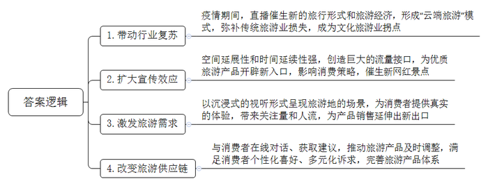
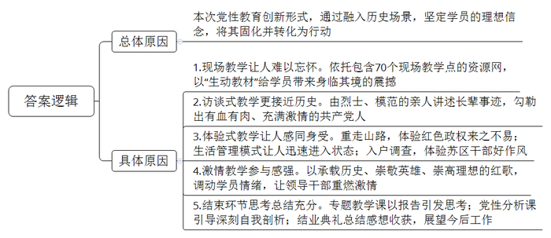
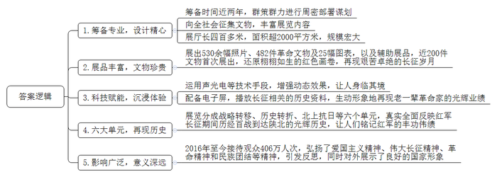
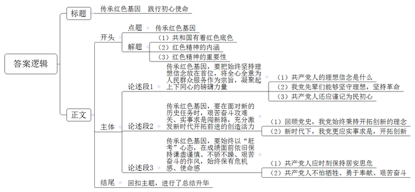

# 2021年新疆下半年公考《申论》题（县级卷）

<!-- gwy:overview:start -->
> **新疆 · 2021 · 申论 · 县级卷** ｜ 4 题 · 图片 4 处 · 答案随题折叠

导航：[题目](#题目) · [材料 1](#材料-1)
<!-- gwy:overview:end -->

> 候选采集稿。参考答案及解析来自粉笔页面，不代表官方答案或真实高分答卷；来源使用许可与原卷对应关系仍需人工核实。

## 给定材料

### 材料 1

疫情之下，宅经济悄然兴起，视频直播及相关行业快速发展。

听敦煌文明的回响，品延安宝塔山上的红色记忆，入嘉兴红船穿越百年的历史通道，看开封府清明上河园的繁华胜景，感婺源的煦风花海，寻西柏坡故事走过的足迹……上浩荡宇宙、下广袤草原，多家短视频直播平台将镜头对准了华夏千年的盛景。

以清明假期为契机，一种新的旅行形式和旅游经济，正在此间酝酿着，发酵着，成熟着。“爬上云端”，成为中国文化旅游业的拐点。

疫情期间，全国旅游业遭受重创。以传统旅游模式为代表的某平台企业，春节期间退单量高达数百万。此外，据统计，2020年第一季度中国餐饮、民航两行业收入同比分别下滑三成和四成。民宿、密室逃脱等“小树杈”，也一大片一大片地“突然死亡”。

随着新媒体平台的诞生和用户直播内容的大爆发，旅游内容通向消费方式的链路正在变革：个性化、有感官冲击的内容，更容易影响用户的消费策略。这一点，从新网红景点的兴起就不难看出，如重庆的洪崖洞，会被认为是“《千与千寻》原型地”而让人流连。

这些旅游目的地，本就如此有“料”。如果说直播平台是一张将鲜美、辛辣恰到好处混合的“炒锅”，它做到的是让消费者足不出户就能欣赏到好景，触摸到历史的记忆，完成了“管中窥豹”的惊鸿一瞥。那么，直播云旅游，奉上的则是翻台不断的流动盛宴。旅游直播，比之狭小直播间有着更强的空间延展性和时间延续性，创造出巨大的流量接口，为一个个传统、经典、红色的旅游业产品开辟了新的入口，足以成为一时一地旅游发展的推手。

### 材料 2

“你写PPT时，阿拉斯加的鱼正跃出水面；你看报表时，梅里雪山的金丝猴刚好爬上树尖；你挤进地铁时，西藏的山鹰一直盘旋云端；你在会议中吵架时，尼泊尔的背包客坐在火堆旁，一起端起了酒杯。总有一些穿高跟鞋走不到的路，总有一些喷着香水闻不到的空气，总有一些在写字楼里永远遇不见的人。”——这样贴在旅行社门口的广告语，曾唤起无数人背上行囊。

而今，当你点开屏幕，一切似乎尽在手掌：你既可以通过直播听到鱼跃出水面的声音，也能看到金丝猴跃于树间。就算不在火堆旁，那个隔着屏幕侃侃而谈的人，会用最大的诚意告诉你，何为温暖。

旅游业是一个以体验为出发点和目的的行业。用一个现在流行的词，就是“体验经济”，而直播的价值，恰恰就落在“体验”二字上。

“身未动，心已远”。在这一背景的引导下，直播作为前端的平台性工具，不仅仅带来了关注量和人流，也能为后端产品的销售延伸出新的出口：清明小长假期间，沙坡头旅游景区、河南老君山风景名胜区等景区，已经实现了线上门票预售。

一个最显著的变化是，商家能获得的“消费者建议”更多了。在与广大“云玩家”的对话中，线下的旅游产品可以更加切合核心消费者的“口味”，迸发出新的想象力——你会明白作为旅游主力的90后消费者们到底喜欢的是什么，什么该留住、什么该舍去。甚至是有针对性地打造景点“爆款”——在某直播平台大火的大唐不夜城“皮卡晨”小姐姐就是一个绝好的先例。如今，随着她的抖音粉丝超过了240万，当面欣赏她的“不倒翁舞蹈”、隔着团扇“一亲芳泽”，也成为了游客必选的项目。

透过这个小案例，我们足以看懂直播平台如何推动了旅游供应链的改变：要满足人们的个性化喜好，景点必须具备从一个或几个最抓人的“点”快速拓展出完整的体系，以满足用户多元化诉求的能力。可以预见，直播平台与景点、OTA（在线旅游）的深度合作，形成新的“生态”，会成为下一个“风”。

### 材料 3

以下是井冈山某干部学院为期三天的青年干部党性教育专题培训班的教学纪实。

10月17日，访谈式教学、现场教学。

上午，青年干部党性教育专题培训班的课程是现场教学。

在小井红军医院旧址的“病房”里，听老红军曾志的故事；小井红军烈士墓前，听130多名重伤员面对敌人枪口不屈服的历史；大井朱毛旧居的大堂内，听何长工为革命不计前嫌的胸怀。

“这次学习之前，井冈山的历史我基本都知道，但身临其境后的震撼是难以忘怀的。”来自山东的小田感慨。

一个现场教学点就是一部党性教育和革命传统教育的生动教材。目前，学院以井冈山为中心，北至八一南昌起义纪念馆，南至福建古田会议旧址，东至上饶集中营革命烈士纪念馆，西至湖南韶山毛泽东故居，建立了包含70个现场教学点的教学资源网。

访谈式教学，是专题培训班最受欢迎的课程。烈士袁文才、王佐的孙辈，甘祖昌将军和全国道德模范龚全珍的女儿，都是访谈对象。由亲人讲述长辈的事迹，从身边点滴说起，由家事到国事，娓娓道来，为学员们勾勒出一个个有血有肉、充满激情的共产党人。

这些故事从书本里走出来，通过革命后代朴实无华的讲述，感动了一批又一批学员。“现场听他们对该事件的了解和体会，让我们更接近历史本身，这种效果是其他教学形式不具备的。”很多学员淌下了热泪。

10月18日，体验式教学、激情教学、入户调查。

一大早，青年干部党性教育专题培训班的学员们就忙活起来，换上红军服装，戴上斗笠，扛起米袋，背起道具枪……他们将要参加的是体验式教学——重走“朱毛红军挑粮小道”。这条往返路程3.1公里的山林小道，曾经是红军运送物资的重要途径，毛泽东、朱德当年也和红军战士一起挑着粮食从这里走过。这条路除了隐蔽，还很陡峭，站在掺杂着泥土和石头的山坡上，脚下直打滑。

重走这段崎岖山路，体验红色政权来之不易，感悟毛泽东、朱德和战士一起挑粮的好作风，来自广东省的小李对历史有了更直观的体会：“原来只知道当时条件艰苦，没想到这么苦！但党的领导干部确实做到了与战士同进退，与群众共甘苦。”

“党性教育入耳容易入心难。如何入心入脑？创新形式很重要。”学院领导认为，“党性党风党纪很多领导干部不是不知道，而是在行为上忽略了。党性教育就是要通过融入历史场景，坚定他们的理想信念，并将它固化，最终转化为行动。”

这种融入，从学员们到学院的第一天就开始了。授班旗、唱国歌、吹起床号、列队点名，许多学习生活管理模式都参照了红军时期的要求。

“以前参加培训可能七八天了还没进入状态，但到井冈山第一天就迅速进入状态了，这种模式的吸引力太强了。”来自云南省的小冯坦言。

参与感很强的激情教学，也是学院帮学员融入红色氛围的“高招”。《十送红军》《映山红》《没有共产党就没有新中国》……一首红歌就是一段历史，是当时革命实践的写照，承载着人们对革命英雄的崇敬、对崇高理想的向往。“当熟悉的旋律响起，仿佛回到了那段激情燃烧的岁月，大家的情绪都调动起来了。”学员小朱说道，“领导干部需要重燃激情。只有满怀激情，才能把工作干好。”

夜色下的入户调查，让专题培训班学员们体验了“提着灯笼访贫农”的苏区干部好作风。“到农民家走访，既是践行群众路线，也是一种社会调查，了解老区人民现在的生活状态。”

学员们反映，感同身受的体验式教学，能够帮他们快速融入历史，在井冈山这个“信念高地”找寻共产党人的“精神家园”，补理想信念之“钙”，补党性修养之“钙”。

有学员说，到这里我才进一步明白了入党为了什么，党员要做什么。有学员说，“为官不易”和“为官不为”的想法，到这里就不攻自破了。

10月19日，专题教学、党性分析课、结业典礼。

上午的专题教学课上，学员们聆听了井冈山革命博物馆肖老师的报告《井冈山的斗争与井冈山精神》。肖老师的报告以大量真材实料展现了我们所不熟悉的井冈山的当年及现在，让井冈山精神放射出新的时代光芒。“曾志的选择，我们能做到吗？”“红军后代能如此，我们的子女又怎样？”“这一代人的思想和境界我们能理解吗，继承了没有？”听了这些，学员们陷入了沉思。

在下午的党性分析课上，学员们以史为镜，对标革命先烈，拿出了一份份深刻的自我剖析材料。这份要求1500字的材料，学员们大都写了3000多字。其中既有对井冈山精神的认识，也有对如何传承井冈山精神的思考；既有自身在党性党风党纪、理想信念方面的不足，也有今后的改进方向。

晚上，青年干部党性教育专题培训班举行了结业典礼。结业典礼现场，大家纷纷发言，谈感想、谈收获，更谈以后工作的打算。经过短短三天的红色培训，所有的学员都在心里产生强烈的共鸣，每一位学员都经历了一次心灵的洗礼。

### 材料 4

以下是青年干部党性教育专题培训班结业典礼上部分学员发言的节选。

甲：两年零四个月的井冈山建设斗争历史，似乎几句话就可以说完。但是，当我们逐一瞻仰了茨坪革命旧址群、八角楼、红军驻地、黄洋界哨口、小井红军医院、小井革命烈士墓、井冈山革命烈士陵园、会师广场等历史遗迹，听取了老师和烈士后代讲述一个个英雄的故事，我被深深地感动了。如果说平时迫于生计和“八股作文”不得不写几个停留在纸上的“感动”的话，那么这次，真是被感动到了心里。

乙：我们唱红歌、重走红军路、听英雄事迹，参观革命烈士陵园、碑林、小井红军医院、大井毛泽东旧居、黄洋界哨口营房等地。现场教学中，老师声情并茂的讲解，让我仿佛看到井冈山革命先烈们英勇抗敌、顽强斗争的感人场面，感受着革命先驱抛头颅、洒热血的崇高精神，每参观一处，都给我一次教育、一次熏陶、一次洗涤，都让我终身难忘。

宣誓、敬礼、脱帽、肃立，齐唱国际歌……我们被分成四个小组，用20分钟时间选出团长、党代表、卫生员，设计出团歌、团训、团徽，最后用5分钟展示团队成果。我们小组根据个人优势分配任务，短时间内设计出团徽、团歌、团训、展示动作，小组成员真实感受到团结协作的伟大力量。

丙：井冈山之行，让我的思想受到了震撼，心灵得到了洗礼，精神得到了升华。这宝贵的精神财富，汇聚成我们今天前行的力量。“坚定信念，艰苦奋斗”是井冈山精神的灵魂。在我们日常的工作中，面临许多的困难和挑战，考验着我们教育工作者的智慧和坚持的勇气。当我疲倦的时候，懈怠的时候，想想当年红军是怎样凭着对革命胜利信念的坚守，如何克服种种困难和磨难……这些榜样的力量激励着我朝着教育的理想迈进，使我拥有“既然选择了远方，便只顾风雨兼程”的心境。

丁：揣着无比敬仰和缅怀之情，我有幸参加了井冈山红色文化教育培训。本次学习采用了室内教学、现场教学以及体验式教学相结合的方式。通过聆听红歌、学习井冈山斗争精神、拜读革命先烈家书、访谈革命烈士后代，感受老一辈无产阶级革命家无私、博大的胸怀和感人事迹；通过参观茅坪八角楼、黄洋界哨口，在心灵深处仿佛听到了那一声声晨雾中清脆的朗读声以及黄洋界那一声定乾坤的炮声。

继续循着革命家的足迹，我们体验了朱毛挑粮小道、参观了大井毛主席故居、小井红军医院，最后瞻仰了革命历史纪念碑。现场教学的老师讲述着发生在这里的一个个事迹，情感一次又一次受到震撼，最后潸然泪下。

戊：今天的井冈山是一座值得我们大家学习的山，在这里我们奔赴前往各地旧址旧居学习，不断地受到一段段红色故事的洗礼，一次次的震撼带给我们的是我们内心深处的感动，也是对于我们思想维度的一个提高。井冈山红色教育培训传承给我们的井冈山精神博大精深、源远流长，是值得我们认真学习的。

### 材料 5

为纪念中国工农红军长征胜利80周年，进一步总结历史经验，继承和弘扬长征精神，2016年10月18日，由X省文物局主办，Y革命纪念馆承办的《伟大长征辉煌史诗》展览在Y革命纪念馆开展。

该展览由6个面积相等的展厅组成，展厅内部高大宽敞，展出了大量珍贵的革命文物、文献和照片。400多米长的展览大厅里，按照历史编年与专题相结合的方式，展示了530余幅历史照片、482件革命文物、25幅图表，还有模型、油画、雕塑及场景复原等辅助展品。通过各类声、光、电等科技手段，增强陈列的动态效果，使人身临其境。陈列空间装置有电子屏幕，播放长征相关的历史资料，生动、形象地再现了老一辈革命家的光辉业绩。

展览真实地反映了从1934年10月到1936年10月，中国工农红军历经百战、斩关夺隘，最终胜利到达陕北，将陕北作为长征落脚点的峥嵘岁月和光辉历史。三军胜利会师于陕甘苏区的这段历史使人们永远铭记红军的丰功伟绩，继承和弘扬伟大的长征精神，不忘初心，继续前进，走好新的长征路。

展览分六个单元展现了长征这部英雄史诗，分别是：一、中央红军战略大转移；二、伟大的历史转折；三、北上抗日到陕北去；四、落脚陕甘根据地；五、高举抗战旗帜三军胜利会师；六、长征精神光耀千秋。

此次展览是为曾经领导红军长征的老一辈无产阶级革命家，为长征胜利英勇献身的革命先烈，为长征作出支援和贡献的各族人民群众，献上的一份崇高礼物。

为了办好展览，早在2015年年初，Y革命纪念馆就开始了准备工作。群策群力进行周密部署和谋划，展览内容上做了精心设计。展览准备工作启动后，向全社会新征集了240余件文物，近200件文物在此次展览首次展出。展览面积超过2000平方米，超过纪念馆总面积的一半。2016年至今，已接待观众406万人次，社会反响良好，已成为深入开展爱国主义教育、弘扬伟大长征精神、对外展示中国形象的重要场所。

### 材料 6

在Y革命纪念馆《伟大长征辉煌史诗》展厅的留言簿上，部分留言如下：

A：在讲解员的带领下依次参观，大家认真聆听讲解员的解说，驻足阅览各式照片、遗物、书籍和战斗武器等珍贵文物。一幅幅栩栩如生的战斗、生产、训练、教育、生活的红色画卷跃然眼前，展现了党和军队为争取民族解放、国家独立、人民幸福与侵略者、反动派不懈斗争、艰苦奋斗的革命精神，体现了党和人民同甘共苦、共同抗争和创造的鱼水之情。（公路局团委）

B：步枪、大刀、手榴弹、挎包、缴获的武器……—件件革命文物将大家的思绪拉入烽火硝烟的战争年代。大刀把上的红绸暗红浓郁，陈旧步枪上痕迹斑斑，军帽袖章整齐排列，将领们在前线阵地沉稳指挥，战士们在战场上浴血奋战的激烈场面，向大家诉说着壮烈的革命峥嵘岁月。（初一学生）

C：进入革命纪念馆，首先采访了门口的几个工作人员，队员们了解到每天来参观的人流量是2万多，大家对如此大的人流量感到非常惊讶。紧接着开始参观，最先映入眼帘的是包括毛泽东在内的一众雕像，生动地再现了老一辈革命家在延安领导中国革命的艰苦岁月，再现了毛泽东、周恩来、朱德等人当年在延安取得的伟大成绩。（大学生社团）

D：来到纪念馆，我首先看到了许多红军在长征中爬雪山、过草地的图片，心中最先想到了毛主席写过的“红军不怕远征难”，毛主席写出了爱国主义战士们不畏艰苦、努力战斗的优良品质。接着我看到红军们跋山涉水，在行军过程中没有粮食的情景，他们吃野草、树皮，甚至把身上的皮带煮了吃，让我不由得想到我们现在，有时候饭菜不合胃口就倒掉，多么浪费啊！（小主人新闻学校）

E：我含着眼泪跟随着人流，慢慢走到了一间介绍文物的展览厅。红军当年爬雪山、过草地时穿的衣服鞋子展陈在晶莹的玻璃柜里。那在我的记忆中只能是做床垫的棕，竟然就是当时战士的主要御寒衣物；那一双双遮不住脚的草鞋，竟然带着战士们爬过了大雪山；那今天看来太过粗硬的皮带，竟然曾经被战士们作为充饥的食物。展览馆内的老旧步枪、电台，令我想破头也想不通如何用它们去打仗。红军长征的故事曾经听说过无数回，可是当我真正看到这些实物的时候，眼泪突然不受控制地涌了上来。我们的前辈，就是在这种艰苦的环境下为我们打下了今天的胜利。（年轻护士）

F：从一个展厅到另一个展厅，跟随讲解员的步伐，驻足聆听红军长征的革命故事，感受着红军长征“不到长城非好汉”的坚毅精神。馆内“回汉民族一家亲”的蜡像场景及回族群众热情欢迎红军到来与支持红军工作的巨幅画面背景，让我深深体会到民族团结之花的绽放。这里陈列的枪支、手雷等遗物与感人的革命故事，向世人讲述“红军不怕远征难，万水千山只等闲”的气魄与坚定的革命精神。（网媒记者）

### 材料 7

在嘉兴南湖的霞光里，水波荡漾，一条红船跨越百年，依然行进在无数人心中，接受着凝望与敬礼。那是再普通不过的一条船，小小的红船上，却有“谁谓河广，一苇杭之”的自信，有“直挂云帆济沧海”的豪情，更有共产党人对“水能载舟，亦能覆舟”的领悟和践行。中国革命的航船在惊涛骇浪中成功到达彼岸，回望红船，初心不改。

五百里井冈，一条崎岖小路徐徐伸展。从南昌城的震耳枪声到井冈山上的困苦坚守，中国革命一路艰难跋涉，开创了农村包围城市、武装夺取政权的全新道路。坚定执着追理想、实事求是闯新路、艰苦奋斗攻难关、依靠群众求胜利——井冈山上走出的这条小路，被视为马克思主义中国化的先声，是中国共产党人坚定信念、敢闯新路的集中体现。

宝塔山下，延河水边。“党除了人民大众利益，没有自己的特殊利益。”在延安召开的党的七大把“为人民服务”写入党章。延安的岁月尽管艰苦，却蕴含着最纯厚、最宝贵的情感，那是凝聚人心、战胜困难、开拓前进的强大精神力量。

太行山下，滹沱河畔，一座静静的小山村见证了历史的巨变。“共产党总是有赶考的那股子劲头，大家的日子越来越好！”

西柏坡纪念馆里，人们兴致勃勃地瞻仰当年留存的实物，仔细打量每一封信件、电报，追寻新中国一路走来的足迹。“务必使同志们继续地保持谦虚、谨慎、不骄、不躁的作风，务必使同志们继续地保持艰苦奋斗的作风”，“两个务必”的告诫始终高悬在中国共产党人心中。赶考，一直在路上。

红船精神、井冈山精神、长征精神、延安精神、西柏坡精神……在红色地标中致敬历史，在红色精神的谱系里接受洗礼。当下，人们寻找精神的力量，以实际行动传承红色基因是对艰苦奋斗、不忘初心的不懈追寻，是对中华优秀传统文化的传承与升华。唯有传承红色基因，筑牢信仰之基，才能在各种风险挑战面前做到“不畏浮云遮望眼”“乱云飞渡仍从容”。

## 题目

### 第 1 题

**根据“给定资料1\-2”，概括直播在旅游业发展中的积极作用。（15分）**

关联材料：材料 1、材料 2

作答要求：

要求：全面、准确、有条理。不超过250字。

第 1 题 · 答案与解析

**参考答案（粉笔题库参考内容）**

1.‌带动行业复苏‌。疫情期间，直播催生新的旅行形式和旅游经济，形成“云端旅游”模式，弥补传统旅游业损失，成为文化旅游业拐点。

2.‌扩大宣传效应。空间延展性和时间延续性强，创造巨大的流量接口，为优质旅游产品开辟新入口，影响消费策略，催生新网红景点。

3.‌激发旅游需求。以沉浸式的视听形式呈现旅游地的场景，为消费者提供真实的体验，带来关注量和人流，为产品销售延伸出新出口。

4.改变旅游供应链‌。与消费者在线对话、获取建议，推动旅游产品及时调整，满足消费者个性化喜好、多元化诉求，完善旅游产品体系。

**解析**

**参考答案说明：**本参考答案从“‌带动行业复苏”“‌扩大宣传效应”“‌激发旅游需求”“改变旅游供应链”四个方面展开，各条答案要点之间在内容上相互并列，没有交叉。

**考点**：影响类

**来源**：2021年新疆下半年公考《申论》题（县级卷）

### 第 2 题

**经过三天的党性教育专题培训，学员产生了强烈的共鸣和深刻的感悟。根据“给定资料3\-4”，分析学员们感悟至深的主要原因。（20分）**

关联材料：材料 3、材料 4

作答要求：

要求：紧扣资料，内容全面；逻辑清晰，语言准确。不超过300字。

第 2 题 · 答案与解析

**参考答案（粉笔题库参考内容）**

因为本次党性教育创新形式，通过融入历史场景，坚定学员的理想信念，将其固化并转化为行动。

1.现场教学让人难以忘怀。依托包含70个现场教学点的资源网，以“生动教材”给学员带来身临其境的震撼。

2.访谈式教学更接近历史。由烈士、模范的亲人讲述长辈事迹，勾勒出有血有肉、充满激情的共产党人。

3.体验式教学让人感同身受。重走山路，体验红色政权来之不易；生活管理模式让人迅速进入状态；入户调查，体验苏区干部好作风。

4.激情教学参与感强。以承载历史、崇敬英雄、崇高理想的红歌，调动学员情绪，让领导干部重燃激情。

5.结束环节思考总结充分。专题教学课以报告引发思考；党性分析课引导深刻自我剖析；结业典礼总结感想收获，展望今后工作。

**解析**

**参考答案说明**：本参考答案呈“总-分”结构，先介绍了学员感触颇深的总体原因，接着从“现场教学让人难以忘怀”“访谈式教学更接近历史”“体验式教学让人感同身受”“激情教学参与感强”“结束环节思考总结充分”五个方面展开介绍了具体原因，各条答案要点之间在内容上相互并列，没有交叉。

**考点**：原因类

**来源**：2021年新疆下半年公考《申论》题（县级卷）

### 第 3 题

**Y革命纪念馆拟以《伟大长征辉煌史诗》展览项目申报2021年度“全国博物馆十大陈列展览精品奖”。请你根据“给定资料5\-6”，以Y革命纪念馆相关工作人员的身份撰写申报材料的申报理由部分。（25分）**

关联材料：材料 5、材料 6

作答要求：

要求：紧扣资料，逻辑清晰，提纲挈领；申报理由充分，不要求格式。不超过400字。

第 3 题 · 答案与解析

**参考答案（粉笔题库参考内容）**

1.筹备专业，设计精心。筹备时间近两年，群策群力进行周密部署谋划；向全社会征集文物，丰富展览内容；展厅长四百多米，面积超2000平方米，规模宏大。

2.展品丰富，文物珍贵。展出530余幅照片、482件革命文物及25幅图表，以及辅助展品，近200件文物首次展出，还原栩栩如生的红色画卷，再现艰苦卓绝的长征岁月。

3.科技赋能，沉浸体验。运用声光电等技术手段，增强动态效果，让人身临其境；配备电子屏，播放长征相关的历史资料，生动形象地再现老一辈革命家的光辉业绩。

4.六大单元，再现历史。展览分成战略转移、历史转折、北上抗日等六个单元，真实全面反映红军长征期间历经百战到达陕北的光辉历史，让人们铭记红军的丰功伟绩。

5.影响广泛，意义深远。2016年至今接待观众406万人次，弘扬了爱国主义精神、伟大长征精神、革命精神和民族团结等精神，引发反思，同时对外展示了良好的国家形象。

**解析**

**参考答案说明：**本参考答案从“筹备专业，设计精心”“展品丰富，文物珍贵”“科技赋能，沉浸体验”“六大单元，再现历史”“影响广泛，意义深远”等五个方面进行了分条撰写。各条要点之间在内容上相互并列，没有交叉。

**考点**：原因类

**来源**：2021年新疆下半年公考《申论》题（县级卷）

### 第 4 题

**“给定资料7”中提到：“唯有传承红色基因，筑牢信仰之基，才能在各种风险挑战面前做到‘不畏浮云遮望眼’‘乱云飞渡仍从容’。”请你深入理解这句话的含义，结合给定资料，联系实际，写一篇文章。（40分）**

关联材料：材料 1、材料 2、材料 3、材料 4、材料 5、材料 6、材料 7

作答要求：

要求：

（1）观点明确，见解深刻；

（2）思路清晰，语言流畅；

（3）参考“给定资料”，但不拘泥于“给定资料”；

（4）字数1000-1200字。

第 4 题 · 答案与解析

**参考答案（粉笔题库参考内容）**

**传承红色基因** **践行初心使命**

习近平总书记指出：“共和国是红色的，不能淡化这个颜色。”在中国共产党建党百年的伟大革命实践中，无数革命先烈用自己的鲜血和生命换来了民族的解放、国家的稳定，并在应对各种困难挑战中，锤炼了信念坚定、敢创新路、百折不挠、艰苦奋斗、立党为公、忠诚为民的红色精神。这些精神是党领导人民革命的胜利之本，也是激励我们不断前进的力量之源，是传承百年的红色基因。

时至今日，在这样一个新问题不断涌现，新挑战不断产生的时代，作为新时代的建设者更要坚定信念保持定力，赓续红色基因，不忘初心使命，以实现中华民族伟大复兴为己任，不负时代，不负韶华，不负党和人民的殷切期望。

**传承红色基因，要把始终坚持理想信念放在首位，将全心全意为人民群众服务作为宗旨，凝聚起上下同心的磅礴力量。**对马克思主义的信仰，对实现社会主义和共产主义的信念，是共产党人的政治灵魂，是共产党人经受住任何考验的精神支柱。一只南湖渔船承载着我党先辈们坚持真理、坚守理想的革命热情；两万五千里长征，丈量了红军战士坚如钢铁的革命必胜信念。传承红色基因，还需谨记为民初心。“水能载舟，亦能覆舟”，这句话深刻地指出人民群众在我党执政兴国、完成民族复兴伟大事业中的重要地位。要用心用情用力解决群众急难愁盼问题，当好群众的“贴心人”“暖心人”。

**传承红色基因，要在面对新的历史任务时，艰苦奋斗攻难关、实事求是闯新路，充分激发新时代开拓前进的创造活力。**回顾党的百年历史，正是因为党始终秉持开拓创新的理念，才取得了一个又一个的胜利。从提出“农村包围城市、武装夺取政权”的井冈山，到炸响改革开放春雷的深圳，中国共产党人在不断开拓创新的道路上带领人民打赢了一场又一场攻坚战。面对新的考验与挑战，要敢于迎风雨、立潮头。在实事求是的基础上，坚持开拓创新，努力在危机中育先机、于变局中开新局，才能战胜中国式现代化道路上的一切艰难险阻。

**传承红色基因，要始终以“赶考”心态，在成绩面前依旧保持谦虚谨慎、不骄不躁、艰苦奋斗的作风，始终保有危机感、使命感。**在已经取得优异成绩的当下，更要居安思危，走好新时代的长征路。“革命不是请客吃饭”，我们党和国家事业的一切成就绝不是敲锣打鼓、轻轻松松取得的。任何时候都有新的困难，然而任何时候，共产党人都是不怕牺牲、勇于奉献的。自从我国全面打响“脱贫攻坚”战役以来，数以百万计的扶贫大军奔赴全国最偏远、最艰苦的地方，日夜奋战、攻坚克难，1800多名同志将生命定格在了脱贫攻坚征程上，是他们的艰苦奋斗，创造了彪炳史册的人间奇迹。

征途如虹，浩荡前行。如今，以中国式现代化推进强国建设、书写中华民族伟大复兴的蓝图徐徐展开，在此历史新时期，我们更要把握方向，延续红色精神，保持江山的不变底色，谱写无愧于时代的华章！

**文章分析**

**传承红色基因 践行初心使命**

【**标题的优点：**标题中含有主题词，使文章主题更突出、清晰。】

（1）习近平总书记指出：“<u>共和国是红色的</u>，不能淡化这个颜色。”（2）在中国共产党建党百年的伟大革命实践中，无数革命先烈用自己的鲜血和生命换来了民族的解放、国家的稳定，并在应对各种困难挑战中，<u>锤炼了信念坚定</u>、<u>敢创新路</u>、<u>百折不挠</u>、<u>艰苦奋斗</u>、<u>立党为公</u>、<u>忠诚为民的红色精神</u>。（3）这些精神是<u>党领导人民革命的胜利之本</u>，也是<u>激励我们不断前进的力量之源</u>，是<u>传承百年的红色基因</u>。

【**开头的优点：**★内容方面。范文的开头是紧扣“传承红色基因”这一主题展开的。首先，开头点出主题，做到了主题明确。其次，对“传承红色基因”这一主题进行了分析阐述：指出了（1）共和国有着红色底色；（2）红色精神的内涵；（3）红色精神的重要性。★文字表达方面：引用了领导人讲话，增强了论述内容的权威性；使用了“并”“是……也是”等关联词，使语言表达有逻辑性。】

时至今日，在这样一个新问题不断涌现，新挑战不断产生的时代，作为<u>新时代的建设者</u>更要坚定信念保持定力，<u>赓续红色基因</u>，<u>不忘初心使命</u>，以<u>实现中华民族伟大复兴</u>为己任，不负时代，不负韶华，不负党和人民的殷切期望。

【**过渡段的优点：**范文过渡段介绍了新时代的建设者更要传承红色基因，不忘初心使命，引出下文具体该如何传承好红色基因。】

**传承红色基因，要把始终坚持理想信念放在首位，将全心全意为人民群众服务作为宗旨，凝聚起上下同心的磅礴力量。**（1）<u>对马克思主义的信仰</u>，<u>对实现社会主义和共产主义的信念</u>，是共产党人的政治灵魂，是共产党人经受住任何考验的精神支柱。（2）一只<u>南湖渔船</u>承载着我党先辈们坚持真理、坚守理想的革命热情；<u>两万五千里长征</u>，丈量了红军战士坚如钢铁的革命必胜信念。（3）传承红色基因，还需<u>谨记为民初心</u>。“水能载舟，亦能覆舟”，这句话深刻地指出<u>人民群众在我党执政兴国</u>、<u>完成民族复兴伟大事业中的重要地位</u>。要<u>用心用情用力解决群众急难愁盼问题</u>，当好群众的“贴心人”“暖心人”。

【**论述段1的优点：**★观点句：范文的观点句是紧扣“传承红色基因”这一文章主题提出的。形式上，它在段首处直接写出，位置突出，容易发现。内容上，关键词突出，内容要点明确，可以明显看出主要论述“坚持理想信念、全心全意为人民服务”方面的内容。★论述内容：（1）先指出了共产党人的理想信念是什么；（2）接着举例介绍了我党先辈们能够坚守理想，坚持革命；（3）最后指出了共产党人还应谨记为民初心。注意：以上三个方面的内容都是紧扣“传承红色基因，要把始终坚持理想信念放在首位，将全心全意为人民群众服务作为宗旨，凝聚起上下同心的磅礴力量”这个观点句进行分析论述的，论述的针对性强，内容层次丰富。在论述方法上采取了举例子和讲道理相结合的方式，论述充实透彻。】

**传承红色基因，要在面对新的历史任务时，艰苦奋斗攻难关、实事求是闯新路，充分激发新时代开拓前进的创造活力。**（1）回顾党的百年历史，正是因为<u>党始终秉持开拓创新的理念</u>，才取得了一个又一个的胜利。从提出“农村包围城市、武装夺取政权”的<u>井冈山</u>，到炸响改革开放春雷的<u>深圳</u>，中国共产党人在<u>不断开拓创新</u>的道路上带领人民打赢了一场又一场攻坚战。（2）面对新的考验与挑战，要敢于迎风雨、立潮头。<u>在实事求是的基础上</u>，<u>坚持开拓创新</u>，努力<u>在危机中育先机</u>、<u>于变局中开新局</u>，才能战胜中国式现代化道路上的一切艰难险阻。

【**论述段2的优点：**★观点句：范文的观点句是紧扣“传承红色基因”这一文章主题提出的。形式上，它在段首处直接写出，位置突出，容易发现。内容上，关键词突出，内容要点明确，可以明显看出主要论述“艰苦奋斗攻难关、实事求是闯新路”方面的内容。★论述内容：（1）先通过回顾党史，指出了我党始终秉持开拓创新的理念；（2）接着介绍了新时代下，我党更应实事求是，开拓创新。注意：以上两个方面的内容都是紧扣“传承红色基因，要在面对新的历史任务时，艰苦奋斗攻难关、实事求是闯新路，充分激发新时代开拓前进的创造活力”这个观点句进行分析论述的，论述的针对性强，内容层次丰富。在论述方法上采取了举例子和讲道理相结合的方式，论述充实透彻。】

**传承红色基因，要始终以“赶考”心态，在成绩面前依旧保持谦虚谨慎、不骄不躁、艰苦奋斗的作风，始终保有危机感、使命感。**（1）在已经取得优异成绩的当下，更要<u>居安思危</u>，走好新时代的长征路。“革命不是请客吃饭”，<u>我们党和国家事业的一切成就绝不是敲锣打鼓</u>、<u>轻轻松松取得的</u>。（2）任何时候都有新的困难，然而任何时候，<u>共产党人都是不怕牺牲</u>、<u>勇于奉献的</u>。自从我国全面打响“脱贫攻坚”战役以来，数以百万计的<u>扶贫大军</u>奔赴全国最偏远、最艰苦的地方，日夜奋战、攻坚克难，1800多名同志将生命定格在了脱贫攻坚征程上，是他们的艰苦奋斗，创造了彪炳史册的人间奇迹。

【**论述段3的优点：**★观点句：范文的观点句是紧扣“传承红色基因”这一文章主题提出的。形式上，它在段首处直接写出，位置突出，容易发现。内容上，关键词突出，内容要点明确，可以明显看出主要论述“保持‘赶考’心态，谦虚谨慎、不骄不躁”方面的内容。★论述内容：（1）先指出了共产党人应时刻保持居安思危；（2）接着举例介绍了共产党人不怕牺牲、勇于奉献、艰苦奋斗。注意：以上两个方面的内容都是紧扣“传承红色基因，要始终以‘赶考’心态，在成绩面前依旧保持谦虚谨慎、不骄不躁、艰苦奋斗的作风，始终保有危机感、使命感”这个观点句进行分析论述的，论述的针对性强，内容层次丰富。在论述方法上采取了举例子和讲道理相结合的方式，论述充实透彻。】

【**论述段之间的关系**：★内容的内在逻辑：范文的论述段之间是依照“并列”的逻辑展开的。论述段1先写了“传承红色基因，要把始终坚持理想信念放在首位，将全心全意为人民群众服务作为宗旨，凝聚起上下同心的磅礴力量”，论述段2再写了“传承红色基因，要在面对新的历史任务时，艰苦奋斗攻难关、实事求是闯新路，充分激发新时代开拓前进的创造活力”，论述段3最后写了“传承红色基因，要始终以‘赶考’心态，在成绩面前依旧保持谦虚谨慎、不骄不躁、艰苦奋斗的作风，始终保有危机感、使命感”，文章整体论述思路清晰。】

征途如虹，浩荡前行。如今，以中国式现代化推进强国建设、书写中华民族伟大复兴的蓝图徐徐展开，在此历史新时期，我们更要把握方向，延续红色精神，保持江山的不变底色，谱写无愧于时代的华章！

【**结尾的优点：**范文的结尾回扣了“传承红色基因”这个主题，并且进行了总结升华。】

**解析状态：unknown（来源未提供）**

**考点**：文章写作题

**来源**：2021年新疆下半年公考《申论》题（县级卷）

