# 2021年新疆生产建设兵团面向社会招录公务员考试《行测》题（网友回忆版）

<!-- gwy:overview:start -->
> **新疆 · 2021 · 行测 · 兵团** ｜ 115 题 · 图片 242 处 · 答案随题折叠

| 题型模块 | 题量 | 题号 |
| --- | ---: | ---: |
| 常识判断 | 20 | 1–20 |
| 言语理解与表达 | 30 | 21–50 |
| 数量关系 | 10 | 51–60 |
| 判断推理 | 35 | 61–95 |
| 资料分析 | 20 | 96–115 |
| **合计** | **115** | |

导航：[题型与作答说明](#题型与作答说明) · [题目](#题目) · [材料 1](#材料-1)
<!-- gwy:overview:end -->

> 候选采集稿。参考答案及解析来自粉笔页面，不代表官方答案或真实高分答卷；来源使用许可与原卷对应关系仍需人工核实。

## 题型与作答说明

常识判断

（20题）

根据题目要求，在四个选项中选出一个最恰当的答案。

言语理解与表达

（30题）

本部分包括表达与理解两方面的内容。请根据题目要求，在四个选项中选出一个最恰当的答案。

数量关系

（10题）

在这部分试题中，每道题呈现一段表述数字关系的文字，要求你迅速、准确地计算出答案。

判断推理

（35题）

本部分包括图形推理、定义判断、类比推理与逻辑判断四种类型的试题，在四个选项中选出一个最恰当的答案。

资料分析

（20题）

所给出的图、表、文字或综合性资料均有若干个问题要你回答。你应根据资料提供的信息进行分析、比较、计算和判断处理。

## 题目

### 第 1 题

2020年10月14日，习近平总书记在深圳经济特区建立40周年庆祝大会上发表讲话，对经济特区建设给予了充分肯定。下列关于经济特区建设的表述不准确的是：

A. 1978年12月，党的十一届三中全会作出把党和国家工作重心转移到经济建设上来、实行改革开放的历史性决策

B. 1979年7月，党中央、国务院批准广东、福建两省实行“特殊政策、灵活措施、先行一步”，并试办出口特区

C. 1980年8月，党和国家批准在深圳、珠海、上海、厦门设置经济特区

D. 1988年4月，党和国家批准建立海南经济特区

第 1 题 · 答案与解析

**参考答案（粉笔题库参考内容）**

C

**解析**

本题考查政治常识。

A项正确，1978年12月，党的十一届三中全会作出把党和国家工作重心转移到经济建设上来、实行改革开放的历史性决策，实现了新中国成立以来党的历史的伟大转折。

B项正确，1979年7月，党中央、国务院批准广东、福建两省实行“特殊政策、灵活措施、先行一步”，并试办出口特区。

C项错误，1980年8月，党和国家批准在深圳、珠海、汕头、厦门设置经济特区。

D项正确，1988年4月，党和国家批准建立海南经济特区，明确要求发挥经济特区对全国改革开放和社会主义现代化建设的重要窗口和示范带动作用。

本题为选非题，故正确答案为C。

### 第 2 题

下列对我国“十四五”时期经济社会发展主要目标表述错误的是：

A. 经济发展取得新成效和改革开放迈出新步伐

B. 创新驱动取得新优势和国内市场形成发展新格局

C. 民生福祉达到新水平和国家治理效能得到新提升

D. 社会文明程度得到新提高和生态文明建设实现新进步

第 2 题 · 答案与解析

**参考答案（粉笔题库参考内容）**

B

**解析**

本题考查政治常识。

2020年10月29日，中国共产党第十九届中央委员会第五次全体会议通过的《国民经济和社会发展第十四个五年规划和2035年远景目标纲要》中指出：“‘十四五’时期经济社会发展主要目标。锚定二〇三五年远景目标，综合考虑国内外发展趋势和我国发展条件，坚持目标导向和问题导向相结合，坚持守正和创新相统一，今后五年经济社会发展要努力实现以下主要目标：经济发展取得新成效；改革开放迈出新步伐；社会文明程度得到新提高；生态文明建设实现新进步；民生福祉达到新水平；国家治理效能得到新提升。”

本题为选非题，故正确答案为B。

### 第 3 题

2020年12月17日凌晨1时59分，嫦娥五号返回器携带月球样品成功着陆，这标志着我国的探月工程—“嫦娥工程"取得阶段性成功。下列关于我国探月工程的表述错误的是：

A. 2020年嫦娥五号成功采集月壤标志着中国探月工程“绕、落、采”三步走战略圆满收官

B. “嫦娥工程”分为“无人月球探测”、“载人登月”和“建立月球基地”三个阶段

C. 2011年我国的嫦娥二号实现了环绕月球的目标

D. 2019年我国的嫦娥四号完成了首次月背登陆

第 3 题 · 答案与解析

**参考答案（粉笔题库参考内容）**

A

**解析**

本题考查政治常识。

A项错误，嫦娥五号任务最重要的目标就是“采样返回”，这也是中国“探月工程”规划的“绕、落、回”中的第三步。2020年12月17日嫦娥五号返回器在内蒙古四子王旗预定区域成功着陆，标志着中国首次月球采样返回任务圆满完成。嫦娥五号任务的成功标志着我国探月工程“绕、落、回”三步走规划如期完成。该项“采”表述错误，应为“回”。

B项正确，2004年，中国正式开展月球探测工程，并命名为“嫦娥工程”。嫦娥工程分为“无人月球探测”“载人登月”和“建立月球基地”三个阶段。

C项正确，嫦娥二号，是中国探月计划中的第二颗绕月人造卫星。2010年10月1日，中国第二颗绕月探测卫星“嫦娥二号”在西昌卫星发射中心发射升空；2010年10月6日，嫦娥二号被月球捕获，进入环月轨道；2011年8月25日，嫦娥二号进入拉格朗日L2点环绕轨道；我国的嫦娥二号再次实现了环绕月球的目标。2012年12月15日，嫦娥二号工程宣布收官。嫦娥二号任务的圆满成功，标志着中国在深空探测领域突破并掌握了一大批新的具有自主知识产权的核心技术和关键技术，为后续实施探月二期工程的“落”和“回”以及下一步开展火星等深空探测奠定了坚实技术基础，中国从航天大国迈向航天强国的进程又跨出了重要的一步。

D项正确，2019年1月3日，嫦娥四号探测器成功自主着陆在月球背面南极—艾特肯盆地内的冯·卡门撞击坑内，实现人类探测器首次在月球背面软着陆。

本题为选非题，故正确答案为A。

### 第 4 题

下列关于讲政治的表述不准确的是：

A. 不忘初心，牢记使命是讲政治最本质的要求

B. 必须提高政治识别力、政治领悟力、政治执行力

C. 讲政治，概括起来说就是从政治上观察和处理问题

D. 党领导人民治国理政，最重要的就是坚持正确政治方向，始终保持我们党的政治本色，始终沿着中国特色社会主义道路前进

第 4 题 · 答案与解析

**参考答案（粉笔题库参考内容）**

B

**解析**

本题考查政治常识。

A项正确，不忘初心，牢记使命是讲政治最本质的要求。职位越高越要忠于人民，全心全意为人民服务。只有敬畏法律、敬畏纪律，自觉管住自己，在廉洁自律上作出表率，才能担起肩上的重任。而最与初心和使命相背离的就是种种腐化堕落、特权思想。

B项错误，中共中央政治局于2020年12月24日至25日召开的民主生活会中，习近平指出，必须增强政治意识，善于从政治上看问题，善于把握政治大局，不断提高政治判断力、政治领悟力、政治执行力。

C项正确，讲政治，概括起来说就是从政治上观察和处理问题。中共中央政治局于2020年12月24日至25日召开的民主生活会中，习近平指出，旗帜鲜明讲政治，既是马克思主义政党的鲜明特征，也是我们党一以贯之的政治优势。

D项正确，中共中央政治局于2020年12月24日至25日召开的民主生活会中，习近平指出，党领导人民治国理政，最重要的就是坚持正确政治方向，始终保持我们党的政治本色，始终沿着中国特色社会主义道路前进。这就是讲政治背后的大逻辑。

本题为选非题，故正确答案为B。

### 第 5 题

下列关于2021年3月1日起施行的《中华人民共和国长江保护法》的亮点描述准确的是：

①做好了统筹协调、系统保护的顶层设计

②坚持把保护和修复长江流域生态环境放在压倒性位置

③突出共抓大保护、不搞新开发

④坚持责任导向，加大处罚力度

⑤切实增强了长江保护和发展的系统性、整体性、协同性

A. ①③④

B. ②④⑤

C. ①②③④

D. ①②④⑤

第 5 题 · 答案与解析

**参考答案（粉笔题库参考内容）**

D

**解析**

本题考查法律常识。

①正确，该法中规定国家建立长江流域协调机制，统一指导、统筹协调、整体推进长江保护工作；按照中央统筹、省负总责、市县抓落实的要求，建立长江保护工作机制，明确各级政府及其有关部门、各级河湖长的职责分工；建立区域协调协作机制，明确长江流域相关地方根据需要在地方性法规和政府规章制定、规划编制、监督执法等方面开展协调与协作，切实增强长江保护和发展的系统性、整体性、协同性。故该法做好了统筹协调、系统保护的顶层设计。

②正确，该法通过规定更高的保护标准、更严格的保护措施，加强山水林田湖草整体保护、系统修复。如强化水资源保护，加强饮用水水源保护和防洪减灾体系建设，完善水量分配和用水调度制度，保证河湖生态用水需求；落实党中央关于长江禁渔的决策部署，加强禁捕管理和执法工作等。故该法体现了把保护和修复长江流域生态环境放在压倒性位置。

③错误，根据《中华人民共和国长江保护法》第三条规定：“长江流域经济社会发展，应当坚持生态优先、绿色发展，共抓大保护、不搞大开发。”“不搞新开发”表述错误。

④正确，该法强化考核评价与监督，实行长江流域生态环境保护责任制和考核评价制度，建立长江保护约谈制度，规定国务院定期向全国人大常委会报告长江保护工作；坚持问题导向，针对长江禁渔、岸线保护、非法采砂等重点问题，在现有相关法律的基础上补充和细化有关规定，并大幅提高罚款额度，增加处罚方式，补齐现有法律的短板和不足，切实增强法律制度的权威性和可执行性。故该法体现了坚持责任导向，加大处罚力度。

⑤正确，该法做好了统筹协调、系统保护的顶层设计，明确了各方职责分工，切实增强长江保护和发展的系统性、整体性、协同性。

故①②④⑤正确。

故正确答案为D。

### 第 6 题

关于《中华人民共和国民法典》，下列说法错误的是：

A. 允许抵押耕地使用权

B. 将绿色原则作为民法的基本原则

C. 明确了生态环境损害的修复和赔偿规则

D. 将无民事行为能力人最高年龄标准调整为10周岁

第 6 题 · 答案与解析

**参考答案（粉笔题库参考内容）**

D

**解析**

本题考查法律常识。

A项正确，根据《中华人民共和国民法典》第三百九十九条第二项规定：“下列财产不得抵押：······（二）宅基地、自留地、自留山等集体所有土地的使用权，但是法律规定可以抵押的除外；······”民法典删除了“耕地”不得抵押的情形，故允许抵押耕地使用权。

B项正确，根据《中华人民共和国民法典》第九条规定：“民事主体从事民事活动，应当有利于节约资源、保护生态环境。”绿色原则是民法的基本原则之一。

C项正确，根据《中华人民共和国民法典》第一千二百三十二条规定：“侵权人违反法律规定故意污染环境、破坏生态造成严重后果的，被侵权人有权请求相应的惩罚性赔偿。”第一千二百三十四条规定：“违反国家规定造成生态环境损害，生态环境能够修复的，国家规定的机关或者法律规定的组织有权请求侵权人在合理期限内承担修复责任。侵权人在期限内未修复的，国家规定的机关或者法律规定的组织可以自行或者委托他人进行修复，所需费用由侵权人负担。”故《民法典》明确了生态环境损害的修复和赔偿规则。

D项错误，根据《中华人民共和国民法典》第二十条规定：“不满八周岁的未成年人为无民事行为能力人，由其法定代理人代理实施民事法律行为。”故无民事行为能力人最高年龄标准并没有调整为十周岁，而是八周岁。

本题为选非题，故正确答案为D。

### 第 7 题

下列历史名人按生活年代先后排序正确的是：

A. 周文王—管仲—孔子

B. 周公旦—李斯—楚庄王

C. 孙膑—诸葛亮—蒙恬

D. 屈原—勾践—伍子胥

第 7 题 · 答案与解析

**参考答案（粉笔题库参考内容）**

A

**解析**

本题考查人文常识。

A项正确，周文王姬昌（前1152年―前1056年），周朝奠基者，其在位期间勤于政事，重视发展农业生产，礼贤下士，广罗人才。管仲（约公元前723年—公元前645年），春秋前期齐国著名的政治家、思想家，被齐桓公任命为相，在齐国进行了政治、经济等方面的一系列改革。孔子（公元前551年—公元前479年），春秋时期思想家、教育家，儒家学派的创始人。选项排序无误。

B项错误，周公旦，西周初期杰出的政治家、军事家、思想家、教育家，曾两次辅佐周武王东伐纣王，并制作礼乐。李斯，战国末期楚国人，秦代著名的政治家、文学家和书法家，法家代表人物之一。楚庄王熊旅，春秋时期楚国国君，楚庄王元年（前613年）至楚庄王二十三年（前591年）在位，春秋五霸之一。选项排序有误，楚庄王生活的年代在李斯之前。

C项错误，孙膑是战国时期齐国军事家，春秋战国时期诸子百家之一的兵家代表人物，其军事思想主要集中于《孙膑兵法》。诸葛亮是三国时期蜀汉丞相，先后辅佐刘备、刘禅两朝。蒙恬，秦朝时期名将，秦统一六国后，蒙恬三十万大军北击匈奴，收复河南之地，威震匈奴，被誉为“中华第一勇士”。选项排序有误，蒙恬生活的年代在诸葛亮之前。

D项错误，屈原（约公元前340年—公元前278年），战国时期楚国诗人、政治家，被誉为“楚辞之祖”。越王勾践（约公元前520年-公元前464年），夏禹后裔，越王允常之子，春秋末年越国国君。伍子胥（约公元前559年-公元前484年），春秋末期吴国大夫、军事家。选项排序有误，屈原生活的年代在伍子胥、勾践之后。

故正确答案为A。

### 第 8 题

某小区业主拟将其住宅改变为经营性民宿，下列选项中不属于其应当具备的前提条件是：

A. 应当遵守国家有关公共防疫的规定

B. 应当遵守由业主共同制定的管理规约

C. 应当获得该业主所在楼栋的其他全体业主同意

D. 应当获得小区全体业主三分之二以上多数同意

第 8 题 · 答案与解析

**参考答案（粉笔题库参考内容）**

D

**解析**

本题考查法律常识。

A、B、C三项正确，D项错误。根据《民法典》第二百七十九条规定：“业主不得违反法律、法规以及管理规约，将住宅改变为经营性用房。业主将住宅改变为经营性用房的，除遵守法律、法规以及管理规约外，应当经有利害关系的业主一致同意。”故业主将住宅改变为经营性用房民宿，应当遵守法律、法规（国家有关公共防疫的规定等）及小区业主共同制定的管理规约，应当经有利害关系的业主（业主所在楼栋的其他全体业主）一致同意。

本题为选非题，故正确答案为D。

### 第 9 题

关于农谚“小雪雪满天，来岁必丰年”所涉及的原理，下列说法错误的是：

A. 新雪孔隙度高、空气多，对土壤有防冻保湿作用

B. 雪融化时吸收土壤内部热量，越冬虫卵不易存活

C. 雪中含有大量磷化物，融化后可为土壤提供肥料

D. 雪融化时入土壤，提高土壤含水量，缓解春旱

第 9 题 · 答案与解析

**参考答案（粉笔题库参考内容）**

C

**解析**

本题考查科技常识。

A项正确，新雪的密度低、孔隙度高，贮藏在新雪中的空气多，而空气是热的不良导体，因此土壤中热量的散失较少，可以起到防冻保湿的作用。

B项正确，雪融化时从土壤中吸收许多热量，这时土壤会突然变得非常寒冷，温度降低许多，越冬虫卵不易存活。

C项错误，雪是大量白色不透明冰晶和其聚合物组成的降水，由大气中的水蒸气直接凝华而成。根据测定，雪水中含有一定量的氮化物。雪水渗入土壤，就等于施了一次氮肥。用雪水喂养家畜家禽、灌溉庄稼都可收到明显的效益。

D项正确，寒潮以后，天气渐渐回暖，雪慢慢融化，雪融下去的水可以提高土壤含水量，给庄稼积蓄很多水，对春耕播种以及庄稼的生长发育都很有利。

本题为选非题，故正确答案为C。

### 第 10 题

新文化运动是一场思想文化革新、文学革命运动。下列新文化运动代表人物与其作品对应错误的是∶

A. 蔡元培—《中国伦理学史》

B. 陈独秀—《文学改良刍议》

C. 胡适—《中国哲学史大纲》

D. 李大钊—《布尔什维主义的胜利》

第 10 题 · 答案与解析

**参考答案（粉笔题库参考内容）**

B

**解析**

本题考查人文常识。

A项正确，《中国伦理学史》是由蔡元培所作的第一部系统整理和研究中国古代伦理思想发生、发展及其变迁的学术著作，全书分绪论、先秦创史时代、汉唐继承时代、宋明理学时代四大部分32章，系统地介绍了中国古代伦理学界重要的流派及主要代表人物，并阐述了各家学说的要点、源流及发展。

B项错误，《文学改良刍议》是由胡适所作，并于1917年1月发表。《文学改良刍议》是倡导文学革命的第一篇文章。

C项正确，《中国哲学史大纲》是胡适写定于1918年9月的书，此书一出版即因其方法和见解的创新而极受注意，3年时间再版了7次。此书被誉为：用现代学术方法系统研究中国古代哲学史的第一部著作，它的出版被视为中国哲学史学科成立的标志。

D项正确，《布尔什维主义的胜利》是由李大钊所作，于1918年11月载于《新青年》。文章热烈欢呼十月革命的胜利，认为这是民主主义的胜利，是布尔什维的胜利，是世界劳工阶级的胜利。

本题为选非题，故正确答案为B。

### 第 11 题

中华传统美德是中华文化精髓，蕴含着丰富的思想道德资源，凝聚着数千年来中华民族关于个人品德修养和行为规范的思考和表达。下列关于中华传统美德的表述正确的有几项？

①天行健，君子以自强不息

②天下兴亡，匹夫有责

③美德即知识

④仁者爱人

A. 1项

B. 2项

C. 3项

D. 4项

第 11 题 · 答案与解析

**参考答案（粉笔题库参考内容）**

C

**解析**

本题考查人文常识。

①正确，“天行健，君子以自强不息”出自《易传》中的《象传》，意为宇宙不停运转，人应效法天地，永远不断地前进。体现了传统美德中的励志自强、崇尚精神境界。

②正确，“天下兴亡，匹夫有责”是清朝初年著名儒者顾炎武的社会主张，意为国家的兴盛或衰亡，每个普通人都有一份责任。体现了传统美德中爱国奉献、以天下为己任的社会责任感。

③错误，“美德即知识”是古希腊哲学家苏格拉底的道德伦理命题，出自公元前420年柏拉图的著作《美诺篇》。“美德”指人的所有优秀品质，“知识”指整个世界的理念知识和善的知识。苏格拉底认为，道德即知识，道德与知识是同一的，美德并非天生，而是得自于教育。其不属于中华传统美德的表述。

④正确，“仁者爱人”出自《孟子·离娄章句下》，意为仁者是充满慈爱之心，满怀爱意的人；仁者是具有大智慧、人格魅力的人。体现了传统美德中乐群贵和，强调人际和谐的精神。

综上所述，表述正确的有①②④三项。

故正确答案为C。

### 第 12 题

关于诗词中反映的生物知识，下列说法错误的是：

A. “有意栽花花不发，无心插柳柳成荫”描述的是柳树进行无性繁殖

B. “银烛秋光冷画屏，轻罗小扇扑流萤”中的萤火虫发光是一种物理变化

C. “野蚕作茧人不取，叶间扑扑秋蛾生”中的野蚕发育过程属于完全变态

D. “等闲识得东风面，万紫千红总是春”中花色在红紫间变化是由于花青素

第 12 题 · 答案与解析

**参考答案（粉笔题库参考内容）**

B

**解析**

本题考查科技常识。

A项正确，“有意栽花花不发，无心插柳柳成荫”指的是柳树用的扦插的方式进行繁殖的，扦插是常见的营养繁殖的方法，没有经过两性生殖细胞的结合过程，所以是无性生殖。

B项错误，“银烛秋光冷画屏，轻罗小扇扑流萤”中的萤火虫发光，是因为萤火虫身体末端下方有发光器，体内的荧光素和荧光素酶反应后生成的黄绿色荧光，是一种化学变化。

C项正确，完全变态是昆虫在个体发育中，经过卵、幼虫、蛹和成虫4个时期。“野蚕作茧人不取，叶间扑扑秋蛾生”中的野蚕发育过程是由卵到幼虫，再到蛹，最后成虫，是一个完全变态发育的过程。

D项正确，花青素又称花色素，是自然界一类广泛存在于植物中的水溶性天然色素，这类色素的颜色，随细胞液的酸碱度变化而变化。花青素在碱性溶液中呈蓝色，在酸性溶液中呈红色，而在中性溶液中则呈紫色。因此凡是含有大量花青素的花瓣其颜色都在红、蓝、紫三色之间变化着。因此，“等闲识得东风面，万紫千红总是春”中花色在红紫间变化是由于花青素。

本题为选非题，故正确答案为B。

### 第 13 题

下列说法符合医学常识的是：

A. 酒精浓度越高消毒效果越好

B. 使用含氯的牙膏有利于防龋齿

C. 缺碘可能会造成甲状腺素缺乏

D. 可作为麻醉剂的乙醚无色无味

第 13 题 · 答案与解析

**参考答案（粉笔题库参考内容）**

C

**解析**

本题考查科技常识。

A项错误，酒精浓度越高，使蛋白质凝固的作用越强。当高浓度的酒精与细菌接触时，就能使菌体表面迅速凝固，形成一层包膜，阻止了酒精继续向菌体内部渗透，细菌内部的细胞没能彻底杀死，待到适当时机，包膜内的细胞可能将包膜冲破重新复活，则达不到消毒的效果。所以，选择浓度为75%的医用酒精最为适宜。

B项错误，龋病是牙体硬组织脱矿与再矿化动态平衡被打破的结果。脱矿，就是牙齿中的矿物质溶解、流失；而再矿化，就是溶解的矿物盐重新在牙齿上沉积。氟化物可使再矿化作用大于脱矿作用，阻止龋病的发展。

C项正确，碘是合成甲状腺激素的重要原料，如果缺碘就会导致甲状腺激素合成障碍，引起的代偿性的甲状腺肿。

D项错误，可作为麻醉剂的乙醚，是一种带有刺激性气味、无色、易燃、极易挥发的液体。

故正确答案为C。

### 第 14 题

坐在火车里透过车窗观察远处的景物，下列说法正确的是：

①远处景物朝火车前进的方向旋转

②远处景物朝背离火车前进的方向旋转

③远处景物相对观察者移动快

④远处景物相对观察者移动慢

A. ①④

B. ①③

C. ②③

D. ②④

第 14 题 · 答案与解析

**参考答案（粉笔题库参考内容）**

A

**解析**

本题考查科技常识。

乘客坐在火车里，以火车为参照系，无论是近处还是远处的景物，看起来都是朝火车前进的相反方向运动，且运动速度相同。近处和远处的景物移动相同距离时，由于近处的景物对人的眼睛造成的视角更大，所以看起来移动的距离更大。因此，在火车上的人看来，近处的景物向后运动得快，而远处的景物向后运动得慢。故④表述正确。

人在火车上同时看近处和远处的景物时，会不自觉地以近处的景物为参照物，这样远处的景物看起来就像在朝火车前进的方向旋转。故①表述正确。

故正确答案为A。

### 第 15 题

下列与地震有关的说法错误的是：

A. 冲击地震震源浅，影响范围小

B. 水库蓄水、地下抽水可诱发地震

C. 火山地震与构造地震常有密切关系

D. 我国的强震绝大部分是深源构造地震

第 15 题 · 答案与解析

**参考答案（粉笔题库参考内容）**

D

**解析**

本题考查地理国情。

A项正确，冲击地震因山崩、滑坡等原因引起，或因碳酸盐岩地区岩层受地下水长期溶蚀形成许多地下溶洞，洞顶塌落引起，约占地震总数的3%，震源很浅，影响范围小，震级也不大。

B项正确，在一定条件下，人类的工程活动可以诱发地震，诸如水库蓄水、城市或油田的抽水或注水、矿山坑道的崩塌、以及人工爆破或地下核爆炸等都能引起当地出现异常的地震活动，这类地震活动统称为诱发地震。

C项正确，火山地震可以是直接由火山爆发引起，也可能是因火山活动引起构造变动，或是因构造变动引起火山喷发，从而导致地震。构造地震是由构造变动特别是断裂活动所产生的地震。因此，火山地震与构造地震常有密切关系。

D项错误，全球绝大多数地震是构造地震，约占地震总数的90%。其中大多数又属于浅源地震，影响范围小，对地面及建筑物的破坏非常强烈，常引起生命财产的重大损失。我国的强震绝大部分是浅源构造地震，其中80%以上均与断裂活动有关。

本题为选非题，故正确答案为D。

### 第 16 题

中国向世界宣布，被誉为“中国天眼”的500米口径球面射电望远镜（FAST）2021年4月1日起将正式对全球科学界开放。下列有关“中国天眼”的说法中正确的是：

A. “中国天眼”并非世界最大的球面射电望远镜

B. “中国天眼”之父是姜鹏

C. “中国天眼”可用来发现脉冲星

D. “中国天眼”所在地区属于丹霞地貌

第 16 题 · 答案与解析

**参考答案（粉笔题库参考内容）**

C

**解析**

本题考查科技常识。

A项错误，500米口径球面射电望远镜（FAST），是中国“十一五”重大科技基础设施建设项目，2020年1月11日通过国家验收工作。目前，“中国天眼”是世界上最大的也是最灵敏的球面射电望远镜。

B项错误，南仁东曾任FAST工程首席科学家兼总工程师，负责500米口径球面射电望远镜（FAST）的科学技术工作，被誉为“中国天眼”之父。

C项正确，FAST作为一个多学科基础研究平台，能够巡视宇宙中的中性氢，研究宇宙大尺度物理学，以探索宇宙起源和演化；观测脉冲星，研究极端状态下的物质结构与物理规律；搜索可能的星际通讯信号，搜寻外星文明等。

D项错误，“中国天眼”位于贵州省黔南布依族苗族自治州平塘县大窝凼的喀斯特洼坑中，属于喀斯特地貌。

故正确答案为C。

### 第 17 题

下列关于黄河流域的说法错误的是:

A. 陕西境内秦岭以北的河流皆属该流域

B. 以“水少沙多、水沙异源”为突出特点

C. 该流域下游常因泥沙堆积形成“地上河”

D. “泾渭分明”的现象发生在该流域的上游

第 17 题 · 答案与解析

**参考答案（粉笔题库参考内容）**

D

**解析**

本题考查地理国情。

黄河发源于青海省中部，巴颜喀拉山北麓，流经青海、四川、甘肃、宁夏、内蒙古、陕西、山西、河南、山东9个省、自治区，注入渤海，全长5464千米，是中国第二大河。

A项正确，陕西境内绝大部分为外流河，分属黄河、长江两大水系。从地域分布上看，秦岭以南的长江水系，流域面积占全省的37%，水资源量占到全省总量的71%，而秦岭以北的黄河水系，流域面积占全省的63%，水资源量仅占29%。

B项正确，黄河主要流经干旱、半干旱和半湿润区，降水量较少，蒸发量大，所以水量小，中游流经黄土高原地区，水土流失严重，含沙量大。黄河的水量主要来自兰州以上的上游河段，而泥沙主要来自中游的黄土高原，具有“水沙异源”的突出特点。

C项正确，黄河流域西界巴颜喀拉山，北抵阴山，南至秦岭，东注渤海。流域内地势西高东低，高差悬殊，形成自西而东、由高及低三级阶梯。第三级阶梯地势低平，绝大部分为海拔低于100米的华北大平原，包括下游冲积平原、鲁中丘陵和河口三角洲。黄河流入冲积平原后，河道宽阔平坦，泥沙沿途沉降淤积，河床高出两岸地面3-5米，甚至10米，形成“地上河”。

D项错误，黄河上游流经青海、四川、甘肃、宁夏、内蒙古五省区的19个市州。而“泾渭分明”是指黄河的支流“泾河”和“渭河”，两河位于黄河流域的中游。渭河位于黄河腹地大“几”字形基底部位，是黄河最大支流，同时也是向黄河输送水、沙最多的支流；泾河，发源于宁夏泾源县六盘山东麓，于陕西高陵县注入渭河，是渭河的主要来沙区。两条河流的清与浊常随着季节发生交替变化，夏季丰水期两条河流含沙量都很高，界限不清晰。到了冬季枯水期，泾河的含沙量会下降，这时候就会呈现出“泾渭分明”的标志性现象。

本题为选非题，故正确答案为D。

### 第 18 题

王某向李某借款1万元，李某当场向王某交付现金1万元，王某向李某出具借条一份，张某在该借条上签字，后王某没有按时还钱，李某将王某和张某同时起诉至法院，要求王某还钱，并要求张某承担连带责任。关于张某的责任，下列说法正确的是:

A. 张某只是作为见证人签字，无须承担任何责任

B. 张某在别人的借条上签字，应当推定为保证人，并承担保证责任

C. 张某在别人的借条上签字，视同共同借款人，应当承担共同还款责任

D. 只要借条上没有任何明确表述或其他事实表明张某愿意承担保证责任的，张某即无须承担任何责任

第 18 题 · 答案与解析

**参考答案（粉笔题库参考内容）**

D

**解析**

本题考查法律常识。

根据《最高人民法院关于审理民间借贷案件适用法律若干问题的规定》第二十条规定：“他人在借据、收据、欠条等债权凭证或者借款合同上签名或者盖章，但是未表明其保证人身份或者承担保证责任，或者通过其他事实不能推定其为保证人，出借人请求其承担保证责任的，人民法院不予支持。”故只要借条上没有任何明确表述或其他事实表明张某愿意承担保证责任的，张某即无须承担任何责任。

故正确答案为D。

### 第 19 题

下列关于数字货币和数字人民币的表述不准确的是:

A. 从2020年下半年开始，数字人民币已在深圳、苏州等地展开大规模试点测试

B. 数字人民币是由中国人民银行发行的具有国家信用背书的法定货币，是数字形式的人民币

C. 没有银行账户，同样可以享受支付等金融服务，但持有的数字人民币在数字钱包里不计付利息

D. 数字人民币装在无形的数字钱包里，可用于线下和线上交易，但没有网络就不可付款，即不能“离线”支付

第 19 题 · 答案与解析

**参考答案（粉笔题库参考内容）**

D

**解析**

本题考查经济常识。

A项正确，2020年下半年以来，数字人民币在深圳、苏州等地面向不定向公众展开大规模试点测试。

B项正确，数字人民币是由中国人民银行发行的具有国家信用背书的法定货币，是数字形式的人民币。数字人民币的定位是替代一部分现金。

C项正确，数字人民币以广义账户体系为基础、支持银行账户松耦合，即意味着用户如果没有银行账户，同样可以利用手机号等唯一身份标识开通数字钱包，使用数字人民币进行支付，但持有的数字人民币在数字钱包里不计付利息。

D项错误，目前，现金主要以纸币和硬币等实物形态存在，而数字人民币可以理解为数字形态的现金。纸币、硬币装在有形的钱包里，携带较为不便，多用于线下交易；数字人民币装在无形的数字钱包里，可用于线下和线上交易，且数字人民币具有“离线”支付功能。所谓“离线”支付，是指在无网或弱网条件下，用户进行交易或转款时不连接后台系统，而是在数字钱包中验证用户身份、确认交易信息并进行支付的方式，即没有网络也能付款。

本题为选非题，故正确答案为D。

### 第 20 题

下列根据特性规律组合而成的对应关系，错误的是：

A. 蜘蛛——昆虫——节肢动物

B. 花生——双子叶植物——被子植物

C. 乳腺——鸭嘴兽——哺乳动物

D. 种子——松树——裸子植物

第 20 题 · 答案与解析

**参考答案（粉笔题库参考内容）**

A

**解析**

本题考查科技常识。

A项错误，蜘蛛不是昆虫，昆虫的基本特征是体躯分为头部、胸部、腹部三段，一对触角，一般有两对翅，三对足。昆虫属于节肢动物门昆虫纲，蜘蛛是节肢动物门、蛛形纲、蜘蛛目所有种的通称。

B项正确，花生又名落花生、双子叶植物，叶脉为网状脉，种子有花生果皮包被。花生是被子植物，被子植物的主要特点是种子外有果皮包被。花生有根、茎、叶、花、果实和种子六大器官，种子外有果皮包被着。

C项正确，鸭嘴兽是最原始的哺乳动物之一，它是未完全进化的哺乳动物，种类极少，同属之中只有鸭嘴兽一种动物，也是最低等的哺乳动物之一。鸭嘴兽的雌兽体内有乳腺，能分泌乳汁哺育幼兽。

D项正确，松树是裸子植物。裸子植物的种子是暴露在空气中的。

本题为选非题，故正确答案为A。

### 第 21 题

区块链的诸多特征使其成为一项备受期待的革命性技术，而目前这一技术的应用潜能还远未被完全开发。今天我们看到的区块链技术在金融、物流、医疗、保险等领域的应用，仅是             般的一瞥所见，尚有许多应用正在被尝试、推广。

填入画横线部分最恰当的一项是：

A. 浮光掠影

B. 走马观花

C. 蜻蜓点水

D. 浅尝辄止

第 21 题 · 答案与解析

**参考答案（粉笔题库参考内容）**

A

**解析**

根据“仅是······般的一瞥所见，尚有许多应用正在被尝试、推广”可知，文段要体现的是区块链现在所涉及的应用领域仅是我们观察到的一部分，还有正在发掘的领域，且横线要与“一瞥所见”构成对应，体现出我们一眼看到这些领域后得到的印象。A项“浮光掠影”比喻观察不细致，得到的只是事物的一些表面现象，侧重观察的结果是印象不深刻，符合文意，当选。

B项“走马观花”比喻匆忙地不深入细致地观察事物，侧重于观察的过程很粗略，横线处对应看到的结果，而非看这些领域的过程，与文意不符，排除。C项“蜻蜓点水”比喻浮浅地接触，浮皮潦草，很不深入地做事，侧重做事情不深入，D项“浅尝辄止”比喻不往深处研究，不深入钻研，侧重于做事情不深入钻研，文段体现的是我们今天看到的区块链，强调的是“看”的结果，并非强调“做事”，均与文意不符，排除。

故正确答案为A。

【文段出处】《挖掘区块链商机 美国在行动》

### 第 22 题

教育，最终都是为了促进人的全面发展，帮助下一代提高生存能力。批评惩戒和赏识鼓励是            的两种方式，有些时候，“当头棒喝”甚至比温言软语更有效果。

填入画横线部分最恰当的一项是：

A. 如影随形

B. 并行不悖

C. 各有所长

D. 不可或缺

第 22 题 · 答案与解析

**参考答案（粉笔题库参考内容）**

B

**解析**

根据后文“有些时候，‘当头棒喝’甚至比温言软语更有效果”可知，横线处应表示，两种方式都有效果，并不存在“当头棒喝”就效果不好之意。B项“并行不悖”指同时进行，互相不违背，可体现出两种方式虽看似完全相反，但都可以起到教育作用之意，符合文意，当选。

A项“如影随形”指好像影子总是跟着身体一样。比喻两个事物关系密切或两个人关系密切不能分离。“批评惩戒”与“赏识鼓励”并非如影随形，往往是单一出现，排除；

C项“各有所长”指各有各的长处、优点，一般多指人才而言，且该词一般用于表示大家都有自己的优势，不相上下，与后文文意不符，排除；

D项“不可或缺”表示非常重要，不能有一点缺失，文段并未体现出两种方式都不能少之意，与前后文语境不符，排除。

故正确答案为B。

【文段出处】《缺乏“棒喝”的教育有缺陷》

### 第 23 题

几乎所有成年人都只能使用左脑处理语句。但对儿童而言，任何一个大脑半球的损伤都不太可能影响语言学习，这说明在早期阶段人脑的两个半球都具有这种能力。美国乔治敦大学神经学家指出，这为神经损伤提供了一种        机制。例如，如果左半球受到围产期中风的        ，新生儿将使用右半球学习语言。

依次填入画横线部分最恰当的一项是：

A. 赔偿 祸害

B. 补偿 损害

C. 补充 损失

D. 填充 毁坏

第 23 题 · 答案与解析

**参考答案（粉笔题库参考内容）**

B

**解析**

第一空，搭配“机制”，体现早期阶段人脑的两个半球对于“神经损伤”的功用，结合横线后的例子可知，当新生儿大脑左半球遭受中风时，右半球可以有效补位，以减少对语言学习的影响。B项“补偿”指补足，用以抵消损失、消耗等，C项“补充”指原来不足或有损失时，增加一部分，二者均符合语境，保留。A项“赔偿”指由于自己的行动而使他人蒙受损失从而给予补偿，新生儿的这一机制是对自身神经损伤的补偿，而非他人，不符合文意，排除；D项“填充”多指对某个空间的填补，与文段语境不符，排除。

第二空，搭配“中风”，体现中风对大脑左半球的伤害。B项“损害”指使事业、利益、健康、名誉等蒙受损失，与“中风”搭配得当，当选。C项“损失”指没有代价地消耗或失去，多与“金钱”“产品”等具象化事物搭配，与“中风”搭配不当，排除。

故正确答案为B。

【文段出处】《研究显示：儿童同时使用左右半脑进行语言学习》

### 第 24 题

我国有很庞大的老年群体，但他们却因为科技的发展，在生活中有很多地方            。不是他们            ，不想接触新事物，而是一辈子的习惯，不是说改就能改的。

依次填入画横线部分最恰当的一项是：

A. 寸步难行 墨守成规

B. 步履艰难 画地为牢

C. 艰难跋涉 抱残守缺

D. 举步维艰 固步自封

第 24 题 · 答案与解析

**参考答案（粉笔题库参考内容）**

D

**解析**

第一空，根据文意可知，老年人在科技发展的背景下，生活中会面临很多不便，因此横线处应表示老年人在很多地方不是很方便。B项“步履艰难”指行走困难、行动不方便，D项“举步维艰”指迈步艰难，比喻办事情每向前进行一步都十分不容易，均符合文意，保留。A项“寸步难行”指连一步都难以进行，形容走路、行动困难，比喻开展某项工作困难重重，用于此处程度过重，排除；C项“艰难跋涉”强调路程很艰苦，或者事业方面很艰辛，体现不出老年群体的不方便，排除。

第二空，根据后文“不想接触新事物”可知，横线处应体现古板、不肯接受新鲜事物之意。D项“固步自封”形容保守，安于现状，不求改进，符合文意，当选。B项“画地为牢”比喻只许在指定的范围内活动，表意与是否保守、不接受新事物无关，排除。

故正确答案为D。

【文段出处】《边亚峰：交医保拒收人民币是一种违法犯罪》

### 第 25 题

从长远看，电影产业的发展必然要拥抱网络平台，但是院线依然具有            的优势，观影社交仪式感、巨幕、3D沉浸式体验以及高度还原的环绕立体声，这些都是网上观影所不具备的，影院和互联网带来的始终是两种            的观影体验。

依次填入画横线部分最恰当的一项是：

A. 遥遥领先 大相径庭

B. 独一无二 背道而驰

C. 不可替代 截然不同

D. 无与伦比 各有所长

第 25 题 · 答案与解析

**参考答案（粉笔题库参考内容）**

C

**解析**

第一空，根据后文“观影社交仪式感······这些都是网上观影所不具备的”可知，横线处应体现院线的这些特点是网上观影所没有的，B项“独一无二”形容唯一的，没有与之相同的，C项“不可替代”指某人或某物是不能够用他人或他物来进行代替的，均符合文意，保留。A项“遥遥领先”指远远地走在最前面，强调比别人快，与文意不符，排除；D项“无与伦比”指事物非常完美，没有能跟他相比的，文段并未说明院线的这些特征是最好的，语义程度过重，排除。

第二空，形容影院和互联网所带来的观影体验，根据前文可知，影院和互联网所带来的观影体验应该是不同的，C项“截然不同”形容两种事物没有一点共同之处，符合文意，当选。B项“背道而驰”指背离正确的目标，朝相反的方向走，文段并未强调偏离正道，与文意不符，排除。

故正确答案为C。

【文段出处】《<囧妈>等新片临时变阵 院线电影有了发行新模式》

### 第 26 题

国无德不兴，人无德不立。如果一个民族、一个国家没有共同的核心价值观，            ，行无依归，那这个民族、这个国家就无法前进。这样的情形，在我国历史上，在当今世界上，都            。

依次填入画横线部分最恰当的一项是：

A. 莫衷一是 屡见不鲜

B. 自以为是 数不胜数

C. 各行其是 不一而足

D. 积非成是 层出不穷

第 26 题 · 答案与解析

**参考答案（粉笔题库参考内容）**

A

**解析**

第一空，根据横线前“没有共同的核心价值观”和后文“行无依归”可知，填入横线处的成语强调没有统一的思想作支撑。A项“莫衷一是”指各有各的意见，不能得出一致的结论，置于此处能够体现出思想不统一，符合文意，保留。B项“自以为是”形容认为自己的看法和做法都正确，不接受别人的意见，侧重强调认为自己是正确的，与文意无关，排除；C项“各行其是”形容按照各自认为对的去做，比喻各搞一套，侧重强调做法，与文意无关，排除；D项“积非成是”指长期所形成的错误，往往被当作正确的，与文意无关，排除。

第二空，代入验证，根据前文“这样的情形，在我国历史上，在当今世界上”可知，填入横线处的成语表达这样的情形很常见。A项“屡见不鲜”意思是常常见到，并不新奇，符合文意，当选。

故正确答案为A。

【文段出处】《习近平：青年要自觉践行社会主义核心价值观——在北京大学师生座谈会上的讲话》

### 第 27 题

学术研究是一项严谨缜密的科学工作，            是其研究的前提基础。学术不求真便会没有标准，当真正的学术研究被        、舆论炒作成为风气之时，便意味着学术低谷的到来。

依次填入画横线部分最恰当的一项是：

A. 实事求是 放弃

B. 有的放矢 遗忘

C. 去伪存真 冷落

D. 推陈出新 忽视

第 27 题 · 答案与解析

**参考答案（粉笔题库参考内容）**

C

**解析**

第一空，根据文段“学术研究是一项严谨缜密的科学工作”“学术不求真便会没有标准”可知，横线处体现的是学术研究要严谨缜密、要求真，A项“实事求是”指从实际情况出发，C项“去伪存真”意思是除掉虚假的，留下真实的，均符合文意，保留。B项“有的放矢”比喻说话做事有针对性，文段未体现针对性，排除；D项“推陈出新”指去掉旧事物的糟粕，取其精华，并使它向新的方向发展，与文意不符，排除。

第二空，根据后文“便意味着学术低谷的到来”可知，横线处词语程度较轻，C项“冷落”形容受到冷淡的待遇，置于此处程度较轻，符合文意，当选。A项“放弃”搭配“学术研究”，程度过重，排除。

故正确答案为C。

【文段出处】《造假与炒作的背后》

### 第 28 题

电视在家庭中基本可以保证固定的开机时长，这就给电视广告提供了足够大的“曝光”空间，不仅可以提高受众的          ，同时更容易在家庭成员之间产生共鸣，无形之中增强广告的        效果。

依次填入画横线部分最恰当的一项是：

A. 积极性 营销

B. 多样化 吸引

C. 保有量 交互

D. 覆盖量 传播

第 28 题 · 答案与解析

**参考答案（粉笔题库参考内容）**

D

**解析**

第一空，根据横线前“给电视广告提供了足够大的‘曝光’空间”以及“提高”可知，横线处应体现受众的数量有所提高之意。C项“保有量”指拥有的数量，D项“覆盖量”指在一定程度之内的数量，均符合文意，保留；A项“积极性”指进取向上的思想和表现，多搭配工作，文段未体现思想及表现，排除；B项“多样化”指种类多种多样，文段未提及种类，排除。

第二空，搭配“广告”，根据“在家庭成员之间产生共鸣”可知，广告起到了传递信息的宣传作用，横线处应体现广告的宣传作用被增强之意。D项“传播”指广泛散布、信息传递，符合文意，当选；C项“交互”指相互联系交流，多用于人机交互，与广告搭配不当，排除。

故正确答案为D。

【文段出处】《互联网的下半场，电视产业的风口在哪里》

### 第 29 题

节约资源、减少垃圾生产成为某种意义上的公共事务，很容易遭遇“搭便车困境”——人人都想            ，最终会导致公共事务乏人问津。节约资源的功效并没有那么            ，需要人们久久为功；付出没有得到及时、有效的反馈与回报，难免会影响公众参与。

依次填入画横线部分最恰当的一项是：

A. 蜂拥而上 妙手回春

B. 鸠占鹊巢 神通广大

C. 据为己有 一劳永逸

D. 坐享其成 立竿见影

第 29 题 · 答案与解析

**参考答案（粉笔题库参考内容）**

D

**解析**

第一空，由破折号可知，所填词语是对“搭便车困境”的解释说明。“搭便车”本义为自己不想开车，所以乘坐他人的便车；引申义为，自己不想付出努力而去享受他人带来的便利。D项“坐享其成”指的是自己不出力，而享受别人取得的成果，符合文意，保留。A项“蜂拥而上”指的是许多人一起涌上来，未体现出自己不出力，享受他人成果之意，不符合文意，排除；B项“鸠占鹊巢”指的是强占别人的房屋、土地、产业等，C项“据为己有”指的是占据为自己所拥有，“搭便车”并非强调占据别人的东西归自己所有，均与文意不符，排除。

第二空，代入验证，根据“并没有······需要······”可知，横线处与后文“久久为功”语义相反，体现“时间短”之意。D项“立竿见影”指见效快，符合文意，当选。

故正确答案为D。

【文段出处】《“零浪费”用更深刻的环保观念拥抱美好生活》

### 第 30 题

世界上的一万多种鸟，其实各有各的美丽，从各种华丽的羽毛，到鸟喙的形状，到鸣唱的声音，不能不让我们        生物多样性的神奇。进化论之父达尔文在加拉帕戈斯群岛上通过观察当地鸟类发现，虽然这些鸟类很明显长得很相似，有着共同的祖先，但是它们的鸟喙形状却            。

依次填入画横线部分最恰当的一项是:

A. 惊叹 大相径庭

B. 惊奇 毫无二致

C. 探索 云泥之别

D. 追寻 异曲同工

第 30 题 · 答案与解析

**参考答案（粉笔题库参考内容）**

A

**解析**

本题可从第二空入手，横线前出现转折关联词“却”可知前后语义相反，横线前“鸟类很明显长得很相似，有着共同的祖先”体现“相似、一样”的含义，因此横线处应体现“不一样、不同”之意。A项“大相径庭”比喻相差很远，大不相同，符合文意，保留。B项“毫无二致”形容完全一样，D项“异曲同工”比喻一件事情的做法不同而都巧妙地达到目的，均与文意相悖，排除；C项“云泥之别”比喻地位的高下相差极大，文段并非论述地位的高下，仅在论述形状的不同，与文意不符，排除。

第一空，代入验证，A项“惊叹”指惊奇赞叹，表达对生物多样性的赞美，感情色彩积极，符合文段语境，当选。

故正确答案为A。

【文段出处】《热带雨林中的鸟类和深海中的蠕虫，我们该保护哪个？》

### 第 31 题

量子计算将极大促进当前人工智能及其应用的发展，深刻地        包括基础教育在内的众多领域。特别是，借助于量子计算技术，人类对于微观世界的认识以及宏观世界的探索将得到极大扩展，从而引发人类思维能力的          提升。

依次填入画横线部分最恰当的一项是：

A. 融合 战略性

B. 改变 根本性

C. 解决 突破性

D. 支持 阶段性

第 31 题 · 答案与解析

**参考答案（粉笔题库参考内容）**

B

**解析**

第一空，搭配“领域”，“领域”指特定的范围或区域，B项“改变”指事物变得和原来不一样，与“领域”搭配恰当，保留。A项“融合”指融为一体，文中并无众多领域融为整体之意，不符合文意，排除；C项“解决”指处理使有结果，D项“支持”指支撑、赞同或鼓励，均与“领域”搭配不当，排除。

第二空，代入验证。搭配“提升”，B项“根本性”意在强调基础或本质，根据文意可知，人类对世界的认识发生了本质上的改变，搭配恰当，符合文意，当选。

故正确答案为B。

【文段出处】《量子科技为何成为多国战略布局的重点领域》

### 第 32 题

原创是作品的生命力之源，抄袭无异于            。影视行业想要成为常青树，优质的原创作品是根基。如果任由抄袭之风盛行，        抄袭作者活跃在屏幕上，将        从业者的生存环境，消耗整个行业的未来前景。

依次填入画横线部分最恰当的一项是：

A. 自相残杀 放纵 剥蚀

B. 自掘坟墓 纵容 腐蚀

C. 自投罗网 放任 消蚀

D. 自欺欺人 容许 磨蚀

第 32 题 · 答案与解析

**参考答案（粉笔题库参考内容）**

B

**解析**

第一空，根据横线前的“无异于”可知，横线处所填词语是对前文的解释说明。由“原创是作品的生命力之源”可知，抄袭则会让作品失去生命。B项“自掘坟墓”是指自己的所作所为就像在替自己挖掘坟墓一样，比喻自寻死路，符合文意，保留。C项“自投罗网”指自己投到罗网里去，比喻自己送死，也可以体现让作品失去生命，保留。A项“自相残杀”指自己人互相杀害，文段未提及互相杀害，排除。D项“自欺欺人”指欺骗自己，也欺骗别人，文段未提及欺骗自己和欺骗别人，与文意无关，排除。

第二空，根据横线前的“任由抄袭之风盛行”可知，横线处表示对抄袭作者不加约束，任由其发展，B项“纵容”指对错误行为不加制止、任其发展，C项“放任”指听其自然，不加约束或干涉，两项均符合文意，保留。

第三空，搭配“生存环境”，根据横线后的“消耗整个行业的未来前景”可知，对抄袭不加约束会产生不好的结果，从业者的生存环境会遭到破坏，B项“腐蚀”比喻坏的思想或环境，使人逐渐变质堕落，与“生存环境”搭配恰当且符合文意，当选。C项“消蚀”意为消耗、消损，多指由于风或者其他气候因素所致的侵蚀而使地面降低，和题干中的“生存环境”搭配不当，排除。

故正确答案为B。

【文段出处】人民资讯《影视圈的抄袭之风，怎么破？》

### 第 33 题

2020年是紫禁城建成600年，也是故宫博物院成立95周年。紫禁城作为明清两代皇宫，它是中华民族宝贵的传统文化        ，也是著名的世界文化遗产。它不仅拥有中国古代最        的宫殿建筑群，还拥有一百八十余万件珍贵文物和大量的文献档案，承载着丰富的历史信息和文化印记，是中华民族记忆传统、        文脉、增强文化自信的重要资源。

依次填入画横线部分最恰当的一项是：

A. 财产 巨大 继承

B. 产业 庞大 延续

C. 遗产 宏伟 传承

D. 象征 丰富 接续

第 33 题 · 答案与解析

**参考答案（粉笔题库参考内容）**

C

**解析**

第一空，横线处所填词语要形容“紫禁城”，且需要搭配“传统文化”，C项“遗产”泛指历史上遗留下来的精神财富或物质财富，由“紫禁城建成600年”可知，它是历史遗留的宝贵财富，符合文意，且“遗产”与“传统文化”搭配得当，保留。A项“财产”指拥有的金钱、物资、房屋、土地等物质财富，与“传统文化”搭配不当，排除；B项“产业”可以指私有财产，如土地、房屋、工厂等，也可以指现代工业生产行业，“紫禁城”并非私有财产，也不是具体生产行业，排除；D项“象征”指能用来暗示特定的人、物或事理的具体的东西，如“白色是纯洁的象征”，而文段不存在这种暗示关系，排除。

第二空，代入验证，横线处所填词语搭配“宫殿建筑群”，C项“宏伟”表示宏大雄伟，多与“建筑”类搭配，用于此处搭配得当，保留。

第三空，代入验证，横线处所填词语搭配“文脉”，C项“传承”表示传授和继承，搭配得当，符合文意，当选。

故正确答案为C。

【文段出处】《600年的记忆：紫禁城历史上的几个关键词》

### 第 34 题

大多数群居的哺乳动物，雌性个体怀孕生育后，随着后代迅速        ，它们也会很快        原有的社会地位。然而在人类的大部分历史中，生育和照顾幼儿几乎是女性壮年时期的全职工作。有研究认为，人类婴儿的          ，让人类与母亲的关系与一般的动物相比更加紧密。

依次填入画横线部分最恰当的一项是：

A. 成熟 改变 重要性

B. 分离 恢复 可塑性

C. 长大 获得 依附性

D. 独立 回归 脆弱性

第 34 题 · 答案与解析

**参考答案（粉笔题库参考内容）**

D

**解析**

第一空，根据前后文可知，横线处应体现后代迅速成长之意，A项“成熟”、C项“长大”、D项“独立”均符合文意，保留。B项“分离”与“群居”矛盾，排除。

第二空，通过转折词“然而”指出人类照顾幼儿是全职工作，可知“雌性哺乳动物”不是“全职”，“会很快回到‘原有的社会地位’”，D项“回归”符合文意，保留。A项“改变”、C项“获得”均未体现“会很快回到‘原有的社会地位’”之意，排除。

第三空，代入验证，文段将动物的幼崽和人类的婴儿进行对比，其结果体现了人类婴儿的“脆弱性”，符合文意，D项当选。

故正确答案为D。

【文段出处】知识分子《站起来，双足走 | 36个月》

### 第 35 题

糖对健康有危害已经            ，大家也能很好地理解和接受“少糖”这一健康饮食的基本原则。但是人类对甜味的喜好是            的，“健康少糖”和“享受甜味”对于很多人来说是很        的选择。甜味剂的出现，为人们提供了二者兼得的可行选择。

依次填入画横线部分最恰当的一项是：

A. 毋庸置疑 刻骨铭心 无奈

B. 深入人心 与生俱来 艰难

C. 显而易见 积重难返 被动

D. 妇孺皆知 根深蒂固 痛苦

第 35 题 · 答案与解析

**参考答案（粉笔题库参考内容）**

B

**解析**

本题从第二空入手。横线处搭配“喜好”，且根据文意可知，横线处表达人类对甜味的喜好一直都有且很深刻。B项“与生俱来”指一出生就拥有的特性或行为，置于此处搭配恰当且符合文意，保留。A项“刻骨铭心”形容留下的印象极其深刻，永远忘不了，侧重将某物或某事“牢记于心”，与“喜好”搭配不当，排除；C项“积重难返”指积习深重，不易改变，常搭配“恶习”“弊端”，D项“根深蒂固”比喻基础稳固，不容易动摇，常搭配“思想”“观念”“主义”，均与“喜好”搭配不当，排除。

第一空，代入验证，B项“深入人心”指理论、学说、政策等为人们深切了解和信服，填入横线处能体现出大家已理解和接受糖对健康的危害，符合文意，保留。

第三空，代入验证，根据文意可知，很多人面对“健康少糖”和“享受甜味”时难以选择，B项“艰难”置于此处能体现出人们纠结、难以抉择的心理，符合文意，当选。

故正确答案为B。

【文段出处】《一种食品为什么要多种甜味剂？你最常听到的猜测都是错的》

### 第 36 题

酸奶是以牛乳为原料，经灭菌、冷却、接种和发酵而制成，除保留了鲜牛奶的全部营养成分外，在发酵过程中还可产生人体所必需的多种维生素，同时钙含量比较高，且易被人体吸收；酸奶经发酵会产生酸性物质，可以促进肠胃蠕动，调节肠道微生态，进而促进消化和吸收，提高食欲，缓解便秘，促进排便，提高免疫力。

这段文字没有谈到的是：

A. 酸奶的起源

B. 酸奶的成分

C. 酸奶的益处

D. 酸奶的制作

第 36 题 · 答案与解析

**参考答案（粉笔题库参考内容）**

A

**解析**

A项，文段没有涉及酸奶的起源，表述错误，当选；

B项，根据“除保留了鲜牛奶的全部营养成分外，在发酵过程中还可产生人体所必需的多种维生素，同时钙含量比较高”可知，文段介绍了酸奶的成分，表述正确，排除；

C项，根据“易被人体吸收”“酸奶经发酵会产生酸性物质，可以促进肠胃蠕动，调节肠道微生态，进而促进消化和吸收，提高食欲，缓解便秘，促进排便，提高免疫力”可知，文段介绍了酸奶的益处，表述正确，排除；

D项，根据“酸奶是以牛乳为原料，经灭菌、冷却、接种和发酵而制成”可知，文段介绍了酸奶的制作，表述正确，排除。

本题为选非题，故正确答案为A。

【文段出处】《老人喝酸奶好还是牛奶好？》

### 第 37 题

资本天然是逐利的，本身并没有好坏之分。有序、合规的资本扩张，对于促进中国经济高质量发展具有重要意义，也是政策面所持续支持推动的。资本扩张有利于串联起产业链上下游企业，然而也带来了严峻的垄断问题。实际上，在这些行业融合、产业链整合的背后，是数字要素与传统生产要素的结合，根本上的要素垄断规律并没有改变，占据要素优势的企业仍然会获得垄断地位。而垄断将严重影响市场经济的竞争机制，降低市场效率，侵犯消费者权益，同时还会阻碍行业整体的创新进步，挫伤其他小微企业的积极性。

接下来作者最有可能讲的是：

A. 需要遏制资本的进一步扩张

B. 加强对数字经济的立法管理

C. 对数字经济中的资本扩张的监管

D. 反垄断监管对保障经济发展的重要性

第 37 题 · 答案与解析

**参考答案（粉笔题库参考内容）**

C

**解析**

文段首先引出“资本扩张”的话题并指出其作用，随后通过转折指出其会带来垄断的问题。接下来阐述数字要素与传统生产要素的结合，占据要素优势的企业会获得垄断地位，尾句进一步论述资本扩张导致的垄断所带来的问题与危害。所以接下来应该根据文段的问题提出对策，即应对资本扩张进行监管，防止资本扩张导致的垄断问题，对应C项。

A项，“遏制资本的进一步扩张”表述不明确，排除；

B项，未提及“资本扩张”这一话题，且文段并没有提到“立法”，排除；

D项，强调的是反垄断监管的作用，但文段中强调的是资本扩张带来的垄断问题，且该项未提及“资本扩张”这一核心话题，排除。

故正确答案为C。

【文段出处】《数字经济时代的反垄断，重点在于对资本扩张的监管》

### 第 38 题

2020年12月，德尔黑和三位同事在《当代生物学》上发表了文章，他们认为葛洛格将温度和湿度混为一谈了。潮湿的环境使植物生长茂盛，这为动物躲避捕食者提供了荫蔽。因此，动物在潮湿的地方往往颜色更深，以伪装自己。德尔黑说，许多温暖的地方是潮湿的，但潮湿又凉爽的森林也是有的，比如塔斯马尼亚的森林，那里也有最黑的鸟类。

从这段文字可推断出：

A. 德尔黑的观点，动物的颜色在温度低的地方会是浅色的

B. 葛洛格的观点，温暖而潮湿的地区，鸟的羽毛颜色会是深色的

C. 葛洛格的观点，阳光充足的赤道地区，鸟的羽毛颜色会是深色的

D. 德尔黑的观点，阳光充足的赤道地区，鸟的羽毛颜色会是浅色的

第 38 题 · 答案与解析

**参考答案（粉笔题库参考内容）**

C

**解析**

根据文段“2020年12月，德尔黑和三位同事在······以伪装自己”可知，德尔黑认为动物颜色深和湿度有关，德尔黑认为葛洛格将温度和湿度混为一谈，因此葛洛格认为动物颜色深和温度有关。由“德尔黑说，许多温暖的地方是潮湿的，但潮湿又凉爽的森林也是有的······最黑的鸟类”进一步确定，德尔黑认为动物颜色深和温度无关，与湿度相关。

A项，与文段最后一句话德尔黑的观点相悖，排除；

B项，文段中提到葛洛格将温度与湿度混为一谈，选项提到”温暖而潮湿“体现二者有区别，不符合葛洛格的观点，排除；

C项，“阳光充足的赤道地区”代表温度高，符合葛洛格的观点，当选；

D项，“阳光充足的赤道地区”没有提到湿度，和德尔黑的观点无关，排除。

故正确答案为C。

【文段出处】《<科学>：全球气候变暖会让动物颜色变深还是变浅？》

### 第 39 题

传承弘扬传统民间艺术的深刻精神内涵，民间艺术能否带来经济效益也成为了至关重要的考量因素。越来越多的年轻人选择放弃手工技艺，离开村庄谋生。对于大多数普通艺人，传承和保护民间文化只是一个概念，维持基本生活需求和追求家庭收入最大化仍然是最先考虑的因素。传承文化和提高收入的矛盾始终贯穿于民间艺人的文化自觉过程之中。对于民间艺人，作为“理性人”去追求收入最大化无可厚非，而作为民间文艺工作者，我们需要思考的是如何在保证民间艺人基本生活和物质需要的基础上，提升民间艺人的文化自觉意识，真正让民间艺人扎得住根、沉得下心。

这段文字意在强调：

A. 激发民间艺人的文化自觉意识

B. 经济效益影响民间艺术的传承

C. 提高民间艺人的经济收入

D. 民间艺术传承的断代危机

第 39 题 · 答案与解析

**参考答案（粉笔题库参考内容）**

A

**解析**

文段开篇论述经济效益对于传承弘扬传统民间艺术很重要，接着通过很多年轻人放弃手工技艺，外出谋生的情况说明在民间艺人的文化自觉过程中始终存在着传承文化和提高收入的矛盾。后文通过“需要”针对上述矛盾提出对策，论述民间文艺工作者要在保证民间艺人物质生活的基础上提升民间艺人的文化自觉意识，故文段重点强调提升民间艺人的文化自觉意识，对应A项。

B、C两项，分别强调“经济效益”和“经济收入”，均未提及文段主题词“文化自觉”，排除；

D项，“断代危机”文段未提及，无中生有，排除。

故正确答案为A。

【文段出处】《以人民为中心繁荣发展社会主义民间文艺》

### 第 40 题

人体严密的免疫防御系统，会在细菌入侵时引起炎症反应，白细胞和大量“防御斗士”对病原体展开攻击。防御的一方通常会胜利，理论上讲，“刺激”消除后，炎症反应会逐渐消失，组织回到正常状态。但在某些特定情况下，炎症依然会持续，这种低度炎症不像通常的炎症那样可以明显感觉到它的存在，其更像人体内未被完全熄灭的“火苗”。机体通过炎症反应抵抗病原体的过程，保障了人类的生存，但是科学家发现，这种低度炎症会缩短生命，促进许多年龄相关性症状，如认知衰退、神经变性、动脉粥样硬化等。不过，引起和维持这些变化的机制，目前尚不能明确。

这段文字主要介绍：

A. 人体免疫系统的防御机制

B. 低度炎症的发生机制与影响

C. 细菌对人类生存的影响

D. 年龄相关性症状的研究现状

第 40 题 · 答案与解析

**参考答案（粉笔题库参考内容）**

B

**解析**

文段开篇介绍人体的免疫系统会在细菌入侵时引起炎症反应，理论上讲，“刺激”消除后，炎症反应会逐渐消失，组织回到正常状态，接着通过转折词“但”引出特定情况下这种低度炎症会持续存在。随后解释了低度炎症的产生原理以及其好、坏两方面影响。故文段主要围绕“低度炎症”展开，从低度炎症的产生原理和对人类的影响两个方面进行阐述，对应B项。

A项，文段主要论述的核心话题为“低度炎症”，“人体免疫系统”范围扩大，排除；

C项，仅对应文段首句内容，非重点，排除；

D项，论述的是“年龄相关性症状的研究现状”，但文段论述的核心话题是“低度炎症”，排除。

故正确答案为B。

【文段出处】《增强巨噬细胞代谢能缓解认知衰退》

### 第 41 题

从绘画类别上看，人物画发展最早，涵盖内容也最为广阔。从人物画的演进层次来看，先是由鬼神而至人间，其目的在于“用”；然后由丹青而趋水墨，其演变则在于“艺”。汉代人物画都与灵魂鬼神有关，宗教意识浓厚，艺术追求的意义不太明显，都应归于“用”之范畴；东晋顾恺之等人的绘画开始脱离“用”的范畴，转而追求艺术的本旨。唐代张彦远在《历代名画记》中说“夫画者，成教化，助人伦，穷神变，测幽微，与六籍同功”，说的正是前一半；“近于艺”的后半段，实际是从唐宋时期才开始的。

下列说法与原文相符的是：

A. 汉代人物画基本以实用为目的

B. 张彦远对东晋人物画评价不高

C. 顾恺之带来了绘画工具的革新

D. 唐代人物画比汉代更具写实性

第 41 题 · 答案与解析

**参考答案（粉笔题库参考内容）**

A

**解析**

A项，根据“汉代人物画都与灵魂鬼神有关······都应归于‘用’之范畴”可知，汉代人物画以实用为目的，表述正确，当选；

B项，根据“唐代张彦远在《历代名画记》中说······说的正是前一半”可知，张彦远论述的是画的作用，而非对人物画水平高低的评价，无中生有，排除；

C项，根据“东晋顾恺之等人的绘画开始脱离‘用’的范畴，转而追求艺术的本旨”可知，带来的不是“绘画工具”的革新，偷换概念，排除；

D项，文段并没有涉及到唐代人物画与汉代人物画的比较，无关比较，排除。

故正确答案为A。

### 第 42 题

当前，“云观展”成为一种热潮。虽然线上展览已普遍拥有极度高清的分辨率，但仍有不少观众希望欣赏实物。这不仅是为了欣赏展品的结构和色彩，更是为了感受每个纹路中所体现的技法与质感，而这些仅仅通过图像是很难传递给观众的。除展品本身外，展览中的墙壁、地毯的质地、颜色，展厅中的光线甚至气味，展品之间实际的大小与尺寸比例，都是构建观众对展览认知的重要框架，是线上彼此割裂的单幅展品或虚拟观展体验所无法实现的。

这段文字意在说明：

A. 线下展览仍具有难以替代的优势

B. 观众对观展体验的要求越来越高

C. “云观展”与线下观展的比较分析

D. 构建观众对展览的认知框架很重要

第 42 题 · 答案与解析

**参考答案（粉笔题库参考内容）**

A

**解析**

文段开篇引出背景，即“云观展”成为一种热潮，紧接着通过转折关联词“但”指出，仍有不少观众希望欣赏实物，接着从展品本身以及展览环境两个方面具体阐述了线上展览无法替代线下展览的原因，故文段强调的重点为线上展览仍无法替代线下展览，对应A项。

B项，“要求越来越高”文段并未提及，无中生有，排除；

C项，“比较分析”对应后文解释说明部分的内容，非重点，排除；

D项，“构建观众对展览的认知框架”对应文段尾句，为解释说明的内容，非重点，排除。

故正确答案为A。

【文段出处】《疫情结束后，“云观展”能否取代线下展览？》

### 第 43 题

田山歌，是以表现稻作生产和水乡生活风情为内容的山歌形式，曾广泛流传于长江三角洲部分水稻耕作地区。田山歌与其说是歌，不如说是一种文化现象，它记录了历史文化、婚姻爱情、民情风俗，反映人文语言心理、宗教等大量内容，有着江南稻作文化区域民歌中独特的艺术价值和欣赏价值。田山歌的历史源头，一直可以追溯到新石器时代，当太湖流域开始有原始的栽培水稻农业时，整个江南就已经产生田山歌的原始形态。作为我国典型的稻作农业区，太湖流域的自然条件十分有利。因此，这种悠久的稻作文化传统，为当地人们创作、传承田山歌奠定了重要的基础。

这段文字主要介绍的是：

A. 田山歌特有的艺术价值

B. 田山歌特殊的环境条件

C. 田山歌独特的创作手法

D. 田山歌深厚的文化底蕴

第 43 题 · 答案与解析

**参考答案（粉笔题库参考内容）**

D

**解析**

文段开篇下定义，引出“田山歌”这一话题，接着指出田山歌是一种文化现象，有着江南稻作文化独特的艺术价值和欣赏价值，又介绍了田山歌的历史源头，太湖流域的自然条件有利于栽培水稻。最后，通过结论词“因此”对前文进行总结，论述了这种悠久的稻作文化传统为田山歌的创作和传承奠定了基础，强调了稻作文化传统对于田山歌的重要作用，对应D项。

A项“艺术价值”，B项“环境条件”，C项“创作手法”均对应尾句之前分述部分的内容，非文段重点，排除。

故正确答案为D。

【文段出处】《从松江“田山歌” 看如何保留传统音乐的生存土壤》

### 第 44 题

做好群众工作，加强和创新社会治理，既要用好“老办法”，也要掌握“新办法”，走好网上群众路线。群众需求什么、期待什么，社会治理就应该重点关注什么。要了解群众的需求和期待，最基本的方法就是调查研究。调查研究是我们党一贯坚持的优良传统和群众工作的经验总结。用好这个“老办法”，当牢记基层是最好的课堂，群众是最好的老师。随着越来越多的群众通过互联网平台获取信息、表达诉求、提出建议、参与政治生活和社会治理，各级党政机关和领导干部也要掌握运用互联网，学会收集网络社情民意，了解网民所思所愿，积极回应网民的关切。

根据这段文字，以下不属于“新办法”的是：

A. 把握网络舆情动向

B. 深入实地走访考察

C. 积极开展网络问政

D. 关注网民需求期待

第 44 题 · 答案与解析

**参考答案（粉笔题库参考内容）**

B

**解析**

根据“也要掌握‘新办法’，走好网上群众路线”可知，“新办法”指“网上群众路线”。B项“深入实地走访考察”与“网上”无关，当选。

A、C、D三项均与“网上群众路线”契合，且可与文段尾句“各级党政机关和领导干部也要掌握运用互联网，学会收集网络社情民意，了解网民所思所愿，积极回应网民的关切” 对应，故三项均为“新办法”，排除。

本题为选非题，故正确答案为B。

【文段出处】人民网《新论：创新方法推进基层社会治理》

### 第 45 题

过去几十年我们主要依靠引进外国技术实现发展，短期看这不失为加快经济发展的捷径，从长期看只靠引进是不行的，它会使我们与国外的技术差距越拉越大，将我们长期锁定在产业分工格局的低端。关键核心技术是要不来、买不来、讨不来的。为此，要加快推进国家重大科技专项，深入推进知识创新和技术创新，增强原始创新、集成创新和引进消化吸收再创新能力。

这段文字意在说明：

A. 我国要不断提高自主创新能力

B. 我国要逐步掌握关键核心技术

C. 我国要依靠技术推动经济发展

D. 我国要减少对国外技术的依赖

第 45 题 · 答案与解析

**参考答案（粉笔题库参考内容）**

A

**解析**

文段开篇提出我国与国外的技术之间差距变大的问题，随后介绍“关键核心技术”靠引进是不行的，最后通过“为此”指代前文进行总结，并通过对策引导词“要”提出对策，即我国要深入推进创新，增强创新能力。故文段是分总结构，尾句为文段重点，核心话题为“创新”，对应A项。

B项，缺乏主题词“创新”，且“核心技术”处在对策之前，非重点，排除。

C项，缺乏主题词“创新”，且“依靠技术”对应文段开篇，非重点，排除。

D项，缺乏主题词“创新”，如何“减少对国外技术的依赖”表述不明确，文段已表明要靠创新实现发展，排除。

故正确答案为A。

【文段出处】《产业链供应链自主可控 中国经济方能“气血充盈”》

### 第 46 题

今年的寒冬，其实恰恰部分源于全球变暖，这种反常的现象，和一种极地涡旋的气候现象有关。极地涡旋是一种发生于极地、介于对流层和平流层的中上部、持续性长且规模大的气旋。最早记载极地涡旋现象的文献出现于1853年。在北半球的冬季，这种现象会导致突然性平流层暖化。1952年，无线电探空仪在海拔高度超过20公里的观测中发现了这种现象导致的平流层暖化。在2013年后的北美冬季，媒体报道中经常提到这种现象，使得该术语推广成为对极低温寒潮的解释。

下列关于极地涡旋的表述正确的是：

A. 极地涡旋是全球气候变暖的“元凶”

B. 极地涡旋现象最早出现于1853年

C. 极地涡旋说明了极低温寒潮现象

D. 极地涡旋是一种反常的气候现象

第 46 题 · 答案与解析

**参考答案（粉笔题库参考内容）**

C

**解析**

A项，根据“今年的寒冬，其实恰恰部分源于全球变暖，这种反常的现象，和一种极地涡旋的气候现象有关”可知，文段描述仅是有关，并未提及“元凶”，无中生有，排除；

B项，根据“最早记载极地涡旋现象的文献出现于1853年”可知，文段介绍的是记载极地涡旋现象的文献最早出现的时间，并非“极地涡旋现象”最早出现的时间，偷换概念，排除；

C项，根据 “媒体报道中经常提到这种现象，使得该术语推广成为对极低温寒潮的解释”可知，极地涡旋是对极低温寒潮现象的解释，表述正确，当选；

D项，根据“今年的寒冬，其实恰恰部分源于全球变暖，这种反常的现象，和一种极地涡旋的气候现象有关”可知，反常的现象指的是寒冬，并非极地涡旋现象，偷换概念，排除。

故正确答案为C。

【文段出处】《这个冬天为什么这么冷》

### 第 47 题

①人们听音时，首先是要用耳朵去听而不是用仪器去测量，如何判断，依靠的就是人们的“音准感”

②这种音准有着精确的物理意义，音是由物体的震动产生的，每个乐音震动的频率就是它的物理属性

③另一种音准指的是人们对于音高的一种听力反应，严格来讲应该叫做“音准感”

④而在音乐中使用的音并不是随意产生的，是人们在长期实践过程中挑选出来的

⑤我们通常所说的音准，一般有两种含义

⑥一种是音乐中的音高要遵循一定的规律，那就是音高的准确性，即音准

请将上述语句重新排列，语序正确的是：

A. ⑤⑥④①③②

B. ①③②⑤⑥④

C. ①⑤⑥③②④

D. ⑤⑥②④③①

第 47 题 · 答案与解析

**参考答案（粉笔题库参考内容）**

D

**解析**

根据选项判断首句，①句介绍人们听音时依靠的就是人们的“音准感”，⑤句最先引出“音准”，强调它有两种含义。对比之下⑤句更适合作首句，排除B、C两项。

观察发现，②句出现指代词“这种”，指代对象为音准，且论述这种音准有着精确的物理意义，观察选项发现，②句之前分别为③句和⑥句，⑥句论述音准，介绍音高的准确性，⑥句和②句衔接很恰当，可以构成指代词捆绑，D项当选。③句论述音准感，介绍是人们对于音高的一种听力反应，与②中对“音准”精确性论述的话题无关，无法构成指代词捆绑，排除 A 项。

故正确答案为D。

【文段出处】《音乐有这些“神力”，你知道吗？》

### 第 48 题

在半个世纪前撞上地球的巨大陨石内，科学家们发现了距今70亿年的星尘。这是地球上已知存在的最古老物质。这种古老的尘埃由比我们的太阳更古老的颗粒组成，通过垂死的恒星进入宇宙。这种尘埃最终借着1969年坠落于澳大利亚的默奇森陨石来到地球。这也是研究人员第一次在地球上的岩石中发现太阳前颗粒。在这项新的研究中，研究人员分析了来自默奇森陨石的颗粒。他们把颗粒碾碎后加入酸性物质，以溶解矿物和硅酸盐，从而仅留下太阳前颗粒。

最适合做这段文字标题的是：

A. 太阳前颗粒的价值

B. 默奇森陨石的由来

C. 地球上最古老的物质

D. 陨石的科学研究价值

第 48 题 · 答案与解析

**参考答案（粉笔题库参考内容）**

C

**解析**

文段首先指出在巨大陨石内发现了地球上已知存在的最古老物质，即星尘，接着通过指代词“这种尘埃”指代地球上已知存在的最古老物质星尘，指出其借助陨石来到地球，这也是研究人员第一次在地球上的岩石中发现太阳前颗粒，后文对这一研究进行详细论述，故文段重点围绕地球上最古老的物质来论述，对应C项。

A项“价值”、D项“科学研究价值”文段均未论述，无中生有，排除；

B项，“默奇森陨石”非重点，文段重在强调借助默奇森陨石来到地球的最古老物质，排除。

故正确答案为C。

【文段出处】《2020年十大科学新纪录》

### 第 49 题

2020年夏天无糖饮料火了，贴着无糖、低糖标签的饮料已经开始向饮料界传统“大咖”——可乐、酸梅汤、冰红茶等发起了挑战。据24小时连锁便利店便利蜂统计数据，7月饮料销售上涨25%，其中代糖水饮、高纯度果汁和中高端牛奶增速明显，毕竟在炎炎夏季，这些无糖、低糖饮料能让众多管不住嘴又怕发胖的人，在享受喝冰镇甜饮料过足嘴瘾的同时，心里又少了很多“罪恶感”，因此，                    。

填入画横线部分最恰当的一项是：

A. 无糖饮料并不如人们心目中所想的那么完美

B. 喝无糖饮料是不会对人体带来任何副作用的

C. 喝无糖饮料引起人体代谢的变化不是特别大

D. 在追求健康体型的人群中无糖饮料备受推崇

第 49 题 · 答案与解析

**参考答案（粉笔题库参考内容）**

D

**解析**

横线在文段结尾，根据“因此“可知，是对前文内容进行概括总结。文段开头指出“无糖饮料火了”，即无糖饮料受到消费者的欢迎。然后通过连锁便利店便利蜂统计数据说明无糖、低糖饮料销售增加，接着通过“同时”引导的并列指出无糖、低糖饮料的两方面好处。D项“备受推崇”体现出无糖饮料因其优点受欢迎，与前文衔接恰当，当选。

A项，“并不如人们心目中所想的那么完美”，文段没有说无糖饮料的不好，感情色彩与前文不符，排除；

B项，“副作用”，前文未提及，且“任何”表述过于绝对，排除；

C项，“人体代谢”前文未提及，与文段衔接不当，排除。

故正确答案为D。

【文段出处】《无糖饮料只是“看上去很美”》

### 第 50 题

农民卖粮舒心，源于市场之“手”用得好。2020年的夏粮生产，不仅数量增加，质量也在提升。一个重要指标就是专用麦比例高，全国优质强筋弱筋小麦面积占比35.8%，比上年提高2.8个百分点。从目前收购市场情况看，每斤优质小麦要比普通品种高出0.1元左右。这背后，                    。如今，多元化市场主体入市收购，既让丰收粮有了更加多样化的销售渠道，也让优质粮食品种销路更好、价格更高，优粮优价成为种粮农民增收的“金钥匙”。

填入画横线部分最恰当的一项是：

A. 说到底就是稳住这些农民的种粮收益，保护农民的种粮积极性

B. 正是粮食收储制度改革持续推进，市场机制作用得到更好发挥

C. 全国农户构成了粮食安全的坚强基石，稳住粮食生产的好形势

D. 通过优化供给体系，拓展粮食产加销增值空间，分享增值收益

第 50 题 · 答案与解析

**参考答案（粉笔题库参考内容）**

B

**解析**

本题为语句填空题，横线在文段中间，需联系前后文把握话题的一致性。横线前首先指出农民粮食卖的好得益于市场，紧接着指出全国优质强筋弱筋小麦面积占比不断提高且价格也高于普通品种，横线后论述“多元化市场主体入市收购”使得优质粮食品种销路好、价格高，故横线处所填句子应体现优质粮食销路好、价格高的原因在于“市场”发挥作用，对应B项。

A项，“稳住这些农民的种粮收益，保护农民的种粮积极性”，无法与后文“市场”衔接，排除；

C项：“全国农户构成了粮食安全的坚强基石”强调农户的重要性，而文段重点围绕“市场”展开，并未提及农户的重要性，该项与前后文衔接不当，排除。

D项：“通过优化供给体系”强调“供给”，而文段重点围绕“市场”展开，并未提及“供给”，该项与前后文衔接不当，排除。

故正确答案为B。

【文段出处】潇湘晨报《千方百计保护农民的种粮积极性（话说新农村）》

### 第 51 题

一次2小时的在线会议，会议结束前半小时才有人开始退出且每分钟退出会议人数满足，（n=1，2，3，……，30）。若会议开始后加入会议人数是退出人数的1.5倍，且会议结束时还有100人在线，问会议开始时可能有多少人在线？

A. 40

B. 50

C. 60

D. 70

第 51 题 · 答案与解析

**参考答案（粉笔题库参考内容）**

A

**解析**

设会议开始时可能有x人在线。由题意可知，会议结束前半小时每分钟退出会议人数分别为人、人、人、人······，则会议结束前的半小时共退出人，故会议开始后加入会议人数=120×1.5=180人。会议结束时还有100人在线，则x+180-120=100，解得x=40，即会议开始时可能有40人在线。

故正确答案为A。

### 第 52 题

张三与李四骑马观光，从东方村开始，途经幸福村到胜利村。从东方村骑行1小时后，张三：“已经走了多远？”李四：“刚好是到幸福村的一半。”两人又骑行20公里后，张三：“到胜利村还有多远？”李四：“刚巧是离幸福村的一半那样远。”则东方村到胜利村的距离是多少公里？

A. 30

B. 35

C. 40

D. 45

第 52 题 · 答案与解析

**参考答案（粉笔题库参考内容）**

B

**解析**

此题对第二个过程的理解不同，会出现不同的答案。

【解析一】将东方村、幸福村、胜利村分别看成A、B、C三地，全程分为两个过程，第一个过程：先行驶AB（东方村到幸福村）的一半，用时1小时；第二个过程：又行驶20公里后，所处位置距胜利村（C）的距离刚好是到幸福村（B）的一半，即再行驶AB的1/2加上BC的2/3共20公里。根据条件可得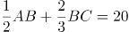，则全长=40，排除C、D两项。代入A项，若全长为30公里，则可得，BC=30，与全长为30公里矛盾。

故正确答案为B。

【解析二】将东方村、幸福村、胜利村分别看成A、B、C三地，全程分为两个过程，第一个过程：先行驶AB的一半，用时1小时；第二个过程：如果理解成到胜利村（C）的距离刚好是胜利村（C）离幸福村（B）的一半那么远，即再行驶AB的1/2加上BC的1/2共20公里，那么全长AB+BC=2×20=40公里。

故正确答案为C。

本题表述有争议，粉笔给出两种解题思路，但更倾向于选B。

### 第 53 题

某直播平台为3种特色农产品直播带货3小时，第1小时B产品销售额比A产品多50万元，C产品只有B产品的60%；第2小时与第1小时相比：A翻倍，B增加幅度比A少20%，而C增加两倍；最后1小时共带货3090万元，且A产品带货额比第1小时大幅增加300%，B、C均比第2小时增加50%，问第2小时直播带货额是多少万元？

A. 1580

B. 1600

C. 1860

D. 2000

第 53 题 · 答案与解析

**参考答案（粉笔题库参考内容）**

C

**解析**

题干给出A、B、C3种农产品在带货第1、2、3小时内销售额的关系，可设第1小时B产品销售额为x万元，可得三类产品3小时内得销售额如下：

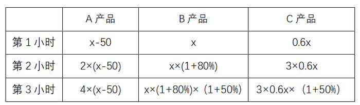

根据最后1小时共带货3090万元可得：；化简得9.4x-200=3090，解得x=350。

代入x=350，第2小时带货额为万元。

故正确答案为C。

### 第 54 题

某省在新冠疫情期间派出包括传染科医生、重症科医生和护士在内的三批援鄂医疗队。三批医疗队中三者人数之比分别为4：2：4、5：2：3和4：3：3。已知第二批医疗队中医生比护士多40人，且传染科医生数逐批增加并成等差数列，三批共派出护士113人，则三批医疗队共有多少人？

A. 339

B. 350

C. 360

D. 390

第 54 题 · 答案与解析

**参考答案（粉笔题库参考内容）**

B

**解析**

根据第二批医疗队中三者人数之比为5：2：3且医生比护士多40人，可得第二批医疗队传染科医生、重症科医生和护士人数分别为人、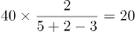人、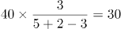人。根据“传染科医生数逐批增加并成等差数列”，设第一批传染科医生比第二批少x人，则第一批和第三批传染科医生分别为（50-x）人、（50+x）人，传染科医生共有人。则根据三批次人数的比例关系可得：

根据“三批共派出护士113人”列方程：，解得：x=18。则重症科医生共有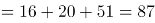人。故三批医疗队共有87+150+113=350人。

故正确答案为B。

### 第 55 题

一车救灾物资从早上8点起开始运往1900公里外的某地，白天平均车速80公里/小时，夜间60公里/小时（假定8：00到18：00为白天，其他时段为夜间），司机每驾驶2小时必须休息20分钟，且每名司机每天驾驶时间不能超过8小时（00：00后即为新的一天）。问车上至少应配备几名司机且至少要用多长时间才能抵达该地？

A. 3名；27小时15分

B. 3名；27小时25分

C. 4名；33小时30分

D. 4名；33小时40分

第 55 题 · 答案与解析

**参考答案（粉笔题库参考内容）**

A

**解析**

根据题意，要使总时间最短，则需让车辆一直在行驶，行驶情况如下表所示：

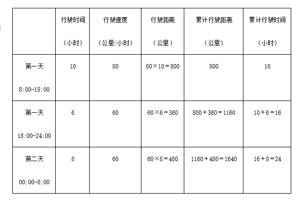

第二天白天所需行驶时间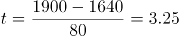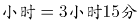，则总时间最短为24小时+3小时15分=27小时15分，只有A项符合。

故正确答案为A。

备注：本题不严谨，根据题意，在总时间最短的情况下，最少需要2名司机即可完成物资运输。第一天16小时可安排为：每名司机开车2小时，休息2小时，每人共计开车8小时；第二天是新的一天，共需行驶11小时15分钟，每名司机可以继续开车2小时，休息2小时，第一名司机共开车6小时，第二名司机共开车5小时15分钟即可。在考场上，可以根据用时最短直接锁定答案，不必纠结司机的人数。

### 第 56 题

受新冠疫情影响，某高校某专业开展在线教育，在同一上课时间开设3门选修课A、B和C，每个学生可任选其中1门，但每门课程限选30人。已知该专业共有90人，问该专业学生小李能选中课程A的概率是：

A. 1/9

B. 1/6

C. 1/3

D. 2/3

第 56 题 · 答案与解析

**参考答案（粉笔题库参考内容）**

C

**解析**

方法一：根据概率公式，概率，可得所求概率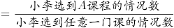。课程A限选30人，小李可为30人中的任意1人，所以小李选到A课程的情况数为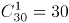；同理，“3门选修课A、B和C，每门课程限选30人”,即3门课共限选90人，小李可为90人中的任意1人，所以小李选到任意一门课的情况数为。则所求概率=30/90=1/3。

方法二：由题目条件 “3门选修课A、B和C，每个学生可任选其中1门，但每门课程限选30人”，可知每个学生选择每门课的概率是相同的。因此小李有A、B、C共3种选择，则选择A课程的概率应为1/3。

故正确答案为C。

### 第 57 题

某果蔬专业博士生一行8人，深入某贫困山区，为当地3个村的村民传授果树的种植技术，当年3个村的水果产量之比为3：2：5，第2年3个村的水果产量都有不低于20%的增加，且3村水果总产量增加50%，问3个村水果产量的最大增幅可能是多少？

A. 80%

B. 120%

C. 150%

D. 170%

第 57 题 · 答案与解析

**参考答案（粉笔题库参考内容）**

D

**解析**

结合条件中比例关系，赋值当年3个村的水果产量分别为30、20、50，当年水果总产量为30+20+50=100，第2年水果总产量增长了100×50%=50。根据增幅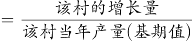，若想增幅最大，则该村基期值尽可能小，对应的增长量尽可能大。结合条件，第2个村的基期值最小，则让第2个村的增幅最大。此时，其他村的增长量应尽可能小，由于“第2年3个村的水果产量都有不低于20%的增加”，第1个村的增长量最小=6，第3个村的增长量最小=10，则第2个村的增长量最大=50-6-10=34，故第2个村的增幅=34/20=170%。

故正确答案为D。

### 第 58 题

100亩实验田中种植了A、B、C三种作物，三种作物亩产量分别为300、500和600千克，总产量为45吨。已知A作物的种植面积是B作物的3倍，问C作物的种植面积是B作物的多少倍？

A. 2

B. 2.5

C. 7/3

D. 8/3

第 58 题 · 答案与解析

**参考答案（粉笔题库参考内容）**

D

**解析**

设B作物的种植面积是x亩，则A作物的种植面积是3x亩。C作物的种植面积是y亩。总种植面积=x+3x+y=100，整理可得：4x+y=100······①。

总产量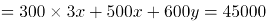，整理可得：7x+3y=225······②

根据①②联立方程组，解得x=15，y=40，故C作物的种植面积是B作物的40/15=8/3倍。

故正确答案为D。

### 第 59 题

2020年老张的年龄是小王年龄的4倍，2021年老李的年龄是小王年龄的3倍，已知老张比老李大12岁，问哪一年三人的年龄之和第一次超过140岁？

A. 2020

B. 2023

C. 2026

D. 2029

第 59 题 · 答案与解析

**参考答案（粉笔题库参考内容）**

D

**解析**

设2020年小王的年龄是x，根据题中的年龄关系列表：

根据老张比老李大12岁可得方程4x= 3(x+1)-1+12，解得：x=14。因此2020年老张，小王，老李的年龄分别为56岁，14岁，44岁。设再过y年三人的年龄和超过140岁，则56+44+14+3y＞140，解得y＞8.66，即9年，2020+9=2029年。

故正确答案为D。

### 第 60 题

乙地在甲地的正东方26千米处，丙地在甲、乙两地连线的北方，且与甲、乙的距离分别为24千米和10千米。一辆车从甲、乙两地中点位置出发向正北方行驶，在经过甲丙连线时，与丙地的距离在以下哪个范围内?

A. 不到8千米

B. 8-9千米之间

C. 9-10千米之间

D. 10千米以上

第 60 题 · 答案与解析

**参考答案（粉笔题库参考内容）**

C

**解析**

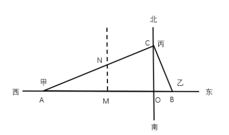

根据题意可得上图，因为甲乙两地距离AB=26千米，甲丙两地距离AC=24千米，乙丙两地距离BC=10千米，可知三角形ABC三边比例为10:24:26=5:12:13，这三边满足勾股定理，所以三角形ABC为直角三角形，。M为甲乙两地中点，汽车从M向正北出发经过甲丙两地连线AC时交于N点，故千米。在直角三角形AMN中，。根据两直角三角形都有公共角∠A可推出△ACB∞，根据相似三角形对应边成比例可列式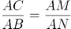，代入数据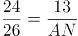，解得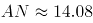千米，那么千米，在C项范围内，当选。

故正确答案为C。

### 第 61 题

从所给四个选项中，选择最合适的一项填入问号处，使之呈现一定的规律性。

A. A

B. B

C. C

D. D

第 61 题 · 答案与解析

**参考答案（粉笔题库参考内容）**

B

**解析**

元素组成不相同，且无明显属性规律，考虑数量规律。图形由若干白球和黑球组成，可以考虑分开看黑球和白球的数量。横行竖行单独看黑球数量和白球数量没有规律，且黑球均出现在九宫格的四角处，可以考虑“米”字型看。“米”字型的四条线上，除最中间的图形外，两端的黑球相加数量为10，两端白球数量相加为10，所以？处应为2个黑球，对应B项。

故正确答案为B。

备注：本题的框架参照我国古代文明图案“河图洛书”所命制（如下图），在河图上，排列成数阵的黑点和白点，蕴藏着无穷的奥秘；在洛书上，纵、横、斜三条线上的三个数字，其和皆等于15。本题选取的即是洛书的排列形式，因此考虑横向、纵向、斜向相加均为15也是可以的。

### 第 62 题

从所给的四个选项中，选择最合适的一个选项拼搭出题干中的图形。

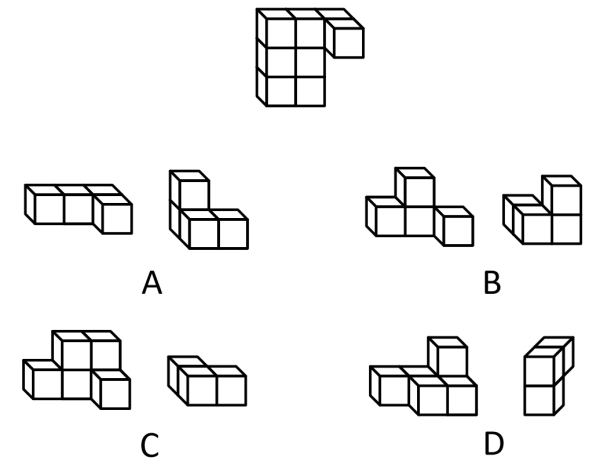

A. A

B. B

C. C

D. D

第 62 题 · 答案与解析

**参考答案（粉笔题库参考内容）**

A

**解析**

本题考查立体拼合。根据题干给出的立体图形可知该图形共由8个小立方体组成，观察选项发现，C、D两项均共有9个小正方体，与题干不符，排除；

再逐一分析剩下两个选项：

A项：将图①立起来，再将图②进行左右上下翻转，进行拼合即可得到题干立体图形，如图所示，当选；

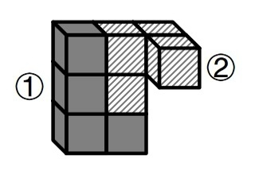

B项：选项中包含两块凸起的小立方体，但是题干立体图形中只有一块小立方体是凸起的，所以无法得到题干立体图形，排除。

故正确答案为A。

### 第 63 题

根据①②③图形的变化规律，编号④的图形中空缺的数字应该是：

A. 8

B. 1

C. 4

D. 2

第 63 题 · 答案与解析

**参考答案（粉笔题库参考内容）**

C

**解析**

元素组成不同，无明显属性规律，考虑数量规律。观察发现，四幅图均为数字，考虑数面。图①②③内数字中面的总数都是3，则图④内数字中面的总数也应是3，故问号处应选择有1个面的数字，只有C项符合。

故正确答案为C。

### 第 64 题

根据左右图形的变化规律，从所给四个选项中，选择最适合的一项填入问号处。

A. A

B. B

C. C

D. D

第 64 题 · 答案与解析

**参考答案（粉笔题库参考内容）**

B

**解析**

元素组成相似，考虑样式规律。左右两侧宫格，每行均由和构成，且左侧到右侧图形个数、位置不同。由左侧的四列变为右侧的三列，考虑相邻两列做黑白运算。观察发现，每行相邻的两个图形做运算，左侧宫格第一列和第二列做运算等于右侧宫格第一列，左侧宫格第二列和第三列做运算等于右侧宫格第二列，左侧宫格第三列和第四列做运算等于右侧宫格第三列，即+\=，+\=，+\=，+\=。经验证，每一行均满足此运算规律；第五行按照此运算规律得到B项。

故正确答案为B。

### 第 65 题

把下面的六个图形分为两类，使每一类图形都有各自的共同特征或规律，分类正确的一项是：

A. ①②③，④⑤⑥

B. ①②④，③⑤⑥

C. ①③④，②⑤⑥

D. ①③⑥，②④⑤

第 65 题 · 答案与解析

**参考答案（粉笔题库参考内容）**

C

**解析**

本题为分组分类题目。元素组成不同，优先考虑属性规律。题干出现等腰元素，考虑对称性。①③④三个图形均有一条对称轴，仅为轴对称图形；②⑤⑥三个图形均有两条相互垂直的对称轴，既是轴对称图形也是中心对称图形。即①③④为一组，②⑤⑥为一组。

故正确答案为C。

### 第 66 题

化学沉积作用是指在水介质中，以胶体溶液和真溶液形式搬运的物质到达适宜场所后，当化学条件发生变化时，产生沉淀、堆积的过程。其中，胶体溶液是指含有一定大小的固体颗粒物质或高分子化合物的溶液，真溶液是指透明度较高的水溶液。

根据上述定义，下列不属于化学沉积作用的是：

A. 干旱气候区，湖水很少外泄，蒸发作用使湖水的氯化钠增加、累积，变成咸水湖

B. 当海水中的绿色粘土矿物随水流动时，会和含有铝、铁的胶体物质聚合形成海绿石

C. 富含磷质的海水上升至浅海区，因压力减小，温度升高，磷质析出、沉积而形成磷矿

D. 湖泊里的生物骨骼，它们吸收了空气中的二氧化碳形成碳酸钙，当碳酸钙浓度达到一定程度就在海底堆积下来，形成石灰岩

第 66 题 · 答案与解析

**参考答案（粉笔题库参考内容）**

D

**解析**

第一步：找出定义关键词。

化学沉积作用：“水介质”、“以胶体溶液和真溶液形式搬运”、“当化学条件发生变化时，产生沉淀、堆积”；

胶体溶液：“含有一定大小的固体颗粒物质或高分子化合物的溶液”；

真溶液：“透明度较高的水溶液”。

第二步：逐一分析选项。

A项：湖水是水介质，符合“透明度较高的水溶液”，蒸发使湖水的氯化钠增加累积，变成咸水湖，即湖水搬运的最终物质是氯化钠，符合“当化学条件发生变化时，产生沉淀、堆积”，符合定义，排除；

B项：海水是水介质，符合“透明度较高的水溶液”，绿色粘土矿物随海水流动和含有铝、铁的胶体物质聚合形成海绿石，符合“以胶体溶液和真溶液形式搬运”、“当化学条件发生变化时，产生沉淀、堆积”，符合定义，排除；

C项：海水是水介质，符合“透明度较高的水溶液”，压力减小、温度升高导致磷质析出沉积形成磷矿，符合“以胶体溶液和真溶液形式搬运”、“当化学条件发生变化时，产生沉淀、堆积”，符合定义，排除；

D项：湖泊是水介质，符合“透明度较高的水溶液”，但生物骨骼最终形成的石灰岩不是在真溶液形式搬运下发生的沉淀、堆积，属于生物沉积作用，不符合“当化学条件发生变化时，产生沉淀、堆积”，不符合定义，当选。

本题是选非题，故正确答案为D。

备注：本题很多学生比较纠结A项和D项，如下图所示，A项是在“化学沉积”相关文献中的典型案例，通过对比择优，本题问“不属于”，故小粉笔更倾向把答案给到D项。

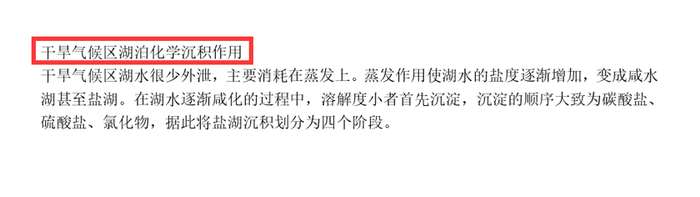

### 第 67 题

生物浓缩，是指生物有机体或处于同一营养级上的许多生物种群，从周围环境中蓄积某种元素或难分解化合物，使生物有机体内该物质的浓度超过环境中该物质浓度的现象。

根据上述定义，以下涉及到生物浓缩的是：

A. 农业上用于杀死昆虫的DDT通过食物链传递到白头鹰体内，导致生下的蛋皆是软壳的，无法孵化

B. 在湖泊、河流等地方出现的藻类及其他浮游生物迅速繁殖，水质恶化，鱼类及其他生物大量死亡的现象

C. 山羊吃多玉米粒之后，一时间难以消化，再加上山羊饮入水后，玉米长时间聚集在胃内，容易引起胃胀

D. 由于严重的白色污染，原本干净清洁的海滩，如今聚集了大量的塑料袋、瓶子等垃圾，以至于无人问津

第 67 题 · 答案与解析

**参考答案（粉笔题库参考内容）**

A

**解析**

第一步：找出定义关键词。

“生物有机体或处于同一营养级上的许多生物种群”、“从周围环境中蓄积某种元素或难分解化合物”、“使生物有机体内该物质的浓度超过环境中该物质浓度的现象”。

第二步：逐一分析选项。

A项：白头鹰体内，符合“生物有机体或处于同一营养级上的许多生物种群”，通过食物链传递导致白头鹰体内有DDT，符合“从周围环境中蓄积某种元素或难分解化合物”，白头鹰的蛋壳变软的原因在于有害化学物质DDT逐步在其体内积累的结果，符合“使生物有机体内该物质的浓度超过环境中该物质浓度的现象”，符合定义，当选；

B项：藻类和浮游生物迅速繁殖，鱼类及其他生物大量死亡，是因为鱼类生存所需的营养物质被藻类和浮游生物抢占了，不符合“使生物有机体内该物质的浓度超过环境中该物质浓度的现象”，不符合定义，排除；

C项：山羊吃多玉米粒之后，玉米聚集在胃里引起胃胀，不符合“使生物有机体内该物质的浓度超过环境中该物质浓度的现象”，不符合定义，排除；

D项：干净清洁的海滩受到白色污染，没有涉及生物有机体或者生物种群，不符合“生物有机体或处于同一营养级上的许多生物种群”，不符合定义，排除。

故正确答案为A。

### 第 68 题

增效作用指的是两种或两种以上药物同时或先后作用于机体所产生的防治作用大于各种药物单独对机体产生的总效应。

根据上述定义，下列最能体现增效作用的是：

A. 石蒜是一种抗癌药，与大剂量维生素C配合使用，石蒜含有的石蒜碱毒性会增强

B. 风湿止痛药酒和安乃近片均具有止痛作用，共用会使安乃近片代谢加快药物半衰期缩短

C. 白掌施用亚硝酸铁化肥后可使发黄的叶子变绿，再施用磷酸二氢钾，会产生良好的催花效果

D. 赤霉素和生长素均能促进植物茎秆伸长，共用时赤霉素可抑制生长素的氧化过程从而提高生长素的含量

第 68 题 · 答案与解析

**参考答案（粉笔题库参考内容）**

D

**解析**

第一步：找出定义关键词。

“两种或两种以上药物”、“同时或先后作用于机体”、“防治作用大于药物单独对机体的总效应”。

第二步：逐一分析选项。

A项：石蒜含有的石蒜碱毒性会增强，不符合“防治作用大于药物单独对机体的总效应”，不符合定义，排除；

B项：共用会使安乃近片代谢加快药物半衰期缩短，不符合“防治作用大于药物单独对机体的总效应”，不符合定义，排除；

C项：施用亚硝酸铁化肥后施用磷酸二氢钾会产生良好的催花效果，不清楚是否防治作用大于单独使用的效果，不符合“防治作用大于药物单独对机体的总效应”，不符合定义，排除；

D项：共用赤霉素和生长素，符合“两种或两种以上药物”、“同时或先后作用于机体”，共用能够提高生长素的含量，符合“防治作用大于药物单独对机体的总效应”，符合定义，当选。

故正确答案为D。

### 第 69 题

背书品牌指出现在一个产品品牌与服务品牌背后的支持性品牌。背书品牌又叫做父母品牌，被背书的叫子品牌。分两类：一是硬背书品牌，采取企业总品牌+子品牌形式。企业总品牌一般是有较长历史，较高知名度及无形资产价值的大品牌，子品牌需借助总品牌吸引消费者。二是软背书品牌，即子品牌前并不直接冠以背书品牌，子品牌是流通的主角，企业总品牌只是为子品牌提供信誉担保。

根据上述定义，下列属于硬背书品牌的是：

A. 别克、欧宝、雪佛莱、凯迪拉克是通用汽车旗下四大主力品牌

B. 某药企的产品都包含有“999”的品牌，如三九胃泰、999感冒灵

C. 浏阳河、京酒、金六福等产品包装上都没标明背书品牌五粮液

D. 无论是潘婷、汰渍，还是舒肤佳，它们都是宝洁公司的产品

第 69 题 · 答案与解析

**参考答案（粉笔题库参考内容）**

B

**解析**

第一步：找出定义关键词。

背书品牌：“在一个产品品牌与服务品牌背后的支持性品牌”。

硬背书品牌：“总品牌+子品牌形式”、“总品牌一般是有较长历史，较高知名度及无形资产价值的大品牌”、“子品牌需借助总品牌吸引消费者”。

软背书品牌：“子品牌前并不直接冠以背书品牌”、“子品牌是流通的主角”、“总品牌只是为子品牌提供信誉担保”。

第二步：逐一分析选项。

A项：别克、欧宝、雪佛莱、凯迪拉克是通用汽车旗下四大主力品牌，不符合“总品牌+子品牌形式”、“子品牌需借助总品牌吸引消费者”，不符合定义，排除；

B项：“999”的品牌是总品牌，三九胃泰、999感冒灵是子品牌，符合“总品牌+子品牌形式”，符合定义，当选；

C项：浏阳河、京酒、金六福等产品包装上都没标明背书品牌五粮液，符合“子品牌前并不直接冠以背书品牌”，属于软背书品牌，不符合定义，排除；

D项：潘婷、汰渍、舒肤佳都是宝洁公司的产品，不符合“总品牌+子品牌形式”、“子品牌需借助总品牌吸引消费者”，不符合定义，排除。

故正确答案为B。

### 第 70 题

相反相成修辞手法是指把通常相互对立、排斥的两个概念或判断巧妙地联系在一起，这样不仅能够揭示出存在于客观事物深层的矛盾辩证关系，还可以增加语言的意蕴。

根据上述定义，下列不属于相反相成修辞手法的是：

A. 横眉冷对千夫指，俯首甘为孺子牛

B. 有的人活着，他已经死了；有的人死了，他还活着

C. 墙上芦苇，头重脚轻根底浅；山中竹笋，嘴尖皮厚腹中空

D. 这一天，死去的伟人在诗的国度里永生；这一天，活着的小丑在人们心上被埋葬

第 70 题 · 答案与解析

**参考答案（粉笔题库参考内容）**

C

**解析**

第一步：找出定义关键词。

“把通常相互对立、排斥的两个概念或判断巧妙地联系在一起”。

第二步：逐一分析选项。

A项：选项这句话意为对待敌人决不屈服，对人民大众甘愿服务。横眉和俯首是一个人的两个相互对立的态度，符合“把通常相互对立、排斥的两个概念或判断巧妙地联系在一起”，符合定义，排除；

B项：选项这句话意为有的人虽然活着，但是他的道德败坏，就如已经死了一样没有价值，而有的人死了，他还活着，他的高尚的品格，代代相传，永远激励后人。活着和死了是一个人的两个相互对立的状态，符合“把通常相互对立、排斥的两个概念或判断巧妙地联系在一起”，符合定义，排除；

C项：选项这句话用芦苇和竹笋比喻那些没有学问只会自吹自擂的人，芦苇和竹笋不符合“相互对立、排斥的两个概念或判断”，不符合定义，当选；

D项：选项这句话表达了不同类型的人在“这一天”的情况，死去和永生、活着和埋葬是一个人的两个相互对立的状态，符合“把通常相互对立、排斥的两个概念或判断巧妙地联系在一起”，符合定义，排除。

本题为选非题，故正确答案为C。

### 第 71 题

涟漪效应是指在突发事件中，身处不同地区民众所呈现的不同心理状态，越靠近危机事件中心区域，人们对事件的风险认知和负性情绪越高。

根据上述定义，下列符合涟漪效应的是：

A. 台风外围空气旋转剧烈，而处于中心的风力流动反而相对微弱，因此，灾民负性情绪从“暴风眼”区域向外逐渐增强

B. 地震带上的重灾区民众在风险认知、心理健康水平及应对行为上都显著高于非重灾区民众

C. 距离垃圾焚烧厂、核反应堆越近的民众，其风险认知程度越高，因而其忧虑感越强

D. 距离大规模传染疫情爆发的时间越短，民众的焦虑情绪及恐慌程度就越高

第 71 题 · 答案与解析

**参考答案（粉笔题库参考内容）**

B

**解析**

第一步：找出定义关键词。

“在突发事件中”、“身处不同地区民众所呈现的不同心理状态”、“越靠近危机事件中心区域，人们对事件的风险认知和负性情绪越高”。

第二步：逐一分析选项。

A项：灾民的负性情绪是从“暴风眼”区域向外逐渐增强的，不符合“越靠近危机事件中心区域，人们对事件的风险认知和负性情绪越高”，不符合定义，排除；

B项：地震符合“在突发事件中”，地震带上的重灾区民众在心理健康水平及应对行为上都显著高于非重灾区民众，符合“身处不同地区民众所呈现的不同心理状态”，虽未提及“负性情绪”，但也符合“越靠近危机事件中心区域，人们对事件的风险认知越高”，符合定义，当选；

C项：垃圾焚烧厂、核反应堆，不符合“在突发事件中”，不符合定义，排除；

D项：距离大规模传染疫情爆发的时间越短，是所有人都会面临的，没有体现身处不同地区，不符合“身处不同地区民众所呈现的不同心理状态”，不符合定义，排除。

故正确答案为B。

附原文说明：

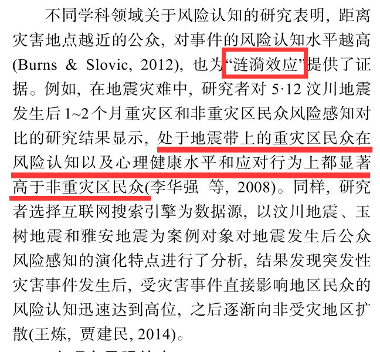

### 第 72 题

自豪是一种产生于对自己的积极评价的情绪，其主要依赖于自我意识、自我评价以及自我反思。基于对成就的不同归因，自豪可分为真实自豪和自大自豪。真实自豪是以成就为导向的一种积极的自豪情绪，其主要来源于个体将成就归因于自身的努力；自大自豪是指一种偏向于消极的自豪情绪，其主要来源于个体将成就归因于自身的天赋。

根据上述定义，下列最符合自大自豪的是：

A. 兴酣落笔摇五岳，诗成笑傲凌沧州

B. 黄金白璧买歌笑，一醉累月轻王侯

C. 俱怀逸兴壮思飞，欲上青天揽明月

D. 天生我材必有用，千金散尽还复来

第 72 题 · 答案与解析

**参考答案（粉笔题库参考内容）**

D

**解析**

第一步：找出定义关键词。

“偏向于消极的自豪情绪”、“主要来源于个体将成就归因于自身的天赋”。

第二步：逐一分析选项。

A项：“兴酣落笔摇五岳，诗成笑傲凌沧州”出自李白（唐）的《江上吟》，意思是我高兴起来落笔能让五岳震动，写出来的诗足以笑傲天下，表达出作者对自身诗才的自信，其态度是积极的，不符合“偏向于消极的自豪情绪”，不符合定义，排除；

B项：“黄金白璧买歌笑，一醉累月轻王侯”出自李白（唐）的《忆旧游寄谯郡元参军》，意思是花黄金白璧买来宴饮与欢歌笑语时光，一次酣醉使我数月轻蔑王侯将相，作者借喝酒买醉后的情绪轻蔑王侯将相，不符合“主要来源于个体将成就归因于自身的天赋”，不符合定义，排除；

C项：“俱怀逸兴壮思飞，欲上青天揽明月”出自李白（唐）的《宣州谢朓楼饯别校书叔云》，意思是我们都怀有豪情逸兴、雄心壮志，酒酣兴发，更是飘然欲飞，想登上青天摘取明月，不符合“偏向于消极的自豪情绪”，也不符合“主要来源于个体将成就归因于自身的天赋”，不符合定义，排除；

D项：“天生我材必有用，千金散尽还复来”出自李白（唐）的《将进酒》，意思是上天造就了我的才干就必然是有用处的，千两黄金花完了也能够再次获得，该诗句为作者政治上遭遇挫折，符合“偏向于消极的自豪情绪”，有才能就一定有用处，符合“主要来源于个体将成就归因于自身的天赋”，符合定义，当选。

故正确答案为D。

### 第 73 题

转喻是指两个认知对象在空间上或时间上的邻近共存以及其中一个对另一个的凸显可及，从而通过另一种事物来理解和体验当前的事物。

根据上述定义，下列不属于转喻的是：

A. 一间阴暗的小屋里，上面坐着两位老爷，一东一西。东边的一个是马褂，西边的一个是西装

B. 当一个游子想他家乡的时候我猜想它是像菜花一样金黄

C. 灾害是一把尺子，可以测量一个民族蹲下后跳跃的高度

D. 朱门酒肉臭，路有冻死骨

第 73 题 · 答案与解析

**参考答案（粉笔题库参考内容）**

C

**解析**

第一步：找出定义关键词。

“两个认知对象”、“在空间上或时间上的邻近共存”、“通过另一种事物来理解和体验当前的事物”。

第二步：逐一分析选项。

A项：一间小屋东西各坐着一位老爷，马褂指代东边的老爷，西装指代西边的老爷，人物和身穿的衣服，符合“两个认知对象在空间上的邻近共存”，在特定场合穿着打扮体现着人物的身份，符合“通过另一种事物来理解和体验当前的事物”，符合定义，排除；

B项：选项取自《感情什么颜色》，用颜色来形容感情，家乡一般到处都种着菜花，菜花和家乡就有了空间上的邻近关系，符合“两个认知对象在空间上的邻近共存”，“金黄”的菜花，比喻春天的气息，生动刻画了游子对家乡的神往和思念，符合“通过另一种事物来理解和体验当前的事物”，符合定义，排除；

C项：用灾害这把“尺子”测量“民族蹲下后跳跃的高度”，灾害和尺子不存在空间上或时间上的邻近共存，不符合“两个认知对象在空间上或时间上的邻近共存”，不符合定义，当选；

D项：“朱门酒肉臭，路有冻死骨”意思是贵族人家的红漆大门里散发出酒肉的香味，路边就有冻死的骸骨。其中“朱门”指“贵族人家”，“冻死骨”指“穷苦百姓”，符合“两个认知对象”、“在空间上或时间上的邻近共存”，“朱门的酒肉臭”体现了贵族人家的骄奢淫逸，“路边的冻死骨”体现了穷苦人家的生活惨状，符合“通过另一种事物来理解和体验当前的事物”，符合定义，排除。

本题为选非题，故正确答案为C。

备注：如下图所示，从小粉笔查询到的相关文献来看，C项属于“隐喻”，而非“转喻”。

### 第 74 题

软暴力是指行为人为谋取不法利益或形成非法影响，对他人或者在有关场所进行滋扰、纠缠、哄闹、聚众造势等，足以使他人产生恐惧、恐慌进而形成心理强制，或者足以影响、限制人身自由、危及人身财产安全，影响正常生活、工作、生产、经营的违法犯罪手段。

根据上述定义，下列属于软暴力的是：

A. 张某威胁王法官，如不秉公判案就举报其贪污的事实

B. 甲公司为了在竞标中获胜，私下散布关于竞争对手的不利信息

C. 某恶势力团伙为了向王某讨要赌债将其堵在酒店房间，24小时看守并不让其睡觉

D. 网贷公司催收员长期使用群呼、群发短信、揭发隐私等手段滋扰欠款人及其紧急联系人、通讯录联系人

第 74 题 · 答案与解析

**参考答案（粉笔题库参考内容）**

D

**解析**

第一步：找出定义关键词。

“为谋取不法利益或形成非法影响”、“对他人或者在有关场所进行滋扰、纠缠、哄闹、聚众造势”、“使他人产生恐惧、恐慌或影响、限制人身自由、危及人身财产安全，影响正常生活、工作、生产、经营的违法犯罪手段”。

第二步：逐一分析选项。

A项：张某威胁王法官秉公判案，不符合“为谋取不法利益或形成非法影响”，不符合定义，排除；

B项：甲公司为了在竞标中获胜，不符合“为谋取不法利益或形成非法影响”，不符合定义，排除；

C项：某恶势力将王某堵在房间不让其睡觉长达24小时，属于严重的人身强制行为，不属于“对他人或者在有关场所进行滋扰、纠缠、哄闹、聚众造势等”，不符合定义，排除；

D项：网贷公司使用群呼、群发、揭发隐私等手段滋扰欠款人及其紧急联系人、通讯录联系人，符合“对他人进行滋扰”，长期如此，符合“使他人产生恐惧、恐慌或影响”和“影响正常生活、工作、生产、经营的违法犯罪手段”，符合定义，当选。

故正确答案为D。

备注：下图中给出的示例，引自《光明日报》，该案是北京市首例网络“软暴力”的案件，与D项对应，而C项中的“24小时不让其睡觉”，直接限制了人身自由和行为且时间较长，二者比较，D项更符合定义。

### 第 75 题

气候保险是一种为遭受气候风险的资产、生计和生命损失提供支持的保障机制，它通过在一个比较大的空间和时间范围内，投保者定期支付确定的小额保费来应对不确定的气候风险损失，能够确保遭遇直接气候风险损失的投保者获得有效和迅速的资金支持。

根据上述定义，下列属于气候保险承保范围的是：

A. 天气异常干旱造成水稻大面积减产

B. 地震引发山体滑坡，掩埋了山下一处工厂

C. 暴雪封路，导致大批牲畜得不到及时照料而被饿死

D. 上游泄洪造成下游地区发生溃堤，导致当地农作物大面积毁损

第 75 题 · 答案与解析

**参考答案（粉笔题库参考内容）**

A

**解析**

第一步：找出定义关键词。

“遭受气候风险”、“资产、生计和生命损失”、“投保者定期支付确定的小额保费”、“遭遇直接气候风险损失”、“获得有效和迅速的资金支持”。

第二步：逐一分析选项。

A项：天气异常干旱，属于气候因素，符合“遭受气候风险”，造成水稻大面积减产，符合“资产、生计和生命损失”，且减产是天气异常直接导致的，符合“遭遇直接气候风险损失”，符合定义，当选；

B项：地震引发山体滑坡，属于地质灾害，不符合“遭受气候风险”，不符合定义，排除；

C项：暴雪封路，符合“遭受气候风险”，但最后大批牲畜死亡是得不到及时照料导致的，并非气候因素直接导致的，不符合“遭遇直接气候风险损失”，不符合定义，排除；

D项：上游泄洪造成下游地区发生溃堤，属于人为因素，不符合“遭受气候风险”，不符合定义，排除。

故正确答案为A。

### 第 76 题

山有色：水发声

A. 山河在：草木深

B. 客舍青：柳色新

C. 鸟飞绝：人踪灭

D. 花作尘：鸟不惊

第 76 题 · 答案与解析

**参考答案（粉笔题库参考内容）**

D

**解析**

第一步：判断题干词语间逻辑关系。

两个词语无明显的逻辑关系，考虑分开看。有色是对山的描述，发声是对水的描述。即后两个字是对第一个字的描述。

第二步：判断选项词语间逻辑关系。

A项：“在”是对“山河”的描述，“深”是对“草木”的描述，即第三个字是对前两个字的描述，与题干逻辑关系不一致，排除；

B项：“青”是对“客舍”的描述，“新”是对“柳色”的描述，即第三个字是对前两个字的描述，与题干逻辑关系不一致，排除；

C项：“飞绝”是对“鸟”的描述，即后两个字是对第一个字的描述，但是“灭”是对“人踪”的描述，即第三个字是对前两个字的描述，与题干逻辑关系不一致，排除；

D项：“作尘”是对“花”的描述，“不惊”是对“鸟”的描述，即后两个字是对第一个字的描述，与题干逻辑关系一致，当选。

故正确答案为D。

### 第 77 题

匹马：单枪

A. 万水：千山

B. 花红：柳绿

C. 地久：天长

D. 猴年：马月

第 77 题 · 答案与解析

**参考答案（粉笔题库参考内容）**

A

**解析**

第一步：判断题干词语间逻辑关系。

匹马是指一匹马，单枪是指一杆枪，二者属于并列关系，并且“匹”和“单”均可以用来表示数量。

第二步：判断选项词语间逻辑关系。

A项：万水和千山为并列关系，并且“万”与“千”均可以用来表示数量，与题干逻辑关系一致，当选；

B项：花红和柳绿为并列关系，但“花”与“柳”不可用来表示数量，与题干逻辑关系不一致，排除；

C项：地久和天长为并列关系，但“地”和“天”不可用来表示数量，与题干逻辑关系不一致，排除；

D项：猴年和马月为并列关系，但“猴”和“马”不可用来表示数量，与题干逻辑关系不一致，排除。

故正确答案为A。

### 第 78 题

就地保护：易地保护

A. 汽车爆胎：汽车漏油

B. 防洪堤：绿化带

C. 纯种繁育：杂交繁育

D. 销售提成：股份分红

第 78 题 · 答案与解析

**参考答案（粉笔题库参考内容）**

C

**解析**

第一步：判断题干词语间逻辑关系。

就地保护和易地保护是保护生物多样性的两种形式，二者为并列关系，且为并列中的矛盾关系。

第二步：判断选项词语间逻辑关系。

A项：汽车爆胎和汽车漏油均为汽车会出现的故障，二者为并列关系，但是汽车除了爆胎和漏油外还会出现其他故障，所以二者为并列中的反对关系，与题干逻辑关系不一致，排除；

B项：防洪堤是为了防止河流泛滥而建立的堤坝，而绿化带是为了起到绿化的作用，美化环境，二者构不成并列关系，与题干逻辑关系不一致，排除；

C项：纯种繁育是同一品种内进行后代繁育，杂交繁育是不同品种间进行后代繁育，二者为并列关系，且为并列中的矛盾关系，与题干逻辑关系一致，当选；

D项：销售提成与股份分红均为获得收入的两种形式，二者为并列关系，但是获得收入除了销售提成与股份分红外还有其他形式，所以二者为并列关系中的反对关系，与题干逻辑关系不一致，排除。

故正确答案为C。

### 第 79 题

洪涝：干旱：防洪抗旱

A. 地震：海啸：抗震救灾

B. 滑坡：雪崩：道路抢修

C. 严寒：酷热：防冻消暑

D. 风沙：雾霾：防沙除霾

第 79 题 · 答案与解析

**参考答案（粉笔题库参考内容）**

C

**解析**

第一步：判断题干词语间逻辑关系。

洪涝与干旱，二者为反义关系，且防洪与抗旱分别是前两种现象针对性的应对方法，与前两词构成对应关系。

第二步：判断选项词语间逻辑关系。

A项：地震与海啸，二者并不是反义关系，抗震是地震的应对方法，但救灾范围太大，与海啸对应关系并不贴切，与题干逻辑关系不一致，排除；

B项：滑坡与雪崩，二者并不是反义关系，且滑坡与雪崩都可能需要进行道路抢修，与题干逻辑关系不一致，排除；

C项：严寒与酷热，二者为反义关系，防冻是严寒的应对方法，消暑是酷热的应对方法，是两种现象的应对方式，与题干逻辑关系一致，当选；

D项：风沙与雾霾，二者并不是反义关系，与题干逻辑关系不一致，排除。

故正确答案为C。

注：本题有同学通过自然灾害选了D，这也是个角度，但是从题干特征来看，本题题干前两词反义关系明显，故优先考虑反义关系，不行的情况下再考虑是否是自然灾害，做题的首要原则是题干特征。

### 第 80 题

党员：干部：服务人民

A. 青年：才俊：报效国家

B. 科学：精英：科技立身

C. 大国：工匠：技术强国

D. 学校：教师：教书育人

第 80 题 · 答案与解析

**参考答案（粉笔题库参考内容）**

A

**解析**

第一步：判断题干词语间逻辑关系。

有的党员是干部，有的党员不是干部，有的干部是党员，有的干部不是党员，二者为交叉关系，党员和干部都是服务人民的主体，与服务人民是对应关系。

第二步：判断选项词语间逻辑关系。

A项：有的青年是才俊，有的青年不是才俊，有的才俊是青年，有的才俊不是青年，二者为交叉关系，青年和才俊都是报效国家的主体，与报效国家是对应关系，与题干逻辑关系一致，当选；

B项：科学和精英不是交叉关系，且科学不是科技立身的主体，与题干逻辑关系不一致，排除；

C项：大国和工匠不是交叉关系，且大国不是技术强国的主体，与题干逻辑关系不一致，排除；

D项：学校是教师的工作地点，二者不是交叉关系，且学校也不是教书育人的主体，与题干逻辑关系不一致，排除。

故正确答案为A。

### 第 81 题

风能：核能：资源

A. 听筒：话筒：音乐

B. 保姆：保安：家政

C. 木柴：木炭：燃料

D. 包子：粽子：节庆

第 81 题 · 答案与解析

**参考答案（粉笔题库参考内容）**

C

**解析**

第一步：判断题干词语间逻辑关系。

风能是一种资源，核能是一种资源，二者为并列关系，且均与资源构成种属关系。

第二步：判断选项词语间逻辑关系。

A项：听筒、话筒是两种设备，二者为并列关系，但与音乐均不构成种属关系，与题干逻辑关系不一致，排除；

B项：保姆、保安是两种职业，二者为并列关系，但保安与家政不构成种属关系，与题干逻辑关系不一致，排除；

C项：木柴是一种燃料，木炭是一种燃料，二者为并列关系，且均与燃料构成种属关系，与题干逻辑关系一致，当选；

D项：包子、粽子是两种食物，二者为并列关系，但与节庆均不构成种属关系，与题干逻辑关系不一致，排除。

故正确答案为C。

### 第 82 题

二氧化碳：珊瑚骨骼：腐蚀

A. 物种灭绝：动物：威胁

B. 天灾人祸：物种：减少

C. 土壤沙化：空气：雾霾

D. 气候变暖：冰川：消融

第 82 题 · 答案与解析

**参考答案（粉笔题库参考内容）**

D

**解析**

第一步：判断题干词语间逻辑关系。

“二氧化碳”会“腐蚀”“珊瑚骨骼”，题干为因果对应关系。

第二步：判断选项词语间逻辑关系。

A项：“物种灭绝”本身就包含“动物”被“威胁”的意思，与题干逻辑关系不一致，排除；

B项：“天灾人祸”会“减少”“物种”，为因果对应关系，与题干逻辑关系一致，保留；

C项：“土壤沙化”会导致“雾霾”，与题干逻辑关系不一致，排除；

D项：“气候变暖”会“消融”“冰川”，与题干逻辑关系一致，保留。

对于BD两项，题干的“二氧化碳”和D项的“气候变暖”只是独立的一个原因，但B项的原因可以拆分为“天灾”和“人祸”两个原因，因此D项与题干更为一致。

故正确答案为D。

### 第 83 题

乡风：民俗：乡村文化

A. 德治：法治：治理能力

B. 小学：中学：基础教育

C. 习惯：民约：社会规则

D. 通讯：网络：通信网络

第 83 题 · 答案与解析

**参考答案（粉笔题库参考内容）**

B

**解析**

第一步：判断题干词语间逻辑关系。

乡风是指乡里的风俗，民俗是指一个国家或民族中广大民众所创造、享用和传承的生活文化，二者是并列关系；乡风和民俗是乡村文化，前两词与第三词均是种属关系。

第二步：判断选项词语间逻辑关系。

A项：德治和法治都是治理方式，与治理能力没有必然联系，与题干逻辑关系不一致，排除；

B项：小学和中学为并列关系，小学和中学属于基础教育，前两词与第三词均是种属关系，与题干逻辑关系一致，当选；

C项：习惯是指积久养成的生活方式，民约是指人们约定共同遵守的契约，民约是一种习惯，二者是种属关系，与题干逻辑关系不一致，排除；

D项：通信网络是网络的一种，通讯和网络不是并列关系，与题干逻辑关系不一致，排除。

故正确答案为B。

### 第 84 题

绵羊 对于 （ ） 相当于 （ ） 对于 高粱

A. 麻雀 水稻

B. 老鹰 麦子

C. 羚羊 玉米

D. 山羊 玫瑰

第 84 题 · 答案与解析

**参考答案（粉笔题库参考内容）**

C

**解析**

逐一代入选项。

A项：绵羊与麻雀都是动物，但绵羊是哺乳动物，而麻雀是鸟类，二者范畴不一致，高粱与水稻都是粮食作物，二者为并列关系，前后逻辑关系不一致，排除；

B项：绵羊与老鹰都是动物，但绵羊是哺乳动物，而老鹰是鸟类，二者范畴不一致，高粱与麦子都是粮食作物，二者为并列关系，前后逻辑关系不一致，排除；

C项：绵羊与羚羊都是反刍类哺乳动物，二者为并列关系，高粱与玉米都是粮食作物，二者为并列关系，前后逻辑关系一致，当选；

D项：绵羊与山羊都是反刍类哺乳动物，二者为并列关系，高粱与玫瑰都是植物，但高粱是粮食作物，玫瑰是观赏性植物，二者范畴不一致，前后逻辑关系不一致，排除。

故正确答案为C。

### 第 85 题

少壮不努力：老大徒伤悲

A. 不入虎穴：焉得虎子

B. 己所不欲：勿施于人

C. 不忘初心：方得始终

D. 若要人不知：除非己莫为

第 85 题 · 答案与解析

**参考答案（粉笔题库参考内容）**

C

**解析**

第一步：判断题干词语间逻辑关系。

因为 “少壮不努力”，所以“老大徒伤悲”，前者是因，后者是果，二者为因果关系。

第二步：判断选项词语间逻辑关系。

A项：“不入虎穴”是“焉得虎子”的充分条件，与题干逻辑关系不一致，排除；

B项：因果关系必定有先后性，因在前，果在后，“己所不欲”和“勿施于人”没有必然先后性，所以不是因果关系，与题干逻辑关系不一致，排除；

C项：因为“不忘初心”，所以“才得始终”，前者是因，后者是果，二者为因果关系，与题干逻辑关系一致，当选；

D项：“人不知”是“己莫为”的充分条件，与题干逻辑关系不一致，排除。

故正确答案为C。

### 第 86 题

最新的两项研究成果引起人们关注：一是利用某种细菌来制造人造肉的蛋白质，该细菌靠吸收温室气体二氧化碳生长，每产生1千克蛋白质约需2千克二氧化碳；二是把从大气中回收的二氧化碳和水合成乙醇，生产1千克乙醇需要1.5千克二氧化碳。专家预测，这些新技术将有助于21世纪中期实现温室气体零排放的目标。

由此可以推出：

A. 利用二氧化碳生产食品和酒类将成为一项新兴产业

B. 未来可以通过人造食品吃掉二氧化碳来减少其排放

C. 只有二氧化碳资源化利用才能实现温室气体零排放

D. 二氧化碳资源化利用可能实现温室气体零排放目标

第 86 题 · 答案与解析

**参考答案（粉笔题库参考内容）**

D

**解析**

日常结论题，根据题干信息逐一分析选项。

A项：题干前面介绍了两项研究成果，即二氧化碳可以用来制造人造肉的蛋白质以及合成乙醇，但没有提及利用二氧化碳生产食品和酒类将成为一项新兴行业，无中生有，排除；

B项：题干第一项研究成果介绍了二氧化碳可以用来制造人造肉的蛋白质，最后说这些新技术将有助于21世纪中期实现温室气体零排放的目标，这是专家预测的未来的事情，但未来是否真的能通过人造食品吃掉二氧化碳来减少其排放，题干没有提及，无法推出，排除；

C项：根据题干最后一句话，这些新技术将有助于21世纪中期实现温室气体零排放的目标，但没有提及只有二氧化碳资源化利用才能实现温室气体零排放，表述过于绝对，无法推出，排除；

D项：题干前面介绍了两种利用二氧化碳的技术，最后说这些新技术将有助于21世纪中期实现温室气体零排放的目标，可以推出二氧化碳资源化利用可能实现温室气体零排放目标，可以推出，当选。

故正确答案为D。

### 第 87 题

野生动物之间因病毒入侵会暴发传染病。最新研究发现，热带、亚热带或低海拔地区的动物，因生活环境炎热，一直面临着罹患传染病的风险。生活在高纬度或高海拔等低温环境的动物，过去因长久寒冬可免于病毒入侵，但现在冬季正变得越来越温暖，持续时间也越来越短。因此，气温升高将加剧野生动物传染病的暴发。

以下哪项如果为真，最能支持上述观点？

A. 无论气候如何变化，生活在炎热地带的动物始终面临着患传染病风险

B. 适应寒带和高海拔栖息地的动物物种遭遇传染病暴发的风险正在升高

C. 气温高低与野生动物患传染病风险之间存在正相关性，即气温越高患病风险越高

D. 寒冷气候可能让野生动物免受病毒入侵，炎热气候却更易导致野生动物感染病毒

第 87 题 · 答案与解析

**参考答案（粉笔题库参考内容）**

C

**解析**

第一步：找出论点和论据。

论点：气温升高将加剧野生动物传染病的暴发。

论据：热带、亚热带或低海拔地区的动物，因生活环境炎热，一直面临着罹患传染病的风险。生活在高纬度或高海拔等低温环境的动物，过去因长久寒冬可免于病毒入侵，但现在冬季正变得越来越温暖，持续时间也越来越短。

论据讨论的是炎热地区与低温地区对于动物罹患传染病的风险情况，论点讨论的是气温升高将加剧野生动物传染病的暴发，论据论点均在讨论气温与野生动物传染病的关系，话题一致，可以考虑补充论据进行加强。

第二步：逐一分析选项。

A项：该项指出炎热地带的动物始终面临着患传染病风险，而论点的主体为野生动物；同时该项并未说明气温升高是否会加剧野生动物传染病的暴发，话题不一致，无法加强，排除；

B项：该项指出适应寒带和高海拔栖息地的动物物种遭遇传染病暴发的风险正在升高，但并未说明气温升高与野生动物传染病暴发之间的关系，话题不一致，无法加强，排除；

C项：该项指出气温高低与野生动物患传染病风险之间存在正相关性，说明气温升高确实会加剧野生动物传染病的暴发，属于补充论据，可以加强，当选；

D项：该项指出寒冷气候与炎热气候对野生动物感染病毒的风险存在差异，属于重复论据，无法得知气温升高是否会加剧野生动物传染病的暴发，且是一种“可能”的说法，加强力度小于C项，排除。

故正确答案为C。

### 第 88 题

小米熬成稀粥后，大分子淀粉会发生水解反应，产生小分子的糊精和少量脂肪，这些成分都浮在粥的表面，稍稍冷却后形成一层薄薄的米油。有人说，小米粥上的这层米油营养价值极高，滋补能力极强，还可以保护胃黏膜。

以下各项如果为真，最能质疑上述观点的组合是：

①未精制的小米富含维生素Bl、B2和钾等成分

②米油没有什么极高营养价值和极强的滋补能力

③米油可助消化，但助消化并不等于营养价值高

④研究证明，米油对胃黏膜没有明显的保护作用

A. ①③

B. ②④

C. ①③④

D. ②③④

第 88 题 · 答案与解析

**参考答案（粉笔题库参考内容）**

D

**解析**

第一步：找出论点和论据。

论点：小米粥上的这层米油营养价值极高，滋补能力极强，还可以保护胃黏膜。

论据：无。

本题只有论点，没有论据，削弱可以优先考虑削弱论点，即米油营养价值不高，滋补能力不强，不能保护胃黏膜。

第二步：逐一分析选项。

题干给出了4个条件，逐一分析4个条件。

①该条件指出未精制的小米含有的成分，但是不代表这些成分的营养价值高低、滋补能力强弱和是否能保护胃黏膜，与论点讨论的话题无关，不能削弱；

②该条件指出米油没有极高营养价值和极强的滋补能力，直接削弱论点；

③该条件指出米油可助消化，但助消化不等于营养价值高，说明米油可能营养价值不高，能削弱论点；

备注：因为第③句是否能削弱，有争议，故放上原文供大家参考，在原文中，作者是用“助消化并不等于营养价值高”来质疑论点“米油营养价值极高”这句，是有可以削弱的。

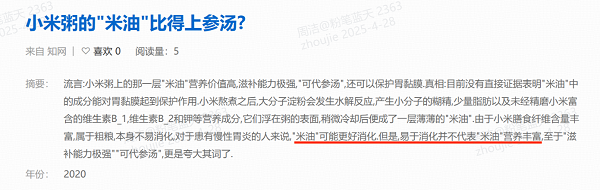

④该条件指出米油对胃黏膜没有明显的保护作用，直接削弱论点。

因此，最能质疑观点的组合是②③④。

故正确答案为D。

### 第 89 题

AI助手在医学应用上有着明显的优势：放射科医生每天要阅读并分析大量的影像，医生会因为疲劳导致效率降低，AI助手则不会，它甚至比人眼能更加迅捷地找到影像中的可疑病变，帮助医生做出初步诊断。

以下哪项如果为真，最能支持上述结论?

A. 甲医院医生借助AI技术将疑难影像分类归档

B. 乙医院呼吸科借助AI助手完成了一次远程会诊

C. 丙医院放射科利用AI技术半天就可完成对200多个患者的影像诊断

D. 丁医院借助AI助手检测出远程会诊患者胸腔部位的异常征象，并为其确定治疗方案

第 89 题 · 答案与解析

**参考答案（粉笔题库参考内容）**

C

**解析**

第一步：找出论点和论据。

论点：AI助手在医学应用上有着明显的优势。

论据：放射科医生每天要阅读并分析大量的影像，医生会因为疲劳导致效率降低，AI助手则不会，它甚至比人眼能更加迅捷地找到影像中的可疑病变，帮助医生做出初步诊断。

本题论据讨论的是AI助手与医生相比更不会疲劳、效率更高，可以更快帮助医生做出诊断，论点讨论的是AI助手有着明显的优势，论点和论据话题一致，加强优先考虑补充论据。

第二步：逐一分析选项。

A项：甲医院医生借助AI助手将影像分类归档，但是并未和人类医生做比较，故无法判断AI助手是否在医学应用上有着明显的优势，无法加强，排除；

B项：乙医院借助AI助手完成了一次远程会诊，但是并未和人类医生做比较，故无法判断AI助手是否在医学应用上有着明显的优势，无法加强，排除；

C项：丙医院的放射科利用AI技术半天就可完成200多个患者的诊断，体现了AI助手不会疲惫，能更快帮助医生做出初步诊断，补充论据，可以加强，当选；

D项：丁医院借助AI助手完成对患者的诊断并确定治疗方案，但是并未和人类医生做比较，故无法判断AI助手是否在医学应用上有着明显的优势，无法加强，排除。

故正确答案为C。

### 第 90 题

研究表明，肉食中的化合物可能引发部分儿童气喘，进而导致哮喘或其他呼吸道疾病。这些化合物被称作“晚期糖基化终产物”，是肉类在高温烤炸烘焙时释放出的物质。所以，素食或者少吃肉可避免儿童患哮喘的风险。

以下哪项如果为真，最能质疑上述观点？

A. 肉类在非高温烤炸烘焙情况下，不产生晚期糖基化终产物，与哮喘的关联性未知

B. 科学家研究显示，体内的晚期糖基化终产物主要来自于但又并非仅仅来自于肉类

C. 晚期糖基化终产物除导致哮喘外，还能加速人体衰老，引发各种慢性退化性疾病

D. 晚期糖基化终产物作为一种蛋白质，在人体中自然生成，并随着年龄的增长不断积聚

第 90 题 · 答案与解析

**参考答案（粉笔题库参考内容）**

B

**解析**

第一步：找出论点和论据。

论点：素食或者少吃肉可避免儿童患哮喘的风险。

论据：肉食中的化合物可能引发部分儿童气喘，进而导致哮喘或其他呼吸道疾病。这些化合物被称作“晚期糖基化终产物”，是肉类在高温烤炸烘焙时释放出的物质。

论据提出肉类烤炸烘焙时产生的晚期糖基化终产物可能引发部分儿童哮喘，论点认为素食或者少吃肉可避免儿童患哮喘的风险，二者话题一致，削弱优先考虑否定论点。

第二步：逐一分析选项。

A项：非高温烤炸烘焙肉类与哮喘关联性未知，因此素食或者少吃肉能否避免儿童患哮喘的风险并不明确，不明确选项，排除；

B项：指出晚期糖基化终产物并非仅仅来自于肉类，说明其他途径也会产生晚期糖基化终产物，只是素食或者少吃肉并不能“避免”儿童患哮喘的风险，可以削弱，保留；

C项：指出晚期糖基化终产物会带来其他不好的作用，与素食或者少吃肉可避免儿童患哮喘的风险无关，无法削弱，排除；

D项：指出晚期糖基化终产物在人体中自然生成，说明晚期糖基化终产物不是仅通过吃肉得到的，人体本身也会产生该物质，只是素食或者少吃肉并不能“避免”儿童患哮喘的风险，可以削弱，保留；

对比B、D两项，B、D两项都是从除了肉类之外还有其他途径会产生晚期糖基化终产物的角度来进行削弱；但题干论点是素食或者少吃肉可避免“儿童”患哮喘，D项的潜台词是人年龄越来越大，晚期糖基化终产物不断积聚，可能避免不了得哮喘，问题是到多大年纪，积聚了多少，才会得哮喘呢？如果是积聚到儿童阶段，就会得哮喘，那能削弱论点，说明素食或者少吃肉不可避免“儿童”患哮喘；但如果积聚到中老年阶段，才会得哮喘，那就与论点主体无关了，不确定素食或者少吃肉能不能避免“儿童”阶段患哮喘，综上所述B项比D项更明确。

故正确答案为B。

### 第 91 题

所有卫星在返回地球大气层时都会焚毁并产生氧化铝微粒，这些微粒会在大气层中飘浮很长时间，最终对环境造成影响。目前大约有6000颗人造卫星环绕地球旋转，其中60%的卫星已经停止运行，成为太空垃圾。专家警告称，随着人类不断发射卫星和太空飞船，太空垃圾极有可能坠向地球。据此科学家认为，应致力于研发木制人造卫星。

以下哪项如果为真，最能支持上述观点？

A. 1969年-2006年，我国发射的返回式卫星，其隔热罩由浸渍白橡木制成，1500℃时可安全燃烧

B. 木头不会阻挡电磁波或地球磁场，天线可放置在木制卫星主体内部，使卫星设计更加简单

C. 科学家已筛选出能有效承受极端温度和空间辐射轰击、可做卫星主体结构的合适木质材料

D. 木制卫星在回收时可直接燃烧，不会向地球大气层释放有害物质，也不会向地面倾泻碎片

第 91 题 · 答案与解析

**参考答案（粉笔题库参考内容）**

D

**解析**

第一步：找出论点和论据。

论点：应致力于研发木制人造卫星。

论据：随着人类不断发射卫星和太空飞船，太空垃圾极有可能坠向地球。

论点讨论的是应该研发木制人造卫星，论据讨论的是卫星等太空垃圾可能产生的危害，二者话题不一致，加强优先考虑搭桥。

第二步：逐一分析选项。

A项：该项说的是我国发射的返回式卫星可安全燃烧，但是并未说明是否会对环境造成影响，话题不一致，无法加强，排除；

B项：该项说的是木制卫星的设计更加简单，但是并未说明木制卫星对环境的影响程度，话题不一致，无法加强，排除；

C项：该项说的是科学家已筛选出可做卫星主体结构的合适木质材料，但是并未说明木制卫星对环境的影响程度，话题不一致，无法加强，排除；

D项：该项说木制卫星在回收时可直接燃烧，不会产生危害，在论据“卫星等太空垃圾可能产生的危害”与论点“木制卫星”之间建立联系，为搭桥项，当选。

故正确答案为D。

### 第 92 题

专家发现，传播疟疾的蚊子被人的气味分子吸引，抗击疟疾的设备负责消除空气中的人体气味，在人体周围制造一个范围为2平方米的电场，让气味分子掉落在地上。这样，传播疟疾的蚊子就找不到它们的猎物了，因为它们在没有气味的空间中会迷失方向。

以下哪项如果为真，最能支持上述观点？

A. 科学家已成功研发出吸引疟疾蚊子的芳香物质，可直接引诱和杀死这些蚊子

B. 现有实验已证实，传播疟疾的蚊子对疟疾患者散发出的人体气味特别感兴趣

C. 传播疟疾的蚊子必须长时间大量吸食血液才能获得繁殖的能量

D. 带疟疾病毒的蚊子无法嗅到人体气味，就会拒绝进食直至死亡

第 92 题 · 答案与解析

**参考答案（粉笔题库参考内容）**

D

**解析**

第一步：找出论点和论据。

论点：抗击疟疾的设备负责消除空气中的人体气味（即在人体周围制造一个范围为2平方米的电场，让气味分子掉落在地上），这样传播疟疾的蚊子就找不到它们的猎物了。

论据：传播疟疾的蚊子在没有气味的空间中会迷失方向。

论点和论据在讨论消除人体气味对传播疟疾的蚊子的影响，话题一致，考虑补充论据，可以通过解释原因或举例进行加强。

第二步：逐一分析选项。

A项：该项指出芳香物质可直接引诱和杀死传播疟疾的蚊子，与论点中消除人体气味对传播疟疾的蚊子的影响无关，话题不一致，无法加强，排除；

B项：该项指出传播疟疾的蚊子对疟疾患者散发出的人体气味感兴趣，并未说明消除人体气味是否会影响到传播疟疾的蚊子找到猎物，话题不一致，无法加强，排除；

C项：该项指出传播疟疾的蚊子如何获得繁殖的能量，与论点中消除人体气味对传播疟疾的蚊子的影响无关，话题不一致，无法加强，排除；

D项：该项指出带疟疾病毒的蚊子无法嗅到人体气味，就会拒绝进食直至死亡，解释了为什么抗击疟疾的设备消除人体气味后就能使得传播疟疾的蚊子找不到它们的猎物了，属于解释原因，可以加强，当选。

故正确答案为D。

### 第 93 题

黄烷醇是存在于许多水果，蔬菜和可可中的小分子物质，人们在日常生活中会很容易摄入含有黄烷醇的食物。如果食用富含黄烷醇的食物，将会促进心血管功能。心血管功能改善有助于提高脑血管功能。某种物质有益于脑血管功能，则会对认知功能产生积极影响。

由此可以推出：

A. 如果要改善心血管功能，就要食用富含黄烷醇的食物

B. 如果要改善脑血管功能，就要食用富含黄烷醇的食物

C. 如果要改善认知功能，就要食用富含黄烷醇的食物

D. 如果要食用富含黄烷醇的食物，就对认知功能产生积极影响

第 93 题 · 答案与解析

**参考答案（粉笔题库参考内容）**

D

**解析**

第一步：翻译题干。

①食用富含黄烷醇的食物→促进心血管功能；

②心血管功能改善→提高脑血管功能；

③有益于脑血管功能→对认知功能产生积极影响。

将①②③串联起来可以递推出：④食用富含黄烷醇的食物→促进心血管功能→提高脑血管功能→对认知功能产生积极影响。

第二步：逐一分析选项。

A项：翻译为改善心血管功能→食用富含黄烷醇的食物，是对条件①的肯后，但肯后得不到确定性的结论，无法推出，排除；

B项：翻译为改善脑血管功能→食用富含黄烷醇的食物，是对条件④的肯后，但肯后得不到确定性的结论，无法推出，排除；

C项：翻译为改善认知功能→食用富含黄烷醇的食物，是对条件④的肯后，但肯后得不到确定性的结论，无法推出，排除；

D项：翻译为食用富含黄烷醇的食物→对认知功能产生积极影响，是对条件④的肯前，肯前必肯后，可以推出，当选。

故正确答案为D。

### 第 94 题

某实验结果表明：源于植物的“天然化合物”组合可以分解新冠病毒与人细胞相连的刺突蛋白，从而能非常有效地抑制新冠病毒，该化合物组合很可能对抑制暴露在新冠病毒环境中的人群遭受感染方面具有立竿见影的效果。

要得到上述研究推论，还需基于以下哪一前提：

A. 新冠病毒的刺突蛋白会随着传播过程发生突变

B. 新冠病毒主要是通过呼吸道飞沫和密切接触而传播

C. 刺突蛋白是病毒本身将其侵入人体细胞的组成部分

D. 刺突蛋白变异会使传染性更强，药物是否有效还待验证

第 94 题 · 答案与解析

**参考答案（粉笔题库参考内容）**

C

**解析**

第一步：找出论点和论据。

论点：源于植物的“天然化合物”组合可以分解新冠病毒与人细胞相连的刺突蛋白，从而能非常有效地抑制新冠病毒，该化合物组合很可能对抑制暴露在新冠病毒环境中的人群遭受感染方面具有立竿见影的效果。

论据：无。

本题论点讨论了“天然化合物”组合可以分解新冠病毒与人细胞相连的刺突蛋白，从而能有效地抑制新冠病毒，无明显论据，且提问方式为前提，加强优先考虑补充必要条件。

第二步：逐一分析选项。

A项：选项强调的是新冠病毒的刺突蛋白会发生突变，论点讨论的是“天然化合物”组合可以分解新冠病毒与人细胞相连的刺突蛋白，从而能有效地抑制新冠病毒，话题不一致，不是论点成立的前提条件，排除；

B项：选项讨论的是新冠病毒的传播方式，论点讨论的是“天然化合物”组合可以分解新冠病毒与人细胞相连的刺突蛋白，从而能有效地抑制新冠病毒，话题不一致，不是论点成立的前提条件，排除；

C项：选项表明刺突蛋白是病毒本身将其侵入人体细胞的组成部分，结合论点可以确认“天然化合物”组合能够用于分解新冠病毒与人细胞相连的刺突蛋白，说明该方法具有可行性，是论点成立的前提条件，当选；

D项：选项重点强调的是现有药物是否有效有待验证，但不明确现有药物是否用到了“天然化合物”组合且是否能够有效地抑制新冠病毒，不是论点成立的前提条件，排除。

故正确答案为C。

### 第 95 题

三位房东甲、乙、丙将自己的房子分别租给租客小李、小张、小王。甲说他租给的是小李；小李说他租的是丙的房子；丙说他租给的是小王。

若这三人均没有说真话，则下列选项正确的是：

A. 房东乙将房子租给了小张

B. 房东丙将房子租给了小李

C. 小王租的是房东乙的房子

D. 小李租的是房东乙的房子

第 95 题 · 答案与解析

**参考答案（粉笔题库参考内容）**

D

**解析**

第一步：分析题干条件。

（1）甲房租给小李；

（2）小李租丙房；

（3）丙房租给小王；

（4）三个人都没说真话。

第二步：根据题干信息进行推理。

三人都说假话，首先把假话变成真话为：

（1）甲房没租给小李；

（2）小李没租丙房；

（3）丙房没租给小王。

根据最大信息，条件（1）、（2）都提到小李，即小李没租甲房和丙房，则小李一定租的是乙房。

故正确答案为D。

## 材料 1

某公司全年销售甲、乙、丙、丁四种产品的销量，单位成本和销售单价如下：

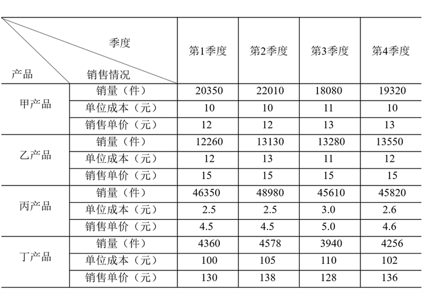

### 第 96 题

某公司全年销量最大的是：

A. 甲产品

B. 乙产品

C. 丙产品

D. 丁产品

第 96 题 · 答案与解析

**参考答案（粉笔题库参考内容）**

C

**解析**

定位表格材料可得：甲产品第1—4季度销量分别为20350件、22010件、18080件、19320件；乙产品第1—4季度销量分别为12260件、13130件、13280件、13550件；丙产品第1—4季度销量分别为46350件、48980件、45610件、45820件；丁产品第1—4季度销量分别为4360件、4578件、3940件、4256件。比较发现，丙产品每个季度的销量在四种产品中都是最大的，根据全年销量=第1季度+第2季度+第3季度+第4季度，可得丙产品全年销量最大。

故正确答案为C。

### 第 97 题

某公司全年销售价格波动绝对值最大的是：

A. 甲产品

B. 乙产品

C. 丙产品

D. 丁产品

第 97 题 · 答案与解析

**参考答案（粉笔题库参考内容）**

D

**解析**

定位表格材料可得：甲产品销售单价的最大值和最小值分别为13元、12元；乙产品4个季度销售单价都是15元；丙产品销售单价的最大值和最小值分别为5.0元、4.5元；丁产品销售单价的最大值和最小值分别为138元、128元；根据波动的绝对值=最大值-最小值，可得甲产品销售价格波动的绝对值为13-12=1，乙产品为0，丙产品为5.0-4.5=0.5，丁产品为138-128=10。故全年销售价格波动绝对值最大的是丁产品。

故正确答案为D。

备注：波动在数学理论上应该算方差，结合公考一贯的命题思路，不涉及复杂计算，可以将波动理解为变化，变化的绝对值最大，即差值最大。

### 第 98 题

对于某公司丁产品，季度销售总额占全年销售总额比重最大的是：

A. 第1季度

B. 第2季度

C. 第3季度

D. 第4季度

第 98 题 · 答案与解析

**参考答案（粉笔题库参考内容）**

B

**解析**

根据题干“······季度销售总额占全年销售总额比重最大的是”，可判定本题为现期比重问题。定位表格材料可得：丁产品第1—4季度销量分别为4360件、4578件、3940件、4256件；销售单价分别为130元、138元、128元、136元。比较发现，第2季度销量和销售单价在4个季度里都是最大的，根据销售总额=销售单价×销量可得，丁产品第2季度的销售总额最大。再根据比重=部分/整体，整体相同，部分越大，比重越大；全年销售总额相同，丁产品第2季度的销售总额最大，故第2季度销售总额占的比重最大。

故正确答案为B。

### 第 99 题

以下图形中，能够表示某公司甲产品四个季度销售利润趋势的是：

A. 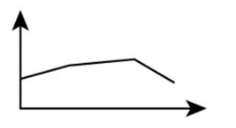

B. 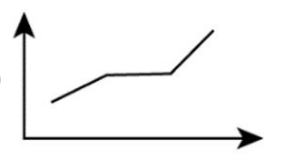

C. 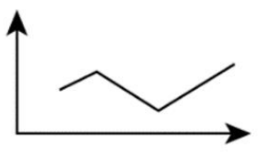

D. 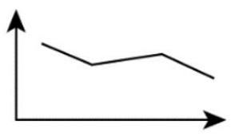

第 99 题 · 答案与解析

**参考答案（粉笔题库参考内容）**

C

**解析**

定位表格材料，甲产品四个季度的销量分别为20350件、22010件、18080件、19320件，单位成本分别为10元、10元、11元、10元，销售单价分别为12元、12元、13元、13元。根据利润总额=单件利润×销量=(销售单价-单位成本)×销量，可知甲产品四个季度的利润总额分别为元、元、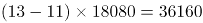元、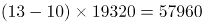元，趋势为上升、下降、上升，符合此规律的只有C项。

故正确答案为C。

### 第 100 题

根据资料，下列选项说法正确的是：

A. 在四种产品中，甲产品的利润率最高

B. 乙产品的销量在四个季度有升有降

C. 由于丙产品每季度单位产品利润没有变化，所以每个季度的利润总额也没有发生变化

D. 在四种产品中，销售总额占全年全公司销售总额比重最大的是丁产品

第 100 题 · 答案与解析

**参考答案（粉笔题库参考内容）**

D

**解析**

A项：定位表格材料，甲产品四个季度的单位成本依次为10元、10元、11元、10元，销售单价依次为12元、12元、13元、13元，丙产品四个季度的单位成本依次为2.5元、2.5元、3.0元、2.6元，销售单价依次为4.5元、4.5元、5.0元、4.6元。由利润率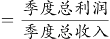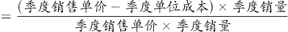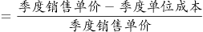得，甲产品四个季度的利润率分别为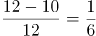、、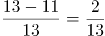、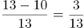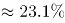，甲产品全年的利润率可以看成四个季度利润率的混合，根据总体混合居中，甲产品全年的利润率应介于15.4%~23.1%之间。同理，丙产品四个季度的利润率分别为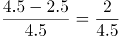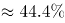、、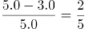=40%、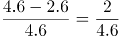，则丙产品的利润率应介于40%~44.4%之间，则丙产品的利润率大于甲产品的利润率，甲产品的利润率并非最高，错误；

B项：定位表格材料，乙产品四个季度的销量分比为12660件、13130件、13280件、13550件，可知乙产品的销量在四个季度中均为上升，错误；

C项：定位表格材料，丙产品第1季度、第2季度的销量分别为46350件、48980件，单位成本分别为2.5元、2.5元，销售单价分别为4.5元、4.5元，根据利润总额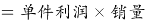，虽然单位利润不变，但销量变化，所以第1季度、第2季度的利润总额是不一样的，错误；

D项：根据比重=部分/整体，整体（全年全公司销售总额）相同，只需比较部分（各产品销售总额）即可，再根据销售总额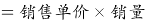，定位表格材料，可知甲产品的销售总额为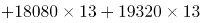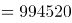元，乙产品的销售总额为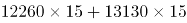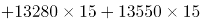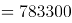元，丙产品的销售总额为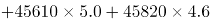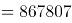元，丁产品的销售总额为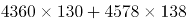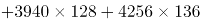元，则丁产品的销售总额最大，故占比也最高，正确。

故正确答案为D。

## 材料 2

### 第 101 题

2009年-2019年，城镇非私营单位和私营单位平均工资差额最大的年份是：

A. 2009年

B. 2013年

C. 2016年

D. 2019年

第 101 题 · 答案与解析

**参考答案（粉笔题库参考内容）**

D

**解析**

定位图1可知，2009年-2019年我国城镇私营和非私营单位就业人员的平均工资。选项各年份对应的城镇非私营单位和私营单位平均工资差额计算如下：

A项（2009年）：元；

B项（2013年）：元；

C项（2016年）：元；

D项（2019年）：元。

因此，平均工资差额最大的年份是2019年。

故正确答案为D。

### 第 102 题

与2009年相比，2019年城镇非私营单位就业人员平均工资增长的倍数约为：

A. 1.5倍

B. 1.8倍

C. 2.8倍

D. 3.2倍

第 102 题 · 答案与解析

**参考答案（粉笔题库参考内容）**

B

**解析**

根据题干“与2009相比，2019年······增长的倍数约为”，可判定本题为一般增长率计算问题。定位图1可知，2009年、2019年城镇非私营单位就业人员平均工资分别为32244元、90501元。根据增长率，所求增长率≈583/320≈182%=1.82倍，即增长的倍数约为1.8倍。

故正确答案为B。

### 第 103 题

2019年城镇非私营单位工资低于当年非私营单位平均工资的行业有：

A. 9个

B. 12个

C. 15个

D. 16个

第 103 题 · 答案与解析

**参考答案（粉笔题库参考内容）**

A

**解析**

定位折线图可知，2019年城镇非私营单位就业人员平均工资为90501元；定位统计表可知，2019年我国各行业城镇非私营单位就业人员的平均工资，故2019年城镇非私营单位工资低于当年非私营单位平均工资的行业有：农、林、牧、渔业，制造业，建筑业，批发和零售业，住宿和餐饮业，房地产业，租赁和商务服务业，水利、环境和公共设施管理业以及居民服务和其他服务业，一共9个行业。

故正确答案为A。

### 第 104 题

2009年-2019年，城镇私营单位平均工资年均增长率最高的是：

A. 科学研究、技术服务和地质勘查业

B. 信息传输、计算机服务和软件业

C. 金融业

D. 建筑业

第 104 题 · 答案与解析

**参考答案（粉笔题库参考内容）**

B

**解析**

根据题干“······年均增长率最高”，可判定本题为年均增长率问题。定位统计表可知，2009年和2019年我国各行业城镇私营单位就业人员的平均工资。根据年均增长率公式：可得，n（年份差：2009年-2019年）相同，只需比较现期量/基期量即可，即现期量/基期量越大，年均增长率越大。则科学研究、技术服务和地质勘查业：现期量/基期量=2+；信息传输、计算机服务和软件业：现期量/基期量；金融业：现期量/基期量=2+；建筑业：现期量/基期量=2+，故2009年-2019年信息传输、计算机服务和软件业的平均工资年均增长率最高。

故正确答案为B。

### 第 105 题

下列选项说法正确的是：

A. 2009年-2019年，城镇私营单位平均工资年均增长速度快于非私营单位平均工资年均增长速度

B. 2009年-2019年，城镇非私营单位的各行业平均工资均高于私营单位相应行业的平均工资

C. 2019年非私营采矿业的平均工资最接近全社会平均工资，所以该行业内部分配最公平

D. 2019年城镇私营单位行业之间薪资差额最大的有3.6倍

第 105 题 · 答案与解析

**参考答案（粉笔题库参考内容）**

A

**解析**

A项：定位折线图可知，城镇非私营单位平均工资2009年为32244元，2019年为90501元；城镇私营单位平均工资2009年为18199元，2019年为53604元。根据年均增长率公式：可得，n（年份差：2009年-2019年）相同，只需比较现期量/基期量即可，即现期量/基期量越大，年均增长率越大。则非私营单位：现期量/基期量≈2.83；私营单位：现期量/基期量≈2.98，故2009年-2019年，城镇私营单位平均工资年均增长速度快于非私营单位，正确；

B项：定位统计表可知，2009年农、林、牧、渔业私营单位平均工资为14585元，非私营单位为14356元，非私营平均工资并非均高于私营，且题干要求的是2009年-2019年，但材料只给了2009年和2019年的数据，中间年份的平均工资无法得知，错误；

C项：材料中没有说明全社会的平均工资，且没有提及行业内部分配问题，故无法推出，错误；

D项：材料未给出2019年公共管理和社会组织的城镇私营单位平均工资，故不能确定2019年城镇私营单位行业的最高薪资和最低薪资，故无法推出，错误。

故正确答案为A。

## 材料 3

2020年，我国规模以上互联网和相关服务企业（以下简称互联网企业）业务收入12838亿元，同比增长12.5%，增速低于上年同期8.9个百分点。

2020年，互联网企业实现营业利润1187亿元，同比增长13.2%，增速低于上年同期3.7个百分点；得益于成本控制较好，营业成本仅增长2.4%，行业营业利润高出同期收入增速0.7个百分点。

2020年，互联网企业信息服务收入共7068亿元，同比增长11.5%，增速低于上年同期11.2个百分点。互联网接入及相关服务收入447.5亿元，同比增长11.5%，增速低于上年同期20.8个百分点；互联网数据服务（包括云服务、大数据服务等）收入199.8亿元，同比增长29.5%，增速较上年同期提高3.9个百分点。

2020年，东部地区互联网业务收入11227亿元，同比增长14.8%，增速较上年同期回落9个百分点，中部地区互联网业务收入448.1亿元，同比增长3.4%，增速较上年同期回落53.1个百分点。西部地区互联网业务收入497.2亿元，同比增长6.9%，增速较上年同期回落15.2个百分点。东北地区互联网业务收入47.1亿元，同比增长9.1%。

2020年，互联网业务累计收入居前5名的广东（增长5.2%）、北京（增长21.5%）、上海（增长20.9%）、浙江（增长24.4%）和江苏（增长8.0%）共完成互联网业务收入10706亿元，同比增长15.1%，增速超过全国平均水平2.6个百分点，占全国（扣除跨地区企业）比重达87.6%，占比较上年同期提高0.8个百分点。

### 第 106 题

2020年，互联网企业收入同比约增长了：

A. 1187亿元

B. 1309亿元

C. 1426亿元

D. 1605亿元

第 106 题 · 答案与解析

**参考答案（粉笔题库参考内容）**

C

**解析**

根据题干“2020年，······同比约增长了”，结合选项有具体单位，可判定本题为增长量计算问题。定位文字材料第一段，“2020年，我国规模以上互联网和相关服务企业（以下简称互联网企业）业务收入12838亿元，同比增长12.5%”。代入公式：增长量，可得2020年，互联网企业收入同比增长量亿元。

故正确答案为C。

### 第 107 题

2019年，互联网企业互联网接入及相关服务收入同比增速比同年信息服务收入同比增速：

A. 高不到10个百分点

B. 高10个百分点以上

C. 低不到10个百分点

D. 低10个百分点以上

第 107 题 · 答案与解析

**参考答案（粉笔题库参考内容）**

A

**解析**

定位文字材料第三段，“2020年，互联网企业信息服务收入······同比增长11.5%，增速低于上年同期11.2个百分点。互联网接入及相关服务收入······同比增长11.5%，增速低于上年同期20.8个百分点”。因此，2019年，互联网接入及相关服务收入同比增速为11.5%+20.8%=32.3%；互联网企业信息服务收入同比增速为11.5%+11.2%=22.7%。32.3%-22.7%=9.6%，则2019年，互联网企业互联网接入及相关服务收入同比增速比同年信息服务收入同比增速高不到10个百分点。

故正确答案为A。

### 第 108 题

在东部、中部、西部和东北四个地区中，2019年和2020年互联网业务收入占全国比重均高于上年水平的地区有几个？

A. 0

B. 1

C. 2

D. 3

第 108 题 · 答案与解析

**参考答案（粉笔题库参考内容）**

B

**解析**

根据题干“2019年和2020年······占全国比重均高于去年水平······”，可判定本题为两期比重比较问题。定位文字材料第一段，“2020年，我国······互联网企业收入······同比增长12.5%，增速低于上年同期8.9个百分点”，定位文字材料第四段，“2020年，东部地区互联网业务收入······同比增长14.8%，增速较上年同期回落9个百分点，中部地区······同比增长3.4%······。西部地区······同比增长6.9%······。东北地区······同比增长9.1%”。根据两期比重比较结论“部分增速快于整体增速，则比重上升”，比较可知：2020年互联网业务收入同比增速只有东部地区（14.8%）快于全国（12.5%），比重上升；2019年，东部地区互联网业务收入同比增速为14.8%+9%=23.8%，快于全国（12.5+8.9%=21.4%），则2019年东部地区的比重也上升。因此，2019年和2020年互联网业务收入占全国比重均高于上年水平的地区有1个。

故正确答案为B。

### 第 109 题

2020年，东部地区除广东、北京、上海、浙江和江苏之外的省市互联网业务收入约比2019年：

A. 增长9%

B. 增长19%

C. 减少9%

D. 减少19%

第 109 题 · 答案与解析

**参考答案（粉笔题库参考内容）**

A

**解析**

根据题干“2020年······比2019年······”，结合选项为增长/减少+%，且东部地区=广东、北京、上海、浙江、江苏+其他东部地区，可判定本题为混合增长率问题。定位文字材料第四段可知：2020年，东部地区完成互联网业务收入11227亿元，同比增长14.8%；定位文字材料第五段可知：2020年，互联网业务累计收入居前5名的广东、北京、上海、浙江和江苏共完成互联网业务收入10706亿元，同比增长15.1%。则2020年，东部地区除广东、北京、上海、浙江、江苏的其他地区完成互联网业务收入11227-10706=521亿元。令东部地区除广东、北京、上海、浙江、江苏的其他地区完成互联网业务收入同比增速为r，根据线段法：距离与量成反比（一般用现期量近似代替基期量），可得：，即，解得，最接近A项。

故正确答案为A。

### 第 110 题

关于我国互联网企业业务状况，能够从上述资料中推出的有几条？

①2019年实现利润超过1000亿元

②2020年，互联网数据服务收入比2018年增长了不到70%

③2018年及2019年，中部地区互联网业务收入均低于西部地区

A. 0

B. 1

C. 2

D. 3

第 110 题 · 答案与解析

**参考答案（粉笔题库参考内容）**

D

**解析**

①：定位文字材料第二段“2020年，互联网企业实现营业利润1187亿元，同比增长13.2%”。根据基期计算公式：基期量，可知2019年实现利润为亿元，正确；

②：定位文字材料第三段可知，2020年，互联网数据服务（包括云服务、大数据服务等）收入199.8亿元，同比增长29.5%，增速较上年同期提高3.9个百分点。则2019年增长率为29.5%-3.9%=25.6%，根据间隔增长率公式：，可知2020年互联网数据服务收入比2018年增长<70%，正确；

③：定位文字材料第四段可知，（2020年）中部地区互联网业务收入448.1亿元，同比增长3.4%，增速较上年同期回落53.1个百分点。西部地区互联网业务收入497.2亿元，同比增长6.9%，增速较上年同期回落15.2个百分点。则2019年中、西部地区互联网业务收入同比增速分别为3.4%+53.1%=56.5%、6.9%+15.2%=22.1%。根据公式：基期量=，可得2019年中、西部地区互联网业务收入分别为亿元、亿元，435亿元（中部）<465亿元（西部），即2019年中部地区互联网业务收入低于西部地区；同理，2018年中、西部地区互联网业务收入分别为亿元、亿元，435/1.57亿元（中部）<465/1.22亿元（西部），即2018年中部地区互联网业务收入低于西部地区，正确。

故正确答案为D。

## 材料 4

### 第 111 题

2020年下半年，全国公路货运量高于上月水平的月份有几个？

A. 2

B. 3

C. 4

D. 5

第 111 题 · 答案与解析

**参考答案（粉笔题库参考内容）**

B

**解析**

定位柱状图可知：2020年下半年，全国公路货运量高于上月水平的月份有8月、9月、11月3个。

故正确答案为B。

### 第 112 题

2020年第二季度，全国货物周转量约比第一季度增长了：

A. 40%

B. 51%

C. 62%

D. 73%

第 112 题 · 答案与解析

**参考答案（粉笔题库参考内容）**

D

**解析**

根据“2020年第二季度······比第一季度增长了”，结合选项为百分数，可判定本题为一般增长率计算问题。定位折线图可知：2020年第一季度全国货物周转量=9200亿吨公里；第二季度全国货物周转量亿吨公里。根据增长率，可得2020年第二季度，全国货物周转量约比第一季度增长了=68/92≈74%，与D项最接近。

故正确答案为D。

### 第 113 题

2020年，我国公路货物周转量累计达1万亿吨公里/2万亿吨公里/3万亿吨公里分别在：

A. 3月 5月 7月

B. 4月 6月 8月

C. 4月 6月 7月

D. 3月 5月 8月

第 113 题 · 答案与解析

**参考答案（粉笔题库参考内容）**

C

**解析**

定位折线图：2020年，累计到4月我国公路货物周转量亿吨公里＞1万亿吨公里，即在4月我国公路货物周转量累计达1万亿吨公里（由上一小题可知2020年第一季度全国货物周转量约9200亿吨公里，不到1万亿吨公里），排除A、D两项；结合选项，B、C两项达到2万亿吨公里均在6月，不用计算；累计到7月，我国公路货物周转量=1至4月+5月+6月+7月亿吨公里＞3万亿吨公里，即在7月我国公路货物周转量累计达3万亿吨公里。

故正确答案为C。

### 第 114 题

2020年各季度公路货物平均运输距离最高的季度是：

A. 第一季度

B. 第二季度

C. 第三季度

D. 第四季度

第 114 题 · 答案与解析

**参考答案（粉笔题库参考内容）**

B

**解析**

根据题干“2020年各季度公路货物平均运输距离最高的季度是”，根据备注可知，货物平均运输距离，可判定本题为现期平均数比较问题。定位统计图可得，2020年各月份公路货物周转量与货运量，分别计算各季度货物平均运输距离进行比较即可。

第一季度：公里；第二季度：公里；第三季度：公里；第四季度：公里。

比较可知，第二季度公路货物平均运输距离最高。

故正确答案为B。

### 第 115 题

关于2020年全国公路货物运输情况的描述，可以推出的是：

A. 2月份货运平均运输距离在170-175公里

B. 全年日均货运量多于1亿吨的月份有6个

C. 3月份货物周转量比2月份多200%以上

D. 全年月均货运量超过30亿吨

第 115 题 · 答案与解析

**参考答案（粉笔题库参考内容）**

B

**解析**

A项：定位统计图材料可得，2020年2月份公路货物周转量1396.4亿吨公里，货运量为8.27亿吨，货物平均运输距离≈169公里，不在170-175公里范围内，错误；

B项：定位统计图材料可得，2020年1-12月货运量分别为21.07、8.27、23.53、29.05、30.43、30.85、30.81、32.52、34.04、33.07、35.24、33.73亿吨，2020年1-12月所对应的天数分别为31、29、31、30、31、30、31、31、30、31、30、31天，则日均货运量多于1亿吨的有6月、8月、9月、10月、11月、12月，共计6个月份，正确；

C项：定位统计图材料可得，2020年2月份公路货物周转量1396.4亿吨公里，3月份为4141.3亿吨公里，3月份货物周转量比2月份多，即不到200%，错误；

D项：定位统计图材料可得，2020年月均货运量为\<30亿吨，错误。

故正确答案为B。

