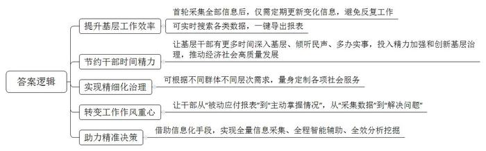
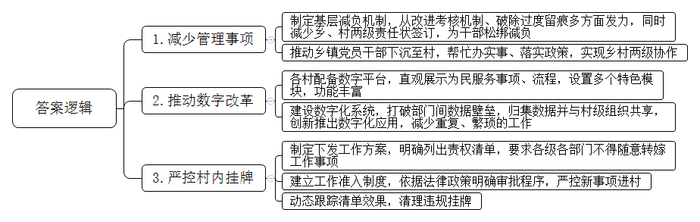
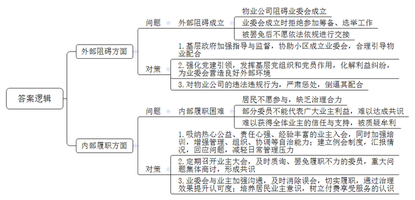
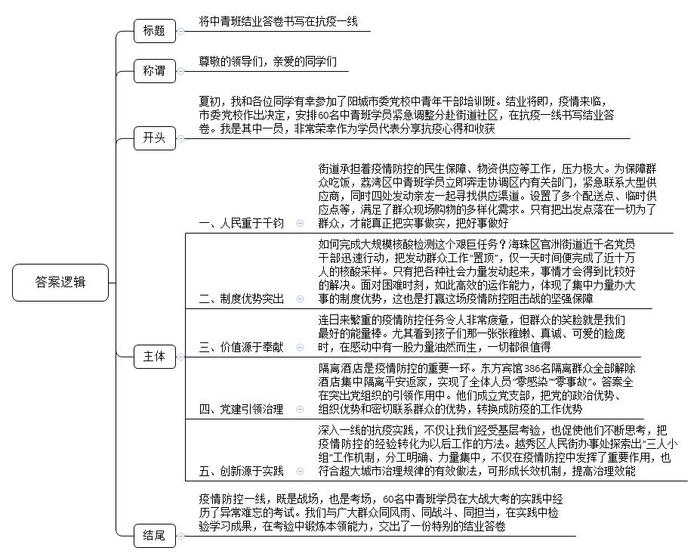

# 2022年公务员多省联考《申论》题（新疆县乡卷）

<!-- gwy:overview:start -->
> **新疆 · 2022 · 申论 · 县乡卷** ｜ 4 题 · 图片 4 处 · 答案随题折叠

导航：[题目](#题目) · [材料 1](#材料-1)
<!-- gwy:overview:end -->

> 候选采集稿。参考答案及解析来自粉笔页面，不代表官方答案或真实高分答卷；来源使用许可与原卷对应关系仍需人工核实。

## 给定材料

### 材料 1

进入年底，评议总结、考核迎检接踵而至，各类数据统计、报送频繁。但陈芳应对自如，对她来说，没有什么是“一张表”解决不了的。

陈芳是岩棋县岩棋镇解放社区党委副书记、居委会副主任。“一张表”是全县68个村、社区推行的“全量信息表”。以前，她和同事被居民戏称为“表姐”“表哥”。来自不同部门的指令一个接一个，一项工作反复采集数据，上个月才报的表这个月又要填……大家被困在办公室里，天天从一堆表格中“找不同”、搬弄数据，压根挤不出入户走访的时间。

去年年底，岩棋县委牵头多部门深入调研，提出“基层减负计划”。梳理所有业务台账，与相关部门协商，明确基层工作台账收集范围；取消针对性不强、不切合实际的统计项目，对内容交叉重复或者关联度高的进行整合，推行标准化台账目录；建立指标统一、口径一致的统计报送制度……一边清理，一边规范，几十本纸质台账最终变成了一张电子“全量信息表”，包括人、房、事、物四大类146项信息，涉及综合治理、社会保障、教育、农业等方方面面。

“全量信息表”听起来高大上，其实就是一份Excel表格。利用Excel的函数计算、数据库和结果自动更新等功能，可随时对信息进行修改、查询、排序、筛选等操作，成本低、上手快、信息准。这张表一端连着村（社区）干部，其首轮入户采集齐全部信息，之后定期入户只需对有变化的信息进行更新；另一端连着各乡镇（街道）、村（社区）管理平台，只需选择项目和关键词进行搜索，就能生成各类数据，一键导出报表。每个村（社区）指定1名维护员定期进行数据维护，同时设置秘钥权限，实行闭环管理，确保数据使用安全。

陈芳说：“全量信息表已成为岩棋县基层干部开展工作的‘神器’。”年初，陈芳上报解放社区参加全民健康体检人员名单，她在“全量信息表”中选择“年龄”和“人群分类”两个项目进行搜索，两小时就筛查了近1500人，而去年这项任务她花了近3天才完成。“通过推动信息报送网络化、集约化、无纸化，让基层干部腾出时间多下去走走、多听听民声、多办点实事，把更多精力投入到加强和创新社会治理、实现经济社会高质量发展上。”岩棋县委政法委副书记陈长彬道出“减负”的初衷。

针对辖区公租房多、老年人多、困难群众多的特点，岩棋镇滨河社区增设“困难诉求”等统计项目，因户因人施策，将低保、大病救助等惠民政策送到群众身边。针对残疾人和未成年人，提供上门办证服务，开展专题法治宣传；七星镇七星村对脱贫户文化层次、务工意愿等信息进行分析，开展职业技能培训，联系用工单位，坚持“扶上马”再“送一程”，确保稳定脱贫……有了“全量信息表”，基层干部根据不同群体不同层次的需求，为其量身定制各项社会服务，打牢精细化治理的基础。从“被动应付报表”到“主动掌握情况”，工作作风实现转变；从“采集数据”到“解决问题”，工作重心完成转移。

上面千条线，下面一根针。岩棋县积极探索出一条以“智治”推动“善治”的有效路径。借助信息化手段，通过“一张表”实现全量数据采集、全程智能辅助、全效分析挖掘，为精准决策提供依据。比如近日，岩棋县委县政府依据该表统筹安排、调配力量，仅用24小时就完成了全县12万人的核酸检测工作。

### 材料 2

回忆以往，吉石县吴官营镇贾庄村党支部书记王古相坦言：“一年要签20多个责任状。责任状多，工作压力着实不小。”吴官营镇行政综合服务中心主任李苏说：“过去，印、发、收责任状对我们来说也是负担，来来回回牵扯不少精力。”责任状过多过滥，村里干部压力很大，干事效率不高、工作效果也有待改善。去年底，吉石县制定了为基层减负的相关工作机制，从改进考核机制、破除过度留痕等方面发力，为基层干部松绑减负，激励广大干部想干事、敢干事、多干事。今年以来，以吴官营镇为代表，吉石县从改革村级组织的责任状入手，进一步减轻基层干部负担。“不光村里，现在乡镇签的责任状也变少了。乡镇党员干部有更多时间精力沉下村去，帮助村级组织办实事，乡村两级在工作上形成‘协奏’，推动了各项政策落实。”吴官营镇镇长崔佳伟说。今年以来，吉石县吴官营镇的21个村，没有签一个责任状，各项工作却没有落下，还在全县7个乡镇考核中取得第二名的好成绩。

“原来管理的事项有100多个，现在只有46个了，还有数字平台帮忙，我们不再被琐事绊住脚了。”乌横村党总支书记、村主任裘松伟很是高兴。走进乌横村村委会，可以看到“数字乌横”平台大屏幕。屏幕上直观展示农民建房、贷款、安吉白茶销售等234项为民服务事项、流程。点开“数字横溪坞”平台，可以看到“矛盾不出村、垃圾不出村、办事不出村、创业不出村”4个特色模块，每个模块都有数据自动归集等功能。裘松伟说：“村里要为村民办什么事、可以提供哪些服务，大家一看就懂、一呼就应。”通过建设数字化系统、打破数据壁垒，并在此基础上创新推出数字化应用，减少了重复的表格、证明和繁琐的工作流程。吉石县建成城市数字大脑，归集44个部门87个系统35亿条数据。有关部门和村级组织根据工作需要，可使用数据接口导入数据，大大减少信息重复收集、全面精减表格数量。吉石县大数据局联合多个部门，打通数据壁垒，建立集补贴发放与数据库功能于一体的“安心享”数字化平台，实现70项民生补贴“一键发放”，既方便了群众办事，也减少了基层干部工作量。“数据充分共享，基层重复用功自然就减少了。”吉石县民政局潘科长说。

聊起以前村委会门口挂过的牌子，凤山乡谢都村党支部书记樊兴云直言，“最多时有13个，挂牌多了，我们的负担就变重了。”为了切实减轻村级组织的负担，吉石县制定下发《推进村（社区）减负工作的实施方案》，列出了基层群众自治组织依法履行的职责事项14项、基层群众自治组织协助政府工作事项20项、村（社区）创建达标保留项目9项的责权清单。以清单为基础，要求各级各部门不得向村级组织转嫁自身职责范围内的工作事项，着力解决“谁能给村里挂牌”“哪些牌子能往村里挂”等问题。聚焦“从上往下”和“从下往上”两端，在村级事务准入和效果监控方面实行制度化、清单化、流程化管理。“从上往下”，对于新事项进村严格管控，以法律法规和政策为依据，明确事项准入审批程序，建立村（社区）工作准入制度；“从下往上”，采取定期统计、实时调研等方法对清单效果进行动态跟踪，共清理各类机构牌子200余块。

方案实施后，各级行政部门将工作随意摊派到村里的现象变少了。村干部可以向责权之外的事情说“不”，集中力量办好村里该办的事。这样的变化，樊兴云的感受更加直接。樊兴云指着村委会大门说：“如今这里只有‘一横两竖’，横起的是便民服务站标识，竖起来的是党支部和村委会的牌子，整齐又清爽！”

### 材料 3

业委会成立难、履职难，是困扰很多社区的老问题。“折腾了大半年，最后我们彻底放弃了。”谈到业委会发展中遭遇到的种种问题，宋女士说，他们克服重重困难成立了业委会，但不到一年绝大多数的委员相继辞职，业委会无法继续履职。

业委会是基层社会治理的重要载体，与居民切身利益息息相关。据统计，在市政府“领导留言板”上，反映小区管理混乱、存在安全隐患的留言数不胜数：小区院内车道两侧全停了车，没有消防通道，一旦出现火情消防车根本进不去，物业也不管；小区物业管理极差，车库淹水、电梯故障、楼栋门损坏等安全隐患突出；小区物业10多年不公开公共收支，业主多次要求均得不到回复，且有业主多次被困电梯无人值班处置，楼道没人打扫，垃圾无人处理，服务还不如老旧小区……

“依据相关法律规定，业主有权要求设立业主大会，选举产生业委会，如果没有成立业委会，业主很难针对小区公共事务发表自己的观点。”北京市物权法学研究会副会长、盛廷律师事务所主任律师毕文强说。咸东社区党委书记、居委会主任苏颖认为，业委会还是物业与群众之间沟通的桥梁，“业主与业主之间、业主与物业之间都有可能发生各种矛盾纠纷。这时，业委会就可以起到沟通桥梁作用，努力做到事了人和，避免矛盾进一步激化。”

尽管业主大多高度期待成立业主委员会，但成立过程却经常遭遇各种阻力。小区业主为了维权打算成立业委会，十几位热心业主分组请全体业主签名，但物业公司知道后，使用各种手段阻碍。小区成立业委会最突出的作用就是规范物业公司的经营行为，于是有些物业公司在业委会成立过程中不配合甚至从中作梗。苏颖说：“一个小区在街道办指导小区成立业委会的情况下，物业公司不依法参加筹备组、拒不参加业主选举大会，甚至在业委会已合法备案，集体罢免原物业、引入新的物业公司后，还不愿依法依规进行交接，对居民生活造成很大影响。”

苏颖说还有一个小区6年多两度筹备成立业委会均失败，后来在街道办事处的指导和监督下，历时4个多月终于选出业委会。业委会受到外部压力导致成立难，而成立后履职难则多半来自业主内部问题。一方面，业委会委员是否秉持公心，是否具备组织带领业主自治的品德、能力、公信力和责任心，是业委会成立并良序运转的重要条件。多数居民“不愿管事、不想管事”的心理较重，难以形成治理合力；另一方面，有的业委会委员并不能代表广大业主的利益。“业主群体的共识很重要。”毕文强认为，业委会顺利运作需要全体业主的信任与支持。

郑州大学公共管理学院特聘教授孙发锋建议：“应尽量将热心公益、责任心强、经验丰富的专业人才吸纳进业委会，为业委会提升能力水平提供人才支撑。”他提出，在业委会成立及运营过程中，可以发挥党建引领作用，充分发挥基层党组织的战斗堡垒作用和党员的先锋模范作用，妥善化解利益纠纷，为业委会营造良好的外部环境。

王瑛在上海市闵行区一个小区担任业委会主任已经5年多了。最初，街道办事处找到她，希望她作为一名党员担起领导业委会的重任。王瑛因此加入了业委会。最初也遇到不少困难，她认为要彻底改变物业服务，必须提高物业费、签约优质物业公司。小区内质疑、猜测的很多。王瑛带着业委会委员、志愿者在小区不断做说明，一家家找物业公司谈，终于找到了满意的物业公司。如今，小区面貌一新，邻里关系和谐，停车秩序井然。王瑛也得到了业主们的普遍认可。

毕文强说：“有些做得比较好的业委会每周开一次例会，邀请物业公司经理报告一周社区情况。业主可以在会上直接反映问题，物业公司经理现场回应。这样的制度建立起来后，业委会的日常管理工作就轻松下来了。”他认为，做好小区里的公共事务需要具备一定的治理能力，可以培训业委会委员，增强他们的管理、组织、协调等自治能力。同时，还要注重培养社区居民的业主意识，“比如按时缴纳物业费。让业主们充分认识到享受物业服务就要支付相应费用”。

### 材料 4

夏初，阳城市委党校中青年干部培训班（下称“中青班”），面临结业。一场突如其来的疫情，打乱了原有的结业计划，市委党校作出决定，安排60名中青班学员紧急调整分赴街道社区，在抗疫一线书写结业答卷。

荔湾区是本次疫情的重点区域，虽然经历过去年疫情，但实行封闭封控区管理，尚属首次。荔湾区花地街党工委委员、办事处副主任姚海兴回到街道承担着疫情防控的民生保障、物资供应等工作。随着疫情的发展，花地街被列入封控管理区域，辖区内群众的物资保障成为亟需解决的问题。“每天一睁眼，想到辖内3万多名居民群众的吃饭问题，就倍感压力巨大。”时间不等人。姚海兴立即奔走协调区内有关部门，紧急联系大型供应商，同时四处发动亲友一起寻找供应渠道。经过多方共同努力后，花地街在全区最快开展与电商企业合作，并在全街8个封控社区合理设置10个配送点，引进企业流动肉菜供应车，不定时在有需求的社区提供封控区内肉菜现场售卖，设置22个临时供应点，满足群众现场购物的多样化需求。“群众的需求就是我们工作的动力，解决好大家的吃饭、喝水等生活基本需求，才能安下心来共同抗疫。”姚海兴说。“这几个月更加明白了人民重千钧，只有把出发点落在一切为了群众，才能真正把实事做实，把好事做好。”他说。

这是一次与病毒赛跑的竞逐赛，一场大规模的核酸检测在广州开展，不少学员需要承担此项任务。街道常住人口超8万，工作人员却只有20来个，如何完成这个艰巨任务？在第二轮全员核酸检测中，海珠区官洲街道号召全街近千名党员干部迅速行动，把发动群众工作“置顶”。在半天时间内完成了六个采样点、两万多平方米的场地布置、人力安排、物资调配等工作，确保核酸检测工作顺利开展，仅一天时间便完成了近十万人的核酸采样。把在辖区内的党员、志愿者等发动起来共同抗疫，他真切地感受到了人民的力量是无穷的。“靠我们工作人员是无法满足群众的所有诉求，只有把各种社会力量发动起来，事情才会得到比较好的解决。这就是制度的力量。”面对困难时刻，如此高效的运作能力，体现了集中力量办大事的制度优势，这也是打赢这场疫情防控阻击战的坚强保障。

有一个场景给闫锋很大触动，医务人员到辖内幼儿园给小朋友进行核酸采样，天真的孩子们在现场用歌声向工作人员和医护人员表示敬意和感谢，让他受到了很大的触动。“看着这群孩子和医护人员的笑脸，我觉得一切都很值得。”闫锋说，虽然连日来繁重的疫情防控任务令人非常疲惫，但看到那一张张稚嫩、真诚、可爱的脸庞时，在感动中有一股力量油然而生，一切都很值得。

隔离酒店是疫情防控的重要一环，也是抗击疫情的另一个战场。东方宾馆接到集中隔离工作任务，荔湾封闭管理区鹤园小区的部分居民将转移到酒店集中隔离。越秀区副区长肖逢春担任临时党支部第一书记，第一时间成立临时党支部，把正在接受隔离医学观察的党员纳入临时党支部管理且共同开展组织生活，在党支部的坚强领导下，仅仅一天时间就完成了防疫要求的硬件设施改造，并成立专班组负责各项工作。驻守酒店期间，肖逢春履行挂点区领导职责，带领专班召开晨会，梳理前一天查摆问题，在当天解决落实问题，确保各项工作有序推进。

“我们成立党支部，就是要把党的政治优势、组织优势和密切联系群众的优势，转换成防疫的工作优势。”肖逢春说，党支部发挥了信息哨点和稳定器的作用，为隔离群众提供暖心、贴心、安心的个性化服务。目前，东方宾馆386名荔湾区的隔离群众已经全部解除酒店集中隔离平安返家，实现了全体人员“零感染”“零事故”。

深入一线的抗疫实践，不仅让中青班的学员们深入基层一线经受考验，也促使他们不断思考，把疫情防控的经验转化为以后工作的方法。越秀区人民街办事处副主任神剑负责统筹街道“三人小组”日常运作，按照重点人员管控措施要求纳入社区健康管控，及时反馈排查公安、卫健部门下发线索及健康管理情况，确保每日线索清零，没有发生人员漏管、脱管现象。

“‘三人小组’的工作机制分工明确、力量集中，不仅在疫情防控中发挥了重要作用，以后也可以成为基层治理领域的一种新机制。”在神剑看来，组织协调能力是应对社会突发事件时的重要本领，在疫情防控中形成的好经验、好做法，符合超大城市治理规律的有效做法，在以后的工作中要形成长效机制，长期坚持。比如，“三人小组背后连接着更为灵敏的信息收集、反馈、行动机制，三个人迸发出大能量。”增城区委常委、统战部部长廖平同样认为，这项工作机制背后铺开的是一张庞大的民生服务保障网络。“可以通过资源整合，让这个好机制沉淀下来，落到社区的日常，让基层治理更有效能。”

疫情防控一线，既是战场，也是考场，60名中青班学员在大战大考的实践中经历了异常难忘的考试。他们与广大群众同风雨、同战斗、同担当，在实践中检验学习成果，在考验中锻炼本领能力，交出了一份特别的结业答卷。

## 题目

### 第 1 题

**根据给定资料**1**，请谈谈“全量信息表”在岩棋****县****基层工作中所起的作用？（****15分）**

关联材料：材料 1、材料 2、材料 3、材料 4

作答要求：

要求：分析全面，准确，字数不超过250字。

第 1 题 · 答案与解析

**参考答案（粉笔题库参考内容）**

1.提升基层工作效率。首轮采集全部信息后，仅需定期更新变化信息，避免反复工作；可实时搜索各类数据，一键导出报表。

2.节约干部时间精力。让基层干部有更多时间深入基层、倾听民声、多办实事，投入精力加强和创新基层治理，推动经济社会高质量发展。

3.实现精细化治理。可根据不同群体不同层次需求，量身定制各项社会服务。

4.转变工作作风重心。让干部从“被动应付报表”到“主动掌握情况”，从“采集数据”到“解决问题”。

5.助力精准决策。借助信息化手段，实现全量信息采集、全程智能辅助、全效分析挖掘。

**解析**

**参考答案说明：**本参考答案从“提升基层工作效率”“节约干部时间精力”“实现精细化治理”“转变工作作风重心”和“助力精准决策”五个方面展开，各条答案要点之间在内容上相互并列，没有交叉。

**考点**：考点影响类

**来源**：来源2022年公务员多省联考《申论》题（新疆县乡卷）

粉笔申论页面对本题只提供「解析视频」入口，该入口是会员推广位，页面无视频地址与文字解析。

### 第 2 题

**根据给定资料**2**，请谈谈吉石县在减轻村级组织负担，激发干事****动****力方面做了哪些工作****。****（****20分）**

关联材料：材料 1、材料 2、材料 3、材料 4

作答要求：

要求：全面，准确，有条理，不超过300字。

第 2 题 · 答案与解析

**参考答案（粉笔题库参考内容）**

1.减少管理事项。制定基层减负机制，从改进考核机制、破除过度留痕多方面发力，同时减少乡、村两级责任状签订，为干部松绑减负；推动乡镇党员干部下沉至村，帮忙办实事、落实政策，实现乡村两级协作。

2.推动数字改革。各村配备数字平台，直观展示为民服务事项、流程，设置多个特色模块，功能丰富；建设数字化系统，打破部门间数据壁垒，归集数据并与村级组织共享，创新推出数字化应用，减少重复、繁琐的工作。

3.严控村内挂牌。制定下发工作方案，明确列出责权清单，要求各级各部门不得随意转嫁工作事项；建立工作准入制度，依据法律政策明确审批程序，严控新事项进村；动态跟踪清单效果，清理违规挂牌。

**解析**

**参****考答案说明：**本参考答案从“减少管理事项”“推动数字改革”“严控村内挂牌”等三个方面展开，各条答案要点之间在内容上相互并列，没有交叉。

**考点**：考点概括措施类

**来源**：来源2022年公务员多省联考《申论》题（新疆县乡卷）

粉笔申论页面对本题只提供「解析视频」入口，该入口是会员推广位，页面无视频地址与文字解析。

### 第 3 题

**根据给定资料**3**，请梳****理一****些小区在成立业主委员会上存在哪些问题，并分别提出解决建议****。****（****25分）**

关联材料：材料 1、材料 2、材料 3、材料 4

作答要求：

要求：问题梳理全面，准确有条理，建议与问题相对应，对策具体可行，字数不超过400字。

第 3 题 · 答案与解析

**参考答案（粉笔题库参考内容）**

一、问题：外部阻碍成立。物业公司阻碍业委会成立；业委会成立时拒绝参加筹备、选举工作；被罢免后不愿依法依规进行交接。

对策：1.基层政府加强指导与监督，协助小区成立业委会，合理引导物业配合。2.强化党建引领，发挥基层党组织和党员作用，化解利益纠纷，为业委会营造良好外部环境。3.对物业公司的违法违规行为，严肃惩处，倒逼其配合。

二、问题：内部履职困难。居民不愿参与，缺乏治理合力；部分委员不能代表广大业主利益，难以达成共识；难以获得全体业主的信任与支持，被质疑牟利。

对策：1.吸纳热心公益、责任心强、经验丰富的业主入会，同时加强培训，增强管理、组织、协调等自治能力；建立例会制度，汇报情况，回应问题，减轻日常管理压力。2.定期召开业主大会，及时质询、罢免履职不力的委员，重大问题集体商讨，形成共识。3.业委会与业主加强沟通，及时消除误会，切实履职，通过治理效果提升认可度；培养居民业主意识，树立付费享受服务的认识。

**解析**

**参考答案说明**：本参考答案从“问题”“对策”两个方面展开，问题从“外部阻碍成立”“内部履职困难”这两个方面展开，对策紧随其后，针对提出，做到了所提建议与问题相对应。各条要点之间在内容上相互并列，没有交叉。

**考点**：考点提出对策类

**来源**：来源2022年公务员多省联考《申论》题（新疆县乡卷）

粉笔申论页面对本题只提供「解析视频」入口，该入口是会员推广位，页面无视频地址与文字解析。

### 第 4 题

**中青班即将举办结业仪式，假如由你代表全体学员发言，交流此次一线抗疫的心得和收获，请结合给定资料**4**，拟写这份发言稿****。****（****40分）**

关联材料：材料 1、材料 2、材料 3、材料 4

作答要求：

要求：

（1）紧扣资料，内容全面；

（2）条理清晰，语言生动感动；

（3）800-1000字。

第 4 题 · 答案与解析

**参考答案（粉笔题库参考内容）**

将中青班结业答卷书写在抗疫一线

尊敬的领导们，亲爱的同学们：

夏初，我和各位同学有幸参加了阳城市委党校中青年干部培训班。结业将即，疫情来临，市委党校作出决定，安排60名中青班学员紧急调整分赴街道社区，在抗疫一线书写结业答卷。我是其中一员，非常荣幸作为学员代表分享抗疫心得和收获。

一、人民重于千钧。街道承担着疫情防控的民生保障、物资供应等工作，压力极大。为保障群众吃饭，荔湾区中青班学员立即奔走协调区内有关部门，紧急联系大型供应商，同时四处发动亲友一起寻找供应渠道。设置了多个配送点、临时供应点等，满足了群众现场购物的多样化需求。只有把出发点落在一切为了群众，才能真正把实事做实，把好事做好。

二、制度优势突出。如何完成大规模核酸检测这个艰巨任务？海珠区官洲街道近千名党员干部迅速行动，把发动群众工作“置顶”，仅一天时间便完成了近十万人的核酸采样。只有把各种社会力量发动起来，事情才会得到比较好的解决。面对困难时刻，如此高效的运作能力，体现了集中力量办大事的制度优势，这也是打赢这场疫情防控阻击战的坚强保障。

三、价值源于奉献。连日来繁重的疫情防控任务令人非常疲惫，但群众的笑脸就是我们最好的能量棒。尤其看到孩子们那一张张稚嫩、真诚、可爱的脸庞时，在感动中有一股力量油然而生，一切都很值得。

四、党建引领治理。隔离酒店是疫情防控的重要一环。东方宾馆386名隔离群众全部解除酒店集中隔离平安返家，实现了全体人员“零感染”“零事故”。答案全在突出党组织的引领作用中。他们成立党支部，把党的政治优势、组织优势和密切联系群众的优势，转换成防疫的工作优势。

五、创新源于实践。深入一线的抗疫实践，不仅让我们经受基层考验，也促使他们不断思考，把疫情防控的经验转化为以后工作的方法。越秀区人民街办事处探索出“三人小组”工作机制，分工明确、力量集中，不仅在疫情防控中发挥了重要作用，也符合超大城市治理规律的有效做法，可形成长效机制，提高治理效能。

疫情防控一线，既是战场，也是考场，60名中青班学员在大战大考的实践中经历了异常难忘的考试。我们与广大群众同风雨、同战斗、同担当，在实践中检验学习成果，在考验中锻炼本领能力，交出了一份特别的结业答卷。

**解析**

**参考答案说明：**（1）格式方面，本参考答案写到了“标题”“称谓”“正文”。（2）正文部分，一方面从内容来看，围绕着“交流一线抗疫的心得和收获”这一主题，本参考答案的开头先写到了中青班结业仪式的相关背景；主体从“人民重于千钧”“制度优势突出”“价值源于奉献”“党建引领治理”“创新源于实践”五个方面写出了具体心得体会。另一方面，形式上，本参考答案做到了分段、分条撰写，整体上条理较为清晰。（3）本参考答案能够结合题目要求“语言生动感动”，使用了一些颇有感染力的表述。

**考点**：考点总结类

**来源**：来源2022年公务员多省联考《申论》题（新疆县乡卷）

粉笔申论页面对本题只提供「解析视频」入口，该入口是会员推广位，页面无视频地址与文字解析。

