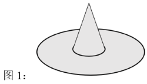
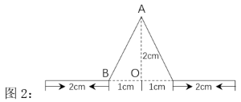
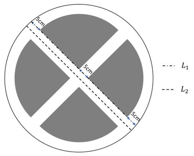
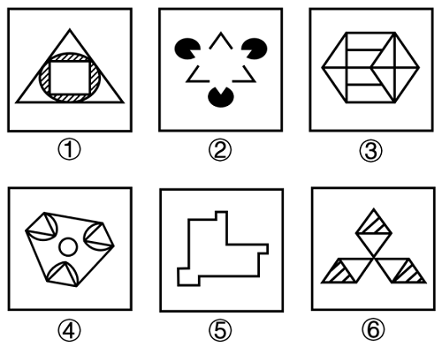
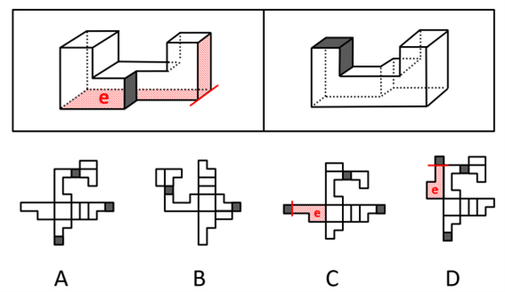

# 2024年新疆公务员录用考试《行测》试题（网友回忆版）

<!-- gwy:overview:start -->
> **新疆 · 2024 · 行测 · 统考** ｜ 115 题 · 图片 162 处 · 答案随题折叠

| 题型模块 | 题量 | 题号 |
| --- | ---: | ---: |
| 常识判断 | 25 | 1–25 |
| 言语理解与表达 | 25 | 26–50 |
| 数量关系 | 15 | 51–65 |
| 判断推理 | 35 | 66–100 |
| 资料分析 | 15 | 101–115 |
| **合计** | **115** | |

导航：[题型与作答说明](#题型与作答说明) · [题目](#题目) · [材料 1](#材料-1)
<!-- gwy:overview:end -->

> 候选采集稿。参考答案及解析来自粉笔页面，不代表官方答案或真实高分答卷；来源使用许可与原卷对应关系仍需人工核实。

## 题型与作答说明

常识判断

（25题）

根据题目要求，在四个选项中选出一个最恰当的答案。

言语理解与表达

（25题）

本部分包括表达与理解两方面的内容。请根据题目要求，在四个选项中选出一个最恰当的答案。

数量关系

（15题）

在这部分试题中，每道题呈现一段表述数字关系的文字，要求你迅速、准确地计算出答案。

判断推理

（35题）

本部分包括图形推理、定义判断、类比推理与逻辑判断四种类型的试题，在四个选项中选出一个最恰当的答案。

资料分析

（15题）

所给出的图、表、文字或综合性资料均有若干个问题要你回答。你应根据资料提供的信息进行分析、比较、计算和判断处理。

## 题目

### 第 1 题

党的二十大报告提出，在社会基层坚持和发展新时代“枫桥经验”，完善正确处理新形势下人民内部矛盾机制，及时把矛盾纠纷化解在基层、化解在萌芽状态。下列关于新时代“枫桥经验”的表述不正确的是：

A. 党建引领是新时代“枫桥经验”的政治灵魂

B. 人民主体是新时代“枫桥经验”的核心价值

C. 新时代“枫桥经验”是以制度现代化为优先价值导向的基层治理现代化经验

D. 新时代“枫桥经验”主要内容是变群众上访为领导下访，深入基层，联系群众，真下真访民情，实心实意办事

第 1 题 · 答案与解析

**参考答案（粉笔题库参考内容）**

D

**解析**

本题考查政治常识。

A项正确，党建引领是新时代“枫桥经验”的政治灵魂，反映了新时代“枫桥经验”的本质特征。

B项正确，人民主体是新时代“枫桥经验”的核心价值，实现人民的利益是新时代“枫桥经验”的价值导向。

C项正确，新时代“枫桥经验”是以制度现代化为优先价值导向的基层治理现代化经验。习近平总书记指出，随着互联网特别是移动互联网发展，社会治理模式正在从单向管理转向双向互动，从线下转向线上线下融合，从单纯的政府监管向更加注重社会协同治理转变。中国特色社会主义进入新时代，“枫桥经验”也在信息化、智能化驱动下，在创新发展中插上科技翅膀，注入大数据动力，内涵不断丰富，重点不断调整，形成具有矛盾精准数据化、解决路径最短化、决策依据信息化、态势研判前置化等鲜明特点的新时代“枫桥经验”，但无论其形式如何变迁，“枫桥经验”的本质和内核始终不变。

D项错误，“枫桥经验”是指上世纪60年代初，诸暨枫桥镇干部群众创造的“发动和依靠群众，坚持矛盾不上交，就地解决，实现捕人少，治安好”的基层社会治理经验。“变群众上访为领导下访，深入基层，联系群众，真下真访民情，实心实意办事”是“浦江经验”的主要内容。

本题为选非题，故正确答案为D。

**考点**：社会建设

**来源**：2024年青海省公务员录用考试《行测》题（网友回忆版）第5题

### 第 2 题

2023年，《习近平著作选读》第一卷、第二卷出版发行，这是党和国家政治生活中的一件大事。下列著作内容和篇名对应正确的是：

A. 生态环境是关系党的使命宗旨的重大政治问题，也是关系民生的重大社会问题——《加强生态文明建设必须坚持的原则》

B. 做好新形势下宣传思想工作，必须自觉承担起举旗帜、聚民心、育新人、兴文化、展形象的使命任务——《开展党史学习教育要突出重点》

C. 我们说的共同富裕是全体人民共同富裕，是人民群众物质生活和精神生活都富裕，不是少数人的富裕，也不是整齐划一的平均主义——《在全国脱贫攻坚总结表彰大会上的讲话》

D. “两个维护”要体现在坚决贯彻党中央决策部署的行动上，体现在履职尽责、做好本职工作的实效上，体现在党员、干部的日常言行上——《不断提高政治判断力、政治领悟力、政治执行力》

第 2 题 · 答案与解析

**参考答案（粉笔题库参考内容）**

A

**解析**

本题考查政治常识。

A项正确，《加强生态文明建设必须坚持的原则》指出，生态环境是关系党的使命宗旨的重大政治问题，也是关系民生的重大社会问题。广大人民群众热切期盼加快提高生态环境质量。我们要积极回应人民群众所想、所盼、所急，大力推进生态文明建设，提供更多优质生态产品，不断满足人民群众日益增长的优美生态环境需要。

B项错误，《宣传思想工作的使命任务》指出，做好新形势下宣传思想工作，必须自觉承担起举旗帜、聚民心、育新人、兴文化、展形象的使命任务，促进全体人民在理想信念、价值理念、道德观念上紧紧团结在一起，为服务党和国家事业全局作出更大贡献。《开展党史学习教育要突出重点》是习近平同志2021年2月20日在党史学习教育动员大会上讲话的一部分。

C项错误，《扎实推动共同富裕》指出，共同富裕是社会主义的本质要求，是中国式现代化的重要特征。我们说的共同富裕是全体人民共同富裕，是人民群众物质生活和精神生活都富裕，不是少数人的富裕，也不是整齐划一的平均主义。《在全国脱贫攻坚总结表彰大会上的讲话》（2021年2月25日）中指出，我国脱贫攻坚战取得了全面胜利，区域性整体贫困得到解决，完成了消除绝对贫困的艰巨任务，创造了又一个彪炳史册的人间奇迹。

D项错误，《带头做到“两个维护”，着力推进中央和国家机关党的政治建设》指出，“两个维护”要体现在坚决贯彻党中央决策部署的行动上，体现在履职尽责、做好本职工作的实效上，体现在党员、干部的日常言行上。带头做到“两个维护”，从根本上讲就是要做到对党忠诚，既要体现高度的理性认同、情感认同，又要有坚决的维护定力和能力。《不断提高政治判断力、政治领悟力、政治执行力》是习近平同志2020年12月24日、25日主持中共十九届中央政治局民主生活会时讲话的要点。

故正确答案为A。

**考点**：重要会议讲话、生态文明建设

**来源**：2024年青海省公务员录用考试《行测》题（网友回忆版）第2题

### 第 3 题

2023年8月26日，习近平总书记在听…干部          的能力，加强干取部队伍政治建设，严明政治纪律，坚定政治立场。

A. 调查研究、把握改策、推进工作、联系群众

B. 科学决策、应急处突、改革攻坚、群众工作

C. 科学发展、驾驭风险、改革创新、依法执政

D. 推动高质量发展、服务群众、防范化解风险

第 3 题 · 答案与解析

**参考答案（粉笔题库参考内容）**

A

**解析**

3.

单选题

2023年8月26日，习近平总书记在听…干部          的能力，加强干取部队伍政治建设，严明政治纪律，坚定政治立场。

-   A

    调查研究、把握改策、推进工作、联系群众

-   B

    科学决策、应急处突、改革攻坚、群众工作

-   C

    科学发展、驾驭风险、改革创新、依法执政

-   D

    推动高质量发展、服务群众、防范化解风险

A正确答案

未作答你的答案

29 %全站正确率

B易错项

解析

略

来源

2024年新疆公务员录用考试《行测》试题（网友回忆版）第3题

笔记

**来源**：2024年新疆公务员录用考试《行测》试题（网友回忆版）第3题

### 第 4 题

在2023年12月召开的中央经济工作会议上，习近平总书记全面总结2023年经济工作，深刻分析当前经济形势，系统部署2024年经济工作。下列关于做好2024年经济工作的要求，表述正确的有：

①强化宏观政策逆周期和跨周期调节

②坚持稳中求进、以进促稳、先立后破

③积极的财政政策要适度加力、提质增效

④稳健的货币政策要灵活适度、精准有效

A. ①②

B. ①②③

C. ②③④

D. ①②③④

第 4 题 · 答案与解析

**参考答案（粉笔题库参考内容）**

D

**解析**

本题考查政治常识。

2023年12月11日至12日，中央经济工作会议在北京举行。

①②正确，会议要求，明年要坚持稳中求进、以进促稳、先立后破，多出有利于稳预期、稳增长、稳就业的政策，在转方式、调结构、提质量、增效益上积极进取，不断巩固稳中向好的基础。要强化宏观政策逆周期和跨周期调节，继续实施积极的财政政策和稳健的货币政策，加强政策工具创新和协调配合。

③正确，会议要求，积极的财政政策要适度加力、提质增效。要用好财政政策空间，提高资金效益和政策效果。优化财政支出结构，强化国家重大战略任务财力保障。合理扩大地方政府专项债券用作资本金范围。落实好结构性减税降费政策，重点支持科技创新和制造业发展。严格转移支付资金监管，严肃财经纪律。增强财政可持续性，兜牢基层“三保”底线。严控一般性支出。党政机关要习惯过紧日子。

④正确，会议要求，稳健的货币政策要灵活适度、精准有效。保持流动性合理充裕，社会融资规模、货币供应量同经济增长和价格水平预期目标相匹配。发挥好货币政策工具总量和结构双重功能，盘活存量、提升效能，引导金融机构加大对科技创新、绿色转型、普惠小微、数字经济等方面的支持力度。促进社会综合融资成本稳中有降。保持人民币汇率在合理均衡水平上的基本稳定。

综上所述，①②③④均表述正确。

故正确答案为D。

**考点**：经济建设、重要会议讲话

**来源**：2024年青海省公务员录用考试《行测》题（网友回忆版）第9题

### 第 5 题

2023年是习近平总书记提出共建“一带一路”倡议10周年。10年来，“一带一路””合作从“大写意”进入“工笔画”阶段，实现了从硬联通扩展到软联通的愿景。下列关于“一带一路”的表述正确的有：

①截止2023年底，已有150多个国家、30多个国际组织签署共建“一带一路”合作文件

②落地落实了“鲁班工坊”“丝路一家亲”等人文交流项目

③建成了中老铁路、雅万高铁等一批标志性项目

④“一带一路”合作从亚欧大陆延伸到非洲和拉美

⑤现已举办5届“一带一路”国际合作高峰论坛

A. 2项

B. 3项

C. 4项

D. 5项

第 5 题 · 答案与解析

**参考答案（粉笔题库参考内容）**

C

**解析**

本题考查政治常识。

①④正确，⑤错误，习近平主席在第三届“一带一路”国际合作高峰论坛开幕式上的主旨演讲中指出：“‘一带一路’合作从亚欧大陆延伸到非洲和拉美，150多个国家、30多个国际组织签署共建‘一带一路’合作文件，举办3届‘一带一路’国际合作高峰论坛，成立了20多个专业领域多边合作平台。”

②正确，习近平主席在第三届“一带一路”国际合作高峰论坛开幕式上的主旨演讲中总结10年来取得的丰硕成果时指出：“精彩纷呈的文化年、艺术节、博览会、展览会，独具特色的鲁班工坊、‘丝路一家亲’‘光明行’等人文交流项目，不断深化的民间组织、智库、媒体、青年交流，奏响新时代的丝路乐章。”

③正确，2023年10月10日，国务院新闻办公室发布《共建“一带一路”：构建人类命运共同体的重大实践》白皮书。其中提到，在“硬联通”方面，中老铁路、雅万高铁、匈塞铁路、比雷埃夫斯港等一批标志性项目陆续建成并投运，中欧班列开辟了亚欧陆路运输新通道，“丝路海运”国际航线网络遍及全球，“六廊六路多国多港”的互联互通架构基本形成。

故①②③④说法正确，共4项。

故正确答案为C。

**考点**：重要会议讲话、其他建设

**来源**：2024年新疆公务员录用考试《行测》试题（网友回忆版）第5题

### 第 6 题

习近平总书记强调，要坚定维护宪法权威和尊严，推动宪法完善和发展，更好发挥宪法在治国理政中的重要作用。下列有关表述正确的有几项：

①要加强宪法理论研究和宣传教育，坚持知识普及、理论阐释、观念引导全面发力

②加快完善以宪法为核心的中国特色社会主义法律体系，不断提高宪法实施和监督水平

③坚持宪法确定的中国共产党领导地位不动摇，坚持宪法确定的人民民主专政的国体和人民代表大会制度的政体不动摇

④宪法是治国安邦的总章程，是我们党治国理政的根本法律依据，是国家政治和社会生活的最高法律规范

A. 1项

B. 2项

C. 3项

D. 4项

第 6 题 · 答案与解析

**参考答案（粉笔题库参考内容）**

D

**解析**

本题考查政治常识。

①②③正确，中共中央总书记、国家主席、中央军委主席习近平在第十个国家宪法日到来之际作出重要指示，强调要坚定政治制度自信，坚持宪法确定的中国共产党领导地位不动摇，坚持宪法确定的人民民主专政的国体和人民代表大会制度的政体不动摇。要贯彻新时代中国特色社会主义法治思想，坚持宪法规定、宪法原则、宪法精神全面贯彻，坚持宪法实施、宪法解释、宪法监督系统推进，加快完善以宪法为核心的中国特色社会主义法律体系，不断提高宪法实施和监督水平。要加强宪法理论研究和宣传教育，坚持知识普及、理论阐释、观念引导全面发力，在全社会大力弘扬宪法精神、社会主义法治精神，推动宪法实施成为全体人民的自觉行动。

④正确，中共中央总书记、国家主席、中央军委主席习近平在第十个国家宪法日到来之际作出重要指示指出，宪法是治国安邦的总章程，是我们党治国理政的根本法律依据，是国家政治和社会生活的最高法律规范。

综上所述，①②③④均表述正确，共有4项。

故正确答案为D。

**考点**：重要会议讲话、其他建设

**来源**：2024年青海省公务员录用考试《行测》题（网友回忆版）第8题

### 第 7 题

党的十八大以来，我国贯彻“绿水青山就是金山银山”的发展理念，由北到南，从生态保护实践到体制保障，美丽中国踏绿而来。下列有关我国生态文明建设的表述错误的是：

A. 2023年5月31日是首个全国生态日

B. 2018年宪法修正案将“生态文明”写入宪法

C. 福建、江西、贵州被列为首批国家生态文明试验区

D. 生态文明建设被纳入中国特色社会主义事业“五位一体”总体布局

第 7 题 · 答案与解析

**参考答案（粉笔题库参考内容）**

A

**解析**

本题考查政治常识。

A项错误，2023年6月28日，依据《全国人民代表大会常务委员会关于设立全国生态日的决定》，将8月15日设立为全国生态日，国家通过多种形式开展生态文明宣传教育活动。2023年8月15日是首个全国生态日。

B项正确，2018年3月11日，十三届全国人大一次会议第三次全体会议经投票表决通过了《中华人民共和国宪法修正案》，“生态文明”正式写入宪法。

C项正确，2016年8月，中办、国办印发《关于设立统一规范的国家生态文明试验区的意见》，福建、江西和贵州三省作为生态基础较好、资源环境承载能力较强的地区，被纳入首批统一规范的国家生态文明试验区，探索形成可在全国复制推广的成功经验。

D项正确，2012年11月，党的十八大胜利召开，十八大将生态文明建设纳入中国特色社会主义事业总体布局，正式拓展为经济建设、政治建设、文化建设、社会建设和生态文明建设“五位一体”。

本题为选非题，故正确答案为A。

**考点**：生态文明建设

**来源**：2024年新疆公务员录用考试《行测》试题（网友回忆版）第7题

### 第 8 题

根据中共中央、国务院2023年3月印发的《党和国家机构改革方案》，下列关于本次改革方案的表述错误的是：

A. 证券业之外的金融业监管由国家金融监督管理总局统一负责

B. 统筹数字资源整合共享和开发利用，是国家数据局的职责之一

C. 在农业农村部加挂国家乡村振兴局牌子，不再保留单设的国家乡村振兴局

D. 将工业和信息化部的国家高新技术产业开发区等科技园区建设职责划入科学技术部

第 8 题 · 答案与解析

**参考答案（粉笔题库参考内容）**

D

**解析**

本题考查政治常识。

A项正确，《党和国家机构改革方案》指出：“（八）组建国家金融监督管理总局。统一负责除证券业之外的金融业监管，强化机构监管、行为监管、功能监管、穿透式监管、持续监管，统筹负责金融消费者权益保护，加强风险管理和防范处置，依法查处违法违规行为，作为国务院直属机构······”

B项正确，《党和国家机构改革方案》指出：“（十四）组建国家数据局。负责协调推进数据基础制度建设，统筹数据资源整合共享和开发利用，统筹推进数字中国、数字经济、数字社会规划和建设等，由国家发展和改革委员会管理······”

C项正确，《党和国家机构改革方案》指出：“（十五）优化农业农村部职责。为统筹抓好以乡村振兴为重心的‘三农’各项工作······推动农村社会事业和公共服务发展等职责划入农业农村部，在农业农村部加挂国家乡村振兴局牌子。全国脱贫攻坚目标任务完成后的过渡期内，有关帮扶政策、财政支持、项目安排保持总体稳定，资金项目相对独立运行管理。不再保留单设的国家乡村振兴局。”

D项错误，《党和国家机构改革方案》指出“（七）重新组建科学技术部······将科学技术部的组织拟订高新技术发展及产业化规划和政策，指导国家自主创新示范区、国家高新技术产业开发区等科技园区建设，指导科技服务业、技术市场、科技中介组织发展等职责划入工业和信息化部······”

本题为选非题，故正确答案为D。

**考点**：政治建设、重要文件

**来源**：2024年青海省公务员录用考试《行测》题（网友回忆版）第10题

### 第 9 题

根据中国（新疆）自由贸易试验区                    区位优势，深入开展差别化探索，培育壮大新疆特色优势产业。

A. “向西开放”桥头堡

B. “五口通八国、一路连欧亚”

C. “一带一路”核心枢纽地带

D. “中国——中亚——西亚经济”

第 9 题 · 答案与解析

**参考答案（粉笔题库参考内容）**

B

**解析**

本题考查政治常识。

B项正确，A、C、D三项错误，国务院于2023年10月31日发布的《中国（新疆）自由贸易试验区总体方案》中“一、总体要求”部分指出：“（二）战略定位及发展目标······赋予自贸试验区更大改革自主权，充分发挥新疆‘五口通八国、一路连欧亚’的区位优势，深入开展差别化探索，培育壮大新疆特色优势产业。经过三至五年改革探索，努力建成营商环境优良、投资贸易便利、优势产业集聚、要素资源共享、管理协同高效、辐射带动作用突出的高标准高质量自由贸易园区。”

故正确答案为B。

**考点**：其他建设

**来源**：2024年新疆公务员录用考试《行测》试题（网友回忆版）第9题

### 第 10 题

2024年新疆维吾尔自治区政府工作报告中提到的“四方合作”中的“四方”指的是：

A. 新疆维吾尔自治区、新疆生产建设兵团、科学技术部、清华大学

B. 新疆维吾尔自治区、教育部、中国科学技术大学、广州市

C. 新疆维吾尔自治区、科学技术部、中国科学院、深圳市

D. 新疆维吾尔自治区、教育部、清华大学、北京市

第 10 题 · 答案与解析

**参考答案（粉笔题库参考内容）**

C

**解析**

本题考查政治常识。

C项正确，A、B、D三项错误，2016年，在共建“一带一路”倡议和创新驱动发展战略指引下，科学技术部、新疆维吾尔自治区人民政府、深圳市、中国科学院启动实施“四方合作”工作机制，在政策、平台、项目、科技资源和创新等方面给予新疆倾斜支持，联合开展多项关键技术攻关和全方位多层次合作。

故正确答案为C。

**考点**：政治建设

**来源**：2024年新疆公务员录用考试《行测》试题（网友回忆版）第10题

### 第 11 题

2024年新疆将聚焦“八大产业集群”，加快“一带一路”核心区建设，促进一、二、三产业融合发展。下列不属于“八大产业集群”建设成果的是：

A. 全国最大天然气制乙二醇示范项目成功投产

B. 在霍尔果斯建成全国最大的汽车出口陆路口岸

C. 我国规模最大光伏发电直接制绿氢项目全面建成投产

D. 成立国家级棉花棉纱交易中心，推动棉花全产业链格局加快形成

第 11 题 · 答案与解析

**参考答案（粉笔题库参考内容）**

B

**解析**

本题考查政治常识。

2024年新疆维吾尔自治区政府工作报告提出，聚焦“八大产业集群”，积极构建具有新疆特色和优势的现代化产业体系。其中“八大产业集群”是指培育壮大油气生产加工产业集群，加快发展煤炭煤电煤化工产业集群，积极建设绿色矿业产业集群，着力推动建设粮油产业集群，加快建设棉花和纺织服装产业集群，打造绿色有机果蔬产业集群，建设优质畜产品产业集群，大力发展新能源新材料等战略性新兴产业集群等。

A项正确，2023年11月29日，全国最大天然气制乙二醇示范项目——中昆新材料2×60万吨/年天然气制乙二醇项目成功投产，为纺织服装产业提供短纤、长丝原料。自此，新疆打通从“一方气”到“一块布”的中间链条，实现化工与纺服耦合发展。属于加快建设棉花和纺织服装产业集群的建设成果。

B项错误，据霍尔果斯海关统计，2023年霍尔果斯口岸出口商品车30.4万辆，同比增长307.5%，成为全国最大的汽车出口陆路口岸。选项说法无误，但此成果不属于“八大产业集群”的建设成果。

C项正确，2023年8月30日，我国规模最大的光伏发电直接制绿氢项目全面建成投产，这是国内首次规模化利用光伏发电直接制绿氢的项目，利用新疆地区丰富的太阳能资源发电直接制绿氢。属于大力发展新能源新材料等战略性新兴产业集群的建设成果。

D项正确，2023年12月18日，国家级棉花棉纱交易中心在新疆国际会展中心揭牌成立。新疆成立国家级棉花棉纱交易中心，推动棉花全产业链格局加快形成。属于加快建设棉花和纺织服装产业集群的建设成果。

本题为选非题，故正确答案为B。

**考点**：经济建设

**来源**：2024年新疆公务员录用考试《行测》试题（网友回忆版）第11题

### 第 12 题

《中华人民共和国法律援助法》对于规范和促进法律援助工作、保障公民和有关当事人合法权益具有重大意义。下列情况属于可经指派获得法律援助的是：

①15岁的学生小明涉嫌贩卖毒品，没有委托辩护人

②25岁的精神病人赵某涉嫌抢劫，其患病多年经济困难，没有委托辩护人

③35岁的村民张某因向村中水井投毒，可能被判处死刑，没有委托辩护人

④45岁的聋哑人李某创设公司后涉嫌逃税罪，其个人资产过亿，没有委托辩护人

A. ①②③

B. ②③④

C. ①③④

D. ①②③④

第 12 题 · 答案与解析

**参考答案（粉笔题库参考内容）**

D

**解析**

本题考查法律常识。

①②③④正确，根据《中华人民共和国法律援助法》第二十五条第一款规定：“刑事案件的犯罪嫌疑人、被告人属于下列人员之一，没有委托辩护人的，人民法院、人民检察院、公安机关应当通知法律援助机构指派律师担任辩护人：（一）未成年人；（二）视力、听力、言语残疾人；（三）不能完全辨认自己行为的成年人；（四）可能被判处无期徒刑、死刑的人；（五）申请法律援助的死刑复核案件被告人；（六）缺席审判案件的被告人；（七）法律法规规定的其他人员。”其中，①中小明是未成年人，②中赵某是不能完全辨认自己行为的成年人。

故正确答案为D。

**考点**：其他法律法规

**来源**：2024年河北省公务员录用考试《行测》题（网友回忆版）第5题

### 第 13 题

司机王某骑电动自行车载其外籍女友去艺术馆参观，二人均未佩戴头盔，被交警发现。对于二人可能面临的行政处罚，下列表述正确的是：

A. 交警可以当场对王某进行罚款

B. 交警可以暂扣王某的机动车驾驶证

C. 王某女友适用《中华人民共和国行政处罚法》，可予以行政拘留

D. 王某女友不适用《中华人民共和国行政处罚法》的规定，不予处罚

第 13 题 · 答案与解析

**参考答案（粉笔题库参考内容）**

A

**解析**

本题考查法律常识。

A项正确，B项错误，根据《天津市道路交通安全若干规定》第四十三条第五项规定：“非机动车在道路上通行，应当遵守下列规定：（五）驾驶电动自行车上道路行驶时，驾驶人以及乘车人应当规范佩戴安全头盔。”《中华人民共和国道路交通安全法》第八十九条规定：“行人、乘车人、非机动车驾驶人违反道路交通安全法律、法规关于道路通行规定的，处警告或者五元以上五十元以下罚款；非机动车驾驶人拒绝接受罚款处罚的，可以扣留其非机动车。”《中华人民共和国道路交通安全法》第一百零七条第一款规定：“对道路交通违法行为人予以警告、二百元以下罚款，交通警察可以当场作出行政处罚决定，并出具行政处罚决定书。”由此可见，王某与其外籍女友骑乘电动自行车未佩戴头盔，违反《天津市道路交通安全若干规定》，依据《中华人民共和国道路交通安全法》的规定，对王某与其女友都可处警告或者五元以上五十元以下罚款，同时警告与五十元以下罚款可以当场作出。

C、D两项错误，根据《中华人民共和国行政处罚法》第八十四条规定：“外国人、无国籍人、外国组织在中华人民共和国领域内有违法行为，应当给予行政处罚的，适用本法，法律另有规定的除外。”由此可见，王某女友的违法行为适用《中华人民共和国行政处罚法》，同时对于王某女友的处罚是警告或者五元以上五十元以下罚款，而非行政拘留。

故正确答案为A。

**考点**：行政法

**来源**：2024年河北省公务员录用考试《行测》题（网友回忆版）第3题

### 第 14 题

戏曲是中华优秀传统文化的重要组成部分，下列有关说法错误的是：

A. 京剧、豫剧、评剧、黄梅戏、越剧是中国戏剧五大剧种

B. 《群英会》是依据《水浒传》改编的传统京剧

C. 黄梅戏代表剧目中有《天仙配》和《女驸马》

D. 豫剧与梆子腔关系紧密

第 14 题 · 答案与解析

**参考答案（粉笔题库参考内容）**

B

**解析**

本题考查人文常识。

A项正确，中国戏曲剧种种类繁多，其中“京剧、豫剧、评剧、黄梅戏、越剧”为五大戏曲剧种。京剧在清光绪年间形成于北京，现已成为中国影响最大、最具有代表性的一个剧种。豫剧也称河南梆子、河南高调，形成于清朝初年，至今已有300多年历史，是洛阳、河南的主要剧种，在国内外影响仅次于京剧。评剧是我国北方地区的一种地方戏，在华北、东北及其他一些地区流行很广，是广大人民所喜闻乐见的剧种之一。黄梅戏起源于湖北黄梅，是安徽省的主要地方戏曲剧种，是十八世纪后期在皖、鄂、赣三省毗邻地区形成的一种民间小戏。评剧原名“平腔梆子戏”，俗称“唐山落子”，“蹦蹦戏”。越剧，是以嵊县一带的民间说唱艺术“落地唱书”为基础，并在余姚鹦歌（秧歌）和湖州滩簧的影响下发展形成的。

B项错误，京剧以历史故事为主要演出内容，传统剧目约有一千三百多个，常演的在三四百个以上，其中《群英会》等剧目家喻户晓，为广大观众所熟知。《群英会》是依据《三国演义》第45回改编的传统京剧，故事叙述：曹操谋士蒋干，与周瑜故交，请求过江劝降。周瑜将计就计，盛会隆重宴请诸将和挚友，号称“群英会”。

C项正确，黄梅戏中有许多为人熟知的优秀剧目，代表剧目中有《天仙配》和《女驸马》。《天仙配》讲述了七仙女不顾天规，私自下凡与董永结为伉俪，憧憬美好生活，最终被玉帝生生拆散的爱情故事。《女驸马》讲述了民女冯素珍冒死救夫，经历了种种曲折，终于如愿以偿，成就了美满姻缘的故事。

D项正确，豫剧因早期演员用本嗓演唱，起腔与收腔时用假声翻高尾音带“讴”，又叫“河南讴”。豫剧在声腔上属梆子腔系。豫剧划分主要有五大流派：以开封为中心的唱法称“祥符调”；以商丘为中心的唱法称“豫东调”，又称“东路调”；以洛阳为中心流传的唱法称为“豫西调”，又称“西府调”；流行于豫东南的称“沙河调”，又叫“本地梆”；建国后，在杨兰春等的领导下，对豫剧四大地域流派唱腔进行了综合吸收和大幅改革，运用科学的发音，融入了歌剧元素，形成了“现代流派”，又称“现代戏流派”。

本题为选非题，故正确答案为B。

**考点**：文化常识

**来源**：2024年青海省公务员录用考试《行测》题（网友回忆版）第13题

### 第 15 题

下列关于国债逆回购的说法正确的是：

A. 投资者可以通过银行网点购买国债逆回购

B. 国债逆回购是以国家为主体进行债券回购

C. 国债逆回购本质上是一种短期资金借贷方式

D. 国债逆回购利率上行20个基点表示利率增加2%

第 15 题 · 答案与解析

**参考答案（粉笔题库参考内容）**

C

**解析**

本题考查经济常识。

A项错误，投资者应选择有国债逆回购业务的证券营业部开户。此外，证券交易所还会和投资者签一个“指定交易协议”，所以投资者应在证券交易所开户进行交易。但不可以通过银行网点进行购买。

B项错误，国债逆回购参与主体大致分为两类：第一类为融资方，一般是商业银行、非银行金融机构等，第二类为资金出借方，一般有个人投资者、基金公司、保险公司等。所以国债逆回购并不是以国家为主体进行债券回购。

C项正确，国债逆回购本质就是一种短期贷款，即将资金通过国债回购市场拆出，其实就是一种短期贷款。个人通过国债回购市场把自己的资金借出去，获得固定的利息收益；而回购方，也就是借款人用自己的国债作为抵押获得这笔借款，到期后还本付息。

D项错误，基点是利率的计数单位，一个百分点等于100个基点，也叫BP。如原来利率是3.25%，下降25个基点，就成了3%。此处上行20个基点表示利率增加0.2%。

故正确答案为C。

**考点**：宏观经济与调控政策

**来源**：2024年河北省公务员录用考试《行测》题（网友回忆版）第12题

### 第 16 题

下列所描述现象与相关专业术语对应正确的是：

A. 某商品的价格越高，其需求量越大——价值悖论

B. 工资率随劳动供求的变动而及时迅速地变动——工资粘性

C. 人们倾向于将从小样本中得到的结论错误地移植到大样本中——小数定律

D. 在完全竞争的市场上，相同交易产品经过汇率调整后，在世界范围内其交易成本是相同的——一价定律

第 16 题 · 答案与解析

**参考答案（粉笔题库参考内容）**

D

**解析**

本题考查经济常识。

A项错误，价值悖论，也被称为钻石与水悖论，是亚当·斯密在《国富论》中提出的一个观点。这个观点指出了物品的使用价值与交换价值之间存在一个反差，即使用价值大的物品（如水）的交换价值却很小，而交换价值大的物品（如钻石）的使用价值却很小。凡勃伦效应是指消费者对一种商品需求的程度因其标价较高而不是较低而增加，如价格昂贵的手表、钢琴等，往往也能在市场上走俏。消费者购买这类商品不仅仅是为了获得直接的物质满足和享受，更大程度上是为了获得心理上的满足。

B项错误，工资粘性或工资黏性指工资率不能随劳动供求的变动而及时迅速地变动。20世纪70年代后半期至80年代，早期的新凯恩斯主义者以长期劳动合同的形式引入了名义工资粘性。在发达的经济中，工资不是在即时交易中决定的，而是由劳资双方以明确（或隐含）的合同确定的。在合同期限内，劳动者必须按照根据他预期的价格水平而计算出来的工资提供劳动，即使在此期间实际的价格水平有所变动，劳资双方也必须遵守合同中规定的工资水平。

C项错误，小数定律又称小数定理，是阿莫斯·特沃斯基和丹尼尔·卡纳曼在其研究中对“赌徒谬误”的总结。小数定律是指把从大样本中得到的结论错误地移植到小样本中的倾向。如“赌博者谬误”：许多人都经常预期一个随机赌局的第二轮会得到与第一轮相反的结果，如果一项投硬币游戏前若干轮出现太多的“头像”，那么许多参与者确信下一轮便应该是“文字”了，而实际上，每一轮在统计上都是独立的。

D项正确，一价定律是绝对购买力平价理论的一种表现形式，它是由货币学派的代表人物弗里德曼提出的。一价定律可简单地表述为：当贸易开放且交易费用为零时，同样的货物无论在何地销售，用同一货币来表示的货物价格都相同。这揭示了国内商品价格和汇率之间的一个基本联系。在完全竞争的市场上，相同的交易产品或金融资产经过汇率调整后，在世界范围内其交易成本一定是相等的。

故正确答案为D。

**考点**：微观经济

**来源**：2024年青海省公务员录用考试《行测》题（网友回忆版）第16题

### 第 17 题

下列诗句中涉及的典故人物与其时代对应说法不正确的一项是：

A. 林暗草惊风，将军夜引弓。平明寻白羽，没在石棱中——西汉

B. 闲来垂钓碧溪上，忽复乘舟梦日边——先秦

C. 怀旧空吟闻笛赋，到乡翻似烂柯人——东汉

D. 求田问舍，怕应羞见，刘郎才气——三国

第 17 题 · 答案与解析

**参考答案（粉笔题库参考内容）**

C

**解析**

本题考查人文常识。

A项正确，“林暗草惊风，将军夜引弓。平明寻白羽，没在石棱中。”出自唐代卢纶的《和张仆射塞下曲六首·其二》。意思是树林幽暗，突来的疾风使草木惊倒纷披，将军以为有虎，黑夜里拉弓射箭。天亮时去寻找那支白羽毛的箭，箭头已深埋在石头里。这里的将军指西汉飞将军李广猎虎的故事，取材于西汉史学家司马迁记载李广事迹的《李将军列传》。

B项正确，“闲来垂钓碧溪上，忽复乘舟梦日边。”出自唐代李白的《行路难·其一》。意思是像姜太公吕尚垂钓溪，闲待东山再起；又像伊尹做梦，乘船经过日边。引用吕尚、伊尹的历史典故，时间对应先秦，即秦朝之前。

C项错误，“怀旧空吟闻笛赋，到乡翻似烂柯人。”出自唐代刘禹锡的《酬乐天扬州初逢席上见赠》。意思是怀念故去旧友徒然吟诵闻笛小赋，久谪归来感到已非旧时光景。“闻笛赋”指西晋向秀的《思旧赋》，刘禹锡借用这个典故怀念已死去的王叔文、柳宗元等人。

D项正确，“求田问舍，怕应羞见，刘郎才气。”出自宋代辛弃疾的《水龙吟·登建康赏心亭》。意思是像只为自己购置田地房产的许汜，应怕惭愧去见，才气双全的刘备。此句用许汜与陈登的典故，时间对应东汉末年至三国时期。

本题为选非题，故正确答案为C。

**考点**：文学常识

**来源**：2024年青海省公务员录用考试《行测》题（网友回忆版）第12题

### 第 18 题

下列选项描述的历史场景与时代不符的是：

A. 唐玄宗时期，百姓可以在祠堂祭拜祖先

B. 南宋时期，人们可以到商业街购买东西

C. 永乐年间，大部分州县由粮长负责征解税粮

D. 道光年间，福建、广东等地的百姓可以用银元完纳钱粮

第 18 题 · 答案与解析

**参考答案（粉笔题库参考内容）**

A

**解析**

本题考查人文常识。

A项错误，祠堂是供奉与祭祀祖先或先贤的场所。“祠堂”一名最早出现于汉代，从秦汉到北宋，有资格建祠堂的不是王公贵族，就是士大夫官员，民间不得立祠。南宋时，理学家朱熹著《家礼》立祠堂之制，创制祠堂以敬祖，民间祠堂已有所发展。故在唐玄宗时期，百姓不可以在祠堂祭拜祖先。

B项正确，南宋时期，商品经济空前繁荣，越来越多的商人在街道两旁开设店铺，商品种类众多，因此带动了商业街的发展，其中最为著名的就是南宋御街。故在南宋时期，人们可以到商业街购买东西。

C项正确，粮长制，始创于洪武四年，是中国明代在各州县设置的由粮长负责征解税粮的制度。粮长的主要任务是负责本区的田粮催征、经收、解运诸事宜，后来其职权范围也有所扩大，行使拟订田赋科则、编造鱼鳞图册、检举流人户等职责。嘉靖后，实行一条鞭法，裁粮归里，粮长的职责由里长担任。洪武为明朝开国国君朱元璋的年号，永乐是明朝第三个皇帝朱棣的年号。故永乐年间，大部分州县由粮长负责征解税粮。

D项正确，银元大约在明万历年间流入中国；乾隆年间，清政府首次在西藏铸行“乾隆宝藏”银币；道光年间，台湾、福建、广东等地也曾仿制银元，称为银饼；光绪年间，清廷开始正式铸造银元“光绪元宝”（即龙洋），各省纷纷效仿铸造。故道光年间，福建、广东等地的百姓可以用银元完纳钱粮。

本题为选非题，故正确答案为A。

**考点**：中国历史

**来源**：2024年青海省公务员录用考试《行测》题（网友回忆版）第14题

### 第 19 题

酶是具有高度特异性和高度催化效能的生物催化剂，在人类的生产生活中具有重要的应用。以下有关酶的添加应用对应错误的是（ ）。

A. 白酒——淀粉酶

B. 果汁——纤维素酶

C. 脱脂奶——乳糖酶

D. 加酶洗衣粉——蛋白酶

第 19 题 · 答案与解析

**参考答案（粉笔题库参考内容）**

C

**解析**

本题考查科技常识。

A项正确，淀粉酶是水解淀粉和糖原的酶类总称，通常通过淀粉酶催化水解织物上的淀粉浆料。淀粉酶可以用作果汁加工中的淀粉分解和提高过滤速度以及蔬菜加工、糖浆制造、葡萄糖等加工制造。在白酒酿酒过程中，以淀粉为原料酿酒，需经过两个主要过程，一是淀粉糖化过程；二是酒精发酵过程。淀粉吸水膨胀，加热糊化，形成结构疏松的淀粉，在淀粉酶的作用下分解为低分子的单糖；单糖在脱羧酶、脱氢酶的催化下分解，逐渐分解形成二氧化碳和酒精。

B项正确，纤维素酶是一类能够降解纤维素的酶，其主要作用是水解果汁中的纤维素成分，使其分解成可溶性物质。水果中含有纤维素、果胶等大分子物质，在榨汁时，这些物质会影响出汁率并使榨出的果汁浑浊，易出现沉淀。添加纤维素酶、果胶酶可以将果胶、纤维素分解成小分子的可溶性的物质，从而提高出汁率并使果汁饮料澄清。

C项错误，乳糖酶是人体中的一种消化酶，是以母乳、奶粉为主要营养来源的婴幼儿体内最重要的消化酶，乳糖酶的主要功能是消化乳糖，将乳糖水解成能够被人体吸收的半乳糖和葡萄糖。乳糖酶主要用于乳品工业，可使低甜度和低溶解度的乳糖转变为较甜的、溶解度较大的单糖，还可使冰淇淋、浓缩乳、淡炼乳中乳糖结晶析出的可能性降低，同时增加甜度。脱脂奶主要通过离心分离将牛奶中的脂肪和非脂肪部分分离而获得。二者并无直接关联。

D项正确，加酶洗衣粉中添加了多种酶制剂，如碱性蛋白酶制剂和碱性脂肪酶制剂等。这些酶制剂不仅可以有效地清除衣物上的污渍，而且对人体没有毒害作用，并且这些酶制剂及其分解产物能够被微生物分解，不会污染环境。

本题为选非题，故正确答案为C。

**考点**：生物常识

**来源**：2024年青海省公务员录用考试《行测》题（网友回忆版）第19题

### 第 20 题

下列病毒与其主要感染的人体系统对应正确的是：

A. 狂犬病毒——免疫系统

B. 流感病毒——神经系统

C. 乙肝病毒——消化系统

D. 艾滋病毒——生殖系统

第 20 题 · 答案与解析

**参考答案（粉笔题库参考内容）**

C

**解析**

本题考查科技常识。

A项错误，狂犬病毒主要感染神经系统。人类被携带狂犬病毒的动物咬伤后，狂犬病毒会从伤口处进入人体，但并不会马上侵染神经元，而是在肌肉内停留一段时间，这就是潜伏期。潜伏期之后，狂犬病毒会经过运动神经和骨骼肌之间的连接，进入神经系统，一旦狂犬病毒开始侵染神经系统，便会在神经元之间高速运输，神经系统会受到致命的破坏。狂犬病毒主要是通过动物咬抓伤传播。

B项错误，流感病毒是一种影响上呼吸道和下呼吸道的传染性病毒性疾病，主要感染呼吸系统，通过空气飞沫传播。

C项正确，乙肝病毒主要感染消化系统。乙肝病毒主要感染身体中的肝脏部位，可能会造成肝功能损伤，肝脏属于消化系统。乙肝的传播方式主要是血液传播、性传播和母婴传播。

D项错误，艾滋病毒主要感染免疫系统。艾滋病毒会攻击并逐渐破坏人类的免疫系统，致使宿主在被感染时得不到保护。感染人类免疫缺陷病毒并且去世的人，往往死于继发感染或者癌症。艾滋病毒主要是血液传播、性传播和母婴传播。

故正确答案为C。

**考点**：生物常识

**来源**：2024年青海省公务员录用考试《行测》题（网友回忆版）第20题

### 第 21 题

宝石是用于装饰的、有经济价值的矿物及生物矿物和岩石的总称，呈现晶体、集合体等形态，是地球送给人类的珍贵礼物。下列不属于宝石形成机制的是（ ）。

A. 由炽热岩浆喷发所生成的熔岩蒸汽冷凝产生

B. 岩浆冷却凝固时浓缩的成分结晶后形成

C. 在地核内部高温高压变质瘤结成型

D. 从岩浆产生的热液中结晶生长

第 21 题 · 答案与解析

**参考答案（粉笔题库参考内容）**

C

**解析**

本题考查地理国情。

A、B两项正确，按岩石性质，宝石可分三类：火成岩（岩浆岩）、变质岩与沉积岩。岩浆岩又称火成岩，是由炽热岩浆喷出地表或侵入地壳冷却凝固所形成的岩石。岩浆在冷却过程中，由于温度和压力的变化，会形成不同类型的火成岩，包括侵入岩和喷出岩。火成岩中的宝石，如钻石和蓝宝石，通常是在岩浆上升到地表的过程中，由于冷却速度的不同而形成的。变质岩是由火成岩或沉积岩在高温高压下经历化学和物理变化而形成。沉积岩，又称为水成岩，是由地表或接近地表的水溶液结晶而成的，这些水溶液可能含有特定的矿物质，如二氧化碳和二氧化硅。沉积岩通常成层堆叠，如石灰岩和页岩，它们可以形成各种宝石，如蛋白石和绿松石。

C项错误，宝石分布在地壳和地幔中，不是在地核内部高温高压变质瘤结成型。

D项正确，当水热与地球内部岩浆相互作用时，形成热液。从岩浆产生的热液中可以形成结晶，当岩浆冷却时，如果有合适的温度、压力、空间和足够时间就可以形成宝石，包括紫水晶、黄晶以及祖母绿等。

本题为选非题，故正确答案为C。

**考点**：自然地理

**来源**：2024年河北省公务员录用考试《行测》题（网友回忆版）第11题

### 第 22 题

下列表述不符合物理常识的是：

A. 一杯泡好的茶，用勺子作圆形搅动茶叶会向杯底中心聚集

B. 用洗衣机洗裤子并脱干后，取出时经常会看到裤兜被翻出来

C. 在河流的弯道上，外圈河床要比内圈浅，因为泥沙会被河水带到外圈

D. 锅里剩下最后几根面条时，用筷子在锅中作圆形搅动，使面汤旋转起来，面条会集中到锅底中心

第 22 题 · 答案与解析

**参考答案（粉笔题库参考内容）**

C

**解析**

本题考查科技常识。

A项正确，当搅动茶杯里的水时，水会做圆周运动。由于茶杯壁会对水产生摩擦，减慢水的流速。所以此时茶杯壁处的流速小于茶杯中心处的流速。由伯努利原理（等高流动时，流速越大，压力越小）可知，茶杯壁处水的压强要大于中心处的压强，形成高压的边界层，引起二次流，从而形成一个新的螺旋，这个螺旋会推动茶叶向心运动。

B项正确，当洗衣机转动时，衣服兜口附近流体有一个相当的速度，而衣服兜的底部流体的速度就要小。这是因为裤兜的底部是在裤筒里，上衣的衣兜底部也是裹在衣服的里头，所以那里的流体相对于衣服的速度要小得多。根据伯努利定律，衣兜底部的压强就比衣兜口附近的大，这种压差就会驱使水从衣兜底部流向衣兜口。洗衣机反复转动，压差就一次次使流体从兜底流向兜口，这种流动就足以把衣兜翻过来。

C项错误，二次流是指一种流动引起的另一种性质不同的流动。在河流的弯道上，由于二次流而使河底处水流所携带的沙子、砾石等从弯段的外侧移走，而在弯段的内侧堆积起来，结果造成河道的外侧被掏深而内侧则变浅。故应该是“外侧深而内侧浅”，而不是“外圈河床要比内圈浅”。

D项正确，如果将旋转起来的面汤看为一次流动，这时微团体做圆周运动，微团加速度指向圆心，其加速度与压力梯度符号相反，压强由锅中心向锅边是增加的，又由于锅底这层流速很小，惯性力与压差不平衡，由此将面条带到锅底中心，这就是所谓的二次流现象，正是这个流动将面条带到锅底中心。

本题为选非题，故正确答案为C。

**考点**：生活常识

**来源**：2024年河北省公务员录用考试《行测》题（网友回忆版）第18题

### 第 23 题

盐碱地被称为“地球之癣”，因土壤里可溶性盐的含量超过普通植物的耐盐程度，导致植物无法生长，甚至造成土地荒漠化，治理难度大。关于盐碱地，下列说法错误的是：

A. 新疆的地形特征为“三山夹两盆”，降水量少、蒸发量大，造成含盐地下水通过上升水流向地表积聚，形成盐碱土

B. 新疆盐碱地面积占全国盐碱地的三分之一，是我国盐碱土地分布最广、面积最大的省区，也是世界上盐碱地分布比较集中的地区

C. 根据土壤类型和气候条件变化，我国盐碱土分布区可分为滨海盐渍区、黄淮海平原盐渍区、荒漠及荒漠草原盐渍区、草原盐渍区四个大类型

D. 我国盐碱地治理方式由“以种适地”转变为“以地适种”，即由选育耐盐碱作物适应盐碱地转为治理盐碱地以适应作物

第 23 题 · 答案与解析

**参考答案（粉笔题库参考内容）**

D

**解析**

本题考查地理国情。

A项正确，“三山夹两盆”中的“三山”是指北为阿尔泰山，南为昆仑山，中部为天山山脉；“两盆”是南部的塔里木盆地和北部的准噶尔盆地。这种地貌使新疆形成了封闭性的内陆盆地，且新疆是内陆性干旱气候，荒漠和山地较多，植被和水源较少，日照较强，从而导致降水稀少、蒸发强烈。地表水分蒸发后，盐分留在土壤上层，日积月累聚集形成了盐碱土。

B项正确，全国土壤普查数据表明，我国有15亿亩盐碱地，其中通过改良可以种植粮食的有5亿亩；新疆盐碱地面积占全国盐碱地的1/3，其中具有改良价值的轻中度盐碱地达1.16亿亩，是我国盐碱土地分布最广、面积最大的省区，也是世界上盐碱地分布比较集中的地区。

C项正确，我国盐碱土分布区是根据它的土壤类型和气候条件变化决定的，分为滨海盐渍区、黄淮海平原盐渍区、荒漠及荒漠草原盐渍区、草原盐渍区四个大类型。

D项错误，过去，我国盐碱地治理“以地适种”占主导地位，即治理盐碱地以适应作物。2023年中央财经委员会第二次会议指出，要全面摸清盐碱地资源状况，研究编制盐碱地综合利用总体规划和专项实施方案，分区分类开展盐碱耕地治理改良，因地制宜利用盐碱地，向各类盐碱地资源要食物，“以种适地”同“以地适种”相结合，加快选育耐盐碱特色品种，大力推广盐碱地治理改良的有效做法，强化水源、资金等要素保障。

本题为选非题，故正确答案为D。

**考点**：中国地理

**来源**：2024年新疆公务员录用考试《行测》试题（网友回忆版）第23题

### 第 24 题

江布拉克景区位于新疆维吾尔自治区昌吉回族自治州奇台县。关于江布拉克景区，下列说法不正确的是：

A. 江布拉克森林公园坐落在天山山脉东段北坡，属温带半湿润山地气候区

B. 江布拉克景区气候垂直变化明显，夏秋季平均气温10℃−25℃，年降水量350-500毫米

C. 江布拉克景区及周边麦田主要分布在地形相对平缓的山麓地区，面积达20万亩之多，被称为“西域第一粮仓”

D. 江布拉克景区石城子遗址，史称疏勒城，是迄今为止新疆地区发现的唯一一处年代准确可考、形制基本完整、保存状况完好、文化特征鲜明的唐代古遗

第 24 题 · 答案与解析

**参考答案（粉笔题库参考内容）**

D

**解析**

本题考查地理常识。

A、B、C三项正确，江布拉克森林公园地处天山山脉东段北麓，在博格达山脉中部最南端转折处，平均海拔约2200米；属于温带半湿润山地气候区，年平均气温约，气候垂直变化明显，夏、秋季平均气温，气温日差；10月一次年4月为积雪期，一般雪深30-40厘米。年降水量350-500毫米，年平均相对湿度≥60%，全年主导风向为南风。江布拉克景区及周边麦田主要分布在地形相对平缓的山麓地区，面积达20万亩之多，被称为“西域第一粮仓”。

D项错误，石城子遗址，位于新疆维吾尔自治区昌吉回族自治州奇台县半截沟镇麻沟梁村，是一处经过科学考古发掘、年代准确、形制完整、文化特征鲜明的汉代古城，在新疆汉代考古学研究上具有标尺意义。古城控扼天山南北交通关隘，建筑遵循汉代边郡规制，是研究新疆及丝路沿线汉代军镇建置体系的宝贵资料。

本题为选非题，故正确答案为D。

**考点**：中国地理

**来源**：2024年新疆公务员录用考试《行测》试题（网友回忆版）第24题

### 第 25 题

新疆地区从汉至清的烽燧、戍堡、驿传、卡伦等的构建，严格遵循边防制度，是（ ）体系的重要组成部分。该体系保障了丝绸之路的畅通和政令的通达，是国家行使主权的重要标识。

A. 长城

B. 戍边

C. 城堡

D. 防御

第 25 题 · 答案与解析

**参考答案（粉笔题库参考内容）**

A

**解析**

本题考查人文常识。

A项正确，B、C、D三项错误，长城体系是中国古代构筑的以长城城墙为主体，与其他工程设施相结合的连续线式防御工程体系。它包括长城城墙、关隘、敌台、烽堠、障碍物和外围关堡。新疆地区从汉代至清代的烽燧、戍堡、驿传、卡伦等的构建严格遵循边防制度，是长城体系的重要组成部分。长城体系在新疆的建立保障了丝绸之路的畅通和政令的通达，是国家行使主权的重要标识。入选2021年全国十大考古发现的克亚克库都克烽燧遗址，即是新疆众多长城资源之一。

故正确答案为A。

**考点**：中国历史

**来源**：2024年新疆公务员录用考试《行测》试题（网友回忆版）第25题

### 第 26 题

数字社会中，用户已经离不开各种必须的应用软件，一些应用软件虽然是在用户知情的前提下收集用户个人信息，但很多时候用户都是被逼无奈地同意。比如，下载App后，要么同意其收集自己的个人信息，要么放弃注册使用。这种貌似        的“二选一”，实际上是通过霸王条款限制了用户的选择自由。

填入划横线部分最恰当的一项是：

A. 均等

B. 自由

C. 恰当

D. 公平

第 26 题 · 答案与解析

**参考答案（粉笔题库参考内容）**

B

**解析**

根据“貌似······实际上······”可知，转折前后语义相反，再根据转折后“通过霸王条款限制了用户的选择自由”可知，转折前应体现随意选择、自由选择之意。B项“自由”指由自己作主，不受限制和约束，符合文意，当选。

A项“均等”指相等，C项“恰当”指合适，妥当，D项“公平”指公正，不偏不倚，均与文段语境不符，排除。

故正确答案为B。

【文段出处】光明日报《严打非法“采挖” 保护个人信息安全》

**考点**：实词填空、关联关系-转折关系

**来源**：2024年青海省公务员录用考试《行测》题（网友回忆版）第21题

### 第 27 题

鸿雁南飞、菊花盛开之时，文人墨客秋思绵延，绘就一幅幅绚丽多姿的晚秋画卷。卢纶笔下的寒露是“数派清泉黄菊盛，一林寒露紫梨繁”，一派明艳繁茂；王安石眼中却是“空庭得秋长漫漫，寒露入暮愁衣单”，满眼的寂寥惆怅；元稹诗里描绘“寒露惊秋晚，朝看菊渐黄。千家风扫叶，万里雁随阳”，充盈着            。

依次填入划横线部分最恰当的一项是：

A. 恬淡之意

B. 肃杀之气

C. 离愁之情

D. 清丽之美

第 27 题 · 答案与解析

**参考答案（粉笔题库参考内容）**

B

**解析**

横线处所填词语对应元稹的诗句，诗中“寒露惊秋晚，朝看菊渐黄。千家风扫叶，万里雁随阳”所描绘的是“深秋寒露时节，菊花渐黄，秋风吹起，留下满地落叶，大雁随着太阳的方向南飞”的景象，故横线处所填词语应表达深秋时节，菊花渐黄，风吹落叶的萧瑟景象，B项“肃杀之气”形容秋冬天气寒冷，草木凋落，置于此处可体现秋风萧瑟、树叶凋零的秋日景色，符合文意，当选。

A项“恬淡之意”指心境平静、淡泊名利，C项“离愁之情”指离别的愁苦、思念，D项“清丽之美”指清新明亮、优雅美丽，均无法对应元稹诗句中秋天的景色，不符合文意，排除。

故正确答案为B。

【文段出处】光明日报《寒露：秋寒渐起 秋粮入库》

**考点**：实词填空、对应关系-前后呼应

**来源**：2024年青海省公务员录用考试《行测》题（网友回忆版）第22题

### 第 28 题

从遏制“舌尖上的浪费”，到刹住“车轮上的腐败”，再到        “会所里的歪风”；从多措并举遏制“天价月饼”“天价烟酒”，到厉行节约、反对浪费成为社会新风尚，再到婚事新办、丧事简办被越来越多人接受······党风政风        社风民风，人民群众成了作风建设的参与者和受益者。

依次填入画横线部分最恰当的一项是：

A. 取缔 指引

B. 遏止 引导

C. 整治 引领

D. 整顿 指点

第 28 题 · 答案与解析

**参考答案（粉笔题库参考内容）**

C

**解析**

第一空，搭配“会所里的歪风”，根据“从遏制‘舌尖上的浪费’，到刹住‘车轮上的腐败’，再到······”可知，横线处所填词语应与“遏制”“刹住”语义相近，C项“整治”指整顿、治理，D项“整顿”指使紊乱的变为整齐，不健全的健全起来（多指纪律、作风等），均符合文意，保留。A项“取缔”指明令取消、关闭，禁止，多搭配“场所”“作坊”等，与“会所里的歪风”搭配不当，排除；B项“遏止”指阻止，多搭配“行为”“发展趋势”等，与“会所里的歪风”搭配不当，排除。

第二空，结合文意可知，横线处应体现“党风政风”与“社风民风”之间的关系，C项“引领”指引导带领，填入文段可体现出“党风政风”对“社风民风”的带动之意，当选。D项“指点”意思是指示，点明，多搭配人，与前后文搭配不当，排除。

故正确答案为C。

【文段出处】云南网《党员干部要时刻整理“廉洁清单”》

**考点**：词的辨析-搭配对象、实词填空、对应关系-前后呼应

**来源**：2024年青海省公务员录用考试《行测》题（网友回忆版）第26题

### 第 29 题

20世纪下半叶兴起的信息通信技术等高新科技，有两个明显特征：一是与每个人的日常生活            ，无人能须臾脱离高新科技的影响；二是高新科技发展速度        ，科技风险随之增加且难以预测。科技创新活动一旦脱靶，将造成不可逆的负面影响甚至巨大灾难。为此，需努力控制科技伦理问题的出现，避免被动治理局面。

依次填入画横线部分最恰当的一项是：

A. 休戚与共 惊人

B. 如影随形 迅速

C. 息息相关 迅猛

D. 一脉相连 飞快

第 29 题 · 答案与解析

**参考答案（粉笔题库参考内容）**

C

**解析**

第一空，根据后文“无人能须臾脱离高新科技的影响”可知，横线处所填内容需体现出科技与人们日常生活联系非常紧密的语义，B项“如影随形”形容关系密切不可分离，C项“息息相关”形容关系密切，均符合文意，保留。A项“休戚与共”指共同承受幸福与灾祸，文段未提及幸福与灾祸等利害关系，排除；D项“一脉相连”指从同一血统、派别世代相承流传下来，文段未提及“世代相承”，排除。

第二空，横线处搭配“发展速度”，C项“迅猛”指迅速而猛烈，与“发展速度”搭配恰当，当选。B项“迅速”与“速度”搭配不当，排除。

故正确答案为C。

【文段出处】论述百练：科技伦理治理

**考点**：词的辨析-搭配对象、对应关系-前后呼应、混搭填空

**来源**：2024年青海省公务员录用考试《行测》题（网友回忆版）第25题

### 第 30 题

短视频已成为互联网的底层应用。某研究报告显示，目前我国短视频用户有10.12亿，青年是绝对主力军。作为互联网原住民一代，青年会被短视频“集体        ”并不奇怪：“短”        了信息时代消费内容快餐化的需求，而“视觉化”带来的生动直观、即时满足等特点，        了对年青一代沉浸式体验的“注意力抓取”。

依次填入画横线部分最恰当的一项是：

A. 攻陷 迎合 实现

B. 攻陷 满足 弥补

C. 沦陷 逢迎 达成

D. 沦陷 契合 兑现

第 30 题 · 答案与解析

**参考答案（粉笔题库参考内容）**

A

**解析**

第一空，根据前文可知，横线处要体现短视频对青年的影响，且搭配“被”，A、B两项“攻陷”指在战争中某个地方被敌军占领，置于此处可体现大量青年受到短视频影响之意，且与“被”搭配得当，均保留。C、D两项“沦陷”意为领土为敌人占领，与“被”搭配不当，均排除。

第二空，搭配“需求”，A项“迎合”指逢迎，猜测或揣度别人的心意以便顺从或投合，B项“满足”指使满意，达到一定要求，均与“需求”搭配得当，保留。

第三空，搭配“注意力抓取”，A项“实现”指使成为现实，与“注意力抓取”搭配恰当，当选。B项“弥补”指填补，补偿，一般搭配“不足”“损失”等，与“注意力抓取”搭配不当，排除。

故正确答案为A。

【文段出处】光明网《青年人与短视频的关系未必是“沉迷”》

**考点**：词的辨析-搭配对象、实词填空

**来源**：2024年青海省公务员录用考试《行测》题（网友回忆版）第38题

### 第 31 题

历史上的关羽之所以经历由人到神的        跃升，从根本上讲，是因为他的道德品行和人格气质满足了不同时代价值信仰重构的精神需求，即在关公身上蕴含着中华优秀文化            的核心价值。那么这种核心价值是什么？主张刚、毅、直、俭者有之，认为孝、悌、忠、信者有之，可谓众说多歧，            。

依次填入划横线部分最恰当的一项是：

A. 改变 一脉相承 鞭辟入里

B. 擢拔 一以贯之 莫衷一是

C. 提携 一如既往 各执一词

D. 擢用 自始至终 众口难调

第 31 题 · 答案与解析

**参考答案（粉笔题库参考内容）**

B

**解析**

第一空，根据“由人到神的        跃升”可知，横线处应体现关羽地位极大提升之意。A项“改变”指事物发生显著的差别，B项“擢拔”指①拔取，②犹耸出，耸拔，③提拔，D项“擢用”指提升任用，均符合文意，保留。C项“提携”指照顾，扶持，多指在事业上扶植后辈或后进，与前文“由人到神”对应不当，排除。

第二空，搭配“中华优秀文化”，且根据前文“即”可知，所填成语应与“满足了不同时代价值”对应。A项“一脉相承”指从同一血统、派别世代相承流传下来，B项“一以贯之”指用一种思想理论贯穿于始终，均与“中华优秀文化”搭配恰当，且与前文对应恰当，保留。D项“自始至终”指从开始到结束，若置于文段中应表述为“关公身上自始至终蕴含着中华优秀文化的核心价值”，置于此处语法错误，排除。

第三空，根据“众说多歧，            ”可知，横线处所填成语应与“众说多歧”形成近义并列，应体现出大家的说法有分歧之意。B项“莫衷一是”指意见分歧，难有一致的定论，符合文意，当选。A项“鞭辟入里”形容言论或文章说理透彻、深刻，无法体现出大家的说法有分歧之意，与文意不符，排除。

故正确答案为B。

【文段出处】光明网-光明日报《历史上的关公文化及其现代性转型》

**考点**：词的辨析-搭配对象、对应关系-前后呼应、混搭填空、关联关系-并列关系

**来源**：2024年青海省公务员录用考试《行测》题（网友回忆版）第37题

### 第 32 题

“医疗美容”是指运用手术、药物、医疗器械以及其他具有创伤性或者侵入性的医学技术方法对人的容貌和人体各部位形态进行的修复与再塑。这个行业在迅速发展的同时，也出现了许多乱象。一些地方医疗美容机构制售假劣“水光针”“整形用注射填充物”等美容针剂、违规使用“热玛吉”“光治疗”等医疗美容设备，导致医美事故频发，甚至出现非法从业、虚假宣传、借“医美贷”实施诈骗等违法犯罪行为，给消费者身心带来巨大伤害。

这段话主要介绍的是：

A. 医美行业发展迅速

B. 医美行业事故频发

C. 医美行业虚假宣传

D. 医美行业乱象丛生

第 32 题 · 答案与解析

**参考答案（粉笔题库参考内容）**

D

**解析**

文段开篇引出“医疗美容”这一话题，接着指出医疗美容行业在迅速发展的同时出现了许多乱象，后文进行举例论证，具体论述了医美事故频发、非法从业、虚假宣传等行为。故文段重点论述医疗美容行业出现的种种乱象，对应D项。

A项，“发展迅速”非重点，文段重点论述医美行业出现的乱象，偏离文段中心，排除；

B项“事故频发”和C项“虚假宣传”均对应举例论证部分的内容，非重点，排除。

故正确答案为D。

【文段出处】人民网《美容消费不“美丽” 多部门接连出手打击“非法医美”》

**考点**：分述句特征-举例子、分述句特征-引入铺垫

**来源**：2024年河北省公务员录用考试《行测》题（网友回忆版）第28题

### 第 33 题

目前我国氢能应用占比最大的领域是工业领域。氢能与建筑融合，是近年兴起的一种绿色建筑新理念。在电力领域，氢能可成为一种新型的储能形式。从清洁低碳角度看，氢能可以在钢铁、化工、公路运输、航运和航空等难以深度脱碳的行业领域发挥重要作用。从安全高效角度看，氢能可以促进更高份额的可再生能源发展。此外，氢能与电能作为能源枢纽，更容易耦合热能、冷能、燃料等多种能源，共同建立互联互通的现代能源网络，形成极具韧性的能源供应体系。

这段文字意在说明：

A. 氢能产业发展有所突破

B. 氢能产业链涉及多种技术和行业领域

C. 氢能的应用正在引发深刻的能源变革

D. 氢能作为一种替代能源进入人们的视野

第 33 题 · 答案与解析

**参考答案（粉笔题库参考内容）**

C

**解析**

文段首句介绍氢能在我国工业领域中的广泛应用和重要地位，然后指出氢能应用在绿色建筑方面的潜力，以及氢能在电力领域中可成为一种新型的储能形式，接着从清洁低碳角度论述氢能应用可推动诸多行业实现绿色转型，最后介绍氢能应用的安全高效性。故整个文段从不同的领域以及角度围绕氢能应用进行介绍，指出其在我国的重要性和广泛的应用，对应C项。

A、B两项，“氢能产业发展”“氢能产业链”均偏离文段核心，文段重在强调“氢能的应用”，且“产业”无中生有，排除；

D项，缺少核心话题“氢能的应用”，“进入人们的视野”属于刚刚被发现的阶段而文段已经进入应用相对成熟期了，语义不符，另外“作为一种替代能源”文段并未提及，无中生有，排除。

故正确答案为C。

【文段出处】光明日报《氢能，现代能源体系新密码》

**考点**：主题词

**来源**：2024年青海省公务员录用考试《行测》题（网友回忆版）第51题

### 第 34 题

实践是人的思维方式得以形成的最切近的现实基础，人的思维方式是实践的要素、结构、过程、程序、规律的观念反映，是实践方式的内化与积淀。没有实践活动，也就没有思维方式或思维结构。而思维方式或思维结构一经形成，又成为人们进行认知活动、评价活动和实践活动的思维的框架、定势、模式、取向。实践方式作为由实践的各种要素、活动构成的实践逻辑，经过实践的无数次的重复，逐步扬弃了具体实践活动的个别性、特殊性与偶然性而具备了一般性、普遍性与必然性，人类实践也逐渐趋向稳定、成熟并形成了相对稳定的模式。

与这段文字的意思相符的一项是：

A. 实践即是一种思维方式

B. 思维即是一种实践方式

C. 实践方式形成思维方式

D. 思维方式形成实践方式

第 34 题 · 答案与解析

**参考答案（粉笔题库参考内容）**

C

**解析**

A、B两项，根据“实践是人的思维方式得以形成的最切近的现实基础，人的思维方式是实践的要素、结构、过程、程序、规律的观念反映，是实践方式的内化与积淀”可知，实践是思维方式形成的基础，两者概念并不等同，因此均表述错误，排除；

C项，根据“人的思维方式是实践的要素、结构、过程、程序、规律的观念反映，是实践方式的内化与积淀。没有实践活动，也就没有思维方式或思维结构”可知，表述正确，当选；

D项，根据“而思维方式或思维结构一经形成，又成为人们进行认知活动、评价活动和实践活动的思维的框架、定势、模式、取向”可知，思维方式形成后，会成为人们进行各种活动的思维的框架、定势、模式、取向，而非“形成实践方式”，表述错误，排除。

故正确答案为C。

【文段出处】《思维、思维方式与当代中国思维方式的建构（期刊<马克思主义哲学>2022年第5期）》

**考点**：细节判断题

**来源**：2024年青海省公务员录用考试《行测》题（网友回忆版）第58题

### 第 35 题

长期以来，我们将沙质土壤景观统称为“沙漠”，常与荒凉、沙尘暴等相联系，甚至认为是地球的皮肤癌。但事实上，“山水林田湖草沙”是生命共同体。沙地依靠渗入地下深处的土壤水分，长出了稀疏的乔木、各类灌木及草本，形成了疏林草原、灌丛草原景观，                    。其生物多样性——如毛乌素沙地是鄂尔多斯高原植物与动物集中分布区，几乎涵盖了鄂尔多斯全部物种。但毕竟受降水限制，大部分沙地土壤水分尚未达到较密的森林生长的基本水分要求，但局部水分条件较好的地区亦有分布。沙漠同样如此，特别是沙漠湖泊湿地，是沙漠区宝贵的生物资源宝库。

填入划横线部分最恰当的一句是：

A. 也具有重要的生态价值

B. 形成重要的防风固沙屏障带

C. 构成了自然生态系统必不可少的要素

D. 其生物多样性往往高于同地带植被区

第 35 题 · 答案与解析

**参考答案（粉笔题库参考内容）**

D

**解析**

横线出现在中间，应联系上下文分析。文段开篇引出沙质土壤的话题，并指出我们通常认为其是地球的皮肤癌，紧接着通过转折词“但”引出其重要性，即“山水林田湖草沙”是生命共同体，并说明沙地能长出乔木、各类灌木及草本，可以形成疏林草原等景观，横线后通过“如”举出毛乌素沙地的例子，指出在水分条件较好的地区几乎涵盖了鄂尔多斯全部物种，强调沙地具有丰富的物种，最后又指出沙漠湖泊湿地是沙漠区宝贵的生物资源宝库。横线前后均围绕沙地的生物多样性展开论述，故横线处也应该围绕沙地的生物多样性展开论述，对应D项。

A项，“生态价值”范围扩大，后文主要围绕“生物多样性”论述，排除；

B项，“防风固沙屏障带”文段并未提及，无中生有，排除；

C项，“必不可少的要素”表述不明确，并且缺少文段核心话题“生物多样性”，排除。

故正确答案为D。

【文段出处】政协君公众号《还把沙漠当地球的“皮肤癌”？快来跟着委员涨知识》

**考点**：横线在中间

**来源**：2024年青海省公务员录用考试《行测》题（网友回忆版）第53题

### 第 36 题

伴随着城市化快速发展的步伐，今天的少年儿童与乡土田园渐行渐远。如何开展既符合时代特色又“接地气”的耕读教育？这道“考题”，考验的是学校与教师勇于创新的意识、因地制宜的本领。很多学校意识到：“耕”离不开土地和自然，“读”重在学习广博有趣的各类知识、涵养自强不息的人格品德、树立报效国家的崇高志气。于是，越来越多的学生被老师们带到原野田间，越来越多的课堂开设在了大自然里。学生们饶有兴致地学习农耕知识、活泼健朗地舒展心胸情怀，耕读教育的真正意义由此得以实现。

对这段文字概括最恰当的一项是：

A. 耕读为本，计之久远

B. 古为今用.耕读传家

C. 劳动教育能够激发内生动力

D. 在“土味”课堂实现耕读教育的价值

第 36 题 · 答案与解析

**参考答案（粉笔题库参考内容）**

D

**解析**

文段开篇指出随着时代发展，少年儿童存在与乡土田园远离的问题，并提出疑问：如何开展好耕读教育，随后详细解释了“耕”与“读”，后文通过“于是”对前文进行总结并回答前文提出的问题，强调开展好耕读教育，需要亲近原野田间，回归大自然，这样学生能更好地学习和舒展心胸情怀，耕读教育的真正意义得以实现，对应D项。

A项，“计之久远”意为要规划好以后要走的路，表述不明确，且缺乏文段核心话题“教育”，排除；

B项，“古为今用”文段未提及，无中生有，排除；

C项，“劳动教育”范围扩大，文段核心话题为“耕读教育”，偏离文段中心，排除。

故正确答案为D。

【文段出处】《“耕”以强体，“读”以润心》

**考点**：关联词-因果、主题词

**来源**：2024年青海省公务员录用考试《行测》题（网友回忆版）第41题

### 第 37 题

从古到今，人类不断梦想着能够找到长生不老的“灵丹妙药”，但目前也未有合法批准的能够真正用于抵抗衰老的药物或疗法。以干细胞抗衰老疗法为例，由于具有自我更新和多向分化能力，干细胞在组织再生等领域具有良好的应用潜力，也被宣传为延缓衰老的有力武器。然而科研人员提醒，虽然干细胞疗法在动物实验中表现出一定的治疗效果，但对于人类而言，还需要等待临床试验结果。衰老是机体在整体水平上的系统性变化，不是单一组织的变化，干细胞目前还无法同时针对所有组织细胞发挥治疗或起到延缓衰老的作用。

这段文字意在强调：

A. 采用干细胞疗法抵抗衰老大有可为

B. 干细胞治疗用于延缓衰老还有许多问题

C. 从古到今人类为延缓衰老进行了各种尝试

D. 当前干细胞的抗衰老研究仍处于实验探索阶段

第 37 题 · 答案与解析

**参考答案（粉笔题库参考内容）**

D

**解析**

文段开篇论述从古至今，人类不断尝试寻找能够长生不老的方法，接着通过转折关联词“但”指出目前并未找到适合抗衰老的药物或疗法，随后围绕“干细胞抗衰老疗法”进行论述，强调干细胞抗衰老疗法虽然具有良好的应有潜力，但是对于人类来说，还需进行进一步的临床试验来确定结果，尾句围绕这一疗法可能存在的问题做了进一步的补充论证，故文段重在强调对干细胞抗衰老疗法的研究还需要进一步的实验探索，对应D项。

A项，“干细胞疗法抵抗衰老大有可为”对应文段转折之前的内容，非重点，排除；

B项，“干细胞治疗用于延缓衰老还有许多问题”对应文段尾句补充论证的部分，非重点，排除；

C项，“人类为延缓衰老进行了各种尝试”对应首句转折之前，文段主要强调的是对于干细胞抗衰老疗法需要进一步的实验探索，非重点，排除。

故正确答案为D。

【文段出处】《开发干细胞疗法、对细胞进行“重新编程”······对抗衰老，人类一直在努力》

**考点**：关联词-转折

**来源**：2024年青海省公务员录用考试《行测》题（网友回忆版）第54题

### 第 38 题

如今无论什么季节，任何水果都能随时买回家尝鲜，很多人对此并不赞同，理由是反季水果的种植过程中总会有不利于健康的因素，因此他们在选购水果的时候，会侧重购买当季、当地产的水果。但是，果蔬中是否存在不利于健康的因素，与自然栽种还是大棚栽种没有必然联系。随着现代化农业技术的推广应用，大棚栽种水果技术越来越成熟，所有的保鲜剂、食品添加剂、植物生长调节剂，只要是国家相关标准允许使用的，且在规定的用量下，对人体健康是没有危害的。

这段文字旨在说明：

A. 人们倾向于购买当季当地产的水果

B. 反季水果在种植过程中会产生不利于健康的因素

C. 水果是否存在不利于健康的因素与栽种方式的选择无关

D. 应加强现代农业技术的推广应用，减少添加剂对健康的危害

第 38 题 · 答案与解析

**参考答案（粉笔题库参考内容）**

C

**解析**

文段开篇指出很多人不赞同随时购买任何水果的做法，之后阐述原因，接下来通过转折词“但是”强调果蔬中是否存在不利于健康的因素与栽种方法无关，之后具体介绍大棚栽种水果的情况，并指出只要添加剂是国家相关标准允许使用的且用量符合规定就不会危害人体健康。故文段重在强调反季水果并没有不健康，水果健康与否与栽种方法无关，对应C项。

A项“购买当季当地产的水果”、B项“在种植过程中会产生不利于健康的因素”均对应转折之前的内容，非重点，排除；

D项，未包含文段核心话题“水果”，且文段强调反季水果在满足各项标准规定条件的前提下对人体健康没有危害，而非选项中所表达的“减少添加剂对健康的危害”的对策，与文意不符，排除。

故正确答案为C。

【文段出处】澎湃新闻《【网络辟谣】反季水果不健康？应保持多样性！》

**考点**：关联词-转折

**来源**：2024年青海省公务员录用考试《行测》题（网友回忆版）第44题

### 第 39 题

碳纤维是由有机纤维经过一系列热处理转化而成，含碳量高于90%的无机高性能纤维，是一种力学性能优异的新材料，其比重不到钢的五分之一。碳纤维树脂复合材料抗拉强度是钢的7至9倍，还具有出色的耐热性、优秀的抗腐蚀性与抗辐射性。以碳为主要原料，以碳纤维复合材料、石墨烯等为核心的新一代复合材料是21世纪最具应用前景的新材料，可应用于飞机结构材料、人工韧带等身体代用材料以及火箭外壳、工业机器人等领域，但碳纤维复合材料发展也面临着高质量树脂基材缺乏等发展瓶颈问题。

根据这段文字，下列说法正确的是：

A. 碳纤维是一种含碳量高的有机纤维

B. 碳正成为21世纪的主导型先进材料

C. 碳纤维树脂复合材料的抗拉强度优于钢

D. 碳纤维树脂复合材料是一种最耐热且最坚硬的材料

第 39 题 · 答案与解析

**参考答案（粉笔题库参考内容）**

C

**解析**

A项，根据“碳纤维是由有机纤维经过一系列热处理转化而成，含碳量高于90%的无机高性能纤维”可知，碳纤维是一种“无机高性能纤维”，而非“有机纤维”，偷换概念，排除；

B项，根据“以碳为主要原料，以碳纤维复合材料、石墨烯等为核心的新一代复合材料是21世纪最具应用前景的新材料”可知，21世纪最具应用前景的新材料是“新一代复合材料”而非“碳”本身，偷换概念，排除；

C项，根据“碳纤维树脂复合材料抗拉强度是钢的7至9倍”可知，选项表述正确，当选；

D项，根据“碳纤维树脂复合材料抗拉强度是钢的7至9倍，还具有出色的耐热性、优秀的抗腐蚀性与抗辐射性”可知，“最”表述绝对，且“最坚硬”无中生有，排除。

故正确答案为C。

**考点**：细节判断题

**来源**：2024年青海省公务员录用考试《行测》题（网友回忆版）第52题

### 第 40 题

经济活动的可持续性和相关金融资产的价值依赖于生物多样性和环境提供的生态系统服务。与气候变化类似，生物多样性丧失也是本世纪面临的最大危机之一。导致环境恶化和气候变化的罪魁祸首是大量不考虑环境影响、破坏生物多样性、只顾赚钱的投资活动。因此，                  。

填入划横线部分最恰当的一句是：

A. 在保护生物多样性方面金融业有着不可推卸的责任

B. 人类将面临气候变化和生物多样性丧失的巨大危机

C. 应逐步建立对金融机构管理的监管框架和稳定机制

D. 导致环境恶化的根本原因是大量经济活动的可持续性

第 40 题 · 答案与解析

**参考答案（粉笔题库参考内容）**

A

**解析**

横线在文段结尾，且由“因此”可知，横线处应总结前文内容。文段首句指出经济活动的可持续性和相关金融资产的价值依赖于生物多样性和环境提供的生态系统服务，接着指出与气候变化类似，生物多样性的丧失也是本世纪面临的危机，随后指出大量不顾后果的投资活动会导致环境恶化和气候变化，结合前一句可知，这类投资活动也会导致生物多样性的丧失。尾句应总结上文，指出金融活动和生物多样性之间的联系，对应A项。

文段讨论的是经济、金融与生物多样性之间的联系，B项缺少“经济、金融”这一话题，C项缺少“生物多样性”这一话题，均不符合文意，排除；

D项，“经济活动的可持续性”对应文段首句，并非环境和气候恶化的原因，偏离文段重点，排除。

故正确答案为A。

【文段出处】《专访马骏：生物多样性风险应被纳入金融监管框架》

**考点**：横线在结尾

**来源**：2024年新疆公务员录用考试《行测》试题（网友回忆版）第40题

### 第 41 题

文化遗产保护体系，是针对与保护对象有关的内部、外部考察范围，所确定的定性、定量、定形态的科学研究体系，也是一个发展着的动态体系。伴随着人类社会价值观念的演变，有关文化遗产资源的观念也不断发生变化，对文化多样性和生物多样性的尊重必然更加突出，文化遗产的外延种类和评价体系也必然不断丰富。

接下来最有可能介绍：

A. 要重视文化遗产的保护方向

B. 要建立新的文化遗产资源观

C. 要将更多文化遗产资源纳入保护范畴

D. 在着力保护文化遗产物质载体的同时，还要重视发掘和保存非物质文化遗产

第 41 题 · 答案与解析

**参考答案（粉笔题库参考内容）**

B

**解析**

本题为接语选择题，需通读全文，重点关注文段最后谈论的核心话题。文段首先围绕“文化遗产保护体系”的概念进行详细介绍，随后指出“文化遗产资源的观念”随着人类社会价值观念的演变也在不断发生变化，并从两方面进行具体论述。因此文段接下来应继续围绕“文化遗产资源的观念”的话题展开论述，对应B项。

A项“文化遗产的保护方向”、D项“文化遗产物质载体”“非物质文化遗产”均与文段最后谈论的核心话题不一致，与前文衔接不当，排除；

C项，“将更多文化遗产资源纳入保护范畴”仅能对应尾句“文化遗产的外延种类不断丰富”，表述片面，且“更多文化遗产资源纳入”这一举措的实施，应在树立正确的观念之后，即文化遗产的观念发生变化，建立全新的文化遗产资源观，故与前文衔接不够紧密，排除。

故正确答案为B。

【文段出处】知网《全球视野下中国文化遗产保护新发展》

**考点**：接语选择题

**来源**：2024年青海省公务员录用考试《行测》题（网友回忆版）第56题

### 第 42 题

腹泻早期由于胃肠道急性充血、水肿、发炎和渗出，肠蠕动活跃且处于痉挛状态，其消化吸收功能比较弱，脂肪、蛋白质会出现吸收、代谢障碍，这时可以进食一些淀粉类食物，如大米粥、藕粉、面糊、细挂面、面片等，可避免呕吐，减少体液的流失，有利于止泻，还可以有效地养护肠道。如果腹泻严重或出汗较多，还应适当给患者多喝一些米汁，以补充体内水、电解质的不足。

这段文字旨在说明：

A. 饮食调理是治疗腹泻的重要手段

B. 腹泻早期吃淀粉类食物有利止泻

C. 食用淀粉类食物可有效治疗腹泻

D. 吃含淀粉的流质食物可养护肠道

第 42 题 · 答案与解析

**参考答案（粉笔题库参考内容）**

B

**解析**

文段开篇介绍了早期腹泻的特征是消化吸收功能比较弱，紧接着指出这时进食一些淀粉类食物有利于止泻和养护肠道，随后通过关联词“还”，介绍了腹泻严重的时候，喝一些米汁有利于补充相应物质，故文段为“还”所引导的并列结构，重点论述了腹泻早期可以通过摄入淀粉类食物缓解症状，对应B项。

A项，偏离文段核心话题“淀粉类食物”，排除；

C项，“有效治疗腹泻”无中生有，且未体现“腹泻早期”这一前提，排除；

D项，“含淀粉的流质食物”主题词缩小，文段核心话题为“淀粉类食物”，且“养护肠道”偏离文段中心，排除。

故正确答案为B。

【文段出处】人民网《肠炎治疗过程中的饮食需求——食品》

**考点**：关联词-并列、主题词

**来源**：2024年青海省公务员录用考试《行测》题（网友回忆版）第46题

### 第 43 题

新农人，不同于传统农民，也异于新型职业农民，他们多是从城市回流农村的新群体。如果说过去大部分年轻人以跳出农门为奋斗目标之一的话，近年来，跳回农门正在成为新时尚。新农人带来了新技术、新商业模式和运营理念，创造了新的就业机会和空间，丰富并拓展了农村经济业态。但在现实中，新农人融入农村社会网络，激活产业网络并没有那么容易。不少人虽然在物理意义上返乡回乡了，但在社会关系上仍是“异乡人”。正如不少调研所显示的，新农人不了解农村，不知道如何与农民打交道，难以有效嵌入当地产业网络开展分工合作。

这段文字主要说明了：

A. 新农人，回得去并不等于融得进

B. 新农人需补短板，否则创业难成

C. 新农人具备新理念，掌握新技术

D. 时代呼唤更多新农人回农村创业

第 43 题 · 答案与解析

**参考答案（粉笔题库参考内容）**

A

**解析**

文段首句介绍了新农人的含义， 之后指出近年来年轻人跳回农门正在成为新时尚。接下来论述新农人带给农村的积极影响，然后通过转折关联词“但”引出重点，指出新农人融入农村社会网络，激活产业网络并不容易，不少人在社会关系上仍是“异乡人”，并没有真正融入农村。尾句通过调研情况对前文的问题进行进一步的解释说明。文段重在提出新农人返乡之后面临难以融入农村的问题，A项是对文段重点的概括，当选。

B项，“需补短板”表述不明确，没有指出“融入难”这一关键问题，偏离文段重点，排除；

C项，“具备新理念，掌握新技术”对应转折前的内容，非重点，排除；

D项，“时代呼唤更多新农人回农村”无中生有，排除。

故正确答案为A。

【文段出处】《让村里来的新农人留得下闯得开》

**考点**：分述句特征-举例子、分述句特征-引入铺垫、关联词-转折

**来源**：2024年青海省公务员录用考试《行测》题（网友回忆版）第47题

### 第 44 题

元素周期表是化学科学的基石，在化学发展史上具有里程碑意义。作为元素周期表中的“住户”，元素的发现几乎与人类文明相伴。像铁、铜、金、银等容易以单质形态存在的元素发现得最早，之后从铁器时代到青铜时代，从炼金术到电解技术，从核辐射到核裂变，                    ，新“住户”不断占据各自的位置。直至今日，仍然有新的元素被发现（合成），而且关于元素在生命起源、物种进化中的作用以及元素如何精准调控材料性能及生命过程等仍然是科学家们非常关注的科学问题。

填入划横线处最恰当的一句是:

A. 元素周期表逐步被填充并扩展

B. 元素周期表被有序地组织起来

C. 元素周期表得到较完美的呈现

D. 元素在周期表不同行列排列着

第 44 题 · 答案与解析

**参考答案（粉笔题库参考内容）**

A

**解析**

横线位于文段中间，需联系前后文共同分析。文段开篇引出元素周期表这一话题，并且指出“元素的发现几乎与人类文明相伴”，即元素周期表里的元素随着文明的提高不断增加，随后通过“铁、铜、金、银”等进行举例说明。横线后依旧强调不断有新的元素被发现。故横线处应体现随着时间的发展不断有新的元素被发现，并被填入元素周期表中，对应A项。

B项“有序地组织起来”、C项“较完美的呈现”、D项“不同行列排列着”文段均未提及，与前后文衔接不当，排除。

故正确答案为A。

【文段出处】中华读书报《更完美的元素周期表一定会出现》

**考点**：横线在中间

**来源**：2024年青海省公务员录用考试《行测》题（网友回忆版）第48题

### 第 45 题

神经科学领域已有研究揭示脑衰老的分子、细胞、器官、系统多层级多种生物学特征，它们相互依赖、彼此互为联系，共同构成脑衰老特征及其发生机制的复杂性。此外，该领域新技术和新方法的应用也使研究内容得到极大丰富与发展。在对抗衰老过程中维持脑健康及其功能，是一项挑战，运动可以通过改善脑衰老的生物学特征及生理功能，促进脑的可塑性。因此，临床实践中运动干预可作为补充策略，改善衰老人群及相关慢性疾病患者的脑健康。

最适合做这段文字标题的是：

A. 运动促进脑生长：加强认知与记忆

B. 运动干预脑衰老：新进展与再认识

C. 运动改变脑结构：挑战性与安全性

D. 运动影响脑健康：运动疗法有前景

第 45 题 · 答案与解析

**参考答案（粉笔题库参考内容）**

B

**解析**

文段开篇指出神经科学领域对于脑衰老特征及其发生机制已有研究，之后通过“此外”指出新技术和新方法的应用使其研究内容得到极大丰富与发展，随后提出运动可以改善脑衰老的生物学特征及生理功能，促进脑的可塑性。尾句通过“因此”总结前文，强调运动干预可以作为改善衰老人群及相关慢性疾病患者脑健康的补充策略。文段重在强调运动对于脑衰老的积极影响，对应B项。

A项“运动促进脑生长”、C项“运动改变脑结构”、D项“运动影响脑健康”均未提及主题词“脑衰老”，偏离文段核心话题，排除。

故正确答案为B。

【文段出处】《运动干预脑衰老：新进展与再认识》

**考点**：标题填入题

**来源**：2024年河北省公务员录用考试《行测》题（网友回忆版）第37题

### 第 46 题

数字文化产业是数字技术与文化创意的融合创生。数字技术从根本上改变了文化生产的创意、生产、传播、流通和消费等价值链的生成机制与内生结构，提高了文化创意的产生速度，丰富了文化内容的创意数量，提高了文化传播和流通的精准度和互动性，拓展了文化消费的体验感和辐射面。文化产品在创意、生产、传播、流通与消费等环节中，运用各类数字技术，将文化符号、审美感知和价值观念等文化内容转化为具有可感知性、可复制性、可推广性的数字文化产品，提升了文化产业高感知、高技术和高品质的价值内涵。

与这段文字的意思不相符的一项是:

A. 数字技术改变了文化产业的机制和形态

B. 文化创意是文化运用数字技术后的结果

C. 数字技术具有转化文化产品形象的功能

D. 数字技术渗透于文化产业的各个环节中

第 46 题 · 答案与解析

**参考答案（粉笔题库参考内容）**

B

**解析**

A项，根据“数字技术从根本上改变了文化生产的创意、生产、传播、流通和消费等价值链的生成机制与内生结构······拓展了文化消费的体验感和辐射面”可知，表述正确，排除；

B项，根据“数字文化产业是数字技术与文化创意的融合创生”可知，文化创意并不是文化运用数字技术后的结果，表述错误，当选；

C项，根据“文化产品在创意、生产、传播、流通与消费等环节中，运用各类数字技术······转化为具有可感知性、可复制性、可推广性的数字文化产品”可知，表述正确，排除；

D项，根据“数字技术从根本上改变了文化生产的创意、生产、传播、流通和消费等价值链的生成机制与内生结构”“文化产品在创意、生产、传播、流通与消费等环节中，运用各类数字技术”可知，表述正确，排除。

本题为选非题，故正确答案为B。

【文段出处】《人民论坛·学术前沿》2022年12月上 《数字文化产业高质量发展的融合机制：连接、赋能与共生》

**考点**：细节判断题

**来源**：2024年青海省公务员录用考试《行测》题（网友回忆版）第57题

### 第 47 题

2012年至2021年，国家知识产权局累计授权发明专利395.3万件，年均增长13.8%，累计注册商标3556.3万件，年均增长25.5%，累计评出中国专利金奖310项，获奖项目新增销售额超过2.5万亿元。我国知识产权使用费进出口总额累计2.19万亿元，年均增长13.7%，其中出口年均增长31.2%，超过进口增速近20个百分点。知识产权有力支撑了创新型经济、品牌经济、区域特色经济和开放型经济发展。

这段文字旨在说明：

A. 知识产权运用的效益快速增长

B. 知识产权助力优化营商环境

C. 知识产权创新专利的数量上升

D. 知识产权国际合作持续深化

第 47 题 · 答案与解析

**参考答案（粉笔题库参考内容）**

A

**解析**

文段开篇通过多个数据列举了国家知识产权局的发明专利、获奖项目、知识产权使用费等方面的增加，尾句得出结论，即知识产权有力支撑了多方面经济的发展，故文段强调知识产权带来了经济效益，对应A项。

B项，“优化营商环境”文段并未提及，无中生有，排除；

C项，“创新专利的数量上升”仅对应文段其中一部分数据内容，表述片面，且非重点，排除；

D项，“国际合作持续深化”文段并未提及，无中生有，排除。

故正确答案为A。

【文段出处】中国经济网《国家知识产权局:这十年进步巨大！累计授权发明专利395.3万件 年均增长13.8%》

**考点**：分述句特征-举例子

**来源**：2024年青海省公务员录用考试《行测》题（网友回忆版）第45题

### 第 48 题

伴随着人类社会的发展进步，我们对时间精准度和稳定性的要求越来越高。目前氢钟的计时已经非常精准，但从长远来看，仍然存在着稳定性不够的问题。研究脉冲星的一个重要价值，就在于弥补这一问题。脉冲星具有稳定的旋转周期，每万亿年才会慢1秒，具有长期的稳定性。而且，脉冲星是永不“断电”的，不像氢钟这样的精密仪器需要精心的保护，脉冲星则没有这样的担忧，没有什么能够干扰到脉冲星，只要几架大型射电望远镜便可接收到它们的信号。

这段文字主要说明了：

A. 脉冲星可以满足人类对时间精准度和稳定性的要求

B. 脉冲星有稳定旋转周期，能满足对时间稳定性的要求

C. 脉冲星具有极强精准性和稳定性，有很多潜在的应用

D. 将氢钟和脉冲星结合，可得到精准、稳定的时间系统

第 48 题 · 答案与解析

**参考答案（粉笔题库参考内容）**

D

**解析**

文段开篇交代背景，指出当前人类对时间精准度和稳定性的要求越来越高，并利用氢钟进行精准计时，接着通过转折关联词“但”引出目前氢钟计时存在稳定性不够的问题，随后针对这一问题，提出对策，即“研究脉冲星”能弥补氢钟计时稳定性不够这一问题，后文从“脉冲星具有稳定的旋转周期”及“抗干扰能力强”两个方面对脉冲星的“稳定性”进行解释说明，支撑论证前文对策。故文段为分总分结构，重点强调脉冲星能弥补氢钟计时稳定性不够的问题，使计时系统能够满足人们对时间精准度和稳定性的双重需求，对应D项。

A项，“脉冲星可以满足人类对时间精准度的要求”文段未提及，文中只是强调脉冲星具备稳定性这一特点，对其精准性的论述并未涉及，无中生有，排除；

B项，“脉冲星有稳定旋转周期”为文段论述脉冲星具备稳定性的其中一个原因，表述片面，且为文段解释说明部分，属于分述句内容，非重点，排除；

C项，“极强精准性”和“有很多潜在的应用”文段均未提及，无中生有，排除。

故正确答案为D。

【文段出处】光明日报《“眨眼睛”的星星：探秘脉冲星》

**考点**：分述句特征-多角度论述、关联词-对策、分述句特征-引入铺垫

**来源**：2024年河北省公务员录用考试《行测》题（网友回忆版）第35题

### 第 49 题

①已经投入应用的主要是针对健康人群开发的、精准性稍差一些的非植入式设备

②到目前为止，科学家们已经发明了多种获取脑电波的设备

③近些年来，科学家们则在开发用于特殊病人的植入式设备上花费了大量精力

④但基于安全性、伦理性等方面的考虑，一直没有在人类的临床上取得突破

⑤这类设备被称为脑机芯片或干脆简称为脑机接口，它能获得更加精准的脑电信息，也能将外界电信号更加精准地输入大脑

⑥然而随着人工智能相关技术和工程技术、材料技术的飞速发展，不少科学家又开始了这类尝试

将以上6个句子重新排列，语序正确的是：

A. ③②①⑥⑤④

B. ③⑥④①②⑤

C. ②①③⑤④⑥

D. ②④①③⑤⑥

第 49 题 · 答案与解析

**参考答案（粉笔题库参考内容）**

C

**解析**

对比选项，确定首句。②句引出脑电波设备的话题，可以作首句，保留C、D两项。③句出现“则”，为关联词后半部分，不适合作首句，排除A、B两项。

继续分析所给语句，⑥句出现“然而”及“这类尝试”，既有转折关系又有指代词，据此可寻找捆绑内容，⑥句介绍技术的飞速发展，使得科学家又开始了原有的尝试，结合选项分析，⑥句前分别是④⑤两句，④句介绍因为安全性和伦理性等方面的考虑，在人类临床上未取得突破，可与⑥句捆绑构成转折关系，且“这类尝试”指代前文的“临床”，C项当选。⑤句介绍设备的名称及其工作原理，无法与⑥句捆绑构成转折关系，排除D项。

故正确答案为C。

【文段出处】光明日报《脑机接口：人工智能下一站？》

**考点**：确定首句-非首句特征、确定捆绑

**来源**：2024年青海省公务员录用考试《行测》题（网友回忆版）第59题

### 第 50 题

①设施农业大有可为，要发展日光温室、植物工厂和集约化畜禽养殖，推进陆基和深远海养殖渔场建设，拓宽农业生产空间领域

②要构建多元化食物供给体系，在保护好生态环境前提下，从耕地资源向整个国土资源拓展，从传统农作物和畜禽资源向更丰富的生物资源拓展

③“吃饭”不仅仅是消费粮食，肉蛋奶、果菜鱼、菌菇笋等样样都是美食

④向森林、草原、江河湖海要食物，向植物动物微生物要热量、要蛋白，多途径开发食物来源

⑤耕地以外，我国还有40多亿亩林地、近40亿亩草地和大量的江河湖海等资源

⑥解决吃饭问题，不能光盯着有限的耕地，要把思路打开，树立大食物观

将以上6个句子重新排列，语序正确的是：

A. ①⑥⑤③②④

B. ⑥①②④③⑤

C. ⑥③⑤②④①

D. ①⑥②④③⑤

第 50 题 · 答案与解析

**参考答案（粉笔题库参考内容）**

C

**解析**

对比选项，判断首句。首句分别为①句和⑥句，①句指出设施农业要发展日光温室、植物工厂和集约化畜禽养殖，推进陆基和深远海养殖渔场建设，⑥句指出解决吃饭问题不能光盯着有限的耕地，要把思路打开，对比发现，①句是对⑥句“不能光盯着有限的耕地，要把思路打开”的解释说明，故⑥句应在①句之前，排除A、D两项。

继续观察选项，对比尾句。尾句分别为①句和⑤句，⑤句介绍我国除了耕地以外还有丰富的资源，根据逻辑顺序，应先介绍我国除了耕地以外还有丰富的资源，再提出如何利用这些资源，故⑤句应在①句之前，C项当选。

故正确答案为C。

【文段出处】求是网《加快建设农业强国 推进农业农村现代化》

**考点**：确定尾句、确定顺序

**来源**：2024年河北省公务员录用考试《行测》题（网友回忆版）第40题

### 第 51 题

甲买一支笔差6元，…，仍差1元，问这笔多少钱?

A. ​8元

B. 9元

C. 10元

D. 11元

第 51 题 · 答案与解析

**参考答案（粉笔题库参考内容）**

B

**解析**

51.

单选题

甲买一支笔差6元，…，仍差1元，问这笔多少钱?

-   A

    ​8元

-   B

    9元

-   C

    10元

-   D

    11元

B正确答案

未作答你的答案

47 %全站正确率

C易错项

解析

略

来源

2024年新疆公务员录用考试《行测》试题（网友回忆版）第51题

笔记

**来源**：2024年新疆公务员录用考试《行测》试题（网友回忆版）第51题

### 第 52 题

某社区服务中心拟引入优质资源为本社区45名老人提供居家养老服务。已知老人的年龄构成如下（设老人的年龄为x）：60 ≤ x ＜ 70有17人，70≤x＜80有12人，80≤x＜90有11人，90岁及以上有5人。现从该社区中随机抽取两名老人了解居家养老服务情况，那么这两名老人恰好都在80岁以上（含80岁）的概率是：

A. 4/33

B. 11/45

C. 16/45

D. 1/3

第 52 题 · 答案与解析

**参考答案（粉笔题库参考内容）**

A

**解析**

根据概率问题公式，概率。总情况数为45名老人随机选两人，共有种情况。满足要求的情况数为在80岁以上（含80岁）的11+5=16人中随机选两人，共有种情况。则所求概率。

故正确答案为A。

**考点**：给情况求概率

**来源**：2024年河北省公务员录用考试《行测》题（网友回忆版）第74题

### 第 53 题

某农产品基地对外供应一批农副产品。假设这批农副产品每天都有定量的自然损耗，如果提货方每天运走1.5吨产品，则50天运完；如果提货方每天运走2吨产品，则40天运完。那么这批农副产品有多少吨?

A. 75

B. 80

C. 100

D. 110

第 53 题 · 答案与解析

**参考答案（粉笔题库参考内容）**

C

**解析**

根据题意，设每天定量的自然损耗为x吨，根据农副产品总量不变可列式：1.5×50+50x=2×40+40x，解得x=0.5，即每天定量的自然损耗为0.5吨，故这批农副产品有1.5×50+0.5×50=100吨。

故正确答案为C。

**考点**：和差倍比问题

**来源**：2024年青海省公务员录用考试《行测》题（网友回忆版）第65题

### 第 54 题

大学生创业主要集中在高科技、智力服务、连锁加盟和自媒体运营四个领域。某学院今年选择创业的大学毕业生不到50人，其中选择智力服务领域、连锁加盟领域和自媒体运营领域的分别占1/7，1/2和1/3。那么该学院今年选择高科技领域创业的大学毕业生有多少人?

A. 1

B. 3

C. 5

D. 7

第 54 题 · 答案与解析

**参考答案（粉笔题库参考内容）**

A

**解析**

根据“其中选择智力服务领域、连锁加盟领域和自媒体运营领域的分别占1/7，1/2和1/3”可知，总人数是7、2、3的倍数，又因7、2、3互质，所以总人数为7×2×3=42的倍数。由于选择创业的大学毕业生不到50人，则总人数为42人。因此选择智力服务领域、连锁加盟领域和自媒体运营领域的人数分别为：人、人、人，则选择高科技领域创业的大学毕业生有42-6-21-14=1人。

故正确答案为A。

**考点**：和差倍比问题

**来源**：2024年青海省公务员录用考试《行测》题（网友回忆版）第61题

### 第 55 题

某公司开展迎新春三分球投篮比赛。3个部门分别派出2、4、4个选手共计10人参加。规则要求同一个部门的选手顺序相连、全部投完再安排另一个部门的人员开始投篮，则这10人不同的投篮顺序种数的范围是：

A. 小于1000

B. 1000~5000

C. 5001~10000

D. 10000以上

第 55 题 · 答案与解析

**参考答案（粉笔题库参考内容）**

C

**解析**

根据题意，要求同一部门的选手顺序相连，故可先将同一部门的选手捆绑起来，再对三个部门进行排序。因同一部门的选手有先后之分，则3个部门分别有A_2^2=2、、种排列方式，3个部门共有A_3^3=6种排列方式。故一共有2×24×24×6=6912种不同的投篮顺序，在C项范围内。

故正确答案为C。

**考点**：相邻问题

**来源**：2024年河北省公务员录用考试《行测》题（网友回忆版）第68题

### 第 56 题

一个机器零部件的三视图如下图所示。为防生锈，要给其内部以及外表面均匀涂抹机油，若零件厚度忽略不计，则涂抹机油的面积为多少平方厘米？

A. (16+2√5)π

B. (18+2√5)π

C. 22π

D. 20π

第 56 题 · 答案与解析

**参考答案（粉笔题库参考内容）**

A

**解析**

根据三视图可知，零件的形状为一个四周为圆环，中间为圆锥状凸起的薄片（类似尖顶草帽形状，如下图1所示）。

要求内部以及外表面均匀涂抹机油，则需要涂抹机油的位置由圆环的上、下两面和圆锥的侧面积内、外两面组成。由于零件厚度忽略不计，则圆环的上、下两面的面积相等，圆锥的侧面积内、外两面的面积相等，因此所求面积=（圆环面积+圆锥侧面积）×2。根据主视图及左视图可知，圆环的大圆直径=2+2+2=6cm，小圆直径=2cm，则大、小圆半径分别为3cm和1cm。根据圆环面积公式：，则所求。结合勾股定理可计算圆锥母线l（AB）长度cm（如下图2所示）。

根据圆锥侧面积公式：，则所求。故涂抹机油的面积。

故正确答案为A。

**考点**：几何结论类-三角形相关、几何公式类-平面图形

**来源**：2024年新疆公务员录用考试《行测》试题（网友回忆版）第56题

### 第 57 题

原油A每吨的价格为0.3万元，可提炼苯乙烯0.5吨，提炼过程中每吨原油产生的废气量为0.4吨；原油B每吨的价格为0.4万元，可提炼苯乙烯0.7吨，提炼过程中每吨原油产生的废气量为0.3吨。若要提炼至少1.9吨的苯乙烯且产生的废气量不超过1吨，则购买原油的最低费用为多少万元？

A. 1

B. 1.1

C. 1.2

D. 1.3

第 57 题 · 答案与解析

**参考答案（粉笔题库参考内容）**

B

**解析**

根据题意可知，原油A提炼出1吨苯乙烯的成本为万元，原油B提炼出1吨苯乙烯的成本为万元，因此购买原油B提炼苯乙烯的费用更低；每吨A、B原油产生的废气量分别为0.4吨、0.3吨，原油B产生废气量更少，综合考虑应尽可能多购买原油B。提炼1.9吨的苯乙烯，优先购买原油B：······0.5（注：默认每类原油都购买整数吨），即最多购买2吨原油B，提炼剩下的0.5吨的苯乙烯还需要购买1吨原油A，此时共产生废气量为2×0.3+0.4=1吨，符合题干要求，则最低费用为2×0.4+0.3=1.1万元。

故正确答案为B。

备注：本题若不默认按整数吨购买，计算为万元，也需选择B项。

**考点**：统筹规划问题

**来源**：2024年青海省公务员录用考试《行测》题（网友回忆版）第69题

### 第 58 题

某公园绿化管理部门采购了100片围栏，每片长1米且不可弯折。现拆分拟围成5块周长相等且互不相邻的矩形花卉区域。若不考虑拼接间隙，那么这5块区域的最大与最小面积最多可相差多少平方米？

A. 10

B. 12

C. 16

D. 25

第 58 题 · 答案与解析

**参考答案（粉笔题库参考内容）**

C

**解析**

根据题意，这5块矩形花卉区域周长相等，则每块矩形的周长为米。因为围栏不可弯折，则矩形的宽最小为1米，那么：

当宽为1米时，长为米，面积为1×9=9平方米；

当宽为2米时，长为米，面积为2×8=16平方米；

当宽为3米时，长为米，面积为3×7=21平方米；

当宽为4米时，长为米，面积为4×6=24平方米；

当宽为5米时，长为米，面积为5×5=25平方米。

综上可得，面积最大为25平方米，最小为9平方米，最多相差25-9=16平方米。

故正确答案为C。

**考点**：几何公式类-平面图形

**来源**：2024年青海省公务员录用考试《行测》题（网友回忆版）第62题

### 第 59 题

为弘扬耕读文化，某校打造多样化“校外+校内”耕读文化教育基地，有种植、绘画、编织、美食四个主题基地供同学们选学。假设每位学生选择1个主题基地参与学习，那么甲、乙、丙、丁4名学生中至少有3名学生选择不同主题基地的方法有多少种？

A. 24

B. 60

C. 144

D. 168

第 59 题 · 答案与解析

**参考答案（粉笔题库参考内容）**

D

**解析**

根据题干条件，甲、乙、丙、丁4名学生中至少有3名学生选择不同主题基地的方法可分为以下两种情况：

①有4名学生选择不同主题基地，情况数为：种；

②有3名学生选择不同主题基地，则其中存在2名学生选择的主题基地相同，先从4名学生中选2名学生选择相同的主题基地，情况数有种，剩余2名学生可从剩下的3个主题基地中选择其中两个，情况数有A_3^2=6种，则有3名学生选择不同主题基地的情况数为：24×6=144种。

故总的情况数为：24+144=168种。

故正确答案为D。

**考点**：基础排列组合

**来源**：2024年青海省公务员录用考试《行测》题（网友回忆版）第67题

### 第 60 题

中秋节前夕，小赵买了6个外观相同的月饼，其中有3个是蛋黄馅的。回到家后，小赵从中任取3个月饼，里面恰好有1个是蛋黄馅的概率是：

A. 9/20

B. 1/2

C. 3/5

D. 11/20

第 60 题 · 答案与解析

**参考答案（粉笔题库参考内容）**

A

**解析**

根据题意可知，总情况数为小赵从6个月饼中选择3个，共有种情况。满足条件情况数为小赵从3个蛋黄馅月饼中选择1个，从余下3个月饼中选择2个，共有种情况。则所求概率P。

故正确答案为A。

**考点**：给情况求概率

**来源**：2024年青海省公务员录用考试《行测》题（网友回忆版）第66题

### 第 61 题

A、D两地设有通信基站（如下图所示），发射信号范围分别是以A、D为圆心，AE和DB为半径的圆形区域，小林从B地出发，沿与DB垂直的BA方向匀速行进，步行速度为4千米/小时，那么步行约多少分钟后小林的手机能够重新接收到信号？（√5≈2.23）

A. 8

B. 10

C. 12

D. 14

第 61 题 · 答案与解析

**参考答案（粉笔题库参考内容）**

C

**解析**

根据题意可知，扇形AEC和扇形DEB分别被A、D两地的通信基站发射的信号所覆盖，故小林由B点出发后，手机就不能接收到信号，沿与DB垂直的BA方向匀速行进到C点后手机可以重新接收到信号。根据勾股定理可得km，又由DE=DB=1km，可得km，故km；根据题意，需要计算小林步行走BC的时间，步行速度为4km/小时，BC=0.77km，故所需时间为分钟。

故正确答案为C。

**考点**：几何结论类-三角形相关、几何公式类-平面图形

**来源**：2024年青海省公务员录用考试《行测》题（网友回忆版）第70题

### 第 62 题

某单位为解决职工暑期“带娃难”的问题，开设了暑托班。开班时男孩与女孩的比例为3：4，后来有2个男孩、1个女孩退出暑托班，此时男孩与女孩的比例为2：3。那么开班时女孩有多少人?

A. 10

B. 12

C. 14

D. 16

第 62 题 · 答案与解析

**参考答案（粉笔题库参考内容）**

D

**解析**

方法一：设开班时男孩有3x人，女孩有4x人，后来有2个男孩、1个女孩退出，可得，解得x=4，则开班时女孩有16人。

方法二：开班时男孩、女孩的比例为3：4，则开班时女孩为4的倍数，排除A、C两项；后来女孩退出1人后为3的倍数，将B项代入12-1=11，不满足3的倍数，排除；D项16-1=15，满足3的倍数，当选。

故正确答案为D。

**考点**：和差倍比问题

**来源**：2024年青海省公务员录用考试《行测》题（网友回忆版）第63题

### 第 63 题

某旅游公司定制甲、乙两种纪念品，第一次共定制50个。试销后根据反馈，第二次定制两种纪念品共70个，其中乙纪念品个数是第一次的1/4。已知甲纪念品单价为15元，第一次定制花费1150元，那么第二次定制花费多少元?

A. 1150

B. 1725

C. 2300

D. 2875

第 63 题 · 答案与解析

**参考答案（粉笔题库参考内容）**

A

**解析**

根据题意，第二次定制的乙变为第一次的1/4，假设第二次定制的甲也变为第一次的1/4，则第二次总定制数量为个，第二次总金额为元。此时比实际第二次定制少了70-12.5＝57.5个甲，总金额少了57.5×15＝862.5元，所以实际第二次定制花费287.5+862.5=1150元。

故正确答案为A。

**考点**：和差倍比问题

**来源**：2024年青海省公务员录用考试《行测》题（网友回忆版）第64题

### 第 64 题

中国空间站主体由天和核心舱、问天实验舱、梦天实验舱构成。某次实验需要5名宇航员同时在三个舱中开展，每个人只能去一个舱，每个舱至少安排1名宇航员，其中甲宇航员只能去问天实验舱和梦天实验舱中的一个，则不同的安排方法有多少种？

A. 72

B. 88

C. 100

D. 144

第 64 题 · 答案与解析

**参考答案（粉笔题库参考内容）**

C

**解析**

根据题意，5名宇航员安排到三个舱，每个舱至少安排1名宇航员，那么三个舱中的人数有两种情况：

①人数分别为1人、2人、2人。

若甲在1人舱，甲有C_2^1=2种情况，剩下4人平均安排到剩下2个舱有C_4^2=6种情况，则共有种情况；

若甲在2人舱，甲有C_2^1=2种情况，剩余4人选1人和甲同一舱有C_4^1=4种情况，还剩下3人安排到剩下2个舱，其中一个1人，另一个2人，有种情况，则共有种情况；

②人数分别为1人、1人、3人。

若甲在1人舱，甲有C_2^1=2种情况，剩下4人安排到剩下2个舱，其中一个1人，另一个3人，有种情况，则共有种情况；

若甲在3人舱，甲有C_2^1=2种情况，剩余4人选2人和甲同一舱有C_4^2=6种情况，还剩下2人平均安排到剩下2个舱有C_2^1=2种情况，则共有种情况；

综上共有12+48+16+24=100种情况。

故正确答案为C。

**考点**：基础排列组合

**来源**：2024年河北省公务员录用考试《行测》题（网友回忆版）第72题

### 第 65 题

某单面圆形交通禁停标志牌如图所示，标志牌直径为60cm，牌中各处红色区域宽度均为5cm，某工厂承接30个该种标志牌的喷绘业务，已知每个标志牌的蓝色区域喷绘价格是112.5元，红蓝区域喷绘单价相同（价格仅按面积计算），那么30个标志牌喷绘共需：

A. 3375元

B. 6000元

C. 6750元

D. 8437.5元

第 65 题 · 答案与解析

**参考答案（粉笔题库参考内容）**

C

**解析**

如图所示，连接四块蓝色扇形区域的顶点DCEF构成一个边长为5cm的正方形，对角线DE的长度为cm。蓝色区域可平移拼成一个完整的圆形，蓝色圆形的直径则=大圆直径AB-5cm-5cm-DE=60cm-5cm-5cm-7cm=43cm。

方法一：蓝色圆形的面积为，整个标志牌的面积为，因为红蓝区域喷绘单价相同，则整个标志牌的喷绘单价相同，整个标志牌的喷绘价格为元，30个标志牌的喷绘总价为219×30=6570元，根据选项选择最为接近的，对应C项。

方法二：根据面积比等于相似比的平方，蓝色圆形和标志牌的直径比为43：60，则面积比为，蓝色面积的喷绘价格为112.5元，则整个标志牌的喷绘价格为112.5×2=225元，30个标志牌的总价为225×30=6750元，对应C项。

故正确答案为C。

备注：1.如下图所示，L_2为大圆直径=60，。本题容易将L_1误认为60，误将小圆直径理解为60-5-5-5=45cm，进而计算误选B项。

2.本题方法一是较为精准的计算，选项无直接答案，C项接近；方法二为估算，估算结果刚好是C项。可能本题考查的思维就是估算，也可能就是命题有误。

**考点**：几何结论类-三角形相关、几何公式类-平面图形、几何结论类-相似图形

**来源**：2024年青海省公务员录用考试《行测》题（网友回忆版）第68题

### 第 66 题

把下面的六个图形分为两类，使每一类图形都有各自的共同特征或规律，分类正确的一项是：

A. ①④⑥，②③⑤

B. ①②③，④⑤⑥

C. ①⑤⑥，②③④

D. ①②⑥，③④⑤

第 66 题 · 答案与解析

**参考答案（粉笔题库参考内容）**

D

**解析**

本题为分组分类题目。元素组成不同，且无明显属性规律，考虑数量规律。题干出现“日”字和“田”字变形图、交圆切圆变形图，优先考虑笔画数。观察发现，图①②⑥的笔画数均为1，图③④⑤的笔画数均为2，即图①②⑥为一组，图③④⑤为一组。

故正确答案为D。

**考点**：数量规律-线

**来源**：2024年青海省公务员录用考试《行测》题（网友回忆版）第71题

### 第 67 题

从所给四个选项中，选择最合适的一个填入问号处，使之呈现一定的规律性。

A. A

B. B

C. C

D. D

第 67 题 · 答案与解析

**参考答案（粉笔题库参考内容）**

D

**解析**

九宫格横行观察无规律，但竖着看发现，相同线条重复出现，优先考虑样式规律中的加减同异。第一列图1和图2求异得到图3；经验证，第二列满足此规律；第三列应用此规律，故“？”处应选择图1和图2求异得到的图形，只有D项符合。

故正确答案为D。

**考点**：样式规律-加减同异

**来源**：2024年河北省公务员录用考试《行测》题（网友回忆版）第77题

### 第 68 题

把下面的六个图形分为两类，使每一类图形都有各自的共同特征或规律，分类正确的一项是：

A. ①④⑥，②③⑤

B. ①②③，④⑤⑥

C. ①⑤⑥，②③④

D. ①③⑤，②④⑥

第 68 题 · 答案与解析

**参考答案（粉笔题库参考内容）**

C

**解析**

本题为分组分类题目。元素组成不同，且题干出现很多等腰三角形，优先考虑对称性。观察发现，图②③④均是轴对称图形，图①⑤⑥均不是轴对称图形，即图①⑤⑥为一组，图②③④为一组。

故正确答案为C。

注1：可能有部分同学根据对称轴数量是1还是3将题干分为①③⑤一组和②④⑥一组，然而本题图①、图⑥均存在由斜线构成的阴影，考虑到斜线也是图形的一部分，而斜线之间并不对称，因此认为图①和图⑥均不是轴对称图形。此外，若认为图⑤存在从右上到左下的对称轴，则画出该“对称轴”后，可以发现“对称轴”两侧的线条并不完全对应等长，图⑤也不是轴对称图形。

注2：分组分类题目优先考虑两组图形分别具有各自的规律，无法分成具有各自规律的两组时，才考虑将图形分成一组具有该规律，一组不具有该规律。

**考点**：属性规律-对称性

**来源**：2024年河北省公务员录用考试《行测》题（网友回忆版）第79题

### 第 69 题

下列两图分别是从正面和后面观察某个多面体所得的立体图形，下列哪项是其正确的外表面展开图？

A. A

B. B

C. C

D. D

第 69 题 · 答案与解析

**参考答案（粉笔题库参考内容）**

A

**解析**

本题为空间重构题。

由题干立体图形可知，存在3个灰色面，因此展开图中也应有3个灰色面，排除B项。

继续观察发现，本题图形存在唯一且明显的大L型面（即底面），将其标记为面e。观察A、C、D三项，可以发现灰色面与面e的相邻关系不同，在立体图形中，从正面观察面e，面e最右侧的边（最凸出的顶端）与白色长方形面相邻，不与灰色面相邻，而C、D两项中面e最凸出的顶端均与灰色面相邻，因此排除C、D两项。

故正确答案为A。

**考点**：空间类-多面体折叠

**来源**：2024年青海省公务员录用考试《行测》题（网友回忆版）第75题

### 第 70 题

从所给四个选项中，选择最合适的一个填入问号处，使之呈现一定的规律性。

A. A

B. B

C. C

D. D

第 70 题 · 答案与解析

**参考答案（粉笔题库参考内容）**

C

**解析**

元素组成相同，优先考虑位置规律。观察发现，题干图形内圈和外圈的黑球数量均相同，优先内外分开看。如下图所示，标记为①的黑球在内圈每次逆时针移动一格，标记为②③的黑球在外圈每次顺时针移动三格，只有C项符合规律。

故正确答案为C。

**考点**：位置规律-平移

**来源**：2024年青海省公务员录用考试《行测》题（网友回忆版）第73题

### 第 71 题

供应商绿色压力是指企业供应商的环保意识和环保行为对企业绿色创新的影响。它会促使企业显著改进产品生产流程，以减少对自然资源的使用，并在产品生命周期内减少有害物质的释放。研究表明，供应商的绿色环保意识越强，绿色环保行为越主动，就越有可能通过供应链来影响链上企业的绿色创新行为。

根据上述定义，下列属于供应商绿色压力的是:

A. 随着绿色意识的增强，消费者更愿意选择资源节约和环境友好的产品

B. 随着国家生态建设的推进，企业会更加谨慎地选择自己的下游客户

C. 供应商可以为链上企业提供“绿色创新”方面的资源和知识

D. 供应商的绿色环保行为倒逼企业进行绿色创新行为

第 71 题 · 答案与解析

**参考答案（粉笔题库参考内容）**

D

**解析**

第一步：找出定义关键词。

“企业供应商的环保意识和环保行为”、“对企业绿色创新的影响”。

第二步：逐一分析选项。

A项：随着绿色意识的增强，消费者更愿意选择资源节约和环境友好的产品，未提及企业，不符合“企业供应商的环保意识和环保行为”、“对企业绿色创新的影响”，不符合定义，排除；

B项：随着国家生态建设的推进，企业会更加谨慎地选择自己的下游客户，未提及企业的环保意识和绿色创新行为，不符合“企业供应商的环保意识和环保行为”、“对企业绿色创新的影响”，不符合定义，排除；

C项：供应商为链上企业提供“绿色创新”方面的资源和知识，但不明确是否对这些企业产生了绿色创新的影响，不符合“对企业绿色创新的影响”，不符合定义，排除；

D项：供应商的绿色环保行为，符合“企业供应商的环保意识和环保行为”，倒逼企业进行绿色创新行为，符合“对企业绿色创新的影响”，符合定义，当选。

故正确答案为D。

**考点**：拆词

**来源**：2024年青海省公务员录用考试《行测》题（网友回忆版）第77题

### 第 72 题

湖陆风是指湖陆之间相互转换的热力环流现象。入夜以后，陆地降温速度比湖水快，近地面空气变冷变重，而湖水降温慢，温度比陆地高，空气暖而轻，形成上升气流，陆上气流流向湖心形成陆风。太阳升起后，陆地吸热和升温速度比湖水快，直至陆上空气升温形成上升气流，湖面空气流向陆地形成湖风。

根据上述定义，下列诗句最能体现湖陆风现象的是：

A. 轮台九月风夜吼，一川碎石大如斗，随风满地石乱走

B. 潮没具区薮，潦深云梦田。朝随北风去，暮逐南风旋

C. 鸱枭养子庭树上，曲墙空屋多旋风

D. 鹊飞山月曙，蝉噪野风秋

第 72 题 · 答案与解析

**参考答案（粉笔题库参考内容）**

B

**解析**

第一步：找出定义关键词。

“湖陆之间相互转换的热力环流现象”。

第二步：逐一分析选项。

A项：诗句的意思是轮台九月整夜里狂风怒号，到处的碎石块块大如斗，狂风吹得斗大乱石满地走。诗句只涉及陆地上的风，没有涉及湖水，不符合“湖陆之间相互转换的热力环流现象”，不符合定义，排除；

B项：诗句的意思是潮水沉没于太湖，潮水沉没于云梦泽里的田地，早上顺着北风驾船进入湖中打鱼采菱，傍晚乘着南风，可以毫不费力地驾船回家。诗句描写了湖水和陆地之间风的形成情况，符合“湖陆之间相互转换的热力环流现象”，符合定义，当选；

C项：诗句的意思是庭院里的树上，凶猛的猫头鹰都养出了小雏；曲折的院墙，空荡的房屋，多有旋风翻卷。诗句只涉及陆地上的风，没有涉及湖水，不符合“湖陆之间相互转换的热力环流现象”，不符合定义，排除；

D项：诗句的意思是曙光微明，月挂西山，鹊鸟出林，寒蝉在初秋的野外晨风中嘶声噪鸣。诗句只涉及陆地上的风，没有涉及湖水，不符合“湖陆之间相互转换的热力环流现象”，不符合定义，排除。

故正确答案为B。

**考点**：单定义-其他句式

**来源**：2024年青海省公务员录用考试《行测》题（网友回忆版）第78题

### 第 73 题

肿瘤侵犯，指的是肿块发展后引起相邻部位的反应和变化。肿瘤浸润，是指肿瘤细胞发展扩大透过原发部位的浆膜层转移到相邻组织和器官。肿瘤转移，指肿瘤由原发器官通过血液、淋巴等方式到达另一个远处器官。

根据上述定义，下列属于肿瘤侵犯的是：

A. 宋阿姨近期体检发现患有乳腺癌，医生告知癌细胞已到达胸壁组织

B. 经检查，老赵的肺部有五个毛玻璃结节，医生提醒他要定期复查

C. 老王的胰腺肿瘤经过三个月的无效治疗已经蔓延到肝脏

D. 老张肺部的肿块碰触心脏薄膜，引起心包积液

第 73 题 · 答案与解析

**参考答案（粉笔题库参考内容）**

D

**解析**

第一步：找出定义关键词。

肿瘤侵犯：“肿块发展后引起相邻部位的反应和变化”；

肿瘤浸润：“肿瘤细胞发展扩大透过原发部位的浆膜层转移到相邻组织和器官”；

肿瘤转移：“肿瘤由原发器官通过血液、淋巴等方式到达另一个远处器官”。

第二步：逐一分析选项。

A项：癌细胞到达了胸壁组织，但无法确定是否引起了胸壁组织的反应和变化，不符合“引起相邻部位的反应和变化”，不符合“肿瘤侵犯”定义，排除；

B项：检查出老赵的肺部有结节，并未涉及其他部位，不符合“肿块发展后引起相邻部位的反应和变化”，不符合“肿瘤侵犯”定义，排除；

C项：胰腺肿瘤蔓延到了肝脏，但无法确定是否引起了肝脏的反应和变化，不符合“引起相邻部位的反应和变化”，不符合“肿瘤侵犯”定义，排除；

D项：肺部肿块碰触心脏薄膜，符合“肿块发展”，引起心包积液，符合“引起相邻部位的反应和变化”，符合“肿瘤侵犯”定义，当选。

故正确答案为D。

**考点**：常规问法

**来源**：2024年青海省公务员录用考试《行测》题（网友回忆版）第83题

### 第 74 题

正常化偏见，就是指大家对某个事物感到习惯后，就会产生安于现状、不愿意再去尝试新事物的惰性心理。

根据上述定义，下列不属于正常化偏见的是：

A. 某些喜欢看西医的病人排斥看中医

B. 上了年纪的老年人更倾向去菜市场买菜

C. 只要吃外卖，小张就只使用某平台下单

D. 当人们试吃样品满意后更有可能进店消费

第 74 题 · 答案与解析

**参考答案（粉笔题库参考内容）**

D

**解析**

第一步：找出定义关键词。

“对某个事物感到习惯后”、“产生安于现状、不愿意再去尝试新事物的惰性心理”。

第二步：逐一分析选项。

A项：习惯看西医的病人会不愿意去尝试看中医，符合“对某个事物感到习惯后”、“产生安于现状、不愿意再去尝试新事物的惰性心理”，符合定义，排除；

B项：老年人更倾向去菜市场买菜，即老年人习惯了去菜市场而不愿意去别的地方（商超、线上平台等）买菜，符合“对某个事物感到习惯后”、“产生安于现状、不愿意再去尝试新事物的惰性心理”，符合定义，排除；

C项：小张只使用某一个平台下单点外卖，说明小张习惯了使用该平台而不愿意使用其他平台，符合“对某个事物感到习惯后”、“产生安于现状、不愿意再去尝试新事物的惰性心理”，符合定义，排除；

D项：人们试吃样品满意后会更有可能进店消费，人们进店消费是因为“试吃样品满意”，不符合“对某个事物感到习惯后”、“产生安于现状、不愿意再去尝试新事物的惰性心理”，不符合定义，当选。

本题为选非题，故正确答案为D。

**考点**：大前提

**来源**：2024年青海省公务员录用考试《行测》题（网友回忆版）第76题

### 第 75 题

政策合成谬误，是指从各部门来看，每项政策都是对的，组合起来实施时却是错的。政策分解谬误，是指不该分解的系统性任务被分解了，有的分解到各部门、各地方，有的分解到各个时间段。

根据上述定义，下列属于政策分解谬误的是：

A. 为了让居民买得起房，某省各部门实施了一系列举措调控房价，几年后该省的房地产商数量明显减少

B. 为了推动乡村振兴，某乡镇决定帮扶辖区内村民养殖黑山羊，一年后黑山羊数量剧增，导致附近山林遭到破坏

C. 为了加快新能源产业的发展，某省出台政策鼓励居民购买电动汽车，半年后发现，该省范围内充电桩数量严重不足

D. 某地政府欲出台一部环境卫生管理条例，其中各部分内容被分配到相关部门草拟，但最终统筹草案后发现各部分之间难以衔接

第 75 题 · 答案与解析

**参考答案（粉笔题库参考内容）**

D

**解析**

第一步：找出定义关键词。

政策合成谬误：“从各部门来看，每项政策都是对的”、“组合起来实施时却是错的”；

政策分解谬误：“不该分解的系统性任务被分解了”、“有的分解到各部门、各地方，有的分解到各个时间段”。

第二步：逐一分析选项。

A项：为了让居民买得起房，某省各部门实施了一系列举措调控房价，符合“从各部门来看，每项政策都是对的”，但几年后该省的房地产商数量明显减少，说明最终的结果可能并不好，符合“组合起来实施时却是错的”，符合“政策合成谬误”定义，不符合“政策分解谬误”定义，排除；

B项：某乡镇决定帮扶辖区内村民养殖黑山羊，没有体现出政策被分解，不符合“不该分解的系统性任务被分解了”，不符合“政策分解谬误”定义，排除；

C项：某省出台政策鼓励居民购买电动汽车，没有体现出政策被分解，不符合“不该分解的系统性任务被分解了”，不符合“政策分解谬误”定义，排除；

D项：某地政府欲出台一部环境卫生管理条例，是一个系统性的任务，其中各部分内容被分配到相关部门草拟，符合“有的分解到各部门、各地方，有的分解到各个时间段”，但最终统筹后发现各部分难以衔接，说明该任务不应该被分解，符合“不该分解的系统性任务被分解了”，符合“政策分解谬误”定义，当选。

故正确答案为D。

**考点**：常规问法

**来源**：2024年青海省公务员录用考试《行测》题（网友回忆版）第82题

### 第 76 题

相变指的是物质微观粒子在不同聚集状态间的转变。在等温等压条件下，从一相转变为另一相时吸收或放出的热量是相变潜热。第一类相变是指伴有相变潜热和体积突变的相变。第二类相变则不伴有相变潜热和体积突变，但有热容跃变。

根据上述定义，下列属于第一类相变的是：

A. 热致变色印刷工艺采用遇热可产生色变的物质，如金属碘化物、络合物等，制成油墨在印品上形成色变层

B. 在1个大气压0°C的情况下，1公斤的冰转变成同温度的水，要吸收79.6千卡的热量，与此同时体积亦收缩

C. 含羞草叶茎部的叶褥含有很多水分，当叶片振动时，叶褥中的水分流向其它地方，叶片逐渐干瘪蜷缩到一起

D. 核磁共振成像是通过使人体本身的磁场和仪器自身的磁性物质相互作用形成检测显影，进而查看到病变的位置

第 76 题 · 答案与解析

**参考答案（粉笔题库参考内容）**

B

**解析**

第一步：找出定义关键词。

相变：“物质微观粒子在不同聚集状态间的转变”；

相变潜热：“在等温等压条件下”、“从一相转变为另一相时”、“吸收或放出的热量”；

第一类相变：“伴有相变潜热和体积突变的相变”；

第二类相变：“不伴有相变潜热和体积突变，但有热容跃变”。

第二步：逐一分析选项。

A项：热致变色印刷工艺采用“遇热”可产生色变的物质，“遇热”表明温度发生了变化，不符合“在等温等压条件下”，不符合“相变潜热”定义，故也不符合“伴有相变潜热和体积突变的相变”，不符合“第一类相变”定义，排除；

B项：在1个大气压0°C的情况下，符合“在等温等压条件下”，1公斤的冰转变成同温度的水，符合“从一相转变为另一相时”，要吸收79.6千卡的热量，符合“吸收或放出的热量”，符合“相变潜热”定义，与此同时体积亦收缩，符合“伴有相变潜热和体积突变的相变”，符合“第一类相变”定义，当选；

C项：当含羞草的叶片振动时，叶褥中的水分流向其它地方，叶片逐渐干瘪蜷缩到一起，不符合“物质微观粒子在不同聚集状态间的转变”，不符合“相变”定义，故也不符合“第一类相变”定义，排除；

D项：核磁共振成像是通过使人体本身的磁场和仪器自身的磁性物质相互作用形成检测显影，进而查看到病变的位置，不符合“物质微观粒子在不同聚集状态间的转变”，不符合“相变”定义，故也不符合“第一类相变”定义，排除。

故正确答案为B。

**考点**：常规问法

**来源**：2024年河北省公务员录用考试《行测》题（网友回忆版）第89题

### 第 77 题

合同法大多属于缺省规则，当事人可以就同一事项做出不同约定，只有在没有约定时，才把合同法规定填补到合同中。缺省规则包括两种类型：一种是符合当事人预期的正向缺省规则，当事人无需事无巨细地对合同进行约定，只要适用合同法规定就能实现合同目的，有利于节约订立合同的成本；另一种是与当事人预期相悖的反向缺省规则，适用该类缺省规则会产生与合同目的相反的结果，以督促当事人事先对相关事项做出约定。

根据上述定义，下列属于反向缺省规则的是：

A. 标的数量没有约定的，视为合同没有成立

B. 质量要求没有约定的，按照强制性国家标准履行

C. 价款没有约定的，按照缔约时履行地的市场价格履行

D. 履行方式没有约定的，按照有利于实现合同目的的方式履行

第 77 题 · 答案与解析

**参考答案（粉笔题库参考内容）**

A

**解析**

第一步：找出定义关键词。

正向缺省规则：“当事人无需事无巨细地对合同进行约定”、“只要适用合同法规定就能实现合同目的”；

反向缺省规则：“与当事人预期相悖”、“适用该类缺省规则会产生与合同目的相反的结果”。

第二步：逐一分析选项。

A项：标的数量没有约定的，视为合同没有成立，当事人签订合同，应是期望合同可以继续生效，符合“与当事人预期相悖”、“适用该类缺省规则会产生与合同目的相反的结果”，符合“反向缺省规则”定义，当选；

B项：质量要求没有约定的，按照强制性国家标准履行，说明合同对这方面即便是没有做出约定，该情况下也可以使用合同法规定继续履行合同，符合“当事人无需事无巨细地对合同进行约定”、“只要适用合同法规定就能实现合同目的”，符合“正向缺省规则”定义，不符合“反向缺省规则”定义，排除；

C项：价款没有约定的，按照缔约时履行地的市场价格履行，说明合同对这方面即便是没有做出约定，该情况下也可以使用合同法规定继续履行合同，符合“当事人无需事无巨细地对合同进行约定”、“只要适用合同法规定就能实现合同目的”，符合“正向缺省规则”定义，不符合“反向缺省规则”定义，排除；

D项：履行方式没有约定的，按照有利于实现合同目的的方式履行，说明合同对这方面即便是没有做出约定，该情况下也可以使用合同法规定继续履行合同，符合“当事人无需事无巨细地对合同进行约定”、“只要适用合同法规定就能实现合同目的”，符合“正向缺省规则”定义，不符合“反向缺省规则”定义，排除。

故正确答案为A。

**考点**：常规问法

**来源**：2024年河北省公务员录用考试《行测》题（网友回忆版）第87题

### 第 78 题

“嗜睡”是一种睡眠失调现象，患者会持续感到极端疲倦，昏昏欲睡，往往会在毫无预警的情况下睡着，甚至是在活动中途突然入睡。“醉睡”则指酒醒后并没有完全清醒的状态，“醉睡”往往伴随混乱、迷惑、甚至暴力反应和失忆。

根据上述定义，下列选项未体现“嗜睡”或“醉睡”的是：

A. 昨夜雨疏风骤，浓睡不消残酒

B. 终日昏昏醉梦间，忽闻春尽强登山

C. 老眠早觉常残夜，病力先衰不待年

D. 临川税驾忽数月，嗜睡爱闲常闭门

第 78 题 · 答案与解析

**参考答案（粉笔题库参考内容）**

C

**解析**

第一步：找出定义关键词。

嗜睡：“睡眠失调现象”、“持续感到极端疲倦，昏昏欲睡”、“在毫无预警的情况下睡着”；

醉睡：“酒醒后并没有完全清醒的状态”、“伴随混乱、迷惑、甚至暴力反应和失忆”。

第二步：逐一分析选项。

A项：诗句意思是昨夜雨下得稀疏，风刮得很急，酣睡一夜，然而醒来之后依然觉得还有一点酒意没有消尽，符合“酒醒后并没有完全清醒的状态”，符合“醉睡”定义，排除；

B项：诗句意思是整日昏昏沉沉恍若梦中，忽然发现春天即将过去便强打精神登山赏景，符合“睡眠失调现象”、“持续感到极端疲倦，昏昏欲睡”，符合“嗜睡”定义，排除；

C项：诗句意思是人老了之后晚上睡眠很少，常常很早就醒来，坐送残夜，等待天晓，因为有病，身体早早地衰老，恐怕不到致仕之年，就要告老还乡了，说的是年老之后睡眠变少，不符合定义，当选；

D项：诗句意思是在临川休息住宿一晃几个月过去了，喜欢睡觉热爱闲适不被打扰，所以经常闭门谢客，符合“持续感到极端疲倦，昏昏欲睡”，符合“嗜睡”定义，排除。

本题为选非题，故正确答案为C。

**考点**：特殊问法

**来源**：2024年青海省公务员录用考试《行测》题（网友回忆版）第85题

### 第 79 题

在统计学中，生态谬误是指用一种高层次的分析单位做调查，却用另一种低层次的分析单位做结论，即运用数据时错误地将整组的汇总结果应用到组内的单位中。

根据以上定义，下列属于生态谬误的是：

A. 一项调研发现甲地居民的收入普遍比乙地居民的收入更高，由此认为甲地教师的收入高于乙地教师的收入

B. 服务业占比大的区域比服务业占比小的区域更容易吸引高层次人才，由此认为服务业占比大的区域高层次人才更多

C. 某杂志开设了读者意见反馈邮箱，几天后收到28个不喜欢时装栏目的反馈邮件。某编辑认为有读者不喜欢，就一定有读者喜欢

D. 某公司规定，上一年工资数额在公司前6%的要降低工资，小王上一年的工资低于公司的平均水平，可以推出小王今年的工资可能降低

第 79 题 · 答案与解析

**参考答案（粉笔题库参考内容）**

A

**解析**

第一步：找出定义关键词。

“运用数据时错误地将整组的汇总结果应用到组内的单位中”。

第二步：逐一分析选项。

A项：根据“甲地居民普遍比乙地居民的收入高”，得到“甲地教师比乙地教师的收入高”，即将整组数据的结果用来得到部分个体的结论，符合“运用数据时错误地将整组的汇总结果应用到组内的单位中”，符合定义，当选；

B项：根据“服务业占比大的区域更容易吸引高层次人才”，得到“服务业占比大的区域高层次人才更多”，前后均为服务业占比大的区域和服务业占比小的区域的对比，不符合“运用数据时错误地将整组的汇总结果应用到组内的单位中”，不符合定义，排除；

C项：根据“有28个不喜欢时装栏目的反馈邮件”，得到“有读者不喜欢，就一定有读者喜欢”，不涉及数据间的错误运用，不符合“运用数据时错误地将整组的汇总结果应用到组内的单位中”，不符合定义，排除；

D项：根据“小王上一年的工资低于公司的平均水平”，得到“小王今年的工资可能降低”，前后均为小王的工资，是根据过去的数据推导现在的情况，不符合“运用数据时错误地将整组的汇总结果应用到组内的单位中”，不符合定义，排除。

故正确答案为A。

**考点**：单定义-其他句式

**来源**：2024年青海省公务员录用考试《行测》题（网友回忆版）第80题

### 第 80 题

蒸发冷却是一种通过水的蒸发来冷却空气的过程，即水会吸收空气的热量而蒸发从而冷却空气。空气越干燥，其容纳水分的能力越强，当用水喷淋空气时，则空气温度的降低幅度越大。如果采用温度更低的自来水或井水，其空气的降温效果更佳。

根据上述定义，下列未体现蒸发冷却的是:

A. 用喷水壶装满冰凉刺骨的井水，然后喷淋房屋周边

B. 在逆风处设置风井，使空气沿风井流入楼内喷泉处

C. 沿海国家在风口建造风车，利用空气流动驱动扇叶

D. 将冷水输送到屋顶，冷水从房檐四周流下形成水帘

第 80 题 · 答案与解析

**参考答案（粉笔题库参考内容）**

C

**解析**

第一步：找出定义关键词。

“水会吸收空气的热量而蒸发从而冷却空气”。

第二步：逐一分析选项。

A项：用喷水壶装满冰凉刺骨的井水喷淋房屋周边时，水接触到空气会吸收空气中的热量而蒸发，从而冷却空气，符合“水会吸收空气的热量而蒸发从而冷却空气”，符合定义，排除；

B项：在逆风处设置风井，使空气沿风井流入楼内喷泉处时，喷泉中的水接触到空气会吸收空气中的热量而蒸发，从而冷却空气，符合“水会吸收空气的热量而蒸发从而冷却空气”，符合定义，排除；

C项：沿海国家在风口建造风车，利用空气流动驱动扇叶时，没有体现水会接触到空气而蒸发，不符合“水会吸收空气的热量而蒸发从而冷却空气”，不符合定义，当选；

D项：将冷水输送到屋顶，冷水从房檐四周流下形成水帘时，水接触到空气会吸收空气中的热量而蒸发，从而冷却空气，符合“水会吸收空气的热量而蒸发从而冷却空气”，符合定义，排除。

本题为选非题，故正确答案为C。

**考点**：方式目的

**来源**：2024年青海省公务员录用考试《行测》题（网友回忆版）第81题

### 第 81 题

白居易在《荔枝图序》中言道：“若离本枝，一日而色变，二日而香变，三日而味变，四五日外，色香味尽去矣。”研究表明，荔枝难以保鲜是因为果实的呼吸强度很高，导致果实品质急剧下降。

以下哪项如果为真，最能支持上述研究结论？

A. 荔枝的可食用部位不是像桃子那样的果皮，而是“假果皮”，它与外皮之间没有直接的维管束相连，外皮失水时不能直接从果肉处获得补充

B. 荔枝离枝后会继续分解糖分：氧气充足时，糖分会分解为二氧化碳；氧气不足时，糖分会转化为一些影响风味的醇、醛类物质

C. 荔枝自身会不断产生乙烯，加速果实成熟甚至腐烂，自然更容易变质

D. 荔枝花能产生花蜜，并且它们的蜜腺很发达，是很好的蜜源植物

第 81 题 · 答案与解析

**参考答案（粉笔题库参考内容）**

B

**解析**

第一步：找出论点和论据。

论点：荔枝难以保鲜是因为果实的呼吸强度很高，导致果实品质急剧下降。

论据：无。

本题只有论点没有论据，加强优先考虑补充论据，即解释原因或举例子。

第二步：逐一分析选项。

A项：该项讨论的是荔枝的可食用部位是“假果皮”以及外皮失水时的情况，但外皮失水与论点中果实的呼吸强度无明确关联，话题不一致，无法加强，排除；

B项：该项讨论的是荔枝离枝后会继续分解糖分，以及分别在氧气充足时和氧气不足时的糖分转化情况，说明荔枝的果实确实存在呼吸作用，补充论据，可以加强，当选；

C项：该项讨论的是荔枝自身不断产生的乙烯会导致其变质，但乙烯的产生与论点中果实的呼吸强度无明确关联，话题不一致，无法加强，排除；

D项：该项讨论的是荔枝花能产生花蜜，与论点中果实的呼吸强度完全无关，话题不一致，无法加强，排除。

故正确答案为B。

**考点**：补充论据

**来源**：2024年河北省公务员录用考试《行测》题（网友回忆版）第101题

### 第 82 题

与储存能量的白色脂肪细胞不同，棕色脂肪细胞会将能量以热的形式消耗掉。实验发现，正在死亡的棕色脂肪细胞会分泌出大量肌苷。接收到肌苷分子信号后，不仅周围的棕色细胞被激活，就连周围的白色脂肪细胞也被转化成棕色脂肪细胞。但是肌苷转运蛋白能将肌苷转至细胞内降低了细胞外的肌苷浓度，致使肌苷的“促燃”作用大打折扣。对照实验证实，喂食高能量饮食并同时使用肌苷转运蛋白抑制剂的小鼠仍然较瘦，且免受糖尿病的困扰。

由此可以推出：

A. 肌苷能调节棕色脂肪细胞在生物体中的产热过程

B. 棕色脂肪细胞有助于身体维持体温，抵御寒冬

C. 刺激棕色脂肪细胞，能够增加身体能量燃烧

D. 干扰转运蛋白活性的物质可用于肥胖症治疗

第 82 题 · 答案与解析

**参考答案（粉笔题库参考内容）**

C

**解析**

日常结论题，根据题干信息逐一分析选项。

A项：根据第四句话“肌苷转运蛋白能将肌苷转至细胞内降低了细胞外的肌苷浓度，致使肌苷的‘促燃’作用大打折扣”可知，是“肌苷转运蛋白”可以调节产热过程，而不是“肌苷”，偷换概念，无法推出，排除；

B项：根据第一句话“棕色脂肪细胞会将能量以热的形式消耗掉”可知，没有提及是否能维持体温，无中生有，无法推出，排除；

C项：根据第一句话“棕色脂肪细胞会将能量以热的形式消耗掉”和第三句话“接收到肌苷分子信号后，不仅周围的棕色细胞被激活”可知，刺激棕色细胞后，棕色细胞会将能量燃烧，可以推出，当选；

D项：题干讨论的是“肌苷转运蛋白”，但该项讨论的是“转运蛋白”，因此无法推出，排除。

故正确答案为C。

**考点**：日常结论

**来源**：2024年青海省公务员录用考试《行测》题（网友回忆版）第102题

### 第 83 题

河西走廊西部的荒原地处内陆，气候干燥，大部分地方都是戈壁沙漠，绿洲面积仅占总面积的很小一部分。千百年来，这里留下了一座又一座的古城址，它们有的彼此连缀，仿佛庞大的星座，有的则间断闪耀，形成多层结构。专家认为，水源变化是形成多个古城址的原因。

以下哪项如果为真，最能支持上述专家的观点？

A. 河西走廊西部的部分地区素有“世界风库”之称，每年三分之一的时间刮着七级以上大风

B. 一旦水量减少，耕地很快会沙化，古城烟火无以为继，人们就会寻找新的绿洲再建一座城

C. 在1000多年的时间中，河西走廊骆驼城的地下水位下降了几十米

D. 在河西走廊，古城都是依水而建

第 83 题 · 答案与解析

**参考答案（粉笔题库参考内容）**

B

**解析**

第一步：找出论点和论据。

论点：水源变化是形成多个古城址的原因。

论据：无。

本题只有论点，没有论据，加强优先考虑补充论据，即解释原因或举例子。

第二步：逐一分析选项。

A项：该项讨论的是河西走廊部分地区每年的刮风情况，而论点讨论的是水源变化是否是形成多个古城址的原因，话题不一致，无法加强，排除；

B项：该项讨论的是水量减少会引起耕地沙化，人们就会寻找新的绿洲再建一座城，所以一旦水源变化，那么就要换新城址，解释了为什么水源变化是形成多个古城址的原因，补充论据，可以加强，当选；

C项：该项讨论的是在1000多年中，河西走廊骆驼城地下水位的变化，但是不明确其他城址的水源变化，无法判断水源变化是否是形成多个古城址的原因，为不明确项，无法加强，排除；

D项：该项讨论的是在河西走廊，古城都是依水而建，说明河西走廊的古城都坐落在水源的附近，但是无法判断水源变化是否是形成多个古城址的原因，为不明确项，无法加强，排除。

故正确答案为B。

**考点**：补充论据

**来源**：2024年青海省公务员录用考试《行测》题（网友回忆版）第96题

### 第 84 题

人的跖趾关节将其脚趾与脚的其他部位相连，使得双脚在行走和跑步中更加平稳，动作更加迅速。有研究认为，当跖趾关节向上弯曲时，连接着脚趾骨和跟骨的足底腱膜会变得更加紧绷，产生一个向上的力，来抵消脚纵弓承受的一部分压力，从而让双脚在前进中更加稳定。因此，一些常见的运动鞋或者老年健步鞋会有一个特征——具有鞋尖翘度。当人们穿上一双鞋尖向上翘起的鞋时，跖趾关节会顺着鞋尖翘起的弧度向上翘起，产生相似的效果。

以下哪项如果为真，最能削弱上述研究者的观点？

A. 这些具有足弓支持、缓冲等作用的鞋出现的时间并不长

B. 脚发力过程中，鞋尖翘度会明显影响跖趾关节的弯曲范围，限制其活动

C. 穿上鞋尖有翘度的鞋行走感觉更轻盈，这是由于脚纵弓承受的压力减少所导致的

D. 跖趾关节向上弯曲产生的向上力虽可抵消脚纵弓承受的一部分压力，但十分微弱，对人类稳定行走的影响不大

第 84 题 · 答案与解析

**参考答案（粉笔题库参考内容）**

D

**解析**

第一步：找出论点和论据。

论点：当人们穿上一双鞋尖向上翘起的鞋时，跖趾关节会顺着鞋尖翘起的弧度向上翘起，产生相似的效果（即会抵消脚纵弓承受的一部分压力，从而让双脚在前进中更加稳定）。

论据：当跖趾关节向上弯曲时，连接着脚趾骨和跟骨的足底腱膜会变得更加紧绷，产生一个向上的力，来抵消脚纵弓承受的一部分压力，从而让双脚在前进中更加稳定。

本题论点和论据均在说当跖趾关节向上弯曲时，可以让双脚在前进中更加稳定，论点论据话题一致，削弱可以考虑削弱论点和削弱论据。

第二步：逐一分析选项。

A项：指出具有足弓支持、缓冲等作用的鞋出现的时间并不长，但论点讨论的是鞋尖翘度导致的跖趾关节向上弯曲能否让双脚在前进中更加稳定，话题不一致，不能削弱，排除；

B项：指出脚发力过程中，鞋尖翘度会限制跖趾关节的活动，但论点讨论的是鞋尖翘度导致的跖趾关节向上弯曲能否让双脚在前进中更加稳定，话题不一致，不能削弱，排除；

C项：指出穿上鞋尖有翘度的鞋行走感觉更轻盈是由于脚纵弓承受的压力减少所导致的，说明当跖趾关节向上弯曲时，会抵消脚纵弓承受的一部分压力，为加强项，不能削弱，排除；

D项：指出跖趾关节向上弯曲产生的向上力所抵消的脚纵弓承受的压力十分微弱，对人类稳定行走的影响不大，削弱论据，当选。

故正确答案为D。

**考点**：削弱论据

**来源**：2024年青海省公务员录用考试《行测》题（网友回忆版）第101题

### 第 85 题

土楼是客家文化的象征，主要集中在福建。其实，在广东潮汕地区也存在大量土楼，仅潮州饶平县就有781座。潮汕的土楼始建于元代，盛于明清，迄今已有700余年的营造史。专家认为，土楼生于乱世，是应潮客先民们聚族而居，集体防卫的需要而产生的。

要得到上述结论，需要补充的前提是：

A. 在古老的土楼守护下，家族得以躲过漫长岁月中的种种侵袭和战乱

B. 潮汕历史上有过漫长的山海动荡，从明至清屡遭山贼、海盗的侵扰

C. 千百年来，大量的客家人和闽南人从陆路和水路迁入潮汕，带去了土楼文化

D. 潮汕地区古有“无村不寨”的说法，曾有大量军事性、封闭型的围寨，类型多样

第 85 题 · 答案与解析

**参考答案（粉笔题库参考内容）**

B

**解析**

第一步：找出论点和论据。

论点：土楼生于乱世，是应潮客先民们聚族而居，集体防卫的需要而产生的。

论据：无。

本题只有论点没有论据，且提问方式为“前提”，加强优先考虑必要条件。

第二步：逐一分析选项。

A项：该项指出家族在土楼的守护下躲过侵袭和战乱，说明土楼有防卫的作用，补充论据，可以加强，保留；

B项：该项指出潮汕从明至清屡遭侵扰，如果潮汕未在此时期内遭受侵扰，那么就无需建造土楼用于防卫，是论点成立的必要条件，可以加强，保留；

C项：该项指出土楼文化是由客家人和闽南人带来的，并未说明土楼因何而生，无法加强，排除；

D项：该项指出潮汕曾有类型多样的围寨，并未说明土楼是因何而生的，无法加强，排除。

对比A、B两项，B项必要条件的加强力度大于A项的补充论据，B项当选。

故正确答案为B。

**考点**：必要条件

**来源**：2024年青海省公务员录用考试《行测》题（网友回忆版）第103题

### 第 86 题

长期只给中老年人提供一些对大脑神经系统有益的营养素，如DHA、抗氧化剂等，对预防脑力衰老似乎没有明显的效果，但改变整体的膳食模式则有利于延缓中老年人的认知退化。研究者发现地中海膳食和得舒膳食模式能保护老年人的认知能力。绿叶蔬菜、鱼类和全谷物是这两种膳食模式强调要充分摄入的三类核心食物。此外，还要严格限制油炸、高盐、甜食饮料等，因为它们不利于预防肥胖和三高，而这些则都是加剧认知退化的重要因素。

以下哪项如果为真，最能支持上述研究发现？

A. 食用蔬果总量高的老年人认知能力保持得较好

B. 地中海膳食、得舒膳食等饮食模式有利于延缓认知退化

C. 预防脑力衰老仅靠摄入营养素或改变整体的膳食模式是不够的

D. 全谷物有利于控制血糖，绿叶蔬菜有利于改善血脂，鱼类所含的脂肪酸更易消化

第 86 题 · 答案与解析

**参考答案（粉笔题库参考内容）**

D

**解析**

第一步：找出论点和论据。

论点：地中海膳食和得舒膳食模式能保护老年人的认知能力。

论据：绿叶蔬菜、鱼类和全谷物是这两种膳食模式强调要充分摄入的三类核心食物。此外，还要严格限制油炸、高盐、甜食饮料等，因为它们不利于预防肥胖和三高，而这些则都是加剧认知退化的重要因素。

本题论点和论据都在说地中海膳食和得舒膳食模式与老年人认知之间的关系，二者话题一致，加强优先考虑补充论据。

第二步：逐一分析选项。

A项：该项说的是蔬果总量高的老年人认知能力保持得较好，但论点中的地中海膳食和得舒膳食模式并没有强调摄入的蔬果总量要高，话题不一致，无法加强，排除；

B项：该项说的是地中海膳食、得舒膳食等饮食模式有利于延缓认知退化，但没有详细展开说明这两种饮膳食模式如何延缓认知退化，只是简单对论点进行重复，可以加强，保留；

C项：该项说的是预防脑力衰老不能仅靠摄入营养素或改变整体的膳食模式，而论点说的是地中海膳食和得舒膳食模式能否保护老年人的认知能力，话题不一致，无法加强，排除；

D项：该项说的是全谷物、绿叶蔬菜、鱼类三种食物分别可以控制血糖、改善血脂、易被消化，说明按照论点中的两种膳食模式摄入的三类核心食物可以帮助控制三高（高血压、高血糖、高血脂），而论据中提到“三高是加剧认知退化的重要因素”，这表明地中海膳食和得舒膳食模式确实能延缓认知退化、保护老年人的认知能力，解释原因，可以加强，保留。

对比B、D两项，B项只是重复论点，而D项解释说明了“膳食模式中的三类核心食物”与“三高”之间的关系，是对论证逻辑的补充，加强力度强于简单重复论点，故D项更为合适。

故正确答案为D。

**考点**：补充论据

**来源**：2024年青海省公务员录用考试《行测》题（网友回忆版）第97题

### 第 87 题

对世界上最常见的火山类型而言，含水量较高的岩浆往往储存在地壳更深处。水在很大程度上引发并助长了火山爆发，岩浆的含水量越多，岩浆上升得越快，喷发就越猛烈。此时，岩浆的浮力不再是岩浆喷发的关键，岩浆中越多的水分含量才意味着越多的气泡和潜在更猛烈的喷发。

以下哪项如果为真，最能加强上述研究发现？

A. 岩浆之所以能通过地壳裂缝上升，是因为岩浆比周围岩石的浮力更大

B. 若除水外还有额外的浮力，也会在火山被触发时将更多的岩浆带到地面

C. 水和岩浆的混合物在上升过程中有时会发生脱气现象，使混合物变得更加粘稠，导致上升缓慢甚至停滞

D. 水和岩浆的混合物储存在火山中，当岩浆上升到地表附近后，压力下降就会形成气泡，气泡迅速膨胀导致岩浆喷射而出

第 87 题 · 答案与解析

**参考答案（粉笔题库参考内容）**

D

**解析**

第一步：找出论点和论据。

论点：水在很大程度上引发并助长了火山爆发，岩浆的含水量越多，岩浆上升得越快，喷发就越猛烈。此时，岩浆的浮力不再是岩浆喷发的关键，岩浆中越多的水分含量才意味着越多的气泡和潜在更猛烈的喷发。

论据：无。

本题只有论点，没有论据，加强优先考虑补充论据。

第二步：逐一分析选项。

A项：该项说的是因为岩浆浮力更大，所以岩浆能上升，强调了浮力对岩浆上升的重要性，而论点说的是岩浆的含水量越多则岩浆喷发得越猛烈，浮力并不是岩浆喷发的关键，削弱论点，无法加强，排除；

B项：该项说的是除水之外的浮力对岩浆喷发的影响，而论点讨论的是岩浆的含水量对岩浆喷发的影响，为无关项，无法加强，排除；

C项：该项说的是水和岩浆的混合物有时会导致岩浆上升缓慢，而论点说的是岩浆的含水量越多则岩浆喷发得越猛烈，削弱论点，无法加强，排除；

D项：该项说的是水和岩浆的混合物在上升到地表附近后会因为压力下降形成气泡，气泡迅速膨胀导致岩浆喷射，解释了水越多就意味着气泡越多，进而会造成岩浆的猛烈喷发，补充论据，可以加强，当选。

故正确答案为D。

**考点**：补充论据

**来源**：2024年青海省公务员录用考试《行测》题（网友回忆版）第98题

### 第 88 题

某智库调查表明，某省2022年的长租房成交量呈不断上涨的趋势，排在全国前列，成交总量超过3000套，较去年增长超过40%，有效解决了新市民、青年人等群体的住房难题。因此有专家认为，加快发展长租房市场是我国解决住房难题的一剂良药。

以下哪项如果为真，最能削弱上述结论？

A. 长租房市场发展时间短，目前缺乏有效监管

B. 2022年，我国的长租房市场规模已达1.73万亿元

C. 长租房无法享受与购房者同等的公共服务，在一二线城市难以推广

D. 有数据表明，我国租赁人口约有2.2亿，占流动人口总数的90%左右

第 88 题 · 答案与解析

**参考答案（粉笔题库参考内容）**

C

**解析**

第一步：找出论点和论据。

论点：加快发展长租房市场是我国解决住房难题的一剂良药。

论据：某省2022年的长租房成交量呈不断上涨的趋势，排在全国前列，成交总量超过3000套，较去年增长超过40%，有效解决了新市民、青年人等群体的住房难题。

本题的论点和论据均在讨论发展长租房能有效解决住房难题，二者话题一致，削弱优先考虑削弱论点。

第二步：逐一分析选项。

A项：该项说的是长租房市场缺乏有效监管，论点说的是发展长租房能有效解决住房难题，话题不一致，无法削弱，排除；

B项：该项说的是我国长租房市场的规模比较大，论点说的是发展长租房能有效解决住房难题，话题不一致，无法削弱，排除；

C项：该项说的是长租房在一二线城市难以推广，说明发展长租房无法解决我国一二线城市的住房难题，削弱论点，可以削弱，当选；

D项：该项说的是我国租赁人口多、占流动人口的比例大，说明我国租房需求大，需要发展租赁市场，补充论据，无法削弱，排除。

故正确答案为C。

**考点**：削弱论点

**来源**：2024年青海省公务员录用考试《行测》题（网友回忆版）第99题

### 第 89 题

学校计划开展暑期夏令营活动，就陈老师和林老师是否担任夏令营带队老师，几个家长纷纷猜测：

吴妈妈：如果陈老师没去带队，林老师肯定也没去；

李妈妈：陈老师是这个夏令营活动的策划者，她一定会去带队；

郑妈妈：你们等着看吧，陈老师和林老师至少有一个人会去；

张妈妈：我认为林老师会去带队，陈老师要回家探亲不会去。

结果发现其中两个妈妈猜对了，两个妈妈猜错了。请问猜对了的妈妈是：

A. 李妈妈和郑妈妈

B. 吴妈妈和张妈妈

C. 吴妈妈和李妈妈

D. 郑妈妈和张妈妈

第 89 题 · 答案与解析

**参考答案（粉笔题库参考内容）**

D

**解析**

第一步：分析题干找关系。

吴妈妈：-陈老师带队→林老师带队；

李妈妈：陈老师带队；

郑妈妈：陈老师带队 或 林老师带队；

张妈妈：林老师带队 且 -陈老师带队。

吴妈妈和张妈妈的猜测为矛盾关系，必有一真一假。

第二步：看其余。

根据题干可知，四人的猜测为两真两假，故李妈妈和郑妈妈也必有一真一假。若李妈妈的猜测为真，那么郑妈妈的猜测也为真，不符合一真一假，因此李妈妈的猜测为假，郑妈妈的猜测为真，即陈老师没带队，再结合“或关系否一推一”可知，林老师带队，进而可以得出张妈妈的猜测为真。

故正确答案为D。

**考点**：两真两假

**来源**：2024年青海省公务员录用考试《行测》题（网友回忆版）第105题

### 第 90 题

某单位由于工作需要，本周六必须安排赵、钱、孙、李、周、吴、郑7名工作人员值班，每个人都要值半天班，上午安排4人一起值班，下午安排3人一起值班。值班人员的分配满足下列条件：

(1）赵和孙不在一起值班；

(2）周和孙不在一起值班；

(3）如果郑在下午值班，那么赵和李也在下午值班；

(4）或者钱在上午值班，或者郑在下午值班。

根据以上信息，必须在上午值班的工作人员是：

A. 钱和郑

B. 赵和郑

C. 赵和周

D. 吴和孙

第 90 题 · 答案与解析

**参考答案（粉笔题库参考内容）**

A

**解析**

第一步：分析题干条件。

(1）赵和孙不在一起值班；

(2）周和孙不在一起值班；

(3）郑下午值班→赵 且 李下午值班；

(4）钱上午值班 或 郑下午值班；

(5）上午4人值班，下午3人值班。

第二步：根据题干条件进行推理。

根据条件（1）（2）可知，赵和孙不在一起值班，周和孙也不在一起值班，那么赵和周在一起值班；结合条件（3），如果郑在下午值班，那么赵和李也在下午值班，此时周也应该在下午值班，下午值班的人数为4，与条件（5）矛盾，因此郑一定在上午值班；再结合条件（4），钱上午值班或郑下午值班，根据或关系“否一推一”可知，钱一定在上午值班，即钱和郑在上午值班。

故正确答案为A。

**考点**：假设

**来源**：2024年青海省公务员录用考试《行测》题（网友回忆版）第104题

### 第 91 题

兵符：信物

A. 七律：绝句

B. 汉字：偏旁

C. 干戈：战争

D. 寒露：节气

第 91 题 · 答案与解析

**参考答案（粉笔题库参考内容）**

D

**解析**

第一步：判断题干词语间逻辑关系。

兵符是古代帝王授予兵权和调发军队的信物，兵符是一种信物，二者为种属关系。

第二步：判断选项词语间逻辑关系。

A项：七律是律诗的一种，绝句和律诗均是格律诗的一种，七律和绝句不是种属关系，与题干逻辑关系不一致，排除；

B项：偏旁是组成汉字的一部分，二者为组成关系，与题干逻辑关系不一致，排除；

C项：干为防具，戈为武器，二者均为古代兵器，因此后以“干戈”用作兵器的通称，后来引申为指战争，干戈和战争为比喻象征义，与题干逻辑关系不一致，排除；

D项：寒露，是二十四节气之第十七个节气，秋季的第五个节气，寒露是一种节气，二者为种属关系，与题干逻辑关系一致，当选。

故正确答案为D。

**考点**：逻辑关系-包容关系

**来源**：2024年青海省公务员录用考试《行测》题（网友回忆版）第89题

### 第 92 题

虫害：植物受损

A. 雾霾：慢性肺炎

B. 除名：查无此人

C. 赤潮：海水污染

D. 失眠：辗转反侧

第 92 题 · 答案与解析

**参考答案（粉笔题库参考内容）**

A

**解析**

第一步：判断题干词语间逻辑关系。

虫害导致植物受损，二者为因果关系。

第二步：判断选项词语间逻辑关系。

A项：雾霾导致慢性肺炎，二者为因果关系，与题干逻辑关系一致，保留；

B项：除名是使退出集体，从名册中除掉姓名，除名导致查无此人，二者为因果关系，与题干逻辑关系一致，保留；

C项：赤潮是由于海洋富营养化，使某些浮游生物暴发性繁殖和高度密集所引起的海水变红的现象，一般是海水先被污染，然后再引发赤潮，海水污染导致赤潮，二者为因果关系，但顺序与题干相反，与题干逻辑关系不一致，排除；

D项：辗转反侧指躺在床上翻来覆去地不能入睡，失眠和辗转反侧不是因果关系，与题干逻辑关系不一致，排除。

对比A、B项，题干中“虫害”是自然现象，A项中“雾霾”也是自然现象，B项中“除名”不是自然现象，故A项更为合适。

故正确答案为A。

**考点**：逻辑关系-对应关系

**来源**：2024年新疆公务员录用考试《行测》试题（网友回忆版）第92题

### 第 93 题

网箱养殖：深海养殖

A. 网络设备：无线网卡

B. 成人教育：职业教育

C. 载人飞船：返回舱

D. 娱乐项目：剧本杀

第 93 题 · 答案与解析

**参考答案（粉笔题库参考内容）**

B

**解析**

第一步：判断题干词语间逻辑关系。

有的网箱养殖是深海养殖，有的网箱养殖不是深海养殖，有的深海养殖是网箱养殖，有的深海养殖不是网箱养殖，二者为交叉关系。

第二步：判断选项词语间逻辑关系。

A项：无线网卡是一种网络设备，二者为种属关系，与题干逻辑关系不一致，排除；

B项：有的成人教育是职业教育，有的成人教育不是职业教育，有的职业教育是成人教育，有的职业教育不是成人教育，二者为交叉关系，与题干逻辑关系一致，当选；

C项：返回舱是载人飞船的一部分，二者为组成关系，与题干逻辑关系不一致，排除；

D项：剧本杀是一种娱乐项目，二者为种属关系，与题干逻辑关系不一致，排除。

故正确答案为B。

**考点**：逻辑关系-交叉关系

**来源**：2024年青海省公务员录用考试《行测》题（网友回忆版）第88题

### 第 94 题

政通人和：国泰民安

A. 深思熟虑：不假思索

B. 星罗棋布：漫山遍野

C. 心领神会：心照不宣

D. 奋起直追：迎头赶上

第 94 题 · 答案与解析

**参考答案（粉笔题库参考内容）**

D

**解析**

第一步：判断题干词语间逻辑关系。

政通人和是指政事通达，人心和顺，形容国家稳定，人民安乐；国泰民安是指国家太平，人民安乐，二者为近义关系。

第二步：判断选项词语间逻辑关系。

A项：深思熟虑是指反复深入细致地考虑；不假思索形容做事答话敏捷、熟练，用不着考虑，二者为反义关系，与题干逻辑关系不一致，排除；

B项：星罗棋布是指像天空的星星和棋盘上的棋子那样分布着，形容数量很多，分布很广；漫山遍野是指山上和田野里到处都是，形容极多，二者为近义关系，与题干逻辑关系一致，保留；

C项：心领神会是指对方没有明说，心里已经领会；心照不宣是指彼此心里明白，而不公开说出来，二者是近义关系，与题干逻辑关系一致，保留；

D项：奋起直追是指振作起来，紧紧赶上去；迎头赶上是指加紧追过最前面的，二者是近义关系，与题干逻辑关系一致，保留。

对比B、C、D三项，题干政通人和、国泰民安均为褒义词，B项星罗棋布、漫山遍野均为中性词，C项心领神会是褒义词，心照不宣是中性词，D项奋起直追、迎头赶上均为褒义词，故D项和题干逻辑关系更为一致。

故正确答案为D。

**考点**：语义-其他、语义关系-近义关系

**来源**：2024年河北省公务员录用考试《行测》题（网友回忆版）第91题

### 第 95 题

服装：唐装：西装

A. 刷牙：牙刷：牙膏

B. 豪车：赛车：轿车

C. 旗帜：国旗：红旗

D. 武术：太极拳：咏春拳

第 95 题 · 答案与解析

**参考答案（粉笔题库参考内容）**

D

**解析**

第一步：判断题干词语间逻辑关系。

唐装和西装是两种不同的服装，后两词为并列关系，且均与第一词构成种属关系。

第二步：判断选项词语间逻辑关系。

A项：牙刷和牙膏是刷牙时配套使用的工具，后两词为配套使用关系，与题干逻辑关系不一致，排除；

B项：豪车、赛车和轿车是从不同的划分角度命名的汽车，三者互为交叉关系，与题干逻辑关系不一致，排除；

C项：有的国旗是红旗，有的国旗不是红旗，有的红旗是国旗，有的红旗不是国旗，后两词为交叉关系，与题干逻辑关系不一致，排除；

D项：太极拳和咏春拳是两种不同的武术，后两词为并列关系，且均与第一词构成种属关系，与题干逻辑关系一致，当选。

故正确答案为D。

**考点**：逻辑关系-并列关系、逻辑关系-包容关系

**来源**：2024年河北省公务员录用考试《行测》题（网友回忆版）第96题

### 第 96 题

泡沫经济：实体经济：通货膨胀

A. 生态农业：传统农业：稻田养鱼

B. 清洁能源：传统能源：污染减少

C. 生理反应：心理反应：望梅止渴

D. 自然现象：社会现象：火山爆发

第 96 题 · 答案与解析

**参考答案（粉笔题库参考内容）**

B

**解析**

第一步：判断题干词语间逻辑关系。

泡沫经济指因投机交易极度活跃，金融证券、房地产等的市场价格脱离实际价值大幅上涨，造成表面繁荣的经济现象；实体经济指一个国家生产的商品价值总量，是人们通过思想、使用工具在地球上创造的经济；当泡沫经济越多而实体经济越少时，就会产生通货膨胀的现象，三者为因果对应关系。

第二步：判断选项词语间逻辑关系。

A项：生态农业是指按照生态学原理，应用现代科学技术进行集约经营管理的综合农业生产体系，传统农业是指采用传统手工劳动方式和生产技术的农业，二者为并列关系，稻田养鱼是一种生态农业，二者为种属关系，与题干逻辑关系不一致，排除；

B项：清洁能源是指开发利用过程中不产生或很少产生污染物的能源，如风能、水能、太阳能、地热能等，传统能源是指已经大规模生产和广泛利用的能源，当使用的清洁能源越多而传统能源越少时，能让污染减少，三者为因果对应关系，与题干逻辑关系一致，当选；

C项：生理反应是个体受到外界刺激而使机体有所反应的一种紧张状态，心理反应是指人们在面对客观事物时产生的主观体验，包括情感、思维和行为等方面的变化，二者为并列关系，望梅止渴是一种生理反应，二者为种属关系，与题干逻辑关系不一致，排除；

D项：自然现象是指自然界中由于大自然的运作规律自发形成的某种状况，社会现象是指所有与同物种共同体有关的活动产生、存在和发展密切联系的现象，二者为并列关系，火山爆发是一种自然现象，二者为种属关系，与题干逻辑关系不一致，排除。

故正确答案为B。

**考点**：逻辑关系-对应关系

**来源**：2024年青海省公务员录用考试《行测》题（网友回忆版）第91题

### 第 97 题

锁骨：肋骨：坐骨

A. 头脑：头皮：头发

B. 腹腔：口腔：鼻腔

C. 盲肠：大肠：直肠

D. 颈椎：胸椎：腰椎

第 97 题 · 答案与解析

**参考答案（粉笔题库参考内容）**

D

**解析**

第一步：判断题干词语间逻辑关系。

锁骨、肋骨、坐骨是三种不同的人体骨骼，三者为并列关系。

第二步：判断选项词语间逻辑关系。

A项：头脑由头发、头皮、肌肉、骨骼和脑体组成，后两词均与第一词构成组成关系，与题干逻辑关系不一致，排除；

B项：腹腔、口腔、鼻腔是三种不同的人体部位，三者为并列关系，与题干逻辑关系一致，保留；

C项：大肠是消化管的下段，可分为盲肠、阑尾、结肠、直肠和肛管5部分，第一词与第三词为并列关系，且均与第二词构成组成关系，与题干逻辑关系不一致，排除；

D项：颈椎、胸椎、腰椎是三种不同的椎骨，三者为并列关系，与题干逻辑关系一致，保留。

对比B、D两项，题干中锁骨、肋骨、坐骨所在的位置依次为从上到下，B项中腹腔、口腔、鼻腔所在的位置依次为从下到上，而D项中颈椎、胸椎、腰椎所在的位置依次为从上到下，因此D项与题干逻辑关系更为一致，当选。

故正确答案为D。

**考点**：逻辑关系-并列关系

**来源**：2024年青海省公务员录用考试《行测》题（网友回忆版）第93题

### 第 98 题

热传递：热传导：热辐射

A. 隔离：冷却：灭火

B. 混合物：化合物：纯净物

C. 播种：撒播：条播

D. 说明文：举例子：作比较

第 98 题 · 答案与解析

**参考答案（粉笔题库参考内容）**

C

**解析**

第一步：判断题干词语间逻辑关系。

热传递是物理学上的一个物理现象，是指由于温度差引起的热能传递现象，热传递主要存在三种基本形式：热传导、热辐射和热对流。热传导和热辐射为并列关系，分别与热传递构成种属关系。

第二步：判断选项词语间逻辑关系。

A项：隔离和冷却是两种不同的灭火方式，二者为并列关系，与题干逻辑关系不一致，排除；

B项：混合物是指由两种或两种以上的单质或化合物混合而成的物质，化合物是指由两种或两种以上不同元素组成的纯净物，纯净物是指由一种单质或一种化合物组成的聚合物。混合物与纯净物为并列关系，化合物与纯净物为种属关系，与题干逻辑关系不一致，排除；

C项：撒播是指把作物的种子均匀地撒在地里，必要时进行覆土的播种方式，条播是指沿着一条浅犁沟撒布种子的播种方式。撒播和条播是两种不同的播种方式，二者为并列关系，分别与播种构成种属关系，与题干逻辑关系一致，当选；

D项：举例子和作比较是写说明文采用的两种不同的写作手法，二者为并列关系，分别与说明文构成对应关系，与题干逻辑关系不一致，排除。

故正确答案为C。

**考点**：逻辑关系-并列关系、逻辑关系-包容关系

**来源**：2024年青海省公务员录用考试《行测》题（网友回忆版）第92题

### 第 99 题

数字经济 对于 （ ） 相当于 （ ） 对于 人工智能

A. 信息工具 家用电器

B. 信息技术 无人驾驶

C. 数字资源 现代农业

D. 数字货币 远程医疗

第 99 题 · 答案与解析

**参考答案（粉笔题库参考内容）**

B

**解析**

逐一代入选项。

A项：数字经济是以新一代信息技术为依托的一种新经济形态，数字经济一定需要利用信息工具，二者为必然利用的对应关系；家用电器可能需要利用人工智能，二者为或然利用的对应关系，前后逻辑关系不一致，排除；

B项：数字经济一定需要利用信息技术，二者为必然利用的对应关系；无人驾驶一定需要利用人工智能，二者为必然利用的对应关系，前后逻辑关系一致，当选；

C项：数字经济一定需要利用数字资源，二者为必然利用的对应关系；现代农业可能需要利用人工智能，二者为或然利用的对应关系，前后逻辑关系不一致，排除；

D项：数字经济的发展导致了数字货币的产生，二者为产物的对应关系；远程医疗可能需要利用人工智能，二者为或然利用的对应关系，前后逻辑关系不一致，排除。

故正确答案为B。

**考点**：逻辑关系-对应关系

**来源**：2024年青海省公务员录用考试《行测》题（网友回忆版）第95题

### 第 100 题

缘木求鱼 对于 （ ） 相当于 （ ） 对于 抱薪救火

A. 事与愿违 抽薪止沸

B. 南辕北辙 通宵达旦

C. 刻舟求剑 纵风止燎

D. 扬汤止沸 凿壁偷光

第 100 题 · 答案与解析

**参考答案（粉笔题库参考内容）**

C

**解析**

逐一代入选项。

A项：“缘木求鱼”指爬上树去找鱼，比喻行事的方向、方法不对，一定达不到目的，“事与愿违”指事情的发展与主观愿望相反，二者无明显逻辑关系；“抽薪止沸”意思是抽掉锅底下的柴火，使锅里的水不再翻滚，比喻从根本上解决问题，“抱薪救火”比喻因为方法不对，虽然有心消灭祸患，结果反而使祸患扩大，二者是反义关系，前后逻辑关系不一致，排除；

B项：“缘木求鱼”指爬上树去找鱼，比喻行事的方向、方法不对，一定达不到目的，“南辕北辙”指心里想往南去，却驾车往北走，比喻行动和目的相反，二者无明显逻辑关系；“通宵达旦”指的是从入夜直到天亮，“抱薪救火”比喻因为方法不对，虽然有心消灭祸患，结果反而使祸患扩大，二者无明显逻辑关系，前后逻辑关系不一致，排除；

C项：“缘木求鱼”指爬上树去找鱼，比喻行事的方向、方法不对，一定达不到目的，“刻舟求剑”比喻看问题做事情死板不灵活，不知情随势变，二者是近义关系；“纵风止燎”指的是用鼓风的方法灭火，比喻本欲消弭其事，却反而助长其声势，“抱薪救火”比喻因为方法不对，虽然有心消灭祸患，结果反而使祸患扩大，二者是近义关系，前后逻辑关系一致，当选；

D项：“缘木求鱼”指爬上树去找鱼，比喻行事的方向、方法不对，一定达不到目的，“扬汤止沸”指把锅里烧的沸水舀起来再倒回去，想叫它不沸腾，比喻办法不对头，不能从根本上解决问题，二者是近义关系；“凿壁偷光”原指西汉匡衡凿穿墙壁引邻舍之烛光读书，后用来形容家贫而读书刻苦，“抱薪救火”比喻因为方法不对，虽然有心消灭祸患，结果反而使祸患扩大，二者无明显逻辑关系，前后逻辑关系不一致，排除。

故正确答案为C。

**考点**：语义关系-近义关系

**来源**：2024年青海省公务员录用考试《行测》题（网友回忆版）第94题

## 材料 1

### 第 101 题

表格所列国家中，相较于2012年，2022年全球创新指数增长最快的国家是：

A. 美国

B. 中国

C. 英国

D. 印度

第 101 题 · 答案与解析

**参考答案（粉笔题库参考内容）**

B

**解析**

根据题干“······相较于2012年，2022年······增长最快的国家是”，可判定本题为一般增长率比较问题。定位统计表可得：2012年美国全球创新指数为57.7，2022年为61.8；2012年中国全球创新指数为45.4，2022年为55.3；2012年英国全球创新指数为61.2，2022年为59.7；2012年印度全球创新指数为35.7，2022年为36.6。根据公式：增长率，则相较于2012年，2022年选项中国家全球创新指数同比增速分别为：

美国：；

中国：；

英国：；

印度：。

综上，表格所列国家中，相较于2012年，2022年全球创新指数增长最快的国家是中国。

故正确答案为B。

**考点**：一般增长率、统计表

**来源**：2024年青海省公务员录用考试《行测》题（网友回忆版）第106题

### 第 102 题

2022年，瑞士的全球创新指数下降约：

A. 0.9个百分点

B. 1.4个百分点

C. 1.8个百分点

D. 2.5个百分点

第 102 题 · 答案与解析

**参考答案（粉笔题库参考内容）**

B

**解析**

根据题干“2022年，瑞士的全球创新指数下降约”，结合选项为百分点，可判定本题为一般增长率问题。定位表格可得：2021年和2022年瑞士的全球创新指数分别为65.5和64.6。根据公式：增长率，则题干所求为，即下降约1.4个百分点。

故正确答案为B。

备注：指数并不等同于百分数，问上升/下降情况时不一定做减法。如A股指数由3000点上涨到3100点，应该说A股指数上涨3.3%，即增长率。经粉笔教研本题的全球创新指数，认为问其上升/下降情况时，计算其增长率更加合理。

**考点**：一般增长率、统计表

**来源**：2024年青海省公务员录用考试《行测》题（网友回忆版）第107题

### 第 103 题

表格所列国家中，2022年全球创新指数排名前五位国家的平均创新指数是：

A. 58.54

B. 59.74

C. 60.84

D. 61.14

第 103 题 · 答案与解析

**参考答案（粉笔题库参考内容）**

D

**解析**

根据题干“······2022年······平均创新指数是”，可判定本题为现期平均数问题。定位统计表可得：2022年全球创新指数排名前五位的国家分别是瑞士（64.6）、美国（61.8）、瑞典（61.6）、英国（59.7）、荷兰（58.0）。利用“削峰填谷”，以60为基准，分别作差得：4.6、1.8、1.6、-0.3、-2，，则排名前五位国家的平均创新指数=60+1.14=61.14。

故正确答案为D。

**考点**：现期平均数、统计表

**来源**：2024年青海省公务员录用考试《行测》题（网友回忆版）第108题

### 第 104 题

关于2021年，下列国家全球创新指数大小比较，错误的是：

A. 瑞士>瑞典>美国

B. 英国>韩国>荷兰

C. 芬兰>新加坡>丹麦

D. 俄罗斯>巴西>印度

第 104 题 · 答案与解析

**参考答案（粉笔题库参考内容）**

D

**解析**

定位统计表可知2021年部分国家全球创新指数。代入选项验证：

A项：瑞士（65.5）>瑞典（63.1）>美国（61.3），正确；

B项：英国（59.8）>韩国（59.3）>荷兰（58.6），正确；

C项：芬兰（58.4）>新加坡（57.8）>丹麦（57.3），正确；

D项：俄罗斯（36.6）>巴西（34.2）<印度（36.4），错误。

本题为选非题，故正确答案为D。

**考点**：统计表、排序类

**来源**：2024年河北省公务员录用考试《行测》题（网友回忆版）第117题

### 第 105 题

能够从上述资料推出的是：

A. 2022年，韩国创新指数同比下降幅度超过丹麦

B. 2022年，中国创新指数在全球的排名比2012年上升20位

C. 表格所列年份中，全球创新指数均在58及以上的国家有5个

D. 2022年，表格所列全球创新指数同比增长的国家中，其创新指数同比增量均不少于0.5

第 105 题 · 答案与解析

**参考答案（粉笔题库参考内容）**

A

**解析**

A项：定位统计表可得，2021年、2022年韩国创新指数分别为59.3、57.8，丹麦分别为57.3、55.9。根据公式：增长率，可得2022年韩国创新指数同比增速，即降幅为2.5%；丹麦创新指数同比增速，即降幅为2.4%。则2022年韩国创新指数同比下降幅度超过丹麦，正确；

B项：材料只给出部分国家创新指数的数据，无法得出2012年、2022年中国在全球的排名，错误；

C项：定位统计表可得，2012年、2021年、2022年全球创新指数均在58及以上的国家分别为瑞士（68.2、65.5、64.6）、瑞典（64.8、63.1、61.6）、英国（61.2、59.8、59.7）、荷兰（60.5、58.6、58.0），共4个国家，并非5个国家，错误；

D项：定位统计表可得，2021年、2022年印度创新指数分别为36.4、36.6。2022年印度创新指数同比增量=现期量-基期量=36.6-36.4=0.2<0.5，并非均不少于0.5，错误。

故正确答案为A。

**考点**：综合分析、统计表

**来源**：2024年青海省公务员录用考试《行测》题（网友回忆版）第110题

## 材料 2

### 第 106 题

2019~2022年全国体育场地面积增长最快的年份是：

A. 2019年

B. 2020年

C. 2021年

D. 2022年

第 106 题 · 答案与解析

**参考答案（粉笔题库参考内容）**

A

**解析**

根据题干“2019~2022年······增长最快的年份是”，可判定本题为一般增长率问题。定位统计图可知2018~2022年全国体育场地面积。根据公式：增长率，则2019~2022年全国体育场地面积同比增长率分别为：

2019年：；

2020年：；

2021年：；

2022年：。

比较发现，2019~2022年全国体育场地面积增长最快的年份是2019年。

故正确答案为A。

**考点**：一般增长率、综合资料

**来源**：2024年河北省公务员录用考试《行测》题（网友回忆版）第114题

### 第 107 题

2022年全国人均体育场地面积同比增量约为2018~2022年年均增长量的：

A. 108.7%

B. 110.5%

C. 115.6%

D. 118.2%

第 107 题 · 答案与解析

**参考答案（粉笔题库参考内容）**

B

**解析**

根据题干“2022年······同比增量约为······年均增长量的”，结合选项为百分数，可判定本题为比值计算问题。定位统计图可得：2018年、2021年、2022年全国人均体育场地面积分别为1.86平方米、2.41平方米、2.62平方米。根据公式：增长量=现期量-基期量，可得2022年全国人均体育场地面积同比增量=2.62-2.41=0.21平方米；根据公式：年均增长量，可得2018~2022年全国人均体育场地面积年均增长量平方米。则所求。

故正确答案为B。

**考点**：比值计算、综合资料

**来源**：2024年青海省公务员录用考试《行测》题（网友回忆版）第112题

### 第 108 题

2022年，按体育场地类型的数量，从大到小排位第二的约占全国体育场地数量的：

A. 5.4%

B. 23.2%

C. 29.6%

D. 62.1%

第 108 题 · 答案与解析

**参考答案（粉笔题库参考内容）**

C

**解析**

根据题干“2022年······约占······的”，结合材料时间为2022年，可判定本题为现期比重问题。定位统计图可得：2022年全国体育场地数量为422.68万个；定位表格可得2022年全国主要分项体育场地数量。则2022年各体育场地类型的数量分别为：

基础大项场地，万个；

球类运动场地，13.59+110.28+10.12万个；

冰雪运动场地，1576+876=2452个；

体育健身场地，万个。

因此，按体育场地类型的数量从大到小排位第二的是体育健身场地。根据公式：比重，则题干所求比重为，与C项最接近。

故正确答案为C。

**考点**：现期比重、综合资料

**来源**：2024年青海省公务员录用考试《行测》题（网友回忆版）第113题

### 第 109 题

2022年，按运动项目划分场地数量之和最接近全国体育场地数量25%的是：

A. 游泳场地+全民健身路径

B. 健身步道+全民健身路径

C. 篮球场地+滑雪场地

D. 排球场地+乒乓球场地

第 109 题 · 答案与解析

**参考答案（粉笔题库参考内容）**

D

**解析**

根据题干“2022年······之和最接近全国体育场地数量25%的是”，可判定本题为现期比重问题。定位统计图可知2022年全国体育场地数量为422.68万个；定位表格可知按运动项目划分场地数量。根据公式：部分=整体×比重，全国体育场地数量的25%为422.68×25%万个。各选项场地数量之和为：A项，3.60万个+98.02万个万个；B项，12.78万个+98.02万个=110.8万个；C项，110.28万个+876个万个；D项，10.12万个+93.53万个万个。分析可得，103.7万个与105.7万个差值最小，即排球场地与乒乓球场地数量之和最接近全国体育场地数量的25%。

故正确答案为D。

**考点**：现期比重、综合资料

**来源**：2024年青海省公务员录用考试《行测》题（网友回忆版）第114题

### 第 110 题

能够从上述资料推出的是：

A. 2022年全国每个体育场地平均面积大于900平方米

B. 2022年足球、篮球、排球场地数量之和少于体育健身场地数量

C. 2022年全国体育场地数量同比增速比2021年提高了2个百分点

D. 2022年全国主要分项体育场地数量占全国体育场地数量的95%以上

第 110 题 · 答案与解析

**参考答案（粉笔题库参考内容）**

D

**解析**

A项：定位统计图可得，2022年全国体育场地数量为422.68万个，全国体育场地面积37.02亿平方米。则2022年全国每个体育场地平均面积万平方米平方米＜900平方米，错误；

B项：定位统计表可得，2022年全国足球场地13.59万个，篮球场地110.28万个，排球场地10.12万个；体育健身场地中，全民健身路径98.02万个，健身房14.29万个，健身步道12.78万个。则2022年足球、篮球、排球场地数量之和=13.59+110.28+10.12=133.99万个，体育健身场地数量=98.02+14.29+12.78=125.09万个，即足球、篮球、排球场地数量之和多于体育健身场地数量，错误；

C项：定位统计图可得，2020-2022年全国体育场地数量分别为371.34万个、397.14万个、422.68万个。根据公式：增长率，则2022年全国体育场地数量同比增速，2021年全国体育场地数量同比增速，后者分子大分母小，则2022年同比增速<2021年同比增速，即2022年全国体育场地数量同比增速较2021年有所下降，错误；

D项：定位统计图可得，2022年全国体育场地数量为422.68万个；定位统计表可得2022年全国主要分项体育场地数量。则2022年全国主要分项体育场地数量=19.74+3.60+13.59+110.28+10.12+93.53+24.61+10.53+0.1576+0.0876+98.02+14.29+12.78≈20+4+14+110+10+94+25+11+98+14+13=413万个。根据公式：比重，可得2022年全国主要分项体育场地数量占全国体育场地数量的比重，正确。

故正确答案为D。

**考点**：综合分析、综合资料

**来源**：2024年青海省公务员录用考试《行测》题（网友回忆版）第115题

## 材料 3

2022年，我国废钢铁、废有色金属等十个品种（详见表格）再生资源回收总重量约为37067.7万吨，同比下降2.62%，回收总金额约为13140.6亿元，同比下降4.05%。2022年废有色金属中废铅回收重量同比增长5.56%。2022年我国报废机动车回收数量399.1万辆，同比增长32.9%，回收数量占我国机动车保有量的9.57‰。

### 第 111 题

相比2021年，2022年我国十个品种再生资源回收重量降幅超过10%的有：

A. 2个

B. 3个

C. 4个

D. 5个

第 111 题 · 答案与解析

**参考答案（粉笔题库参考内容）**

B

**解析**

根据题干“相比2021年······降幅超过10%······”，可判定本题为一般增长率问题。定位统计表可知2021-2022年我国十个品种再生资源回收重量。根据公式：增长率，则相比2021年，我国十个品种再生资源回收重量同比增速分别为：

废钢铁：；

废有色金属：；

废塑料：；

废纸：；

废轮胎：；

废弃电器电子产品：，即降幅超过10%；

报废机动车：；

废旧纺织品：，即降幅超过10%；

废玻璃：，即降幅超过10%；

废电池（铅酸电池除外）：；

综上可知，相比2021年，我国十个品种再生资源回收重量降幅超过10%的有废弃电器电子产品、废旧纺织品、废玻璃，共3个。

故正确答案为B。

**考点**：一般增长率、综合资料

**来源**：2024年河北省公务员录用考试《行测》题（网友回忆版）第122题

### 第 112 题

相比2021年，2022年我国废纸平均回收价格（平均回收价格）：

A. 下调约170元/吨

B. 下调约347元/吨

C. 上调约170元/吨

D. 上调约347元/吨

第 112 题 · 答案与解析

**参考答案（粉笔题库参考内容）**

A

**解析**

根据题干“相比2021年，2022年······平均回收价格······”，结合选项为上调/下调约+单位，可判定本题为平均数的增长量问题。定位统计表可知：2021年和2022年我国废纸回收重量分别为6491.0万吨和6585.0万吨；2021年和2022年我国废纸回收金额分别为1493.0亿元和1402.6亿元。根据平均回收价格，可知题干所求元/吨，与A项最为接近。

故正确答案为A。

**考点**：平均数的增长量、综合资料

**来源**：2024年河北省公务员录用考试《行测》题（网友回忆版）第121题

### 第 113 题

按2022年我国十个品种再生资源回收重量从大到小进行排序，以下哪个折线图能准确反映排名前5位再生资源同比增量的变化趋势？

A. 

B. 

C. 

D. 

第 113 题 · 答案与解析

**参考答案（粉笔题库参考内容）**

D

**解析**

根据题干“······同比增量的变化趋势”，可判定本题为增长量比较问题。定位统计表可得2021年和2022年我国十个品种再生资源回收重量，其中2022年再生资源回收重量从大到小排名前5位的为废钢铁（24081.0万吨）、废纸（6585.0万吨）、废塑料（1800.0万吨）、废有色金属（1375.0万吨）、废玻璃（850.0万吨）。根据公式：增长量=现期量-基期量，可得2022年排名前5位再生资源的同比增量分别为：

废钢铁：24081.0-25021.0=-940万吨；

废纸：6585.0-6491.0=94万吨；

废塑料：1800.0-1900.0=-100万吨；

废有色金属：1375.0-1348.0=27万吨；

废玻璃：850.0-1005.0=-155万吨。

综上可知，废钢铁的同比增量最小，应处于折线图最低点，A、B、C三项中排名第一的废钢铁的同比增量均不在最低点位置，排除。

故正确答案为D。

**考点**：增长量比较、综合资料

**来源**：2024年河北省公务员录用考试《行测》题（网友回忆版）第123题

### 第 114 题

2022年我国废有色金属中废铅回收重量约为：

A. 261万吨

B. 275万吨

C. 285万吨

D. 291万吨

第 114 题 · 答案与解析

**参考答案（粉笔题库参考内容）**

C

**解析**

根据题干“2022年我国废有色金属中废铅······”，结合材料时间为2022年，可判定本题为现期计算问题。定位统计表可得，2021年我国废有色金属回收重量为1348.0万吨；定位饼状图可得，2021年废有色金属中废铅回收重量占比=1-51.93%-17.88%-10.16%=20.03%；定位文字材料可得，2022年废有色金属中废铅回收重量同比增长5.56%。根据公式：部分=整体×比重，现期量=基期量×（1+增长率），则所求万吨。

故正确答案为C。

**考点**：现期计算、综合资料

**来源**：2024年河北省公务员录用考试《行测》题（网友回忆版）第124题

### 第 115 题

能够从上述资料中推出的是：

A. 截止2022年底，我国机动车保有量约为4170万辆

B. 2022年我国十个品种再生资源平均回收价格最高的是废有色金属

C. 2021年回收金额排前两名的再生资源回收金额之和的比值超过75%

D. 2022年除废铅以外的废有色金属回收重量总和比2021年的有所下降

第 115 题 · 答案与解析

**参考答案（粉笔题库参考内容）**

C

**解析**

A项：定位文字材料可得：2022年我国报废机动车回收数量399.1万辆，回收数量占我国机动车保有量的9.57‰。根据公式：整体，可知截止2022年底，我国机动车保有量为万辆，错误；

B项：定位统计表可知2022年我国十个品种再生资源的回收重量以及回收金额。根据公式：平均回收价格，可得2022年废有色金属的平均回收价格为万元/吨；废电池（铅酸电池除外）的平均回收价格为万元/吨，可知废有色金属的平均回收价格低于废电池（铅酸电池除外），则2022年我国十个品种再生资源平均回收价格最高的并非废有色金属，错误；

C项：定位文字材料可得：2022年，我国废钢铁、废有色金属等十个品种再生资源回收总金额约为13140.6亿元，同比下降4.05%。定位统计表可知2021年我国十个品种再生资源的回收金额。观察可知：2021年回收金额排前两名的再生资源分别为废钢铁（7523.6亿元）、废有色金属（2878.5亿元），根据公式：基期量，则所求为，正确；

D项：定位文字材料可得：2022年废有色金属中废铅回收重量同比增长5.56%。定位统计表可得：2021年、2022年废有色金属的回收重量分别为1348.0万吨、1375.0万吨。定位统计图可知2021年废有色金属中除废铅以外的各类废金属回收重量的占比情况。

方法一：定位统计图可知，2021年废有色金属中废铅回收重量的占比为1-（51.93%+17.88%+10.16%）=1-79.97%=20.03%。根据公式：部分=整体×比重，可知2021年废有色金属中废铅回收重量为万吨，则2021年废有色金属中除废铅以外的各类废金属回收重量约为1348.0-270=1078万吨。根据公式：现期量=基期量×（1+增长率），可知2022年废有色金属中废铅回收重量为万吨，则2022年废有色金属中除废铅以外的各类废金属回收重量为1375.0-285=1090万吨>1078万吨，即2022年除废铅以外的废有色金属回收重量总和比2021年的有所上升，错误。

方法二：2021年废有色金属中除废铅以外的废有色金属回收重量的占比为51.93%+17.88%+10.16%=79.97%，则2021年废有色金属中废铅回收重量的占比为1-79.97%=20.03%。根据公式：增长率，可知2022年废有色金属的回收重量同比增长率为，设2022年除废铅以外的废有色金属回收重量总和的同比增长率为r，根据线段法“距离与基期量成反比”，可知：，解得：，即2022年除废铅以外的废有色金属回收重量总和比2021年的有所上升，错误。

故正确答案为C。

**考点**：综合分析、综合资料

**来源**：2024年河北省公务员录用考试《行测》题（网友回忆版）第125题

