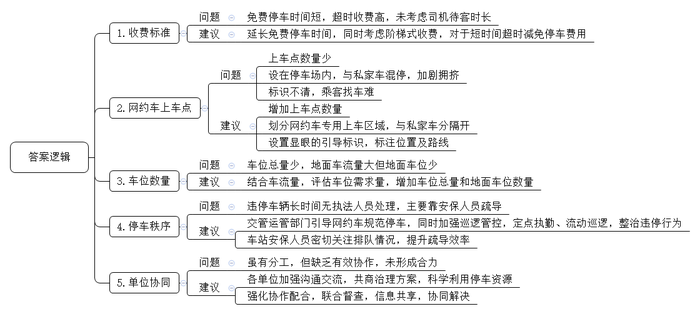
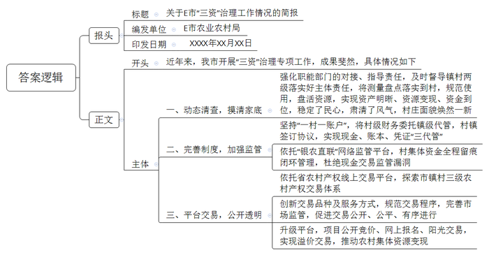
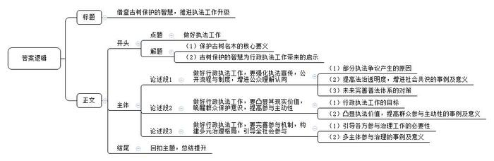

# 2025年公务员多省联考《申论》题（新疆行政执法卷）

<!-- gwy:overview:start -->
> **新疆 · 2025 · 申论 · 行政执法** ｜ 4 题 · 图片 4 处 · 答案随题折叠

导航：[题目](#题目) · [材料 1](#材料-1)
<!-- gwy:overview:end -->

> 候选采集稿。参考答案及解析来自粉笔页面，不代表官方答案或真实高分答卷；来源使用许可与原卷对应关系仍需人工核实。

## 给定材料

### 材料 1

“你看这梯田一圈一圈，像池塘里的涟漪，层层荡开，非常漂亮。”站在定川村的山头，A市农业农村局马局长指着已经建成的高标准农田说。举目四望，山横黛，田绕山，碧绿轻盈的马铃薯苗正在田中茁壮成长，随高标准农田配套修建的“田间生产路”起伏于山间，延展向远方。在高标准农田建设上，A市立足当地实际，组织设计单位扎实摸底勘察，打破行政界限，整山系、整流域推进实施。“高标准农田消除了界埂沟渠，不仅增加了种植面积，而且集中连片，为新的农田经营方式创造了便利。”马局长说。

马铃薯种植是当地传统的主导产业。“我们以前人工点种，一天下来一人也只能点一亩。”定川村村民老秦说，“现在田间路宽了，大型机械也能开进田了，一天能种40多亩，而且每亩可以种4200株左右。”A市市政府引导种植大户牵头成立马铃薯种植合作社，在自愿的前提下，吸引农户以土地经营权入社，合作社与农户签订收购合同，给农户提供种子和机械，指导农户按照标准进行种植。

在定川村智慧农田服务中心，几位年龄较大的村民正在学习如何用手机浇地。打开手机应用软件，简单几步操作后，通过墙上的大屏幕可以直观地看到伸缩式喷灌连接杆缓缓地伸出来，喷头旋转喷洒。这种喷灌设施不仅可以喷洒水，还可以喷洒调配好的肥料和药物。服务中心旁边有一块儿被栏杆围起的场地，分布着土壤墒情监测仪、物联网虫情信息采集设备等智慧农业设施。“这些设备收集到的信息都会汇集到软件上，农业技术员分析研判后在手机上发布灌溉、施肥、除虫等指导意见，农民只要点点手机，就能精准管理上千亩农田。”马局长说，“智慧农田服务中心让高标准农田有了‘大脑’，我们正在全市逐步推广。”

为确保高标准农田发挥长久效应，A市严格执行国家关于坚决遏制耕地“非农化”“非粮化”政策，出台了高标准农田建设项目管理办法等文件，要求任何单位和个人不得毁损、擅自占用高标准农田或改变高标准农田用途。“市里统筹‘建、用、管’一体，建立县、乡、村、组四级网格长的建后管护新机制。”市农业农村局农田建设与耕地质量保护科罗科长说。目前A市已经划定各个网格管理区域，为每个网格都聘请了管护员，逐级落实管护责任主体。同时，A市农业农村、自然资源等部门加大执法力度，随机开展抽查检查，畅通举报渠道，公开监督投诉电话，对发现的各类违法违规问题依法依规严肃查处。

近年来，A市加大科研投入力度，建成了一批集研发、教学和生产为一体的马铃薯种薯培育基地。“随着高标准农田建设的迅速推进，打造现代化的马铃薯产业发展体系成为我市迫在眉睫的任务。”马局长说，“市里围绕马铃薯种植，上溯下延，聚焦繁育、种植、储存、加工等关键环节，不断进行技术攻坚。”现在A市每年生产的五百多万吨鲜薯，一部分作为良种向外销售推广，其余作为原料进入当地淀粉生产厂进行深加工，一个个马铃薯正在串起金色的产业链。“我们公司年加工鲜薯9万多吨，生产薯产品1.4万吨，销售总额达1.08亿元。近年来，我们持续延伸产业链条，开发了流汁宽粉、马铃薯纤维等多种产品，进一步增加了企业的经济效益。”某淀粉加工有限公司柳经理说。

产业兴带来人气旺。以前定川村的年轻人都去外面发展，村子冷清得很。“现在我们合作社年轻人越来越多，仅去年就有十来名年轻人从城镇回来工作。这些人大部分受过高等教育，他们带回了新技术、新观念。”定川村马铃薯专业合作社杜经理说。这些年轻人经常随手拍一些定川马铃薯种植的短视频发到网上，自豪地宣传家乡的特色农业，吸引不少商家前来合作。“高标准农田建设一头连着国家的粮食安全，是实现高质量发展的重要保障，一头连着百姓的增产增收，是实现美好生活的坚实基础。”马局长说，“通过建设高标准农田，我们激活了农村的‘一池春水’。”山，还是那座山；地，依旧是那片地。从粮田到良田，如今的A市“鲜活”了起来，溢满勃勃生机。

### 材料 2

火车站是城市交通的重要枢纽，更是城市的形象窗口，但Z市火车站却各种问题层出不穷，“本来几分钟就可以上车，在这里竟然要等上几十分钟。”一位乘客无奈地对记者说。

周日上午，火车站地面停车场入口与外部高架桥相连接的道路上停靠了十余辆车。走近一看，车上都坐着候客的网约车驾驶员。这些司机为何不停靠在上车点内，而在道路上违停呢？“上车点在停车场内，超过15分钟就要收费。”网约车司机李师傅说，“既是上车点又是停车场，私家车跟网约车混在一起停车，车位本来就不够，这样就更挤啦。”

“我们地面的车流量要远远高于地下，但是地下停车场有192个车位，地面停车场只有170个，地面车位本来就规划不足。”物业刘经理坦言，“Z市火车站总共加起来不足400个车位，目前的地面停车场车位也确实有限，暂时只能是安排工作人员多在现场引导。”

由于车流量大，地面的上车点内不断有网约车进入，车位很快就几近饱和，后来的司机就只能“见缝插针”。一辆网约车因没有车位违停在通道上，二十多分钟过去了，都没有执法人员前来处理。直到停车场的安保人员发现通道上的车辆排起长队，上前疏导，通道才得以畅通。“停车场里就这一个上车点，画线的位置都被停了，我要是到偏一点的地方，乘客就不好找，说不定还得被投诉。”网约车司机封师傅说。蔡女士下了动车后，找了许久才找到上车点。“从车站出来后，一路上的标识牌都不显眼。”好不容易到了上车点，也没看到她的网约车，她说，“现在上下车的需求这么大，应该多设置几个上车点，这样乘客好找车，司机也好等客。”

在记者走访过程中，不少驾车及候车的市民表示，网约车上车点应当做得大些、规范些，让车辆好通行，市民好上车。部分市民认为，导致堵车的原因还在于停车场内网约车上车点的位置不清晰，应当划分出一块专门的上车区，而不是只有一个“微缩”的上车点。

谈到停车场收费标准时，网约车司机陆师傅表示，时常会遇到一些乘客高铁还没停稳就开始约车，乘客到网约车上车点的时间难以确定，“有时候乘客快到了，但停车场的15分钟免费停车时间就要用完，我们只能开出去再进来，否则接一单赚的钱可能还不够停车费。”

“针对网约车上车点的停车乱象，我们已经与交管部门和运管部门沟通，引导网约车尽量进入车位，不要停在通道上。”刘经理说，“如果确实存在比较严重的违停现象，还是需要交管部门加强巡逻处理。”

交警中队薛队长说，“我们将采取定点执勤与流动巡逻相结合的方式，加大巡逻管控力度，对违停挡道、有场不进的车辆进行重点整治。”

“火车站停车管理的分工其实是很明确的，各单位都作出了一定的努力，但‘头痛医头’‘各自为战’是不够的，分工的表象在分，但其实质是分背后的合，真正考察的是合的能力。”火车站管委会程主任说，“彻底破解火车站网约车停车乱象，还需要标本兼治，更科学地利用火车站停车资源，为群众提供一个良好的停车环境。”

### 材料 3

“‘三资’（资产、资源、资金）治理不仅关系到村民富不富，也关系到村庄美不美。”E市水北镇杨庄村党支部书记说，“‘三资’治理就是要摸清家底，规范使用，盘活资源。落实到村里，主要是测量盘点，把现有资源搞‘活’。通过治理，不仅资产明晰了，资源变现了，资金到位了，而且民心稳了，风气正了，村庄面貌也随之焕然一新。”

杨庄村属于典型的城边村，村内企业占地较多，但过去一段时间，“三资”问题一直困扰着干部和群众。“不少地块都是本村村民在承包，但由于大伙签订合同的背景不一样，价格也存在差异，群众之间又有攀比心理，所以工作一直很难推进。”杨庄村党支部书记介绍，“一旦开展‘三资’清查，就要推翻很多过去已经签好的合同，涉及到村里很多企业的资金问题，要让商户和村民都接受、配合，的确很不容易。”

近年来，借着市里乡村振兴工作计划“三资”治理专项实施的契机，杨庄村在市农业农村局指导下多次召开村两委联席会议，讨论制定了“三资”清查方案，成立了“三资”清查工作小组。

清查的第一步，就是摸清家底。为确保公正公开，杨庄村采取实地测量的方式，邀请企业方、测量方、村干部、村民代表等多方同时到场进行土地测量，测量结果需得到多方认可，在公示无异议后才能生效。“这是一项为村为民的好政策，就先从我家的大棚开始吧。”党员老纪不仅第一个接受实地测量，第一个重新签署合同、缴纳承包费，还主动加入工作小组，负责土地测量工作。像老纪一样，全村54名党员充分发挥先锋模范作用，以实际行动支持“三资”治理工作。在他们的影响下，原本心存疑虑的村民逐渐转变态度，纷纷配合入户进企实地测量，捋顺合同、明晰债权债务，开展企业租赁合同续签、改签等工作，使清查工作得到有序推进。

自治理专项开展以来，E市进一步强化职能部门的对接、指导责任，及时督导镇村两级落实好主体责任，着力推动治理工作走深走实。截至目前，共清收各类闲置或被侵占的机动地、集体建设用地、四荒水面等10769亩，盘活15167亩，增收2832万元。摸排合同35194份，规范问题合同10344份，清收债权6418笔，金额共计6840万元。

在动态清查农村集体“三资”底数的同时，E市也在不断完善相应的监管制度。坚持“一村一账户”，将村级财务委托镇级代管，村集体与镇级业务部门签订协议，村级实行报账员制度。在各乡镇（街道）设立农村财务委托代理服务中心，在坚持村级集体资产所有权、使用权、财务审批权不变和会计核算主体不变的前提下，统一管理村级账目，实现现金、账本、凭证“三代管”。将所有村级账户纳入“银农直联”网络监管平台，依托平台对村集体资金实行全程留痕闭环管理，做到干部不经钱、会计不见钞，切实杜绝以往村集体现金交易难监管的现象。

最近，水北镇法柳村的夜市成了当地居民的热门打卡地。每当夜幕降临，人们汇聚在此，不仅可以品尝近百种特色美食，还能观看灯光秀和演出。然而一年前，这里还是堆满建筑废料、生活垃圾的荒地，一到下雨天便污水横流。在“三资”治理专项实施过程中，这片荒地成为镇村干部关注的重点。镇村两级多次组织召开协商议事会，广泛征集干部和群众意见。“隔壁杨庄村的夜市搞得挺红火的，我们是不是也可以搞？”“对啊，我们周边人流量大，这个优势可得好好利用！”……经充分研究论证，法柳村两委决定借助企业力量将荒地发展为夜市。水北镇第一时间将情况汇报给市农业农村局，并协助村两委将夜市招标信息发布至农村产权线上交易平台。

“几家企业竞价角逐，最终价高者得。与企业签订的合同中土地租金是一年26万元，超过了我们最初的预期。”法柳村党支部杨书记说道，“从申请报名到与企业签订土地租赁合同，前后也就半个多月时间。”

“村里的这笔交易做得好啊，我们有活干，村里有钱挣，人气也旺了。”53岁的夜市清洁员赵大姐说，她现在每月能增加3000元的收入。

十年前，E市建成省内首家农村产权线上交易平台。多年来，E市积极探索市、镇、村三级农村产权交易体系，在市级成立农村产权交易中心，在乡镇（街道）设分中心，在村庄设信息点。同时，不断创新交易品种及服务方式，规范交易程序，完善市场监管，促进交易公开、公平、有序进行。

随着数字技术的发展和农村资源要素活力的释放，去年，E市又对交易平台进行了升级。目前，所有项目均采取公开竞价、网上报名、阳光交易的模式，部分交易项目溢价超3倍，为农村集体资源变现发挥着更加便捷、积极的作用。

### 材料 4

P县是林业大县，森林覆盖率高达77%，至今留存着216个古树群落、7491株古树名木。这些古树名木种类和数量多，且散落遍布山野，保护难度极大。踏遍P县的山山水水，为一棵棵古树名木“健康诊断”“建档立卡”……这是县林长办高级工程师老汪和团队成员长期坚持的工作。

P县素来有保护树木的传统。早在1996年，县政府就公布挂牌保护了16科25属28种1096株古树名木，并抢救性保护了一批濒临死亡的古树名木。2012年，该县组织开展古树名木普查，工作人员翻山越岭，探访散布在村口院落、田间地头、密林深处的珍贵古树。此次普查，新增了13科36属55种6395株古树名木。此后，工作人员将数据信息整合到省智慧林业平台，在赋予古树“身份证号”的同时，为每棵古树建立起了“个体档案”。

“位于梨岭村的水松古树群，对研究杉科植物的系统发育、古植物学等都有重要科研价值。我们在寺庙、宗祠、学堂中发现普遍栽有罗汉松，这对于了解当地历史文化也具有一定意义。”老汪说。为古树名木建立“个体档案”，对于研究其历史价值和科研价值等具有重要作用。

“黄源岭背为保留庇荫，禁止砍柴，违者罚银一两，留存众用。”P县境内有一块始立于明朝崇祯年间的石碑，与当地村民一同守护了古树群数百年。这里，南方红豆杉、银杏等117株平均树龄260年以上的古树虬枝飘逸、郁郁葱葱，成为P县珍稀树种最多、林相最完整，绿化、美化、彩化兼备的“最美古树群”。

“随着这几十年生活条件大大改善，老百姓们逐渐意识到生态环境的珍贵价值，保护古树的意识也越来越强。”老汪说，“自发巡山、护林、保护古树已经成为我们的一种习惯。”在没有路的大山里爬坡过沟，护林员老石在这片山林里走了27年。一本笔记本，一个水杯，一个背包，每天上午，老石都要背着他的这些家当到森林深处仔细观察一株株古树，记录古树的生长情况，一旦发现枝叶枯萎迹象或病虫害，就立刻上报。如今，P县像老石一样的专职护林员有349人，日常巡护、病虫害监测、森林防灭火、宣传劝导……这是他们的护林日常。护林员们行走在山水之间，就像“专职护卫”一样默默守护着青山、古树。

“今年，针对偏远山区存在被破坏风险的古树名木，我们还采取了植入芯片的方式24小时强化跟踪保护。目前，首批确定保护的有南方红豆杉、罗汉松等100余棵具有重要经济价值的古树名木。当古树名木发生移动时，系统将会自动报警，工作人员即可通过后台定位跟踪，及时处置。近期，我们也协调了县林业、供电等单位共20架无人机，对县域内国家森林公园及古树名木群落等重点生态部位进行无人机3D建模。”县公安局宁局长介绍。依托生态警务中心，引进无人机云平台，实现数据存储比对分析、资源共享等功能，为开展无人机生态巡查和打击涉生态领域违法犯罪提供技术支撑。

古树是活着的历史，但树龄越大，越容易生病，更需要“私人医生”的专业守护，“一树一策”开“药方”。“九龙桂”是P县最有代表性的丹桂树，但在几年前，它出现了生长衰退、持续落叶等问题。“当时一发现情况，县、镇两级就及时组织了林业专家进行会诊。”老汪说，“对树周、冠下环境进行治理，撤除硬化设施，换上新土。与此同时，采伐、移植周边影响‘九龙桂’生长的毛竹和小丹桂树等，创造利于古树光合作用、排水、透风透气的生长环境，并借助空中喷洒药物等方式进行病虫害防治。”

如今，专家把古树养护重点放在了“治未病”上，采取多种手段促进树体健康生长。持续监测古树的生长环境，借助专业设备进行分析，提前防范化解病虫害侵蚀、土壤板结、缺水失肥等风险；定期进行体检，对古树名木做精细化“查体”，借助新型打孔注药技术，为古树打“疫苗”。“利用检测设备，经专业软件处理后，就能在电脑上对古树建模，直观地反映古树当前整体情况，这为我们精准救护古树提供了依据。”老汪说。

P县在加强和规范古树名木日常管护的同时，还鼓励挖掘和提炼古树名木的生态和人文价值。比如，建设古树主题公园，推出特色古树群游览路线，设立有声古树名木保护牌，开展形式多样的宣教、普法活动等，同时加强部门联动，合力保护，提升群众对古树名木保护的知晓度和参与度，在大家心中播撒生态文明的种子，让保护古树名木蔚然成风。

为了讲好古树的故事，近年来，P县还组织编辑出版了《P县古树名木》一书，收录了24个景观优美的古树群和132株具有代表性的古树。除了珍贵的资料，书中还有许多民间故事，图文并茂地展现了当地古树名木的风采。

“千姿百态的古树名木是自然的见证，是绿色的文物和‘活化石’。<u>保护古树名木单靠我们是远远不够的，不仅要让大家认识、了解古树名木，还要唤醒大家的保护意识，引导全社会共同参与。”</u>县林业局段局长说。

## 题目

### 第 1 题

**根据****“给定资料**1**”，请你谈谈A市是如何通过建设高标准农田激活当地农村“一池春水”的。（10分）**

关联材料：材料 1

作答要求：

要求：

（1）全面准确；

（2）分条列出；

（3）不超过200字。

第 1 题 · 答案与解析

**参考答案（粉笔题库参考内容）**

1.实现农业规模化。打破行政界限，农田集中连片、面积增加，实现大型机械作业。

2.推动种植标准化。成立合作社，吸引农户入社，签订收购合同，统一提供农资和指导。

3.推进农业智慧化。建设智慧农田服务中心，配备智慧农业设施，精准管理农田。

4.农田保护长效化。出台文件，严控土地用途，建立管护机制；加大执法力度，严查违法违规行为。

5.产业体系现代化。聚焦关键环节，进行技术攻坚，延伸产业链，增加经济效益，吸引人才回流。

**参考答案说明：**本参考答案从“实现农业规模化”“推动种植标准化”“推进农业智慧化”“农田保护长效化”“产业体系现代化”这五个方面展开，各条答案要点之间在内容上相互并列，没有交叉。

**解析状态：unknown（来源未提供）**

### 第 2 题

**根据****“给定资料**2**”，请你梳理Z市火车站停车场存在的问题，并提出解决建议。（25分）**

关联材料：材料 2

作答要求：

要求：

（1）问题梳理全面、准确、有条理；

（2）所提建议与问题相对应，具体明确、切实可行；

（3）不超过400字。

第 2 题 · 答案与解析

**参考答案（粉笔题库参考内容）**

1.收费标准问题：免费停车时间短，超时收费高，未考虑司机待客时长。建议：延长免费停车时间，同时考虑阶梯式收费，对于短时间超时减免停车费用。

2.网约车上车点问题：上车点数量少；设在停车场内，与私家车混停，加剧拥挤；标识不清，乘客找车难。建议：增加上车点数量；划分网约车专用上车区域，与私家车分隔开；设置显眼的引导标识，标注位置及路线。

3.车位数量问题：车位总量少，地面车流量大但地面车位少。建议：结合车流量，评估车位需求量，增加车位总量和地面车位数量。

4.停车秩序问题：违停车辆长时间无执法人员处理，主要靠安保人员疏导。建议：交管运管部门引导网约车规范停车，同时加强巡逻管控，定点执勤、流动巡逻，整治违停行为；车站安保人员密切关注排队情况，提升疏导效率。

5.单位协同问题：虽有分工，但缺乏有效协作，未形成合力。建议：各单位加强沟通交流，共商治理方案，科学利用停车资源；强化协作配合，联合督查，信息共享，协同解决。

**参考答案说明：**本参考答案整体上分为“问题”和“建议”两个要素，其中，“问题”部分从“收费标准”“网约车上车点”“车位数量”“停车秩序”“单位协同”五个方面展开，“建议”部分与“问题”相对应。各条答案要点之间在内容上相互并列，没有交叉。

**解析状态：unknown（来源未提供）**

### 第 3 题

**假如你是市农业农村局的工作人员，根据****“给定资料**3**”，请你就E市“三资”治理工作情况写一份工作简报，供领导参考。（25分）**

关联材料：材料 3

作答要求：

要求：

（1）紧扣资料，内容全面；

（2）简明扼要，条理清晰；

（3）不超过450字。

第 3 题 · 答案与解析

**参考答案（粉笔题库参考内容）**

关于E市“三资”治理工作情况的简报

E市农业农村局 XXXX年XX月XX日

近年来，我市开展“三资”治理专项工作，成果斐然，具体情况如下：

一、动态清查，摸清家底。强化职能部门的对接、指导责任，及时督导镇村两级落实好主体责任，将测量盘点落实到村，规范使用，盘活资源，实现资产明晰、资源变现、资金到位，稳定了民心，肃清了风气，村庄面貌焕然一新。

二、完善制度，加强监管。坚持“一村一账户”，将村级财务委托镇级代管，村镇签订协议，实现现金、账本、凭证“三代管”；依托“银农直联”网络监管平台，村集体资金全程留痕闭环管理，杜绝现金交易监管漏洞。

三、平台交易，公开透明。依托省农村产权线上交易平台，探索市镇村三级农村产权交易体系；创新交易品种及服务方式，规范交易程序，完善市场监管，促进交易公开、公平、有序进行；升级平台，项目公开竞价、网上报名、阳光交易，实现溢价交易，推动农村集体资源变现。

**参考答案说明：**（1）格式方面，本参考答案写到了“报头”和“正文”两个部分。（2）正文部分，一方面从内容上来看，围绕“E市‘三资’治理工作”这一主题，本参考答案的开头先简单介绍了E市“三资”治理工作的背景；主体部分从“动态清查，摸清家底”“完善制度，加强监管”“平台交易，公开透明”三个方面介绍了E市的“三资”治理工作。另一方面，形式上，本参考答案做到了分段、分条撰写，整体上条理较为清晰。

**解析状态：unknown（来源未提供）**

### 第 4 题

**“给定资料**4**”中提到“保护古树名木单靠我们是远远不够的，不仅要让大家认识、了解古树名木，还要唤醒大家的保护意识，引导全社会共同参与”，请你深入思考这句话对做好执法工作的借鉴意义，参考给定资料，联系实际，自选角度，自拟题目，写一篇文章。（40分）**

关联材料：材料 1、材料 2、材料 3、材料 4

作答要求：

要求：

（1）观点明确，见解深刻，内容充实；

（2）参考给定资料，但不拘泥于给定资料；

（3）思路清晰，语言流畅；

（4）字数800-1000字。

第 4 题 · 答案与解析

**参考答案（粉笔题库参考内容）**

**借鉴古树保护的智慧，推进执法工作升级**

北京故宫博物院里，古树上挂着不同颜色的古树铭牌，详细介绍了古树的品种、年龄，这个细节生动诠释了保护古树名木的核心要义——唯有唤起全民珍视，才能实现真正守护。见微知著，古树保护的智慧恰为破解行政执法困境提供了关键启示。借鉴古树保护“认知-认同-参与”的三阶推进策略，行政执法应当构建“普法教育+价值认同+协同治理”的新型治理范式，破解单边治理与多元诉求之间的矛盾。

**做好行政执法工作，要强化执法宣传，****公开流程****与制度，****增进公众理解认同****。**部分执法争议的根源在于信息不对称——公众因不了解相关规定，对执法行为产生误解甚至抵触。破解这一认知壁垒，关键在于提高法治透明度，增进社会共识。北京市城管局开展的“执法微课堂”，通过短视频解析占道经营执法标准后，提升了商户主动整改率；深圳市通过开展“直播式”执法行动，在直播互动中以案释法，提升市民法治认同度……这些创新实践实现了执法效益与社会效益的有机统一。未来应构建多层次、立体化的普法体系，让执法过程可感知、法律依据看得懂、程序规则信得过**。**

**做好行政执法工作，要****凸显****其****现实价值****，唤醒群众保护意识，提高参与主动性。**行政执法工作的目标一方面是纠正违法行为，另一方面是传递法治精神，引导公众自觉守法、主动护法。杭州市城管局在整治违建时，会说明违建对消防通道的危害，居民从“事不关己”转变为主动举报线索；广州市在推行垃圾分类时，执法部门在对违规行为处罚的同时推出“绿色账户”制度，让环保行为直接获益，垃圾分类准确率显著提升。只有让群众切实感受到执法对其生活质量的提升，明确自身在法治社会中的角色，才能打破“政府干、群众看”的困局。

**做好行政执法工作，要****完善参与机制，构建多元治理格局****，引导全社会参与。**当前城市治理面临新业态崛起、社会结构转型等挑战，单靠行政执法力量已难以应对复杂治理需求，需引导各方主动参与。将新业态就业群体转化为“流动网格员”，使快递小哥成为城市运行的“毛细血管传感器”，让社区志愿者担当民情民意的“神经末梢”……微光汇集，让“小角色”能散发“大能量”。多主体参与能够激发全社会主人翁意识，共同构建治理新图景。

以认知培育筑基、价值共鸣聚力、机制创新破局，构建全民共建的法治新生态，让行政执法焕发新活力。

**文章分析**

**借鉴古树保护的智慧，推进执法工作升级**

【**标题的优点：**首先，标题中含有主题词，使文章主题更突出、清晰。其次，形式上采用对称式结构，使标题更加完整、饱满。】

（1）北京故宫博物院里，古树上挂着不同颜色的古树铭牌，详细介绍了古树的品种、年龄，这个细节生动诠释了<u>保护古树名木</u>的核心要义——唯有<u>唤起全民珍视</u>，才能<u>实现真正守护</u>。（2）见微知著，<u>古树保护的智慧</u>恰为<u>破解行政执法困境</u>提供了关键启示。借鉴古树保护“认知-认同-参与”的<u>三阶推进策略</u>，行政执法应当构建“普法教育+价值认同+协同治理”的<u>新型治理范式</u>，破解<u>单边治理</u>与<u>多元诉求</u>之间的矛盾。

【**开头的优点：**★内容方面。范文的开头是紧扣“做好执法工作”这一主题展开的。首先，开头点出主题，做到了主题明确。其次，对“做好执法工作”这一主题进行了分析阐述，指出了：（1）保护古树名木的核心要义；（2）古树保护的智慧为行政执法工作带来的启示。★文字表达方面。使用了“唯有……才能……”等关联词，使语言表达有逻辑性；长短句配合使用，使语言表达有节奏感。】

**做好行政执法工作，要强化执法宣传，公开流程与制度，增进公众理解认同。**（1）部分<u>执法争议的根源</u>在于<u>信息不对称</u>——公众因<u>不了解相关规定</u>，对<u>执法行为产生误解甚至抵触</u>。（2）破解这一认知壁垒，关键在于<u>提高法治透明度</u>，<u>增进社会共识</u>。北京市城管局开展的“<u>执法微课堂</u>”，通过<u>短视频解析占道经营执法标准</u>后，提升了<u>商户主动整改</u>率；深圳市通过开展“<u>直播式”执法</u>行动，在直播互动中<u>以案释法</u>，提升市民<u>法治认同度</u>……这些创新实践<u>实现了执法效益与社会效益的有机统一</u>。（3）未来应<u>构建多层次、立体化的普法体系</u>，让<u>执法过程</u>可感知、<u>法律依据</u>看得懂、<u>程序规则</u>信得过。

【**论述段****1的优点：**★观点句：范文的观点句是紧扣“做好执法工作”这一文章主题提出的。形式上，它在段首处直接写出，位置突出，容易发现。内容上，关键词突出，内容要点明确，可以明显看出主要从“增进公众理解认同”的角度展开论述。★论述内容：（1）部分执法争议产生的原因；（2）提高法治透明度，增进社会共识的事例及意义；（3）未来完善普法体系的对策。注意：以上几个方面的内容都是紧扣“做好行政执法工作，要强化执法宣传，公开流程与制度，增进公众理解认同”这个观点句进行分析论述的，论述的针对性强，内容层次丰富。在论述方法上采用了讲道理与举例子相结合的方式，论述充实深刻。】

**做好行政执法工作，要凸显其现实价值，唤醒群众保护意识，提高参与主动性。**（1）<u>行政执法工作的目标</u>一方面是<u>纠正违法行为</u>，另一方面是<u>传递法治精神</u>，<u>引导公众自觉守法</u>、<u>主动护法</u>。（2）杭州市城管局在<u>整治违建</u>时，会说明违建对<u>消防通道</u>的危害，居民从“事不关己”转变为<u>主动举报线索</u>；广州市在推行<u>垃圾分类</u>时，执法部门在<u>对违规行为处罚</u>的同时推出“绿色账户”制度，让<u>环保行为</u>直接获益，垃圾分类准确率显著提升。只有让群众切实感受到执法对其<u>生活质量</u>的提升，<u>明确自身在法治社会中的角色</u>，才能打破“政府干、群众看”的困局。

【**论述段****2的优点：**★观点句：范文的观点句是紧扣“做好执法工作”这一文章主题提出的。形式上，它在段首处直接写出，位置突出，容易发现。内容上，关键词突出，内容要点明确，可以明显看出主要从“唤醒群众保护意识”的角度展开论述。★论述内容：（1）行政执法工作的目标；（2）凸显执法价值，提高群众参与主动性的事例及意义。注意：以上几个方面的内容都是紧扣“做好行政执法工作，要凸显其现实价值，唤醒群众保护意识，提高参与主动性”这个观点句进行分析论述的，论述的针对性强，内容层次丰富。在论述方法上采用了讲道理与举例子相结合的方式，论述充实清晰。】

**做好行政执法工作，要完善参与机制，构建多元治理格局，引导全社会参与。**（1）当前<u>城市治理</u>面临<u>新业态崛起</u>、<u>社会结构转型</u>等挑战，单靠行政执法力量已难以应对<u>复杂治理需求</u>，需<u>引导各方主动参与</u>。（2）将新业态就业群体转化为“<u>流动网格员</u>”，使快递小哥成为<u>城市运行</u>的“毛细血管传感器”，让社区志愿者担当<u>民情民意</u>的“神经末梢”……微光汇集，让“小角色”能散发“大能量”。多主体参与能够<u>激发全社会主人翁意识</u>，<u>共同构建治理新图景</u>。

【**论述段****3的优点：**★观点句：范文的观点句是紧扣“做好执法工作”这一文章主题提出的。形式上，它在段首处直接写出，位置突出，容易发现。内容上，关键词突出，内容要点明确，可以明显看出主要从“引导全社会参与”的角度展开论述。★论述内容：（1）引导各方参与治理工作的必要性；（2）多主体参与治理的事例及意义。注意：以上几个方面的内容都是紧扣“做好行政执法工作，要完善参与机制，构建多元治理格局，引导全社会参与”这个观点句进行分析论述的，论述的针对性强，内容层次丰富。在论述方法上采用了讲道理与举例子相结合的方式，论述充实到位。】

【**论述段之间的关系：**★内容的内在逻辑：范文的论述段之间是依照“递进”的逻辑展开的。论述段1先写了“做好行政执法工作，要强化执法宣传，公开流程与制度，增进公众理解认同”，论述段2再写了“做好行政执法工作，要凸显其现实价值，唤醒群众保护意识，提高参与主动性”，论述段3接着写了“做好行政执法工作，要完善参与机制，构建多元治理格局，引导全社会参与”。文章按照“认知-认同-参与”的逻辑层层递进，整体思路清晰。】

以认知培育筑基、价值共鸣聚力、机制创新破局，构建全民共建的法治新生态，让行政执法焕发新活力。

【**结尾的优点：**范文的结尾回扣了“做好执法工作”这个主题，并且进行了总结提升。】

**解析状态：unknown（来源未提供）**

