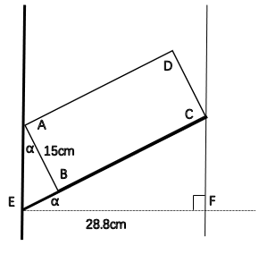
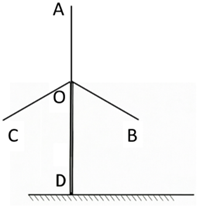
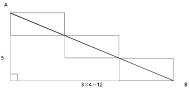
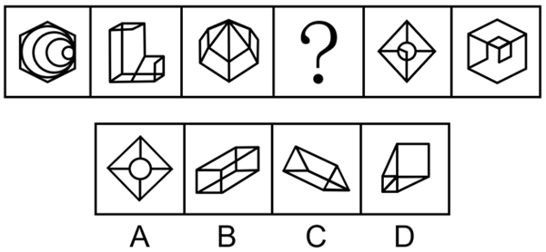
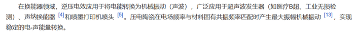
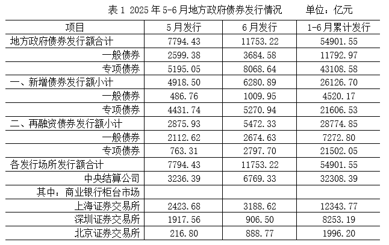

# 2026年新疆区考公务员录用考试《行测》试题（网友回忆版）

<!-- gwy:overview:start -->
> **新疆 · 2026 · 行测 · 统考** ｜ 115 题 · 图片 193 处 · 答案随题折叠

| 题型模块 | 题量 | 题号 |
| --- | ---: | ---: |
| 政治理论 | 15 | 1–15 |
| 常识判断 | 10 | 16–25 |
| 言语理解与表达 | 25 | 26–50 |
| 数量关系 | 15 | 51–65 |
| 判断推理 | 35 | 66–100 |
| 资料分析 | 15 | 101–115 |
| **合计** | **115** | |

导航：[题型与作答说明](#题型与作答说明) · [题目](#题目) · [材料 1](#材料-1)
<!-- gwy:overview:end -->

> 候选采集稿。参考答案及解析来自粉笔页面，不代表官方答案或真实高分答卷；来源使用许可与原卷对应关系仍需人工核实。

## 题型与作答说明

政治理论

（15题）

根据题目要求，在四个选项中选出一个最恰当的答案。

常识判断

（10题）

根据题目要求，在四个选项中选出一个最恰当的答案。

言语理解与表达

（25题）

本部分包括表达与理解两方面的内容。请根据题目要求，在四个选项中选出一个最恰当的答案。

数量关系

（15题）

在这部分试题中，每道题呈现一段表述数字关系的文字，要求你迅速、准确地计算出答案。

判断推理

（35题）

本部分包括图形推理、定义判断、类比推理与逻辑判断四种类型的试题，在四个选项中选出一个最恰当的答案。

资料分析

（15题）

所给出的图、表、文字或综合性资料均有若干个问题要你回答。你应根据资料提供的信息进行分析、比较、计算和判断处理。

## 题目

### 第 1 题

党的二十大报告指出，坚持把发展经济的着力点放在实体经济上，推进新型工业化，加快建设制造强国、质量强国、航天强国、交通强国、网络强国、数字中国。关于发展实体经济，下列说法正确的是：

①金融是实体经济的血脉，为实体经济服务是金融的天职

②要增强资本市场服务实体经济功能，积极有序发展股权融资

③要实现实体经济、科技创新、现代金融、人力资源协同发展

④要促进实体经济和数字经济深度融合，有序推动实体经济脱实向虚

⑤要推动资源要素向实体经济集聚、政策措施向实体经济倾斜、工作力量向实体经济加强

A. ①②③⑤

B. ②③④

C. ①②④⑤

D. ③④⑤

第 1 题 · 答案与解析

**参考答案（粉笔题库参考内容）**

A

**解析**

本题考查新思想。

①正确，2026年2月1日出版的第3期《求是》杂志发表了习近平总书记的重要文章《走好中国特色金融发展之路，建设金融强国》，文章指出：“······坚持把金融服务实体经济作为根本宗旨。实体经济是金融的根基，金融是实体经济的血脉，服务实体经济是金融的天职······”

②正确，2017年7月召开的全国金融会议指出：“金融是国之重器，是国民经济的血脉······要增强资本市场服务实体经济功能，积极有序发展股权融资，提高直接融资比重······”

③正确，党的十九大报告在“五、贯彻新发展理念，建设现代化经济体系”部分指出：“必须坚持质量第一、效益优先······着力加快建设实体经济、科技创新、现代金融、人力资源协同发展的产业体系，着力构建市场机制有效、微观主体有活力、宏观调控有度的经济体制，不断增强我国经济创新力和竞争力。”

④错误，2026年2月1日出版的第3期《求是》杂志发表了习近平总书记的重要文章《走好中国特色金融发展之路，建设金融强国》，文章指出：“······我国金融必须守好服务实体经济本分，推动高质量发展，决不能脱实向虚。”十五五规划纲要在“第十三章 全方位推进数智技术赋能”部分指出：“促进实体经济和数字经济深度融合。”故“有序推动实体经济脱实向虚”表述有误。

⑤正确，《习近平新时代中国特色社会主义思想学习纲要》在“九、以新发展理念引领经济高质量发展”部分指出：“······要加快发展先进制造业，坚定不移建设制造强国。推动互联网、大数据、人工智能同实体经济深度融合，推动资源要素向实体经济集聚、政策措施向实体经济倾斜、工作力量向实体经济加强······”

故正确的有①②③⑤。

故正确答案为A。

### 第 2 题

党的二十届四中全会指出，“十五五”时期是基本实现社会主义现代化夯实基础、全面发力的关键时期，在基本实现社会主义现代化进程中具有承前启后的重要地位。关于“十五五”规划，下列说法正确的是：

A. 加强原始创新和关键核心技术攻关，推动科技创新和产业创新深度融合

B. 把发展经济的着力点向传统实体产业转移，巩固壮大传统实体产业根基

C. 积极稳妥推进和实现碳达峰，发展集中式能源，逐步缩减全国碳排放权交易市场

D. 发挥积极财政政策作用，适当加强地方事权、提高地方财政支出比重，增加地方自主财力

第 2 题 · 答案与解析

**参考答案（粉笔题库参考内容）**

A

**解析**

本题考查新思想。

2025年10月23日，中国共产党第二十届中央委员会第四次全体会议通过《中共中央关于制定国民经济和社会发展第十五个五年规划的建议》（以下简称《建议》）。

A项正确，《建议》在“四、加快高水平科技自立自强，引领发展新质生产力”部分指出：“（11）加强原始创新和关键核心技术攻关。完善新型举国体制，采取超常规措施，全链条推动集成电路、工业母机、高端仪器、基础软件、先进材料、生物制造等重点领域关键核心技术攻关取得决定性突破······（12）推动科技创新和产业创新深度融合。统筹国家战略科技力量建设，增强体系化攻关能力。强化科技基础条件自主保障，统筹科技创新平台基地建设。完善区域创新体系，布局建设区域科技创新中心和产业科技创新高地，强化国际科技创新中心策源功能······”

B项错误，《建议》在“三、建设现代化产业体系，巩固壮大实体经济根基”部分指出：“现代化产业体系是中国式现代化的物质技术基础。坚持把发展经济的着力点放在实体经济上，坚持智能化、绿色化、融合化方向，加快建设制造强国、质量强国、航天强国、交通强国、网络强国，保持制造业合理比重，构建以先进制造业为骨干的现代化产业体系。”故“把发展经济的着力点向传统实体产业转移，巩固壮大传统实体产业根基”表述错误，应为“坚持把发展经济的着力点放在实体经济上，巩固壮大实体经济根基”。

C项错误，《建议》在“十二、加快经济社会发展全面绿色转型，建设美丽中国”部分指出：“（47）积极稳妥推进和实现碳达峰。实施碳排放总量和强度双控制度。深入实施节能降碳改造。推动煤炭和石油消费达峰。完善碳排放统计核算体系，稳步实施地方碳考核、行业碳管控、企业碳管理、项目碳评价、产品碳足迹等政策制度。发展分布式能源，建设零碳工厂和园区。扩大全国碳排放权交易市场覆盖范围，加快温室气体自愿减排交易市场建设······”故“发展集中式能源，逐步缩减全国碳排放权交易市场”表述错误，应为“发展分布式能源，扩大全国碳排放权交易市场覆盖范围”。

D项错误，《建议》在“六、加快构建高水平社会主义市场经济体制，增强高质量发展动力”部分指出：“（20）提升宏观经济治理效能。发挥积极财政政策作用，增强财政可持续性······适当加强中央事权、提高中央财政支出比重。增加地方自主财力。加强财会监督。加快构建同高质量发展相适应的政府债务管理长效机制。”故“适当加强地方事权、提高地方财政支出比重”表述错误，应为“适当加强中央事权、提高中央财政支出比重”。

故正确答案为A。

### 第 3 题

习近平总书记强调，要坚持以铸牢中华民族共同体意识为主线，不断推进民族团结进步事业，推动党的民族工作高质量发展。关于铸牢中华民族共同体意识，下列说法正确的有几项?

①广泛交往交流交融是推进中华民族共同体建设的重要途径

②加强对青少年的历史文化教育，全面推广普及国家通用语言文字，全面推行使用国家统编教材

③要坚持和完善民族区域自治制度，逐步完善相关法律法规和差别化区域支持政策，依法保障各族群众合法权益

④要引导各族群众不断增强对伟大祖国、中华民族、中华文化、中国共产党、中国特色社会主义的认同

A. 1项

B. 2项

C. 3项

D. 4项

第 3 题 · 答案与解析

**参考答案（粉笔题库参考内容）**

D

**解析**

本题考查新思想。

2024年9月27日，全国民族团结进步表彰大会在北京举行。习近平总书记出席大会并发表重要讲话。

①正确，习近平总书记在讲话中指出：“第四，推动各民族全方位嵌入，积极促进各民族交往交流交融。广泛交往交流交融是推进中华民族共同体建设的重要途径。”

②正确，习近平总书记在讲话中指出：“第二，着力构筑中华民族共有精神家园······加强对青少年的历史文化教育，全面推广普及国家通用语言文字，全面推行使用国家统编教材，把中华民族共同体意识从小就植入孩子们的心灵。”

③正确，习近平总书记在讲话中指出：“第五，依法治理民族事务，不断提高民族事务治理能力和水平。要坚持和完善民族区域自治制度，逐步完善相关法律法规和差别化区域支持政策，依法保障各族群众合法权益。加强法治宣传教育，引导各族群众增强国家意识、公民意识、法治意识。”

④正确，习近平总书记在讲话中指出：“第一，始终坚持党的领导，不断巩固各民族团结奋斗的共同思想政治基础······要引导各族群众不断增强对伟大祖国、中华民族、中华文化、中国共产党、中国特色社会主义的认同，牢固树立休戚与共、荣辱与共、生死与共、命运与共的共同体理念。”

故①②③④表述正确，共4项。

故正确答案为D。

### 第 4 题

习近平总书记强调，要牢固树立和践行绿水青山就是金山银山的理念，坚定不移走生态优先、绿色发展之路。关于绿色发展，下列表述正确的有几项?

①坚持绿色发展是发展观的一场深刻革命

②要坚持经济优先、技术优先、人工恢复为主的方针，像保护眼睛一样保护自然和生态环境

③应暂缓绿色发展领域的多边合作平台建设，以应对现有国际环境治理合作存在的诸多风险与挑战

④不仅要从政策上加强管理和保护，而且要从全球变化、碳循环机理等方面加深认识，依靠科技创新破解绿色发展难题

A. 1项

B. 2项

C. 3项

D. 4项

第 4 题 · 答案与解析

**参考答案（粉笔题库参考内容）**

B

**解析**

本题考查新思想。

①正确，2017年6月21日至23日，习近平总书记在山西考察工作时强调：“坚持绿色发展是发展观的一场深刻革命。要从转变经济发展方式、环境污染综合治理、自然生态保护修复、资源节约集约利用、完善生态文明制度体系等方面采取超常举措，全方位、全地域、全过程开展生态环境保护。”

②错误，2018年5月18日至19日，全国生态环境保护大会在北京召开，习近平总书记出席会议并发表重要讲话，他指出：“新时代推进生态文明建设，必须坚持好以下原则。一是坚持人与自然和谐共生，坚持节约优先、保护优先、自然恢复为主的方针，像保护眼睛一样保护生态环境，像对待生命一样对待生态环境，让自然生态美景永驻人间······”故“要坚持经济优先、技术优先、人工恢复为主的方针”表述有误，应为“坚持节约优先、保护优先、自然恢复为主的方针”。

③错误，2024年7月18日，二十届三中全会通过的《中共中央关于进一步全面深化改革 推进中国式现代化的决定》在“七、完善高水平对外开放体制机制”中指出：“（28）完善推进高质量共建‘一带一路’机制。继续实施‘一带一路’科技创新行动计划，加强绿色发展、数字经济、人工智能、能源、税收、金融、减灾等领域的多边合作平台建设······”故“应暂缓绿色发展领域的多边合作平台建设”表述错误，应为“加强绿色发展······等领域的多边合作平台建设”。

④正确，2016年5月30日，习近平总书记在全国科技创新大会、两院院士大会、中国科协第九次全国代表大会上强调：“绿色发展是生态文明建设的必然要求，代表了当今科技和产业变革方向，是最有前途的发展领域······不仅要研究生态恢复治理防护的措施，而且要加深对生物多样性等科学规律的认识；不仅要从政策上加强管理和保护，而且要从全球变化、碳循环机理等方面加深认识，依靠科技创新破解绿色发展难题，形成人与自然和谐发展新格局。”

综上，①④表述正确，共2项。

故正确答案为B。

### 第 5 题

粉笔暂未收录本题（来源缺题，题位保留）

第 5 题 · 答案与解析

**答案状态：unknown（来源未提供）**

**解析状态：unknown（来源未提供）**

### 第 6 题

粉笔暂未收录本题（来源缺题，题位保留）

第 6 题 · 答案与解析

**答案状态：unknown（来源未提供）**

**解析状态：unknown（来源未提供）**

### 第 7 题

粉笔暂未收录本题（来源缺题，题位保留）

第 7 题 · 答案与解析

**答案状态：unknown（来源未提供）**

**解析状态：unknown（来源未提供）**

### 第 8 题

粉笔暂未收录本题（来源缺题，题位保留）

第 8 题 · 答案与解析

**答案状态：unknown（来源未提供）**

**解析状态：unknown（来源未提供）**

### 第 9 题

粉笔暂未收录本题（来源缺题，题位保留）

第 9 题 · 答案与解析

**答案状态：unknown（来源未提供）**

**解析状态：unknown（来源未提供）**

### 第 10 题

粉笔暂未收录本题（来源缺题，题位保留）

第 10 题 · 答案与解析

**答案状态：unknown（来源未提供）**

**解析状态：unknown（来源未提供）**

### 第 11 题

城乡融合发展是中国式现代化的必然要求。关于城乡融合发展，下列说法正确的有几项？

①要把乡村振兴战略这篇大文章做好，必须走城乡融合发展之路

②在现代化进程中，如何处理好工农关系、城乡关系，在一定程度上决定着现代化的成败

③要顺应城乡融合发展大趋势，破除妨碍城乡要素平等交换、双向流动的制度壁垒

④振兴乡村，不能就乡村论乡村，还是要强化以工补农、以城带乡，加快形成工农互促、城乡互补、协调发展、共同繁荣的新型工农城乡关系

A. 1项

B. 2项

C. 3项

D. 4项

第 11 题 · 答案与解析

**参考答案（粉笔题库参考内容）**

D

**解析**

本题考查新思想。

①正确，2018年9月21日，习近平总书记在十九届中央政治局第八次集体学习时讲话指出：“要把乡村振兴战略这篇大文章做好，必须走城乡融合发展之路。我们一开始就没有提城市化，而是提城镇化，目的就是促进城乡融合。要向改革要动力，加快建立健全城乡融合发展体制机制和政策体系。”

②正确，2018年9月21日，习近平总书记在十九届中央政治局第八次集体学习时讲话指出：“我一直强调，没有农业农村现代化，就没有整个国家现代化。在现代化进程中，如何处理好工农关系、城乡关系，在一定程度上决定着现代化的成败。”

③正确，2022年12月23日，习近平总书记在中央农村工作会议上讲话指出：“要顺应城乡融合发展大趋势，破除妨碍城乡要素平等交换、双向流动的制度壁垒，促进发展要素、各类服务更多下乡，率先在县域内破除城乡二元结构。”

④正确，2020年12月28日，习近平总书记在中央农村工作会议上讲话指出：“第六，推动城乡融合发展见实效。振兴乡村，不能就乡村论乡村，还是要强化以工补农、以城带乡，加快形成工农互促、城乡互补、协调发展、共同繁荣的新型工农城乡关系。”

综上，①②③④说法正确，共4项。

故正确答案为D。

### 第 12 题

就业是最基本的民生，事关人民群众切身利益，事关经济社会健康发展，事关国家长治久安。关于促进高质量充分就业，下列举措恰当的有几项？

①引导退役军人围绕国家重点扶持领域创业

②推动农村低收入人口就业帮扶常态化，防止因失业导致规模性返贫

③鼓励支持企业吸纳就业、自主创业，统筹用好公益性岗位，确保不出现零就业家庭

④对各种类型的就业困难高校毕业生均按照规定给予一定的社会保险补贴

⑤提升青年就业服务效能，强化针对性职业指导、职业介绍、技能培训、见习实习，形成衔接校内校外、助力成长成才的服务支撑

A. 5项

B. 4项

C. 3项

D. 2项

第 12 题 · 答案与解析

**参考答案（粉笔题库参考内容）**

C

**解析**

本题考查新思想。

2024年9月15日，中共中央、国务院发布《关于实施就业优先战略促进高质量充分就业的意见》，以下简称《意见》。

①正确，《意见》在“四、完善重点群体就业支持体系”部分指出：“（十）做好退役军人就业服务保障。健全学历教育与职业技能培训、创业培训、个性化培训并行的退役军人教育培训体系······引导退役军人围绕国家重点扶持领域创业。”

②正确，《意见》在“四、完善重点群体就业支持体系”部分指出：“（十一）拓宽农村劳动力就业增收空间。壮大县域富民产业，推出一批适应乡村全面振兴需要的新职业，注重引导外出人才返乡、城市人才下乡创业，实施以工代赈，加快形成双向流动、互融互通的统筹城乡就业格局······推动农村低收入人口就业帮扶常态化，防止因失业导致规模性返贫。”

③错误，《意见》在“四、完善重点群体就业支持体系”部分指出：“（十二）完善困难人员就业援助制度······鼓励支持企业吸纳就业、自主创业，统筹用好公益性岗位，确保零就业家庭动态清零。”故“确保不出现零就业家庭”表述错误，应为“确保零就业家庭动态清零”。

④错误，《意见》在“四、完善重点群体就业支持体系”部分指出：“（十三）优化自主创业灵活就业保障制度······对就业困难人员、离校2年内未就业高校毕业生灵活就业的，按照规定给予一定的社会保险补贴。”故“各种类型的就业困难高校毕业生”表述错误，应为“就业困难人员、离校2年内未就业高校毕业生灵活就业的”。

⑤正确，《意见》在“四、完善重点群体就业支持体系”部分指出：“（九）拓展高校毕业生等青年就业成才渠道······提升青年就业服务效能，强化针对性职业指导、职业介绍、技能培训、见习实习，形成衔接校内校外、助力成长成才的服务支撑。”

综上，①②⑤说法正确，共3项。

故正确答案为C。

### 第 13 题

唯物辩证法认为，事物是普遍联系的，事物及事物各要素相互影响、相互制约，整个世界是相互联系的整体，也是相互作用的系统。下列有关说法正确的是：

①系统的功能等于各个部分功能的简单相加

②系统思维就是在确认事物普遍联系的基础上，具体揭示对象的系统存在、系统关系及其规律的观点和方法

③系统是一个静态和复杂的整体，由不同要素无序构成

④对于外来作用，系统能作为一个统一体作出反应，而不管这种外来作用直接作用于系统的哪一个部分

⑤系统的相关性特征集中体现为事物之间、事物内部诸要素之间的相互作用

A. ①②③④⑤

B. ①②③⑤

C. ②③④⑤

D. ②④⑤

第 13 题 · 答案与解析

**参考答案（粉笔题库参考内容）**

D

**解析**

本题考查马克思主义。

①错误，唯物辩证法认为，系统具有整体性特征，整体功能不是部分功能的机械相加。当部分以合理、有序、优化的结构形成整体时，整体功能大于部分功能之和；若结构不合理，则整体功能小于部分功能之和。因此，系统功能并非各个部分功能的简单相加。

②正确，唯物辩证法认为，世界是普遍联系的，任何事物都处在相互影响、相互制约、相互作用的关系之中。系统思维就是在确认事物普遍联系的基础上，把认识对象当作一个相互联系、相互作用的有机系统，进而具体揭示其系统存在、系统结构、系统关系及其运动发展规律的观点和方法。

③错误，系统是一个动态的、有序的整体，而非静态无序的构成。系统的本质特征是动态性与有序性：系统始终处于运动、变化、发展之中，并非静态；系统内部各要素按照一定的秩序、结构、层次有机组合，而非无序堆砌。

④正确，对于外来作用，系统能作为一个统一体作出反应，这体现了系统的整体性特征。由于系统内部各要素相互关联、相互制约，当外部作用直接作用于系统的某一局部时，这种影响会通过内在的联系传导至整个系统，从而使系统能够作为一个有机整体对外部刺激做出统一反应。

⑤正确，系统的相关性特征集中体现为事物之间、事物内部诸要素之间的相互作用。相关性是系统存在的基础，它强调世界上的万事万物都不是孤立存在的，而是通过相互影响、相互制约、相互促进的相互作用联系在一起，这种相互作用构成了系统运动和发展的根本原因。

综上，②④⑤表述正确。

故正确答案为D。

### 第 14 题

优化政务服务、提升行政效能是优化营商环境、建设全国统一大市场的必然要求，对加快构建新发展格局、推动高质量发展具有重要意义。关于优化政务服务、提升行政效能，下列举措恰当的是：

①推进关联事项集成办，为企业和群众提供“一件事一次办”“一类事一站办”服务

②推进线下办事“只进一门”，要求所有的银行网点、邮政网点、园区等都要设置便民服务点

③推进企业和群众诉求“一线应答”，根据需要设置重点领域专席，不断提升12345热线接办效率

④推进线上办事“一网通办”，推动各类政务服务事项和应用“应接尽接、应上尽上”，政府服务事项全面纳入同级政务服务平台管理和办理

A. ①②

B. ①③

C. ②④

D. ③④

第 14 题 · 答案与解析

**参考答案（粉笔题库参考内容）**

B

**解析**

本题考查新思想。

2024年01月16日，《国务院关于进一步优化政务服务提升行政效能推动“高效办成一件事”的指导意见》（以下简称《意见》）发布。

①正确，《意见》在“三、全面深化政务服务模式创新”部分指出：“（四）推进关联事项集成办。从企业和群众视角出发，将需要多个部门办理或跨层级办理，关联性强、办理量大、办理时间相对集中的多个事项集成办理，为企业和群众提供‘一件事一次办’、‘一类事一站办’服务。明确每个‘一件事’的牵头部门和配合部门及各自职责，强化跨部门政策、业务、系统协同和数据共享······”

②错误，《意见》在“二、全面加强政务服务渠道建设”部分指出：“（一）推进线下办事‘只进一门’······有关部门单设的政务服务窗口应整合并入本级政务服务中心，确不具备整合条件的要纳入一体化管理，按统一要求提供规范服务。结合经济社会发展状况、人口分布情况，统筹推进乡镇（街道）便民服务中心和村（社区）便民服务站建设。鼓励在有条件、有需求的银行网点、邮政网点、园区等设置便民服务点，探索利用集成式自助终端提供‘24小时不打烊’服务。国务院部门可根据实际需要设立政务服务大厅，集中提供办事服务。”故“要求所有的银行网点、邮政网点、园区等都要设置便民服务点”表述错误，应为“鼓励在有条件、有需求的银行网点、邮政网点、园区等设置便民服务点”。

③正确，《意见》在“二、全面加强政务服务渠道建设”部分指出：“（三）推进企业和群众诉求‘一线应答’。依托12345政务服务便民热线加强政务服务热线归并，根据需要设置重点领域专席，不断提升12345热线接办效率，高效受理政务服务咨询、投诉、求助、建议和在线办理指导等诉求。建立健全‘接诉即办’机制，更好发挥热线直接面向企业和群众的窗口作用，及时了解问题建议，推动解决服务问题······”。

④错误，《意见》在“二、全面加强政务服务渠道建设”部分指出：“（二）推进线上办事‘一网通办’······加强省级政务服务平台网上统一受理端建设，推动办件信息实时共享，实现办事申请‘一次提交’、办理结果‘多端获取’。依托各级政务服务平台整合联通各类办事服务系统，推动各类政务服务事项和应用‘应接尽接、应上尽上’，除法律法规另有规定或涉及国家秘密等外，政务服务事项全部纳入同级政务服务平台管理和办理。”故“政府服务事项全面纳入同级政务服务平台管理和办理”表述错误，应为“除法律法规另有规定或涉及国家秘密等外，政务服务事项全部纳入同级政务服务平台管理和办理”。

综上，①③表述正确。

故正确答案为B。

### 第 15 题

粉笔暂未收录本题（来源缺题，题位保留）

第 15 题 · 答案与解析

**答案状态：unknown（来源未提供）**

**解析状态：unknown（来源未提供）**

### 第 16 题

粉笔暂未收录本题（来源缺题，题位保留）

第 16 题 · 答案与解析

**答案状态：unknown（来源未提供）**

**解析状态：unknown（来源未提供）**

### 第 17 题

粉笔暂未收录本题（来源缺题，题位保留）

第 17 题 · 答案与解析

**答案状态：unknown（来源未提供）**

**解析状态：unknown（来源未提供）**

### 第 18 题

粉笔暂未收录本题（来源缺题，题位保留）

第 18 题 · 答案与解析

**答案状态：unknown（来源未提供）**

**解析状态：unknown（来源未提供）**

### 第 19 题

《民营经济促进法》规定平等对待民营经济组织，保障公平竞争。下列做法符合该规定的是：

A. 某市规范性文件规定，限制信用等级B级以下的民营企业参加政府采购交易活动

B. 某市严格把控数据安全，限缩民营企业使用公共交通数据的授权范围

C. 某银行风控规范要求，民营企业信贷审批需要公司法人提供连带保证

D. 某银行合理设置小型民营企业不良贷款容忍度、健全尽职免责机制

第 19 题 · 答案与解析

**参考答案（粉笔题库参考内容）**

D

**解析**

本题考查法律常识。

A项错误，根据《中华人民共和国民营经济促进法》第十四条第一款规定：“公共资源交易活动应当公开透明、公平公正，依法平等对待包括民营经济组织在内的各类经济组织。”本项中，以信用等级为由限制民营企业参与政府采购，属于排斥民营经济组织参与公共资源交易，违反平等对待、公平竞争原则，因此，某市限制信用等级B级以下的民营企业参加政府采购交易活动，不符合《中华人民共和国民营经济促进法》规定。

B项错误，根据《中华人民共和国民营经济促进法》第十二条规定：“国家保障民营经济组织依法平等使用资金、技术、人力资源、数据、土地及其他自然资源等各类生产要素和公共服务资源，依法平等适用国家支持发展的政策。”第十三条规定：“各级人民政府及其有关部门依照法定权限，在制定、实施政府资金安排、土地供应、排污指标、公共数据开放、资质许可、标准制定、项目申报、职称评定、评优评先、人力资源等方面的政策措施时，平等对待民营经济组织。”因此，限缩民营企业使用公共数据的授权范围，剥夺其平等使用数据要素的权利，不符合《中华人民共和国民营经济促进法》规定。

C项错误，根据《中华人民共和国民营经济促进法》第二十四条规定：“金融机构在授信、信贷管理、风控管理、服务收费等方面应当平等对待民营经济组织。金融机构违反与民营经济组织借款人的约定，单方面增加发放贷款条件、中止发放贷款或者提前收回贷款的，依法承担违约责任。”因此，对民营企业单独设置“法人连带保证”的额外担保要求，违反金融机构平等对待民营经济组织的原则，不符合《中华人民共和国民营经济促进法》规定。

D项正确，根据《中华人民共和国民营经济促进法》第二十条规定：“国务院有关部门依据职责发挥货币政策工具和宏观信贷政策的激励约束作用，按照市场化、法治化原则，对金融机构向小型微型民营经济组织提供金融服务实施差异化政策，督促引导金融机构合理设置不良贷款容忍度、建立健全尽职免责机制、提升专业服务能力，提高为民营经济组织提供金融服务的水平。”因此，某银行合理设置小型民营企业不良贷款容忍度、健全尽职免责机制，符合《中华人民共和国民营经济促进法》规定。

故正确答案为D。

### 第 20 题

关于金融知识，下列说法错误的是：

A. 外汇结构性理财产品可以挂钩大宗商品、对冲基金、黄金石油等标的

B. 股票净值，又称股票的票面价值，是指每股股票所包含的实际资产的价值

C. 开放式基金是指基金份额总额不固定，基金份额可以在基金合同约定的时间和场所申购或赎回的基金

D. 债券的票面利率取决于债券发行时的市场利率、债券期限、发行者信用水平、债券的流动性水平等因素

第 20 题 · 答案与解析

**参考答案（粉笔题库参考内容）**

B

**解析**

本题考查经济常识。

A项正确，外汇结构性理财产品是一种将固定收益类资产与金融衍生品结合的理财产品。它们通常会设定一个最低保本额，保本额上的浮动收益取决于产品挂钩标的的表现。这些挂钩标的可以非常广泛，包括大宗商品、境外上市的股票价格或指数、对冲基金和黄金石油等。

B项错误，股票净值亦称“股票的账面价值”，指每个普通股能够分配到的公司会计账面上的净价值，是股票所含实际资产的价值。它等于公司净值减去流通在外的公司优先股总面额后的余额再除以流通在外的普通股数。“股票的票面价值”是一个固定的数值，主要用于表明股票所代表的资本数额和在公司总股本中的比例，但它并不直接反映股票的实际资产的价值。

C项正确，按基金运作方式不同，基金可分为封闭式基金和开放式基金。其中开放式基金是指基金份额总额不固定，基金份额可以在基金合同约定的时间和场所申购或者赎回的基金。

D项正确，债券的票面利率取决于债券发行时的市场利率、债券期限、发行者信用水平、债券的流动性水平等因素。发行时市场利率越高，票面利率就越高；债券期限越长，票面利率就越高；发行者信用水平越高，票面利率就越低；债券的流动性越高，票面利率就越低。

本题为选非题，故正确答案为B。

### 第 21 题

“二十四史”是中国历代史学家精心编撰的纪传体史书，是中华民族珍贵的文化遗产。下列说法正确的是：

A. 《后汉书》记载了侯景之乱

B. 《南史》是南朝范晔编撰的史书

C. 《汉书》中《艺文志》是记述经济制度的专篇

D. 《史记》卷次中《五帝本纪》排序在《殷本纪》之前

第 21 题 · 答案与解析

**参考答案（粉笔题库参考内容）**

D

**解析**

本题考查人文常识。

A项错误，《后汉书》是南朝宋范晔编撰的史书，创作于南朝宋元嘉年间，是一部记载东汉历史的纪传体断代史。《后汉书》主要记述了上起东汉的汉光武帝建武元年（25年），下至汉献帝建安二十五年（220年），共195年的史事。而侯景之乱发生在南北朝时期的梁朝，属于南朝历史事件，时间远晚于东汉，不可能出现在《后汉书》中。

B项错误，《南史》是中国历代官修正史“二十四史”之一，记述上起宋武帝刘裕永初元年（420年），下迄陈后主陈叔宝祯明三年（589年），包含南朝宋、齐、梁、陈四个朝代共一百七十年的历史。《南史》与《北史》为姊妹篇，由李大师及其子李延寿两代人编撰完成，而非范晔。

C项错误，《汉书》由东汉班固编撰，班昭、马续补作，是中国首部纪传体断代史，成书于汉和帝年间，与《史记》《后汉书》《三国志》并称“前四史”。《汉书》中的《艺文志》在西汉刘歆《七略》基础上改编而成，是中国古代第一部系统性的图书目录、学术源流专篇，主要记录当时存世典籍、分类与学术流派。而记述经济制度、财政、农业、工商业等内容的专篇是《食货志》。

D项正确，《史记》是西汉史学家司马迁撰写的纪传体史书，是中国历史上第一部纪传体通史，记载了上至上古传说中的黄帝时代，下至汉武帝太初四年间共三千多年的历史。全书由十二本纪、十表、八书、三十世家、七十列传构成，其中“本纪”是全书提纲，以王朝的更替为体，按年月时间记述帝王的言行政绩，照历史时间顺序：《五帝本纪》居首，其后依次为《夏本纪》《殷本纪》《周本纪》等。五帝时代早于殷商，因此《五帝本纪》在卷次排序上位于《殷本纪》之前。

故正确答案为D。

### 第 22 题

极光是一种绚丽多彩的大气发光现象，一般只在南北两极的高纬度地区出现，它的形成与太阳活动、地球磁场和高层大气的相互作用有关。由此判断观测极光需要的条件是（ ）。

A. 太阳活动强烈，月圆的夜晚

B. 太阳活动强烈，晴朗的夜晚

C. 太阳活动微弱，多云的夜晚

D. 太阳活动微弱，下雨的夜晚

第 22 题 · 答案与解析

**参考答案（粉笔题库参考内容）**

B

**解析**

本题考查科技常识。

A项错误，B项正确，极光的产生依赖于太阳活动释放的高能带电粒子与地球磁场的相互作用。当太阳活动强烈时，更多高能带电粒子进入地球两极，激发高层大气中的原子发光，形成极光。而极光亮度较低，需在无云层遮挡且无其他光污染的晴朗夜晚才能清晰观测。但月圆的夜晚通常月光强烈，明亮的月光会严重削弱极光的可见度，甚至使其完全不可见。故“太阳活动强烈，晴朗的夜晚”可以观测到极光。

‌C、D两项错误，太阳活动微弱时，太阳风强度降低，进入地球两极的高能带电粒子减少，极光出现的频率和强度显著降低，甚至无法形成可见极光。下雨意味着云层厚密，而在多云的夜晚，云层会完全遮挡极光，不具备极光的观测条件。

故正确答案为B。

### 第 23 题

粉笔暂未收录本题（来源缺题，题位保留）

第 23 题 · 答案与解析

**答案状态：unknown（来源未提供）**

**解析状态：unknown（来源未提供）**

### 第 24 题

下列异常的体检指标，与其关联的疾病最不可能对应的是（ ）。

A. 白细胞数量高于参考范围的上限——阑尾炎

B. 谷丙转氨酶高于参考范围的上限——冠心病

C. 红细胞数量低于参考范围的下限——贫血症

D. 甲胎蛋白浓度高于参考范围的上限——肝癌

第 24 题 · 答案与解析

**参考答案（粉笔题库参考内容）**

B

**解析**

本题考查科技常识。

A项正确，白细胞是人体免疫系统的核心功能细胞，外周血白细胞总数升高，是急性细菌性感染、化脓性炎症反应的标志性指标。阑尾炎的核心发病机制是阑尾管腔堵塞后继发肠道细菌感染，引发的急性化脓性炎症，属于典型的腹腔细菌感染性疾病。急性阑尾炎发作时，机体免疫系统快速激活，大量白细胞增殖并趋化至炎症病灶，直接导致外周血白细胞总数显著高于参考上限。

B项错误，谷丙转氨酶90%以上储存于人体肝细胞的胞质中，心肌、骨骼肌等其他组织中含量极低。只有当肝细胞受损、细胞膜完整性被破坏时，大量谷丙转氨酶才会释放进入血液，导致外周血检测值显著升高。故谷丙转氨酶是临床诊断肝细胞损伤、肝脏疾病的特异性、敏感性核心指标，冠心病本身不会导致谷丙转氨酶升高。冠心病全称冠状动脉粥样硬化性心脏病，是冠状动脉粥样硬化导致血管狭窄、心肌缺血缺氧引发的心脏疾病，其特异性生物标志物是肌钙蛋白等。

C项正确，贫血症指外周血中单位容积内的红细胞计数、血红蛋白浓度、红细胞比容低于同年龄、同性别、同地区健康人群的参考范围下限的一种病理状态。其中，红细胞数量减少是贫血最核心的病理表现之一。

D项正确，甲胎蛋白是原发性肝细胞癌的特异性肿瘤标志物。生理状态下，甲胎蛋白主要由胎儿肝细胞合成，出生后合成能力迅速下降，健康成人外周血中甲胎蛋白浓度极低。当肝细胞发生癌变时，癌变的肝细胞可能重新获得合成甲胎蛋白的能力，导致外周血甲胎蛋白浓度显著升高。

本题为选非题，故正确答案为B。

### 第 25 题

下列选项体现的物理原理与其他选项不同的是（ ）。

A. 三角形的泡泡棒吹出的泡泡总是趋于球状

B. 植物根部的毛细管从土壤中吸收水分

C. 眼镜镜片的表面镀膜可以防蓝光

D. 雨后荷叶上的水珠呈球形

第 25 题 · 答案与解析

**参考答案（粉笔题库参考内容）**

C

**解析**

本题考查科技常识。

A、D两项正确，三角形的泡泡棒吹出的泡泡最终呈球形，雨后荷叶上的水珠呈球形，都是因为液体表面张力的作用，表面张力会使液体表面尽可能收缩到最小表面积（相同体积下球形表面积最小），因此体现的是表面张力原理。

B项正确，毛细作用是液体表面对固体表面的吸引力。当毛细管插入浸润液体中，管内液面上升，高于管外液面；毛细管插入不浸润液体中，管内液体下降，低于管外液面。植物根部毛细管从土壤中吸水，利用的是毛细现象，而毛细现象本质上是液体表面张力与附着层分子相互作用力共同作用的结果，核心原理是表面张力。

C项错误，眼镜镜片的表面镀膜防蓝光，利用的是光的干涉原理。镜片表面镀多层纳米级光学薄膜，蓝光入射时，在膜层上表面与下表面分别反射，两束反射光相位相反、发生相消干涉，大幅降低蓝光透过率。与表面张力无关。

本题为选非题，故正确答案为C。

### 第 26 题

当前人类已全面进入知识经济时代，高质量发展越来越依靠知识和创新。教育强国、科技强国、人才强国具有共生性，            。科技强国要求高科技自立自强，成为世界主要科学中心；人才强国要求提高自主培养质量，成为世界重要人才中心。科技和人才离不开高质量教育体系，因此“三大强国”的统筹部署有利于支撑“两个中心”建设。

填入画横线部分最恰当的一项是：

A. 异曲同工

B. 同气连枝

C. 同日而语

D. 同声相应

第 26 题 · 答案与解析

**参考答案（粉笔题库参考内容）**

B

**解析**

根据“教育强国、科技强国、人才强国具有共生性”“科技强国要求高科技自立自强，成为世界主要科学中心；人才强国要求提高自主培养质量，成为世界重要人才中心。科技和人才离不开高质量教育体系”可知，横线处应体现三者互相离不开、联系紧密之意。B项“同气连枝” 比喻同胞的兄弟姐妹，现引申为彼此的关系很密切，互相依存，符合文意，当选。A项“异曲同工”指不同的做法收到同样效果，并未体现三者关系紧密之意，排除；C项“同日而语”指放在同一时间谈论，多用于否定句式，文段并未讨论时间关系，排除；D项“同声相应”指志趣、意见相同的人互相响应，自然地结合在一起，与文意不符，排除。

故正确答案为B。

【文段出处】华中师范大学国家教育治理研究院《教育科技人才三位一体 共同支撑高质量发展》

### 第 27 题

现有研究认为，虚拟孵化之所以能培育创业企业，是基于网络聚集了人力和资本资源，帮助创业企业实现了资源        。事实上，无论是传统孵化还是虚拟孵化，提供资源是孵化平台帮助创业企业克服新生        、获取竞争优势的重要方式。

依次填入画横线部分最恰当的一项是：

A. 汇聚 颓势

B. 聚积 弱势

C. 聚拢 态势

D. 聚合 劣势

第 27 题 · 答案与解析

**参考答案（粉笔题库参考内容）**

D

**解析**

本题可从第二空入手，根据文意及顿号可知，横线处所填词语与“新生”搭配且与后文的“优势”构成反义并列关系，表达创业企业处于新生阶段，面临着竞争中的不利条件或不足之处之意。B项“弱势”指力量弱小的地位或状态，D项“劣势”指在力量或态势上处于比对方不利的条件或地位，置于此处都能表达出新生企业在竞争中相对不利的状况，符合文意，保留。A项“颓势”指衰败、没落的趋势或形势，通常用于描述事物已经出现明显的衰败迹象，但新生企业处于起步和成长初期，只是相对基础薄弱、竞争力不足，而非已呈现出衰败的趋势，与文意不符，排除；C项“态势”指状态和形势，为中性词，无法体现出新生企业面临的不利状况，排除。

第一空，搭配“资源”，且根据文意可知，横线处词语表示因网络聚集了人力和资本资源为创业企业带来的积极作用，应与前文的“聚集”在语义上构成对应。D项“聚合”指聚集并结合，强调不仅集中，还能整合为一体，常搭配“资源”，能很好地体现虚拟孵化将人力和资本资源整合为一个有机整体的过程，符合文意，当选。B项“聚积”强调的是通过长时间的积累使数量增多，常搭配“财富”“物资”等，侧重于积累的过程，而文段强调的是虚拟孵化借助网络对人力和资本资源进行整合，并非单纯数量上的积累，与文意不符，排除。

故正确答案为D。

【文段出处】知网《虚拟孵化对创业企业数字化的使能机理：组织学习视角的案例研究》

### 第 28 题

在一般印象里，香水是比较晚近的舶来品，但这里的“香水”指的是发展成熟的香精香水。20世纪初，香港的广生行和上海中西大药房        引进了淡香精香水“佛罗里达水”，借用欧阳修词中“花露重，草烟低，人家帘幕垂”的句子，命名为“花露水”。这种淡绿色香水主要使用玫瑰与麝香香精，在此后数十年里        中国，是中国最流行的香调。所以，有人将花露水称为中国最早的香水，也不能说没有依据。

依次填入画横线部分最恰当的一项是：

A. 先后 遍及

B. 率先 风靡

C. 抢先 享誉

D. 分别 席卷

第 28 题 · 答案与解析

**参考答案（粉笔题库参考内容）**

B

**解析**

第一空，根据“在一般印象里，香水是比较晚近的舶来品”“有人将花露水称为中国最早的香水”可知，横线处要体现出香港的广生行和上海中西大药房在较早的时候就引进了香水，B项“率先”指带头，首先，C项“抢先”指赶在别人前头，争先，均符合文意，保留。A项“先后”指前后相继，侧重香港的广生行和上海中西大药房这两家引进香水的先后顺序，D项“分别”指分头，各自，均与文意不符，排除。

第二空，根据“是中国最流行的香调”可知，横线处要体现出花露水在此后数十年里很流行之意，B项“风靡”指草木随风而倒，形容事物很风行，符合文意，当选。C项“享誉”指在社会上取得声誉，以此体现其品质好口碑好之意，而文段仅仅表达流行之意，与文意不符，排除。

故正确答案为B。

【文段出处】光明网《中国古代的“香水”》

### 第 29 题

史诗类电视剧可以被视为一种文化记忆的        ，其目的不仅是呈现特定时期的历史社会文本，而且也是向观众传递镌刻在历史中的社会价值和思想观念。经由历史重现，向观众传递正确的社会价值和思想观念，是史诗类电视剧创制的            。

依次填入画横线部分最恰当的一项是：

A. 表现 金科玉律

B. 投影 玉圭金臬

C. 展示 不二之选

D. 再现 应有之义

第 29 题 · 答案与解析

**参考答案（粉笔题库参考内容）**

D

**解析**

第一空，横线处形容“史诗类电视剧”与“文化记忆”之间的关系，根据横线后“呈现特定时期的历史社会文本”可知，横线处应体现出“史诗类电视剧”能够把文化记忆呈现、还原出来之意，A项“表现”意为表示出来，C项“展示”指清楚地摆出来、明显地表现，D项“再现”指（过去的事情）再次出现，均符合文意且与“文化记忆”搭配恰当，保留。B项“投影”意为投射在一个面或一条线上的物体的影子或图形，比喻甲事物在乙事物上面表现出来的迹象，文段并无“投射”之意，排除。

第二空，根据横线前“也是向观众传递镌刻在历史中的社会价值和思想观念”及“向观众传递正确的社会价值和思想观念”可知，横线处应体现“史诗类电视剧”应该通过其创作向观众传达正确的社会价值和思想观念之意，D项“应有之义”指应该有的义理，符合文意，当选。A项“金科玉律”比喻必须遵守、不能变更的信条，具有强制性和权威性，置于此处程度过重，排除；C项“不二之选”意为没有比这个选择更好的了，文段并无“选择”的语境，与文意不符，排除。

故正确答案为D。

【文段出处】光明日报《在酸甜苦辣中向阳而生》

### 第 30 题

考古学的早期实践是自然史的延伸，就是以进化模式来安排考古材料。人类的历史和文化被看作是一种        的过程，世界各地的文化发展遵循相同的轨迹，文化差异是由发展速率的快慢所造成。这种直线进化论存在明显弱点，导致种族主义考古学        ，把原住民文化看作生物学因素造成的        现象，无法发展到更高级的阶段。

依次填入画横线部分最恰当的一项是：

A. 自然 泛滥 滞后

B. 加速 盛行 反常

C. 累进 流行 落后

D. 演变 胜出 极端

第 30 题 · 答案与解析

**参考答案（粉笔题库参考内容）**

C

**解析**

第一空，根据“以进化模式来安排考古材料”“文化差异是由发展速率的快慢所造成”“这种直线进化论”可知，横线处应体现不断进化之意。C项“累进”指以一定方式逐步增加，D项“演变”指发展变化，均符合文意，保留。A项“自然”指自由发展，不受外界干预，侧重自发产生，无法体现进化之意，与文意不符，排除；B项“加速”指加快速度，与文意不符，排除。

第二空，根据文意可知，横线处应体现种族主义考古学比较盛行之意，C项“流行”指广泛传布、盛行，可以体现种族主义考古学比较盛行之意，符合文意，保留。D项“胜出”指在比赛或竞争中胜过对手，文段并未体现战胜对手之意，与文意不符，排除。

第三空，代入验证。根据“无法发展到更高级的阶段”可知，横线处应体现水平较低、不高级之意，C项“落后”指不先进，符合文意，当选。

故正确答案为C。

【文段出处】齐鲁学刊《考古学如何重建上古史》

### 第 31 题

托育服务是由3岁以下婴幼儿的法定监护人之外的人或机构，在特定时间内进行的一种组织化、系统化的照顾服务活动。在现代社会中，妇女外出就业造成的亲职抚育困境愈发        。家庭结构的小型化也造成婴幼儿照顾的代际支持        ，加之年轻父母对婴幼儿照护要求的精细化，托育服务作为一种          儿童福利，越来越成为城市工薪家庭的重要选择。

依次填入画横线部分最恰当的一项是：

A. 突出 薄弱 辅助性

B. 明显 短缺 基础性

C. 普遍 不足 补充性

D. 典型 欠缺 支持性

第 31 题 · 答案与解析

**参考答案（粉笔题库参考内容）**

C

**解析**

第一空，搭配“亲职抚育困境”“愈发”，A项“突出”指超过一般地显露出来，B项“明显”指清楚地显露出来，容易让人看出或感觉到，C项“普遍”指广泛而有共同性，均与“亲职抚育困境”“愈发”搭配恰当，保留。D项“典型”指具有代表性的人或事物，与“愈发”搭配不当，且文段未提及该困境代表了什么样的人或事物，排除。

第二空，搭配“代际支持”，根据“托育服务作为一种······儿童福利，越来越成为城市工薪家庭的重要选择”可知，横线处所填词语应体现代际支持不够之意，B项“短缺”指缺乏，不足，C项“不足”表示数量或程度上的不充分，无法满足需求，均符合文意且搭配恰当，保留。A项“薄弱”指容易破坏或动摇，不雄厚，不坚强，一般搭配“兵力”“基础”“意志”，与“代际支持”搭配不当，排除。

第三空，根据“托育服务是由3岁以下婴幼儿的法定监护人之外······系统化的照顾服务活动”可知，横线处所填词语应体现托育是额外的支持之意，C项“补充性”指因不足或损失而加以添补的，符合文意，当选。B项“基础性”指基本的，与文意不符，排除。

故正确答案为C。

【文段出处】学术论坛期刊《我国托育服务的社区化转向：逻辑与路径》

### 第 32 题

人工智能技术飞速发展，逐渐向人类智能水平逼近。科学家们在研究过程中愈发清晰地意识到，许多棘手的问题并非单凭一家公司之力就能成功解决。除了至今            的“电车难题”外，还有日益重要的价值观        问题——当AI拥有了自主设定目标的能力时，又该如何确保这些由AI自行确定的目标符合人类利益、与人类价值观相        ？

依次填入画横线部分最恰当的一项是：

A. 争论不休 构建 吻合

B. 流口常谈 践行 出入

C. 悬而未决 对齐 契合

D. 束手无策 匹配 切合

第 32 题 · 答案与解析

**参考答案（粉笔题库参考内容）**

C

**解析**

第一空，搭配“电车难题”，且根据“许多棘手的问题并非单凭一家公司之力就能成功解决”可知，横线处所填成语应表达“电车难题”至今没有解决之意，C项“悬而未决”指一直拖在那里，没有得到解决，符合文意，保留。A项“争论不休”比喻双方或多方对某一个问题各执一端，讨论不出最终的结果，谁也不肯停下来，B项“流口常谈”指人人挂在嘴上的老话，均无法体现没有解决之意，排除；D项“束手无策”形容遇到问题时毫无解决的办法，程度过重，且主语通常为人，一般表述为“令人束手无策的‘电车难题’”，排除。

第二空，代入验证。搭配“价值观”，C项“对齐”指的是使两个或多个事物在位置、方向或功能上达到整齐、一致或协调的状态，与“价值观”搭配恰当，保留。

第三空，代入验证。根据“、”可知，横线处所填词语与“符合”意思接近，C项“契合”指投合，符合，符合文意，当选。

故正确答案为C。

【文段出处】微信公众号：中国战略新兴产业《从互撕到约谈：马斯克与奥特曼的“AI冷战”突然破冰？》

### 第 33 题

目前，以京津冀、长三角、粤港澳大湾区、成渝、中部地区城市群为核心的快递枢纽集群建设已基本成形，全球性国际寄递中心、境外地面网络和海外仓加快建设，农村寄递服务网络实现下乡进村，宅递、箱递、站递等多元化末端服务体系初步形成。我国快递业拥有专业物流园区400多个，营业网点41.3万处，快递运输汽车27万多辆，全货机近200架。重点城市群内快件1日达、国内重点城市间次日达已成为常态。

这段文字意在说明：

A. 我国快递业通过完善基础设施推动了城乡寄送服务均衡发展

B. 我国快递业将聚焦全球寄递网络建设以提升国际运输时效

C. 我国快递业依托“枢纽+网络”建设实现了物流及寄递能力全面发展

D. 我国快递业在农村寄递网络建设及寄递时效提升上成效显著

第 33 题 · 答案与解析

**参考答案（粉笔题库参考内容）**

C

**解析**

文段开篇指出“以城市群为核心的快递枢纽集群”已基本建设成形，随后指出“全球性国际寄递中心、境外地面网络和海外仓”加快建设、“农村寄递服务网络”实现下乡进村。接下来通过列数据的形式说明我国快递业物流能力显著增强，进而提升了寄递能力。故文段通过并列结构说明快递业依托枢纽集群与地面网络，提升了物流能力和寄递能力，对应C项。

A项“城乡”、B项“全球寄递网络”、D项“农村”均仅对应文段部分内容，文段提及我国快递业覆盖城市与农村，同时“全球性国际寄递中心、境外地面网络和海外仓”也加快建设，表述片面，排除。

故正确答案为C。

【文段出处】求是网《更好发挥快递业引领作用 有效降低全社会物流成本》

### 第 34 题

普惠金融体系面临的重要挑战之一是服务对象存在标准化数据少、个体风险高、抵押品少、个性化需求多等特征，因此发展普惠金融需要不同类型的金融机构和企业共同分担风险和损失，比如融资担保等风险共担机制即为解决上述问题的一种手段，不过费用设计、合作模式等都有待于进一步创新。

这段文字意在说明：

A. 普惠金融体系费用设计和合作模式亟待创新

B. 普惠金融体系建设要逐步拓宽金融服务领域

C. 普惠金融体系建设有必要完善风险共担机制

D. 普惠金融体系面临来自服务对象的多重挑战

第 34 题 · 答案与解析

**参考答案（粉笔题库参考内容）**

C

**解析**

文段首先介绍了普惠金融体系面临的一大重要挑战，为问题引入。随后以“因此”+“需要”引导对策“发展普惠金融需要不同类型的金融机构和企业共同分担风险和损失”，并以“比如”引导举例论证，结尾处虽出现转折词“不过”，但其引导的“费用设计、合作模式等都有待于进一步创新”实为对风险共担机制的具体完善。所以中心句仍为“因此”引导的对策句，对应C项。

A项，对应文段尾句对“风险共担机制”补充说明的内容，非文段重点，且C项既包含文段的核心对策“风险共担机制”，又通过“有必要完善”概括了“费用设计、合作模式等都有待于进一步创新”，更为全面完整，故排除A项；

B项，“逐步拓宽金融服务领域”文段未提及，无中生有，排除；

D项，“面临来自服务对象的多重挑战”为问题表述，非重点，排除。

故正确答案为C。

【文段出处】《建设高质量普惠金融体系：目标任务、发展实践和挑战应对》

### 第 35 题

市场是实现资源优化配置的有效手段，建设全国统一大市场是构建新发展格局的基础支撑。只有加快建设全国统一大市场，彻底破除地方保护和市场分割等造成的经济大循环中的堵点、卡点、断点，促进商品要素资源在更大范围畅通流动和高效配置，才能充分发挥我国超大规模市场优势，推动我国市场由大到强，进一步促进科技创新和产业升级，增强产业链供应链韧性，推动经济高质量发展。

这段文字意在说明：

A. 应尽快实现资源的优化配置

B. 要加快建设全国统一大市场

C. 要充分发挥我国的市场优势

D. 必须彻底破除地方保护主义

第 35 题 · 答案与解析

**参考答案（粉笔题库参考内容）**

B

**解析**

文段开篇通过“基础支撑”指出建设全国统一大市场对构建新发展格局的重要性，接着通过“只有······才······”强调要加快建设全国统一大市场，指出其对于发挥我国市场优势、推动经济高质量发展等方面的重要作用。故文段重在强调要加快建设全国统一大市场，主题词为“全国统一大市场”，对应B项。

A项，“实现资源优化配置”对应文段首句，为引入话题的部分，非重点，且偏离文段核心话题“全国统一大市场”，排除；

C项，“发挥我国市场优势”对应“才”之后的内容，是建设全国统一大市场带来的意义，非重点，排除；

D项，偏离文段核心话题“全国统一大市场”，且“破除地方保护主义”属于具体举措之一，非重点且表述片面，排除。

故正确答案为B。

【文段出处】经济日报《建设统一大市场需坚持问题导向》

### 第 36 题

智能社会的演进模糊了社会心态与社会行为的边界，呈现出线上线下虚实共生、心态风险与行动风险交织缠绕的特征，这对社会心态的治理策略与治理工具提出了新的挑战。社交软件的分享机制与算法推荐规律，都以对人类心理特征的精准利用为前提。此类技术往往把复杂的人类互动过程简化为点赞、转发等二元化的态度立场或简单行为，虽然便利了个体表达观点，却可能导致网络行为高度两极化，让许多事实错误但情绪饱满的虚假信息快速传播，成为网络空间治理的一大顽疾。

这段文字意在强调：

A. 智能社会对社会心态治理提出了新的挑战

B. 智能化加速了从社会心态到社会行为的转化

C. 社交软件的算法可能导致网络行为高度两极化

D. 智能社会当务之急是要加强网络空间治理

第 36 题 · 答案与解析

**参考答案（粉笔题库参考内容）**

A

**解析**

文段开篇介绍了智能社会演进所呈现的特征，并指出这对社会心态的治理提出了新挑战。随后指出社交软件的分享机制与算法推荐规律会简化人类的互动行为，导致网络行为高度两极化，让虚假信息传播，成为网络空间治理的一大顽疾，即对前文进行了解释说明。故文段重点在首句，强调智能社会的演进对社会心态治理提出了新挑战，对应A项。

B项，“加速了从社会心态到社会行为的转化”无中生有，文段未提及，排除；

C项，“可能导致网络行为高度两极化”对应分述句部分，非重点，且缺少文段主题词“智能社会”，排除；

D项，文段的问题是“智能社会对社会心态的治理提出新挑战”，若想提对策，也应该是针对“社会心态”，“要加强网络空间治理”偏离文段核心，对策不具备针对性，排除。

故正确答案为A。

【文段出处】光明日报《以“智”臻“善”：社会心态治理的发展趋势》

### 第 37 题

人形机器人的传感器像是人类的眼睛、耳朵和皮肤，扮演着感知器官的角色。视觉传感器通过摄像头捕捉环境图像；声音传感器接收并解析语音指令；力觉传感器仿效人体的力觉感受，精确感知与外界的接触力；触觉传感器模仿人类触觉，精准感知物体的形状和硬度。控制系统是人形机器人的大脑，借助计算单元和智能算法处理数据并作出决策。多种智能算法的应用让机器人越来越接近人类，比如利用深度神经网络，处理视觉、语音识别等任务。

根据这段文字，对“人形机器人的设计原理”概括最准确的是：

A. 借助多功能传感器实现智能化处理

B. 仿生学与机械工程的有机融合

C. 赋予精准触觉，提升感知能力

D. 传感技术与控制理论的集成突破

第 37 题 · 答案与解析

**参考答案（粉笔题库参考内容）**

D

**解析**

文段首先指出人形机器人的传感器扮演感知器官的角色，并具体介绍视觉、声音、力觉和触觉传感器的作用。随后指出控制系统如同人类大脑，借助计算单元和智能算法处理数据并作出决策，并说明智能算法的应用使其更接近人类。故文段为并列结构，从传感器与控制系统两个角度论述了人形机器人的设计原理，对应D项。

A项“多功能传感器”、C项“触觉”和“提升感知能力”均仅对应传感器部分，未提及“控制系统”，表述片面，排除；

B项，“机械工程”文段未提及，无中生有，排除。

故正确答案为D。

【文段出处】人民日报《探索人形机器人的奥秘（开卷知新）》

### 第 38 题

晚安牛奶的最大卖点在于“高褪黑素含量”。有品牌标明“褪黑素含量：12500pg/盒”，1pg等于万亿分之一克。而褪黑素的有效剂量在0.1~0.3毫克，这意味着需要喝约8000盒这种牛奶才能达到治疗剂量，因此晚安牛奶助眠更依赖于其安慰剂效应。如果某人有轻微的失眠困扰，还达不到临床上失眠的诊断标准，又能够排除器质性或精神疾病因素导致的失眠，个体比较相信晚安牛奶，或者喝后有效，在这种有益无害的前提下，不妨食用。

这段文字意在强调：

A. 晚安牛奶的助眠效果主要源自心理作用

B. 晚安牛奶能助眠是商家的虚假宣传

C. 多喝晚安牛奶才能起到助眠作用

D. 晚安牛奶有较好的助眠效果

第 38 题 · 答案与解析

**参考答案（粉笔题库参考内容）**

A

**解析**

文段首先通过晚安牛奶的最大卖点，引出“高褪黑素含量”话题，之后通过数据对比指出品牌标明的褪黑素含量远远达不到褪黑素的治疗剂量，随后通过结论词“因此”引出结论，即晚安牛奶助眠更依赖于其安慰剂效应。最后进行补充说明，指出在某些轻微、非器质性或精神疾病因素导致的失眠且在本人相信等情况下可以食用。故文段重在强调晚安牛奶助眠效果的真正来源是安慰剂作用，即心理作用，对应A项。

B项，“商家的虚假宣传”文段并未提及，无中生有，排除；

C项，“多喝晚安牛奶才能起到助眠作用”非重点，虽然文段提到“需要喝约8000盒”，但这只是为了证明晚安牛奶的褪黑素含量低，排除；

D项，“晚安牛奶有较好的助眠效果”偏离重点，文段重点强调“晚安牛奶的助眠效果主要靠安慰剂作用”，排除。

故正确答案为A。

【文段出处】中华网《网红“晚安牛奶”真能助眠吗？医生：喝8000瓶才有效》

### 第 39 题

在深度学习的过程中，实际确定误差并非易事。为解决这一问题，当前深度学习领域应用“损失函数”实现误差最小化，即在人工智能的学习过程中，找到能够最小化损失函数值的参数。但损失函数的形式会随具体情况而有所不同，难以全面掌握其特性，因此需要引入微分。微分主要用于分析某个变量的变化如何影响函数的值。通过对损失函数进行微分，可以明了参数变化时损失函数值的变化，进而调整参数值，让损失函数的值尽可能小。在针对性地进行编程后，人工智能能够自动完成上述任务。

对这段文字概括最恰当的是：

A. 通过对损失函数进行微分，深度学习能实现误差最小化

B. 引入微分后，损失函数能帮助人工智能实现自主深度学习

C. 损失函数在深度学习中主要用于确定误差

D. 损失函数对深度学习的参数优化具有重要意义

第 39 题 · 答案与解析

**参考答案（粉笔题库参考内容）**

A

**解析**

文段开篇介绍在深度学习过程中确定实际误差并非易事，接下来指出用“损失函数”实现误差最小化，随后“但”转折引出损失函数形式会随具体情况而有所不同，难以全面掌握其特性，紧接着通过“因此”强调需要引入微分，后文继续说明对损失函数微分能明确参数变化对损失值的影响，进而调整参数值让损失函数的值尽可能小，且进行针对性编程后人工智能就可自动完成任务。故文段核心在于对损失函数进行微分能帮助深度学习实现误差最小化，对应A项。

B项，文段重点是“误差最小化”，并非“实现自主深度学习”，偏离文段中心，排除；

C、D两项，均缺少“微分”这一主题词，偏离文段中心，排除。

故正确答案为A。

### 第 40 题

斑翅果蝇的雌虫会在多种软皮水果中产卵，其幼虫在果实内取食，导致水果腐烂。近日，科研人员利用“基因剪刀”技术将影响斑翅果蝇性别发育的基因修改成让雌虫无法正常产卵但对雄虫无影响的版本后，斑翅果蝇的绝大多数后代都会继承这个基因变化，实现基因驱动。科学家认为，人为实现基因驱动，让特定基因在生物群体中传播开来，可以控制有害生物的数量或增强濒危物种的抗病能力。此前已有研究团队用相关方法消灭传播疟疾的蚊子，此次用于斑翅果蝇这种农业害虫尚属首次。

这段文字主要介绍了：

A. “基因剪刀”技术是一项高效的抗虫害技术

B. “基因剪刀”技术增强了濒危物种的抗病能力

C. 通过基因驱动可以控制有害生物的数量

D. 研究人员用“基因剪刀”技术对抗斑翅果蝇

第 40 题 · 答案与解析

**参考答案（粉笔题库参考内容）**

D

**解析**

文段首先指出斑翅果蝇雌虫产卵会危害软皮水果，接着说明科研人员用“基因剪刀”技术修改其性别发育基因，实现基因驱动，随后介绍基因驱动具有控制有害生物数量或增强濒危物种抗病能力的作用，尾句进一步强调，此次将该技术用于斑翅果蝇这种农业害虫是首次尝试。故文段围绕“基因剪刀”技术与“斑翅果蝇”展开，重点强调研究人员运用“基因剪刀”技术对抗斑翅果蝇这一具体研究，对应D项。

A项，“高效的抗虫害技术”侧重对技术本身的属性评价，但文段并未提及该技术是否“高效”，且文段核心是介绍该技术针对斑翅果蝇的具体应用实践，选项缺少文段主题词“斑翅果蝇”，偏离文段重点，排除；

B项，“增强了濒危物种的抗病能力”仅为“基因剪刀”技术实现基因驱动后可能带来的效果之一，并非文段所阐述的核心内容，表述片面且非重点，且缺少文段主题词“斑翅果蝇”，排除；

C项，“控制有害生物的数量”仅为基因驱动可能带来的效果之一，并非文段所阐述的核心内容，表述片面且非重点，且缺少文段主题词“基因剪刀”技术与“斑翅果蝇”，排除。

故正确答案为D。

【文段出处】新华网《美国研究用“基因剪刀”对抗农业害虫斑翅果蝇》

### 第 41 题

当人们将光照程度作为城市发达程度的衡量标准时，大都市的星光也正在“黯淡消失”。曾几何时，夜晚璀璨的星空带给人无限的遐思，但是随着城市化进程的加快，越来越多生活在城市里的人发现，星星似乎“消失不见”了。天文学家表示，近年来光污染状况迅速恶化，超过三分之一的人类看不到夜空中明亮的银河。发光二极管和其他形式的照明正以惊人的速度照亮夜空。由于光污染的加剧，20年后人类可能无法看到夜晚的星空。

最适合做这段文字标题的是：

A. 星光黯淡：寻找消失的星星

B. 光污染：亮了城市，暗了星空

C. 星星点灯：照不亮城市的夜空

D. 光污染：让星星们“无处可藏”

第 41 题 · 答案与解析

**参考答案（粉笔题库参考内容）**

B

**解析**

文段开篇介绍人们将光照程度作为衡量城市发达程度的标准，同时大都市的星光在“黯淡消失”，接着指出随着城市化进程加快，城市的星星似乎“消失不见”了。后文通过天文学家的观点，强调城市光污染状况迅速恶化，部分人类已经看不到夜空中明亮的银河，最后指出未来人类可能看不见夜晚的星空，故文段整体围绕“光污染”展开，介绍其照亮城市的同时也“暗淡”了星空，对应B项。

A项，未提及核心话题“光污染”，且“寻找消失的星星”文段并未提及，无中生有，排除；

C项，未提及核心话题“光污染”，且“星星点灯”文段并未提及，无中生有，排除；

D项，“无处可藏”与文意相悖，且缺少对城市的影响，表述片面，排除。

故正确答案为B。

【文段出处】中国科学报《光污染：亮了城市，暗了星空》科技日报《光污染或致20年后难见星空》

### 第 42 题

绿色供应链是一种在整个供应链中综合考虑环境影响和资源效率的现代管理模式。它以绿色制造理论和供应链管理技术为基础，涉及供应商、生产商、销售商、消费者和回收商，目的是使产品从物料获取、加工、包装、仓储、运输、使用到报废处理的整个过程，对环境影响最小，资源利用率最高。资源材料是绿色供应链的基础，其可持续性供给是实现绿色供应链的根本条件。

根据这段文字，可以推出的是：

A. 传统供应链对环境影响的关注度较低

B. 应用绿色供应链，生产商和供应商最为关键

C. 绿色供应链的核心目标是增强可持续发展

D. 若资源材料供给不可持续，绿色供应链则难以实现

第 42 题 · 答案与解析

**参考答案（粉笔题库参考内容）**

D

**解析**

A项，文段仅介绍了绿色供应链“综合考虑环境影响”，未提及传统供应链对环境影响的关注度，无中生有，排除；

B项，根据“它以绿色制造理论和供应链管理技术为基础，涉及供应商、生产商、销售商、消费者和回收商”可知，“生产商和供应商最为关键”表述过于绝对，排除；

C项，根据“目的是使产品从物料获取、加工、包装、仓储、运输、使用到报废处理的整个过程，对环境影响最小，资源利用率最高”可知，“核心目标是增强可持续发展”表述错误，排除；

D项，根据“资源材料是绿色供应链的基础，其可持续性供给是实现绿色供应链的根本条件”可知，若资源材料供给不可持续，作为根本条件缺失，绿色供应链则难以实现，表述正确，当选。

故正确答案为D。

【文段出处】中国知网《打造绿色供应链 如何让电机“转”得更省》

### 第 43 题

20世纪中叶，分子生物学诞生，开启了在分子水平上研究生命及其活动的现代生命科学时代。这个时期的研究者采用“碎片化”的模式来研究生命及其生理或病理活动。但是，研究者逐渐认识到，生命活动并非是由一个个基因或蛋白质“零件”独立完成的，而是建立在生命体内众多基因、蛋白质和其他化学小分子形成的复杂相互作用之上；对于高等生物而言，除了分子层面复杂的相互作用网络外，还有着细胞、组织和器官等不同介观层面各种组分之间的相互作用。

根据这段文字，可以推出：

A. 生命活动是一种复杂系统的整体行为

B. 低等生物的生命活动由基因独立完成

C. 分子层面的研究是理解高等生物的关键

D. 现代科学主要采用“碎片化”模式研究生命活动

第 43 题 · 答案与解析

**参考答案（粉笔题库参考内容）**

A

**解析**

A项，根据“生命活动并非是由一个个基因或蛋白质‘零件’独立完成的，而是建立在生命体内众多基因、蛋白质和其他化学小分子形成的复杂相互作用之上······还有着细胞、组织和器官等不同介观层面各种组分之间的相互作用”可知，表述正确，当选；

B项，根据“生命活动并非是由一个个基因或蛋白质‘零件’独立完成的”可知，文段是一个普遍性的陈述，并未区分低等生物和高等生物，尽管后文提及高等生物有额外的介观层面相互作用，但并不意味着低等生物的生命活动可以由基因独立完成，无中生有，排除；

C项，根据“除了分子层面复杂的相互作用网络外，还有着细胞、组织和器官等不同介观层面各种组分之间的相互作用”可知，除了“分子层面的研究”，还存在“细胞、组织和器官等不同介观层面”，未提及分子层面的研究是理解高等生物的“关键”，偷换逻辑，排除；

D项，根据“20世纪中叶，分子生物学诞生······这个时期的研究者采用‘碎片化’的模式来研究生命及其生理或病理活动”和“但是，研究者逐渐认识到，生命活动并非是······”可知，20 世纪中叶使用了“碎片化”的模式，后来研究者逐渐认识到该模式的弊端，故无法得出现代科学“主要采用”“碎片化”模式研究生命活动，排除。

故正确答案为A。

【文段出处】中国网《生命大科学：从微观到介观的组学研究》

### 第 44 题

在我国，对农业生产造成重大危害的多数昆虫都具有迁飞性。草地贪夜蛾、黏虫等具有“春夏北迁，秋冬南迁”的习性。由于昆虫个体小、重量轻，飞行能力有限，远距离迁飞主要借助气流运载。季风、台风、西太平洋副热带高压的位置与强度变化等因素都会对害虫的迁飞扩散产生重要影响。每年春夏，害虫大军从中南半岛等地随西南季风迁飞入我国，之后又随西南季风或东南季风暖湿气流继续北上。到了秋冬，草地贪夜蛾、黏虫等为逃避低温环境，只好迁回温暖的南方。这是昆虫逃避不良环境条件的一种生存对策。

这段文字重在说明害虫大军迁飞的：

A. 地域密码

B. 季节规律

C. 环境影响

D. 生存策略

第 44 题 · 答案与解析

**参考答案（粉笔题库参考内容）**

B

**解析**

文段开篇引出话题“多数昆虫都具有迁飞性”，随后提出观点，草地贪夜蛾、黏虫等具有“春夏北迁，秋冬南迁”的习性，即害虫大军迁飞的季节规律。后文对其进行原因解释，从季风、台风、西太平洋副热带高压的位置与强度变化等因素具体论述如何影响其迁飞的季节规律，文段最后一句通过“这”对前文“逃避低温环境”进行补充说明。故文段重在说明害虫大军迁飞的季节规律，对应B项。

A项“地域密码”文段并非重点描述，虽然提及南北方，但“春夏北迁，秋冬南迁”重点是强调季节的规律，排除；

C项“环境影响”对应“季风、台风、西太平洋副热带高压的位置与强度变化等因素”，为原因解释部分内容，非重点，排除；

D项“生存策略”出现在尾句，是对“逃避低温环境”进行的补充说明，并非全文重点，排除。

故正确答案为B。

【文段出处】中国农业科学院植物保护研究所《一探究竟 “虫军”迁飞的气象“密码”》

### 第 45 题

如今，网络和数字媒介已成为未成年人生活的基本环境。短视频以沉浸式体验让他们轻松获得各种热点、热梗和表情包，“老铁”“666”等迅速进入他们的话语体系，甚至成为特定圈层的身份标识。在各大社交媒体上，家长们担心“孩子不好好说话”，老师们交流“如何引导学生正确用语”。诙谐幽默的网络语言在丰富人类表达的同时，                    。在“人机共生”时代，如何培育未成年人的语言文化素养值得重视。

填入画横线处最恰当的是：

A. 也成为人们理解文化和世界的重要方式

B. 也对原有规范的语言文化体系造成冲击

C. 更需要思考机器智能环境下的文化素养提升问题

D. 越来越多的人感受到“文字失语”的困扰

第 45 题 · 答案与解析

**参考答案（粉笔题库参考内容）**

B

**解析**

本题为语句填空题，横线在文段中间，需结合前后文进行分析。文段开篇指出各种网络语言进入了未成年人的话语体系，但与此同时，家长与老师对此种现象表示了担心并给予正确引导。可知，网络语言虽丰富了人类的表达，但仍有负面影响。B项中“对原有规范的语言文化体系造成冲击”准确对应概括了前文中“不好好说话”“引导学生正确用语”等问题，并且与后文“重视如何培育未成年人语言文化素养”这一对策高度契合，当选。

A项，“理解文化和世界”文段并未提及，无中生有，排除；

C项，缺少文段核心话题“语言”，且“机器智能”文段并未提及，无中生有，排除；

D项，“文字失语”指因网络文化和流行语的影响，导致语言表达能力下降的现象，但横线之前强调“丰富人类表达”，与前文语义矛盾，无法衔接，排除。

故正确答案为B。

【文段出处】《“人机共生”时代更须注重语言规范》

### 第 46 题

“低空风怪”也叫下击暴流，是一股从雷暴云中快速下沉的强烈气流。如同瀑布一泻千里直击山石，“风怪”在触及地面后向四周爆发出强大的冲击力。当“风怪”呼啸而下时，速度最高可达每秒100米，比高铁还快。不仅如此，它还会在低空形成猛然四散的强风，击中地面时爆发出的水平风力最大可达17级，足以掀翻火车、轮船。“风怪”造成的大风会在几百米内风向突变，对飞机起降危害很大。

接下来作者最有可能讲述的是：

A. “低空风怪”的定义及其特征

B. “低空风怪”威力强、危害大

C. 能否对“低空风怪”作出预警

D. “低空风怪”与龙卷风的差异

第 46 题 · 答案与解析

**参考答案（粉笔题库参考内容）**

C

**解析**

本题为接语选择题，需要在通读全文的基础上，重点关注文段最后讨论的核心话题。文段开篇引出“低空风怪”这一话题，随后分别论述了其冲击力强、风速快、风力大的特点，尾句强调“低空风怪”的危害，即对飞机起降危害性很大。故下文应该继续围绕“低空风怪”的危害性进一步延伸，最有可能探讨预警“低空风怪”的相关话题，C项当选。

A项“‘低空风怪’的定义及其特征”与B项“‘低空风怪’威力强、危害大”均为前文已论述过的内容，后文不会再次论述，排除；

D项，“龙卷风”文段并未提及，与前文衔接不当，排除。

故正确答案为C。

【文段出处】光明网·文摘报《降服“低空风怪”》

### 第 47 题

一年中的大部分时间，成年棕熊都是离群索居的动物。但当大量鲑鱼洄游到湖中繁殖时，常常会有几十头棕熊同时聚集在湖边。过高的种群密度和相对有限的理想捕鱼位置，决定了它们必须竞争进食序列。在这个巨大的“餐桌”周围，进食的座次是由实力来决定的，成年公熊之间常常为了争夺捕鱼位置在湖畔发生激烈打斗，胜者赢得一切。在这个时期，湖畔通常是被雄性棕熊所占据的，当雌性带着幼年棕熊靠近时，狂暴的公熊会驱赶它们，幼熊易遭到撕咬而死亡。

由这段文字无法推出：

A. 成年棕熊在争夺食物时竞争非常激烈

B. 成年棕熊的进食序列主要由实力决定

C. 鲑鱼繁殖期的湖畔对幼熊会更加危险

D. 雌熊带幼熊靠近湖畔是为了捕食鲑鱼

第 47 题 · 答案与解析

**参考答案（粉笔题库参考内容）**

D

**解析**

A项：根据“成年公熊之间常常为了争夺捕鱼位置在湖畔发生激烈打斗”可知，符合文意，排除；

B项：根据“在这个巨大的‘餐桌’周围，进食的座次是由实力来决定的”可知，符合文意，排除；

C项：根据“当大量鲑鱼洄游到湖中繁殖时，······在这个时期······当雌性带着幼年棕熊靠近时，狂暴的公熊会驱赶它们，幼熊易遭到撕咬而死亡”可知，符合文意，排除；

D项：文段仅指出“当雌性带着幼年棕熊靠近时，狂暴的公熊会驱赶它们”，但并未提及它们靠近的目的是捕食鲑鱼，无中生有，当选。

本题为选非题，故正确答案为D。

【文段出处】中国国家地理网《堪察加棕熊 为森林“运氮”的鲑鱼猎手》

### 第 48 题

近年来，一系列具有人文情怀的文化综艺类节目集体走红。在融媒体时代，文化综艺类节目如何创新成了摆在创作者面前的一道难题。创新要找到令年轻人感兴趣的点进行嫁接，但又不能丢掉主流媒体的审美、价值观和社会责任。文化综艺的创新，应该走文化传统和现代时尚相结合之路，不能脱离对传统经典文化的传承凭空打造所谓现代时尚，而是要把传统与时代精神相结合，走进人民群众最接地气的生活，在寓教于乐中让人受到启迪。

下列选项与这段文字意思不符的是：

A. 文化综艺类节目的创新要扎根人民、扎根生活

B. 文化综艺类节目要以传承传统文化为首要目的

C. 文化综艺类节目不能流于说教而忽视其娱乐性

D. 文化综艺类节目创新要关注年轻人的精神需求

第 48 题 · 答案与解析

**参考答案（粉笔题库参考内容）**

B

**解析**

A项，根据“走进人民群众最接地气的生活”可知，“扎根人民、扎根生活”与文意相符，排除；

B项，根据“应该走文化传统和现代时尚相结合之路······要把传统与时代精神相结合”可知，“以传承传统文化为首要目的”文段并未提及，无中生有，当选；

C项，根据“在寓教于乐中让人受到启迪”可知，“不能流于说教而忽视其娱乐性”与文意相符，排除；

D项，根据“创新要找到令年轻人感兴趣的点进行嫁接”可知，“创新要关注年轻人的精神需求”与文意相符，排除。

本题为选非题，故正确答案为B。

【文段出处】中国文化报《文化综艺如何“玩转”传统文化？》

### 第 49 题

①一段时间里，长视频葆有一种艺术优越感，认为台网联动就是把影视作品切成片段挪到网上

②这种长短阵营划分实际上是专业作品和民间段子的区分

③但在当今短视频崛起的网络视频生态中，长视频不可再孤芳自赏，而应打开视野，与更多短视频及受众进行联结交流

④剧场化不是让长视频成为网络视听阵营的“孤勇者”，而是在精品化战略基础上思考如何利用短视频为作品铺垫引流

⑤的确，长视频是一种综合艺术，包含文学、戏剧、音乐、歌舞等多种艺术元素

⑥网络视频原无长短之分，只因短视频的崛起，专业生产的影视作品才以长视频的概念区别于用户生产模式的短视频

将以上6个句子重新排列，语序正确的是：

A. ⑥④①②③⑤

B. ④⑥②①⑤③

C. ⑤①②③⑥④

D. ①⑤③②④⑥

第 49 题 · 答案与解析

**参考答案（粉笔题库参考内容）**

B

**解析**

观察选项，确定首句。①句指出长视频葆有艺术优越感及对台网联动的认识，④句对“剧场化”下定义，指出剧场化是在精品化战略基础上思考如何利用短视频为长视频作品铺垫引流，⑥句说明长短视频划分的由来，三句均可作首句，故保留A、B、D三项。⑤句以“的确”开头，“的确”指完全确实，多用于佐证前文观点，故不适合直接作首句，排除C项。

继续观察发现，②句出现指代词“这”，可考虑指代词捆绑解题。②句核心围绕“长短视频的阵营划分”展开，前文需围绕此话题论述。观察A、B、D三项可知，②句前分别为①、③、⑥句。⑥句介绍因短视频的崛起才有了长短视频之分，与②句话题一致，可构成指代词捆绑，B项当选。①句介绍长视频葆有艺术优越感，③句介绍当下长视频的发展方向，二者均无法与②句构成指代词捆绑，排除A、D两项。

故正确答案为B。

【文段出处】光明日报《影视节目创作传播：长短视频互利共生》

### 第 50 题

①如今，有些文字砖在未被发现前就已经消匿了，尽量多地发现并解读文字砖，成为了钩沉历史的重要途径

②我国古代的很多国家工程都实行“物勒工名”制

③砖上的文字记录了长城修建者的信息，甚至还有远隔百里千里之外的地名

④在今天河北、北京、山西等地的明长城上有一些带有文字的砖，它们被称为长城文字砖

⑤长城文字砖上的每个文字都是史书之外的鲜活符号，为我们解锁那段历史提供了秘钥

⑥透过文字砖，我们可以辨识出某段长城是由谁修造的，还可通过上面的地名探察明朝国防的客兵制度

将以上6个句子重新排列，语序正确的是：

A. ②③④⑥⑤①

B. ④⑤②⑥③①

C. ②④⑥⑤③①

D. ④③②⑥⑤①

第 50 题 · 答案与解析

**参考答案（粉笔题库参考内容）**

D

**解析**

对比选项，确定首句。②句介绍中国古代很多国家都实行“物勒工名”这一制度，介绍“物勒工名”的背景，④句通过下定义，引出“长城文字砖”这一话题，二者均适合作为首句，无法排除选项。

观察题干，可以发现①句、⑤句、⑥句都介绍了“长城文字砖”对解答历史的重要意义，③句介绍了长城文字砖上的文字信息。故根据行文逻辑可以判断，文段应先介绍文字砖上的信息内容，再介绍基于其具备的重要历史价值。因此③句应在①句、⑤句、⑥句之前，排除B、C两项，保留A、D两项。

对比A、D两项发现，可通过确定③句和④句的顺序确定答案。③句介绍长城文字砖上记录的具体信息，④句通过下定义的方式引出长城文字砖的话题，应先引出文字砖的话题，再具体介绍砖上的信息内容，故④句应在③句之前，排除A项，D项当选。

故正确答案为D。

【文段出处】中国国家地理《透过文字砖 看明长城隐藏的历史信息》

### 第 51 题

运动心率即人体在运动时保持的心率状态，保持最佳的运动心率对于运动安全及运动效果来说都十分重要。一般来说，正常人最佳运动心率的范围是：最大运动心率=（220-年龄）×0.8次/分；最小运动心率=（220-年龄）×0.6次/分。那么正常人40岁时，最佳运动心率的范围为：

A. 108~132次/分

B. 132~144次/分

C. 108~144次/分

D. 144~176次/分

第 51 题 · 答案与解析

**参考答案（粉笔题库参考内容）**

C

**解析**

根据题干给出的公式，当正常人40岁时，最大运动心率=（220-40）×0.8=144次/分；最小运动心率=（220-40）×0.6=108次/分。故正常人40岁时，最佳运动心率的范围为：108~144次/分。

故正确答案为C。

### 第 52 题

某电影院即将开始检票，检票前已有人在排队。假设每人检票时间相同，且排队检票的人数均匀增加。若开一个检票口，10分钟可以检完；若开两个检票口，4分钟可以检完；若开三个检票口，则多少分钟可以检完？

A. 1.8

B. 2

C. 2.5

D. 2.8

第 52 题 · 答案与解析

**参考答案（粉笔题库参考内容）**

C

**解析**

设检票前已有Y人排队，每分钟增加x人排队检票，每个检票口每分钟检1人。根据牛吃草公式：Y=(N-x)×T，可得：Y=(1-x)×10······①，Y=(2-x)×4······②，联立①②两式，解得x=1/3，。设开三个检票口，t分钟可以检完，则有，解得t=2.5。

故正确答案为C。

### 第 53 题

木星冲日，即木星、地球和太阳三者处于一条直线上，且地球位于太阳和木星之间。已知2024年12月8日发生了木星冲日，若木星绕太阳公转的周期约为12个地球年，则下一次木星冲日发生于下列哪个时间段？

A. 2025年7月~9月

B. 2026年1月~3月

C. 2026年4月~6月

D. 2026年7月~9月

第 53 题 · 答案与解析

**参考答案（粉笔题库参考内容）**

B

**解析**

已知地球绕太阳公转的周期为1个地球年，相当于钟表的分针（短且快）；木星绕太阳公转的周期约为12个地球年，相当于钟表的时针（长且慢）。“木星冲日，即木星、地球和太阳三者处于一条直线上，且地球位于太阳和木星之间”，相当于分针和时针重合。两针角速度差为圈/年，则重合周期为年≈1年零33天。已知2024年12月8日发生了木星冲日，则下一次约为2026年1月10日，在B项范围内。

故正确答案为B。

### 第 54 题

某县拟对某段运河开展河道治理。甲公司治理1米需要用时1.5天，投入5万元；乙公司治理1米需要用时2天，投入4万元。甲、乙两公司不能同时作业，若要求在365天内完成不少于200米的治理工作，则至少需要治理费用：

A. 832万元

B. 845万元

C. 860万元

D. 870万元

第 54 题 · 答案与解析

**参考答案（粉笔题库参考内容）**

D

**解析**

根据题意要求总费用最少，则需治理总量尽量少，即完成200米的治理工作即可。又因甲公司治理费用为5万元/米，乙公司为4万元/米，要使总治理费用最低，则需乙公司治理距离尽量长。设乙公司治理x米，则甲公司治理（200-x）米，根据治理天数在365天内，可列式：，解得，x最大为130。则总治理费用最低为5×（200-130）+4×130=870万元。

故正确答案为D。

### 第 55 题

为了节约资源，保护环境，某企业需要购买A、B两种型号的污水处理设备共8台。A型设备月污水处理能力为240吨，价格为每台12万元，B型设备月污水处理能力为160吨，价格为每台10万元，企业最多支出90万元购买设备，且要求月污水处理能力不低于1600吨。那么A型污水处理设备最多可购买：

A. 3台

B. 4台

C. 5台

D. 6台

第 55 题 · 答案与解析

**参考答案（粉笔题库参考内容）**

C

**解析**

方法一：根据题意可得A、B两种型号的设备每万元月污水处理能力分别为吨、吨，相同支出情况下A型设备污水处理能力更强，但A型设备价格较高，结合题目问A型污水处理设备最多可购买多少，可从最大选项开始代入验证：

代入D项，A型设备6台，则B型设备8-6=2台，总费用=6×12+2×10=72+20=92万元，超过90万预算，排除；

代入C项，A型设备5台，则B型设备8-5=3台，总费用=5×12+3×10=60+30=90万元，刚好符合预算，总处理能力，符合能力要求。

故正确答案为C。

方法二：设购买A型设备x台，则B型设备(8-x)台。根据企业最多支出90万元可得，根据要求月污水处理能力不低于1600吨可得，解得4≤x≤5，因此A型设备最多可购买5台。

故正确答案为C。

### 第 56 题

一家三口去旅游，拍摄单人照、合照一共68张。合照的数量比单人照的两倍少一张；合照中，全家福占了三分之二，且孩子出现的次数为爸爸妈妈出现次数之和的一半；孩子的单人照比爸爸、妈妈单人照数量之和多1张。那么孩子出现的照片一共有：

A. 52张

B. 48张

C. 45张

D. 37张

第 56 题 · 答案与解析

**参考答案（粉笔题库参考内容）**

A

**解析**

根据“单人照、合照一共68张。合照的数量比单人照的两倍少一张”，可得单人照为张，合照为68−23=45张。因为“孩子的单人照比爸爸、妈妈单人照数量之和多1张”，则孩子单人照为张，爸爸、妈妈单人照为23−12=11张。由于“合照中，全家福占了三分之二”，则全家福数量为张，两人合照数量为45−30=15张。

设有孩子的两人合照为x张，则没有孩子的两人合照为(15−x)张。根据 “合照中孩子出现的次数为爸爸妈妈出现次数之和的一半”，可得方程，解得x=10。所以孩子出现的照片一共有12+30+10=52张。

故正确答案为A。

### 第 57 题

随着新型清洁能源、现代生态农牧的发展，昔日戈壁荒滩不仅成为光伏“蓝海”，还变成了养殖数万只“光伏羊”的繁茂草原。牧民甲、乙家中都有若干只“光伏羊”，乙若给甲20只羊，甲的羊数将是乙的K倍；甲若给乙K只羊，乙的羊数将是甲的一半；若K为正整数，那么K的值可能有多少个？

A. 5

B. 6

C. 7

D. 8

第 57 题 · 答案与解析

**参考答案（粉笔题库参考内容）**

D

**解析**

设牧民甲、乙家中的光伏羊分别有x只、y只。根据题意可列方程组：，将①式x=k（y-20）-20代入②式可得：k（y-20）-20-k=2（y+k），整理可得，变形后可得，根据题意y为正整数，且k为正整数，则k-2为66的约数。对66进行因式分解：66=1×66=2×33=3×22=6×11，因此66的约数共8个，k-2共8种情况：

当k-2=1时，k=3，y=89只，x=187只；

当k-2=2时，k=4，y=56只，x=124只；

当k-2=3时，k=5，y=45只，x=105只；

当k-2=6时，k=8，y=34只，x=92只；

当k-2=11时，k=13，y=29只，x=97只；

当k-2=22时，k=24，y=26只，x=124只；

当k-2=33时，k=35，y=25只，x=155只；

当k-2=66时，k=68，y=24只，x=252只。

则k值共有8种可能。

故正确答案为D。

### 第 58 题

某数字展馆沿入口两侧各设有3个展位。现需安排数字产品展位和人工智能展位各3个，且数字产品展位不能都安排在同一侧，那么共有多少种安排方式？

A. 244

B. 648

C. 684

D. 720

第 58 题 · 答案与解析

**参考答案（粉笔题库参考内容）**

B

**解析**

方法一：根据题意，要求数字产品的3个展位不能都安排在同一侧，分类讨论如下：

（1）左侧有1个数字产品展位和2个人工智能展位，其余展位在右侧，有种安排方式；

（2）左侧有2个数字产品展位和1个人工智能展位，其余展位在右侧，有种安排方式。

综上，共有324+324=648种安排方式。

方法二：可考虑逆向思维。总情况为将6个展位任意放置在左右两侧的6个位置，有种安排方式。要求数字产品的3个展位不能都安排在同一侧，反面为数字产品的3个展位均放在同一侧。从左、右两侧选择其中一侧，放入数字产品的3个展位，另一侧放入人工智能的3个展位，有种安排方式。因此，共有720-72=648种安排方式。

故正确答案为B。

### 第 59 题

体操世锦赛男团预赛一共有单杠、双杠、自由体操、鞍马、吊环、跳马六个项目，每个国家的比赛项目顺序由抽签决定。那么某个国家第一个比赛项目不是单杠，且自由体操不在双杠之后的概率是多少?

A. 5/12

B. 1/2

C. 7/12

D. 2/3

第 59 题 · 答案与解析

**参考答案（粉笔题库参考内容）**

A

**解析**

根据题意，第一个比赛项目是六个项目中的任意一项的概率均为1/6，则第一个比赛项目不是单杠的概率为；自由体操要么在双杠之前，要么在双杠之后，要求自由体操不在双杠之后，则自由体操在双杠之前，概率为1/2。分步用乘法，则所求概率。

故正确答案为A。

### 第 60 题

某冷链物流公司每天至少要运送160吨海鲜从甲港口到乙市场，公司有8辆A型冷链运输车和4辆B型冷链运输车，且只有10名驾驶员。A型车每天每辆可运输24吨，运费350元；B型车每天每辆可运输20吨，运费450元。那么公司每天的运费最少为：

A. 2450元

B. 2550元

C. 2650元

D. 2900元

第 60 题 · 答案与解析

**参考答案（粉笔题库参考内容）**

A

**解析**

求每天的运费最少，优先考虑使用费用低的车型。根据题意可知，A型车的运费（350元）更低，则尽量多用A型车。要满足每天至少运送160吨，，车辆为整数，向上取整为7辆，即7辆A型车可满足运送要求，且运费最少，运费为7×350=2450元。

故正确答案为A。

### 第 61 题

小刚新做了一个鞋柜，鞋柜的纵截面如左下图所示。鞋柜水平深度28.8厘米，隔板与水平面夹角为α，这个格子刚好放得下一个15厘米高的鞋盒，则这双鞋的鞋码最大是：（参考数据：，，）

A. 40

B. 41

C. 42

D. 43

第 61 题 · 答案与解析

**参考答案（粉笔题库参考内容）**

B

**解析**

如下图所示，已知，，，所以，。

在直角中，，所以；

在直角中，，所以；

所以，BC=CE-BE=30-4.35=25.65cm=256.5mm，对应题中表格可知，最大可放41码的鞋。

故正确答案为B。

### 第 62 题

某风力发电机的三片风叶之间两两所成的角度为120°，当其中一片风叶OB与塔杆叠合时，一位身高1.8米的技术人员站在另一片风叶OA端头的正下方，测得塔杆顶部仰角为60°（如左下图所示）；若该技术人员站在离塔杆60米处，则测得塔杆顶部仰角为45°（如右下图所示）。那么风叶转动时叶片顶端最高离地面：

A. 81.8米

B. 89.8米

C. 95.8米

D. 101.8米

第 62 题 · 答案与解析

**参考答案（粉笔题库参考内容）**

D

**解析**

根据题意，在风叶转动过程中，叶片垂直地面达到最高点时顶端距地面最远，如图所示，最大距离=OA+OD+1.8米。

根据题干右图所示，且，可得为等腰直角三角形，技术人员离塔杆60米，可得OE=EP=60米；根据题干左图所示，且，根据勾股定理可得，直角三边之比为，则米；根据题意，相邻风叶夹角均为120°，则且，人在A点正下方，则，，同理可得直角三边之比为，则米。

综上，题干所求=OA+OD+1.8米=40米+60米+1.8米=101.8米。

故正确答案为D。

### 第 63 题

为庆祝春节，某村计划在村口的两根圆柱体石柱上缠绕灯带。每根石柱需绕上3圈灯带，起始点为A，终点为B，如下图所示。若每根石柱高为5米，横截面圆的周长为4米，那么两根石柱所需的灯带总长度最短为多少米？

A. 13

B. 25

C. 26

D. 50

第 63 题 · 答案与解析

**参考答案（粉笔题库参考内容）**

C

**解析**

根据题干要求“两根石柱所需的灯带总长度最短”，即求A点到B点的长度最短，已知每根石柱高为5米，横截面圆的周长为4米，将石柱侧面展开成平面图形（如下图所示），则所求AB长度最短即图中直角三角形的斜边。根据直角三角形勾股定理：，则，故两根石柱所需灯带总长度最短为13×2=26米。

故正确答案为C。

### 第 64 题

某小区内有一块直角扇形的草坪如下图所示，两条互相垂直的小路AC与BC分别长4米和3米。物业公司准备在四边形OACB围成的区域种植丁香花。如果小路面积忽略不计，则丁香花种植面积为多少平方米？

A. 11

B. 12

C. 13

D. 14

第 64 题 · 答案与解析

**参考答案（粉笔题库参考内容）**

A

**解析**

连接AB，且延长CB、AO相交于D点，如下图所示：

已知，AC=4米，BC=3米，在直角三角形ABC中，斜边米。由于AD所对圆周角为90°，故AD为直径，AO=OD，则与全等，BD=AB=5米，CD=CB+BD=3+5=8米。，，。所求面积。

故正确答案为A。

### 第 65 题

某款蛋堡锅的锅盘为直径24厘米的圆，其中排布着7个全等的深度均为2厘米的圆柱状凹槽，锅盘的金属用料与表面积成正比（厚度忽略不计，锅盘可近似看作如右下图所示的图形）。厂家现推出凹槽加深30%的升级款，则升级后的锅盘用料约增加多少倍？

A. 0.13

B. 0.21

C. 0.3

D. 0.69

第 65 题 · 答案与解析

**参考答案（粉笔题库参考内容）**

A

**解析**

根据题意，锅盘的表面积=直径24厘米的圆形面积+7个等深的圆柱体侧面积。锅盘升级后，圆形面积不变，圆柱体的高变大30%。则锅盘半径cm，每个圆形小凹槽的半径cm，升级后的高为2×(1+30%)=2.6cm。根据圆柱侧面积公式，则题干所求。

故正确答案为A。

### 第 66 题

从所给的四个选项中，选择最合适的一个填入问号处，使之呈现一定的规律性。

A. A

B. B

C. C

D. D

第 66 题 · 答案与解析

**参考答案（粉笔题库参考内容）**

B

**解析**

元素组成不同，且无明显属性规律，考虑数量规律。观察发现，题干图形出现明显封闭区域，优先考虑数面。题干图形的面数量依次为10、9、8、？、6、5，故“？”处图形的面数量应为7，只有B项符合。

故正确答案为B。

### 第 67 题

从所给四个选项中，选择最合适的一个填入问号处，使之呈现一定规律。

A. A

B. B

C. C

D. D

第 67 题 · 答案与解析

**参考答案（粉笔题库参考内容）**

A

**解析**

元素组成不同，且无明显属性规律，考虑数量规律。观察发现，题干图形线条交叉明显，优先考虑交点数。第一行图形的交点数依次为1、2、3，第二行图形的交点数依次为4、5、6，第三行图形的交点数依次为7、8、？，故？处应为9个交点的图形，只有A项符合。

故正确答案为A。

### 第 68 题

从所给的四个选项中，选择最合适的一个填入问号处，使之呈现一定的规律：

A. A

B. B

C. C

D. D

第 68 题 · 答案与解析

**参考答案（粉笔题库参考内容）**

D

**解析**

元素组成不同，且无明显属性规律，考虑数量规律。观察发现，题干图形均由黑块和白块构成，且分堆明显，考虑部分数。第一组图，黑块部分数明显无规律，白块部分数为2、3、4，依次递增1；第二组图，前两幅图白块部分数依次为2、3，故问号处图形白块部分数应为4，对应D项。

故正确答案为D。

### 第 69 题

把下面的六个图形分为两类，使每一类图形都有各自的共同特征或规律，分类正确的一项是：

A. ①②④，③⑤⑥

B. ①②⑥，③④⑤

C. ①③⑥，②④⑤

D. ①④⑥，②③⑤

第 69 题 · 答案与解析

**参考答案（粉笔题库参考内容）**

C

**解析**

本题为分组分类题目。元素组成相似，且相同元素“圆”重复出现，优先考虑样式规律中的遍历。观察发现，图①③⑥中的圆均位于图形内部，图②④⑤中的圆均位于图形外部，即图①③⑥为一组，图②④⑤为一组。

故正确答案为C。

### 第 70 题

从所给的四个选项中，选择最合适的一个填入问号处，使之呈现一定的规律性：

A. A

B. B

C. C

D. D

第 70 题 · 答案与解析

**参考答案（粉笔题库参考内容）**

B

**解析**

本题考查立体拼合。第一组图的图一由图二和图三拼合而成，第二组图的图一也应由图二与“？”处图形拼合而成，对应B项。

故正确答案为B。

### 第 71 题

凯伊效应是指当一束高粘度的假塑性流体倾倒至固体表面时，固体表面会把液束向上反弹出去。其原理为快速下落的液束冲击下方堆积的黏性流体，流体表面因为受到冲击粘度变小，受到撞击后形成一个酒窝状的凹坑，同时粘度降低的表面充当了润滑剂的作用，最终使得下落的液束被反弹出去。

根据上述定义，下列属于凯伊效应的是：

A. 用肥皂水冲洗勺子，肥皂水碰到勺子后会沿着勺子曲面流下去

B. 在喷水池喷出的水柱上放乒乓球，水柱会托举乒乓球向上跳跃

C. 水流冲过土壤中的孔隙或裂缝时，形成了类似管道的水流通道

D. 将洗发水从高处快速倒向桌面，堆积的洗发水会突然跳起一束

第 71 题 · 答案与解析

**参考答案（粉笔题库参考内容）**

D

**解析**

第一步：找出定义关键词。

“高粘度的假塑性流体倾倒至固体表面”、“液束向上反弹出去”。

第二步：逐一分析选项。

A项：肥皂水碰到勺子后沿着勺子曲面流下去，液束没有反弹，不符合“液束向上反弹出去”，不符合定义，排除；

B项：水柱托举乒乓球向上跳跃，不涉及液束反弹，不符合“液束向上反弹出去”，不符合定义，排除；

C项：水流冲过孔隙或裂缝形成类似管道的水流通道，不涉及液束反弹，不符合“液束向上反弹出去”，不符合定义，排除；

D项：将洗发水从高处快速倒向桌面，洗发水是高粘度假塑性流体，符合“高粘度的假塑性流体倾倒至固体表面”，堆积的洗发水突然跳起一束，符合“液束向上反弹出去”，符合定义，当选。

故正确答案为D。

### 第 72 题

敏化电极法指的是在指示电极上覆盖一层物质，使电极能提高或改变其选择性，进而检测物质的方法，包括气敏电极法、酶电极法等。其中，气敏电极法在指示电极上覆盖的是特殊的透气膜或空隙间隔，使待测气体可以通过。酶电极法在电极敏感膜上覆盖的是含酶凝胶或悬浮液，待测物可以向酶膜扩散。

根据上述定义，下列属于气敏电极法的是：

A. 在pH电极上覆盖乙烯材料，NH\_3气体穿过覆盖物进入中介溶液，引起化学平衡移动，进而计算出浓度

B. 某种能将乙醇转化为电流的微生物经培养后可形成微生物膜，当电极放置在膜上时可检测出乙醇的浓度

C. 给pH电极装上葡萄糖氧化酶膜，当电极插入待测溶液时，酶催化产生化学反应，进而测定葡萄糖含量

D. 在植株鲜样中加偏磷酸溶液，打碎成浆后，取样品滤液加活性炭及硼酸钠溶液，进而测定抗坏血酸含量

第 72 题 · 答案与解析

**参考答案（粉笔题库参考内容）**

A

**解析**

第一步：找出定义关键词。

敏化电极法：“指示电极上覆盖一层物质”、“电极能提高或改变其选择性”、“检测物质”；

气敏电极法：“指示电极上覆盖的是特殊的透气膜或空隙间隔”、“待测气体可以通过”；

酶电极法：“电极敏感膜上覆盖的是含酶凝胶或悬浮液”、“待测物可以向酶膜扩散”。

第二步：逐一分析选项。

A项：在pH电极上覆盖乙烯材料，符合“指示电极上覆盖的是特殊的透气膜或空隙间隔”，NH\_3气体穿过覆盖物进入中介溶液，从而计算出浓度，符合“待测气体可以通过”，符合“气敏电极法”定义，当选；

B项：电极放置在微生物膜上检测出乙醇的浓度，乙醇不属于气体，不符合“待测气体可以通过”，不符合“气敏电极法”定义，排除；

C项：给pH电极装上葡萄糖氧化酶膜，符合“电极敏感膜上覆盖的是含酶凝胶或悬浮液”，电极插入待测溶液时，酶催化产生化学反应，进而测定葡萄糖含量，符合“待测物可以向酶膜扩散”，符合“酶电极法”定义，不符合“气敏电极法”定义，排除；

D项：在植株鲜样中加偏磷酸溶液，取样品滤液加活性炭及硼酸钠溶液来测定抗坏血酸含量，不涉及电极，不符合“指示电极上覆盖一层物质”，不符合“敏化电极法”，不符合定义，排除。

故正确答案为A。

### 第 73 题

某些电介质在沿一定方向上受到外力的作用而变形时，其内部会产生极化现象，同时在它的两个相对表面上出现正负相反的电荷。当外力去掉后，它又会恢复到不带电的状态，这种现象被称为正压电效应。相反，当在电介质的极化方向上施加电场，电介质会发生变形，电场去掉后，电介质的变形随之消失，这种现象被称为逆压电效应。

根据上述定义，下列体现了逆压电效应的是：

A. 超声波清洗是利用超声波的机械振动来清洗物体表面

B. 液晶显示器利用液晶材料改变光通过的方向和强度，从而显示动态图像

C. 打火机的打火器被按下后能瞬间产生高压，在极小的间隙下击穿空气，点燃气体

D. 风力发电机工作时将风的动能转化为风轮轴的机械能，发电机在风轮轴的带动下旋转发电

第 73 题 · 答案与解析

**参考答案（粉笔题库参考内容）**

A

**解析**

第一步：找出定义关键词。

正压电效应：“电介质受外力作用变形”、“内部产生极化现象”、“两个相对表面出现正负相反电荷”、“外力去掉后恢复不带电状态”；

逆压电效应：“在电介质的极化方向上施加电场”、“电介质发生变形”、“电场去掉后，变形随之消失”。

第二步：逐一分析选项。

A项：超声波清洗是利用超声波的机械振动来清洗物体表面，超声波发生器在电介质极化方向施加电场，使电介质发生变形产生机械振动，符合“在电介质的极化方向上施加电场”、“电介质发生变形”，符合“逆压电效应”的定义，当选；

B项：液晶显示器利用液晶材料改变光通过的方向和强度，从而显示动态图像，液晶显示器仅通过电场改变液晶分子排列来控光，未涉及电介质的变形，不符合“在电介质的极化方向上施加电场”、“电介质发生变形”，不符合“逆压电效应”的定义，排除；

C项：打火机的打火器被按下后能瞬间产生高压，是对压电材料施加外力使其产生电荷，符合“电介质受外力作用变形”、“内部产生极化现象”、“两个相对表面出现正负相反电荷”，压力去掉后，电介质不带电，符合“外力去掉后恢复不带电状态”，符合“正压电效应”的定义，不符合“逆压电效应”的定义，排除；

D项：风力发电机将“风的动能”转化为“机械能”，发电机在风轮轴的带动下旋转发电，没有在电介质的极化方向上施加电场，不符合“在电介质的极化方向上施加电场”、“电介质发生变形”、“电场去掉后，变形随之消失”，不符合“逆压电效应”的定义，排除。

故正确答案为A。

本题定义内容专业性较强，选项也涉及专业领域知识，仅靠常识较难直接判断。在结合下图资料表述进行匹配，综合关键限定条件比对后，A项更符合定义要求，优选A项。

### 第 74 题

复冰现象是指当冰的表面受压，压力令其熔点降低，使得冰化成水，一旦压力消失，熔点提高至原来的水平，水又变为冰的现象。

根据上述定义，下列不属于复冰现象的是：

A. 将两块水平放置的冰砖面对面压实，松手后两块冰砖粘在了一起

B. 在一块很大的冰上放一条金属线，金属线两端分别连着两个重物，金属线缓慢穿越冰块而且不会将其切开

C. 在滑冰场上滑冰时，冰刀留下道道痕迹，但很快刀痕会全部消失，留下完好如初的冰面

D. 水结冰时，所释放的热量在其内部形成压力、产生气泡，这使得结成的冰看上去不透明

第 74 题 · 答案与解析

**参考答案（粉笔题库参考内容）**

D

**解析**

第一步：找出定义关键词。

“冰受压化成水”、“压力消失水又变为冰”。

第二步：逐一分析选项。

A项：两块冰砖压实，说明冰在受压时先化成了水，松开粘一块说明刚刚化的水又结冰了，符合“冰受压化成水”、“压力消失水又变为冰”，符合定义，排除；

B项：金属线能够穿过冰，说明冰受压化成了水，金属线穿过之后压力解除，但冰不会被切开，说明水又结冰，符合“冰受压化成水”、“压力消失水又变为冰”，符合定义，排除；

C项：刀痕消失，说明冰刀离开冰面后，压力消失，水膜重新结冰，冰面恢复平整，符合“冰受压化成水”、“压力消失水又变为冰”，符合定义，排除；

D项：水结冰时内部产生压力和气泡，仅仅是水结冰的单向凝固过程，并没有体现冰化水现象，不符合“冰受压化成水”、“压力消失水又变为冰”，不符合定义，当选。

本题为选非题，故正确答案为D。

### 第 75 题

可编程物质是指一种可以根据用户输入或自主感应而以编程方式来改变自身物理性质的物质。

根据上述定义，下列不涉及可编程物质的是：

A. 某智能水泥通过内嵌的传感器，自主控制水泥应力的释放以保持建筑物结构稳定

B. 某智能布料由高分子复合纤维织成，输入不同电压会改变其电场，从而根据预设编码显现不同图案

C. 通过添加纳米颗粒和化学反应物，某新型水泥可以实现自动修复裂缝和损坏，从而延长建筑的寿命

D. 某智能玻璃使用Socket网络编程技术，可根据外部光照强度和内部信号来改变透明度，调节室内光线以节省能源

第 75 题 · 答案与解析

**参考答案（粉笔题库参考内容）**

C

**解析**

第一步：找出定义关键词。

“根据用户输入或自主感应”、“以编程方式”、“改变自身物理性质”。

第二步：逐一分析选项。

A项：智能水泥通过内嵌的传感器自主控制应力的释放来保持建筑物结构稳定，属于“自主感应”、“以编程方式”、“改变自身物理性质”，符合定义，排除；

B项：智能布料通过输入不同电压改变电场，根据预设编码显现不同图案，属于“用户输入”、“以编程方式”、“改变自身物理性质”，符合定义，排除；

C项：新型水泥通过添加纳米颗粒和化学反应物实现自动修复，属于材料本身的化学特性，不符合“根据用户输入或自主感应”、“以编程方式”，不符合定义，当选；

D项：智能玻璃通过网络编程技术，根据外部光照强度和内部信号来改变透明度，属于“自主感应”、“以编程方式”、“改变自身物理性质”，符合定义，排除。

本题为选非题，故正确答案为C。

### 第 76 题

回归效应，是指极端样本在后续观测中更接近总体均值的趋势，表现为个体极端特征随时间推移逐渐减弱。

根据上述定义，下列体现了回归效应的是：

A. 龙生龙，凤生凤，老鼠的儿子会打洞

B. 尺寸小的豌豆子代会变大，尺寸大的豌豆子代会变小

C. 一对父母身高近两米，他们的孩子成年后身高也近两米

D. 某篮球运动员平均每场得分为20分，但在某场比赛中得了40分

第 76 题 · 答案与解析

**参考答案（粉笔题库参考内容）**

B

**解析**

第一步：找出定义关键词。

“更接近总体均值”、“个体极端特征”、“随时间推移逐渐减弱”。

第二步：逐一分析选项。

A项：龙生龙、凤生凤强调的是遗传稳定性，个体极端特征没有减弱，反而保持，不符合定义，排除；

B项：尺寸小（极端偏小）的豌豆子代变大，尺寸大（极端偏大）的豌豆子代变小，个体极端特征随时间推移逐渐减弱，都向中间的总体尺寸均值靠拢，符合定义，当选；

C项：父母身高近两米，孩子身高也近两米，个体极端特征没有减弱，反而保持，不符合定义，排除；

D项：只说了一场得40分（极端高分），但没有后续数据说明得分向20分的均值回归，不符合定义，排除。

故正确答案为B。

### 第 77 题

新污染物筛查主要有两类：非靶向筛查是不针对特定的目标污染物，基于全扫描分析获取对样品成分的表达；疑似筛查是根据先验的化学结构信息和质谱采集的特征发现样品中可能存在的化学物质。

根据上述定义，下列最能体现疑似筛查的是：

A. 小肖利用全二维气相色谱—质谱法分析废水样品，发现污水处理过程中产生了苯并三唑类化合物

B. 课题组筛查化工园区土壤中的污染物，对识别到的化合物的检测频率和相对含量进行打分，最终选出了36种优先污染物

C. 研究小组筛查了潜在内分泌干扰物列表中的化学物，发现一半以上的个人护理产品中含有与发育损害或内分泌干扰有关的成分

D. 吴教授采用效应导向分析方法筛查出石油和香烟浸出液中导致芳基烃受体（AhR）反应的组分，并鉴定出这些组分中导致AhR反应的化合物

第 77 题 · 答案与解析

**参考答案（粉笔题库参考内容）**

C

**解析**

第一步：找出定义关键词。

非靶向筛查：“不针对特定的目标污染物”、“基于全扫描分析获取对样品成分的表达”；

疑似筛查：“根据先验的化学结构信息和质谱采集的特征”、“发现样品中可能存在的化学物质”。

第二步：逐一分析选项。

A项：小肖利用全二维气相色谱—质谱法分析废水样品发现了苯并三唑类化合物，符合“不针对特定的目标污染物”、“基于全扫描分析获取对样品成分的表达”，符合非靶向筛查定义，不符合疑似筛查定义，排除；

B项：对识别到的化合物的检测频率和相对含量进行打分，最终“选出”了36种优先污染物，“选出”意味着不是新发现的，是对已有识别结果的后续处理，不符合“发现样品中可能存在的化学物质”，不符合疑似筛查定义，排除；

C项：筛查潜在内分泌干扰物列表中的化学物，符合“根据先验的化学结构信息和质谱采集的特征”，发现一半以上的个人护理产品中含有与发育损害或内分泌干扰有关的成分，符合“发现样品中可能存在的化学物质”，符合疑似筛查定义，当选；

D项：吴教授采用“效应导向”分析方法筛查出石油和香烟浸出液中导致芳基烃受体（AhR）反应的组分，是从效应倒推成分，不符合“根据先验的化学结构信息和质谱采集的特征”，不符合疑似筛查定义，排除。

故正确答案为C。

### 第 78 题

玻尔兹曼宇宙是玻尔兹曼为了解释宇宙初始阶段的熵之谜提出的假说。基于“整个系统的熵增加，则系统某些部分的熵可以减少”的事实，它设想在宇宙初始物质的随机运动过程中偶然产生一个熵较低的区域，从这个区域诞生了我们所熟知的宇宙。玻尔兹曼大脑假说认为，如果一个新结构可由随机的熵减少所触发产生，那么一个拥有“宇宙记忆”的大脑因为比较简单，所以它的出现概率远比宇宙这种复杂结构的出现概率大得多。

根据上述定义，最有可能得出的结论是：

A. 玻尔兹曼大脑假说是由玻尔兹曼提出的

B. 玻尔兹曼宇宙假说认为宇宙可能是唯一的

C. 玻尔兹曼大脑假说质疑玻尔兹曼宇宙假说的理论基础

D. 玻尔兹曼大脑假说反对存在玻尔兹曼宇宙，主张我们可能只是一些大脑

第 78 题 · 答案与解析

**参考答案（粉笔题库参考内容）**

C

**解析**

第一步：找出定义关键词。

玻尔兹曼宇宙假说：宇宙是随机运动中偶然出现的低熵区域。

玻尔兹曼大脑假说：在同样的随机熵减机制下，简单的“大脑”比整个宇宙更容易出现。

第二步：逐一分析选项。

A项：题干中仅提及了“玻尔兹曼宇宙假说”是由玻尔兹曼提出的，但未提及“玻尔兹曼大脑假说”是由谁提出的，故无法推出，排除；

B项：题干中“玻尔兹曼宇宙假说”仅仅是在假设宇宙是如何诞生的，但未提及宇宙是否是唯一的，无法推出，排除；

C项：“玻尔兹曼宇宙假说”认为“宇宙”是随机运动偶然产生的，按照这个说法，题干最后一句说随机运动偶然产生的更应该是“简单的大脑”，而非“宇宙”，所以“玻尔兹曼大脑假说”是对“玻尔兹曼宇宙假说”的质疑，可以推出，当选；

D项：题干中“玻尔兹曼大脑假说”并未提及我们是否可能是那些拥有“宇宙记忆”的大脑，无法推出，排除。

故正确答案为C。

### 第 79 题

疤痕效应是指人在遭受创伤后，伤口经过一段时间的恢复会愈合，但留下的疤痕会时刻提醒人们过去的伤痛，并对人的心理造成持续的影响。在社会学中，疤痕效应泛指重大事件会使人们的行为模式趋于保守，更加厌恶风险，进而导致人们对于事物的看法和决策产生偏差。

根据上述定义，下列未体现疤痕效应的是：

A. 一朝被蛇咬，十年怕井绳

B. 经历台风袭击后，老刘会经常囤积一些非必要生活用品，以备不时之需

C. 五年前老陈投资失败后，将所有积蓄存入银行，不再选择其他理财方式

D. 杨教授儿时经历过饥荒，深刻理解粮食的重要性，矢志培育优质高产的小麦种子

第 79 题 · 答案与解析

**参考答案（粉笔题库参考内容）**

D

**解析**

第一步：找出定义关键词。

“重大事件”、“趋于保守”、“更加厌恶风险”、“人们对于事物的看法和决策产生偏差”。

第二步：逐一分析选项。

A项：意思是被蛇咬伤的创伤事件后，长达十年里看到外形相似的绳子都会心生恐惧，被蛇咬属于重大创伤事件，怕井绳是行为上的风险回避，符合“重大事件”、“趋于保守”、“更加厌恶风险”、“人们对于事物的看法和决策产生偏差”，符合定义，排除；

B项：经历台风袭击后，符合“重大事件”，老刘经常囤积非必要生活用品，说明行为模式转为保守，决策因过往创伤出现偏差，符合“趋于保守”、“更加厌恶风险”、“人们对于事物的看法和决策产生偏差”，符合定义，排除；

C项：五年前投资失败后，符合“重大事件”，老陈将所有积蓄存银行，不再选择其他理财方式，说明他厌恶风险，决策因过往创伤发生根本性的保守转变，符合“趋于保守”、“更加厌恶风险”、“人们对于事物的看法和决策产生偏差”，符合定义，排除；

D项：杨教授儿时经历过饥荒，矢志培育优质高产的小麦种子，说明他主动投身科研，并未厌恶风险，而是将经历转化为解决问题的动力，不符合“趋于保守”、“更加厌恶风险”、“人们对于事物的看法和决策产生偏差”，不符合定义，当选。

本题为选非题，故正确答案为D。

### 第 80 题

偏序集是一个集合与其上元素之间的一种关系组成的整体，该关系需满足三个条件：

①自反性：集合中每个元素与自身有此关系

②反对称性：若元素A与B，B与A互有此关系，则A与B必为同一元素

③传递性：若A与B，B与C有此关系，则A与C有此关系

根据上述定义，下列属于偏序集的是：

A. 设集合为一天中所有的时间点，定义集合上的关系为某时间点不晚于另一时间点

B. 设集合为书架上所有的书，定义集合上的关系为某本书与另一本书摆在同一层

C. 设集合为某班级的所有同学，定义集合上的关系为朋友关系

D. 设集合为所有整数，定义集合上的关系为不等于

第 80 题 · 答案与解析

**参考答案（粉笔题库参考内容）**

A

**解析**

第一步：找出定义关键词。

“集合中每个元素与自身有此关系”、“若元素A与B，B与A互有此关系，则A与B必为同一元素”、“若A与B，B与C有此关系，则A与C有此关系”。

第二步：逐一分析选项。

A项：设A、B、C为一天中的三个时间点，即有“A不晚于A，B不晚于B，C不晚于C”，符合“集合中每个元素与自身有此关系”，若“A不晚于B且B不晚于A，可以得到A=B”，符合“若元素A与B，B与A互有此关系，则A与B必为同一元素”，若“A不晚于B，B不晚于C，则A不晚于C”，符合“若A与B，B与C有此关系，则A与C有此关系”，符合定义，当选；

B项：设A、B为书架上的两本书，通过“A与B在同一层，B与A在同一层，无法得到A和B一定是同一本书”，不符合“若元素A与B，B与A互有此关系，则A与B必为同一元素”，不符合定义，排除；

C项：设A、B、C为班级中的三位同学，若“A和B是朋友，B和C是朋友，无法得到A和C一定是朋友”，不符合“若A与B，B与C有此关系，则A与C有此关系”，不符合定义，排除；

D项：任意整数都等于自身，即任意整数和自身都没有“不等于”关系，不符合“集合中每个元素与自身有此关系”，不符合定义，排除。

故正确答案为A。

### 第 81 题

我国幅员辽阔，物产丰富。2022年海洋原油产量5800万吨，但是缺少高精度海洋勘测设备和技术，这严重制约了国家海洋油气勘探开发进程。2023年我国自主研发的海底地震勘探采集设备——“海脉”在渤海投入使用，这将极大提升我国海洋油气藏勘探精度。由此可以预期我国海洋原油产量将会提升。

以下哪项是上述论证成立的必要前提？

A. “海脉”可以“看”清埋藏几千米深的陆地油气储层

B. “海脉”能捕捉到海底相当于蚊子声1/150大小的信号

C. 当前我国已经具有开采海洋原油的各项技术、设备和能力

D. 成千上万个“海脉”节点采集的数据信息可以处理成地震剖面

第 81 题 · 答案与解析

**参考答案（粉笔题库参考内容）**

C

**解析**

第一步：找出论点和论据。

论点：我国海洋原油产量将会提升。

论据：“海脉”在渤海投入使用，这将极大提升我国海洋油气藏勘探精度。

本题论点讨论的是我国海洋原油产量将会提升，论据讨论的是“海脉”的使用将极大提升我国海洋油气藏勘探精度，二者话题不一致，提问为“必要前提”，加强优先考虑搭桥和补充必要条件。

A项：该项指出“海脉”可以“看”清陆地油气储层，但并未说明“看”清陆地油气储层是否能提升我国海洋原油产量，为不明确项，无法加强，排除；

B项：该项指出“海脉”能捕捉到海底的微弱信号，但并未说明捕捉到海底的微弱信号是否能提升我国海洋原油产量，为不明确项，无法加强，排除；

C项：该项指出我国已经具有开采海洋原油的各项技术、设备和能力，只有具备开采能力，勘探精度提升才能带来产量提升，如果我国不具备开采海洋原油的各项技术、设备和能力，那么即使勘探精度提升，产量也无法提升，因此该项是论点成立的必要条件，当选；

D项：该项指出成千上万个“海脉”节点采集的数据信息可以处理成地震剖面，但并未说明得到的地震剖面是否能提升我国海洋原油产量，为不明确项，无法加强，排除。

故正确答案为C。

### 第 82 题

端粒是染色体末端的一段重复的核苷酸序列。当端粒长度变得非常短时，就更容易导致细胞的衰老和凋亡。有研究发现，每天每增加一杯速溶咖啡摄入量，端粒长度对应的等效年龄减少0.38年，因而速溶咖啡摄入量与端粒长度呈负相关。不过，研究结果也显示，研磨咖啡摄入量与端粒长度的相关性没有统计学意义，不能证实研磨咖啡也会减少端粒长度对应的等效年龄。该研究认为，饮用速溶咖啡会导致衰老，饮用研磨咖啡则不会，因而后者更健康。

以下哪项如果为真，不能支持上述结论？

A. 速溶咖啡中往往会添加白砂糖、乳粉等，这些成分容易导致衰老

B. 实验中使用的部分速溶咖啡样本，其实是现场研磨咖啡豆制作的

C. 与相同量的研磨咖啡相比较，速溶咖啡中导致衰老的铅含量更高

D. 制作研磨咖啡时，会使用滤纸吸附咖啡白醇等对人体有害的物质

第 82 题 · 答案与解析

**参考答案（粉笔题库参考内容）**

B

**解析**

第一步：找出论点和论据。

论点：饮用速溶咖啡会导致衰老，饮用研磨咖啡则不会，因而后者更健康。

论据：每天每增加一杯速溶咖啡摄入量，端粒长度对应的等效年龄减少0.38年，因而速溶咖啡摄入量与端粒长度呈负相关。不过，研究结果也显示，研磨咖啡摄入量与端粒长度的相关性没有统计学意义，不能证实研磨咖啡也会减少端粒长度对应的等效年龄。

本题论点与论据都在说饮用速溶咖啡会导致衰老，但饮用研磨咖啡则不会。论点和论据话题一致，加强优先考虑补充论据，即解释原因或举例子，且本题为选非题，将可以加强的选项排除即可。

第二步：逐一分析选项。

A项：该项讨论的是速溶咖啡中往往会添加白砂糖、乳粉等，这些成分容易导致衰老，解释了为什么饮用速溶咖啡会导致衰老，补充论据，可以加强，排除；

B项：该项讨论的是实验中使用的部分速溶咖啡样本，其实是现场研磨咖啡豆制作的，那么就不确定造成衰老的是否为速溶咖啡，说明实验不科学、不准确，可以削弱，不能加强，当选；

C项：该项讨论的是与相同量的研磨咖啡相比较，速溶咖啡中导致衰老的铅含量更高，说明饮用速溶咖啡会导致衰老，饮用研磨咖啡则相较不会，补充论据，可以加强，排除；

D项：该项讨论的是制作研磨咖啡时，会使用滤纸吸附咖啡白醇等对人体有害的物质，解释了为什么饮用研磨咖啡会更加健康，补充论据，可以加强，排除。

本题为选非题，故正确答案为B。

### 第 83 题

近日，考古学家发现了一块展示约1.25亿年前肉食性哺乳动物爬兽袭击较大植食性恐龙鹦鹉嘴龙的化石。化石中，鹦鹉嘴龙呈俯卧姿态，后肢折叠在身体两侧；爬兽的身体向右盘绕，俯坐在鹦鹉嘴龙背侧，抓扒着猎物的下巴并撕咬肋骨，其小腿则被鹦鹉嘴龙的后腿夹住。研究者认为，这一发现挑战了“恐龙在白垩纪期间几乎没有受到同时代哺乳动物威胁”的观点。

以下哪项如果为真，最不能支持上述研究者的结论？

A. 已能够确认爬兽与鹦鹉嘴龙纠缠在一起并同时葬身于火山喷发

B. 在发现该标本前就有其他观点认为爬兽会捕食鹦鹉嘴龙等恐龙

C. 通过恐龙骨架上的牙印证明了爬兽当时正啃食鹦鹉嘴龙的尸体

D. 在一块爬兽标本的胃中曾发现有鹦鹉嘴龙幼年个体的骨骼残留

第 83 题 · 答案与解析

**参考答案（粉笔题库参考内容）**

A

**解析**

第一步：找出论点和论据。

论点：恐龙在白垩纪期间受到过同时代哺乳动物威胁。

论据：考古学家发现了一块展示约1.25亿年前肉食性哺乳动物爬兽袭击较大植食性恐龙鹦鹉嘴龙的化石。化石中，鹦鹉嘴龙呈俯卧姿态，后肢折叠在身体两侧；爬兽的身体向右盘绕，俯坐在鹦鹉嘴龙背侧，抓扒着猎物的下巴并撕咬肋骨，其小腿则被鹦鹉嘴龙的后腿夹住。

从论据“化石显示二者身体纠缠在一起”到论点“恐龙受到过威胁”，注意身体纠缠≠威胁，所以论据到论点的推理是有漏洞的，可以补充论据填补漏洞，也可以直接加强论点。

第二步：逐一分析选项。

A项：该项指出能够确认爬兽与鹦鹉嘴龙纠缠在一起，论据讨论的也是二者在化石中呈现的纠缠在一起的形态，所以该项的表述是对论据内容的重复，保留；

B项：该项指出在发现该标本前就有其他观点认为爬兽会捕食恐龙，补充了其他观点的论据说明哺乳动物对恐龙有威胁，保留；

C项：该项指出可证明爬兽当时正啃食鹦鹉嘴龙的尸体，结合论据中“二者身体纠缠在一起”的表述，说明在鹦鹉嘴龙死之前有和爬兽纠缠的过程，可体现出哺乳动物对恐龙的威胁，保留；

D项：该项指出在爬兽标本的胃中发现有鹦鹉嘴龙幼年个体的骨骼残留，结合论据中“二者身体纠缠在一起”的表述，说明爬兽对恐龙有威胁，保留；

对比四个选项，从论据“纠缠”到论点“威胁”，

A还在说纠缠，重复论据

B举例加强论点，确实在捕食，有威胁

论据（纠缠）+C（捕食），可以推出论点（威胁）

论据（纠缠）+D（捕食），可以推出论点（威胁）

B、C、D三项均从其他角度补充了论据，证明了可能有“威胁”，只有A项是对题干论据的重复，对于加强而言，补充其他角度的论据比单纯重复题干论据更有说服力，因此，对比择优，A项最不能支持。

本题为选非题，故正确答案为A。

### 第 84 题

研究人员发现，与摄入盐水的对照组小鼠相比，摄入葡萄球菌肠毒素SEA的小鼠会出现明显干呕现象。人类癌症患者使用化疗药物也会有类似的恶心和呕吐反应。研究显示，小鼠肠道内的SEA毒素激活了肠内壁的肠嗜铬细胞，释放出血清素，血清素又与肠道的感觉神经元受体结合，将信号传递到脑干中的特定神经元从而引发干呕，当特定神经元被灭活后，小鼠干呕显著减少。研究还发现，特定神经元被灭活后，其他动物的干呕也会显著减少。

由此可以推出：

A. 如果不摄入葡萄球菌肠毒素，那么小鼠就不会出现干呕现象

B. 开发出灭活特定神经元的药物或能帮助化疗病人减少呕吐

C. SEA毒素与肠道的感觉神经元受体结合会引发动物的干呕

D. 切断小鼠脑干中特定神经元的信号传递或能引发干呕

第 84 题 · 答案与解析

**参考答案（粉笔题库参考内容）**

B

**解析**

日常结论题，根据题干信息逐一分析选项。

A项：题干指出“摄入葡萄球菌肠毒素SEA的小鼠会出现明显干呕现象”，并未提到不摄入葡萄球菌肠毒素的情况，无法推出，排除；

B项：题干指出“人类癌症患者使用化疗药物也会有类似的恶心和呕吐反应”和“当特定神经元被灭活后，小鼠干呕显著减少。研究还发现，特定神经元被灭活后，其他动物的干呕也会显著减少”，说明灭活特定神经元能减少动物干呕，而化疗呕吐与此相似，因此开发出灭活特定神经元的药物有可能帮助化疗病人减少呕吐，可以推出，当选；

C项：题干指出“小鼠肠道内的SEA毒素激活了肠内壁的肠嗜铬细胞，释放出血清素，血清素又与肠道的感觉神经元受体结合，将信号传递到脑干中的特定神经元从而引发干呕”，说明与受体结合的是血清素，并非SEA毒素，无法推出，排除；

D项：题干指出“当特定神经元被灭活后，小鼠干呕显著减少”，说明切断信号传递能够减少干呕，而非引发干呕，无法推出，排除。

故正确答案为B。

### 第 85 题

青藏高原被誉为“亚洲水塔”，是全球气候变化敏感区和指示区。这里分布着地球海拔最高数量最多的高原湖泊群，面积约占全国的百分之五十，对区域水循环、生态环境和气候调节具有重要意义。如果青藏高原降水增加或者冰川加速消融，那么青藏高原的湖泊将会持续扩张，并且导致潜在的流域合并或重组，威胁到该地区的基础设施和生态安全。由此可以推出：

A. 如果青藏高原的湖泊没有持续扩张，那么青藏高原的降水没有增加且冰川并没有加速消融

B. 如果青藏高原降水增加或者冰川加速消融，将会导致其潜在的流域合并

C. 如果青藏高原降水没有增加，那么其潜在的流域没有合并和重组

D. 如果青藏高原的流域合并或重组，那么青藏高原降水增加

第 85 题 · 答案与解析

**参考答案（粉笔题库参考内容）**

A

**解析**

第一步：翻译题干。

青藏高原降水增加 或 冰川加速消融→（青藏高原的湖泊将会持续扩张） 且 （潜在的流域合并 或 重组）。

第二步：逐一分析选项。

A项：翻译为：-青藏高原的湖泊将会持续扩张→-青藏高原降水增加 且 -冰川加速消融，是否定题干箭头后“且关系”的一部分，否后必否前，可以推出，当选；

B项：翻译为：青藏高原降水增加 或 冰川加速消融→潜在的流域合并，是对题干的肯前，肯前必肯后，应推出“潜在的流域合并 或 重组”，而非“潜在的流域合并”，不能推出，排除；

C项：翻译为：-青藏高原降水增加→-潜在的流域合并和重组，是否定题干箭头前“或关系”的一部分，不是否前，且否前得不到确定结论，不能推出，排除；

D项：翻译为：青藏高原的流域合并 或 重组→青藏高原降水增加，是肯定题干箭头后“且关系”的一部分，不是肯后，且肯后得不到确定结论，不能推出，排除。

故正确答案为A。

### 第 86 题

鱼通过鳃的呼吸作用，从水中吸收钙离子，进入耳石囊内与碳酸根离子结合形成碳酸钙、随后沉积形成耳石，它具有维持鱼身平衡及辅助听觉的作用。鱼耳石的日周轮、年轮和产卵轮等时间记号，记录了鱼类生长过程中的环境信息。通过分析鱼耳石形态和化学组成等方式，我们可以了解鱼类生活史特征及其栖息环境的变化。

以下哪项如果为真，最能加强上述论证？

A. 许多鱼类的寿命可长达数十年之久

B. 环境污染可能导致鱼停止生长甚至死亡

C. 不同鱼类的耳石大小不同，难以据此判断鱼类的生长环境情况

D. 相对于鳞片、鳍条，鱼耳石的形态结构和化学组成更稳定，保存时间更长

第 86 题 · 答案与解析

**参考答案（粉笔题库参考内容）**

D

**解析**

第一步：找出论点和论据。

论点：通过分析鱼耳石形态和化学组成等方式，我们可以了解鱼类生活史特征及其栖息环境的变化。

论据：鱼耳石的日周轮、年轮和产卵轮等时间记号，记录了鱼类生长过程中的环境信息。

本题论点和论据均在讨论“分析鱼耳石有助于了解鱼类生活的环境”，二者话题一致，加强可以考虑补充论据。

第二步：逐一分析选项。

A项：该项说的是许多鱼类的寿命很长，而论点讨论的是分析鱼耳石有助于了解鱼类生活的环境，话题不一致，不能加强，排除;

B项：该项说的是环境污染对鱼的不良影响，而论点讨论的是分析鱼耳石有助于了解鱼类生活的环境，话题不一致，不能加强，排除;

C项：该项说的是根据耳石难以判断鱼类的生长环境，是对论点进行削弱，不能加强，排除;

D项：该项说的是鱼耳石形态结构和化学组成更稳定，保存时间更长，补充论据说明鱼耳石在了解鱼类的生活史特征及其栖息环境的变化方面更有优势，可以加强，当选。

故正确答案为D。

### 第 87 题

紫杉醇是治疗癌症的明星药物。紫杉醇通过作用于细胞内的微管蛋白，保持微管的稳定性来抑制细胞的有丝分裂，控制癌细胞发展，从而达到治疗目的。香榧中含有紫杉醇，因此，有观点认为，多食用香榧可以治疗癌症。

以下哪项如果为真，最能削弱上述结论？

A. 紫杉醇对正常细胞产生的影响目前还未可知

B. 香榧中紫杉醇含量微乎其微，几乎可以忽略不计

C. 香榧含有丰富的蛋白质，可以增强癌症患者的免疫力

D. 对于分裂速度比正常细胞快的癌细胞，紫杉醇表现出更明显的抑制作用

第 87 题 · 答案与解析

**参考答案（粉笔题库参考内容）**

B

**解析**

第一步：找出论点和论据。

论点：多食用香榧可以治疗癌症。

论据：香榧中含有紫杉醇，紫杉醇通过作用于细胞内的微管蛋白，保持微管的稳定性来抑制细胞的有丝分裂，控制癌细胞发展，从而达到治疗目的。

本题论点在讨论“多食用香榧可以治疗癌症”，论据在讨论“香榧中的紫杉醇能治疗癌症”，论点和论据话题不一致，削弱优先考虑拆桥，即拆断“食用香榧”和“紫杉醇”之间的联系。

第二步：逐一分析选项。

A项：该项指出“紫杉醇对正常细胞产生的影响目前还未可知”，而题干讨论的是“紫杉醇对癌细胞的影响”，话题不一致，无法削弱，排除；

B项：论点讨论的是“多食用香榧可以治疗癌症”，原因是“香榧中的紫杉醇能治疗癌症”，该项指出“香榧中紫杉醇含量微乎其微，几乎可以忽略不计”，即不能通过日常食用香榧取得治疗癌症的效果，断开了论点和论据之间的联系，为拆桥项，可以削弱，当选；

C项：该项指出“香榧可以增强癌症患者的免疫力”，但增强免疫力不等于可以治疗癌症，话题不一致，无法削弱，排除；

D项：该项指出“紫杉醇能抑制癌细胞”，补充论据，为加强项，无法削弱，排除。

故正确答案为B。

### 第 88 题

一项关于离子通道Piezo2的介导性慢性疼痛超敏反应功能的研究表明，Piezo2是一个机械敏感通道，会在压力的刺激下激活伤害性感受器，当Piezo2发生功能丧失型突变时，患者对轻微的触摸或振动不再敏感；当它发生功能获得型突变时，患者通常被诊断为其它疾病。

以下哪项如果为真，最能削弱上述结论？

A. 有的慢性疼痛综合征患者的伤害性感受器在无机械刺激时仍然活跃

B. 有的Piezo2功能丧失型突变患者在强烈挤压皮肤时激活了伤害性感受器

C. 有的患者发生Piezo2功能获得型突变，被诊断出患有复杂发育障碍疾病

D. 有的患者发生Piezo2功能丧失型突变，伤害性感受器对机械刺激更敏感

第 88 题 · 答案与解析

**参考答案（粉笔题库参考内容）**

D

**解析**

第一步：找出论点和论据。

论点：Piezo2是一个机械敏感通道，会在压力的刺激下激活伤害性感受器，当Piezo2发生功能丧失型突变时，患者对轻微的触摸或振动不再敏感；当它发生功能获得型突变时，患者通常被诊断为其它疾病。

论据：无。

本题论点讨论的是Piezo2会在压力的刺激下激活伤害性感受器，并给出Piezo2功能丧失型突变和功能获得型突变的两种表现。只有论点，没有论据，削弱优先考虑削弱论点。

第二步：逐一分析选项。

A项：该项指出有的慢性疼痛综合征患者伤害性感受器在“无机械刺激时”仍活跃，而论点讨论的是Piezo2通道在“压力刺激时”的表现，话题不一致，无法削弱，排除；

B项：该项指出有的Piezo2功能丧失型突变患者在“强烈挤压皮肤时”激活了伤害性感受器，但不明确其在“轻微的触摸或振动时”是否能激活伤害性感受器，不明确选项，无法削弱，排除；

C项：该项指出有的患者发生Piezo2功能获得型突变，被诊断出患有复杂发育障碍疾病，对论点中“发生功能获得型突变时，患者通常被诊断为其它疾病”进行支持，具有一定加强力度，无法削弱，排除；

D项：该项指出有的患者发生Piezo2功能丧失型突变，伤害性感受器对机械刺激更敏感，举例削弱论点中“Piezo2发生功能丧失型突变时，患者对轻微的触摸或振动不再敏感”，削弱论点，可以削弱，当选。

故正确答案为D。

### 第 89 题

小王把仙女座、猎户座、大熊座、人马座、狮子座五个星座在星空图上的位置用A、B、C、D、E随机标记。已知：如果仙女座或猎户座中有一个在位置C上，则大熊座在位置B上；如果狮子座在位置C上，则人马座在位置E上。

如果人马座在位置B上，那么下列哪项必然为真？

A. 大熊座在位置C上

B. 狮子座在位置C上

C. 仙女座在位置C上

D. 猎户座在位置C上

第 89 题 · 答案与解析

**参考答案（粉笔题库参考内容）**

A

**解析**

第一步：翻译题干条件。

（1）仙女座在位置C 或 猎户座在位置C→大熊座在位置B；

（2）狮子座在位置C→人马座在位置E；

（3）人马座在位置B。

第二步：根据题干条件进行推理。

根据条件（3）人马座在位置B，可知大熊座不在位置B，是对条件（1）的否后，根据否后必否前，可以推出仙女座不在位置C且猎户座不在位置C，排除C、D两项；

根据条件（3）人马座在位置B，可知人马座不在位置E，是对条件（2）的否后，根据否后必否前，可以推出狮子座不在位置C，排除B项。

故正确答案为A。

### 第 90 题

甲、乙、丙、丁、戊、己、庚7人分别去P、Q、R、S四个不同的值班点，根据工作安排，每个值班点至少有1人，至多有3人；每个人只能去1个值班点；要求Q值班点有3人值班。同时，还需满足下列条件：

（1）去R值班点的人数与去P值班点的人数一样

（2）如果甲、乙、丙中至多2人去Q值班点，那么只有丁去S值班点

（3）只有乙和庚去S值班点，丁或戊才不去S值班点

根据上述信息，下列哪项必然为真？

A. 乙去Q值班点，戊去S值班点

B. 甲去Q值班点，丁去P值班点

C. 己去P值班点，庚去R值班点

D. 丙去P值班点，戊去S值班点

第 90 题 · 答案与解析

**参考答案（粉笔题库参考内容）**

A

**解析**

第一步：分析题干条件。

（1）甲、乙、丙、丁、戊、己、庚7人去P、Q、R、S四个值班点，每个值班点至少有1人，至多有3人，每个人只能去1个值班点，Q值班点有3人；

（2）R值班点人数=P值班点人数；

（3）甲、乙、丙至多2人去Q值班点→只有丁去S值班点；

（4）丁 或 戊不去S值班点→乙和庚去S值班点。

第二步：根据题干条件进行推理。

由条件（1）（2）可确定各值班点的人数为Q值班点3人、S值班点2人、P值班点1人、R值班点1人。S值班点2人是对条件（3）的否后，否后必否前，可推知甲、乙、丙3人均去Q值班点。乙去Q值班点，就不能再去S值班点，是对条件（4）的否后，否后必否前，可推知丁、戊均去S值班点。己、庚的值班点无法确定，只有A项必然为真。

故正确答案为A。

### 第 91 题

寓意：寓言

A. 序言：正文

B. 情节：童话

C. 报告文学：新闻

D. 著作：诗集

第 91 题 · 答案与解析

**参考答案（粉笔题库参考内容）**

B

**解析**

第一步：判断题干词语间逻辑关系。

寓言是用假托的故事或自然物的拟人手法来说明某个道理或教训的文学作品，寓意是寓言所包含的核心内涵，二者是组成关系。

第二步：判断选项词语间逻辑关系。

A项：序言和正文是同一篇作品里的两个组成部分，二者是并列关系，与题干逻辑关系不一致，排除；

B项：童话是通过丰富的想象、幻想和夸张来编写的适合于儿童欣赏的故事，情节是童话的核心组成部分，二者是组成关系，与题干逻辑关系一致，当选；

C项：报告文学是一种散文体裁，以现实生活中具有典型意义的真人真事为题材,经过适当的艺术加工而成,兼有新闻报道特点，报告文学和新闻不是组成关系，与题干逻辑关系不一致，排除；

D项：所有诗集都是著作，二者是种属关系，与题干逻辑关系不一致，排除。

故正确答案为B。

### 第 92 题

蛋白质：有机物

A. 故宫：北京

B. 5G基站：通讯设施

C. 显示屏：折叠屏

D. 固态硬盘：台式机硬盘

第 92 题 · 答案与解析

**参考答案（粉笔题库参考内容）**

B

**解析**

第一步：判断题干词语间逻辑关系。

蛋白质是有机物，二者为种属关系。

第二步：判断选项词语间逻辑关系。

A项：故宫在北京，二者为地点对应关系，与题干逻辑关系不一致，排除；

B项：5G基站是通讯设施，二者为种属关系，与题干逻辑关系一致，当选；

C项：折叠屏是显示屏，二者为种属关系，但顺序与题干相反，与题干逻辑关系不一致，排除；

D项：有的固态硬盘是台式机硬盘，有的固态硬盘不是台式机硬盘，有的台式机硬盘是固态硬盘，有的台式机硬盘不是固态硬盘，二者为交叉关系，与题干逻辑关系不一致，排除。

故正确答案为B。

### 第 93 题

鸡犬不宁：安居乐业

A. 羊质虎皮：色厉内荏

B. 莺歌燕舞：鸟语花香

C. 海底捞针：探囊取物

D. 蝇营狗苟：寡廉鲜耻

第 93 题 · 答案与解析

**参考答案（粉笔题库参考内容）**

C

**解析**

第一步：判断题干词语间逻辑关系。

“鸡犬不宁”意思是连鸡狗都不得安宁，形容搅扰得很厉害，“安居乐业”意思是安定地生活，愉快地工作，二者为反义关系。

第二步：判断选项词语间逻辑关系。

A项：“羊质虎皮”意思是羊虽然披上虎皮，但怯弱的本性不变，比喻外强内弱，虚有其表，“色厉内荏”意思是外表强横，内心怯懦，形容外表凶恶强横，实际上内心虚弱怯懦，二者为近义关系，与题干逻辑关系不一致，排除；

B项：“莺歌燕舞”意思是黄莺歌唱，燕子飞舞，形容大好春光或大好形势，“鸟语花香”意思是鸟儿叫，花儿飘香，多形容春天魅人的景象，二者为近义关系，与题干逻辑关系不一致，排除；

C项：“海底捞针”比喻极难找到，“探囊取物”意思是伸手到袋子里取东西，比喻能够轻而易举地办成某件事情，二者为反义关系，与题干逻辑关系一致，当选；

D项：“蝇营狗苟”意思是像苍蝇那样飞来飞去，像狗那样苟且偷生，形容人不顾廉耻，到处钻营，“寡廉鲜耻”意思是不廉洁，不知羞耻，二者为近义关系，与题干逻辑关系不一致，排除。

故正确答案为C。

### 第 94 题

杏仁：腰果：坚果

A. 餐具：饭碗：饭勺

B. 门框：门楣：门扇

C. 礼单：礼帖：礼仪

D. 火枪：火炮：火器

第 94 题 · 答案与解析

**参考答案（粉笔题库参考内容）**

D

**解析**

第一步：判断题干词语间逻辑关系。

杏仁和腰果都是坚果，二者为并列关系中的反对关系，均与第三个词语构成包容关系中的种属关系。

第二步：判断选项词语间逻辑关系。

A项：饭碗和饭勺都是餐具，二者为反对关系，均与第一个词语构成种属关系，词语顺序不同，与题干逻辑关系不一致，排除；

B项：门楣是门框上部的横梁结构，二者为包容关系中的组成关系，与题干逻辑关系不一致，排除；

C项：礼单和礼帖都是传统礼仪文书‌，二者为反对关系，但礼单和礼帖均是礼仪的体现，与第三个词语构成对应关系，与题干逻辑关系不一致，排除；

D项：火枪和火炮都是火器，二者为反对关系，均与第三个词语构成种属关系，与题干逻辑关系一致，当选。

故正确答案为D。

### 第 95 题

树枝：秸秆：柴火

A. 车前：沉香：中药

B. 尘土：烟雾：污染

C. 蚕蛾：蚊子：成虫

D. 火车：汽车：车厢

第 95 题 · 答案与解析

**参考答案（粉笔题库参考内容）**

A

**解析**

第一步：判断题干词语间逻辑关系。

树枝和秸秆都是柴火，前两词为并列关系，均与第三词构成种属关系，且树枝、秸秆均为植物类。

第二步：判断选项词语间逻辑关系。

A项：车前和沉香都是中药，前两词为并列关系，均与第三词构成种属关系，且车前、沉香均为植物类，与题干逻辑关系一致，当选；

B项：尘土和烟雾都是污染物，会导致污染，前两词为并列关系，均与第三词构成因果对应关系，与题干逻辑关系不一致，排除；

C项：蚕和蚊子是完全变态昆虫，完全变态昆虫的发育需要经历卵、幼虫、蛹、成虫四个时期，蚕蛾和蚊子均是成虫，前两词为并列关系，均与第三词构成种属关系，但蚕和蚊子均为动物类，与题干逻辑关系不一致，排除；

D项：火车和汽车都是交通工具，二者为并列关系，车厢为火车和汽车的组成部分，前两词均与第三词构成组成关系，与题干逻辑关系不一致，排除。

故正确答案为A。

### 第 96 题

照相机：凸透镜：照相

A. 火炕：煤炭：取暖

B. 潜水艇：鱼鳔：潜水

C. 飞机：起落架：飞行

D. 微波炉：磁控管：烹饪

第 96 题 · 答案与解析

**参考答案（粉笔题库参考内容）**

D

**解析**

第一步：判断题干词语间逻辑关系。

凸透镜是照相机的组成部分，二者为组成关系；照相是照相机的功能，且该功能依靠凸透镜实现。

第二步：判断选项词语间逻辑关系。

A项：煤炭在火炕里，二者为地点对应关系，不是组成关系，与题干逻辑关系不一致，排除；

B项：鱼鳔是潜水艇设计灵感的来源，二者为仿生对应关系，不是组成关系，与题干逻辑关系不一致，排除；

C项：起落架是飞机的组成部分，二者为组成关系；飞行是飞机的功能，但起落架的主要功能是帮助飞机起落，而非在飞行过程中使用，因此飞行功能不依靠起落架实现，与题干逻辑关系不一致，排除；

D项：磁控管是微波炉的组成部分，二者为组成关系；烹饪是微波炉的功能，且该功能依靠磁控管实现，与题干逻辑关系一致，当选。

故正确答案为D。

### 第 97 题

清明：传统节日：春节

A. 神话：民间文学：舞蹈

B. 手机：家用电器：冰箱

C. 电话：通讯工具：快递

D. 足球：体育用品：哑铃

第 97 题 · 答案与解析

**参考答案（粉笔题库参考内容）**

D

**解析**

第一步：判断题干词语间逻辑关系。

清明和春节都是传统节日，二者为并列关系中的反对关系，且均与第二个词构成包容关系中的种属关系。

第二步：判断选项词语间逻辑关系。

A项：舞蹈不是民间文学，后两词不构成种属关系，与题干逻辑关系不一致，排除；

B项：手机不是家用电器，前两词不构成种属关系，与题干逻辑关系不一致，排除；

C项：快递不是通讯工具，后两词不构成种属关系，与题干逻辑关系不一致，排除；

D项：足球和哑铃都是体育用品，二者为反对关系，且均与第二个词构成种属关系，与题干逻辑关系一致，当选。

故正确答案为D。

### 第 98 题

光刻机 对于 （ ） 相当于 （ ） 对于 核燃料

A. 芯片 离心机

B. 计算器 核电站

C. 光盘 压铸机

D. 紫外线光源 核裂变

第 98 题 · 答案与解析

**参考答案（粉笔题库参考内容）**

A

**解析**

逐一代入选项。

A项：光刻机是生产芯片的设备，二者为生产设备与产品的对应关系；离心机是生产核燃料的设备，二者为生产设备与产品的对应关系，前后逻辑关系一致，当选；

B项：光刻机是生产计算器中的芯片的设备，二者对应关系；核燃料是核电站的能量来源，二者为能量来源的对应关系，前后逻辑关系不一致，排除；

C项：光刻机是生产芯片的设备，光盘是一种利用激光扫描记录和读取信息的光学存储介质，二者没有明显逻辑关系；压铸机是用于压力铸造的机器，核燃料是可在核反应堆中通过核裂变或核聚变释放核能的材料，二者没有明显逻辑关系，前后逻辑关系不一致，排除；

D项：紫外线光源是光刻机的组成部分，二者为组成关系；核裂变是核燃料释放能量的方式，二者为对应关系，前后逻辑关系不一致，排除。

故正确答案为A。

### 第 99 题

（ ）对于 庐山 相当于 车水马龙 对于（ ）

A. 游人如织 街市

B. 惊鸿一瞥 人群

C. 天然画卷 剧场

D. 鬼斧神工 陋巷

第 99 题 · 答案与解析

**参考答案（粉笔题库参考内容）**

A

**解析**

逐一代入选项。

A项：游人如织形容游人多得像织布的线一样，密密麻麻，可以用来形容庐山的景象，二者为特点与描述对象的对应关系；车水马龙指车如流水，马如游龙一般，形容热闹繁华的景象，可以用来形容街市，二者为特点与描述对象的对应关系，前后逻辑关系一致，当选；

B项：惊鸿一瞥指人只是匆匆看了一眼，却给人留下极深的印象，与庐山无明显逻辑关系；车水马龙指车如流水，马如游龙一般，形容热闹繁华的景象，不能用来形容人群，前后逻辑关系不一致，排除；

C项：天然画卷指自然形成的、未经人工加工修饰的美丽景观，可以用来形容庐山的景象；车水马龙指车如流水，马如游龙一般，形容热闹繁华的景象，不能用来形容剧场，前后逻辑关系不一致，排除；

D项：鬼斧神工原意是像鬼神制作出来的，形容艺术技巧高超，不像是人力所能达到的，可以用来形容庐山的景象；车水马龙指车如流水，马如游龙一般，形容热闹繁华的景象，不能用来形容陋巷，前后逻辑关系不一致，排除。

故正确答案为A。

### 第 100 题

龙葵碱 对于 （ ） 相当于 （ ） 对于 面团发酵

A. 芝麻开花；无氧呼吸

B. 土豆发芽；二氧化碳

C. 冬瓜落霜；线粒体

D. 香蕉成熟；葡萄糖

第 100 题 · 答案与解析

**参考答案（粉笔题库参考内容）**

B

**解析**

逐一代入选项。

A项：“芝麻开花”是芝麻植株生长的一个自然阶段，与“龙葵碱”无明显逻辑关系；“无氧呼吸”是“面团发酵”过程中酵母等微生物所采用的一种生理过程，二者为对应关系，前后逻辑关系不一致，排除；

B项：“土豆发芽”会产生“龙葵碱”，二者为活动与其产物的对应关系；“面团发酵”过程中酵母等微生物代谢会产生“二氧化碳”，二者为活动与其产物的对应关系，前后逻辑关系一致，当选；

C项：“冬瓜落霜”是指冬瓜在成熟的时候，表面会生出一层白霜，和“龙葵碱”无明显逻辑关系；“线粒体”是酵母菌的细胞器，酵母菌可以用来“面团发酵”，二者为对应关系，前后逻辑关系不一致，排除；

D项：“香蕉成熟”与“龙葵碱”无明显逻辑关系；“葡萄糖”是“面团发酵”过程中酵母进行发酵作用的重要能量来源和底物，二者为对应关系，前后逻辑关系不一致，排除。

故正确答案为B。

## 材料 1

近年来，我国低空经济发展表现出巨大潜力，2023年底全国低空经济规模超5000亿元，2030年底有望达到2万亿元。截至2024年底，全国在册通用机场达475个，较2023年增加26个。截至2023年底，全国通用航空企业达689家，在册通用航空器数量3303架，通用航空完成飞行时长137.1万小时，同比增长12.4%。其中，载客类完成2.8万小时，同比增长55.1%，载人类完成14.5万小时，同比增长34.7%，其他类完成69.6万小时，同比增长8.3%；非经营性作业时长完成50.2万小时，同比增长11.2%。

截至2024年底，全国无人机生产企业近700家，截至2023年底，全国获得通用航空经营许可证且使用民用无人机的通用航空企业19825家，同比净增4695家；全行业无人机拥有者注册用户92.9万个，其中，个人用户84.9万个，企业、事业、机关法人单位用户8万个；全行业注册无人机共126.7万架，同比增长32.2%；全行业有效无人机操控员执照共19.44万本，同比增长27.2%。2023年，全年无人机累计飞行2311万小时，同比增长11.8%。

### 第 101 题

在2023年底的基础上，要确保2030年底全国低空经济规模达到2万亿元，那么从2024年开始，全国低空经济规模平均每年增量约为：

A. 1468亿元

B. 1643亿元

C. 1875亿元

D. 2143亿元

第 101 题 · 答案与解析

**参考答案（粉笔题库参考内容）**

D

**解析**

根据题干“······那么从2024年开始，全国低空经济规模平均每年增量约为”，结合选项为具体值，可判定本题为年均增长量问题。定位文字材料第一段可得：近年来，我国低空经济发展表现出巨大潜力，2023年底全国低空经济规模超5000亿元，2030年底有望达到2万亿元。根据公式：年均增长量，则所求，对应D项。

故正确答案为D。

### 第 102 题

2023年我国通用航空完成飞行时长比2022年约多：

A. 13万小时

B. 15万小时

C. 17万小时

D. 19万小时

第 102 题 · 答案与解析

**参考答案（粉笔题库参考内容）**

B

**解析**

根据题干“2023年······比2022年约多”，结合选项带单位，可判定本题为增长量计算问题。定位文字材料第一段可得：2023年我国通用航空完成飞行时长137.1万小时，同比增长12.4%。根据公式：增长量，则题目所求万小时。

故正确答案为B。

### 第 103 题

关于2022年底通用航空飞行时长，下列排序正确的是：

A. 其他类>非经营性>载人类

B. 其他类>载客类>非经营性

C. 非经营性>其他类>载人类

D. 载人类>载客类>非经营性

第 103 题 · 答案与解析

**参考答案（粉笔题库参考内容）**

A

**解析**

根据题干“关于2022年底······下列排序正确的是”，结合材料时间为2023年底，可判定本题为基期比较问题。定位文字材料第一段可得：截至2023年底，载客类完成2.8万小时，同比增长55.1%，载人类完成14.5万小时，同比增长34.7%，其他类完成69.6万小时，同比增长8.3%；非经营性作业时长完成50.2万小时，同比增长11.2%。根据公式：基期量，则2022年底各类通用航空飞行时长情况如下：

载客类：万小时；

载人类：万小时；

其他类：万小时；

非经营类：万小时。

综上可知，2022年底各类通用航空飞行时长排序为：其他类>非经营性>载人类>载客类。

故正确答案为A。

### 第 104 题

2023年底，全行业无人机拥有者注册用户中，个人用户占比与企业、事业、机关法人单位用户占比约相差：

A. 8.6个百分点

B. 82.8个百分点

C. 83.8个百分点

D. 91.4个百分点

第 104 题 · 答案与解析

**参考答案（粉笔题库参考内容）**

B

**解析**

根据题干“2023年底······占比······”，结合材料时间为2023年，可判定本题为现期比重问题。定位文字材料第二段可得：截至2023年底，全行业无人机拥有者注册用户92.9万个，其中，个人用户84.9万个，企业、事业、机关法人单位用户8万个。根据公式：比重，可得所求为。

故正确答案为B。

### 第 105 题

不能从上述资料中推出的是：

A. 2022年，载客类通用航空完成飞行时长约1.8万小时

B. 2023年，通用航空完成飞行时长小于无人机累计飞行时长

C. 若保持2023年同比增速不变，那么2026年全行业有效无人机操控员执照将超过35万本

D. 2023年，全国获得通用航空经营许可证且使用民用无人机的通用航空企业数量的同比增速不超过30%

第 105 题 · 答案与解析

**参考答案（粉笔题库参考内容）**

D

**解析**

A项：定位文字材料第一段可得：截至2023年底，载客类通用航空完成飞行时长2.8万小时，同比增长55.1%。根据公式：基期量，则2022年载客类通用航空完成飞行时长万小时，正确；

B项：定位文字材料第一段可得：截至2023年底，通用航空完成飞行时长137.1万小时；定位文字材料第二段可得：2023年，全年无人机累计飞行2311万小时。比较可知，2023年通用航空完成飞行时长小于无人机累计飞行时长，正确；

C项：定位文字材料第二段可得：截至2023年底，全行业有效无人机操控员执照共19.44万本，同比增长27.2%。根据公式：现期量，则所求为万本>35万本，正确；

D项：定位文字材料第二段可得：截至2023年底，全国获得通用航空经营许可证且使用民用无人机的通用航空企业19825家，同比净增4695家。根据公式：增长率，则所求为，错误。

本题为选非题，故正确答案为D。

## 材料 2

2025年上半年，Q市12348公共法律服务热线有效接听解答咨询量（以下简称法律热线咨询量）为102428人次。按咨询事项分类统计，前十事项的咨询量合计占法律热线咨询量的85.85%，同比提升0.65个百分点。法律热线咨询量超过1万人次的共四项：咨询量最多的事项是民事诉讼程序，数量为20846人次，同比增长38.3%；其次为经济合同，数量为16819人次；第三名劳动合同与第四名劳动报酬相差无几，分别为10708人次、10682人次。

### 第 106 题

2025年第一季度Q市法律热线咨询量环比增长速度约为：

A. 24.23%

B. 19.50%

C. \-19.68%

D. \-16.44%

第 106 题 · 答案与解析

**参考答案（粉笔题库参考内容）**

D

**解析**

根据题干“2025年第一季度······环比增长速度约为”，可判定本题为一般增长率问题。定位统计图可得：2024年第四季度、2025年第一季度Q市法律热线咨询量分别为63193人次、52802人次。根据公式：增长率，可得2025年第一季度Q市法律热线咨询量环比增长速度，与D项最接近。

故正确答案为D。

### 第 107 题

2024年上半年Q市法律热线咨询量同比增速约为：

A. \-4.6%

B. \-4.0%

C. \-3.5%

D. \-3.1%

第 107 题 · 答案与解析

**参考答案（粉笔题库参考内容）**

B

**解析**

根据题干“2024年上半年······同比增速约为”，可判定本题为一般增长率问题。定位统计图可得：2023年第一、二季度Q市法律热线咨询量分别为47010人次、49483人次，2024年第一、二季度Q市法律热线咨询量分别为42504人次、50085人次。根据公式：，可得2024年上半年Q市法律热线咨询量同比增速，与B项最接近。

故正确答案为B。

### 第 108 题

以下折线图中，最能准确反映2022-2025年间Q市法律热线咨询量第二季度环比增量变化趋势的是：

A. 

B. 

C. 

D. 

第 108 题 · 答案与解析

**参考答案（粉笔题库参考内容）**

A

**解析**

根据题干“······第二季度环比增量变化趋势的是”，可判定本题为增长量比较问题。定位统计图可知：2022年第一季度、第二季度Q市法律热线咨询量分别为34658人次、34027人次；2023年第一季度、第二季度Q市法律热线咨询量分别为47010人次、49483人次；2024年第一季度、第二季度Q市法律热线咨询量分别为42504人次、50085人次；2025年第一季度Q市法律热线咨询量为52802人次。定位文字材料可得：2025年上半年，Q市法律热线咨询量为102428人次。则2025年第二季度Q市法律热线咨询量为102428-52802=49626人次。（说明：2025年第二季度Q市法律热线咨询量本材料第一小题已计算过，本题求解时可直接用）。根据公式：增长量=现期量-基期量，可得2022-2025年Q市法律热线咨询量第二季度环比增量分别为：

2022年第二季度，人次；

2023年第二季度，人次；

2024年第二季度，人次；

2025年第二季度，人次。

综上可知，环比增量呈先上升后下降趋势，且2022年第二季度环比增量（-600人次）>2025年第二季度环比增量（-3000人次），与A项变化趋势一致。

故正确答案为A。

速算提示：

观察数据可知，2022年、2025年第二季度环比增量均为负，2023年、2024年第二季度环比增量均为正，即折线图第一个点和第四个点应处于较低的两个位置，排除C、D两项；2022年第二季度，人次，2025年第二季度，人次，则第四个点应为最低点，排除B项。

### 第 109 题

2024年上半年Q市法律热线咨询量中前十事项的咨询量约为：

A. 9.19万人次

B. 8.27万人次

C. 7.89万人次

D. 6.38万人次

第 109 题 · 答案与解析

**参考答案（粉笔题库参考内容）**

C

**解析**

根据题干“2024年上半年Q市法律热线咨询量中前十事项的咨询量约为”，结合材料时间为2025年上半年，且材料中给出2025年上半年Q市法律热线咨询量中前十事项咨询量的占比，可判定本题为基期比重问题。定位文字材料可得：2025年上半年，Q市按咨询事项分类统计，前十事项的咨询量合计占法律热线咨询量的85.85%，同比提升0.65个百分点；定位统计图可得：2024年Q市一和二季度法律热线咨询量分别为：42504人次、50085人次。则2024年上半年Q市法律热线咨询量中前十事项咨询量占比为85.85%-0.65%=85.2%；2024年上半年Q市法律热线咨询量为42504+50085=92589人次。根据公式：部分=整体×比重，故题干所求为万人次，与C项最接近。

故正确答案为C。

### 第 110 题

能够从上述资料中推出的是：

A. 2024年上半年民事诉讼程序咨询量不超过1.4万人次

B. 2022-2024年，下半年法律热线咨询量均高于上半年

C. 2023-2024年，法律热线咨询量出现同比增长的季度有7个

D. 2025年上半年，前十事项咨询量中劳动合同的占比超过11%

第 110 题 · 答案与解析

**参考答案（粉笔题库参考内容）**

D

**解析**

A项：定位文字材料可得：2025年上半年，咨询量最多的事项是民事诉讼程序，数量为20846人次，同比增长38.3%。根据公式：基期量，则所求人次万人次，即2024年上半年民事诉讼程序咨询量超过1.4万人次，错误；

B项：定位统计图可知2022-2024年各季度法律热线咨询量。因上半年=一季度+二季度，下半年=三季度+四季度，则2023年上半年法律热线咨询量=47010+49483=96493人次，下半年法律热线咨询量=49429+39991=89420人次，即2023年下半年法律热线咨询量低于上半年，错误；

C项：定位统计图可知2022-2024年各季度法律热线咨询量。比较可知，2023年法律热线咨询量出现同比增长的季度有一季度、二季度、三季度，2024年出现同比增长的季度有二季度、三季度、四季度，共6个，错误；

D项：定位文字材料可得：2025年上半年，Q市12348公共法律服务热线有效接听解答咨询量（以下简称法律热线咨询量）为102428人次。按咨询事项分类统计，前十事项的咨询量合计占法律热线咨询量的85.85%，第三名劳动合同为10708人次。根据公式：比重，则所求，即占比超过11%，正确。

故正确答案为D。

## 材料 3

### 第 111 题

2025年1-4月，再融资债券发行额占地方政府债券累计发行额的比重在下列哪个范围内？

A. 35%~45%

B. 45%~55%

C. 55%~65%

D. 65%~75%

第 111 题 · 答案与解析

**参考答案（粉笔题库参考内容）**

C

**解析**

根据题干“2025年1-4月······占······的比重在下列哪个范围内”，结合材料时间为2025年，可判定本题为现期比重问题。定位表1可得：2025年1-6月地方政府债券累计发行额为54901.55亿元，6月发行额为11753.22亿元，5月发行额为7794.43亿元；2025年1-6月再融资债券累计发行额为28774.85亿元，6月发行额为5472.33亿元，5月发行额为2875.93亿元。根据公式：比重，且2025年1-4月=2025年1-6月累计-6月-5月，可得所求为，在C项范围内。

故正确答案为C。

### 第 112 题

关于2025年6月各类地方政府债券发行额的环比增速，下列排序正确的是：

A. 再融资专项债券>新增一般债券>再融资一般债券>新增专项债券

B. 新增一般债券>新增专项债券>再融资一般债券>再融资专项债券

C. 再融资专项债券>再融资一般债券>新增一般债券>新增专项债券

D. 再融资专项债券>新增一般债券>新增专项债券>再融资一般债券

第 112 题 · 答案与解析

**参考答案（粉笔题库参考内容）**

A

**解析**

根据题干“关于2025年6月······环比增速，下列排序正确的是”，可判定本题为一般增长率问题。定位表1可得2025年5月、6月地方新增一般债券、新增专项债券、再融资一般债券、再融资专项债券的发行额。根据公式：增长率，可得2025年6月各类地方政府债券发行额的环比增速分别如下：

新增一般债券：；

新增专项债券：；

再融资一般债券：；

再融资专项债券：。

综上，正确排序为再融资专项债券>新增一般债券>再融资一般债券>新增专项债券。

故正确答案为A。

### 第 113 题

下列选项和如下饼图相符的是：

A. 2025年5月各发行场所发行额：1-中央结算公司、2-上海证券交易所、3-深圳证券交易所、4-北京证券交易所

B. 2025年6月各发行场所发行额：1-中央结算公司、2-上海证券交易所、3-深圳证券交易所、4-北京证券交易所

C. 2025年5月地方政府债券发行额：1-新增一般债券、2-新增专项债券、3-再融资一般债券、4-再融资专项债券

D. 2025年6月地方政府债券发行额：1-新增一般债券、2-新增专项债券、3-再融资一般债券、4-再融资专项债券

第 113 题 · 答案与解析

**参考答案（粉笔题库参考内容）**

D

**解析**

A项：定位表1可知：2025年5月地方政府中央结算公司债券发行额3236.39亿元>上海证券交易所债券发行额2423.68亿元，与饼状图不符，错误；

B项：定位表1可知：2025年6月地方政府中央结算公司债券发行额6769.33亿元>上海证券交易所债券发行额3188.62亿元，与饼状图不符，错误；

C项：定位表1可知：2025年5月地方政府再融资一般债券发行额2112.62亿元，远大于再融资专项债券发行额763.31亿元，与饼状图不符，错误；

D项：定位表1可知：2025年6月地方政府新增一般债券发行额1009.95亿元、新增专项债券发行额5270.94亿元、再融资一般债券发行额2674.63亿元、再融资专项债券发行额2797.70亿元，与饼状图完全符合，正确。

故正确答案为D。

### 第 114 题

按照投资者持有总额的环比增速，若保持2025年6月投资者持有结构不变，那么2025年7月商业银行的地方政府债券持有额在下列哪个范围内？

A. 375000~385000亿元

B. 385000~395000亿元

C. 395000~405000亿元

D. 405000~415000亿元

第 114 题 · 答案与解析

**参考答案（粉笔题库参考内容）**

A

**解析**

根据题干“按照······环比增速，若保持2025年6月投资者持有结构不变，那么2025年7月······持有额在下列哪个范围内”，可判定本题为现期计算问题。定位表2可得：2025年5月、6月地方政府债券投资者持有总额分别为510036.49亿元、516550.47亿元；6月商业银行的持有占比为71.87%。根据公式：增长率、现期量=基期量×（1+增长率），则2025年6月投资者持有总额的环比增速为，故2025年7月投资者持有总额将为亿元。根据公式：部分=整体×比重，则2025年7月商业银行的地方政府债券持有额为523266×71.87%＜523300×（70%+2%）=366310+10466=376776亿元，在A项范围内。

故正确答案为A。

### 第 115 题

能够从上述资料中推出的是：

A. 与2025年5月相比，所有机构在6月均增持了地方政府债券

B. 2025年1-4月地方政府债券平均发行额低于6月地方政府债券发行额

C. 2025年5月与6月上海证券交易所发行额占1-6月总发行额的比重差异超过7个百分点

D. 对比2025年5月与6月的机构投资者持有情况，不存在持有金额上升、占比却下降的机构

第 115 题 · 答案与解析

**参考答案（粉笔题库参考内容）**

B

**解析**

A项：定位统计表2可知2025年5月及6月各机构持有地方政府债券的相关金额。观察发现，2025年6月信用社持有地方政府债券（2630.15亿元）低于2025年5月（2662.62亿元），错误；

B项：定位统计表1可知，2025年5月、6月、1-6月地方政府债券发行额分别为7794.43亿元、11753.22亿元、54901.55亿元。根据公式：平均数，则2025年1-4月地方政府债券平均发行额亿元，即低于6月地方政府债券发行额（11753.22亿元），正确；

C项：定位统计表1可知，2025年5月、6月、1-6月上海证券交易所发行额分别为2423.68亿元、3188.62亿元、12343.77亿元。根据公式：比重，则所求为，即比重差异未超过7个百分点，错误；

D项：定位统计表2可知2025年5月及6月各机构投资者持有地方政府债券的相关金额及占比情况。观察发现，2025年6月商业银行持有金额（371255.62亿元）高于2025年5月（366807.08亿元），2025年6月商业银行所占比重（71.87%）低于2025年5月（71.92%），错误。

故正确答案为B。

