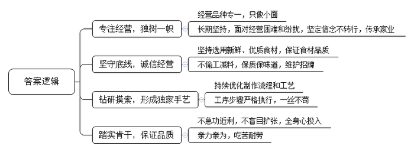
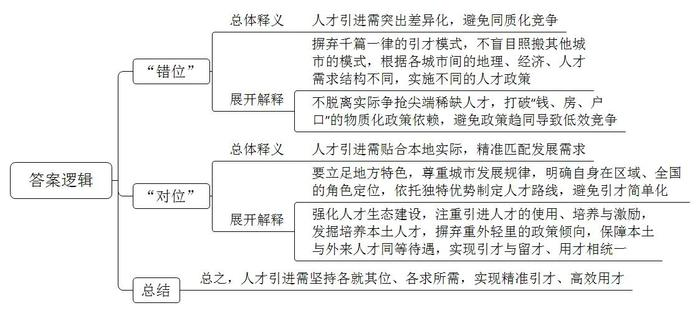

# 2018年公务员多省联考《申论》题（新疆兵团卷）

<!-- gwy:overview:start -->
> **新疆兵团 · 2018 · 申论 · 兵团** ｜ 3 题 · 图片 3 处 · 答案随题折叠

导航：[题目](#题目) · [材料 1](#材料-1)
<!-- gwy:overview:end -->

> 候选采集稿。参考答案及解析来自粉笔页面，不代表官方答案或真实高分答卷；来源使用许可与原卷对应关系仍需人工核实。

## 给定材料

### 材料 1

在西部某城，大大小小、各种各样的面馆有数万家。由于市场竞争激烈，大部分面馆都采用多种经营：面条、酸辣粉、米粉、盖浇饭……一应俱全。然而，有一家面馆却独树一帜，它只卖小面。小面可以说是这座城市各类面食中最朴素的一种。它没有浇头，没有名贵佐料，只有面条、调料以及青菜叶。也正是由于不像牛肉面、炸酱面这些有浇头的面能用大肉大料添味儿，小面靠的完全是店家自己的手艺和食材品质。食客们说，这家只卖小面的面馆那些不可名状的绝活儿很多。别的店家也是食材新鲜，用料地道，可这家面馆的小面味道就是要高一层。“里面门道可多啦，要做好一碗小面，必须得有好几年的摸索。”这家颇具个性的面馆老板老叶说，“我只有笨办法，就是多做多摸索。比如说，我就发现，先放猪油后掺汤水和先加汤水后放猪油，做出来的小面味道就差很远。这些很难一口说清楚，只能慢慢摸索。我现在都还在边做边学呢。”

老叶介绍道，他家从爷爷辈开始，就是只做小面的。虽然现在老叶的店可以用“客似云来”四个字来形容，但当初老叶也是被现实狠狠地上了一课——店铺租金高，商业区改造导致食客流量减少……亲戚朋友也劝他转型或者改行。可他就是特别拧：我要是连小面都做不好，还能干什么？我要是把小面都做好了，那我还怕什么？那时的老叶，就凭着“只做小面”的信念，对抗着各种纷扰。每天吃一碗小面，对于食客来说，是一件稀松平常的小事；而对于老叶，每天却是要煮上千碗小面。小面虽小，要求却也不少，一碗小面必须包括当地特定的猪油、小磨香油、酱油、陈醋、榨菜、芽菜、油辣子和花椒面等等。而调味、煮面、熬汤这些事儿，每一件都是老叶亲力亲为。老叶没读过太多书，但有两句话却是一直记在心头：炮制虽繁必不敢减人工，品味虽贵必不敢减物料。所以，即使是在经营最困难的时候，老叶也坚持用最新鲜的原料，熬汤、制辣子油、拌料……一个步骤都不能少。卖不出去的，就全部倒掉。“我只做小面，要是我偷工减料，把自己小面这块招牌都做臭了，我还能怎么办？”也正是因为这一根筋的坚持，让老叶走到了现在，成为本地小面中的独一家。而在别的面馆开始做连锁、开分店时，老叶也没有眼红脑热，“要是开加盟连锁交给别人，做得不好，怎么办？我嘛，怕分心，还是踏实点好。”

“做好小面不简单，一辈子只做小面，一辈子都能把小面做好更不简单。”这是一位“骨灰级”食客对老叶的评价。面馆很小，老叶是集老板、伙计于一身。这个小小的面馆，是他一生的天与地。而面馆门前至今挂着一位老食客送给他的对联：油盐酱醋十年功，麻辣鲜香一碗面。

### 材料 2

最近几年，很多二线城市的人才引进工作都开展得如火如荼。二线城市尚在努力，三四线城市自然也不甘落后：给钱、给房、给户口。然而，纵观很多三四线城市的“人才争夺战”，大多也只是出台买房打折、租房补贴、落户降标、项目资助、一次性奖励等引才政策。这固然有一定的吸引力。但作为本身经济实力和区位优势就不那么突出的三四线城市，给出和二线城市差不多的“彩礼”，能真正地“引凤求凰”吗？

“在人才工作中，一些地方的同质化倾向依旧明显。”一位从事人才引进工作多年的部门负责人说道，“现在，很多中小城市都要高学历、高效能、高层次、高大上、高精尖的人才；而给人才的往往就是‘老三样’——钱、房和户口。”

“很多地方把人才引进工作想得过于简单了。”一位评论家说道，“人才工作不是把人引进来就可以的，它其实更依赖人才生态的建设——如何利用、再培养、激励，如何留得住才是重中之重。然而，这往往是被很多中小城市忽视的。花了大力气，引不到人才；人才来了待不久。消耗了那么多的财力物力，也还是为他人做嫁衣。”问题还不止于此。现在一些地方的人才引进工作，已经给当地的财政带来不小的压力和负担了，但却收效甚微。很多地方都重视引进外地人才。可外地人才引不来，厚彼薄此、重外轻里的人才政策更让本地人颇有意见，可以用“赔本也没赚到吆喝”来形容。

“计算机、生物科技、航空航天这些尖端领域的顶尖人才本来就非常稀缺，即使在北上广深这样的城市都是‘肉少狼多’。在这样的环境中，实力薄弱许多的三四线城市往往是耗费了大量的财力人力，最后却还是被‘剩下’。而且，就算引进了，往往也用不好，甚至用不上。”一位人力资源专家说道，“引进人才要靠优势，但中小城市能靠的优势往往不是物质吸引力，而是自己的特色。”

另一位评论家也给了一个观点，“各个地方的人才引进工作，必须要‘错位’又‘对位’。我们的城市定位不应该也不可能是趋同的，要是采用同样的人才路线，是会‘撞车’的；毕竟错落有致，才既尊重城市发展规律，又符合建筑美学嘛。我国各个城市间的地理、经济等方面差距依旧巨大，对人才的吸引力、对人才的需求结构都是大不相同的。我们必须认清这个现实，找准自己的位置，才可能做好人才工作。因为你是你，你不是别的城市。你在全省，甚至是全国有你的角色定位，有你自己独特的优势。所以必须各就其位、各求所需。”

位于东部的B市，就曾犯过一种“经典”的错误。在五年时间里，B市花费数亿资金引进了大量外市的高职称人才。然而，效果却不尽如人意。“招来了女婿，气走了儿子。各个地方都是这样，厚彼薄此成了通病！”B市土生土长的科研人员小姚说道，“同样的学历、同样的职称，就因为我一直在本地，来路不同，待遇差距就这么大？果然是外来的和尚会念经？这让我们这些兢兢业业的本地人有些寒心。”而与此同时，小姚也接到了外地的一个职位邀请，待遇颇为优厚，他说自己正在考虑中。其实引进人才不能够片面地理解为“买进人才”。发掘培养本土人才也同样重要。

## 题目

### 第 1 题

**根据给定资料1，概括面馆老板老叶能够成功的原因。（20分）**

关联材料：材料 1

作答要求：

要求：全面、准确、简明，有条理，字数不超过200字。

第 1 题 · 答案与解析

**参考答案（粉笔题库参考内容）**

一、专注经营，独树一帜。1.经营品种专一，只做小面；2.长期坚持，面对经营困难和纷扰，坚定信念不转行，传承家业。

二、坚守底线，诚信经营。1.坚持选用新鲜、优质食材，保证食材品质；2.不偷工减料，保质保味道，维护招牌。

三、钻研摸索，形成独家手艺。1.持续优化制作流程和工艺；2.工序步骤严格执行，一丝不苟。

四、踏实肯干，保证品质。1.不急功近利，不盲目扩张，全身心投入；2.亲力亲为，吃苦耐劳。

**解析**

**参考答案说明：**答案从“专注经营”“诚信经营”“钻研摸索”“踏实肯干”四个方面对老叶成功的“原因”进行了分条撰写，对每条要点提炼出了总括词并前置。各条要点之间内容上没有交叉。

**考点**：原因类

**来源**：2018年公务员多省联考《申论》题（新疆兵团卷）

粉笔申论页面对本题只提供「解析视频」入口，该入口是会员推广位，页面无视频地址与文字解析。

### 第 2 题

**根据材料2谈谈你对其中划线部分“各个地方的人才引进工作，必须要‘错位’又‘对位’”的理解。（30分）**

关联材料：材料 2

作答要求：

要求：全面、准确、简明，有条理，字数不超过400字。

第 2 题 · 答案与解析

**参考答案（粉笔题库参考内容）**

一、“错位”指人才引进需突出差异化，避免同质化竞争。1.摒弃千篇一律的引才模式，不盲目照搬其他城市的模式，根据各城市间的地理、经济、人才需求结构不同，实施不同的人才政策。2.不脱离实际争抢尖端稀缺人才，打破“钱、房、户口”的物质化政策依赖，避免政策趋同导致低效竞争。

二、“对位”指人才引进需贴合本地实际，精准匹配发展需求。1.要立足地方特色，尊重城市发展规律，明确自身在区域、全国的角色定位，依托独特优势制定人才路线，避免引才简单化。2.强化人才生态建设，注重引进人才的使用、培养与激励，发掘培养本土人才，摒弃重外轻里的政策倾向，保障本土与外来人才同等待遇，实现引才与留才、用才相统一。

总之，人才引进需坚持各就其位、各求所需，实现精准引才、高效用才。

**解析**

**参考答案说明：**思路方面，本参考答案按照“总体释义+展开解释+总结”的答题思路展开。内容方面，本答案分别解释什么是“错位”，什么是“对位”；然后展开解释“错位”和“对位”的具体体现；最后依据材料提出了对策，进行总结，即人才引进“如何做到‘错位’又‘对位’”。

**考点**：词句解释类

**来源**：2018年公务员多省联考《申论》题（新疆兵团卷）

### 第 3 题

**根据材料5划线部分，“我们的‘简单’和‘繁琐’的总量并没有变，它们只是在不同的人群间流动，但就是这不停的流动，推动了社会的改变”，写一篇文章。（50分）**

关联材料：材料 1

作答要求：

要求：

（1）自选角度、立意明确；

（2）联系实际不拘泥于“给定资料”；

（3）思路清晰，语言流畅；

（4）总字数1000字左右。

第 3 题 · 答案与解析

**参考答案（粉笔题库参考内容）**

**繁与简的流动**

简单与繁琐相互依存、辩证共生。简单代表便利，是我们在生活、工作、思维上追求的目标。但获得简单离不开曲折繁琐的探索过程，没有繁琐便成就不了简单。就如守恒定律一般，简单与繁琐的总量不变，只是在不同人群中相互流动。这种流动推动了社会专业化分工，提高了社会运行效率，推动了社会进步。

“简单”和“繁琐”的流动规律启示我们：自己得到了简单，那别人就承担了繁琐；自己把简单的事情做到极致，也就是给别人提供便利；只有共同努力，才能出效率、出成果。

**我们得到简单、便利，别人就会负责其背后的“繁琐”。这样的“流动”，有利于专门人做专门事；有利于改善生产生活方式，促进经济发展**。人们更喜欢微小说、微电影、智能化榨汁机、便携式音箱、一键启动式汽车……很多时候，简便快捷是我们所追崇的。为了满足这种需求，生产者、开发者夜以继日、不断创新，化繁为简。于是，消费者有了更加便利的生活，更多的时间参与娱乐文化活动，生产者也会变得愈发专业，极大提升生产效率。简和繁在不同的人群间流动，无疑会变成社会发展的助推器。

但简单的事情里也蕴含了繁杂，看似简单的事情，要长期坚持做好也是不易的。

**若我们把简单的事情做到极致专业，藏繁于简，那就好方便他人。**老师尽职尽责，细致备课、寓教于乐，每一个看似简单的引导背后都有自己的精心设计，学生就能够更快吸收书本知识，增强对知识点的理解。城市管理者明确人才的需求，不断完善政策，采取全面、综合的措施，各个行业的人才就能有一个简单、便捷的生活环境。由此可见，每一个好的人才引进政策的背后都凝聚着管理者的无数思考与努力。每一个患者都期望大夫能够快速、准确诊断出自己的病情，那么医生就不能辜负患者的期待，需要不断给自己“充电”，不断学习，增强业务能力。每一张准确无误病例的背后其实都凝聚着医生的智慧与汗水。繁藏于简，本就是一种智慧。这种智慧流动在不同的人群中时，就会变成社会进步的引擎。

**总体上看，简单与繁琐在不同的群体中流动，能让社会分工更明确，相互协作更紧密**。由此，社会效率得到提升、生活生产方式得到改变，进而丰富了世界，活跃了经济，带来了颠覆性的发展。我们每个人越专业，工作效率和工作成果会更多，就越能给别人提供“简单”，与此同时，我们越有机会获得别人提供的“简单”，获得更多的产品、服务和便利。从这个意义而言，我们的“简单”和“繁琐”的总量并没有变，它们只是在不同的人群间流动，但就是这不停的流动，推动了社会的改变。

繁与简的结合是一种艺术，更是一种智慧。要想欣赏这种艺术，掌握这种智慧，就需要当简勿繁，从本质着眼去思考问题，分清主次；就要当繁勿简，肯下真功夫，不玩“花拳绣腿”；就要简繁得当，在二者间找到平衡点。当这样的智慧流动在不同的人群间，相信定促进社会发展，会生生不息、久久为功……

**解析**

**文章分析**

**繁与简的流动**

【**标题的优点：**首先，范文的标题“繁与简的流动”突出了“简与繁”这一主题。其次，形式上，文字简洁明快。】

（1）简单与繁琐相互依存、辩证共生。简单代表便利，是我们在生活、工作、思维上追求的目标。但获得简单离不开曲折繁琐的探索过程，没有繁琐便成就不了简单。（2）就如守恒定律一般，简单与繁琐的总量不变，只是在不同人群中相互流动。这种流动推动了社会专业化分工，提高了社会运行效率，推动了社会进步。

【**开头的优点：**★内容方面。范文的开头是紧扣题目给定的“我们的‘简单’和‘繁琐’的总量并没有变，它们只是在不同的人群间流动，但就是这不停的流动，推动了社会的改变”这句话展开的。首先，**开头第一句话点出主题，做到了主题明确。其次，对“简与繁”这一主题进行了分析阐述，（1）指出了“简与繁”的关系。（2）对题目给定的句子进行解释说明**。★文字表达方面：长短句配合使用，使语言表达有节奏感。】

“简单”和“繁琐”的流动规律启示我们：自己得到了简单，那别人就承担了繁琐；自己把简单的事情做到极致，也就是给别人提供便利；只有共同努力，才能出效率、出成果。

【**过渡段的优点：**范文过渡段分析了“简与繁”相互流动给予我们的启示，过渡段末尾的“只有共同努力，才能出效率、出成果”是用来引起下文的过渡句。】

**我们得到简单、便利，别人就会负责其背后的“繁琐”。这样的“流动”，有利于专门人做专门事；有利于改善生产生活方式，促进经济发展**。（1）人们更喜欢微小说、微电影、智能化榨汁机、便携式音箱、一键启动式汽车……很多时候，简便快捷是我们所追崇的。（2）为了满足这种需求，生产者、开发者夜以继日、不断创新，化繁为简。于是，（3）消费者有了更加便利的生活，更多的时间参与娱乐文化活动，生产者也会变得愈发专业，极大提升生产效率。简和繁在不同的人群间流动，无疑会变成社会发展的助推器。

【**论述段1的优点：**★观点句：范文的观点句是紧扣“简与繁”这一文章主题提出的。形式上，它在段首处直接写出，位置突出，容易发现。内容上，关键词突出，内容要点明确，可以明显看出它是从“有利于专人专事、改变生活方式、促进经济发展”入手，指出了“简与繁”相互流动的重要性。★论述内容：（1）先介绍了“简便快捷是人们所追崇的”；（2）接着介绍了“生产者、开发者追求极简理念”；（3）最后介绍了“追求简便的积极影响”。注意：以上三个方面的内容都是紧扣“我们得到简单、便利，别人就会负责其背后的‘繁琐’。这样的‘流动’，有利于专门人做专门事；有利于改善生产生活方式，促进经济发展”这个观点句进行分析论述的，论述的针对性强，内容层次丰富。最后，在论述方法和论据的选取上做到了讲道理、举例子相结合，做到了丰富多样。】

但简单的事情里也蕴含了繁杂，看似简单的事情，要长期坚持做好也是不易的。

**若我们把简单的事情做到极致专业，藏繁于简，那就好方便他人。**（1）老师尽职尽责，细致备课、寓教于乐，每一个看似简单的引导背后都有自己的精心设计，学生就能够更快吸收书本知识，增强对知识点的理解。（2）城市管理者明确人才的需求，不断完善政策，采取全面、综合的措施，各个行业的人才就能有一个简单、便捷的生活环境。由此可见，每一个好的人才引进政策的背后都凝聚着管理者的无数思考与努力。（3）每一个患者都期望大夫能够快速、准确诊断出自己的病情，那么医生就不能辜负患者的期待，需要不断给自己“充电”，不断学习，增强业务能力。每一张准确无误病例的背后其实都凝聚着医生的智慧与汗水。繁藏于简，本就是一种智慧。这种智慧流动在不同的人群中时，就会变成社会进步的引擎。

【**论述段2的优点：**★观点句：范文的观点句是紧扣“简与繁”这一文章主题提出的。形式上，它在段首处直接写出，位置突出，容易发现。内容上，关键词突出，内容要点明确，可以明显看出它是从“藏繁于简”入手，指出了“简与繁”的关系。★论述内容：（1）先从“老师”这一主体出发，介绍了如何以简洁有趣的授课方式吸引学生；（2）接着从“城市管理者”这一主体出发，介绍了如何吸引人才；（3）最后从“医生”这一角度出发，介绍了如何给予病患精准诊断。注意：以上三个方面的内容都是紧扣“若我们把简单的事情做到极致专业，藏繁于简，那就好方便他人”这个观点句进行分析论述的，论述的针对性强，内容层次丰富。最后，在论述方法和论据的选取上做到了讲道理、举例子相结合，做到了丰富多样。】

**总体上看，简单与繁琐在不同的群体中流动，能让社会分工更明确，相互协作更紧密**。由此，社会效率得到提升、生活生产方式得到改变，进而丰富了世界，活跃了经济，带来了颠覆性的发展。（1）我们每个人越专业，工作效率和工作成果会更多，就越能给别人提供“简单”，与此同时，（2）我们越有机会获得别人提供的“简单”，获得更多的产品、服务和便利。从这个意义而言，我们的“简单”和“繁琐”的总量并没有变，它们只是在不同的人群间流动，但就是这不停的流动，推动了社会的改变。

【**论述段3的优点：**★观点句：范文的观点句是紧扣“简与繁”这一文章主题提出的。形式上，它在段首处直接写出，位置突出，容易发现。内容上，关键词突出，内容要点明确，可以明显看出它是从“社会分工明确，相互协作更紧密”入手，指出了“简与繁”相互流动的重要性。★论述内容：（1）先介绍了“每个人都很专业有利于提高工作效率”；（2）接着介绍了“每个人都很专业有利于获得更多的产品和服务”。注意：以上两个方面的内容都是紧扣“简单与繁琐在不同的群体中流动，能让社会分工更明确，相互协作更紧密”这个观点句进行分析论述的，论述的针对性强，内容层次丰富。最后，在论述方法和论据的选取上做到了讲道理、举例子相结合，做到了丰富多样。】

繁与简的结合是一种艺术，更是一种智慧。要想欣赏这种艺术，掌握这种智慧，就需要当简勿繁，从本质着眼去思考问题，分清主次；就要当繁勿简，肯下真功夫，不玩“花拳绣腿”；就要简繁得当，在二者间找到平衡点。当这样的智慧流动在不同的人群间，相信定促进社会发展，会生生不息、久久为功……

【**结尾的优点：**范文的结尾回扣了“简与繁”这一主题，并发出了号召希望，阐述了“简与繁”相互流动的深远意义。】

**参考范文2**

**繁简之道**

简于表者，繁于意也。简者，简化步骤，简便快捷，直达目的，直奔目标；繁者，投入时间，付之心血，聚集智慧与创意，实现所求之目标。化繁为简是一种艺术，呈现简单之表象，于简见繁是一种智慧，暗藏繁琐之内涵。**二者看似矛盾，但万事万物都是从简到繁，由繁至简的过程，二者此消彼长，互相渗透，不断地流动转化，推动社会的发展。**

“简单”和“繁琐”的流动规律启示我们：自己得到了简单，那别人就承担了繁琐；自己把看似简单的事情做到极致，把真正繁芜的事情简单化，才能深刻剖析出世间的本质；只有让“繁”“简”自由地转化，才能出效率、出成果。

**生活中，兢兢业业、恪尽职守、专业细致的生产者、劳动者化繁为简，创造出各种产品与服务，是他们的付出、努力，让世人享受方便、快捷、高效，让经济活跃、腾飞，让世界变得更加缤纷、多彩与绚丽。**现代化、信息化、科技化的当今世界，让我们拥有足不出户就可以尝遍人间美味的外卖软件，无需计划就可以出门游玩的导航软件，亦有动动手指就可以消费的支付软件。不禁地感慨，生活如此简单，而这背后却是整个团队千思万绪、加班熬夜的心血与付出。同理，人们喜欢智能化榨汁机、便携式音箱、一键启动式汽车……很多时候，简便快捷是我们所追崇的。为了满足这种需求，开发者夜以继日、微调打磨、绞尽脑汁、不断创新。

**学习中，个人在认知世界、研究知识、掌握技能时，必须投入时间和精力，顺应规律，不断地去分析、去挖掘、去思考，方能微言大义，举重若轻。**一个简单凝练的道理，只有深入探寻其背景，才能懂得暗藏着的最深奥复杂的思想；一首短小精悍的千古绝句，只有深知作者曲折丰富的生平，才能领略诗词的真谛；一张准确无误的病例背后，是医生自身无数个日夜，起早贪黑、辛勤汗水的结晶。作为社会个体中的我们只有花费心思，去观察、去思考；去品咂其中的况味；去学习万事万物由此及彼、由内而外的复杂过程，才能化繁为简，繁简互转，透彻了解事物发展的规律，领略万千古诗的风情，掌握便捷高效的技能。

**当然，“繁”“简”之间的流动、转变，也要保持适度、平衡，做到当繁勿简，当简勿繁。我们追求极简与朴素，但不能否认、拒绝繁复；我们保持适当的繁琐与复杂，但不能故弄玄虚，而应是深思熟虑后的素心，是去芜存菁后的执着。简繁得当，方能出效率，出成果。**简有简的好，繁有繁的妙，二者辩证统一，相互作用，相互影响。任何事物都是繁简平衡、相辅相成的结果。看似独立简单的个体，却是亿万复杂细胞的组合；看似平静单纯的湖面，却有深不见底的深邃；看似简便轻巧的图书，却是大千知识的集成；看似简单的产品也离不开科学家匠人般的执着；看似简单的味道需得益于厨师无数次的尝试。因此，当简则简，当繁则繁，万事万物才能相得益彰。

简单与繁复相互流动又辩证统一。当繁则繁，繁复推敲，方能大道至简，领悟真谛。当简则简，删繁去粗，方可专心致志，满载而归。繁简得当，世界大放异彩。

**考点**：文章写作题

**来源**：2018年公务员多省联考《申论》题（新疆兵团卷）

