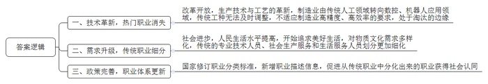
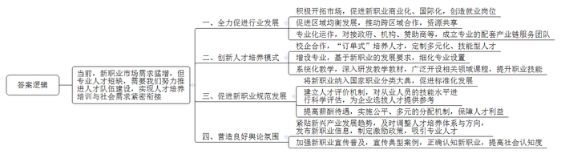
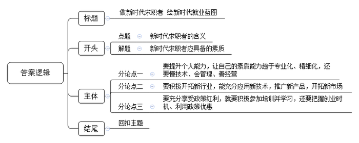

# 2019年新疆兵团公考《申论》题（下半年）

> 候选采集稿。参考答案及解析来自粉笔页面，不代表官方答案或真实高分答卷；来源使用许可与原卷对应关系仍需人工核实。

## 给定材料

### 材料 material-27d998d7ade1bfae

王涛今年55岁，曾在中国铁路北京局集团有限公司北京西车务段门头沟站做了35年扳道工。他的工作主要是根据车站值班员的指示，正确及时地扳动道岔，确保火车能够顺利进站。门头沟站附近曾有8家煤矿，每天运煤的火车络绎不绝。在王涛的印象中，一天最忙时需要扳动200多次道岔，有时连午饭也来不及吃。

伴随生产技术与工艺的革新，铁路上越来越多地使用电动道岔，像王涛这样的扳道工日渐减少。与扳道工境遇相似的，还有修钢笔工、补锅匠、寻呼转接员等一批曾经耳熟能详的职业。2015年，人力资源和社会保障部等部门颁布了修订后的《中华人民共和国职业分类大典》，减少了205个职业。

“在很多人的观念中，厨师就是做饭炒菜。但随着人们对更高生活质量的追求，厨师也开始细化，产生了像我这样的烘焙师。”叶昭说。今年23岁的叶昭是安徽省芜湖市人，虽然年纪轻，却已是第44届世界技能大赛烘焙项目金牌获得者，现在从事烘焙教练工作。

社会的进步，生活水平的提高，让人们物质文化需求日趋多样。老百姓已经不满足于吃饱，更要吃得精细，吃得营养，这一变化导致了厨师职业的细分。中式烹调师、西式烹调师、公共营养师、营养配餐员等职业应运而生。除此之外，脱胎于理发匠的美容美发等职业也在城市服务行业中占据一席之地。以兽医专业为基础分化出来的宠物医师，也颇受市场欢迎。

改革开放以来，随着技术水平的革新，我国制造业主要工种由传统的车工、铣工、刨插工、磨工、钳工向数控领域再到向机器人应用领域转变，生产制造的精度和效率有了极大提高。

“人们对美好生活的追求，反映在职业领域，就是传统的‘专业技术人员’‘社会生产服务和生活服务人员’呈现越来越细化发展的趋势。”中国劳动和社会保障科学研究院研究室相关负责人说，“2015版职业大典中新增了347个职业的描述信息。”这有利于让更多从传统职业中分化出来的职业被大众所认同。

### 材料 material-b435ecd2e4f3870c

作为一名物联网安装调试员，王建回到故乡雄安，投身于智慧城市的研发，先后参与了中移超脑、边缘计算、雄安大数据等多个智慧城市项目。他表示，物联网技术是新兴技术的代表，也是雄安新区的代表性产业之一，此时此刻能凭借自己的知识和经验参与新区的建设，这是物联网人最大的价值。

2016年，一个偶然的机会，李磊在接受专业培训后，成为一名无人机驾驶员。在无人机行业，他发现了巨大的市场机会，包括产品销售、教育、技术研发和软件配套以及企业级、政府级的应用。目前，他已拥有3家无人机专卖店，行业应用渗透到电力、安防、测绘等领域。

2019年4月1日，人力资源和社会保障部、国家市场监管总局、国家统计局向社会发布了13个新职业信息，这是自2015年版国家职业分类大典颁布以来发布的首批新职业。这13个新职业包括：人工智能工程技术人员、物联网工程技术人员、大数据工程技术人员、云计算工程技术人员、数字化管理师、建筑信息模型技术员、电子竞技运营师、电子竞技员、无人机驾驶员、农业经理人、物联网安装调试员、工业机器人系统操作员、工业机器人系统运维员。王建、李磊，都是从事这些新职业的新型专业技术人才。

近日，人社部连续发布《新职业——物联网安装调试员就业景气现状分析报告》《新职业——无人机驾驶员就业景气现状分析报告》等报告，高密度地对这些新职业中的人才状况进行了深入剖析与展示。

这些报告显示，新职业市场需求迅猛增长的同时，也带来了巨大的人才缺口。以王某所在的物联网安装调试员职业为例，2018年我国物联网业务收入比上年增长72.9%，从事物联网及相关行业的从业人员超过200万，预测未来5年物联网安装调试员人才需求量将达到500万人。李磊从事的无人机驾驶员职业，也面临着同样的人才瓶颈。国际数据公司（IDC）数据分析显示，到2019年年底，我国无人机年销售量将达到196万架，其中消费级无人机150万架，工业级无人机46万架，预测未来5年无人机驾驶员人才需求量达到100万人。

## 题目

### 第 1 题

**请根据****“给定资料**1**”，归纳概括****传统****新老职业更迭的原因。（****20分）**

关联材料：material-27d998d7ade1bfae

作答要求：

要求：准确全面，条理清楚，语言精练，不超过250字。

### 第 2 题

**阅读****“给定资料**4**”和“给定资料**5**”，结合实际，请就如何解决新职业领域专业技术人才短缺的问题，提出自己的建议。（30分）**

关联材料：material-b435ecd2e4f3870c

作答要求：

要求：建议合理可行，内容全面，条理清楚，语言简练，不超过450字。

### 第 3 题

**请结合给定资料，从求职者的角度，以****“新职业，新要求”为主题，自拟标题，写一篇文章。（50分）**

关联材料：material-27d998d7ade1bfae

作答要求：

要求：观点鲜明，议论深刻，结构严谨，语言流畅，不拘泥于“给定资料”，联系社会实际，不少于1000字。

## 答案与解析

第 1 题

**参考答案（粉笔题库参考内容）**

一、技术革新，热门职业消失。改革开放，生产技术与工艺的革新，制造业由传统人工领域转向数控、机器人应用领域，传统工种无法及时调整，不适应制造业高精度、高效率的要求，处于淘汰的边缘。

二、需求升级，传统职业细分。社会进步，人民生活水平提高，开始追求美好生活，对物质文化需求多样化，传统的专业技术人员、社会生产服务和生活服务人员划分更加细化。

三、政策完善，职业体系更新。国家修订职业分类标准，新增职业描述信息，促进从传统职业中分化出来的职业获得社会认同。

**解析**

**参考答案说明：**本参考答案从“技术革新，热门职业消失”“需求升级，传统职业细分”“政策完善，职业体系更新”等三个方面进行分条撰写，各条要点在内容上相互并列，没有交叉。

**考点**：考点原因类

**来源**：来源2019年新疆兵团公考《申论》题（下半年）

粉笔申论页面对本题只提供「解析视频」入口，该入口是会员推广位，页面无视频地址与文字解析。

第 2 题

**参考答案（粉笔题库参考内容）**

当前，新职业市场需求猛增，但专业人才短缺，需要我们努力推进人才队伍建设，实现人才培养培训与社会需求紧密衔接。

一、全力促进行业发展。积极开拓市场，促进新职业商业化、国际化，创造就业岗位；促进区域均衡发展，推动跨区域合作，资源共享；专业化运作，对接政府、机构、赞助商等，成立专业的配套产业链服务团队。

二、创新人才培养模式。校企合作，“订单式”培养人才，定制多元化、技能型人才；增设专业，基于新职业的发展要求，细化专业设置；系统化教学，深入研发教学教材，广泛开设相关领域课程，提升职业技能。

三、促进新职业规范发展。将新职业纳入国家职业分类大典，促进标准化发展；建立人才评价机制，对从业人员的技能水平进行科学评估，为企业选拔人才提供参考；提高薪酬待遇，实施公平、多元的分配机制，保障人才利益。

四、营造良好舆论氛围。紧贴新兴产业发展趋势，及时调整人才培养体系与方向，发布新职业信息，制定激励政策，吸引专业人才；加强新职业宣传普及，宣传典型案例，正确认知新职业，提高社会认知度。

**解析**

**参考答案说明：**本参考答案从“全力促进行业发展”“创新人才培养模式”“促进新职业规范发展”“营造良好舆论氛围”等不同方面进行了分条撰写。各条答案要点之间在内容上相互并列，没有交叉。

**考点**：考点提出对策类

**来源**：来源2019年新疆兵团公考《申论》题（下半年）

粉笔申论页面对本题只提供「解析视频」入口，该入口是会员推广位，页面无视频地址与文字解析。

第 3 题

**参考答案（粉笔题库参考内容）**

**做新时代求职者 绘新时代就业蓝图**

新时代催生新职业，随着产业升级、服务消费的兴起，一批批陌生但与人们生活息息相关的职业不断诞生，营养配餐师、新型职业农民、送餐员、快递员……从传统制造业向新兴产业不断延伸，对人才的要求也越来越高。作为新时代的求职人，要提升自身能力素质，适应时代需求，利用好新时代技术优势，开拓新市场，更要把握时代机遇，努力学习积极创业。  
**要提升个人能力，让自己的素质能力趋于专业化、精细化，还要懂技术、会管理、善经营。**“打铁还需自身硬”，各类新兴职业的兴起，确实带来丰富的就业岗位，但是，如果求职者没有过硬的本领，只能被就业大潮裹挟前行，在就业过程中处于被动地位，随时可能面临转岗甚至淘汰。我们身边不乏因为技能缺乏而下岗的案例，这也为新时代求职者敲响警钟，随着物质文化需求的日趋多样化，职业分工也要精细化，要精益求精，发扬工匠精神。“既要低头看路，更要抬头望天”，新职业不仅要求踏实、精致、效率，更需要创新、灵活、有远见。因此，作为求职者，更需要掌握现代技术，了解市场需求，随时调整发展战略，做个有技术、懂管理、善经营的新时代求职者。  
**要积极开拓新行业，能充分应用新技术，推广新产品，开拓新市场。**习近平总书记说“美好生活是奋斗出来的”，鲁迅先生也说“这世界上本没有路，走的人多了也便成了路”，就业岗位同样如此。传统产业、传统行业，既有岗位已成定数，“等靠要”等不来机会，只有勇于发现、敢于开拓、积极创新，才能柳暗花明。很多返乡创业者在广阔农村，敢于做吃螃蟹的第一人，他们应用互联网新技术，发展电商平台，将本地特色产品加工、包装，帮助当地百姓脱贫致富，同时实现自己的职业梦想。创新不仅是对内创新，更要对外开拓，新兴行业只有与市场对接，产生效益，才能创造价值。作为新时代的从业者，要做好市场的开拓者，向基础弱、需求大的地方进军。

**要充分享受政策红利，就要积极参加培训并学习，还要把握创业时机、利用政策优惠。**如今，华夏儿女都在感慨我们背后有强大的祖国，在就业创业之路中，国家也提供了各项优惠政策：培养高技能人才，加强困难群体就业帮扶……作为求职者，要充分享受政策红利，珍惜培训学习机会，如参加技能人才培训班、技能大赛等，在培训中提升自己的理论技能。同时，要把握创业时机，积极创业，“这个时代是历史上最有利于创业的时代”，网友曾这样评价我们在创新创业方面的优势。作为新时代求职者要把握新时代脉搏，利用政策优势，如利用减税降费、减少审批流程等一系列优惠政策，把“我会”变为“你也会”，通过创业创造更多就业岗位。

新时代、新产业、新模式、新动能，只有把自己锻造成专业能力强、职业眼光远、把握时代脉搏的新型求职者，才能拓宽职业发展前景、提升待遇，才能绘制新时代就业蓝图。

**解析**

**文章分析**

**做新时代求职者 绘新时代就业蓝图**

【**标题的优点：**首先，范文的标题“做新时代求职者 绘新时代就业蓝图”突出了“新职业，新要求”这一主题。其次，形式上，文字简洁明快。】

（1）新时代催生新职业，随着产业升级、服务消费的兴起，一批批陌生但与人们生活息息相关的职业不断诞生，（2）营养配餐师、新型职业农民、送餐员、快递员……从传统制造业向新兴产业不断延伸，对人才的要求也越来越高。（3）作为新时代的求职人，要提升自身能力素质，适应时代需求，利用好新时代技术优势，开拓新市场，更要把握时代机遇，努力学习积极创业。  
【**开头的优点：**★内容方面。范文的开头是紧扣题目给定的“新职业，新要求”这一主题展开的。首先，**开头点出主题，做到了主题明确**。其次，**对“**新职业，新要求**”这一主题进行了分析阐述，指出了（****1****）“**新职业**”兴起的背景。（****2****）“新职业”具体指哪些？（****3****）“**新职业**”有哪些新要求**。★文字表达方面：长短句配合使用，使语言表达有节奏感。】

**要提升个人能力，让自己的素质能力趋于专业化、精细化，还要懂技术、会管理、善经营。**（1）“打铁还需自身硬”，各类新兴职业的兴起，确实带来丰富的就业岗位，但是，如果求职者没有过硬的本领，只能被就业大潮裹挟前行，在就业过程中处于被动地位，随时可能面临转岗甚至淘汰。我们身边不乏因为技能缺乏而下岗的案例，这也为新时代求职者敲响警钟，（2）随着物质文化需求的日趋多样化，职业分工也要精细化，要精益求精，发扬工匠精神。“既要低头看路，更要抬头望天”，新职业不仅要求踏实、精致、效率，更需要创新、灵活、有远见。（3）因此，作为求职者，更需要掌握现代技术，了解市场需求，随时调整发展战略，做个有技术、懂管理、善经营的新时代求职者。  
【**论述段****1****的优点：**★观点句：范文的观点句是紧扣“新职业，新要求”这一文章主题提出的。形式上，它在段首处直接写出，位置突出，容易发现。内容上，关键词突出，内容要点明确，可以明显看出它是从“提升个人能力”入手，指出了“如何达到新职业的新要求”。★论述内容：（1）先介绍了“求职者提升个人能力的原因”；（2）接着介绍了“求职者提升个人能力就要精细化”；（3）最后介绍了“求职者提升个人能力还要有技术、懂管理、善经营”。注意：以上几个方面的内容都是紧扣“要提升个人能力，让自己的素质能力趋于专业化、精细化，还要懂技术、会管理、善经营”这个观点句进行分析论述的，论述的针对性强，内容层次丰富。最后，在论述方法上采用了道理论证，做到了论述有力。】

**要积极开拓新行业，能充分应用新技术，推广新产品，开拓新市场。**习近平总书记说“美好生活是奋斗出来的”，鲁迅先生也说“这世界上本没有路，走的人多了也便成了路”，就业岗位同样如此。（1）传统产业、传统行业，既有岗位已成定数，“等靠要”等不来机会，只有勇于发现、敢于开拓、积极创新，才能柳暗花明。（2）很多返乡创业者在广阔农村，敢于做吃螃蟹的第一人，他们应用互联网新技术，发展电商平台，将本地特色产品加工、包装，帮助当地百姓脱贫致富，同时实现自己的职业梦想。（3）创新不仅是对内创新，更要对外开拓，新兴行业只有与市场对接，产生效益，才能创造价值。（4）作为新时代的从业者，要做好市场的开拓者，向基础弱、需求大的地方进军。

【**论述段****2****的优点：**★观点句：范文的观点句是紧扣“新职业，新要求”这一文章主题提出的。形式上，它在段首处直接写出，位置突出，容易发现。内容上，关键词突出，内容要点明确，可以明显看出它是从“开拓新行业”入手，指出了“如何达到新职业的新要求”。★论述内容：（1）先介绍了“开拓新行业的原因”；（2）接着介绍了“开拓新行业需要应用新技术，推广新产品”；（3）然后介绍了“开拓新行业还要与市场对接”；（4）最后介绍了“开拓新市场要向基础弱、需求大的地方进军”。注意：以上几个方面的内容都是紧扣“要积极开拓新行业，能充分应用新技术，推广新产品，开拓新市场”这个观点句进行分析论述的，论述的针对性强，内容层次丰富。最后，在论述方法和论据的选取上做到了讲道理、举例子相结合，做到了丰富多样。】

**要充分享受政策红利，就要积极参加培训并学习，还要把握创业时机、利用政策优惠。**（1）如今，华夏儿女都在感慨我们背后有强大的祖国，在就业创业之路中，国家也提供了各项优惠政策：培养高技能人才，加强困难群体就业帮扶……（2）作为求职者，要充分享受政策红利，珍惜培训学习机会，如参加技能人才培训班、技能大赛等，在培训中提升自己的理论技能。（3）同时，要把握创业时机，积极创业，“这个时代是历史上最有利于创业的时代”，网友曾这样评价我们在创新创业方面的优势。作为新时代求职者要把握新时代脉搏，利用政策优势，如利用减税降费、减少审批流程等一系列优惠政策，把“我会”变为“你也会”，通过创业创造更多就业岗位。

【**论述段****3****的优点：**★观点句：范文的观点句是紧扣“新职业，新要求”这一文章主题提出的。形式上，它在段首处直接写出，位置突出，容易发现。内容上，关键词突出，内容要点明确，可以明显看出它是从“享受政策红利”入手，指出了“如何达到新职业的新要求”。★论述内容：（1）先介绍了“享受政策红利的原因”；（2）接着介绍了“享受政策红利需要珍惜培训学校机会”；（3）最后介绍了“享受政策红利还要把握创业时机”。注意：以上几个方面的内容都是紧扣“要充分享受政策红利，就要积极参加培训并学习，还要把握创业时机、利用政策优惠”这个观点句进行分析论述的，论述的针对性强，内容层次丰富。最后，在论述方法和论据的选取上做到了讲道理、举例子相结合，做到了丰富多样。】

新时代、新产业、新模式、新动能，只有把自己锻造成专业能力强、职业眼光远、把握时代脉搏的新型求职者，才能拓宽职业发展前景、提升待遇，才能绘制新时代就业蓝图。

【**结尾的优点：**范文的结尾回扣了“新职业，新要求”这一主题，并发出了号召希望。】

**考点**：考点文章写作题

**来源**：来源2019年新疆兵团公考《申论》题（下半年）

粉笔申论页面对本题只提供「解析视频」入口，该入口是会员推广位，页面无视频地址与文字解析。

