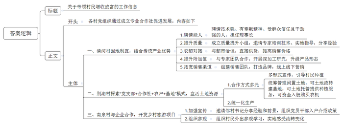
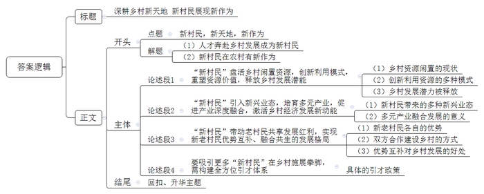

# 2021年公务员多省联考《申论》题（新疆兵团二卷）

> 候选采集稿。参考答案及解析来自粉笔页面，不代表官方答案或真实高分答卷；来源使用许可与原卷对应关系仍需人工核实。

## 给定材料

### 材料 material-9f4839ad361bac0b

秋风送爽，走进泸溪县马王溪村七彩花果园，朵朵各色玫瑰花挂满枝头，随处可见蜜蜂采撷、蝴蝶飞舞，园里随风散发出幽幽芬芳，让人心旷神怡。看着众多游客，在花果园一角默默察看的黄连光笑意渐浓。他就是泸溪县七彩生态旅游公司创始人、总经理，80后返乡创业者——黄连光。现年35岁的他和同龄人相比，多了一份成熟与担当。从流水线工人到理发手艺人，从外乡打拼到返乡创业，从一人发家到带领乡邻致富，20年的艰苦奋斗，他品尝到不一样的酸甜苦辣，用初心展示了共产党人的风采。

2001年7月，黄连光初中毕业，刚满16岁的他只身一人来到浙江温州打工，开启了他人生的拼搏征途。经过多年打拼，黄连光成为了一家连锁店的店长，经济收入一年比一年可观。每年的春节回家，他目睹着家乡翻天覆地的变化，心里萌生了返乡创业的念头。

2012年7月，黄连光决定放弃自己打拼多年的事业，回到家乡泸溪县城开了一家名留国际美容美发店，成为当地美发圈小有名气的“Tony老师”，月收入超过2万元。

当时，泸溪县正创建浦市古镇国家4A级旅游景区，并出台利好政策扶持乡村旅游。2014年7月，黄连光不顾家人反对，毅然地转让自己在县城的理发店，选择了“浦市印象”项目，与几个好友经一年多努力，成功把“浦市印象”打造成了一个集餐饮、观光、游玩于一体的旅游品牌。

2016年，泸溪县精准扶贫如火如荼，马王溪村得益于交通便利和地势平坦优势，村支书石泽林找到了黄连光，邀请他参与到马王溪村的建设中来。

面对抛来的橄榄枝，黄连光既激动又倍感压力，他把乡村旅游和产业扶贫融合发展，让老百姓得实惠，他一遍又一遍地和村支两委讨论发展方案，讨论股权分配和利益模式，研究其他村的旅游项目运营模式。

2017年10月，在他的带动下，村里11人成立众筹公司，充分利用当地资源，以村民变股民、以土地变股金、以现金变股金的方式，将产业变资产，充分发挥能人和党员的作用，吸引包括13户贫困户在内的96户群众参与其中，以3000元每股土地入股，村集体经济占股10%，大家众筹520万元组建了马王溪七彩旅游公司。

旅游公司成立后，黄连光带领大家鼓足干劲，流转土地搞起了旅游项目建设，精品民宿、四季花海、陶艺馆、千亩瓜果采摘园、嗨起乐园……经过一年时间，农业特色产业和文游脱贫强势推进，马王溪乡村旅游形成了一条扶贫脱贫的产业链。2018年，被评为“国家级AAA旅游景区”，2019年度游客量突破40万人次，国庆期间单日突破万人次，收入280万元，带动周边村民增收，顺利脱贫致富。

三年发展，公司累计投资2200万元，名下有精品民宿、花海、玫瑰产业园、嗨起乐园、大户种植的1000余亩水果园、餐饮行业。

2020年增加了鱼菜共生农场，受疫情冲击仍然接待游客突破20万人，全年用工本村劳动力260人，月收入达到2500元以上，并带动周边村民在家门口就业致富。

2020年5月，鱼菜共生农场项目实施后带动马王溪村78户283人贫困户和浦市镇其他村建档立卡贫困户253户329人，计331户612人脱贫走上共同富裕之路。

如今的马王溪村，已成为湘西州乡村旅游的一张闪亮名片。黄连光踌躇满志，信心满满地说：“目前，峡谷探险、峡谷风光带、水上乐园、养生休闲等项目正陆续规划建设中，文旅融合与乡村振兴并进，未来无限可期！”

### 材料 material-73a75c04169c8428

在传统乡镇布局中，部分乡镇面积小、人口少，但管理机构、干部职数、机构编制、财政投入均不少，行政运行成本较高。合理调整乡镇行政区划有助于统筹设置乡镇服务机构，统一配备服务人员，集中一站式服务，提升公共服务效能。2019年12月，祁河市8个（县）区完成了撤乡并镇行政区划调整，为了充分发挥便民职能，继续服务当地群众，推动乡镇机构职能由“管理型”向“服务型”转变，被撤乡并镇的便民服务站继续保留了下来。

近期，祁河市政府部门陆续收到基层民众反映“便民服务站一点都不便民”的问题，事实究竟怎样？对此，市电视台《阳光问政》节目进行了一次采访。

镜头一：S县赵湾镇罗湖便民服务站

服务站内，办公硬件设施设备齐全，4名工作人员在岗上班，但却无法办理任何业务，并且也不提供代办服务。

“之前我们有对口上级部门，各方面有明确的规定，自从原来的乡撤了之后，上面一直没有安排好，不知道如何衔接。”一名工作人员表示很无奈。

对此，该县乡镇行政区划调整改革领导小组副组长张轩伟说：“在乡镇行政区划调整改革之初，县委、县政府就明确要求，保留设立的乡镇便民服务站要确保服务不减。现在看来，我们的工作确实没有做到位。据了解，这个问题，不仅在赵湾镇罗湖便民服务站存在，在我县其他便民服务站也存在。”

镜头二：T区红河镇双星便民服务站

“这儿可以办准生证吗？”

“准生证办不了，要到镇上的便民服务中心去办。”

“为什么现在办不了？”

“我只给你们解释相关政策，跟你们说在哪里办。”问的人多了，这名工作人员显得有点不耐烦。

这里仅有一名工作人员在岗，但是只会办理医保、社保两项业务，其他业务需到红河镇便民服务中心才能办理。

村民抱怨：“原来办事很齐全，家门口办也很方便，现在服务质量明显不如以前了。”

镜头三：M县张集镇饶河便民服务站

一位村民说：“撤乡并镇之前，乡政府曾承诺，原来便民服务的地点和人员都会保留，但是现在却找不到人办事。”

M县张集镇党委委员李玲解释：“公章只有一枚，我们也不可能把公章放在那边，所以基本上老百姓都是自己到镇上来办理业务。”

“公章的问题，难道没有其他方式解决吗？比如采用电子公章或通过提前预约的方式来协调用章冲突？”记者问。

M县有关领导回应：“实际上这个问题是在服务群众的最后一公里上出现了偏差，也反映了我们为群众考虑不够，我们可以通过其他更灵活的方式来改进服务，比如由工作人员集中代办，尽量让群众少跑路，提高服务质量。”

镜头四：N县大林镇绿树便民服务站

办事窗口的电脑主机已被撤走，办公桌上布满了灰尘，绿植已经枯萎……这里已经停用很长一段时间了。

大林镇镇政府工作人员介绍：“镇上每天都会派干部到这里值守，为村民开展引导服务，告知他们办事要去山下的便民服务中心。”

大林镇党委副书记、镇长朱国伟就便民服务站变为“引导服务站”一事进行了剖析：“我们认为大林镇镇政府所在地是全镇进出的唯一一个口子。山上的群众下来就可以顺便办事，这样既方便了大家，也方便了我们，所以我们的工作安排就出现了偏差，把便民服务站变成了‘引导服务站’。下一步，我们将把便民服务站不便民的问题作为重点工作来改进，多提供‘送服务下乡’活动，以弥补便民服务站的缺失、缺陷，扎实做好乡镇行政区划调整改革的‘后半篇’文章。”

### 材料 material-5b14f06c018f4d78

村级党组织如何带领村民增收致富，有哪些实践探索？D市某部门深入基层进行调研。情况如下：

长桥镇清河村党支部书记聂玉斌谈到，去年4月，村里结合本村传统产业优势，成立了长鲜鱼腥草专业合作社，合作社筹建之初，村里就注意到了孙海新，聘请他担任理事长。“他爱学习肯钻研，种植技术好，亩产值明显高于其他人；他热心肠，为使其他农户受益主动掏钱打井；他性格开朗，在村里人缘好，大家有事都愿意找他说。”于是，聂书记找孙海新谈话，让他接管合作社，带领大家致富。“大家信任我，我就要做出点成绩来。”孙海新干劲十足地说。上任伊始，就成立了鱼腥草质量提升小组，请来县里的专家对农户进行鱼腥草种植技术培训，还下到田间地头进行实地指导，分享种植经验。在他的帮助下，村里的鱼腥草种植质量有了明显提高。他主动与县里的大型超市联系洽谈，成功实现了向超市直接供货，鱼腥草销售价格得到明显提高。为了充分利用好鱼腥草资源，提升鱼腥草附加值，孙海新与市科院专家团队合作开展鱼腥草深加工研究，推出了凉茶冲剂等系列产品。他组建专门销售市场团队，主打“鱼腥草之乡”的名片，与市内外的商超、医药公司进行联系，推销产品。同时还在线上开设直播间，大力宣传本村鱼腥草系列产品的质量和功效，进行网上直销。经过一段时间的努力，鱼腥草系列产品顺利打开了市场，获得了可观的收入。

“9年前我们成立了荆湖粮食专业合作社，探索‘党支部+合作社+农户+基地’的模式，您可以采取任意方式与我们合作。”柳林镇荆湖村党支部书记刘汉生介绍道，“我们村有200余户村民，地势平坦、丰富，是个传统的农业种植村，其他自然资源不丰富，主要靠天吃饭，很多村民都长期在外务工，造成了大量土地长期闲置，眼睁睁看着土地闲着，觉得很可惜。我们采取院坝会、走村入户、村直播等形式进行宣传，引导村民种植多种经济作物。对于闲置的土地交由村里统筹管理。现在村民们可以用土地流转、土地托管的方式，也可用资金入股合作社，流转的土地可以建基地。一体化发展多种作物优化产业结构，托管的土地按农户要求提供种植服务，让闲置产生效益，入股的资金购买农机提高生产效率。”

这些年合作社共吸纳社员198人，托管土地近5000亩，流转土地1500多亩。聚合了土地、农机、资金等资源，小田连片大田。去年合作社又出了新招，通过品种、肥料、种植、管理、收获“五统一”，实现了生产成本下降，机械化程度提升，亩产收入增加。合作社经营收入1000万元，合作社社员收入5万元，被评为市级示范合作社。

南泉花海，山花婀娜多姿。丛林探险基地、互动体验式游乐项目，应有尽有……谁曾想到这个每年揽客10万人次的乡村旅游项目险些“难产”。2015年南泉街道南泉村成立馨辉名苑旅游合作社。次年，与花谷生态旅游发展有限公司联合启动南泉花海项目。

“建设初期有一个很大的问题，那就是村民有顾虑不愿意流转土地。为了解决这个难题，村支两委一起想办法。首先我们邀请邻村的王书记过来向村民介绍他们村在土地流转中的具体做法、村民获得的实惠及今后的发展前景，同时我们还组织村支两委成员、共产党员、村级各干部、大学生村官分片分组入户进行宣传，讲明土地流转并不改变村民承包经营等政策。还组织村民走出去到处参观，到阳安长家岭、武陵区玉泉等地参观学习，实地感受土地流转带来的变化。百余村民也边走边看边学，看到了发展机遇。通过多方努力，村民们消除疑点，主动流转上百亩土地，为项目落地、产业发展打下了基础。当时要是没有解决好村民的思想问题，也不会有南泉的今天。”南泉村党总支书记、馨辉名苑乡村旅游专业合作社理事长汪瑞涵说。

## 题目

### 第 1 题

**请你根据****“给定资料**1**”，谈谈黄连光是如何让旅游公司发展得更好的。(15分)**

关联材料：material-9f4839ad361bac0b

作答要求：

要求：全面、准确、有条理，不超过300字。

### 第 2 题

**请你根据****“给定资料**2**”，分析为什么村民抱怨“便民服务站一点都不便民”，并提出解决的建议。（20分）**

关联材料：material-73a75c04169c8428

作答要求：

要求：内容全面，条理清晰，有针对性，不超过400字。

### 第 3 题

**假如你是调研组的工作人员，请根据****“给定资料**3**”拟写一份带领村民增收致富的工作信息，供领导参阅。（25分）**

关联材料：material-5b14f06c018f4d78

作答要求：

要求：准确全面，条理清晰，语言流畅，不超过400字。

### 第 4 题

**根据****“给定资料**4**”以“新村民，新天地，新作为”为主题，联系实际，参考给定资料，不拘泥于给定资料，写一篇文章。（40分）**

关联材料：material-9f4839ad361bac0b

作答要求：

要求：自选角度，观点明确，内容充实，结构完整，篇幅800字左右。

## 答案与解析

第 1 题

**参考答案（粉笔题库参考内容）**

黄连光把握精准扶贫政策机遇，将乡村旅游和产业扶贫相融合，让公司发展更好的同时也带动了乡村建设。

1.统筹规划。与村支两委讨论发展方案、股权分配和利益模式，研究其他村的运营模式。

2.利益联结。成立众筹公司，利用当地资源，带动村民以土地、现金入股，将产业变资产；发挥能人和党员作用，吸引群众和集体参与。

3.开发项目。投入资金，流转土地，开展旅游项目建设，推进农业特色产业和文游脱贫，形成扶贫脱贫产业链，带动周边村民脱贫增收。

4.持续建设。疫情期间直至当下，持续扩展项目，壮大规模，打造旅游名片，吸纳本村劳动力就业，带动村民就近就业致富。

**解析**

**参考答案说明**：内容上，本答案先给出整体举措，再分别从“统筹规划”“利益联结”“开发项目”“持续建设”这四个方面给出了具体举措。形式上，本参考答案做到了分条撰写，整体上条理较为清晰。

**考点**：考点概括措施类

**来源**：来源2021年公务员多省联考《申论》题（新疆兵团二卷）

粉笔申论页面对本题只提供「解析视频」入口，该入口是会员推广位，页面无视频地址与文字解析。

第 2 题

**参考答案（粉笔题库参考内容）**

原因：1.撤乡并镇后与对口上级部门衔接不畅，缺少明确规定，造成业务无法办理，也不提供代办服务。2.缺少办事人员，办公设备、场所闲置。3.存在用章冲突，工作方式僵化。4.对群众需求考虑不到位，工作人员的业务技能和服务意识不足。

建议：1.完善规定，严格落实。县级政府统筹安排，明确对口上级部门，做好衔接，明确便民服务站的运行管理规定；严格落实县里要求，确保各项服务正常办理。2.强化办公场地管理。维持原有的服务人员、办公设备等方面的配置，维护办公环境，确保场地正常开展业务。3.灵活服务。采用电子公章或提前预约的方式，协调用章冲突；工作人员集中代办，让群众少跑路；多开展送服务下乡活动，以弥补便民服务站的缺失、缺陷。4.提升队伍能力。开展业务培训，提升业务技能和服务意识；深入了解群众需求，换位思考，确保服务满足群众需求。

**解析**

**参考答案说明：**本参考答案分为“原因”和“建议”两个部分。其中“原因”部分从“规定落实”“办公管理”“服务方式”“队伍能力”四个方面展开；“建议”部分从“完善规定，严格落实”“强化办公场地管理”“灵活服务”“提升队伍能力”四个方面展开。本参考答案做到了分类分条撰写，各条答案要点之间在内容上相互并列，没有交叉。

**考点**：考点提出对策类

**来源**：来源2021年公务员多省联考《申论》题（新疆兵团二卷）

粉笔申论页面对本题只提供「解析视频」入口，该入口是会员推广位，页面无视频地址与文字解析。

第 3 题

**参考答案（粉笔题库参考内容）**

关于带领村民增收致富的工作信息

各村党组织通过成立专业合作社促进发展，内容如下：

一、清河村因地制宜，结合传统产业优势。1.聘请能人。聘请技术强、有奉献精神、受群众信任且干劲强的人，担任理事长；2.提升质量。成立质量提升小组，邀请专家培训技术、实地指导，分享经验；3.农超对接。与超市洽谈，直接供货，提高销售价格；4.提升附加值。与专家团队合作，开展深加工研究，升级产品形态；5.拓宽销售渠道。组建销售团队，打造品牌，线上线下营销。二、荆湖村探索“党支部+合作社+农户+基地”模式，盘活土地资源。1.合作方式多元。多形式宣传，引导村民种植；统筹管理闲置土地，可土地流转建基地，可土地托管提供种植服务，可资金入股购买农机；2.统一化生产。三、南泉村与企业合作，开发乡村旅游项目。1.加强宣传。邀请邻村书记分享经验和前景，组织党员干部入户介绍政策；2.组织参观。组织村民外出参观学习，实地感受流转变化。

**解析**

**参考答案说明：**（1）格式方面，本参考答案写到了“标题”“正文”两个部分。（2）正文部分，一方面从内容上来看，围绕“带领村民增收致富”这一主题，本参考答案的开头先介绍了带领村民增收致富的总体性举措；主体部分从“清河村因地制宜，结合传统产业优势”“荆湖村探索‘党支部+合作社+农户+基地’模式，盘活土地资源”“南泉村与企业合作，开发乡村旅游项目”三个方面介绍了带领村民增收致富的具体举措。另一方面，形式上，本参考答案做到了分段、分条撰写，整体上条理较为清晰。

**考点**：考点总结类

**来源**：来源2021年公务员多省联考《申论》题（新疆兵团二卷）

粉笔申论页面对本题只提供「解析视频」入口，该入口是会员推广位，页面无视频地址与文字解析。

第 4 题

**参考答案（粉笔题库参考内容）**

**深耕****乡村新天地** **新村民展现新作为**

乡村振兴的号角响彻山河，一批批怀揣知识文化与创意的人才从城市奔赴乡村，成为“新村民”。他们扎根乡土，在希望的“新天地”勇立潮头，以智慧与实干为笔，绘就乡村振兴“新作为”的壮美画卷。

**“新村民”盘活乡村闲置资源，创新利用模式，重塑资源价值，释放乡村发展潜能。**乡村闲置的土地、房屋等资源，因缺乏有效利用而陷入沉睡。“新村民”以创新视角，通过与村民合作、引入社会资本等方式，将闲置农房改造成特色民宿，把废弃仓库转变为手工作坊，还将荒芜的土地打造成生态农场、创意花园。通过资源的有效整合与创新利用，乡村发展的潜力被充分释放，为乡村振兴奠定坚实基础。

**“新村民”引入新兴业态，培育多元产业，促进产业深度融合，激活乡村经济发展新动能。**在传统农业面临转型挑战时，“新村民”带来直播电商、乡村研学等新兴业态。他们利用互联网平台，将乡村农产品推向全国；依托乡村自然与文化资源，开发研学旅行项目。多元产业的融合发展，打破了乡村产业单一的桎梏，让乡村经济发展充满活力，实现从“输血”到“造血”的转变。

**“新村民”带动老村民共享发展红利，实现新老村民优势互补、融合共生的发展格局。**“新村民”拥有先进技术与广阔市场视野，老村民则熟知乡土人情与生产经验。双方携手合作，“新村民”借助老村民的经验快速扎根乡村，老村民跟随“新村民”学习新技能、开拓新市场。这种优势互补，让乡村发展更具持续性，也让乡村社会在发展中更加和谐稳定。

**要吸引更多“新村民”在乡村施展拳脚，需构建全方位引才体系。**各地应加大资源投入，完善乡村基础设施；搭建广阔创业平台，提供技术支持与信息服务；出台优惠政策，给予资金补贴与税收减免，吸引多元人才投身乡村，为乡村发展汇聚磅礴力量。

从“空心化”到“凤归巢”，乡村振兴的密码在于敞开怀抱迎接“新村民”，他们以智慧唤醒乡土，用担当重铸乡魂，在广袤田野上书写新的传奇！

**解析**

**文章分析**

**深耕乡村新天地** **新村民展现新作为**

【**标题的优点：**首先，标题中含有主题词，使文章主题更突出、清晰。其次，形式上，文字简洁明快。】

（1）乡村振兴的号角响彻山河，一批批怀揣知识文化与创意的人才从城市奔赴乡村，成为“新村民”。（2）他们扎根乡土，在希望的“新天地”勇立潮头，以智慧与实干为笔，绘就乡村振兴“新作为”的壮美画卷。

【**开头的优点：**★内容方面。范文的开头是紧扣题目给定的“新村民，新天地，新作为”这一主题展开的。首先，开头点出主题，做到了主题明确。其次，对“新村民，新天地，新作为”这一主题进行了分析阐述，指出了：（1）人才奔赴乡村发展成为新村民。（2）新村民在农村有新作为。★文字表达方面：长短句配合使用，使语言表达有节奏感。】

**“新村民”盘活乡村闲置资源，创新利用模式，重塑资源价值，释放乡村发展潜能。**（1）乡村闲置的土地、房屋等资源，因缺乏有效利用而陷入沉睡。（2）“新村民”以创新视角，通过与村民合作、引入社会资本等方式，将闲置农房改造成特色民宿，把废弃仓库转变为手工作坊，还将荒芜的土地打造成生态农场、创意花园。（3）通过资源的有效整合与创新利用，乡村发展的潜力被充分释放，为乡村振兴奠定坚实基础。

【**论述段****1的优点：**★观点句：范文的观点句是紧扣“新村民，新天地，新作为”这一文章主题提出的。形式上，它在段首处直接写出，位置突出，容易发现。内容上，关键词突出，内容要点明确，可以明显看出主要论述“盘活闲置资源”。★论述内容：（1）乡村资源闲置的现状；（2）创新利用资源的多种模式；（3）乡村发展潜力被释放。注意：以上三个方面的内容都是紧扣“‘新村民’盘活乡村闲置资源，创新利用模式，重塑资源价值，释放乡村发展潜能”这个观点句进行分析论述的，论述的针对性强，内容层次丰富。在论述方法上采用了讲道理、举例子相结合的方式，论述充实有力。】

**“新村民”引入新兴业态，培育多元产业，促进产业深度融合，激活乡村经济发展新动能。**（1）在传统农业面临转型挑战时，“新村民”带来直播电商、乡村研学等新兴业态。他们利用互联网平台，将乡村农产品推向全国；依托乡村自然与文化资源，开发研学旅行项目。（2）多元产业的融合发展，打破了乡村产业单一的桎梏，让乡村经济发展充满活力，实现从“输血”到“造血”的转变。

【**论述段****2****的优点：**★观点句：范文的观点句是紧扣“新村民，新天地，新作为”这一文章主题提出的。形式上，它在段首处直接写出，位置突出，容易发现。内容上，关键词突出，内容要点明确，可以明显看出主要论述“发展新产业”。★论述内容：（1）新村民带来的多种新兴业态；（2）多元产业融合发展的意义。注意：以上两个方面的内容都是紧扣“‘新村民’引入新兴业态，培育多元产业，促进产业深度融合，激活乡村经济发展新动能”这个观点句进行分析论述的，论述的针对性强，内容层次丰富。在论述方法上采用了讲道理、举例子相结合的方式，论述充分。】

**“新村民”带动老村民共享发展红利，实现新老村民优势互补、融合共生的发展格局。**（1）“新村民”拥有先进技术与广阔市场视野，老村民则熟知乡土人情与生产经验。（2）双方携手合作，“新村民”借助老村民的经验快速扎根乡村，老村民跟随“新村民”学习新技能、开拓新市场。（3）这种优势互补，让乡村发展更具持续性，也让乡村社会在发展中更加和谐稳定。

【**论述段****3****的优点：**★观点句：范文的观点句是紧扣“新村民，新天地，新作为”这一文章主题提出的。形式上，它在段首处直接写出，位置突出，容易发现。内容上，关键词突出，内容要点明确，可以明显看出主要论述“共享发展红利”。★论述内容：（1）新老村民各自的优势；（2）双方合作建设乡村的方式；（3）优势互补对乡村发展的好处。注意：以上三个方面的内容都是紧扣“‘新村民’带动老村民共享发展红利，实现新老村民优势互补、融合共生的发展格局”这个观点句进行分析论述的，论述的针对性强，内容层次丰富。在论述方法上主要采用了讲道理的方式，论述清晰透彻。】

**要吸引更多****“新村民”在乡村施展拳脚，需构建全方位引才体系。**各地应加大资源投入，完善乡村基础设施；搭建广阔创业平台，提供技术支持与信息服务；出台优惠政策，给予资金补贴与税收减免，吸引多元人才投身乡村，为乡村发展汇聚磅礴力量。

【**论述段****4****的优点：**★观点句：范文的观点句是紧扣“新村民，新天地，新作为”这一文章主题提出的。形式上，它在段首处直接写出，位置突出，容易发现。内容上，关键词突出，内容要点明确，可以明显看出主要论述“构建引才体系”。★论述内容：从资源设施、平台支持、优惠政策等方面给出具体的引才政策。注意：以上内容都是紧扣“要吸引更多‘新村民’在乡村施展拳脚，需构建全方位引才体系”这个观点句进行分析论述的，论述的针对性强，内容层次丰富。在论述方法上主要采用了讲道理的方式，论述清晰透彻。】

【**论述段之间的关系：**★内容的内在逻辑：范文的论述段之间有两层逻辑。第一层，整体上是从“作用”到“对策”的逻辑展开的。第二层，其中观点1、观点2和观点3又是从“作用”出发，论述段1先写了“盘活闲置资源”，论述段2再写了“发展新产业”，论述段3接着写了“共享发展红利”，论述逻辑清晰。】

从“空心化”到“凤归巢”，乡村振兴的密码在于敞开怀抱迎接“新村民”，他们以智慧唤醒乡土，用担当重铸乡魂，在广袤田野上书写新的传奇！

【**结尾的优点：**范文的结尾回扣了“新村民，新天地，新作为”这一主题，语言简练，不拖沓。】

**考点**：考点文章写作题

**来源**：来源2021年公务员多省联考《申论》题（新疆兵团二卷）

粉笔申论页面对本题只提供「解析视频」入口，该入口是会员推广位，页面无视频地址与文字解析。

