# 2008年江苏省公务员录用考试《行测》题（B类）

<!-- gwy:overview:start -->
> **江苏 · 2008 · 行测 · B类** ｜ 155 题 · 图片 41 处 · 答案随题折叠

| 题型模块 | 题量 | 题号 |
| --- | ---: | ---: |
| 知觉速度与准确性 | 60 | 1–60 |
| 数量关系 | 20 | 61–80 |
| 判断推理 | 40 | 81–120 |
| 言语理解与表达 | 15 | 121–135 |
| 资料分析 | 20 | 136–155 |
| **合计** | **155** | |

导航：[题型与作答说明](#题型与作答说明) · [题目](#题目) · [材料 1](#材料-1)
<!-- gwy:overview:end -->

> 候选采集稿。参考答案及解析来自粉笔页面，不代表官方答案或真实高分答卷；来源使用许可与原卷对应关系仍需人工核实。

## 题型与作答说明

知觉速度与准确性

（60题）

该部分的题目主要考测你对信息进行筛选，从几个同时性的信息中选择一定对象的能力。总题量为60道， 包括三种类型，时限为10分钟。1~35题为同符查找，36~50题为数字区间定位，51~60题为字符替换。

数量关系

（20题）

本部分包括数字推理与数学运算两种类型的试题。

判断推理

（40题）

本部分包括图形推理、逻辑判断与定义判断三种类型的试题。

言语理解与表达

（15题）

本部分包括片段阅读与文章阅读两种类型的试题。

资料分析

（20题）

所给出的图表或文字均有5个问题要你回答，你应根据资料提供的信息进行分析、计算、处 理，然后从备选答案中选择一个最恰当的答案。

## 题目

### 第 1 题

NQTMDF    ED29TO

A. 0

B. 1

C. 2

D. 3

第 1 题 · 答案与解析

**参考答案（粉笔题库参考内容）**

C

**解析**

题干给出的两个字符组中重复的字符为T、D，共2个。

故正确答案为C。

**来源**：2008年江苏省公务员录用考试《行测》题（B类）第1题

### 第 2 题

P和*W民发    #产上农和

A. 1

B. 2

C. 3

D. 4

第 2 题 · 答案与解析

**参考答案（粉笔题库参考内容）**

A

**解析**

题干给出的两个字符组中重复的字符为“和”，共1个。

故正确答案为A。

**来源**：2008年江苏省公务员录用考试《行测》题（B类）第2题

### 第 3 题

0?%↑→¥ 78&—↗半1

A. 2

B. 1

C. 0

D. 3

第 3 题 · 答案与解析

**参考答案（粉笔题库参考内容）**

C

**解析**

题干给出的两个字符组中没有重复的字符。

故正确答案为C。

**来源**：2008年江苏省公务员录用考试《行测》题（B类）第3题

### 第 4 题

A. 2

B. 0

C. 3

D. 1

第 4 题 · 答案与解析

**参考答案（粉笔题库参考内容）**

B

**解析**

题干给出的两个字符组中没有重复的字符。

故正确答案为B。

**来源**：2008年江苏省公务员录用考试《行测》题（B类）第4题

### 第 5 题

样伯他公介们偿伙        分他祥们样门偿

A. 2

B. 4

C. 6

D. 8

第 5 题 · 答案与解析

**参考答案（粉笔题库参考内容）**

B

**解析**

题干给出的两个字符组中重复的字符为样、他、们、偿，共4个。

故正确答案为B。

**来源**：2008年江苏省公务员录用考试《行测》题（B类）第5题

### 第 6 题

XPAMWKE        MKFXBVI

A. 0

B. 1

C. 3

D. 4

第 6 题 · 答案与解析

**参考答案（粉笔题库参考内容）**

C

**解析**

题干给出的两个字符组中重复的字符为X、M、K，共3个。

故正确答案为C。

**来源**：2008年江苏省公务员录用考试《行测》题（B类）第6题

### 第 7 题

& ※ ★ ▼ #    § ◆ ※ ★ ⊙

A. 0

B. 1

C. 2

D. 3

第 7 题 · 答案与解析

**参考答案（粉笔题库参考内容）**

C

**解析**

题干给出的两个字符组中重复的字符为※、★，共2个。

故正确答案为C。

**来源**：2008年江苏省公务员录用考试《行测》题（B类）第7题

### 第 8 题

⊙≡@¢¤ ∞@=○C

A. 0

B. 1

C. 3

D. 4

第 8 题 · 答案与解析

**参考答案（粉笔题库参考内容）**

B

**解析**

题干给出的两个字符组中重复的字符为@，共1个。

故正确答案为B。

**来源**：2008年江苏省公务员录用考试《行测》题（B类）第8题

### 第 9 题

陈服膦孙针折        什诉栋肋磷耿

A. 0

B. 1

C. 2

D. 3

第 9 题 · 答案与解析

**参考答案（粉笔题库参考内容）**

A

**解析**

题干给出的两个字符组中没有重复的字符。

故正确答案为A。

**来源**：2008年江苏省公务员录用考试《行测》题（B类）第9题

### 第 10 题

A. 3

B. 1

C. 0

D. 2

第 10 题 · 答案与解析

**参考答案（粉笔题库参考内容）**

B

**解析**

题干给出的两个字符组中重复的字符为%，共1个。

故正确答案为B。

**来源**：2008年江苏省公务员录用考试《行测》题（B类）第10题

### 第 11 题

ウヴェカλ カψウネス

A. 0

B. 2

C. 3

D. 4

第 11 题 · 答案与解析

**参考答案（粉笔题库参考内容）**

B

**解析**

题干给出的两个字符组中重复的字符为ウ、カ，共2个。

故正确答案为B。

**来源**：2008年江苏省公务员录用考试《行测》题（B类）第11题

### 第 12 题

GKIROE5         QE56UIKJ

A. 3

B. 1

C. 4

D. 2

第 12 题 · 答案与解析

**参考答案（粉笔题库参考内容）**

C

**解析**

题干给出的两个字符组中重复的字符为K、I、E、5，共4个。

故正确答案为C。

**来源**：2008年江苏省公务员录用考试《行测》题（B类）第12题

### 第 13 题

2mwasioe         ozajnew

A. 1

B. 2

C. 3

D. 4

第 13 题 · 答案与解析

**参考答案（粉笔题库参考内容）**

D

**解析**

题干给出的两个字符组中重复的字符为w、a、o、e，共4个。

故正确答案为D。

**来源**：2008年江苏省公务员录用考试《行测》题（B类）第13题

### 第 14 题

零露寮寒需雾        霜零凿赛露骞

A. 0

B. 1

C. 2

D. 3

第 14 题 · 答案与解析

**参考答案（粉笔题库参考内容）**

C

**解析**

题干给出的两个字符组中重复的字符为零、露，共2个。

故正确答案为C。

**来源**：2010年江苏省公务员录用考试《行测》题（B类）第9题

### 第 15 题

国晶是为耍月        只品国要为有

A. 1

B. 3

C. 0

D. 2

第 15 题 · 答案与解析

**参考答案（粉笔题库参考内容）**

D

**解析**

题干给出的两个字符组中重复的字符为国、为，共2个。

故正确答案为D。

**来源**：2008年江苏省公务员录用考试《行测》题（B类）第15题

### 第 16 题

8 ↗ ↑ — # *    / ♂ B → ↑ *

A. 0

B. 1

C. 2

D. 3

第 16 题 · 答案与解析

**参考答案（粉笔题库参考内容）**

C

**解析**

题干给出的两个字符组中重复的字符为↑、*，共2个。

故正确答案为C。

**来源**：2008年江苏省公务员录用考试《行测》题（B类）第16题

### 第 17 题

茶芝苗革共菜        匠载革芝麻茶

A. 3

B. 2

C. 1

D. 0

第 17 题 · 答案与解析

**参考答案（粉笔题库参考内容）**

A

**解析**

题干给出的两个字符组中重复的字符为茶、芝、革，共3个。

故正确答案为A。

**来源**：2008年江苏省公务员录用考试《行测》题（B类）第17题

### 第 18 题

光不在五亿        存乙兴在水      之王他子在

A. 0

B. 1

C. 2

D. 4

第 18 题 · 答案与解析

**参考答案（粉笔题库参考内容）**

B

**解析**

题干给出的三个字符组中重复的字符为在，共1个。

故正确答案为B。

**来源**：2008年江苏省公务员录用考试《行测》题（B类）第18题

### 第 19 题

A. 0

B. 1

C. 2

D. 3

第 19 题 · 答案与解析

**参考答案（粉笔题库参考内容）**

C

**解析**

题干给出的三个字符组中重复的字符为Ü、~，共2个。

故正确答案为C。

**来源**：2008年江苏省公务员录用考试《行测》题（B类）第19题

### 第 20 题

A. 0

B. 1

C. 2

D. 3

第 20 题 · 答案与解析

**参考答案（粉笔题库参考内容）**

B

**解析**

题干给出的三个字符组中重复的字符为%，共1个。

故正确答案为B。

**来源**：2008年江苏省公务员录用考试《行测》题（B类）第20题

### 第 21 题

A. 1

B. 2

C. 3

D. 4

第 21 题 · 答案与解析

**参考答案（粉笔题库参考内容）**

A

**解析**

题干给出的三个字符组中重复的字符为中，共1个。

故正确答案为A。

**来源**：2008年江苏省公务员录用考试《行测》题（B类）第21题

### 第 22 题

A. 1

B. 2

C. 3

D. 4

第 22 题 · 答案与解析

**参考答案（粉笔题库参考内容）**

A

**解析**

题干给出的三个字符组中重复的字符为α，共1个。

故正确答案为A。

**来源**：2008年江苏省公务员录用考试《行测》题（B类）第22题

### 第 23 题

针峰B8锋R     RB峰锋8K     蜂峰钱唯R8财

A. 1

B. 2

C. 3

D. 4

第 23 题 · 答案与解析

**参考答案（粉笔题库参考内容）**

C

**解析**

题干给出的三个字符组中重复的字符为峰、8、R，共3个。

故正确答案为C。

**来源**：2008年江苏省公务员录用考试《行测》题（B类）第23题

### 第 24 题

A. 5

B. 4

C. 3

D. 2

第 24 题 · 答案与解析

**参考答案（粉笔题库参考内容）**

D

**解析**

题干给出的三个字符组中重复的字符为Φ、6，共2个。

故正确答案为D。

**来源**：2008年江苏省公务员录用考试《行测》题（B类）第24题

### 第 25 题

A. 1

B. 2

C. 3

D. 4

第 25 题 · 答案与解析

**参考答案（粉笔题库参考内容）**

C

**解析**

题干给出的三个字符组中重复的字符为L、△、≡，共3个。

故正确答案为C。

**来源**：2010年江苏省公务员录用考试《行测》题（B类）第11题

### 第 26 题

8042139        6FR02B8        1827405

A. 2

B. 0

C. 3

D. 1

第 26 题 · 答案与解析

**参考答案（粉笔题库参考内容）**

C

**解析**

题干给出的三个字符组中重复的字符为8、0、2，共3个。

故正确答案为C。

**来源**：2008年江苏省公务员录用考试《行测》题（B类）第26题

### 第 27 题

s3k01c      sjw380k      0rkm3i

A. 3

B. 2

C. 0

D. 1

第 27 题 · 答案与解析

**参考答案（粉笔题库参考内容）**

A

**解析**

题干给出的三个字符组中重复的字符为3、k、0，共3个。

故正确答案为A。

**来源**：2008年江苏省公务员录用考试《行测》题（B类）第27题

### 第 28 题

AWQPLD         DRWOBN

A. 0

B. 1

C. 2

D. 3

第 28 题 · 答案与解析

**参考答案（粉笔题库参考内容）**

C

**解析**

题干给出的两个字符组中重复的字符为W、D，共2个。

故正确答案为C。

**来源**：2008年江苏省公务员录用考试《行测》题（B类）第28题

### 第 29 题

镓锭镗镈锴      锽镓镈锴镗锿        镓镗镈锴锢

A. 1

B. 2

C. 3

D. 4

第 29 题 · 答案与解析

**参考答案（粉笔题库参考内容）**

D

**解析**

题干给出的三个字符组中重复的字符为镓、镗、镈、锴，共4个。

故正确答案为D。

**来源**：2008年江苏省公务员录用考试《行测》题（B类）第29题

### 第 30 题

A. 0

B. 1

C. 2

D. 3

第 30 题 · 答案与解析

**参考答案（粉笔题库参考内容）**

C

**解析**

题干给出的三个字符组中重复的字符为三、δ，共2个。

故正确答案为C。

**来源**：2008年江苏省公务员录用考试《行测》题（B类）第30题

### 第 31 题

A. 0

B. 1

C. 2

D. 4

第 31 题 · 答案与解析

**参考答案（粉笔题库参考内容）**

A

**解析**

题干给出的三个字符组中没有重复的字符。

故正确答案为A。

**来源**：2008年江苏省公务员录用考试《行测》题（B类）第31题

### 第 32 题

A. 0

B. 1

C. 2

D. 3

第 32 题 · 答案与解析

**参考答案（粉笔题库参考内容）**

B

**解析**

题干给出的三个字符组中重复的字符为b，共1个。

故正确答案为B。

**来源**：2010年江苏省公务员录用考试《行测》题（B类）第14题

### 第 33 题

A. 2

B. 0

C. 1

D. 3

第 33 题 · 答案与解析

**参考答案（粉笔题库参考内容）**

C

**解析**

题干给出的三个字符组中重复的字符为◤，共1个。

故正确答案为C。

**来源**：2008年江苏省公务员录用考试《行测》题（B类）第33题

### 第 34 题

龃龅龍龋龆龂      龆龉龂龌龃齴     龄龃龂龀龆龁

A. 0

B. 4

C. 2

D. 3

第 34 题 · 答案与解析

**参考答案（粉笔题库参考内容）**

D

**解析**

题干给出的三个字符组中重复的字符为龃、龆、龂，共3个。

故正确答案为D。

**来源**：2008年江苏省公务员录用考试《行测》题（B类）第34题

### 第 35 题

LDNXEW        SPNVE3        R8EJFC

A. 0

B. 1

C. 2

D. 4

第 35 题 · 答案与解析

**参考答案（粉笔题库参考内容）**

B

**解析**

题干给出的三个字符组中重复的字符为E，共1个。

故正确答案为B。

**来源**：2008年江苏省公务员录用考试《行测》题（B类）第35题

## 材料 1

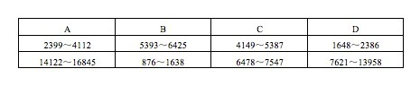

| A | B | C | D |
| --- | ---: | ---: | ---: |
| 2399～4112 | 5393～6425 | 4149～5387 | 1648～2386 |
| 14122～16845 | 876～1638 | 6478～7547 | 7621～13958 |

### 第 36 题

16342

A. A

B. B

C. C

D. D

第 36 题 · 答案与解析

**参考答案（粉笔题库参考内容）**

A

**解析**

数字16342位于区间14122~16845。

故正确答案为A。

**来源**：2008年江苏省公务员录用考试《行测》题（B类）第36题

### 第 37 题

1765

A. A

B. B

C. C

D. D

第 37 题 · 答案与解析

**参考答案（粉笔题库参考内容）**

D

**解析**

数字1765位于区间1648~2386。

故正确答案为D。

**来源**：2008年江苏省公务员录用考试《行测》题（B类）第37题

### 第 38 题

9286

A. A

B. B

C. C

D. D

第 38 题 · 答案与解析

**参考答案（粉笔题库参考内容）**

D

**解析**

数字9286位于区间7621~13958。

故正确答案为D。

**来源**：2008年江苏省公务员录用考试《行测》题（B类）第38题

### 第 39 题

8761

A. A

B. B

C. C

D. D

第 39 题 · 答案与解析

**参考答案（粉笔题库参考内容）**

D

**解析**

数字8761位于区间7621~13958。

故正确答案为D。

**来源**：2008年江苏省公务员录用考试《行测》题（B类）第39题

### 第 40 题

5399

A. A

B. B

C. C

D. D

第 40 题 · 答案与解析

**参考答案（粉笔题库参考内容）**

B

**解析**

数字5399位于区间5393~6425。

故正确答案为B。

**来源**：2008年江苏省公务员录用考试《行测》题（B类）第40题

### 第 41 题

2499

A. A

B. B

C. C

D. D

第 41 题 · 答案与解析

**参考答案（粉笔题库参考内容）**

A

**解析**

数字2499位于区间2399~4112。

故正确答案为A。

**来源**：2008年江苏省公务员录用考试《行测》题（B类）第41题

### 第 42 题

3748

A. A

B. B

C. C

D. D

第 42 题 · 答案与解析

**参考答案（粉笔题库参考内容）**

A

**解析**

数字3748位于区间2399~4112。

故正确答案为A。

**来源**：2008年江苏省公务员录用考试《行测》题（B类）第42题

### 第 43 题

11111

A. A

B. B

C. C

D. D

第 43 题 · 答案与解析

**参考答案（粉笔题库参考内容）**

D

**解析**

数字11111位于区间7621~13958。

故正确答案为D。

**来源**：2008年江苏省公务员录用考试《行测》题（B类）第43题

### 第 44 题

6153

A. A

B. B

C. C

D. D

第 44 题 · 答案与解析

**参考答案（粉笔题库参考内容）**

B

**解析**

数字6153位于区间5393~6425。

故正确答案为B。

**来源**：2008年江苏省公务员录用考试《行测》题（B类）第44题

### 第 45 题

4638

A. A

B. B

C. C

D. D

第 45 题 · 答案与解析

**参考答案（粉笔题库参考内容）**

C

**解析**

数字4638位于区间4149~5387。

故正确答案为C。

**来源**：2008年江苏省公务员录用考试《行测》题（B类）第45题

### 第 46 题

913

A. A

B. B

C. C

D. D

第 46 题 · 答案与解析

**参考答案（粉笔题库参考内容）**

B

**解析**

数字913位于区间876~1638。

故正确答案为B。

**来源**：2008年江苏省公务员录用考试《行测》题（B类）第46题

### 第 47 题

5339

A. A

B. B

C. C

D. D

第 47 题 · 答案与解析

**参考答案（粉笔题库参考内容）**

C

**解析**

数字5339位于区间4149~5387。

故正确答案为C。

**来源**：2008年江苏省公务员录用考试《行测》题（B类）第47题

### 第 48 题

7104

A. A

B. B

C. C

D. D

第 48 题 · 答案与解析

**参考答案（粉笔题库参考内容）**

C

**解析**

数字7104位于区间6478~7547。

故正确答案为C。

**来源**：2008年江苏省公务员录用考试《行测》题（B类）第48题

### 第 49 题

2368

A. A

B. B

C. C

D. D

第 49 题 · 答案与解析

**参考答案（粉笔题库参考内容）**

D

**解析**

数字2368位于区间1648~2386。

故正确答案为D。

**来源**：2008年江苏省公务员录用考试《行测》题（B类）第49题

### 第 50 题

15428

A. A

B. B

C. C

D. D

第 50 题 · 答案与解析

**参考答案（粉笔题库参考内容）**

A

**解析**

数字15428位于区间14122~16845。

故正确答案为A。

**来源**：2008年江苏省公务员录用考试《行测》题（B类）第50题

## 材料 2

字符替换

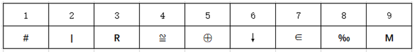

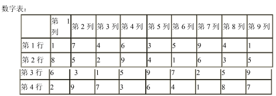

|  | 第1列 | 第2列 | 第3列 | 第4列 | 第5列 | 第6列 | 第7列 | 第8列 | 第9列 |
| --- | ---: | ---: | ---: | ---: | ---: | ---: | ---: | ---: | ---: |
| 第1行 | 1 | 7 | 4 | 6 | 3 | 5 | 9 | 4 | 1 |
| 第2行 | 8 | 5 | 2 | 9 | 4 | 1 | 6 | 3 | 5 |
| 第3行 | 6 | 3 | 1 | 5 | 9 | 7 | 2 | 5 | 9 |
| 第4行 | 2 | 9 | 7 | 3 | 6 | 4 | 1 | 8 | 7 |

### 第 51 题

数字表中对应M的数字有几个：

A. 1

B. 3

C. 5

D. 7

第 51 题 · 答案与解析

**参考答案（粉笔题库参考内容）**

C

**解析**

由对应表可知M对应的数字为9，在数字表中9共出现5次。

故正确答案为C。

**来源**：2008年江苏省公务员录用考试《行测》题（B类）第51题

### 第 52 题

数字表中代表R的数字在哪几列：

A. 3458

B. 2459

C. 2458

D. 2468

第 52 题 · 答案与解析

**参考答案（粉笔题库参考内容）**

C

**解析**

由对应表可知R对应的数字为3，在数字表中3出现在2、4、5、8列。

故正确答案为C。

**来源**：2008年江苏省公务员录用考试《行测》题（B类）第52题

### 第 53 题

数字表中第7列的数字对应的符号是：

A. M ↓ I #

B. ∈RM

C. #%○↓I

D. ↓ I # M

第 53 题 · 答案与解析

**参考答案（粉笔题库参考内容）**

A

**解析**

数字表中第7列的数字分别为9、6、2、1，由对应表可知对应的符号分别为，选项B、C、D均不符合。

故正确答案为A。

**来源**：2008年江苏省公务员录用考试《行测》题（B类）第53题

### 第 54 题

数字表中第3行前四个数字对应的符号是：

A. ↓ R # ‰

B. ↓ R # ∈

C. ∈ I M ⊕

D. ↓R#⊕

第 54 题 · 答案与解析

**参考答案（粉笔题库参考内容）**

D

**解析**

数字表中第3行前四个数字分别为6、3、1、5，由对应表可知对应的符号分别为↓、R、#、⊕，选项A、B、C均不符合。

故正确答案为D。

**来源**：2008年江苏省公务员录用考试《行测》题（B类）第54题

### 第 55 题

图例中与数字3964对应的符号是：

A. R#↓≅

B. RM↓≅

C. RM∣≅

D. RM↓∈

第 55 题 · 答案与解析

**参考答案（粉笔题库参考内容）**

B

**解析**

图例中与数字3964对应的符号为R、M、↓、≈。

故正确答案为B。

**来源**：2008年江苏省公务员录用考试《行测》题（B类）第55题

### 第 56 题

数字表中第4行缺失的数字是：

A. ∈

B. 3

C. ⊕

D. 5

第 56 题 · 答案与解析

**参考答案（粉笔题库参考内容）**

D

**解析**

数字表中第4行的数字为2、9、7、3、6、4、1、8、7，缺失数字5。

故正确答案为D。

**来源**：2008年江苏省公务员录用考试《行测》题（B类）第56题

### 第 57 题

数字表中第1行缺失的数字对应的符号是：

A. 28

B. IR

C. ｜≅

D. I‰

第 57 题 · 答案与解析

**参考答案（粉笔题库参考内容）**

D

**解析**

数字表中第1行的数字为1、7、4、6、3、5、9、4、1，缺失的数字是2、8，2、8对应的符号为丨、‰。

故正确答案为D。

**来源**：2008年江苏省公务员录用考试《行测》题（B类）第57题

### 第 58 题

符号≅与∈所对应的数字在数字表中出现次数的差额为：

A. 0

B. 1

C. 2

D. 3

第 58 题 · 答案与解析

**参考答案（粉笔题库参考内容）**

A

**解析**

由对应表可知符号≅与∈对应的数字分别为4、7，在数字表中出现的次数分别为4、4，其差额为0。

故正确答案为A。

**来源**：2008年江苏省公务员录用考试《行测》题（B类）第58题

### 第 59 题

数字表中第2列四个数字之和对应的符号是：

A. R_∞

B. I≅

C. 24

D. ∞

第 59 题 · 答案与解析

**参考答案（粉笔题库参考内容）**

B

**解析**

数字表中第2列四个数字的和为7+5+3+9＝24，由对应表可知对应的符号为I、≤。

故正确答案为B。

**来源**：2008年江苏省公务员录用考试《行测》题（B类）第59题

### 第 60 题

数字表中第1行第4列的数与第3行第9列的数的乘积对应的符号是：

A. #‰

B. ⊕≅

C. ≅｜

D. R≅

第 60 题 · 答案与解析

**参考答案（粉笔题库参考内容）**

B

**解析**

数字表中第1行第4列的数与第3行第9列的数的乘积为6×9=54，由对应表可知对应的符号为⊕、≌。

故正确答案为B。

**来源**：2008年江苏省公务员录用考试《行测》题（B类）第60题

### 第 61 题

6，8，11，16，（  ），34

A. 19

B. 21

C. 23

D. 27

第 61 题 · 答案与解析

**参考答案（粉笔题库参考内容）**

C

**解析**

原数列为二级质数数列。

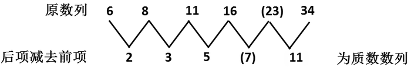

故正确答案为C。

**来源**：2008年江苏省公务员录用考试《行测》题（B类）第61题

### 第 62 题

1414，1326，1545，1352，（  ），1696

A. 1775

B. 1785

C. 1795

D. 1805

第 62 题 · 答案与解析

**参考答案（粉笔题库参考内容）**

B

**解析**

机械划分：14|14、13|26、15|45、13|52、（ ）、16|96。

将每一项分为两部分，后一部分 ÷ 前一部分，得到新数列：1 2 3 4 (5) 6，为等差数列。

验证选项，只有B项符合，85÷17=5。

故正确答案为B。

**来源**：2008年江苏省公务员录用考试《行测》题（B类）第62题

### 第 63 题

1，3，2，5，9，（  ），395

A. 11

B. 22

C. 33

D. 44

第 63 题 · 答案与解析

**参考答案（粉笔题库参考内容）**

D

**解析**

原数列为乘积递推数列，从第三项开始，每一项都等于前两项的乘积减去1。

1×3−1=2，3 × 2 - 1 = 5，2 × 5 - 1 = 9，5 × 9 - 1 = (44)，9 × 44 − 1 = 395。

故正确答案为D。

**来源**：2008年江苏省公务员录用考试《行测》题（B类）第63题

### 第 64 题

119，327，545，783，（  ）

A. 7161

B. 8353

C. 9161

D. 9355

第 64 题 · 答案与解析

**参考答案（粉笔题库参考内容）**

C

**解析**

机械划分：1|1|9，3|2|7，5|4|5，7|8|3，（‖）。

每一项划分为三部分，各自构成新数列。

第一部分：1 3 5 7 (9)，为等差数列；

第二部分：1 2 4 8 (16)，为等比数列；

第三部分：9 7 5 3 (1)，为等差数列。

故所求项为9161。

故正确答案为C。

**来源**：2008年江苏省公务员录用考试《行测》题（B类）第64题

### 第 65 题

1/2，1，5/4，5/6，17/48，()

A. 25/240

B. 13/120

C. 13/240

D. 11/220

第 65 题 · 答案与解析

**参考答案（粉笔题库参考内容）**

B

**解析**

原分数数列变形：1/2、2/2、5/4、10/12、17/48、( )/( )。

分子部分为：1，2，5，10，17，后项减前项得到新数列为：1，3，5，7，（    ），是公差为2的等差数列，则下一项为7+2=9，故所求项分子部分为17+9=26。分母部分为：2，2，4，12，48，后项÷前项得到新数列为：1，2，3，4，是公差为1的等差数列，则下一项为5，故所求项分母部分为48×5=240。则所求项为26/240，即13/120。

故正确答案为B。

**来源**：2008年江苏省公务员录用考试《行测》题（B类）第65题

### 第 66 题

339，516，236，729，428，（  ）

A. 305

B. 311

C. 336

D. 339

第 66 题 · 答案与解析

**参考答案（粉笔题库参考内容）**

C

**解析**

观察数列每一项，3×3=9，5+1＝6，2×3=6，7+2＝9，4×2=8，可知原数列整体为交叉数列，奇数项为乘法关系，偶数项为加法关系，因此所求项为加法关系，只有C项3＋3＝6符合。

故正确答案为C。

**来源**：2008年江苏省公务员录用考试《行测》题（B类）第66题

### 第 67 题

A. 2

B. 4

C. 6

D. 8

第 67 题 · 答案与解析

**参考答案（粉笔题库参考内容）**

D

**解析**

观察数阵前两项可知，4×5−3×6=2，8×10−7×9=17，所以未知项=5×7−3×9=8。

故正确答案为D。

**来源**：2008年江苏省公务员录用考试《行测》题（B类）第67题

### 第 68 题

2，12，45，112，（  ），468

A. 135

B. 155

C. 185

D. 275

第 68 题 · 答案与解析

**参考答案（粉笔题库参考内容）**

D

**解析**

数列各项因数分解可得：

2 = 1^2 × 2，12 = 2^2 × 3，45 = 3^2 × 5，112=4^2×7，(275) = (5^2) × (11)，468 = 6^2 × 13。

乘式前项为幂次数列，底数为等差数列；乘式后项为质数数列。

故正确答案为D。

**来源**：2008年江苏省公务员录用考试《行测》题（B类）第68题

### 第 69 题

1，3，11，15，20，28，7，23，（  ），55

A. 23

B. 25

C. 27

D. 29

第 69 题 · 答案与解析

**参考答案（粉笔题库参考内容）**

A

**解析**

原数列为分组数列。

两两一组，[1,3] [11,15] [20,28] [7,23] [( ),55]。

每组后项减去前项可得新数列：2、4、8、16、(32)，为等比数列。

故未知项应为55－32＝23。

故正确答案为A。

**来源**：2008年江苏省公务员录用考试《行测》题（B类）第69题

### 第 70 题

0，7，22，45，76，（  ），162

A. 115

B. 113

C. 97

D. 93

第 70 题 · 答案与解析

**参考答案（粉笔题库参考内容）**

A

**解析**

原数列为二级等差数列。

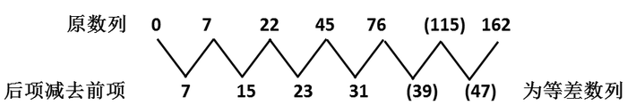

故正确答案为A。

**来源**：2008年江苏省公务员录用考试《行测》题（B类）第70题

### 第 71 题

1/3 + 1/9 + 1/27 + … + 1/3^n + … =（ ）

A. 1

B. 0.5

C. 2

D. 1.5

第 71 题 · 答案与解析

**参考答案（粉笔题库参考内容）**

B

**解析**

原式为无穷递缩等比数列求和，无穷递缩等比数列各项和S = a_1/(1 − q)。原式 = (1/3)/(1−1/3) = 0.5。

故正确答案为B。

**考点**：数列问题

**来源**：2008年江苏省公务员录用考试《行测》题（B类）第71题

### 第 72 题

已知(x+√(x^2+1))(y+√(y^2+1))=1，则x+y=()

A. 1

B. 2

C. 0

D. 不能确定

第 72 题 · 答案与解析

**参考答案（粉笔题库参考内容）**

C

**解析**

直接赋值，当x＝y＝0时，原式＝1成立，此时x＋y＝0。

故正确答案为C。

**来源**：2008年江苏省公务员录用考试《行测》题（B类）第72题

### 第 73 题

一个三角形的面积为12平方米，则该三角形内接正方形的最大面积为：

A. 6平方米

B. 4平方米

C. 3平方米

D. 不能确定

第 73 题 · 答案与解析

**参考答案（粉笔题库参考内容）**

A

**解析**

利用特殊三角形快速求解。

当这个三角形是等腰直角三角形时，其高为2√6，内接正方形的边长为√6，此时面积为6平方米。

故正确答案为A。

**考点**：几何公式类-平面图形、非典型最值问题

**来源**：2008年江苏省公务员录用考试《行测》题（B类）第73题

### 第 74 题

一个球内接立方体的表面积增加21％后，则该球的体积增加百分之几：

A. 10

B. 21

C. 33.1

D. 33.3

第 74 题 · 答案与解析

**参考答案（粉笔题库参考内容）**

C

**解析**

由题可知，表面积变为原来的1.21倍，1.21 = 1.1²。根据几何等比放缩性质，可知体积变为原来的1.1^3 = 1.331倍。增加1.331-1=33.1%。

故正确答案为C。

**考点**：几何公式类-立体图形、几何结论类-相似图形

**来源**：2008年江苏省公务员录用考试《行测》题（B类）第74题

### 第 75 题

将0、2、4、6、8、1、3、5、7、9十个数字按顺时针方向排成环形，从其中的任一数字开始按顺时针方向连续取三个数形成的所有三位数的和为：

A. 4983

B. 4971

C. 4995

D. 无法确定

第 75 题 · 答案与解析

**参考答案（粉笔题库参考内容）**

B

**解析**

从首位为2的三位数开始：246、468、681、813、135、357、579、790、902，利用尾数法，6＋8＋1＋3＋5＋7＋9＋0＋2＝41，故尾数为1。

故正确答案为B。

**来源**：2008年江苏省公务员录用考试《行测》题（B类）第75题

### 第 76 题

甲乙丙三个蔬菜基地共存放了5200吨蔬菜，如果从甲基地运出544吨放到乙基地后，乙基地的蔬菜比丙基地多800吨，且此时甲乙基地的蔬菜重量比为7：4，则甲基地原有蔬菜的吨数为：

A. 2256

B. 2800

C. 3059

D. 3344

第 76 题 · 答案与解析

**参考答案（粉笔题库参考内容）**

D

**解析**

设现在乙基地内有蔬菜4x吨，那么现在甲基地有7x吨，丙基地有5200－11x吨，且现在乙基地的蔬菜比丙基地多800吨，则有4x－5200＋11x＝800，解得x＝400，原来甲基地有蔬菜7 × 400 + 544 = 3344吨。

故正确答案为D。

**考点**：和差倍比问题

**来源**：2008年江苏省公务员录用考试《行测》题（B类）第76题

### 第 77 题

某宾馆一栋九层楼客房部，每层都有10套客房，每个房间号均编成三位数，百位数代表楼层、十位及个位表示第几号房间，每层的前9个房间号十位数用零表示，现知王先生和李先生住在该楼内，王先生住的楼层刚好等于李先生的房间号的个位数，而王先生的房号与李先生房号的个位数和为210，则王先生的房间号为：

A. 206

B. 208

C. 207

D. 307

第 77 题 · 答案与解析

**参考答案（粉笔题库参考内容）**

B

**解析**

根据题干条件，王先生的房号与李先生房号的个位数之和为210，则可知王先生只能居住在2楼。而王先生住的楼层刚好等于李先生的房间号的个位数，则李先生房号的个位数为2，故可推知王先生的房号为210-2=208。

故正确答案为B。

**来源**：2008年江苏省公务员录用考试《行测》题（B类）第77题

### 第 78 题

某商品价格近三年出现了波动，第一年在原价的基础上提价8%，第二年在第一年的基础上下降12%，第三年又在第二年的基础上提价6%，则第三年在原价的基础上：

A. 上涨0.74%

B. 下降0.74%

C. 上涨0.74

D. 下降0.74

第 78 题 · 答案与解析

**参考答案（粉笔题库参考内容）**

A

**解析**

根据常识可直接排除C、D两项。

设第一年价格为1，则三年后价格为(1 + 8%) × (1 - 12%) × (1 + 6%)＞ (1 + 14%) × (1 − 12%)= 1.02 - 0.0168 ＞ 1，所以为上涨，只有A项符合。

故正确答案为A。

**考点**：经济利润问题

**来源**：2008年江苏省公务员录用考试《行测》题（B类）第78题

### 第 79 题

现由甲乙丙三人完成一项工程，如果由甲乙两人合作，需要12小时完成；如果由乙丙两人合作，需要10小时完成；如果甲乙丙三人合作，需要6小时才能完成，则这项工程如果全部由甲单独完成，所需小时数为：

A. 15

B. 18

C. 20

D. 25

第 79 题 · 答案与解析

**参考答案（粉笔题库参考内容）**

A

**解析**

赋值工程总量为时间12、10、6的公倍数60，则甲乙合作的效率为60/12=5；乙丙合作的效率为60/10=6；甲乙丙合作的效率为60/6=10；则丙的效率=10-5=5，乙的效率=6-5=1，甲的效率=5-1=4。则这项工程如果全部由甲单独完成，所需小时数为60/4=15。

故正确答案为A。

**考点**：给完工时间型

**来源**：2008年江苏省公务员录用考试《行测》题（B类）第79题

### 第 80 题

某服装厂生产一种服装，每件的成本是150元，售价为206元，在市场实际销售时发现，服装销售获得的利润y（元）与市场临时降价x（元）的关系式为y = −x^3 + 12x^2 + 2240，则服装厂获得利润最大时，服装售价为：

A. 8元

B. 168元

C. 198元

D. 206元

第 80 题 · 答案与解析

**参考答案（粉笔题库参考内容）**

C

**解析**

方法一：根据题意，y = −x^3 + 12x^2 + 2240= 2240 + (12-x)x^2，由于 2240是定值，故当(12 - x)x^2取得最大值时，利润也取得最大值。结合选项代入计算可得：

A项：售价为8元，应降价206-8=198元，(12−198)×198^2＜0；

B项：售价为168元，应降价206-168=38元，(12 − 38) × 38^2 ＜ 0；

C项：售价为198元，应降价206-198=8元，(12 − 8) × 8^2 ＞ 0；

D项：售价为206元，应降价0元，(12 - 0) × 0^2 = 0；

显然，C项对应的利润最大。

方法二：对y = −x^3 + 12x^2 + 2240求导得y' = −3x^2 + 24x，令y'=0，则-3x^2+24x = 0，解得x=0或x=8，当x=8时，利润最大，这时服装售价为206-8=198元。

故正确答案为C。

**考点**：函数最值问题

**来源**：2008年江苏省公务员录用考试《行测》题（B类）第80题

### 第 81 题

从所给四个选项中，选择最合适的一个填入问号处，使之呈现一定的规律性：

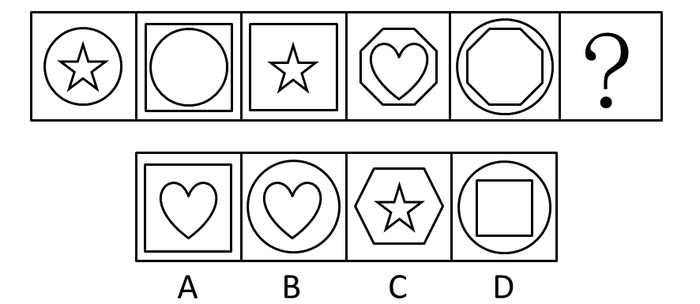

A. A

B. B

C. C

D. D

第 81 题 · 答案与解析

**参考答案（粉笔题库参考内容）**

B

**解析**

元素相似，元素叠加运算。

前三个图形是一组，前两个图形叠加后去同存异得到第三个图形。第四个和第五个图形叠加去同存异留下圆形和心形。

故正确答案为B。

**考点**：样式规律-加减同异

**来源**：2008年江苏省公务员录用考试《行测》题（B类）第81题

### 第 82 题

请从所给的四个选项中，选择最合适的一项填在问号处，使之呈现一定的规律性。

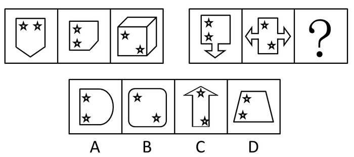

A. A

B. B

C. C

D. D

第 82 题 · 答案与解析

**参考答案（粉笔题库参考内容）**

A

**解析**

题干图形均含有两个五角星，考虑功能元素。观察发现，每幅图中两个五角星都处于直角位置，故“？”处图形的两个五角星也应处于直角位置，只有A项符合规律。

故正确答案为A。

**考点**：特殊规律-功能元素

**来源**：2008年江苏省公务员录用考试《行测》题（B类）第82题

### 第 83 题

从所给四个选项中，选择最合适的一个填入问号处，使之呈现一定的规律性：

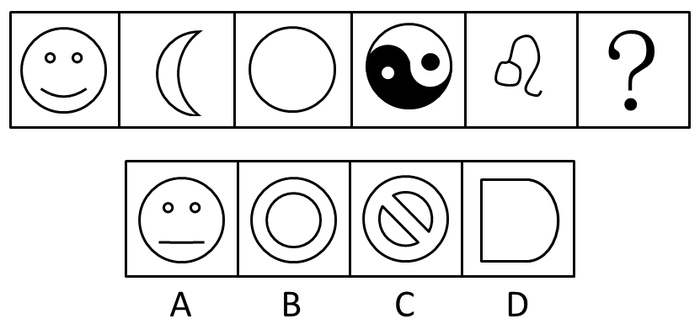

A. A

B. B

C. C

D. D

第 83 题 · 答案与解析

**参考答案（粉笔题库参考内容）**

B

**解析**

元素组成凌乱，考查曲直性。

已知图形的组成元素都是曲线，只有B项的组成元素都是曲线，A、C、D中都包含直线。

故正确答案为B。

**考点**：属性规律-曲直性

**来源**：2008年江苏省公务员录用考试《行测》题（B类）第83题

### 第 84 题

从所给四个选项中，选择最合适的一个填入问号处，使之呈现一定的规律性：

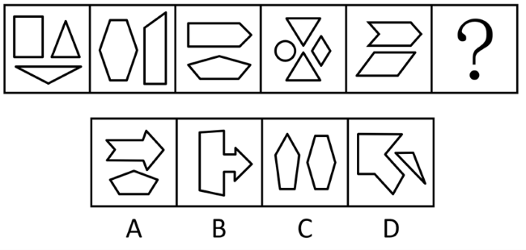

A. A

B. B

C. C

D. D

第 84 题 · 答案与解析

**参考答案（粉笔题库参考内容）**

D

**解析**

元素组成凌乱，考查数量规律。

数直线，已知图形中包含的直线数均为10，D项中的直线数也是10。选项图形直线数量为13，11，11，10。

故正确答案为D。

**考点**：数量规律-线

**来源**：2008年江苏省公务员录用考试《行测》题（B类）第84题

### 第 85 题

从所给四个选项中，选择最合适的一个填入问号处，使之呈现一定的规律性：

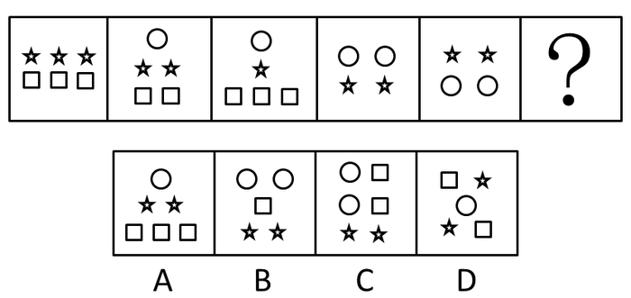

A. A

B. B

C. C

D. D

第 85 题 · 答案与解析

**参考答案（粉笔题库参考内容）**

D

**解析**

特殊考点，元素的换算。

令第二、第三个图形等价可得：1个五角星=1个方形，将此关系代入原图后可知：1个圆形=2个五角星=2个方形，且原图的每个图形均可等价为6个方形。将此关系代入选项，可知D正确。

故正确答案为D。

**考点**：数量规律-素

**来源**：2008年江苏省公务员录用考试《行测》题（B类）第85题

### 第 86 题

左边给定的是正方体的外表面展开图，右边哪一项能由它折叠而成？

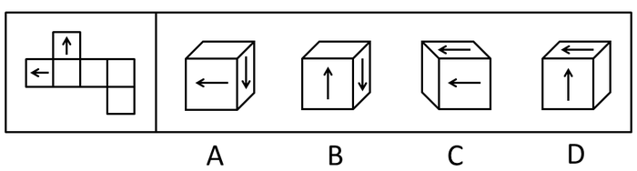

A. A

B. B

C. C

D. D

第 86 题 · 答案与解析

**参考答案（粉笔题库参考内容）**

C

**解析**

相邻边的考查。

由左边的图形可知，对折后两个箭头的指向相同，处于平行位置。A、D中两个箭头方向垂直，排除；B中的两个箭头方向相反，排除。

故正确答案为C。

**考点**：空间类-空间重构-六面体

**来源**：2008年江苏省公务员录用考试《行测》题（B类）第86题

### 第 87 题

左边给定的是正方体的外表面展开图，右边哪一项能由它折叠而成？

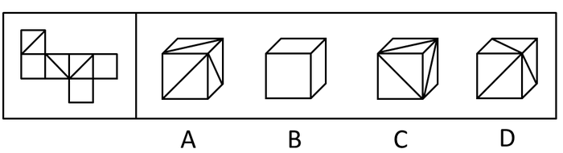

A. A

B. B

C. C

D. D

第 87 题 · 答案与解析

**参考答案（粉笔题库参考内容）**

B

**解析**

A项：选项顶面应为白色，与题干不一致，排除；

B项：与题干一致，当选；

C项：选项顶面的对角线方向应为左上到右下方向，与题干不一致，排除；

D项：与A项一样，顶面应为白色，与题干不一致，排除。

故正确答案为B。

**考点**：空间类-空间重构-六面体

**来源**：2008年江苏省公务员录用考试《行测》题（B类）第87题

### 第 88 题

左边给定的是纸盒的外表面展开图，右边哪一项能由它折叠而成？

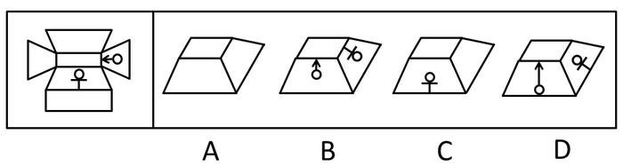

A. A

B. B

C. C

D. D

第 88 题 · 答案与解析

**参考答案（粉笔题库参考内容）**

A

**解析**

原图折叠后，A项正确；B项中带符号的两个面的图形应交换，且B项右边的图形应为○在上；C项中右面应为带雄性符号的面；D项中与正面相邻的面应为空白面。

故正确答案为A。

**来源**：2008年江苏省公务员录用考试《行测》题（B类）第88题

### 第 89 题

左边给定的是正方体的外表面展开图，右边哪一项能由它折叠而成？

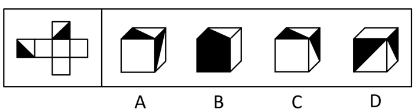

A. A

B. B

C. C

D. D

第 89 题 · 答案与解析

**参考答案（粉笔题库参考内容）**

D

**解析**

由题干知，没有一个面为全黑的面，故排除B选项；而A、C选项只有右面的图案不一样，由题干折成的图形中右面的图案只有以下两种情况，不可能出现A、C的情况。

故正确答案为D。

**考点**：空间类-空间重构-六面体

**来源**：2008年江苏省公务员录用考试《行测》题（B类）第89题

### 第 90 题

左边给定的是纸盒的外表面展开图，右边哪一项能由它折叠而成？

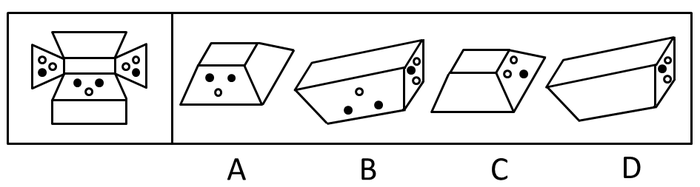

A. A

B. B

C. C

D. D

第 90 题 · 答案与解析

**参考答案（粉笔题库参考内容）**

B

**解析**

将A项图形展开与原图对比可知，右面不是空白，而应该带有两白点、一黑点；C项中右面三个点的排布位置不正确；靠长边的应该是一黑一白两个点而不是一个黑点，D项错误。

故正确答案为B。

**来源**：2008年江苏省公务员录用考试《行测》题（B类）第90题

### 第 91 题

左边给定的是八面体的外表面展开图，右边哪一项能由它折叠而成？

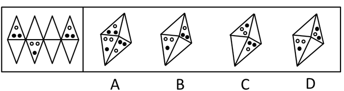

A. A

B. B

C. C

D. D

第 91 题 · 答案与解析

**参考答案（粉笔题库参考内容）**

C

**解析**

将选项中的立体图形展开成平面图形，上下两个对立的面不可能都有图形，A项错误；B、D项右边应为两个空白面（注意观察白点和黑点的位置）。

故正确答案为C。

**来源**：2008年江苏省公务员录用考试《行测》题（B类）第91题

### 第 92 题

左边给定的是八面体的外表面展开图，右边哪一项能由它折叠而成？

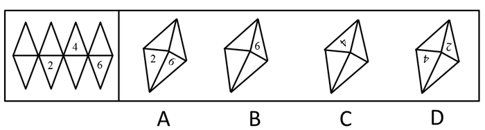

A. A

B. B

C. C

D. D

第 92 题 · 答案与解析

**参考答案（粉笔题库参考内容）**

D

**解析**

将选项中的立体图形展开后逐一判断各选项。

A项，2和6的面并不相邻，错误；

B项，数字6的方向反了，错误；

C项，数字4的方向不对，且与其相邻的面不可能上下都是空白面，错误。

故正确答案为D。

**来源**：2008年江苏省公务员录用考试《行测》题（B类）第92题

### 第 93 题

左边给定的是六面体的外表面展开图，右边哪一项能由它折叠而成？

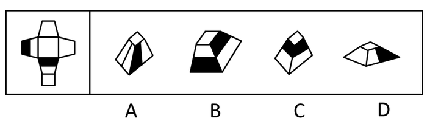

A. A

B. B

C. C

D. D

第 93 题 · 答案与解析

**参考答案（粉笔题库参考内容）**

B

**解析**

将左边的平面折成空间图形后，带阴影的两个面与顶面均为平行关系，故排除A、D选项；且带阴影的两面一个靠顶面，一个靠底面，并不相邻，排除C。

故正确答案为B。

**来源**：2008年江苏省公务员录用考试《行测》题（B类）第93题

### 第 94 题

左边给定的是六面体的外表面展开图，右边哪一项能由它折叠而成？

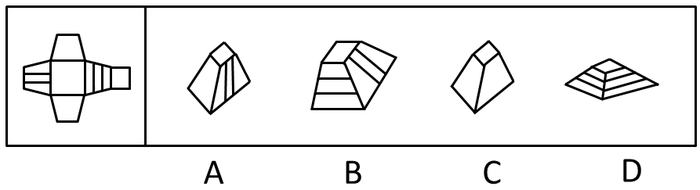

A. A

B. B

C. C

D. D

第 94 题 · 答案与解析

**参考答案（粉笔题库参考内容）**

A

**解析**

将选项中的立体图形展开后逐一判断各选项，题干中的两个空白面为对立面，故C选项错误；带线条的两个面为对立面，B、D选项展开后为相邻面，故排除B、D。

故正确答案为A。

**来源**：2008年江苏省公务员录用考试《行测》题（B类）第94题

### 第 95 题

左边给定的是六面体的外表面展开图，右边哪一项能由它折叠而成？

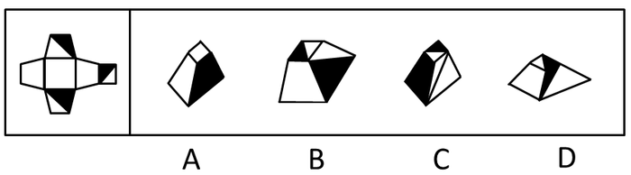

A. A

B. B

C. C

D. D

第 95 题 · 答案与解析

**参考答案（粉笔题库参考内容）**

B

**解析**

将选项中的立体图形展开后逐一判断各选项，不可能整个面都是黑色，排除A、C选项；D项中右面的图案不正确，故排除D。

故正确答案为B。

**来源**：2008年江苏省公务员录用考试《行测》题（B类）第95题

### 第 96 题

凡是春天小区的保安都来自郊区农村，而春风理发店的员工中没有一人来自郊区农村。所有春季装修公司的工人都拥有大专文凭，有些春天小区的保安拥有大专文凭。

据此，以下各项中哪项判断必然为真？

A. 春风理发店的员工中有人拥有大专文凭

B. 春风理发店的员工中没有人拥有大专文凭

C. 春季装修公司的工人没有一人来自郊区农村

D. 有些拥有大专文凭的人是春天小区的保安

第 96 题 · 答案与解析

**参考答案（粉笔题库参考内容）**

D

**解析**

第一步：翻译题干，利用充分必要条件。

第一句：小区保安→郊区农村，理发店员工→郊区农村。

第二句：装修工人→大专文凭，有些小区保安→大专文凭。

第二步：逐一翻译选项判断正确答案。

A项：理发店员工→大专文凭，从题干无法推出，排除。

B项：理发店员工→大专文凭，从题干无法推出，排除。

C项：装修工人→郊区农村，从题干无法推出，排除。

D项：有些人有大专文凭→小区保安，属于可能性推理，可由有些小区保安→大专文凭得到。

故正确答案为D。

**考点**：集合推理

**来源**：2008年江苏省公务员录用考试《行测》题（B类）第96题

### 第 97 题

如果小刘是学生会成员，他一定是三年级学生。

上述断定是基于以下哪项判断作为前提的？

A. 只有小刘才能被选入学生会

B. 只有三年级学生才有资格被选入学生会

C. 入选学生会成员中必须有三年级学生

D. 三年级学生也可能不被选入学生会

第 97 题 · 答案与解析

**参考答案（粉笔题库参考内容）**

B

**解析**

本题考查三段论。

第一步：分析题干信息。

条件：小刘与学生会成员的关系；

结论：小刘与三年级学生的关系。

第二步：根据三段论特点得到以下步骤，直接得出结论。

1. 在条件和结论不同的对象间搭桥，即在学生会成员和三年级学生之间搭桥；

2. 搭桥的方向：由条件的对象指向结论的对象，即由学生会成员推出三年级学生；

3. 该表达必须是充分的表达，即所有学生会成员都是三年级学生。

第三步：分析选项得出答案。

B的意思是只有三年级学生才有资格成为学生会成员，恰是第二步结论的逆否规则。

故正确答案为B。

**考点**：搭桥

**来源**：2008年江苏省公务员录用考试《行测》题（B类）第97题

### 第 98 题

所有公共政策的后续效应可能是难以预料的。

下列哪项判断的涵义与上述判断最为相近？

A. 所有公共政策的后续效应必然是难以预料的

B. 有的公共政策的后续效应不必然不是难以预料的

C. 有的公共政策的后续效应必然不是难以预料的

D. 有的公共政策的后续效应可能不是难以预料的

第 98 题 · 答案与解析

**参考答案（粉笔题库参考内容）**

B

**解析**

第一步：判断题干类型。

考查的是模态命题的推理。

第二步：逐一判断选项得出答案。

题干中“所有公共政策的后续效应可能是难以预料的”的模态词是“可能”，而A中是“必然”，A错误；

根据模态词的转换“可能=不必然不”，因此题干中的“所有公共政策的后续效应可能是难以预料的”等价于“所有公共政策的后续效应不必然不是难以预料的”，然后根据直言命题的推出关系，可推出“有的公共政策的后续效应不必然不是难以预料的”即B项，B正确；

根据模态词的转换“可能=不必然不”，因此题干中的“所有公共政策的后续效应可能是难以预料的”不等价于“所有公共政策的后续效应必然不是难以预料的”，所以推不出“有的公共政策的后续效应必然不是难以预料的”，C错误；

D中“有的公共政策的后续效应可能不是难以预料的”经过双重否定后可以等价于“有的公共政策的后续效应可能是可以预料的”。而题干中“所有公共政策的后续效应可能是难以预料的”等价于“所有公共政策的后续效应不可能是可以预料的”，进而推出“有的公共政策的后续效应不可能是可以预料的”。D等价转化后的结论和题干转化后的结论不符，因此D和题干的判断不相近，D错误。

故正确答案为B。

**来源**：2008年江苏省公务员录用考试《行测》题（B类）第98题

### 第 99 题

去冬今春，我国南方部分地区天降大雪。如果高速公路管理者不及时采取扫雪等多项措施，则积雪会在严寒中结冰。如果高速公路结冰，则会存在重大行车安全隐患。如果存在重大行车安全隐患，则高速公路就要关闭。如果高速公路关闭，则会给人民群众的工作和生活带来很大不便。事实上，我国南方有多条高速公路一度被迫关闭。

据此，下列哪项判断是上述最可能的推断？

A. 高速公路结冰是普遍现象

B. 只有存在重大安全隐患，高速公路才要关闭

C. 如果不想给人民群众的工作和生活带来很大不便，高速公路管理者就需要及时采取扫雪等多项措施

D. 普通公路更具有抗灾害能力，因为在高速公路关闭时，普通公路的通车量剧增

第 99 题 · 答案与解析

**参考答案（粉笔题库参考内容）**

C

**解析**

第一步：翻译题干，利用充分必要条件。

第一句：我国南方地区天降大雪。

第二句：不及时扫雪→公路结冰。

第三句：公路结冰→安全隐患。

第四句：安全隐患→公路关闭。

第五句：公路关闭→生活不便。

第六句：南方高速公路关闭。

第二步：逐一分析选项。

A、D项从题干无法推出，为无关项，排除；

B项翻译为：公路关闭→安全隐患，而题干是-公路关闭→—安全隐患，即B中的公路关闭为否前件，推不出任何绝对化的结论，排除；

C项翻译为：-生活不便→及时扫雪。由题干推导-生活不便→—公路关闭，-公路关闭→﹣安全隐患，-安全隐患→—公路结冰，-公路结冰→及时扫雪，可以推出，当选。

故正确答案为C。

**考点**：常规翻译

**来源**：2008年江苏省公务员录用考试《行测》题（B类）第99题

### 第 100 题

某公司要提拔部门经理。总经理说：“在小王和小孙中至少提拔一人。”董事长说：“我不同意。”

据此，下列哪项判断最为准确地表达了董事长实际同意的意思？

A. 小王、小孙都提拔

B. 小王、小孙都不提拔

C. 不提拔小王，就提拔小孙

D. 要么提拔小王，要么提拔小孙

第 100 题 · 答案与解析

**参考答案（粉笔题库参考内容）**

B

**解析**

第一步：翻译题干。

题干中总经理的话等价于“或者选拔小王，或者选拔小孙”，董事长的观点：不同意。

第二步：通过提问判断选项的正确。

而董事长的观点是总经理的话的矛盾命题，即“小王和小孙都不提拔”。

故正确答案为B。

**考点**：常规翻译

**来源**：2008年江苏省公务员录用考试《行测》题（B类）第100题

### 第 101 题

“上有政策，下有对策”并非都是不好的现象，在落实上级政策的时候，下级制定有关“对策”其实是很正常的。

下列哪项判断能对上述推断构成最有力的支持：

A. 一般来说，下级的对策总是对上级政策的篡改或曲解

B. 一般来说，下级总要根据实际情况对上级政策进行细化，以方便政策执行

C. 上下级所面临的情况和问题是不一样的，下级也应拥有一定的政策权限

D. 下级只能开展政策执行，不能进行政策制定

第 101 题 · 答案与解析

**参考答案（粉笔题库参考内容）**

B

**解析**

第一步：找到论点和论据。

本题论点是有些“上有政策，下有对策”是好的现象，本题论据是在落实上级政策的时候，下级制定有关“对策”其实是很正常的。

第二步：逐一判断选项的作用。

A中“下级的对策总是对上级政策的篡改或曲解”说明下面的对策阻碍了上面的政策的执行，这不是好现象，A是削弱选项，错误；

B中“下级总要根据实际情况对上级政策进行细化，以方便政策执行”说明下面的对策对上面的政策起好的作用，这是好现象，B是加强选项，正确；

C中“下级也应拥有一定的政策权限”与题干的论述无关，C错误；

D中“下级不能进行政策制定”与题干中“下级制定有关‘对策’其实是很正常的”不符，D是削弱选项，错误。

故正确答案为B。

**考点**：补充论据

**来源**：2008年江苏省公务员录用考试《行测》题（B类）第101题

### 第 102 题

张、王、李三人是某小学英语教师。他们对甲、乙两个班学生的学习英语状况作出如下判断：

张：如果甲班所有学生都爱学英语，那么乙班有的学生不爱学英语

王：甲班有的学生不爱学英语，而乙班所有学生都爱学英语

李：或者甲班所有学生爱学英语，或者乙班所有学生爱学英语

如果上述三人的判断只有一假时，则以下各项中除了哪项其余判断均不能必然推出？

A. 甲班所有学生都爱学英语，乙班所有学生都爱学英语

B. 甲班有的学生不爱学英语，乙班有的学生不爱学英语

C. 甲班有的学生不爱学英语，乙班所有学生都爱学英语

D. 甲班所有学生都爱学英语，乙班有的学生不爱学英语

第 102 题 · 答案与解析

**参考答案（粉笔题库参考内容）**

D

**解析**

第一步：观察题干。

题干中三人的判断不存在明显的矛盾关系，适合用代入法。

第二步：逐一代入选项并判断选项正确与否。

代入A，“甲班所有学生都爱学英语，乙班所有学生都爱学英语”，那么可以得出张为假，王为假，李为真，这和题干中“三人的判断只有一假”不符，A错误；

代入B，“甲班有的学生不爱学英语，乙班有的学生不爱学英语”，那么可以得出张为真，王为假，李为假，这和题干中“三人的判断只有一假”不符，B错误；

代入C，“甲班有的学生不爱学英语，乙班所有学生都爱学英语”，那么可以得出张为真，王为真，李为真，这和题干中“三人的判断只有一假”不符，C错误；

代入D，“甲班所有学生都爱学英语，乙班有的学生不爱学英语”，那么可以得出张为真，王为假，李为真，这和题干中“三人的判断只有一假”相符，D正确。

故正确答案为D。

**考点**：真假推理-其他

**来源**：2008年江苏省公务员录用考试《行测》题（B类）第102题

### 第 103 题

为了实施最佳配合，在确定某排球赛上场队员的组成时，甲、乙、丙三位教练对小王和小李是否上场表态如下：

甲：“只有小王上场，小李才上场。”

乙：“如果小王上场，则小李上场。”

丙：“或者小王上场，或者小李上场。”

据此，下列哪项判断为不可能推出的结论？

A. 三人的话都是真的

B. 三人的话都是假的

C. 三人的话两真一假

D. 甲乙的话都为真话

第 103 题 · 答案与解析

**参考答案（粉笔题库参考内容）**

B

**解析**

第一步：翻译题干，利用充分必要条件。

甲：小李上→小王上；

乙：小王上→小李上；

丙：小王上∨小李上。

第二步：列举情况，并将信息列于表中。

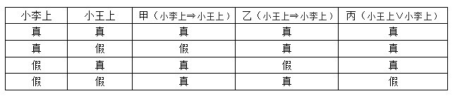

第三步：分析表格并判断选项。

由表格可知，三人的话要么都为真，要么两真一假，可能甲、乙的话都为真话，不存在三人的话都为假话的情况。

故正确答案为B。

**考点**：常规翻译

**来源**：2008年江苏省公务员录用考试《行测》题（B类）第103题

### 第 104 题

甲、乙、丙三人对某公司所有人员是否会开车做出如下推测：

甲说：“该公司有人会开车。”

乙说：“该公司的李经理和王会计都不会开车。”

丙说：“该公司有人不会开车。”

如果三人的推测只有一个为真，则下列哪项判断必然为真？

A. 该公司所有人都会开车

B. 该公司所有人都不会开车

C. 该公司的李经理可能不会开车

D. 该公司的王会计可能不会开车

第 104 题 · 答案与解析

**参考答案（粉笔题库参考内容）**

A

**解析**

第一步：找突破口。

本题突破口为甲和丙之间的反对关系，必有一真。

第二步：看其他的话。

三人的推测只有一个为真，则乙的话必为假，那么李经理和王会计至少有一个人会开车。

第三步：判断突破口中两句话的真假。

由第二步中李经理和王会计至少有一个人会开车知道甲的话为真，即该公司有人会开车为真，而该公司有人不会开车为假，即该公司所有人都会开车。

故正确答案为A。

**考点**：只有一真/一假

**来源**：2008年江苏省公务员录用考试《行测》题（B类）第104题

### 第 105 题

甲、乙、丙三人在一起推测小张、小王和小李是做什么的：

甲：“如果小王是水工，则小李是木工。”

乙：“只有小张是电工，小王才是水工。”

丙：“小张是电工但小李不是木工。”

如果三人推测中只有一句是真话，那么下列各项判断中除了哪项其余均为真？

A. 小张不是电工

B. 小王不是水工

C. 小李是木工

D. 小王是水工

第 105 题 · 答案与解析

**参考答案（粉笔题库参考内容）**

B

**解析**

第一步：观察题干。

题干中无明显矛盾关系，反对关系，适合用代入检验法。

第二步：逐一代入选项并判断选项正确与否。

假设A为假，即小张是电工。则甲、乙、丙的话都可能为真话，这与题干中“一真二假”的条件不符，所以A为真；

假设B为假，即小王是水工，而其余各选项都为真。小李是木工，小张不是电工。代入到题干检验得：甲说的正确，乙说的为假，丙说的也假。满足题干中“一真二假”的条件，所以B为假；

假设C为假，即小李不是木工，而其余各选项都为真。由此可以推出甲、乙、丙都为假，这与题干中“一真二假”的条件不符，所以C为真；

假设D为假，即小王不是水工，而其余各选项都为真。由此可以推出甲、乙为真，丙为假，这与题干中“一真二假”的条件不符，所以D为真。

故正确答案为B。

**考点**：真假推理-其他

**来源**：2008年江苏省公务员录用考试《行测》题（B类）第105题

### 第 106 题

结构化决策：对某一决策过程的环境及规则，能用确定的模型或语言描述，以适当的算法产生决策方案，并能从多种方案中选择最优解的决策。非结构化决策是指决策过程复杂，不可能用确定的模型和语言来描述其决策过程，更无所谓最优解的决策。

下列属于非结构化决策的是：

A. 跨国公司财务部门每月核算和发放职工工资

B. 制定城市未来五年发展战略

C. 某高校要建造一幢学生宿舍大楼

D. 企业仓库库存量管理

第 106 题 · 答案与解析

**参考答案（粉笔题库参考内容）**

B

**解析**

第一步：找出定义关键词。

结构化决策：“对某一决策过程的环境及规则”、“能用确定的模型或语言描述”、“以适当的算法产生决策方案，并能从多种方案中选择最优解的决策”；

非结构化决策：“决策过程复杂”、“不可能用确定的模型和语言来描述其决策过程”、“更无所谓最优解的决策”。

第二步：逐一分析选项。

A项：每月核算和发放职工工资能用适当的方法产生决策方案，属于结构化决策；

B项：制定城市未来五年的发展战略的决策过程复杂，不能用确定的模型和语言来描述，属于非结构化决策；

C项：建造一幢学生宿舍大楼，有施工计划和确定的模型描述，属于结构化决策；

D项：企业仓库库存量管理是有一定的管理方案和规则的，并不存在“过程复杂”和“不可能用确定的模型和语言来描述”的情况，属于结构化决策。

故正确答案为B。

**考点**：常规问法

**来源**：2008年江苏省公务员录用考试《行测》题（B类）第106题

### 第 107 题

劳务输出：生产力水平较低，生活条件较差的国家和地区，为了积累资金、开拓视野、吸收先进技术、增长见识和培养自己建设队伍的素质，把一部分剩余劳动力转向生产力水平较高，生活条件较富裕，劳动报酬较多的国家和地区从事合同制的工作和劳动服务的一种形式。

下列属于劳务输出的是：

A. 某大学教授到边远地区大学兼职

B. 甲县向乙县借调技术干部

C. 四川某县政府组织大批民工到广东找工作

D. 甲厂倒闭，其工人大部分经培训后安置到邻近的乙厂工作

第 107 题 · 答案与解析

**参考答案（粉笔题库参考内容）**

C

**解析**

第一步：抓住定义中的关键词。

关键词强调“国家和地区”和“一部分剩余劳动力”。

第二步：逐一判断选项。

A项中大学教授到边远地区并不属于“为了积累资金、开拓视野、吸收先进技术、增长见识等”，且大学教授属于个人，故A项不属于劳务输出；

B项只是借调技术干部，不属于输出剩余劳动力；

C项符合劳务输出的定义；

D项甲厂和乙厂不属于国家或地区，不符合劳务输出的定义。

故正确答案为C。

**考点**：主客体

**来源**：2008年江苏省公务员录用考试《行测》题（B类）第107题

### 第 108 题

个人合伙：两个以上公民按照协议，各自提供资金、实物、技术等，合伙经营，共同劳动。

下列不属于个人合伙的一项是：

A. 小黄提供场地，小李提供资金，小王提供技术，三人开办了一家饲料加工厂

B. 陈家三兄弟共同出资，买了一辆大货车做长途货运生意

C. 大学毕业后，小瑛在家人的资助下，开办了一家美容院

D. 李强提供劳务，刘海提供技术，二人共同从事软件制作

第 108 题 · 答案与解析

**参考答案（粉笔题库参考内容）**

C

**解析**

第一步：抓住定义中的关键词。

关键词强调“两个以上公民”、“合伙经营”。

第二步：逐一判断选项。

A、B、D项都符合定义；

只有C项中小瑛是在家人的资助下开办美容院，是属于资助而不是“合伙经营”，因此不属于个人合伙。

本题为选非题，故正确答案为C。

**考点**：主客体

**来源**：2008年江苏省公务员录用考试《行测》题（B类）第108题

### 第 109 题

气候：在太阳辐射、下垫面性质、大气环流和人类活动长时间相互作用下，在某一时段内大量天气过程的综合。

下列不属于气候的一项是：

A. 在2006年圣诞节前后，南京出现了50年一遇的罕见大雾

B. 昨天南京下暴雨了

C. 今年冬天的雪很大

D. 南京在6月中旬到7月上旬，经常会出现阴雨连绵、闷热的梅雨天气

第 109 题 · 答案与解析

**参考答案（粉笔题库参考内容）**

B

**解析**

第一步：抓住定义中的关键词。

关键词强调“某一段时间内”、“大量天气过程的综合”。

第二步：逐一判断选项。

A、C、D项都符合气候的定义；

B项中昨天南京下暴雨并不是一段时间内大量天气过程的综合，只是短时间的天气变化，因此不属于气候。

本题为选非题，故正确答案为B。

**考点**：大前提

**来源**：2008年江苏省公务员录用考试《行测》题（B类）第109题

### 第 110 题

承揽合同：承揽人按照定作人的要求完成工作，交付工作成果，定作人给付报酬的合同。

下列不属于承揽合同的一项是：

A. 甲把数码相机送到厂家维修处进行修理，并支付200元的维修费

B. 甲以3万元的价格将自己开了两年的捷达车卖给乙

C. 甲花2000元请某装修公司设计了一套装修方案

D. 甲提供木材，请一木工为自己打造一张雕花大床

第 110 题 · 答案与解析

**参考答案（粉笔题库参考内容）**

B

**解析**

第一步：抓住定义中的关键词。

关键词强调“承揽人按照定作人的要求完成工作”且“定作人付报酬”。

第二步：逐一判断选项。

A项中厂家按照甲的要求维修，符合定义；

B项中甲把车卖给乙，而乙并不需要按照甲的要求完成任何工作，因此不符合承揽合同的定义；

C项装修公司按照甲的要求设计，符合定义；

D项木工按照甲的要求制作，符合定义。

本题为选非题，故正确答案为B。

**考点**：方式目的

**来源**：2008年江苏省公务员录用考试《行测》题（B类）第110题

### 第 111 题

犯罪中止：在犯罪过程中，自动放弃犯罪或者自动有效地防止犯罪结果发生的行为。

下列情形属于犯罪中止的是：

A. 小李、小王商量晚上去某仓库行窃，当晚小王因肚子痛而没有去，小李独自实施了盗窃行为

B. 小刘正在撬保险柜，突然听到室内的警笛声响起，小刘很害怕，迅速逃离了现场

C. 张三趁李四不备，将李四家的古董花瓶偷走，几天后担心被抓，又偷偷地将花瓶放回原处

D. 王某欲杀死赵某，见赵某流血不止，王某非常害怕，遂将赵某送到医院，由于抢救及时，赵某脱离危险

第 111 题 · 答案与解析

**参考答案（粉笔题库参考内容）**

D

**解析**

第一步：抓住定义中的关键词。

关键词强调“自动放弃”和“自动有效地防止犯罪”。

第二步：逐一判断选项。

A项中的小王并不是在犯罪过程中放弃，且小李已经实施了盗窃行动，故不符合定义；

B项小刘不是自动放弃，也不符合定义；

C项中张三没有在犯罪过程中放弃犯罪，因此也不符合定义；

D项中的王某是在犯罪过程中自动放弃犯罪并有效地防止犯罪结果的发生，因此属于犯罪中止。

故正确答案为D。

**考点**：大前提

**来源**：2008年江苏省公务员录用考试《行测》题（B类）第111题

### 第 112 题

社会测量：运用一定测量工具、按照一定测量规则对社会现象的特征进行预测或量度并赋予一定数值的过程。

根据定义，下列哪个说法是正确的：

A. 社会测量的结果必须用数值表示

B. 社会测量的对象既可以是社会现象，也可以是自然现象

C. 社会测量不一定需要测量规则

D. 测量人的智商不属于社会测量

第 112 题 · 答案与解析

**参考答案（粉笔题库参考内容）**

A

**解析**

第一步：抓住定义中的关键词。

关键词强调“按照一定的测量规则”、“社会现象的特征”、“赋予一定数值”。

第二步：逐一判断选项。

A项中说社会测量的结果必须用数值表示，这与题干“要赋予社会测量一定的数值”符合，故A正确；

B项提到社会测量也可以是自然现象，而定义是要对社会现象特征进行预测或量度，并未提到自然现象，所以B错误；

C项中说社会测量不一定需要测量规则，而定义规定要按照一定的测量规则，所以C错误；

D项中测量人的智商是对社会现象的特征进行测量，且智商是用数值来表示的，因此测量人的智商属于社会测量，所以D错误。

故正确答案为A。

**考点**：单定义-其他句式

**来源**：2008年江苏省公务员录用考试《行测》题（B类）第112题

### 第 113 题

锐角三角形：三个角都是锐角的三角形。

下列一定属于锐角三角形的一项是：

A. 有一个角是锐角的三角形

B. 有两个角是锐角的三角形

C. 没有一个角是大于或等于90度的三角形

D. 有一个角是大于90度的三角形

第 113 题 · 答案与解析

**参考答案（粉笔题库参考内容）**

C

**解析**

第一步：抓住定义中的关键词。

关键词强调“三个角都是锐角”。

第二步：逐一判断选项。

A、B项均有可能为钝角或直角三角形；

C项没有一个角大于或等于90度，即三个角都小于90度，即一定是锐角三角形；

D项有可能为钝角三角形。

故正确答案为C。

**考点**：拆词

**来源**：2008年江苏省公务员录用考试《行测》题（B类）第113题

### 第 114 题

需求收入弹性：需求对消费者收入水平变动的反应程度或敏感程度，其大小以系数Ei＝需求变动（％）÷收入变动（％）的绝对值来表示。

根据上述定义，下列说法不正确的是：

A. 当需求收入弹性系数Ei﹥1时，表示收入水平的变化会引起需求较大的变化

B. 当Ei越小，表明收入变动对需求变动的影响越小

C. Ei的大小实际上反映了收入水平变动对需求的敏感程度

D. 根据定义，不可能存在Ei﹤0的商品

第 114 题 · 答案与解析

**参考答案（粉笔题库参考内容）**

C

**解析**

第一步：抓住定义中的关键词。

关键词强调“需求对消费者收入水平变动的反应程度或敏感程度”、“绝对值”。

第二步：逐一判断选项。

A项：Ei﹥1，即需求收入弹性大于1，说明需求对消费者收入水平变动的敏感程度较大，故收入水平的变化会引起需求较大的变化，A项正确；

B项：Ei越小，说明需求对消费者收入水平变动的敏感程度越小，故收入变动对需求变动的影响也越小，B项正确；

C项：题干强调的是“需求对消费者收入水平变动的反应程度或敏感程度”而不是“收入水平变动对需求的敏感程度”，C项错误；

D项：由于Ei是绝对值，所以Ei不可能小于0，D项正确。

本题为选非题，故正确答案为C。

**考点**：单定义-其他句式

**来源**：2008年江苏省公务员录用考试《行测》题（B类）第114题

### 第 115 题

行政许可：行政机关根据公民、法人或其他组织的申请，经依法审查，准予其从事特定活动的行为。

下列属于行政许可的一项是：

A. 学校为符合条件的学生颁发毕业证

B. 警察对打架斗殴的小张实施了治安行政拘留

C. 法院对小李起诉小王的名誉侵权案作了一审判决

D. 小赵通过考试获得了行政主管部门颁发的教师资格证

第 115 题 · 答案与解析

**参考答案（粉笔题库参考内容）**

D

**解析**

第一步：抓住定义中的关键词。

定义中强调“行政机关”、“申请”、“依法审查”。

第二步：逐一判断选项。

A项学校不属于行政机关；

B项不是根据公民的申请依法审查的；

C项法院也不属于行政机关；

D项符合定义属于行政许可。

故正确答案为D。

**考点**：拆词

**来源**：2008年江苏省公务员录用考试《行测》题（B类）第115题

### 第 116 题

定义：

①旷达：心胸开阔乐观。

②寂寞：冷清孤单。

③郁愤：忧郁愤恨。

典型例证：

（1）烽火连三月，家书抵万金。

（2）四海无闲田，农夫犹饿死。

（3）海内存知己，天涯若比邻。

上述典型例证与定义存在对应关系的数目有：

A. 0个

B. 1个

C. 2个

D. 3个

第 116 题 · 答案与解析

**参考答案（粉笔题库参考内容）**

C

**解析**

第一步：抓住每个定义中的关键词。

旷达：心胸开阔乐观。

寂寞：冷清孤单。

郁愤：忧郁愤恨。

第二步：逐一分析例证与定义间的关系。

例证（1）表达了诗人忧国思亲的感情，不能与题干定义相对应；

例证（2）表达了诗人对战争的愤恨和对农民的怜悯，与定义③相对应；

例证（3）表达的是心胸的开阔乐观，与定义①相对应。

所以例证与定义存在对应关系的数目有2个。

故正确答案为C。

**考点**：特殊问法

**来源**：2008年江苏省公务员录用考试《行测》题（B类）第116题

### 第 117 题

定义：

①双趋冲突：当两种或两种以上目标同时吸引着人们，但只能选择其中一种目标时，通常会出现双趋冲突。

②双避冲突：当两种或两种以上的目标都是人们力图回避的事物，而他们又只能回避其中一种目标时，就会产生双避冲突。

③趋避冲突：在同一事物对个体既有吸引力，又有排斥力的情况下产生的冲突。

典型例证：

（1）鱼和熊掌不可得兼，舍鱼而取熊掌。

（2）一般来说，小孩子生病以后想尽快好起来，但又非常害怕打针吃药。

（3）一个贪官被盗，但又不敢报案，因为这可能使他的罪行大白于天下。

上述典型例证与定义存在对应关系的数目有：

A. 0个

B. 1个

C. 2个

D. 3个

第 117 题 · 答案与解析

**参考答案（粉笔题库参考内容）**

D

**解析**

第一步：抓住每个定义中的关键词。

双趋冲突：关键词强调“两种或两种以上目标同时吸引”且“只能选择其中一种”。

双避冲突：关键词强调“两种或两种以上的目标都是人们力图回避的事物”且“只能回避其中一种”。

趋避冲突：关键词强调“同一事物对个体既有吸引力，又有排斥力”。

第二步：逐一分析例证与定义间的关系。

例证（1）中鱼和熊掌都是对人们有吸引力的目标，但只能选择一种，因此对应定义①；

例证（2）中打针吃药对病情好转有利，但是又受到小孩子的排斥；对应定义③；

例证（3）被发现贪污和被偷都是贪官想回避的事情，但是只能回避其中一个，对应定义②。

所以典型例证与定义存在对应关系的数目有3个。

故正确答案为D。

**考点**：特殊问法

**来源**：2008年江苏省公务员录用考试《行测》题（B类）第117题

### 第 118 题

定义：

①知觉的选择性：人们在知觉对象时，总是在许多对象中有选择地突出地反映某些对象，或者在一个对象的许多特性中突出反映某些特性。

②知觉的理解性：人们在知觉事物时，总是用以往的知识和经验来理解和领会的。词的指导作用、实践活动的任务以及人们对知觉对象的态度等，对理解和领会知觉对象都有很大影响。

③知觉的恒常性：当知觉的条件在一定范围内改变了的时候，知觉的映象仍然保持相对不变。

典型例证：

（1）张老师在第一次上课时，就注意到靠近窗口的那个男孩。

（2）王先生每天上班后的第一件事就是向主任问好。

（3）老孙家昨夜电视突然闪出火花，老孙迅速拔掉电源。

上述典型例证与定义存在对应关系的数目有：

A. 0个

B. 1个

C. 2个

D. 3个

第 118 题 · 答案与解析

**参考答案（粉笔题库参考内容）**

C

**解析**

第一步：抓住每个定义中的关键词。

知觉的选择性：关键词强调“有选择地突出反映某些对象”。

知觉的理解性：关键词强调“用以往的知识和经验来理解和领会”。

知觉的恒常性：关键词强调“知觉的映象仍然保持相对不变”。

第二步：逐一分析例证与定义间的关系。

例证（1）中张老师第一次上课就注意到靠近窗口的男孩，这是有选择的对靠近窗口的男孩的注意，符合知觉的选择性的定义，因此例证（1）对应定义①；

例证（2）强调王老师每天上班干的第一件事，“每天”说明这是一种习惯，不与上面的定义相对应；

例证（3）中老孙迅速拔掉电源，说明老孙有这样的经验或是相关方面的知识，所以他在面对电视突然闪出火花时会迅速采取应对措施，符合“用以往的知识和经验来理解和领会”，因此例证（3）对应定义②。

典型例证与定义存在对应关系的数目有2个。

故正确答案为C。

**考点**：特殊问法

**来源**：2008年江苏省公务员录用考试《行测》题（B类）第118题

### 第 119 题

定义：

①群体互补效应：由不同年龄、专业、智能水平、气质类型的人才有机地组成一个结构合理的人才群体，达到知识互用、能力互补，使只有专才的个体，变成多能的人才群。

②群体协调效应：在结构合理的人才群体中，逐步形成了群体每个成员共同遵守的良好的道德规范和传统作风，以此调节和协调群体中个体与个体、个体与群体、群众与社会的关系，并影响和控制整个群体，使群体的力量和功能得到维护和加强。

③群体感应效应：在结构合理的人才群体中，人才之间在目标上志同道合，在学风上互相感染，在学术上互相影响，同心同德，紧密团结，创新意识和创造思维不断激化和强化，形成对人才创造特别有利的“微型气候”。

典型例证：

（1）某大学有效整合资源，在校内外组织多方面人才，团结协作，集体攻关。

（2）正因为好大学有优良的校风和传统，所以人人才都想上好大学。

（3）小李做事低调，从不张扬。

上述典型例证与定义存在对应关系的数目有：

A. 0个

B. 1个

C. 2个

D. 3个

第 119 题 · 答案与解析

**参考答案（粉笔题库参考内容）**

C

**解析**

第一步：抓住每个定义中的关键词。

群体互补效应：关键词强调“不同年龄、专业、智能水平、气质类型的人才”、“知识互用、能力互补”。

群体协调效应：关键词强调“群体每个成员共同遵守”、“调节和协调”。

群体感应效应：关键词强调“目标上志同道合，在学风上互相感染，在学术上互相影响”。

第二步：逐一分析典型例证与定义间的关系。

典型例证（1）大学组织了多方面的人才，形成群体互补效应，对应定义①；

典型例证（2）好大学因为有优良的校风和传统而受欢迎，属于群体感应效应，对应定义③；

典型例证（3）讲的是小李的个体行为，与上面的定义均不相符。

典型例证与定义存在对应关系的数目有2个。

故正确答案为C。

**考点**：特殊问法

**来源**：2008年江苏省公务员录用考试《行测》题（B类）第119题

### 第 120 题

定义：

①独白：在画面上看不见人物嘴动，画外却传来他自己表白心境的说话声的画外音。

②对白：剧中角色相互间的对话，是剧本台词的主要部分。

③旁白：台词画外运用的一种形式，是叙事、抒情的重要表现手法。

典型例证：

（1）“看到眼前这一切，老张的心在流血。”一个深沉的男中音从画面外响起。

（2）“我为什么就没想到这层关系呢？”老李痛苦地自责，但画面上的他却一言不发，满脸刚毅。

（3）两小儿辩日，辩来辩去，都不科学。

上述典型例证与定义存在对应关系的数目有：

A. 0个

B. 1个

C. 2个

D. 3个

第 120 题 · 答案与解析

**参考答案（粉笔题库参考内容）**

C

**解析**

第一步：抓住每个定义中的关键词。

独白：关键词强调“画面上看不见人物嘴动”、“画外音”。

对白：关键词强调“角色相互间的对话”。

旁白：关键词强调“台词画外运用”。

第二步：逐一分析例证与定义间的关系。

典型例证（1）声音在画面外响起，属于旁白，与定义③相对应；

典型例证（2）老李在画面上一言不发，但是却有表达他心境的声音，属于独白，与定义①相对应；

典型例证（3）属于简单叙述，不属于上面任何一种定义。

典型例证与定义存在对应关系的数目有2个。

故正确答案为C。

**考点**：特殊问法

**来源**：2008年江苏省公务员录用考试《行测》题（B类）第120题

### 第 121 题

1956年，印度西南三个地区合并成为喀拉拉邦，全邦说同一语言——马拉亚拉姆语，是“山地语”的意思。喀邦人口3千3百万，农村人口占80%，有990个乡，人口密度在全国排第二，每平方公里有750人。但有一个惊人的数字：全邦有9千多间图书馆，1万2千多间阅览室。其中，隶属于“喀拉拉图书馆议会”的图书馆有5千多间，分为三类：甲类有图书2万5千册以上，乙类有1万5千册以上，丙类有5千册以上。三类图书馆的比例是2：3：5。这就是说，每个乡大约有人口2万5千人，图书馆8间，阅览室10间。

这段文字所要表达的重点内容是：

A. 印度喀拉拉邦的图书馆和阅览室数量惊人

B. 印度喀拉拉邦人口众多

C. 印度喀拉拉邦的城市化程度很低

D. 印度喀拉拉邦的图书馆分为甲乙丙三类

第 121 题 · 答案与解析

**参考答案（粉笔题库参考内容）**

A

**解析**

材料首先介绍了喀拉拉邦的地理人口现状，然后通过一系列数字揭示了该邦图书馆和阅览室数量惊人的事实。材料的重点在第二部分的图书馆及图书数量介绍，前一段起铺垫作用。

因此，结合选项应该选择A。

选项B仅叙述了第一部分的内容；选项C并不是文段所体现的内容；选项D是第二部分解释说明的内容，均排除。

故正确答案为A。

**考点**：关联词-转折

**来源**：2008年江苏省公务员录用考试《行测》题（B类）第121题

### 第 122 题

我国在由生存型社会向发展型社会的历史性过渡中，“生存性”压力明显减弱，“发展性”压力全面凸显。主要表现在经济持续快速增长与资源环境约束的矛盾；经济快速增长的巨大潜力同经济增长的体制机制存在缺陷的矛盾；经济总量、物质财富的不断增加与城乡差距、贫富差距扩大的矛盾；全社会公共服务需求全面快速增长与基本公共产品短缺的矛盾：经济发展、社会进步同公共治理滞后的矛盾。

对这段文字理解不正确的一项是：

A. 我国正在由生存型社会向发展型社会过渡

B. 我国存在经济持续快速增长与资源环境约束的矛盾

C. 我国存在经济总量、物质财富的不断增加与城乡差距、贫富差距扩大的矛盾

D. 我国社会“生存性”压力已不复存在

第 122 题 · 答案与解析

**参考答案（粉笔题库参考内容）**

D

**解析**

材料讲述了我国在由生存型社会向发展型社会的历史性过渡中存在的矛盾。

文中所述“‘生存性’压力明显减弱”，但并未体现压力已不复存在，选项D过于绝对，是错误的。

选项A是文中的第一句话，正确；选项B是文中的第二句话，正确；选项C是文中的第三句话，也正确。A、B、C三项在文段中均可以直接体现和找到。

本题为选非题，故正确答案为D。

**考点**：细节判断题

**来源**：2008年江苏省公务员录用考试《行测》题（B类）第122题

### 第 123 题

当初苏美两国军事实力不相上下，军备竞赛斗得你死我活。前苏联末代领导一味相信“全人类共同价值”，销毁核武器，缩减军备，“自废武功”。叶利钦上台后一头倒向西方，到后期，俄罗斯军费仅为美国的1/40，营房停水停电，战机缺油，升不了空，舰艇生锈，军港里挤满废铜烂铁。唯一正常运作的军事活动是销毁战略核导弹——给俄罗斯熊满口拔“核牙”，美国人慷慨解囊。

文中美国人是针对什么慷慨解囊：

A. 为俄罗斯提供军费开支

B. 为俄罗斯舰艇除锈

C. 销毁俄罗斯战略核导弹

D. 为俄罗斯战机加油

第 123 题 · 答案与解析

**参考答案（粉笔题库参考内容）**

C

**解析**

据提问知此题是细节判断题。

材料运用嘲讽的手法叙述了前苏联末期及叶利钦时期俄罗斯军事实力的急速下降。首先阐述了苏联强大的军事实力，之后分述前苏联末期和叶利钦时期的军事窘境，最后以讽刺的语气凸显了俄罗斯军备废弛的事实。

因此，结合选项应该选择C。

A、B、D文中未提及，文中的“销毁战略核导弹——给俄罗斯熊满口拔 ‘核牙’，美国人慷慨解囊”，很显然C项是正确的。

故正确答案为C。

**考点**：细节判断题

**来源**：2008年江苏省公务员录用考试《行测》题（B类）第123题

### 第 124 题

原子一分子论的建立，使人类对原子的认识，又前进了一大步，但它仍保留了“原子是不可再分的最小微粒”这一错误观念。这种观念历史久远、根深蒂固，直到19世纪末期，很多有学问的科学家还坚信不移。所以原子的大门一直在禁锢着，谁也不知道，甚至谁也不想知道，原子的内部世界，究竟是个什么样子。

导致19世纪末期谁也不知道，甚至不想知道原子内部世界的最主要的原因是什么？

A. 原子是不可再分的

B. 原子一分子论的建立

C. 人们不求甚解

D. “原子不可再分”观念的根深蒂固

第 124 题 · 答案与解析

**参考答案（粉笔题库参考内容）**

D

**解析**

据提问知此题是考查原因的细节判断题。文中第二句话提到“这种观念历史久远、根深蒂固，直到19世纪末期，很多有学问的科学家还坚信不移”。可见这种错误观点的根深蒂固。

因此，结合选项应该选择D。

文中第一句话提到说原子--分子论的建立后，人们仍保留了“原子是不可再分的最小微粒”这一错误观念，可知选项A和选项B是文中理论的本身，是原本的一种认识，并没有影响到科学家对原子的认识；而选项C文中未涉及。

故正确答案为D。

**考点**：细节判断题

**来源**：2008年江苏省公务员录用考试《行测》题（B类）第124题

### 第 125 题

在我国夏商周时期，海贝作为一种产于东南沿海地区的外来交换品发展成为最早的货币。河南偃师二里头遗址曾出土夏代的天然贝、骨贝和石贝。商周时期出土的贝更多，在山西保德和安阳殷墓中还发现了铜贝。春秋战国时期更有银贝、包金贝。甲骨文、金文中有大量君王赏赐臣下若干朋贝的记述。

下面哪一项最好地概括了这段文字的大意：

A. 海贝是最早的货币

B. 商周时期出土的贝更多

C. 甲骨文、金文中有大量君王赏赐臣下若干朋贝的记述

D. 贝是货币的早期形态

第 125 题 · 答案与解析

**参考答案（粉笔题库参考内容）**

D

**解析**

据提问“概括”一词可知本题为中心理解题。

材料铺陈谈及了不同历史时段贝作为流通工具的语意。所以，主旨是“贝是货币的早期形态”。

因此，结合选项应该选择D。

选项A仅列举海贝，并且“最早”之说缺少依据；选项B和C是不同时段货币形态的表现，故不能是主旨所在。

故正确答案为D。

**考点**：分述句特征-其他

**来源**：2008年江苏省公务员录用考试《行测》题（B类）第125题

### 第 126 题

倡导短信文明，用先进思想占领短信宣传阵地，仅靠政府的有效监管和运营商的努力协作还远远不够。专家指出，通过创新形式引导社会大众的主动参与，创作和传播优秀的、健康的内容才是根本。

上述文字强调的是：

A. 短信的形式和内容对实现短信文明同等重要

B. 倡导短信文明仅靠政府的监管效果不佳

C. 倡导短信文明仅靠运营商的协作远远不够

D. 多元主体的参与与合作，对实现短信文明起着重要的作用

第 126 题 · 答案与解析

**参考答案（粉笔题库参考内容）**

D

**解析**

据提问可知本题为中心理解题。

题干中采用的是“提出问题”到“分析问题”的分总结构形式。材料提出了短信文明需要多元主体共同协作维护的观点和问题。材料首先分析和说明了短信文明仅依靠政府和运营商是不够的，然后提出根本解决之道在于引领大众参与。

因此，结合选项应该选择D。

选项A的内容文中未涉及；选项B和C内容正确但过于片面；选项D概括全面。

故正确答案为D。

**考点**：关联词-对策

**来源**：2008年江苏省公务员录用考试《行测》题（B类）第126题

### 第 127 题

中华民族的强国梦一直是百年来国人的追求，实力之强与道德之强是通往强国之路的必经之途。道德是软实力，失去道德之强，绝无实力之强。

本段阐述的主要观点是：

A. 道德是软实力

B. 实力之强与道德之强同样重要

C. 实力之强比道德之强重要

D. 道德之强是实力之强的必要保障

第 127 题 · 答案与解析

**参考答案（粉笔题库参考内容）**

D

**解析**

据提问知本题为中心理解题。

材料论述了道德之强与实力之强的关系。首先阐明实力之强与道德之强同样重要的观点，然后强调道德不容忽视的作用。

因此，结合选项应该选择D，因为文段中“道德是软实力，失去道德之强，绝无实力之强”一句特别强调了道德的作用。

选项A和B过于片面；选项C在文中未体现。

故正确答案为D。

**来源**：2008年江苏省公务员录用考试《行测》题（B类）第127题

### 第 128 题

幽默是人类面对共同的生活困境而创造出来的一种文明。它以愉悦的方式表达人的真诚、大方和心灵的善良。它像一座桥梁拉近人与人之间的距离，弥补人与人之间的鸿沟。幽默是奋发向上者和希望与他人建立良好关系者不可缺少的东西，也是每一个希望减轻自己人生重担的人所必须依靠的支柱。

下列说法中，不符合文意的一项是：

A. 幽默拉近了人与人之间的距离

B. 幽默是希望减轻人生重担者的支柱

C. 幽默创造了人类文明

D. 幽默表达人的真诚、大方和心灵的善良

第 128 题 · 答案与解析

**参考答案（粉笔题库参考内容）**

C

**解析**

据提问知此题是细节判断题。

材料讲述了幽默的产生及作用。材料首先总述了幽默的产生，然后列举出幽默的种种作用。“幽默是人类面对共同的生活困境而创造出来的一种文明”而不是“幽默创造了人类文明”，C选项错误。

选项A、B、D三个选项都是原文中的句子，所以正确。

本题为选非题，故正确答案为C。

**考点**：细节判断题

**来源**：2008年江苏省公务员录用考试《行测》题（B类）第128题

### 第 129 题

据统计，自1978年以来的20多年中，中国制定了包括宪法在内的400多部法律、800多部行政法规，有力地规范和指引着社会生活的发展方向。作为从书本上的法律走向行动中的司法，也是努力按照依法审判的要求，高度重视制定法在社会生活中的贯彻落实。然而，现实的司法实践告诉我们，在有些情况下，依法审判的结果往往并没有得到当事人和社会公众的普遍认同，案结事不了的现象仍然存在。造成这一状况的原因是多方面的。其中，不能忽视的是，社会生活中调整人们行为、形成社会秩序的不仅仅是法律，还有世代相传、约定俗成的民俗习惯。它们坚韧地存在于人们的思想当中，并规范着人们的行为，指导着人们的生活。在一定意义上，民俗习惯更为人们所依归。

最能表达这段文字主题的一项是：

A. 制定法在规范社会生活中的突出地位

B. 与民俗习惯相比，制定法在规范社会生活中具有更加突出的作用

C. 民俗习惯在规范社会生活中具有至高无上的地位

D. 在一定意义上，民俗习惯更为深刻地影响和规范着人们的行为

第 129 题 · 答案与解析

**参考答案（粉笔题库参考内容）**

D

**解析**

据提问可知本题为中心理解题。

材料主要讲述了在我国社会生活中民俗习惯对人们行为的影响和规范作用。材料首先概述了近20年来制定法在规范社会生活中所起到的积极作用，“然而”发生转折，重点强调后文。而后文“其中”之后是对民俗习惯不可忽视的规范作用的突出强调。

因此，结合选项应该选择D。

选项A和B仅能体现文段前一部分的内容；选项C过于绝对。

故正确答案为D。

**来源**：2008年江苏省公务员录用考试《行测》题（B类）第129题

### 第 130 题

马克思说：“社会不是以法律为基础，那是法学家的幻想。相反，法律应该以社会为基础，法律应该是社会共同的，由一定的物质生产方式所产生的利益需要的表现，而不是单个人的恣意横行。”

根据这段话所表达的马克思主义法学原理，下列表述中，正确的是：

A. 强调法律以社会为基础，这是马克思主义法学与其他派别法学的根本区别

B. 法律在本质上是社会共同体意志的体现

C. 特定时空下的特定国家的法律都是由一定的社会物质生活条件所决定的

D. 在任何社会，物质生产方式实际上都是法律内容的决定性因素

第 130 题 · 答案与解析

**参考答案（粉笔题库参考内容）**

D

**解析**

本题为细节判断题。

文段的主旨句在相反后面，即“法律应该以社会为基础，法律应该是社会共同的，由一定的物质生产方式所产生的利益需要的表现”，故“物质生产方式”是法律内容的决定性因素。

因此，结合选项应该选择D。

A项过度推断，文段中并未提及“强调法律以社会为基础”是马克思主义法学与其他派别法学的根本区别；

B项理解错误，根据文段，法律是社会共同的，是“物质生产方式所产生的利益需要”的表现，而不是社会共同体意志的体现；

C项偷换概念，是“物质生产方式”，而不是“社会物质生活条件”。

故正确答案为D。

**考点**：细节判断题

**来源**：2008年江苏省公务员录用考试《行测》题（B类）第130题

## 材料 3

人类掌握了冶炼技术，便出现了冷兵器战争。冷兵器是人的胳膊的延伸，杀伤敌人的能量是人的体能的直接转化，因而军队战斗力是比较低下的。人类发明了火药，战争进入到火器时代，杀伤敌人的主要能量形式是化学能，即火药产生的动能和炸药产生的爆炸能，这种能量是武器自身拥有的能量，其效能远大于人的体能，因而，构成的战斗力跃升到一个新的级次。工业革命，将战争带入了机械化战争时代，杀伤敌人的主要能量形式是机械能加化学能，它们使军队的机动力空前提高，冲击力和杀伤效能空前增大，出现了高速度、大范围、立体化的作战样式。因而，在这个时代，发生了给人类带来深重灾难的两次世界大战。人类在对原子结构及其运动规律的认识基础上，发明了核武器，核武器以其巨大的核爆炸能杀伤敌人，由于其威力无比，敌对双方都使用核武器的真正意义上的核战争没有来临，因为那将是敌对双方乃至整个人类的共同毁灭，自有核武器以来，人类一直笼罩在核威胁的阴影之中。

        当前，由于以信息技术为核心的众多高新技术的迅猛发展，推动了新的军事技术革命，进而正在引发一场新的军事革命。许多高新技术被运用到武器系统中，武器杀伤敌人的能量形式变得复杂多样，包括动能、物质流能、信息能和化学能等，其中，信息能处于核心地位。对部队战斗力的评估，不能再简单的以军队规模、武器的类型、数量、性能指标来描述，必须充分考虑信息能这一动态的因素。

### 第 131 题

从低到高排列武器的杀伤力，排序正确的一项是：

A. 冷兵器、火器、核武器、机械化武器

B. 核武器、机械化武器、火器、冷兵器

C. 冷兵器、火器、机械化武器、核武器

D. 冷兵器、机械化武器、火器、核武器

第 131 题 · 答案与解析

**参考答案（粉笔题库参考内容）**

C

**解析**

此题是细节判断题。

文章第一部分叙述了人类武器所经历的四个发展阶段，分别是冷兵器时代、火器时代、机械化武器时代、核武器时代；第二部分阐述了未来武器的发展趋势及评估战斗力的新标准。文章是按照武器发展的前后顺序写作的，据此顺序，可以较为容易的排出武器杀伤力的高低顺序。由低到高分别是：冷兵器、火器、机械化武器、核武器。

故正确答案为C。

**来源**：2008年江苏省公务员录用考试《行测》题（B类）第131题

### 第 132 题

下面符合文意的一项是：

A. 冷兵器时代军队战斗力比火器时代军队战斗力高

B. 火器时代杀伤敌人的能量是人的体能的直接转化

C. 核武器战争没有胜利者

D. 机械化战争时代杀伤敌人主要靠机械能

第 132 题 · 答案与解析

**参考答案（粉笔题库参考内容）**

C

**解析**

此题是细节判断题。

文中第一段最后一句提到“由于其威力无比，敌对双方都使用核武器的真正意义上的核战争没有来临”一旦使用核武器将会造成敌对双方乃至整个人类的共同毁灭，所以“核武器战争没有胜利者”。

因此，结合选项应该选择C。

A项错误，冷兵器时代军队战斗力比火器时代军队战斗力低；

B项错误，文中第一段第三句话提到“火器时代杀伤敌人的主要能量形式是化学能”；

D项错误，第一段第四句话提到“机械化战争时代，杀伤敌人的主要能量形式是机械能加化学能”，并非主要靠机械能。

故正确答案为C。

**来源**：2008年江苏省公务员录用考试《行测》题（B类）第132题

### 第 133 题

下面不符合文意的一项是：

A. 当前战争中信息能处于核心地位

B. 自有核武器以来，人类一直笼罩在核威胁的阴影之中

C. 工业革命，将战争带入了机械化战争时代

D. 人类发明了火药，战争进入到冷兵器时代

第 133 题 · 答案与解析

**参考答案（粉笔题库参考内容）**

D

**解析**

此题细节判断题。

A正确，文中第二段提到“以信息技术为核心的众多高新技术的迅猛发展，推动了新的军事技术革命”；

B正确，文中第一段最后一句话说“自有核武器以来，人类一直笼罩在核威胁的阴影之中”；

C正确，文中第一段第四句话的开头就说“工业革命，将战争带入了机械化战争时代”；

D错误，D选项在原文中是“人类发明了火药，战争进入到火器时代”，并非进入了“冷兵器时代”。

本题为选非题，故正确答案为D。

**来源**：2008年江苏省公务员录用考试《行测》题（B类）第133题

### 第 134 题

出现高速度、大范围、立体化的作战样式的时代是：

A. 冷兵器时代

B. 机械化战争时代

C. 信息时代

D. 核武器时代

第 134 题 · 答案与解析

**参考答案（粉笔题库参考内容）**

B

**解析**

此题是细节判断题。

原文中第一段第四句话提到“工业革命，将战争带入了机械化战争时代，杀伤敌人的主要能量形式是机械能加化学能，它们使军队的机动力空前提高，冲击力和杀伤效能空前增大，出现了高速度、大范围、立体化的作战样式”。可见，出现高速度、大范围、立体化的作战样式的时代是机械化战争时代。

故正确答案为B。

**来源**：2008年江苏省公务员录用考试《行测》题（B类）第134题

### 第 135 题

在信息时代，武器杀伤敌人的能量是：

A. 动能、物质流能、信息能和化学能等

B. 由冷兵器直接转化的人的体能

C. 机械能加化学能

D. 火药产生的动能和炸药产生的爆炸能

第 135 题 · 答案与解析

**参考答案（粉笔题库参考内容）**

A

**解析**

此题是细节判断题。

原文第二段才提到信息时代武器杀伤敌人能量的由来。文中提到“许多高新技术被运用到武器系统中，武器杀伤敌人的能量形式变得复杂多样，包括动能、物质流能、信息能和化学能等”。

故正确答案为A。

**来源**：2008年江苏省公务员录用考试《行测》题（B类）第135题

## 材料 4

全国科技进步统计监测及综合评价课题组近日发布的《2006年全国及各地区科技进步统计监测报告》显示：2006年江苏科技进步综合水平指数为52.56%，比2005年提高2.37个百分点，比全国平均水平高出5.45个百分点，继续在全国各省市中保持第5的位次。排名第1至第4位的分别是上海（74.64%）、北京（72.77%）、天津（65.06%）和广东（55.74%）。浙江（47.14%）居第7位，山东（44.29%）居第9位。

        从科技进步综合水平指数的五项构成要素来看，江苏有四项在全国的排位与上年相同，有一项下降了1位。在科技进步环境指数的排序中，北京、上海、天津、辽宁、江苏、广东、浙江、山东排在前8位，同时也是高于全国平均水平51.06%的地区。江苏省为53.53%，比上年提高2.24个百分点；在科技活动投入指数的排序中，上海、北京、天津、陕西、广东、浙江、辽宁、江苏排在前8位，同时也是高于全国平均水平47.74%的地区。江苏省为54.43%，比上年下降3.12个百分点，在全国的位次由上年第7位下降到第8位；在科技活动产出指数的排序中，上海、北京、天津、海南、辽宁排在前5位，同时也是高于全国平均水平42.26%的地区。该项指标江苏省为35.59%，虽比上年提高1.22个百分点，但仅排名第12位；在高新技术产业化指数的排序中，上海、北京、天津、广东、江苏排在前5位，同时也是高于全国平均水平43.88%的地区。江苏省为55.54%，比上年提高4.46个百分点：在科技促进经济社会发展指数的排序中，上海、天津、北京、广东、江苏、浙江、山东、福建、辽宁、黑龙江、吉林、河北排在前12位，同时也是高于全国平均水平49.94%的地区。江苏省为62.0%，比上年提高1.45个百分点。

### 第 136 题

2006年度江苏科技进步综合水平指数在全国位居第5，比位居第1位的城市的科技进步综合水平指数低：

A. 34.12个百分点

B. 22.08个百分点

C. 19.19个百分点

D. 23.18个百分点

第 136 题 · 答案与解析

**参考答案（粉笔题库参考内容）**

B

**解析**

由资料可知，排名第1的上海是74.64%，而江苏为52.56%，两者相差74.64%-52.56%=22.08%。

故正确答案为B。

**来源**：2008年江苏省公务员录用考试《行测》题（B类）第136题

### 第 137 题

在科技进步综合水平指数的五项构成要素中，江苏省排名最差的指数是：

A. 高新技术产业化指数

B. 科技活动投入指数

C. 科技进步环境指数

D. 科技活动产出指数

第 137 题 · 答案与解析

**参考答案（粉笔题库参考内容）**

D

**解析**

定位文字材料第二段，A项高新技术产业化指数：江苏排在前5位；B项科技活动投入指数：江苏排在前8位；C项科技进步环境指数：江苏排在前8位；D项科技活动产出指数：江苏省为35.59%，仅排名第12位；因此江苏省排名最差的指数是D项科技活动产出指数。

故正确答案为D。

**来源**：2008年江苏省公务员录用考试《行测》题（B类）第137题

### 第 138 题

下列说法中错误的是：

A. 2006年科技活动投入指数的全国平均水平为47.74%

B. 2006年江苏省科技进步环境指数比上年提高了2.24个百分点

C. 2006年江苏省科技活动投入指数比上年提高了3.12个百分点

D. 2006年高新技术产业化指数的全国平均水平是43.88%

第 138 题 · 答案与解析

**参考答案（粉笔题库参考内容）**

C

**解析**

A选项正确，2006年科技活动投入指数的全国平均水平为47.74%；

B选项正确，2006年江苏省科技进步环境指数比上年提高了2.24个百分点；

C选项错误，2006年江苏省科技活动投入指数比上年下降了3.12个百分点；

D选项正确，2006年高新技术产业化指数的全国平均水平是43.88%。

本题为选非题，故正确答案为C。

**来源**：2008年江苏省公务员录用考试《行测》题（B类）第138题

### 第 139 题

2006年度，在科技进步综合水平指数的五项构成要素中，江苏省比上年提高比率最多的是：

A. 高新技术产业化指数

B. 科技活动投入指数

C. 科技进步环境指数

D. 科技促进经济社会发展指数

第 139 题 · 答案与解析

**参考答案（粉笔题库参考内容）**

A

**解析**

定位文字材料第二段，“在科技进步环境指数的排序中······江苏省为53.53%，比上年提高2.24个百分点”、“ 在科技活动投入指数的排序中······江苏省为54.43%，比上年下降3.12个百分点”、“ 在高新技术产业化指数的排序中······江苏省为55.54%，比上年提高4.46个百分点”、“ 在科技促进经济社会发展指数的排序中······江苏省为62.0%，比上年提高1.45个百分点“。因此2006年度，在科技进步综合水平指数的五项构成要素中，江苏省比上年提高比率最多的是高新技术产业化指数。

故正确答案为A。

**来源**：2008年江苏省公务员录用考试《行测》题（B类）第139题

### 第 140 题

2006年度，在科技进步综合水平指数的五项构成要素中，江苏省高出全国平均水平最多的是：

A. 高新技术产业化指数

B. 科技活动投入指数

C. 科技进步环境指数

D. 科技促进经济社会发展指数

第 140 题 · 答案与解析

**参考答案（粉笔题库参考内容）**

D

**解析**

定位文字材料第二段：“在科技进步环境指数的排序中，······全国平均水平51.06%的地区。江苏省为53.53%，比上年提高2.24个百分点；在科技活动投入指数的排序中，······全国平均水平47.74%的地区。江苏省为54.43%，比上年下降3.12个百分点，······；在科技活动产出指数的排序中，······全国平均水平42.26%的地区。该项指标江苏省为35.59%，······在高新技术产业化指数的排序中，······全国平均水平43.88%的地区。江苏省为55.54%，······在科技促进经济社会发展指数的排序中，······全国平均水平49.94%的地区。江苏省为62.0%，比上年提高1.45个百分点”。

故高新技术产业化指数中，江苏高出全国平均水平55.54%-43.88%=11.66%；

科技活动投入指数中，江苏高出全国平均水平54.43%-47.74%=6.69%；

科技进步环境指数中，江苏高出全国平均水平53.53%-51.06%=2.47%；

科技促进经济社会发展指数中，江苏高出全国平均水平62.0%-49.94%=12.06%。

则江苏省高出全国平均水平最多的是科技促进经济社会发展指数。

故正确答案为D。

**来源**：2008年江苏省公务员录用考试《行测》题（B类）第140题

## 材料 5

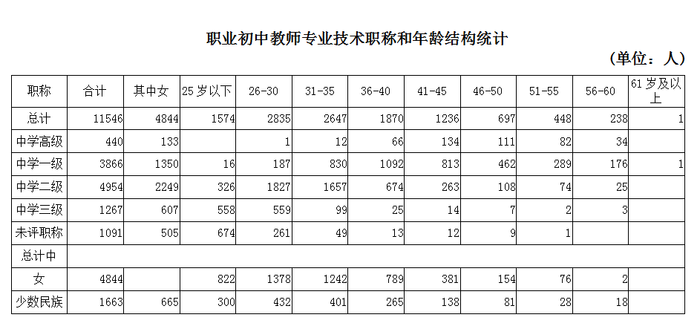

| 职称 | 合计 | 其中女 | 25岁以下 | 26-30 | 31-35 | 36-40 | 41-45 | 46-50 | 51-55 | 56-60 | 61岁及以上 |
| --- | ---: | ---: | ---: | ---: | ---: | ---: | ---: | ---: | ---: | ---: | ---: |
| 总计 | 11546 | 4844 | 1574 | 2835 | 2647 | 1870 | 1236 | 697 | 448 | 238 | 1 |
| 中学高级 | 440 | 133 |  | 1 | 12 | 66 | 134 | 111 | 82 | 34 |  |
| 中学一级 | 3866 | 1350 | 16 | 187 | 830 | 1092 | 813 | 462 | 289 | 176 | 1 |
| 中学二级 | 4954 | 2249 | 326 | 1827 | 1657 | 674 | 263 | 108 | 74 | 25 |  |
| 中学三级 | 1267 | 607 | 558 | 559 | 99 | 25 | 14 | 7 | 2 | 3 |  |
| 未评职称 | 1091 | 505 | 674 | 261 | 49 | 13 | 12 | 9 | 1 |  |  |
| 总计中 |  |  |  |  |  |  |  |  |  |  |  |
| 女 | 4844 |  | 822 | 1378 | 1242 | 789 | 381 | 154 | 76 | 2 |  |
| 少数民族 | 1663 | 665 | 300 | 432 | 401 | 265 | 138 | 81 | 28 | 18 |  |

### 第 141 题

职称为中学二级的男教师占职业初中全体教师总数的比例约为：

A. 38.7%

B. 42.3%

C. 22.9%

D. 23.4%

第 141 题 · 答案与解析

**参考答案（粉笔题库参考内容）**

D

**解析**

根据题干“职称为中学二级的男教师占职业初中全体教师总数的比例约为”，结合问的是现期时间，可判定本题为现期比重问题。定位统计表可得：职业初中全体教师总数为11546人，职称为中学二级的总人数为4954人，其中女生2249人。因此职称为中学二级的男教师为4954-2249=2705人，职称为中学二级的男教师占职业初中全体教师总数的比例为2705/11546 ≈ 2705/11500≈23.5%，与D项最接近。

故正确答案为D。

**来源**：2008年江苏省公务员录用考试《行测》题（B类）第141题

### 第 142 题

36岁以下（不含36岁）取得中学一级及其以上职称的男女教师比例约为：

A. 125.12%

B. 123.56%

C. 117.45%

D. 无法计算

第 142 题 · 答案与解析

**参考答案（粉笔题库参考内容）**

D

**解析**

由表可知，各年龄段给出的是该职称的总人数，男女教师比例没有给出，故无法计算。

故正确答案为D。

**来源**：2008年江苏省公务员录用考试《行测》题（B类）第142题

### 第 143 题

未评职称者中男女教师比例约为：

A. 101.78%

B. 112.34%

C. 115.67%

D. 108.24%

第 143 题 · 答案与解析

**参考答案（粉笔题库参考内容）**

C

**解析**

根据题干“未评职称者中男女教师比例约为”，可判定本题为比值计算问题。定位统计表可得：未评职称总人数为1091人，其中女生505人，则未评职称者中男生为1091-505=586人，未评职称者中男女教师比例为586/505 ≈ 1.16=116%，与C项最接近。

故正确答案为C。

**来源**：2008年江苏省公务员录用考试《行测》题（B类）第143题

### 第 144 题

中学三级职称中各年龄段人数占该级职称总人数的最高比例和最低比例相差约：

A. 29.88%

B. 43.96%

C. 33.49%

D. 22.57%

第 144 题 · 答案与解析

**参考答案（粉笔题库参考内容）**

B

**解析**

根据题干“中学三级职称中各年龄段人数占该级职称总人数的最高比例和最低比例”，结合问的时间是现期时间，可判定本题为现期比重问题。定位统计表可得，中学三级职称总人数为1267人，各年龄段中人数最多的是559人（26-30岁），人数最少的是2人（51-55岁）。则中学三级职称中各年龄段人数占该级职称总人数的最高比例和最低比例相差(559-2)/1267 = 557/1267≈557/1300≈43%，与B项最为接近。

故正确答案为B。

**来源**：2008年江苏省公务员录用考试《行测》题（B类）第144题

### 第 145 题

由表中可能得出的判断是：

A. 获得中学高级职称者主要集中在50岁以上的年龄段

B. 在职业初中教育中中学一级和二级教师是最主要的教学力量

C. 在职业初中教育中女教师虽然数量少，但重要性超过男教师

D. 少数民族教师只承担与少数民族事务相关的教育

第 145 题 · 答案与解析

**参考答案（粉笔题库参考内容）**

B

**解析**

A项错误：定位统计表可得，获得中学高级职称者主要集中在41-45岁的年龄段，为134人，排除；

B项正确：定位统计表可得，职业初中教师人数为11546人，其中中学一级教师人数为3866人，二级教师人数为4954人，则职业初中教育中中学一级和二级教师总数为3866+4954=8820人，中学一级和二级教师人数占职业初中教师人数的比重为8820/11546＞50%，说明是主要教学力量，当选；

C项错误：定位统计表可得，表格中未体现职业初中教育中教师性别的重要性数据，因此职业初中教育中教师性别的重要性无法从表中得出，排除；

D项错误：定位统计表可得，表格中未体现少数民族教师从事教育范围，因此无法推出，排除。

故正确答案为B。

**来源**：2008年江苏省公务员录用考试《行测》题（B类）第145题

## 材料 6

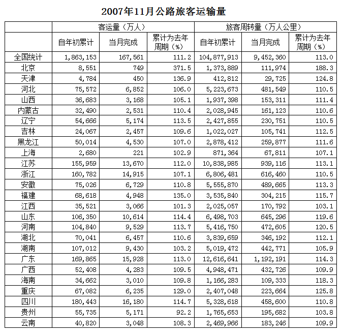

|  | 客运量（万人） 自年初累计 | 客运量（万人） 当月完成 | 客运量（万人） 累计为去年周期（%） | 旅客周转量（万人公里） 自年初累计 | 旅客周转量（万人公里） 当月完成 | 旅客周转量（万人公里） 累计为去年周期（%） |
| --- | ---: | ---: | ---: | ---: | ---: | ---: |
| 全国统计 | 1,863,153 | 167,561 | 111.2 | 104,877,913 | 9,452,360 | 113.0 |
| 北京 | 8,551 | 749 | 371.5 | 1,373,889 | 111,974 | 188.3 |
| 天津 | 4,784 | 450 | 136.9 | 412,812 | 29,725 | 124.8 |
| 河北 | 75,572 | 6,852 | 106.0 | 5,223,673 | 481,549 | 110.5 |
| 山西 | 36,683 | 3,168 | 105.1 | 1,937,398 | 153,311 | 111.4 |
| 内蒙古 | 32,490 | 2,531 | 110.4 | 2,028,945 | 161,123 | 110.6 |
| 辽宁 | 54,666 | 5,174 | 113.5 | 2,427,855 | 230,751 | 110.5 |
| 吉林 | 24,067 | 2,457 | 109.6 | 1,022,027 | 105,741 | 112.5 |
| 黑龙江 | 50,014 | 4,530 | 107.0 | 2,878,412 | 259,877 | 111.6 |
| 上海 | 2,680 | 221 | 102.9 | 871,364 | 67,811 | 107.1 |
| 江苏 | 155,959 | 13,670 | 112.0 | 10,838,985 | 939,116 | 113.1 |
| 浙江 | 160,782 | 14,915 | 107.1 | 6,806,481 | 616,460 | 110.5 |
| 安徽 | 75,026 | 6,729 | 110.8 | 5,555,870 | 489,665 | 113.3 |
| 福建 | 68,618 | 4,948 | 135.0 | 3,535,840 | 304,215 | 115.7 |
| 江西 | 35,521 | 3,066 | 101.3 | 2,025,057 | 170,792 | 103.1 |
| 山东 | 106,350 | 10,614 | 114.4 | 6,498,703 | 645,296 | 119.6 |
| 河南 | 104,840 | 9,529 | 113.7 | 5,416,750 | 472,605 | 120.5 |
| 湖北 | 70,041 | 6,457 | 110.6 | 3,839,659 | 346,192 | 112.1 |
| 湖南 | 107,012 | 9,430 | 103.2 | 5,019,472 | 442,771 | 105.9 |
| 广东 | 169,865 | 15,928 | 113.0 | 12,616,641 | 1,192,191 | 114.3 |
| 广西 | 52,408 | 4,283 | 109.5 | 4,948,471 | 432,726 | 109.9 |
| 海南 | 34,662 | 3,010 | 109.8 | 1,166,283 | 109,333 | 118.3 |
| 重庆 | 67,082 | 6,235 | 129.0 | 2,407,048 | 223,664 | 125.8 |
| 四川 | 180,443 | 16,180 | 114.7 | 5,328,618 | 458,600 | 110.8 |
| 贵州 | 55,735 | 5,171 | 92.2 | 1,765,653 | 195,682 | 103.8 |
| 云南 | 40,820 | 3,048 | 108.3 | 2,469,966 | 183,246 | 109.9 |

### 第 146 题

当月客运量超过当月全国总客运量8%的省（区、市）有：

A. 4个

B. 5个

C. 3个

D. 6个

第 146 题 · 答案与解析

**参考答案（粉笔题库参考内容）**

A

**解析**

根据题干“当月客运量超过当月全国总客运量8%的省（区、市）有”，可判定本题为现期比重问题。定位统计表可得，2007年11月，公路旅客客运量全国总计为167561万人，因此全国总客运量的8%为167561×8%=13404.88万人。观察统计表，发现当月客运量超过当月全国总客运量8%的有江苏（13760万人）、浙江（14915万人）、广东（15928万人）、四川（16180万人），共4个。

故正确答案为A。

**来源**：2008年江苏省公务员录用考试《行测》题（B类）第146题

### 第 147 题

华东地区自年初累计旅客周转量最大省份的当月旅客周转量比东北地区自年初累计旅客周转量最大省份的当月旅客周转量多：

A. 95.32%

B. 261.37%

C. 121.58%

D. 48.52%

第 147 题 · 答案与解析

**参考答案（粉笔题库参考内容）**

B

**解析**

根据题干“华东地区自年初累计旅客周转量最大省份的当月旅客周转量比东北地区自年初累计旅客周转量最大省份的当月旅客周转量多”，结合选项为百分数，可判定本题为一般增长率问题。华东地区包括山东、江苏、安徽、浙江、江西、福建和上海。东北地区包括黑龙江、吉林、辽宁和内蒙古自治区。定位统计表可得，华东地区自年初累计旅客周转量最大的省份是江苏，当月旅客周转量为939116万人；东北地区自年初累计旅客周转量最大的省份是黑龙江，当月旅客周转量为259877万人。增长率= (现期量−基期量)/基期量=(939116−259877)/259877，与B项最为接近。

故正确答案为B。

**来源**：2008年江苏省公务员录用考试《行测》题（B类）第147题

### 第 148 题

从上表中可以看出：

A. 当月客运量最大的省（区、市）其当月旅客周转量相应也最大

B. 沿海各省份比内陆各省份自年初的累计客运量要高

C. 客运量越大则说明该地经济越发达

D. 以上答案都不对

第 148 题 · 答案与解析

**参考答案（粉笔题库参考内容）**

D

**解析**

A项错误：定位统计表可得，四川的当月客运量最大，为16180万人，其当月旅客周转量为458600万人公里，明显少于广东，排除；

B项错误：定位统计表可得，浙江自年初的累计客运量为160782万人，广东自年初的累计客运量为169865万人，四川自年初的累计客运量为180443万人，说明浙江、广东等沿海省份自年初的累计客运量要少于四川，排除；

C项错误：定位统计表可得，四川的当月客运量最大，为16180万人，但不是最发达的地区，说法过于绝对，排除；

D项：A、B、C三项均错误，因此以上答案都不对，当选。

故正确答案为D。

**来源**：2008年江苏省公务员录用考试《行测》题（B类）第148题

### 第 149 题

北京市和上海市2006年1月至11月的累计客运量之比为：

A. 53.6%

B. 361.1%

C. 88.4%

D. 113.2%

第 149 题 · 答案与解析

**参考答案（粉笔题库参考内容）**

C

**解析**

根据题干“北京市和上海市2006年1月至11月的累计客运量之比为”，可判定本题为比值计算问题。定位统计表，北京市2007年1～11月累计客运量为8551万人，累计为去年同期371.5%，则北京市2006年1～11月累计客运量为8551/371.5%；上海市2007年1～11月累计客运量为2680万人，累计为去年同期102.9%，则上海市2006年1～11月累计客运量为2680/102.9%。 北京市和上海市2006年1月至11月的累计客运量之比为8551/371.5%÷2680/102.9%= 8551/3.715 × 1.029/2680≈ 8551/4 × 1/2680≈2138/2680≈80%，与C项最为接近。

故正确答案为C。

**来源**：2008年江苏省公务员录用考试《行测》题（B类）第149题

### 第 150 题

下列省、市中，2007年11月客运量占当月旅客周转量比例最小的是：

A. 天津

B. 江苏

C. 湖北

D. 黑龙江

第 150 题 · 答案与解析

**参考答案（粉笔题库参考内容）**

B

**解析**

根据题干“下列省、市中，2007年11月客运量占当月旅客周转量比例最小的是”，结合问题时间与材料时间一致，可判定本题为现期比重问题。定位统计表，可得2007年11月天津客运量占当月旅客周转量比例为450/29725≈450/29700≈1.5%；2007年11月江苏客运量占当月旅客周转量比例为13670/939116 ≈ 13670/939000 ≈ 1.5%^-；2007年11月湖北客运量占当月旅客周转量比例为6457/346192≈6457/346000≈1.9%；2007年11月黑龙江客运量占当月旅客周转量比例为4530/259877 ≈ 4530/260000 ≈ 1.7%。因此比例最小的是江苏省。

故正确答案为B。

**来源**：2008年江苏省公务员录用考试《行测》题（B类）第150题

## 材料 7

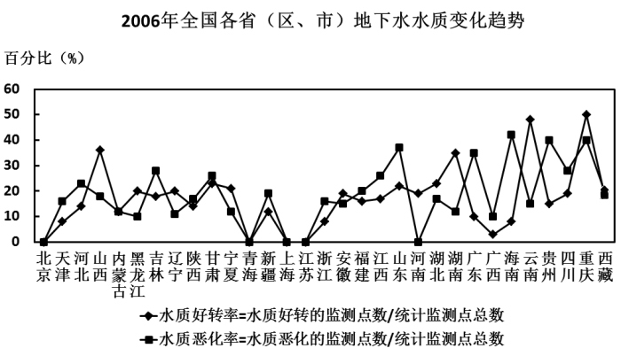

### 第 151 题

由上图可看出，2006年水质没有变化的省（区、市）有：

A. 2个

B. 5个

C. 4个

D. 6个

第 151 题 · 答案与解析

**参考答案（粉笔题库参考内容）**

C

**解析**

水质没有变化就是水质好转和恶化的监测点数都是0，即水质好转率和恶化率都是0，从图上最下端看，两条线都与横轴相交的是北京、青海、上海和江苏四个省（区、市）。

故正确答案为C。

**来源**：2008年江苏省公务员录用考试《行测》题（B类）第151题

### 第 152 题

上图中，2006年水质恶化的监测点多于水质好转的监测点的省（区、市）有：

A. 18个

B. 19个

C. 12个

D. 15个

第 152 题 · 答案与解析

**参考答案（粉笔题库参考内容）**

D

**解析**

水质恶化监测点多于水质好转检测点说明水质恶化率大于水质好转率，从图上看，水质恶化曲线在水质好转曲线上面的是天津、河北、吉林、陕西、甘肃、新疆、浙江、福建、江西、山东、广东、广西、海南、贵州和四川，共15个省。

故正确答案为D。

**来源**：2008年江苏省公务员录用考试《行测》题（B类）第152题

### 第 153 题

下列省（区、市）中水质恶化率与好转率之比约为30%的是：

A. 山西

B. 广东

C. 云南

D. 重庆

第 153 题 · 答案与解析

**参考答案（粉笔题库参考内容）**

C

**解析**

根据题干“下列省（区、市）中水质恶化率与好转率之比约为30%的是”，可判定本题为比值计算问题。定位统计图，A项山西省水质恶化率与好转率之比约20%/40% = 50%；B项广东省水质恶化率与好转率之比约40%/10%=4；C项云南省水质恶化率与好转率之比约15%/50%=30%；D项重庆水质恶化率与好转率之比约40%/50% = 80%。因此水质恶化率与好转率之比约为30%的是云南。

故正确答案为C。

**来源**：2008年江苏省公务员录用考试《行测》题（B类）第153题

### 第 154 题

下列说法中正确的是：

A. 2006年各直辖市的水质均保持良好

B. 2006年水质恶化率最高的省（区、市），其水质好转率相应最低

C. 总体上2006年全国水质全面好转趋势明显

D. 以上说法都不对

第 154 题 · 答案与解析

**参考答案（粉笔题库参考内容）**

D

**解析**

A项：直辖市为北京、天津、重庆、上海，定位统计图，发现2006年天津水质恶化率高于水质好转率，因此表述绝对，说法错误，排除；

B项：定位统计图，2006年水质恶化率最高的是海南，而海南的水质好转率>0，并非最低，说法错误，排除；

C项：由前面小题知道，全国水质恶化率高于好转率的是15个省，没有变化的是4个省，总共检测的是31个省，所以总体看，全国水质好转趋势不明显，说法错误，排除；

D项：A、B、C三项均说法错误，因此以上说法都不对，当选。

故正确答案为D。

**来源**：2008年江苏省公务员录用考试《行测》题（B类）第154题

### 第 155 题

2006年水质好转率高于30%的省（区、市）份数与水质恶化率低于30%的省（区、市）份数之比为：

A. 4︰11

B. 2︰13

C. 4︰9

D. 2︰5

第 155 题 · 答案与解析

**参考答案（粉笔题库参考内容）**

B

**解析**

根据题干“2006年水质好转率高于30%的省（区、市）份数与水质恶化率低于30%的省（区、市）份数之比为”，可判定本题为比值计算问题。定位统计图，水质好转率高于30%的有山西、湖南、云南、重庆4个地区；水质恶化率高于30%的有山东、广东、海南、贵州、重庆5个地区，则水质恶化率低于30%的有31-5=26个，那么比值是4：26=2：13。

故正确答案为B。

**来源**：2008年江苏省公务员录用考试《行测》题（B类）第155题

