# 2008年江苏省公务员录用考试《行测》题（C类）

<!-- gwy:overview:start -->
> **江苏 · 2008 · 行测 · C类** ｜ 100 题 · 图片 15 处 · 答案随题折叠

| 题型模块 | 题量 | 题号 |
| --- | ---: | ---: |
| 数量关系 | 20 | 1–20 |
| 判断推理 | 45 | 21–65 |
| 言语理解与表达 | 15 | 66–80 |
| 资料分析 | 20 | 81–100 |
| **合计** | **100** | |

导航：[题型与作答说明](#题型与作答说明) · [题目](#题目) · [材料 1](#材料-1)
<!-- gwy:overview:end -->

> 候选采集稿。参考答案及解析来自粉笔页面，不代表官方答案或真实高分答卷；来源使用许可与原卷对应关系仍需人工核实。

## 题型与作答说明

数量关系

（20题）

本部分包括数字推理与数量关系两种类型的试题。

判断推理

（45题）

本部分包括类比推理、图形推理、逻辑判断与定义判断四种类型的试题。

言语理解与表达

（15题）

每道题包含一段文字，要求你从四个选项中选出最恰当的一项。

资料分析

（20题）

所给出的图表或一段文字均有5个问题要你回答，你应根据资料提供的信息进行分析、计算、处理.然后从备选答案中选择一个最恰当的答案。

## 题目

### 第 1 题

11，14，19，26，35，（  ）

A. 39

B. 41

C. 45

D. 46

第 1 题 · 答案与解析

**参考答案（粉笔题库参考内容）**

D

**解析**

观察数列起伏不大，没有明显特征，考虑多级数列，后一项减前一项得到新数列：3，5，7，9，新数列是公差为2的等差数列，下一项为9+2=11，因此所求项-35=11，所求项=35+11=46。

故正确答案为D。

**来源**：2008年江苏省公务员录用考试《行测》题（C类）第1题

### 第 2 题

3，3，6，18，72，（  ）

A. 360

B. 350

C. 288

D. 260

第 2 题 · 答案与解析

**参考答案（粉笔题库参考内容）**

A

**解析**

观察数列存在明显倍数关系，考虑作商，后一项除以前一项得到新数列：1，2，3，4，新数列构成公差为1的等差数列，下一项为4+1=5，因此所求项= 72 × 5 = 360。

故正确答案为A。

**来源**：2008年江苏省公务员录用考试《行测》题（C类）第2题

### 第 3 题

1，3，3，9，27，（  ）

A. 251

B. 243

C. 223

D. 143

第 3 题 · 答案与解析

**参考答案（粉笔题库参考内容）**

B

**解析**

观察数列无明显特征，起伏变化较大，考虑递推数列。观察发现，1×3=3，3×3=9，3 × 9 = 27，即第一项×第二项= 第三项，则所求项 =9×27=243。

故正确答案为B。

**来源**：2008年江苏省公务员录用考试《行测》题（C类）第3题

### 第 4 题

22，24，39，28，（  ），16

A. 14

B. 11

C. 30

D. 15

第 4 题 · 答案与解析

**参考答案（粉笔题库参考内容）**

D

**解析**

观察数列发现，原数列均为两位数，且个位与十位数字均存在明显倍数关系，两两相除可得比值分别为2/2=1，4/2=2，9/3=3，8/2=4，构成公差为1的等差数列，因此所求项个位数字除以十位数字应该为5，只有D项符合。

故正确答案为D。

**来源**：2008年江苏省公务员录用考试《行测》题（C类）第4题

### 第 5 题

176，187，198，253，（  ）

A. 360

B. 361

C. 362

D. 363

第 5 题 · 答案与解析

**参考答案（粉笔题库参考内容）**

D

**解析**

原数列中每一项某一位数上的值可以表示为该数其他两个位数上值的和（例如十位上的值=百位上的值+个位上的值），即176:7=1+6，187：8=1+7，198:9=1+8，253:5=2+3，选项中只有D项363:6=3+3满足条件。

故正确答案为D。

**来源**：2008年江苏省公务员录用考试《行测》题（C类）第5题

### 第 6 题

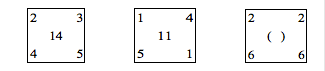

A. 13

B. 15

C. 16

D. 18

第 6 题 · 答案与解析

**参考答案（粉笔题库参考内容）**

C

**解析**

题干中每个数阵中心位置的数等于四个角上数的和，即14=2+3+4+5，11=1+4+5+1，(16)=2+2+6+6。

故正确答案为C。

**来源**：2008年江苏省公务员录用考试《行测》题（C类）第6题

### 第 7 题

1，9，7，27，13，（  ），19，63

A. 25

B. 33

C. 45

D. 54

第 7 题 · 答案与解析

**参考答案（粉笔题库参考内容）**

C

**解析**

数列较长，优先考虑多重数列，交叉看，奇数项：1、7、13、19，是公差为6的等差数列；偶数项：9、27、（  ）、63，猜测是公差为18的等差数列，经验证：27+18=45，45+18=63，符合规律，因此所求项=27+18=45。

故正确答案为C。

**来源**：2008年江苏省公务员录用考试《行测》题（C类）第7题

### 第 8 题

0，8，24，48，80，（  ）

A. 120

B. 116

C. 108

D. 100

第 8 题 · 答案与解析

**参考答案（粉笔题库参考内容）**

A

**解析**

观察数列无明显特征，优先考虑多级数列，后一项减去前一项，得到新数列：8、16、24、32，是公差为8的等差数列，下一项为32+8=40，因此所求项=80+40=120。

故正确答案为A。

**来源**：2008年江苏省公务员录用考试《行测》题（C类）第8题

### 第 9 题

1，3，13，15，27，29，35，（    ）

A. 36

B. 37

C. 38

D. 39

第 9 题 · 答案与解析

**参考答案（粉笔题库参考内容）**

B

**解析**

数列较长，优先考虑多重数列，将原数列两两分组，为（1，3）、（13，15）、（27，29）、（35，？），组内作差，结果均为2，因此所求项-35=2，所求项=35+2=37。

故正确答案为B。

**来源**：2008年江苏省公务员录用考试《行测》题（C类）第9题

### 第 10 题

2，6，15，28，（  ），78

A. 45

B. 48

C. 55

D. 56

第 10 题 · 答案与解析

**参考答案（粉笔题库参考内容）**

C

**解析**

观察发现原数列每个数字均可拆分为两个数乘积，2=1×2，6=2×3，15=3×5，28=4×7，（    ），78=6×13，乘积中前一项分别为1、2、3、4、（    ）、6，为等差数列，因此所求项乘积中前一项为5；乘积中后一项分别为2、3、5、7、（    ）、13，为质数数列，因此所求项乘积中后一项为11。即所求项=5×11=55。

故正确答案为C。

**来源**：2008年江苏省公务员录用考试《行测》题（C类）第10题

### 第 11 题

2008＋2007－2006－2005＋2004＋2003－2002－2001＋······＋4＋3－2－1＝

A. 0

B. 1

C. 2007

D. 2008

第 11 题 · 答案与解析

**参考答案（粉笔题库参考内容）**

D

**解析**

解析1：

2008+2007-2006-2005+2004+2003-2002-2001+……+4+3-2-1中，将每四个数分为一组有(2008+2007-2006-2005)+(2004+2003-2002-2001)+ ...... + (4+3-2-1)= 4 × (2008 ÷ 4) = 2008。

解析2：

2008+2007-2006-2005+2004+2003-2002-2001+……+4+3-2-1=2008+(2007-2006-2005+2004)+(2003-2002-2001+2000)+……+(7-6-5+4)+(3-2-1+0)=2008。

故正确答案为D。

**来源**：2008年江苏省公务员录用考试《行测》题（C类）第11题

### 第 12 题

191919÷373737×185=

A. 95

B. 123

C. 135

D. 151

第 12 题 · 答案与解析

**参考答案（粉笔题库参考内容）**

A

**解析**

解析1：

191919÷373737×185=191919×185÷373737，结果的尾数只能是5，因此从A、C两项中选择，直接代入95，通过几次消去公约数判断191919 × 185 = 373737 × 95是否成立即可。

解析2：

191919 ÷ 373737 × 185 =(19×10101)÷(37×10101)×185= 19 × (185 ÷ 37) = 19 × 5 = 95。

故正确答案为A。

**来源**：2008年江苏省公务员录用考试《行测》题（C类）第12题

### 第 13 题

已知正整数数列{a_n}满足a(n+2) = a(n+1) + a(n)，且第七项等于18，则该数列的第十项为：

A. 47

B. 72

C. 76

D. 123

第 13 题 · 答案与解析

**参考答案（粉笔题库参考内容）**

C

**解析**

a10 = a9 + a8=a8+a7+a7+a6=3a7+2a6，3a_7 + 2a_6 ＜ 5a_7。且3a_7+2a_6=3a_7+a_6+a_5+a_4=4a7+a4＞4a7，所以4a_7＜a_10＜5a_7，即72＜a_10＜90，只有C项符合。

故正确答案为C。

**考点**：数列问题

**来源**：2008年江苏省公务员录用考试《行测》题（C类）第13题

### 第 14 题

一个面积为2π的圆内接长方形的最大面积为：

A. π

B. 3

C. 2

D. 4

第 14 题 · 答案与解析

**参考答案（粉笔题库参考内容）**

D

**解析**

解析1：

因为圆面积S = πr^2 = 2π，所以圆的半径为√2，如下图所示，设圆内接长方形边为a，b，根据圆的性质有a^2 + b^2 = (2r)^2 = 8，2ab ≤ a^2 + b^2 = 8，则长方形面积ab≤4。

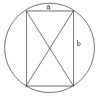

解析2：

代入选项中最大的值4，当圆内接长方形为正方形时，面积为4成立。

故正确答案为D。

**考点**：几何公式类-平面图形、几何结论类-三角形相关、几何结论类-几何小题型

**来源**：2008年江苏省公务员录用考试《行测》题（C类）第14题

### 第 15 题

两棵柳树相隔165米，中间原本没有任何树，现在这两棵树中间等距种植32棵桃树，第1棵桃树到第20棵桃树间的距离是：

A. 90

B. 95

C. 100

D. 前面答案都不对

第 15 题 · 答案与解析

**参考答案（粉笔题库参考内容）**

B

**解析**

在相隔165米的两棵柳树中间等距种植32棵桃树后，每两棵桃树的间隔为165 ÷ (32 + 1) = 5米，所以第1棵桃树与第20棵桃树之间的间隔为5×(20−1) = 95米。

故正确答案为B。

**来源**：2008年江苏省公务员录用考试《行测》题（C类）第15题

### 第 16 题

如果股票P和Q每股均分别上涨6%和5%，则P股长了0.36元，Q股涨了1.05元，那么两种股票在涨价前的差价是多少元？

A. 21

B. 19

C. 17

D. 15

第 16 题 · 答案与解析

**参考答案（粉笔题库参考内容）**

D

**解析**

根据利润率公式：利润率=利润/进价，可得进价=利润/利润率，那么股票P涨价前为0.36/6%=6元，股票Q涨价前为1.05/5% = 21元，因此两种股票在涨价前的差价是21-6=15元。

故正确答案为D。

**考点**：经济利润问题

**来源**：2008年江苏省公务员录用考试《行测》题（C类）第16题

### 第 17 题

两列对开的列车相遇，第一列车的速度为12米/秒，第二列车的速度为14米/秒，第二列车上的一旅客发现第一列车从旁边开过的时间为5秒，则第一列车的车长为多少米？

A. 6

B. 75

C. 80

D. 130

第 17 题 · 答案与解析

**参考答案（粉笔题库参考内容）**

D

**解析**

根据题意，第一列车的长度为两列车在5秒内走过的长度之和，所以5 × (12 + 14) = 130米。

故正确答案为D。

**考点**：相遇追及

**来源**：2008年江苏省公务员录用考试《行测》题（C类）第17题

### 第 18 题

A、B两位同学参加同一次竞赛考试，如果A答对的题目占题目总数的3/4，B答对了25道题，他们两人都答对的题目占题目总数的2/3，那么两人都没有答对的题目共有：

A. 5道

B. 6道

C. 7道

D. 8道

第 18 题 · 答案与解析

**参考答案（粉笔题库参考内容）**

D

**解析**

设题目总数为12x，都没有答对的题目数为y，那么A答对的题目数为3/4×12x=9x，两人都答对的题目数为2/3 × 12x = 8x，根据两集合容斥原理公式：9x+25-8x=12x-y，整理为y=11x-25，由于y≥0，则x>2。当取x=3时，解得y=8。

故正确答案为D。

**考点**：两集合

**来源**：2008年江苏省公务员录用考试《行测》题（C类）第18题

### 第 19 题

在春运高峰时，某客运中心售票大厅站满等待买票的旅客，为保证售票大厅的旅客安全，大厅入口处旅客排队以等速度进入大厅按次序等待买票，买好票的旅客及时离开大厅。按照这种安排，如果开出10个售票窗口，5小时可使大厅内所有旅客买到票；如果开12个售票窗口，3小时可使大厅内所有旅客买到票，假设每个窗口售票速度相同。由于售票大厅入口处旅客速度增加到原速度的1.5倍，在2小时内使大厅中所有旅客买到票，按这样的安排至少应开售票窗口数为（  ）。

A. 15

B. 16

C. 18

D. 19

第 19 题 · 答案与解析

**参考答案（粉笔题库参考内容）**

C

**解析**

本题属于牛吃草问题。假设原有旅客为N，每小时增加旅客m，则根据已知有N = (10 - m) × 5，N = (12 - m) × 3，解得：N=15，m=7。设入口处旅客速度增加后至少需要n个窗口，则有15 = (n − 1.5 × 7) × 2，解得：n=18。

故正确答案为C。

**来源**：2008年江苏省公务员录用考试《行测》题（C类）第19题

### 第 20 题

从某车站以加速度为1/18 m/s^2始发的甲列车出发9分钟后，恰好有一列与甲列车同方向，并以50m/s做匀速运动的乙车通过该车站，则乙车运行多少分钟与甲车距离为最近？

A. 9

B. 3

C. 5

D. 6

第 20 题 · 答案与解析

**参考答案（粉笔题库参考内容）**

D

**解析**

解析1：

根据物理常识，当乙车速度比甲车快时，距离甲车将越来越近，当乙车速度比甲车慢时，距离甲车将越来越远，所以当乙车速度等于甲车速度时，两车距离最小，设经过t秒两车速度相等，则有1/18 (9 × 60 + t) = 50，解得t=360秒=6分钟。

解析2：

设乙车经过t秒后距离甲车为S，此时甲车行驶距离为1/2×1/18×(9×60+t)^2，乙车行驶距离为50×t，所以S=1/2×1/18×(9×60+t)^2-50×t= 1/36 t^2 − 20t + A(A为常数)，所以t = 20/(2 × (1/36)) = 360时S有最小值，360 ÷ 60 = 6分钟。

故正确答案为D。

**考点**：函数最值问题、普通行程

**来源**：2008年江苏省公务员录用考试《行测》题（C类）第20题

### 第 21 题

床铺：客房

A. 机票：机场

B. 聪明：智商

C. 课桌：教室

D. 汽车：驾驶员

第 21 题 · 答案与解析

**参考答案（粉笔题库参考内容）**

C

**解析**

第一步：判断题干词语间逻辑关系。

题干两个词属于包容关系，客房有床铺，床铺是客房的一个组成部分。

第二步：判断选项词语间逻辑关系。

A项，机场出售机票，但机票不是机场的实体组成部分，与题干不符。

B项，聪明是智商高的一种表现，两者是对应关系，与题干不符。

C项，两个词之间为包容关系，教室有课桌，课桌是教室的一个组成部分，与题干相符。

D项，驾驶员驾驶汽车，两者是对应关系，与题干不符。

故正确答案为C。

**考点**：逻辑关系-包容关系

**来源**：2008年江苏省公务员录用考试《行测》题（C类）第21题

### 第 22 题

轿车：汽车

A. 植物：水果

B. 民法：法律

C. 医院：护士

D. 行政法：环境法

第 22 题 · 答案与解析

**参考答案（粉笔题库参考内容）**

B

**解析**

第一步：判断题干词语间逻辑关系。

题干词语是包容关系中的种属关系。“轿车”是“汽车”的一种，前者属于后者。

第二步：判断选项词语间逻辑关系。

A项：两词顺序与题干相反；

B项：两词是种属关系，“民法”是“法律”的一种，前者属于后者；

C项：“医院”和“护士”是地点和人物的对应关系；

D项：“行政法”和“环境法”都是法律，二者不是种属关系。

故正确答案为B。

**考点**：逻辑关系-包容关系

**来源**：2008年江苏省公务员录用考试《行测》题（C类）第22题

### 第 23 题

愉快：快活

A. 信任：信息

B. 严肃：严谨

C. 真诚：诚实

D. 闲聊：休闲

第 23 题 · 答案与解析

**参考答案（粉笔题库参考内容）**

C

**解析**

第一步：判断题干词语间逻辑关系。

题干中“愉快”和“快活”是一对近义词。

第二步：判断选项词语间逻辑关系。

A项：“信任”指可信赖，“信息”指传播的内容，二者不是近义词，排除；

B项：“严谨”指做事细心，“严肃”是指气氛和人的表情使人感到敬畏，二者不是近义词，排除；

C项：“真诚”和“诚实”是近义词，当选；

D项：“休闲”的近义词是悠闲，随意，和“闲聊”不是近义词，排除。

故正确答案为C。

**考点**：语义关系-近义关系

**来源**：2008年江苏省公务员录用考试《行测》题（C类）第23题

### 第 24 题

鲁迅：《祝福》

A. 吴承恩：《西游记》

B. 宋江：《水浒传》

C. 喜儿：《白毛女》

D. 茅盾：《骆驼祥子》

第 24 题 · 答案与解析

**参考答案（粉笔题库参考内容）**

A

**解析**

第一步：判断题干词语间逻辑关系。

题干中“鲁迅”和“《祝福》”是对应关系。“鲁迅”是“《祝福》”的作者。

第二步：判断选项词语间逻辑关系。

A项：“吴承恩”是“《西游记》”的作者，A项正确；

B项：“宋江”是“《水浒传》”中的人物；

C项：“喜儿”是“《白毛女》”中的人物；

D项：“《骆驼祥子》”的作者是老舍。

故正确答案为A。

**考点**：逻辑关系-对应关系

**来源**：2008年江苏省公务员录用考试《行测》题（C类）第24题

### 第 25 题

肥沃：土地

A. 保持：清醒

B. 办事：谨慎

C. 开朗：心情

D. 天气：晴朗

第 25 题 · 答案与解析

**参考答案（粉笔题库参考内容）**

C

**解析**

第一步：判断题干词语间逻辑关系。

肥沃的土地，二者为偏正关系。

第二步：判断选项词语间逻辑关系。

A项：保持清醒，二者为动宾关系，与题干逻辑关系不一致，排除；

B项：谨慎地办事，二者为偏正关系，但二者顺序与题干相反，与题干逻辑关系不一致，排除；

C项：开朗的心情，二者为偏正关系，与题干逻辑关系一致，当选；

D项：晴朗的天气，二者为偏正关系，但二者顺序与题干相反，与题干逻辑关系不一致，排除。

故正确答案为C。

**考点**：语法关系

**来源**：2008年江苏省公务员录用考试《行测》题（C类）第25题

### 第 26 题

红灯 对于 停止 相当于 （    ） 对于 （    ）

A. 伤心 哭泣

B. 歌唱 愉悦

C. 绿灯 能行

D. 微笑 友好

第 26 题 · 答案与解析

**参考答案（粉笔题库参考内容）**

C

**解析**

第一步：判断题干词语间第一重逻辑关系，并在选项中进行选择。

题干中“停止”是“红灯”的隐含的意思，而A项是因果关系，因此排除A项。

第二步：再判断题干词语间第二重逻辑关系，并在选项中进行选择。

“红灯”意味着“停止”，这在交通规则中被特定使用。

B、D两项并非在交通规则中使用，B、D两项不符；

C项中“绿灯”在交通规则中意味着“能行”，C项符合。

故正确答案为C。

**考点**：逻辑关系-对应关系

**来源**：2008年江苏省公务员录用考试《行测》题（C类）第26题

### 第 27 题

（    ） 对于 信箱 相当于 电脑 对于 （    ）

A. 邮件 激光

B. 邮局 硬盘

C. 邮递员 程序员

D. 光缆 光驱

第 27 题 · 答案与解析

**参考答案（粉笔题库参考内容）**

B

**解析**

第一步：逐一代入选项。

A项中前面部分是对应关系，后面部分无明显逻辑关系；

B项中前面部分是包容关系，后面部分是包容关系；

C项中前面部分是对应关系，后面部分是对应关系，但前后部分顺序相反；

D项中前面部分无明显逻辑关系，后面部分是包容关系。

第二步：逻辑关系相同即为答案。

根据第一步可知，逻辑关系完全相同的是B。

故正确答案为B。

**考点**：逻辑关系-包容关系

**来源**：2008年江苏省公务员录用考试《行测》题（C类）第27题

### 第 28 题

慷慨 对于 大方 相当于 （    ） 对于 （    ）

A. 休闲 谈天

B. 抖动 颤栗

C. 神气 豪气

D. 拷贝 复制

第 28 题 · 答案与解析

**参考答案（粉笔题库参考内容）**

D

**解析**

第一步：判断题干词语间逻辑关系。

题干中“慷慨”和“大方”是近义词。

第二步：判断选项词语间逻辑关系。

A项：“休闲”的近义词是悠闲，随意，而非“谈天”；

B项：“抖动”意为物体颤动，“颤栗”意为打哆嗦，二者不是近义词；

C项：“神气”是指得意傲慢的神态，“豪气”是指英雄的气概，C项不正确；

D项：两词是近义词，“拷贝”是“复制”的英译词。

故正确答案为D。

**考点**：语义关系-近义关系

**来源**：2008年江苏省公务员录用考试《行测》题（C类）第28题

### 第 29 题

（    ） 对于 过失 相当于 谦虚 对于 （    ）

A. 功劳 傲慢

B. 错误 内向

C. 失败 愧疚

D. 成就 虚心

第 29 题 · 答案与解析

**参考答案（粉笔题库参考内容）**

A

**解析**

第一步：逐一代入选项。

A项中前面部分是全同关系，构成一对反义词，后面部分是全同关系，构成一对反义词；

B项中前面部分是全同关系，构成一对近义词，后面部分无明显逻辑关系；

C项中前面部分是因果关系，后面部分无明显逻辑关系；

D项中前面部分无明显逻辑关系，后面部分是全同关系，构成一对近义词。

第二步：逻辑关系相同即为答案。

根据第一步可知，逻辑关系完全相同的是A项。

故正确答案为A。

**考点**：语义关系-反义关系

**来源**：2008年江苏省公务员录用考试《行测》题（C类）第29题

### 第 30 题

（    ） 对于 手机 相当于 程序 对于 （    ）

A. 通信 言论

B. 短信 文学

C. 信号 电脑

D. 电脑 文化

第 30 题 · 答案与解析

**参考答案（粉笔题库参考内容）**

C

**解析**

第一步：逐一代入选项。

A项中前面部分是对应关系，后面部分无明显逻辑关系；

B项中前面部分是对应关系，后面部分无明显逻辑关系；

C项中前面部分要使用手机就必须有信号，二者是对应关系，后面部分要使用电脑就必须有程序，二者是对应关系；

D项中前面部分是并列关系，后面部分无明显逻辑关系。

第二步：逻辑关系相同即为答案。

根据第一步可知，逻辑关系完全相同的是C项。

故正确答案为C。

**考点**：逻辑关系-对应关系

**来源**：2008年江苏省公务员录用考试《行测》题（C类）第30题

### 第 31 题

气候：变暖：气温

A. 生存：发展：持续

B. 极冰：融化：水位

C. 保护：环境：生态

D. 温室：气体：臭氧

第 31 题 · 答案与解析

**参考答案（粉笔题库参考内容）**

B

**解析**

第一步：判断题干词语间逻辑关系。

气候变暖为主谓关系，气候变暖导致气温升高，为因果对应关系。

第二步：判断选项词语间逻辑关系。

A项，生存与发展为并列关系，与题干逻辑关系不一致，排除；

B项，极冰融化为主谓关系，极冰融化导致水位升高，为因果对应关系，与题干逻辑关系一致，当选；

C项，保护环境为动宾关系，与题干逻辑关系不一致，排除；

D项，温室气体为偏正关系，与题干逻辑关系不一致，排除。

故正确答案为B。

**考点**：语法关系、逻辑关系-对应关系

**来源**：2008年江苏省公务员录用考试《行测》题（C类）第31题

### 第 32 题

长城：中国：古迹

A. 开发商：银行：金融

B. 教室：学生：专家

C. 茶杯：茶壶：茶叶

D. 大脑：人体：器官

第 32 题 · 答案与解析

**参考答案（粉笔题库参考内容）**

D

**解析**

第一步：判断题干词语间逻辑关系。

长城是中国的组成部分，二者为组成关系；长城是古迹，二者为种属关系。

第二步：判断选项词语间逻辑关系。

A项：开发商不是银行的组成部分，与题干逻辑关系不一致，排除；

B项：教室不是学生的组成部分，与题干逻辑关系不一致，排除；

C项：茶杯不是茶壶的组成部分，与题干逻辑关系不一致，排除；

D项：大脑是人体的组成部分，二者为组成关系，大脑是器官，二者为种属关系，与题干逻辑关系一致，当选。

故正确答案为D。

**考点**：逻辑关系-包容关系

**来源**：2008年江苏省公务员录用考试《行测》题（C类）第32题

### 第 33 题

高尚：卑鄙：德行

A. 谦虚：骄傲：品质

B. 伟大：自豪：美德

C. 平凡：平庸：才华

D. 有才：有德：人才

第 33 题 · 答案与解析

**参考答案（粉笔题库参考内容）**

A

**解析**

第一步：判断题干词语间第一重逻辑关系，并在选项中进行选择。

题干中“高尚”和“卑鄙”是反义词，符合此逻辑关系的只有A项。

第二步：再判断题干词语间第二重逻辑关系，验证选项。

题干中“高尚”和“卑鄙”都属于“德行”，A项中“谦虚”和“骄傲”都属于“品质”。

故正确答案为A。

**考点**：语义关系-反义关系、逻辑关系-包容关系

**来源**：2008年江苏省公务员录用考试《行测》题（C类）第33题

### 第 34 题

李白：床前明月光：思念

A. 王之涣：白日依山尽：境界

B. 杜甫：青春作伴好还乡：激情

C. 苏东坡：卷起千堆雪：壮观

D. 毛泽东：高峡出平湖：气概

第 34 题 · 答案与解析

**参考答案（粉笔题库参考内容）**

B

**解析**

第一步：判断题干词语间逻辑关系。

题干中“李白”和“床前明月光”是作者与诗句间的对应关系，“床前明月光”和“思念”是诗句与其表达的情感间的对应关系。

第二步：判断选项词语间逻辑关系。

A、B、C、D四项中的前两词都是作者与诗句的对应关系。

A项中“境界”，C项中“壮观”和D项中“气概”都只是对所描写景物的一种观感，而不是表达的情感，所以A、C、D三项中的后两词不是诗句与其表达的情感间的对应关系，A、C、D三项错误；

B项，在《闻官军收复河南河北》中，“青春作伴好还乡”和“激情”是诗句与其表达的情感间的对应关系，正确。

故正确答案为B。

**考点**：逻辑关系-对应关系

**来源**：2008年江苏省公务员录用考试《行测》题（C类）第34题

### 第 35 题

红色：蓝色：花朵

A. 和平：战争：革命

B. 及格：合格：成就

C. 土地：阳光：原野

D. 物理学：化学：知识

第 35 题 · 答案与解析

**参考答案（粉笔题库参考内容）**

D

**解析**

第一步：判断题干词语间第一重逻辑关系，并在选项中进行选择。

题干中“红色”和“蓝色”是并列关系中的反对关系，符合此逻辑关系的只有D项。A项中“和平”和“战争”是矛盾关系；B项中“及格”和“合格”是近义词；C项中“土地”和“阳光”无直接逻辑关系。

第二步：再判断题干词语间第二重逻辑关系，验证选项。

“红色”“蓝色”和“花朵”是颜色和事物间的对应关系，D项中“物理学”“化学”和“知识”是学科和认识成果间的对应关系。

故正确答案为D。

**考点**：逻辑关系-对应关系、逻辑关系-并列关系

**来源**：2008年江苏省公务员录用考试《行测》题（C类）第35题

### 第 36 题

从所给四个选项中，选择最合适的一个，使之呈现一定的规律性：

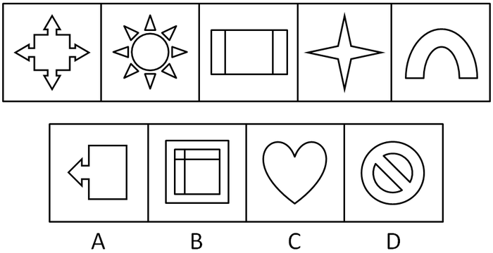

A. A

B. B

C. C

D. D

第 36 题 · 答案与解析

**参考答案（粉笔题库参考内容）**

C

**解析**

元素组成凌乱，先考虑属性。

题干中各幅图都以垂直的竖线为对称轴。

故正确答案为C。

**考点**：属性规律-对称性

**来源**：2008年江苏省公务员录用考试《行测》题（C类）第36题

### 第 37 题

从所给四个选项中，选择最合适的一个，使之呈现一定的规律性：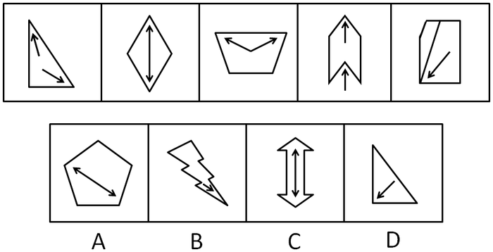

A. A

B. B

C. C

D. D

第 37 题 · 答案与解析

**参考答案（粉笔题库参考内容）**

B

**解析**

题干元素组成不相同且不相似，属性和数量均无规律。观察发现，题干每幅图都出现了箭头，考虑功能元素中箭头的指向。再次观察发现，题干各幅图中的箭头都指向锐角，只有B项符合。

故正确答案为B。

**考点**：特殊规律-功能元素

**来源**：2008年江苏省公务员录用考试《行测》题（C类）第37题

### 第 38 题

从所给四个选项中，选择最合适的一个，使之呈现一定的规律性：

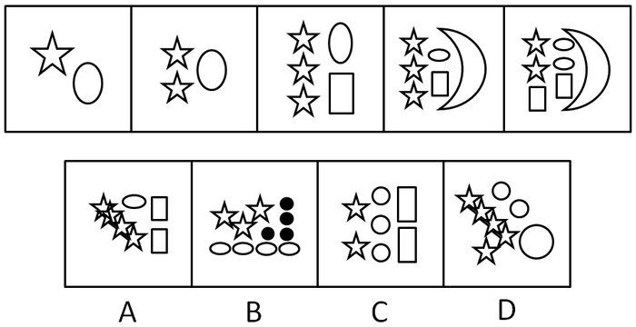

A. A

B. B

C. C

D. D

第 38 题 · 答案与解析

**参考答案（粉笔题库参考内容）**

C

**解析**

元素组成不同，且图形出现多个小元素，优先考虑数素，但元素的种类和数量无规律，而选项又只出现三种元素，考虑元素换算。整体观察发现，元素的数目是在增多，再仔细比对，图1到图2增加了1个☆，图2到图3增加了1个☆和1个□，图3到图4增加了1个☽，图4到图5增加了1个□和1个⚪，减少了1个☆。据此推测图形整体等量增加，且1个⚪=2个☆，1个□=0个☆，1个☽=1个☆。则元素换算完后，题干各图中的☆数量依次为3、4、5、6、7，则需要选择一个元素换算后为8个☆的图形，只有C项符合。

故正确答案为C。

**考点**：数量规律-素

**来源**：2008年江苏省公务员录用考试《行测》题（C类）第38题

### 第 39 题

从所给四个选项中，选择最合适的一个，使之呈现一定的规律性：

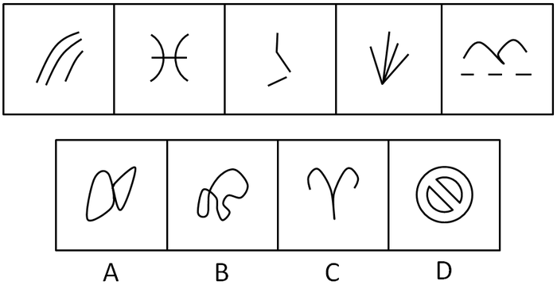

A. A

B. B

C. C

D. D

第 39 题 · 答案与解析

**参考答案（粉笔题库参考内容）**

C

**解析**

题干中各幅图都是开放图形。

故正确答案为C。

**考点**：属性规律-开闭性

**来源**：2008年江苏省公务员录用考试《行测》题（C类）第39题

### 第 40 题

从所给四个选项中，选择最合适的一个，使之呈现一定的规律性：

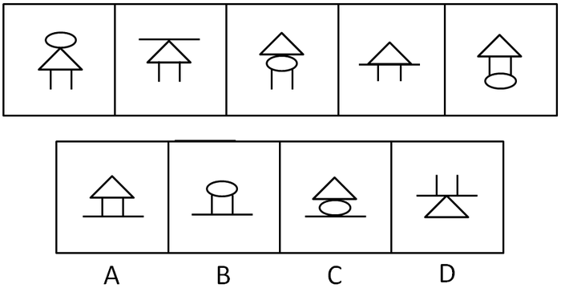

A. A

B. B

C. C

D. D

第 40 题 · 答案与解析

**参考答案（粉笔题库参考内容）**

A

**解析**

间隔图形元素组成相同，考查位置规律。

题干中奇数项图内圆的位置依次向下移动，偶数项图内横线的位置也依次向下移动。

故正确答案为A。

**考点**：位置规律-平移

**来源**：2008年江苏省公务员录用考试《行测》题（C类）第40题

### 第 41 题

从所给四个选项中，选择最合适的一个填入问号处，使之呈现一定的规律性：

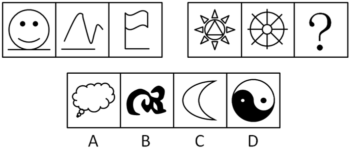

A. A

B. B

C. C

D. D

第 41 题 · 答案与解析

**参考答案（粉笔题库参考内容）**

D

**解析**

单元素周遍。

第一组图中三幅图拥有共同的元素是横线，第二组图中三幅图拥有共同的元素是圆。

故正确答案为D。

**考点**：数量规律-素、样式规律-遍历

**来源**：2008年江苏省公务员录用考试《行测》题（C类）第41题

### 第 42 题

从所给四个选项中，选择最合适的一个填入问号处，使之呈现一定的规律性：

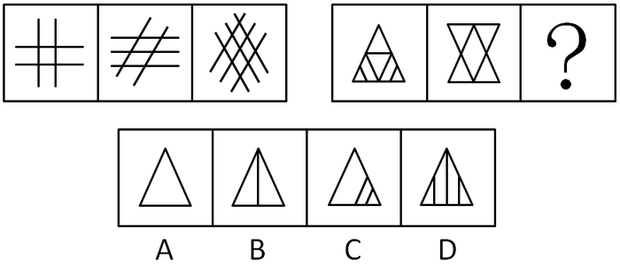

A. A

B. B

C. C

D. D

第 42 题 · 答案与解析

**参考答案（粉笔题库参考内容）**

B

**解析**

元素组成凌乱，考数数。

第一组图中三幅图的线条数依次为4，5，6，第二组图中三幅图的线条数依次为8，6，（4），选项线条数依次为3、4、5、6。

故正确答案为B。

**考点**：数量规律-线

**来源**：2008年江苏省公务员录用考试《行测》题（C类）第42题

### 第 43 题

从所给四个选项中，选择最合适的一个填入问号处，使之呈现一定的规律性：

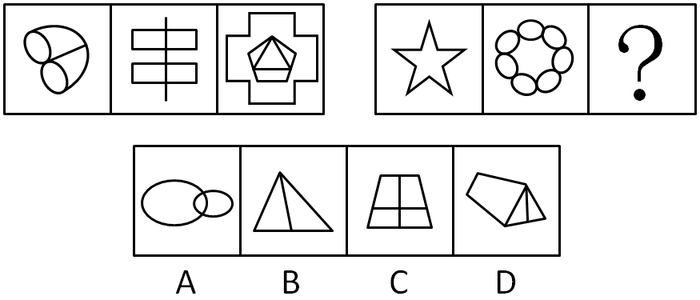

A. A

B. B

C. C

D. D

第 43 题 · 答案与解析

**参考答案（粉笔题库参考内容）**

C

**解析**

元素组成凌乱，考数数。

第一组图形中，三幅图内的封闭空间数分别为4、4、5，和为13。第二组图形中，前两幅图的封闭空间数分别为1、8，和为9，应再选择一个有4个封闭空间的图形，使三者和为13，与前一组图形规律相同，选项中的封闭区间为3、2、4、3。

故正确答案为C。

**考点**：数量规律-面

**来源**：2008年江苏省公务员录用考试《行测》题（C类）第43题

### 第 44 题

从所给四个选项中，选择最合适的一个填入问号处，使之呈现一定的规律性：

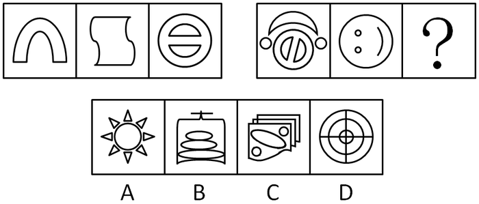

A. A

B. B

C. C

D. D

第 44 题 · 答案与解析

**参考答案（粉笔题库参考内容）**

D

**解析**

部分元素周遍。

第一组图中的三幅图都有共同的元素（两条直线），第二组图中的三幅图都有共同的元素（三个圆）。

故正确答案为D。

**考点**：数量规律-素、样式规律-遍历

**来源**：2008年江苏省公务员录用考试《行测》题（C类）第44题

### 第 45 题

从所给四个选项中，选择最合适的一个填入问号处，使之呈现一定的规律性：

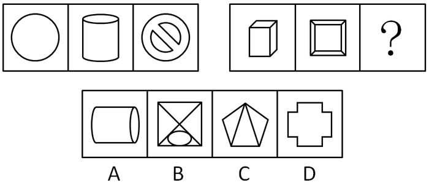

A. A

B. B

C. C

D. D

第 45 题 · 答案与解析

**参考答案（粉笔题库参考内容）**

B

**解析**

元素组成凌乱，考数数。

数封闭空间，第一组中的三幅图分别有1、2、3个封闭空间，第二组的三幅图分别有3，5，（7）个封闭空间。

故正确答案为B。

**考点**：数量规律-面

**来源**：2008年江苏省公务员录用考试《行测》题（C类）第45题

### 第 46 题

所有电力公司职工都参加了抗雪救灾工作，某部武警官兵也参加了抗雪救灾工作。该部武警官兵强化了冬季军事训练。铁路部门的工作人员大多没有参加冬季军事训练，但都参加了抗雪救灾工作。

据此，下列各项判断除了哪项其余必然为真？

A. 有的参加了抗雪救灾工作的人员是电力公司职工

B. 某部武警官兵既参加抗雪救灾工作又强化冬季军事训练

C. 有的铁路部门的工作人员参加了冬季军事训练

D. 有的铁路部门的工作人员参加了抗雪救灾工作

第 46 题 · 答案与解析

**参考答案（粉笔题库参考内容）**

C

**解析**

第一步：翻译题干。

第一句：电力职工→参加救灾。

第二句：某部官兵→参加救灾 且 强化训练。

第三句：大多铁路工作人员→未参加强化训练；所有铁路工作人员→参加救灾。

第二步：利用题干，判断各个选项正确与否。

由第一、二、三句可知参加救灾的人群有“所有电力公司职工”，“某部所有官兵”和“所有铁路部门工作人员”，A项正确；

由第二句可知“某部官兵既参加救灾又强化训练”，B项正确；

第三句中“大多铁路工作人员未参加训练”包括没有人参加训练这一情况，因此C项中“有的参加了训练”这个表述不必然正确，C项错误；

由第三句中“所有铁路部门工作人员都参加救灾”可以推出“有的参加救灾”，D项正确。

本题为选非题，故正确答案为C。

**考点**：集合推理

**来源**：2008年江苏省公务员录用考试《行测》题（C类）第46题

### 第 47 题

有人断言：“近日股市可能会上涨。”

下列哪项判断的意思和该人判断最为相近？

A. 近日股市必然上涨

B. 近日股市必然不上涨

C. 近日股市必然下跌

D. 近日股市不必然不上涨

第 47 题 · 答案与解析

**参考答案（粉笔题库参考内容）**

D

**解析**

第一步：翻译题干。

题干中“可能”等值于“并非必然不”，即“不必然不”。

第二步：逐一判断选项。

题干中的模态词是“可能”，而A、B两项中模态词都是“必然”，“可能”和“必然”意思不相近，所以A、B两项错误；

题干表述了股市上涨的可能性，而C项表述下跌，所以C项错误；

由第一步可知，D项中“不必然不”就等值于“可能”，因此D项的含义等值于“近日股市可能会上涨”，所以D项正确。

故正确答案为D。

**来源**：2008年江苏省公务员录用考试《行测》题（C类）第47题

### 第 48 题

小李对小夏说：“你只有既加强锻炼又多吃保健产品，才能保持身体健康。”小夏说：“你这个观点我不同意。”下列哪项判断是小夏所同意的观点？

A. 能保持身体健康；但如果加强锻炼，就不多吃保健产品

B. 能保持身体健康；但如果不多吃保健产品，就加强锻炼

C. 能保持身体健康；但既不加强锻炼，又不多吃保健产品

D. 能保持身体健康；但既加强锻炼，又多吃保健产品

第 48 题 · 答案与解析

**参考答案（粉笔题库参考内容）**

A

**解析**

第一步：翻译题干。

本题涉及到假言命题的负判断，P→Q的负判断是P 且 -Q。

首先翻译：只有······才······翻译方法：后→前。

①身体健康→（加强锻炼且吃保健品）。

第二步：根据题干信息进行推导。

利用假言命题的负判断，①的负判断为：②身体健康 且 -（加强锻炼且吃保健品），根据-（A 且 B）等价于-A 或 -B，②转化成：③身体健康，并且没有加强锻炼或者没有吃保健品。根据“A 或 B”否定其中一个必然肯定另外一个可得：④身体健康，如果加强锻炼就没有吃保健品；或者，身体健康，如果吃保健品就没有加强锻炼。

第三步：再次标注答案。

故正确答案为A。

**考点**：常规翻译

**来源**：2008年江苏省公务员录用考试《行测》题（C类）第48题

### 第 49 题

所有甲村村民都参加了希望镇镇人大代表选举，有的乙村村民没有参加希望镇镇人大代表选举。据此，下列哪项判断必然为真？

A. 有的乙村村民不是甲村村民

B. 有的乙村村民不是希望镇的选民

C. 有的乙村村民是希望镇的选民

D. 有的乙村村民是甲村村民

第 49 题 · 答案与解析

**参考答案（粉笔题库参考内容）**

A

**解析**

第一步：翻译题干。

①甲村村民→参加选举

②有的乙村村民→没有参加选举

由①可得其逆否命题为：③没有参加选举→不是甲村村民

第二步：推理。

A项，由②③递推可得，有的乙村村民不是甲村村民，该项正确。

B项，没参加选举的可能是缺席的选民，也可能不是选民，因此，“有的乙村村民是否是希望镇的选民”不得而知，该项无法确定。

C项，没参加选举的可能是缺席的选民，也可能不是选民，因此，“有的乙村村民是否是希望镇的选民”不得而知，该项无法确定。

D项，由②③递推可得，有的乙村村民不是甲村村民，是否存在乙村村民是甲村村民不得而知，该项无法确定。

第三步：再次标注答案。

故正确答案为A。

**考点**：集合推理

**来源**：2008年江苏省公务员录用考试《行测》题（C类）第49题

### 第 50 题

赵、钱、孙三人对甲、乙、丙、丁四人的比赛名次进行推测：

赵：“如果乙是第二名，则甲是第一名。”

钱：“如果丙是第三名，则甲是第一名。”

孙：“甲不是第一名。”

比赛结果表明，三人推测中一真两假。

据此，下列哪项判断不可能为真？

A. 甲是第一名

B. 乙是第二名

C. 丙是第三名

D. 丁是第一名

第 50 题 · 答案与解析

**参考答案（粉笔题库参考内容）**

A

**解析**

第一步：观察题干。

本题中赵、钱、孙三人之间不是矛盾关系也不是反对关系，真假难辨时，可采用代入法。

第二步：代入各选项并判断选项正确与否。

代入A项，那么可以推出赵为真，钱为真，孙为假，这和题干中“三人推测中一真两假”不符，错误；

代入B项，那么当丁是第一名，乙是第二名，丙是第三名，甲是第四名时，赵为假，钱为假，孙为真，这和题干中“三人推测中一真两假”相符，正确；

代入C项，那么当丁是第一名，乙是第二名，丙是第三名，甲是第四名时，赵为假，钱为假，孙为真，这和题干中“三人推测中一真两假”相符，正确；

代入D项，那么当丁是第一名，乙是第二名，丙是第三名，甲是第四名时，赵为假，钱为假，孙为真，这和题干中“三人推测中一真两假”相符，正确。

本题为选非题，故正确答案为A。

**考点**：真假推理-其他

**来源**：2008年江苏省公务员录用考试《行测》题（C类）第50题

### 第 51 题

有人说：“这段材料是真的，因为它来自公开出版物。”

假定下列各项判断为真，则下列哪项判断是对该人观点最有力的反驳？

A. 公开出版物上的材料都是真的

B. 有的公开出版物上的材料是真的

C. 有的公开出版物上的材料不是真的

D. 有的真材料并不来自公开出版物

第 51 题 · 答案与解析

**参考答案（粉笔题库参考内容）**

C

**解析**

第一步：找到论点和论据。

本题的论点是“这段材料是真的”，论据是“这段材料来自公开出版物”。题干可翻译为：来自出版物→材料为真。

第二步：逐一判断选项正确与否。

“来自出版物→材料为真”的矛盾命题是“有的公开出版物上的材料不是真的”，即C项。C项削弱了“来自出版物”和“材料为真”推导关系，C项正确。该人的观点隐含着一个大前提“所有来自公开出版物的材料都是真的”；

A、B两项都肯定该人的大前提，A、B两项加强了论证，A、B两项均错误；

题干说“来自公开出版物的材料是否为真”，D项说“真材料是否来自公开出版物”，D项与题干的表述相反，D项错误。

故正确答案为C。

**考点**：拆桥

**来源**：2008年江苏省公务员录用考试《行测》题（C类）第51题

### 第 52 题

某居民违章搭建，严重影响市容。执法人员对他说：“如果你不在规定期限内自行拆除。那么，我们将依法强拆。”该居民回答：“我坚决不同意。”

按照居民的说法，下列哪项判断是他同意的？

A. 在规定期限内自行拆除，不需要执法人员依法强拆

B. 在规定期限内自己坚决不拆，执法人员也不要依法强拆

C. 在规定期限内不自行拆除，等着执法人员依法强拆

D. 违章搭建严重影响市容，不如一拆了之

第 52 题 · 答案与解析

**参考答案（粉笔题库参考内容）**

B

**解析**

第一步：翻译题干，判断选项正确与否。

执法人员：不在规定期限内自行拆除→依法强拆。

居民说“不同意”：-（不在规定期限内自行拆除→依法强拆）。

第二步：转化题干并判断选项。

“并非（如果p，则q）”等值于“p 且 -q”。因此，“-（不在规定期限内自行拆除→依法强拆）”等值于：不在规定期限内自行拆除 且 不依法强拆，B项符合。

故正确答案为B。

**考点**：常规翻译

**来源**：2008年江苏省公务员录用考试《行测》题（C类）第52题

### 第 53 题

近几年，我国大陆房地产业迅速升温，很多人节衣缩食只为购买一套住房；但也有的人不愿意将大半生的积蓄耗在房子上，声称人不能为一套房子而活着。下列哪项判断为最不可能推出的结论？

A. 近几年我国大陆的商品房价格偏高

B. 在房价偏高的情况下，买房人可能会成为房奴

C. 人应该为两套或两套以上的房子而活着

D. 有的中国人感到生活中有意义的内容很多，住房只是其中的一个方面

第 53 题 · 答案与解析

**参考答案（粉笔题库参考内容）**

C

**解析**

第一步：给出解题思路。

日常推理题需要几个原则：保持主题一致、排除无关概念、慎选宏观论断、优选可能论断。特别注意几个容易犯的错误：偷换概念、强加比较、夸大事实、无由猜测。

第二步：逐一分析选项。

A项，近几年，“大陆房地产业迅速升温”，“节衣缩食只为购买一套住房”，这些都说明商品房价格偏高，正确。

B项，“节衣缩食只为购买一套住房”，说明有可能会成房奴，这也符合“优选可能论断”的原则，正确。

C项，从“但是”这句话就可以看出，有的人并不主张为了房子而活着，更别说为了两套或两套以上的房子而活，明显不符合题意，排除。

D项，从“但是”这句话就可以知道有的中国人并不是只为了房子而活，正确。

本题为选非题，故正确答案为C。

**考点**：日常结论

**来源**：2008年江苏省公务员录用考试《行测》题（C类）第53题

### 第 54 题

某校准备选四个班级给予表彰，并给予一定奖励。从学习来看，A、B两个班级比C、D两个班级好。

据此，再加上下列哪项判断可能推出“E班比D班学习好”的结论：

A. E班的学习比C班好

B. E班的学习比A班好

C. E班的学习比B班差

D. B班的学习比A班好

第 54 题 · 答案与解析

**参考答案（粉笔题库参考内容）**

B

**解析**

第一步：翻译题干。

题干可翻译为：A、B比C、D好，即A比C、D好，B也比C、D好。经过转化可知：A比D好 且 （  ）→E比D好。

第二步：根据题干补充前提。

如果要推出E比D还好，那就让E比好的还要好，所以括号内补充E比A好。

故正确答案为B。

**考点**：日常结论

**来源**：2008年江苏省公务员录用考试《行测》题（C类）第54题

### 第 55 题

某大学积极引导大学生开展暑期社会实践活动，取得显著成效。学校和某乡镇联合选拔两位品学兼优的学生到该乡镇担任村官，多方考核之后，甲、乙、丙、丁四人在一起讨论人选的可能性：

甲说：“我不会入选。”

乙说：“如果我入选，则丙会入选。”

丙说：“如果乙入选，则丁会入选。”

丁说：“乙会入选但丙不会入选。”

如果四人中只有一人猜对，则下列哪项判断必然为真？

A. 甲、乙会入选

B. 甲、丁会入选

C. 乙、丙会入选

D. 乙、丁会入选

第 55 题 · 答案与解析

**参考答案（粉笔题库参考内容）**

A

**解析**

第一步：寻找突破口。

本题突破口为乙和丁之间是矛盾关系，两人的话必有一真一假。

第二步：看其他的话。

本题只有一句为真，所以甲和丙猜错。由甲猜错，可知甲入选；

由丙猜错，可知“并非（如果乙入选，则丁会入选）”，这等值于“乙入选但丁不会入选”，因此乙入选；

由“联合选拔两位品学兼优的学生到该乡镇担任村官”可知只有两人入选，又因为甲入选，乙入选，所以丙和丁都不入选。

故正确答案为A。

**考点**：只有一真/一假

**来源**：2008年江苏省公务员录用考试《行测》题（C类）第55题

### 第 56 题

纳米：一种几何尺寸的度量单位。1纳米为百万分之一毫米，即1毫微米，也就是十亿分之一米。纳米结构通常是指尺寸在100纳米以下的微观结构。

下列关于纳米正确表述的一项是：

A. 纳米是一种长度单位

B. 十万纳米等于1分米

C. 纳米是一种非常先进的技术，现已被广泛应用于生产生活的许多领域

D. 纳米通常是指尺寸非常微小的结构

第 56 题 · 答案与解析

**参考答案（粉笔题库参考内容）**

A

**解析**

第一步：抓住定义中的关键词。

关键词强调纳米是“一种几何尺寸的度量单位”，并且又介绍了纳米和毫米，米之间的数量转换。

第二步：逐一判断选项。

由题干可知纳米是一种长度单位，A项正确；

由“一纳米是十亿分之一米”可以计算出一亿纳米等于一分米，B项错误；

纳米是长度单位，而不是C、D两项中所指的“技术”“结构”，C、D两项错误。

故正确答案为A。

**考点**：单定义-其他句式

**来源**：2008年江苏省公务员录用考试《行测》题（C类）第56题

### 第 57 题

首因效应：在记忆或社会知觉中，最先出现的信息往往记得牢固和准确或给个体留下的印象最鲜明深刻。

下列属于首因效应的一项是：

A. 戴立对班主任记忆最深的就是初次见面时他的微笑，尽管以后班主任也经常面带微笑，但总不及初次见面时那么迷人

B. 周平发现人力资源部王经理待人特别热情和真诚，回家后他就不停地向家人说王经理如何好

C. 两位小学同学分别三十年后偶然相遇，不约而同都说到了小学毕业典礼上相互叙别的情形

D. 老李最近常常只记得手头的事而记不起过去发生的事

第 57 题 · 答案与解析

**参考答案（粉笔题库参考内容）**

A

**解析**

第一步：抓住定义中的关键词。

题干中强调人对“记忆中”“最先出现的信息”记得最牢。

第二步：逐一判断选项。

A项，“初次见面时他的微笑”是“记忆中”“最先出现的信息”，正确；

B项，“发现王经理待人真诚”只是主观结论而非“最先出现的信息”，错误；

C项，“叙别的情形”是两人最深的记忆但并非“最先出现的信息”，错误；

D项，“记得手头的事”并非“最先出现的信息”D项错误。

故正确答案为A。

**考点**：主客体

**来源**：2008年江苏省公务员录用考试《行测》题（C类）第57题

### 第 58 题

社会政策：以公正为理念依据，以解决社会问题、保证社会成员的基本权利、改善社会环境、增进社会的整体福利为主要目的，以国家的立法和行政干预为主要途径而制定和实施的一系列行为准则、法令和条例的总称。

下列不符合社会政策定义的一项是：

A. 社会政策制定的主体是以国家机构和政府为主的一些公共机构

B. 社会政策的价值取向主要是效率而非公平正义

C. 教育、公共医疗卫生和社会保障等方面的政策都属于社会政策

D. 社会政策可以有多种表现形式

第 58 题 · 答案与解析

**参考答案（粉笔题库参考内容）**

B

**解析**

第一步：抓住定义中的关键词。

关键词强调社会政策的制定“以公正为理念依据”、“以解决社会问题、保证社会成员的基本权利、改善社会环境、增进社会的整体福利为主要目的”、“以国家的立法和行政干预为主要途径而制定和实施的一系列行为准则、法令和条例”。

第二步：逐一判断选项。

A项，“国家的立法和行政干预”的主体主要就是“国家机构和一些政府为主的公共机构”，符合；

B项，强调“价值取向是效率”与题干中“公正”不符，B项不符；

C项，“教育、公共医疗卫生和社会保障方面的政策”都属于“保证社会成员的权利，增进社会整体福利”的政策，符合；

D项，社会政策可以表现为“准则、法令和条例”等多种形式，符合。

本题为选非题，故正确答案为B。

**考点**：单定义-其他句式

**来源**：2008年江苏省公务员录用考试《行测》题（C类）第58题

### 第 59 题

运营活动：投入一定的资源，经过一系列多种形式的变换，使其价值增值，最后以某种形式的产出提供给社会的过程。

下列不属于运营活动的一项是：

A. 银行提供金融服务

B. 家庭主妇打扫家庭卫生

C. 咨询公司提供设计方案

D. 鞋厂生产鞋子

第 59 题 · 答案与解析

**参考答案（粉笔题库参考内容）**

B

**解析**

第一步：抓住定义中的关键词。

题干中强调“投入一定的资源”、“使其价值增值”，最后“以某种形式的产出提供给社会”。

第二步：逐一判断选项。

A、C、D三项都符合“投入一定的资源”、“使其价值增值”、“以某种形式的产出提供给社会”这三点；

B项，“妇女打扫卫生”既没有“价值增值”，也没有“提供给社会”。

本题为选非题，故正确答案为B。

**考点**：方式目的

**来源**：2008年江苏省公务员录用考试《行测》题（C类）第59题

### 第 60 题

商品差价：同一商品由于流通环节、购销地区、购销季节以及质量不同而形成的价格差额。

下列不属于商品差价的一项是：

A. 同一本书，刚出版时与两年后的价格不同

B. 早市萝卜一块一斤，下午则五角一斤

C. 富康轿车与大众轿车价格不同

D. 甲地的盐比乙地的盐便宜，因为甲地产盐

第 60 题 · 答案与解析

**参考答案（粉笔题库参考内容）**

C

**解析**

第一步：抓住定义中的关键词。

关键词强调“同一商品”的价格差额。

第二步：逐一判断选项。

A项，书由于购销季节不同而形成的商品差价；

B项，萝卜由于购销季节、质量不同而形成的商品差价；

C项，“富康轿车”“大众轿车”不是同一商品，即使流通环节、购销地区和质量等都相同，它们的价格也会不同，不符；

D项，盐由于购销地区不同而形成的商品差价。

本题为选非题，故正确答案为C。

**考点**：主客体

**来源**：2008年江苏省公务员录用考试《行测》题（C类）第60题

### 第 61 题

演绎推理：从一般性前提推出个别性或特殊性结论的推理。

下列属于演绎推理的一项是：

A. 南京的乌鸦是黑的，北京的乌鸦是黑的，东京的乌鸦是黑的，所有天下乌鸦一般黑

B. 所有的花都是美丽的，玫瑰花是花，所以玫瑰花是美丽的

C. 大学生小陈是位女孩子，来自东北，学习成绩很好，所以东北来的女大学生学习成绩都很好

D. 老王既不抽烟，也不喝酒，对卡拉OK更是不感兴趣，所以，烟酒不沾的老李也不会对卡拉OK感兴趣

第 61 题 · 答案与解析

**参考答案（粉笔题库参考内容）**

B

**解析**

第一步：抓住定义中的关键词。

关键词强调从“一般”推出“个别或特殊”。

第二步：逐一判断选项。

A项，从特殊推出一般，属于归纳推理；

B项，“所有的花都是美丽的”是一般性前提，推出“玫瑰花是美丽的”这个特殊结论，正确；

C项，从个别推出一般；

D项，从个别推出个别。

故正确答案为B。

**考点**：主客体

**来源**：2008年江苏省公务员录用考试《行测》题（C类）第61题

### 第 62 题

文物：历史遗留下来的在文化发展史上有价值的东西。

下列属于文物的一项是：

A. 秦兵马俑

B. 年近七十岁的王老一直保存着童年时画的有纪念意义的图画

C. 黄果树瀑布

D. 陈老板用了近十年的宝马汽车

第 62 题 · 答案与解析

**参考答案（粉笔题库参考内容）**

A

**解析**

第一步：抓住定义中的关键词。

题干强调文物是“历史遗留下来”并且“在文化发展上有价值”的“东西”。

第二步：逐一判断选项。

A项，“秦兵马俑”是秦始皇时期建造的，具有一定政治、经济、文化价值；

B项，“图画”不是“历史遗留下来”，在文化发展上也没有价值；

C项，“瀑布”是景物不是“东西”；

D项，“汽车”并非“历史遗留”。

故正确答案为A。

**考点**：拆词

**来源**：2008年江苏省公务员录用考试《行测》题（C类）第62题

### 第 63 题

融资租赁合同：出租人根据承租人对出卖人、租赁物的选择，向出卖人购买租赁物，提供给承租人使用，承租人支付租金的合同。

下列属于融资租赁合同的一项是：

A. 甲听取了乙的建议，从丙处购买了一台印刷机

B. 甲按照乙的要求，购买了某厂的E型机器设备提供给乙使用，乙每月支付出给甲一千元的使用费，使用期满后乙将该机器买下

C. 村民甲是个很有经济头脑的人，他见村里没有播种机，便向姐姐借钱，买回一台播种机，在农忙时出租给本村村民使用

D. 甲将自己的房子出租给乙，乙又将房子转租给丁

第 63 题 · 答案与解析

**参考答案（粉笔题库参考内容）**

B

**解析**

第一步：抓住定义中的关键词。

融资租赁合同强调“合同由出租人、承租人、出卖人以及租赁物组成”、“出租人与承租人之间有租赁关系”、“承租人选择出卖人和租赁物”。

第二步：逐一判断选项。

A项，甲和乙没有“租赁关系”，故错误；

B项，存在甲、乙、某厂三方和租赁物E型机器，其中甲和乙之间是租赁关系且甲按乙的要求购买机器然后租给乙使用，故正确；

C项，没有体现“承租人对出卖人的选择”，故错误；

D项，不存在“出卖人”，故错误。

故正确答案为B。

**考点**：单定义-其他句式

**来源**：2008年江苏省公务员录用考试《行测》题（C类）第63题

### 第 64 题

台风：发生在北半球西太平洋地区的、发展到一定强度（近中心最大风力不小于12级）时的热带气旋。

下列属于台风的一项是：

A. 近中心最大风力达11级的热带气旋在福建登陆

B. 近中心最大风力达12级的热带气旋在菲律宾附近洋面生成

C. 近中心最大风力达14级的热带气旋袭击美国佛罗里达州

D. 在澳大利亚大陆西侧海洋上有一个近中心最大风力达15级的热带气旋

第 64 题 · 答案与解析

**参考答案（粉笔题库参考内容）**

B

**解析**

第一步：抓住定义中的关键词。

题干强调台风发生在“北半球西太平洋地区”、“近中心最大风力不小于12级”。

第二步：逐一判断选项。

A项，风力为11级，未达到“不小于12级”的标准，不符合；

B项，菲律宾位于北半球西太平洋地区，风力达到“不小于12级”的标准，，符合；

C项，美国在东太平洋地区，不符合；

D项，澳大利亚在南半球，不符合。

故正确答案为B。

**考点**：大前提

**来源**：2008年江苏省公务员录用考试《行测》题（C类）第64题

### 第 65 题

内部言语：一种对自己发出的言语，是自己思考问题时所伴随的一种不出声的言语。

下列属于内部言语的一项是：

A. 培训班学员小声议论这位教师的教学方法

B. 望着窗外的那一片林子，老张陷入了沉思

C. 小李站起来，胆怯地望着老师，用很小的声音说:“我不知道”

D. 老李与老赵对于是否要打一仗，大声地争执起来

第 65 题 · 答案与解析

**参考答案（粉笔题库参考内容）**

B

**解析**

第一步：抓住定义中的关键词。

题干强调内部语言的特点是“对自己发出的”、“不出声的”。

第二步：逐一判断选项。

B项，“老张的沉思”是无声的，符合定义；

A、C、D三项，“小声议论”、“很小的声音”、“大声争执”都发出了声音，均不符合定义。

故正确答案为B。

**考点**：主客体

**来源**：2008年江苏省公务员录用考试《行测》题（C类）第65题

### 第 66 题

19世纪的一项重大发明导致制蜡业产生了革命性的变化，也使得照明成为了普通老百姓的现实。在19世纪的早期和中期，人类发现了利用碱和硫酸提炼动物脂的工艺，其产品硬脂比没有提炼的动物硬脂更加坚硬，燃烧时间也更长。这一发明创造意味着人类可以生产出点燃时无太多烟尘和太臭气体的脂蜡。

下列关于19世纪人类发明了硬脂产品以后的各项说法中正确的一项是：

A. 蜡燃烧时没有太多烟尘

B. 蜡燃烧时散发出香味

C. 蜡没有达到普通使用

D. 蜡燃烧时间不长

第 66 题 · 答案与解析

**参考答案（粉笔题库参考内容）**

A

**解析**

A项，根据“一发明创造意味着人类可以生产出点燃时无太多烟尘和太臭气体的脂蜡”可知，表述正确，当选；

B项，根据“一发明创造意味着人类可以生产出点燃时无太多烟尘和太臭气体的脂蜡”可知文段仅为无太臭气体，而非“散发出香味”，表述错误，排除；

C项，根据“19世纪的一项重大发明导致制蜡业产生了革命性的变化，也使得照明成为了普通老百姓的现实”可知，“蜡没有达到普通使用”与文意相悖，排除；

D项，根据“其产品硬脂比没有提炼的动物硬脂更加坚硬，燃烧时间也更长”可知，“燃烧时间不长”与文意相悖，排除。

故正确答案为A。

**考点**：细节判断题

**来源**：2008年江苏省公务员录用考试《行测》题（C类）第66题

### 第 67 题

中国的工业革命开始得相对较晚，其大部分效果在过去四十年中才显现出来。它对中国人与自然环境关系的影响，发生的肯定比其他任何地方都要快，而且可能比其他任何地方都要强大。随着政治越来越稳定，大规模的发展，生产，消费，运输和废物处理已经改变了中国。

上述文字透露出来的潜在的信息是：

A. 中国工业改革的效果在较长时间内才能显现出来

B. 中国工业改革对中国的影响比其他任何地方都快

C. 中国工业革命后政治越来越稳定

D. 中国自然环境的发展前景和威胁

第 67 题 · 答案与解析

**参考答案（粉笔题库参考内容）**

D

**解析**

文段论述了中国工业革命的效果以及对中国人和自然环境的影响，由最后一句“大规模的发展、生产、消费、运输和废物处理已经改变了中国”能得出作者的潜在意思是，中国工业革命带来大规模的发展，给环境也带来挑战和威胁，对应D项。

A项，根据“其大部分效果在过去四十年中才显现出来”可知，不属于潜在信息，排除；

B项，根据文中第二句话可知，不属于潜在信息，排除；

C项，根据“随着政治越来越稳定”可知，不属于潜在信息，排除。

故正确答案为D。

**考点**：细节判断题

**来源**：2008年江苏省公务员录用考试《行测》题（C类）第67题

### 第 68 题

定律具有普适性，不受文化、宗教、地域等因素的限制。壶如果没有底或者开口比其它部位开敞，我们就不认为这是传统意义上的壶。物理学定律决定了实用型工艺品的一般形式，“它们”具有一些基本的样式，其功能也只能在一定限度内有所变化。

这里的“它们”是指：

A. 实用型工艺品

B. 物理学定律

C. 壶

D. 壶的底与开口

第 68 题 · 答案与解析

**参考答案（粉笔题库参考内容）**

A

**解析**

本题属于词句理解的代词指代题。

就近原则，首先确定“它们”在文段中出现的位置，然后查看前后的句子，“物理学定律决定了实用型工艺品的一般形式，‘它们’具有一些基本的样式”这句话中，前半句主要讲实用型工艺品，后半句中又提出了“它们”，根据前后文衔接顺序。“它们”应指“实用型工艺品”。

故正确答案为A。

**考点**：代词

**来源**：2008年江苏省公务员录用考试《行测》题（C类）第68题

### 第 69 题

解放初期，有一次毛泽东和周谷城谈话。毛泽东说：“失败是成功之母。”周谷城回答说：“成功也是失败之母。”毛泽东思索了一下说：“你讲得好。”

上述文字所要强调的内容是：

A. 戒骄戒躁

B. 毫不气馁

C. 忍辱负重

D. 持之以恒

第 69 题 · 答案与解析

**参考答案（粉笔题库参考内容）**

A

**解析**

根据提问和材料可知该题为中心理解题。

题干中共有两句话“失败是成功之母”和“成功也是失败之母”，前者说明成功来源于失败，应该吸取经验，而后句话说明成功也是失败的来源，那么在成功后就不应该骄傲，即“戒骄戒躁”，其它三个选项都不合题意。

故正确答案为A。

**考点**：关联词-并列

**来源**：2008年江苏省公务员录用考试《行测》题（C类）第69题

### 第 70 题

新时期以来，我国经济从一度濒于崩溃的边缘发展到总量跃至世界第四、进出口总额位居世界第三，人民生活从温饱不足发展到总体小康，农村贫困人口从两亿五千多万减少到两千多万。

本段的主旨可概括为：

A. 我国取得了举世瞩目的成就

B. 我国的国际地位显著提升

C. 新时期我国经济工作的快速发展

D. 人民生活水平迅速提高

第 70 题 · 答案与解析

**参考答案（粉笔题库参考内容）**

A

**解析**

据提问知本题为中心理解题。

文段可以概括为三点内容，即我国经济快速发展、人们生活水平提高和贫困人口减少，这三点综合起来即是我国取得了举世瞩目的成就。

因此，结合选项应该选择A项。

而B、C、D三项均是主旨的一部分内容，概括得不够全面。

故正确答案为A。

**考点**：关联词-并列

**来源**：2008年江苏省公务员录用考试《行测》题（C类）第70题

### 第 71 题

要加大技术研发的投入，通过深化国有企业改革，形成企业自主创新的机制，同时通过落实国家关于鼓励自主创新的各项政策措施，引导企业增加技术开发的投入。只有形成一批具有自主知识产权的核心技术，才能立于不败之地。

上述文字阐述的主旨是：

A. 提高自主创新能力

B. 加大技术研发的投入

C. 落实鼓励自主创新的各项政策

D. 形成具有自主知识产权的核心技术

第 71 题 · 答案与解析

**参考答案（粉笔题库参考内容）**

D

**解析**

文段首先指出通过加大技术研发投入、国有企业改革，使得企业形成自主创新机制，随后通过并列标志词“同时”指出通过落实自主创新政策措施，促使企业加大技术研发投入，论述了提高创新的做法。尾句通过“只有······才”提出对策，强调自主创新要形成具有自主知识产权的核心技术，对应D项。

A项，缺少“自主知识产权的核心技术”，排除；

B项，偏离文段核心话题“自主知识产权的核心技术”，排除；

C项，“政策”，表述片面，且偏离文段核心话题“自主知识产权的核心技术”，排除。

故正确答案为D。

**考点**：关联词-对策

**来源**：2008年江苏省公务员录用考试《行测》题（C类）第71题

### 第 72 题

一件可能使人感到吃惊的事实是，目前不但世界粮食产量的增长速度超过了人口的增长速度，而且同世界上人均收入的增长速度相比，粮食增长速度也是较快的，甚至其他商品价格的增长速度也比不上粮食的增长速度。尽管如此，今天在全世界仍有很多人口得不到充足的粮食。据估计，由于缺粮而面临饥饿的人口有3.4到7.3亿之多，他们尤其集中在南亚和非洲撒哈拉以南的地区。

这段文字想要说明的问题是：

A. 世界粮食产量的增长速度超过了人口的增长速度

B. 尽管世界粮食生产充足，但仍有很多人口得不到充足的粮食

C. 其他产品价格的增长速度比不上粮食的增长速度

D. 因缺粮而面临饥饿的人口有3.4到7.3亿之多

第 72 题 · 答案与解析

**参考答案（粉笔题库参考内容）**

B

**解析**

本题属于中心理解题。

注意文中前后语意方向的变化，前面讲述粮食产量的增长速度超过人口增长速度，后面出现转折词语“尽管如此”，又列举出饥饿的人口数据，从而可知尽管世界粮食生产充足，但仍有很多人口得不到充足的粮食，B项更为准确。

A、C、D三项是正确表述，但没有针对题干进行延伸。

故正确答案为B。

**考点**：关联词-转折

**来源**：2008年江苏省公务员录用考试《行测》题（C类）第72题

### 第 73 题

“亚健康”一词是从国外传过来的，“亚健康”在全世界发生率很高，它是由于心理社会环境的压力而造成人体的一种不适状态。近年来，“亚健康”在国内外的发生率逐渐增高，因此展开“亚健康”的研讨是有意义的。从字面来说亚就是次于。“亚健康”就是介于健康与疾病之间的状态。

与这段文字意思不符合的一项是：

A. “亚健康”在全世界发病率很高

B. “亚健康”一词是从国外传过来的

C. “亚健康”是由于心理社会环境的压力而造成人体的一种不适状态

D. “亚健康”就是介于健康与疾病之间的状态

第 73 题 · 答案与解析

**参考答案（粉笔题库参考内容）**

A

**解析**

本题属于细节判断题型。

据材料“亚健康”是“由于心理社会环境的压力而造成人体的一种不适状态”，可知“亚健康”是一种状态，而并非是一种病，“发病率”不等于“发生率”，属于偷换概念，所以A项错误。

B、C、D三项都是材料语句的同义替换。

本题为选非题，故正确答案为A。

**考点**：细节判断题

**来源**：2008年江苏省公务员录用考试《行测》题（C类）第73题

### 第 74 题

按照近代政治学理论观点，共和含义比较广泛，涵盖着民主概念。具体来说，共和国相对于君主国而言，凡是非君主制国家便是共和国，共和国在历史上分成贵族共和国和民主共和国。应当说，这种政治理论观点可能适用于近代国家情况，但不合乎古代政治观念。共和国概念源于古罗马，在西塞罗的著作中共和国基本上相同于城市国家，用来表示一种国家形态。

对这段文字主体的概括正确的一项是：

A. 共和含义比较广泛，涵盖着民主概念

B. 共和国的概念在古今有所不同

C. 凡是非君主制国家便是共和国

D. 共和国在历史上分成贵族共和国和民主共和国

第 74 题 · 答案与解析

**参考答案（粉笔题库参考内容）**

B

**解析**

据提问“概括”一词可知该题是中心理解题。

“这种政治理论观点可能适用于近代国家情况，但不合乎古代政治观念”这句话将这段文字分成两部分，前一部分介绍近代政治学理论中共和国的概念，后一部分介绍古代政治观念中共和国的概念，而这两个概念是完全不同的两部分。

故正确答案为B。

**考点**：关联词-转折

**来源**：2008年江苏省公务员录用考试《行测》题（C类）第74题

### 第 75 题

游泳是人体处于一个完全陌生的环境下进行的一项运动。人在陆地上的日常生活中所形成的走、跑、跳、投等习惯性的运动技能，由于活动环节、姿势、呼吸、动力等因素的改变，都不能在水中直接运用。因此，凡是初学游泳的人，不是先学某一个动作，而是先从熟悉水性这个环节开始，亲临水中了解水的浮力、压力、阻力，体验水中运动技能形成的感觉。消除怕水的恐惧心理，是学习游泳的入门关键。

下列选项不符合文意的一项是：

A. 游泳是人体处于一个完全陌生的环境下进行的一项运动

B. 人在陆地上的运动技能可以直接在水中运用

C. 初学游泳的人先从熟悉水性开始

D. 消除怕水的恐惧心理，是学习游泳的入门关键

第 75 题 · 答案与解析

**参考答案（粉笔题库参考内容）**

B

**解析**

第一步：给出解题思路。

本题属于细节判断题。将选项带回原文一一对应。

第二步：分析选项。

A项，对应原文首句“游泳是人体处于一个完全陌生的环境下进行的一项运动”，该项正确；

B项，对应原文“人在陆地上的日常生活中所形成的······运动技能······都不能在水中直接运用”，错误；

C项，对应原文“凡是初学游泳的人，不是先学某一个动作，而是先从熟悉水性这个环节开始”，该项正确；

D项，对应原文尾句“消除怕水的恐惧心理，是学习游泳的入门关键”，该项正确。

本题为选非题，故正确答案为B。

**考点**：细节判断题

**来源**：2008年江苏省公务员录用考试《行测》题（C类）第75题

### 第 76 题

虽然帧扩展技能可以增加千兆位以太网的地理跨距，但是当大量传输短帧时会造成系统带宽浪费严重，大大降低了半双工模式下的传输性能。千兆位以太网采用帧突发技术解决了大量短帧传输所收起的传输性能下降的问题。帧突发技术可以使一个站点一次能连续发送多个帧，是千兆位以太网的一个可选功能。

解决了千兆位以太网传输性能下降问题的一项技术是：

A. 帧扩展技术

B. 半双工模式

C. 帧突发技术

D. 千兆位以太网的一个可选功能

第 76 题 · 答案与解析

**参考答案（粉笔题库参考内容）**

C

**解析**

本题属于细节判断题。

“但”之后的解释句子是中心句，这段文字中“千兆位以太网采用帧突发技术解决了大量短帧传输所收起的传输性能下降的问题”直接说明了解决千兆位以太网传输性能下降问题的是“帧突发技术”。

故正确答案为C。

**考点**：细节判断题

**来源**：2008年江苏省公务员录用考试《行测》题（C类）第76题

### 第 77 题

中国对待西方文化的态度具有某种程度的暧昧性和矛盾性。对物质文化和科技文化一般比较乐于接受，而一旦涉及到精神文化层面时则常常比较踌躇，甚至是内在抵制。这构成中西文化互动的复杂性。物质文化和科技文化具有直接改善和提高人们生活水平的功能，同时和增强国力密不可分，而且科技文化又是一种带有普遍意义的文化，与人文文化的民族性和特殊性有极大不同。

下列选项符合文意的一项是：

A. 中国对西方文化在精神层面较易接受

B. 中国对西方文化的物质层面常常比较踌躇，甚至是内在抑制

C. 中国对待西方文化的态度具有某种程度的暧昧性和矛盾性

D. 中西文化有很大差异，水火不容

第 77 题 · 答案与解析

**参考答案（粉笔题库参考内容）**

C

**解析**

据提问该题为细节判断题。

A项错误，文段中并未提及中国对西方文化的精神层面易接受的问题，排除；

B项错误，题干中是在说精神文化层面的踌躇，而并非物质层面，排除；

D项存在明显错误，和文意不符。所以可以直接排除A、B、D三项。

因此，结合选项应该选择C项，因为C项是该文章的中心句。

故正确答案为C。

**考点**：细节判断题

**来源**：2008年江苏省公务员录用考试《行测》题（C类）第77题

### 第 78 题

要买铁炒锅，不要买不锈钢炒锅，因为不锈钢炒锅易糊锅，又不好清洗，而且化学结构复杂。大家知道，用不锈钢杯子泡的茶水就不好喝。据《食品与健康》杂志介绍，不要用不锈钢锅长期烹饪食物，也不要用不锈钢锅长期盛放油、酱、醋等食品，因为使用不当会释放对身体有害的物质，这些物质能与含有碱性的茶生成有毒、有害的氧化物。

下列说法符合文意的一项是：

A. 不锈钢炒锅比铁锅好

B. 不锈钢炒锅可以长期盛放油、酱、醋等食品

C. 不锈钢炒锅可能会释放对人体有害的物质

D. 铁锅化学结构复杂，会释放对身体有害的物质

第 78 题 · 答案与解析

**参考答案（粉笔题库参考内容）**

C

**解析**

第一步：给出解题思路。

本题属于细节判断题。将选项带回原文进行验证。

第二步：分析选项。

A项，表述错误，原文意思是“铁锅比不锈钢锅更好”，该项意思与原文相反，故排除；

B项，对应原文“······也不要用不锈钢锅长期盛放油、酱、醋等食品，因为使用不当会释放对身体有害的物质”，可知，不锈钢锅不能盛放油、酱、醋等食品，B项与原文意思恰恰相反，故排除；

C项，对应原文“不锈钢锅······因为使用不当会释放对身体有害的物质”，表述符合原文，故当选；

D项，对应原文“不锈钢炒锅······而且化学结构复杂”，偷换概念，故排除。

故正确答案为C。

**考点**：细节判断题

**来源**：2008年江苏省公务员录用考试《行测》题（C类）第78题

### 第 79 题

孔子是中国伟大的哲学家，对人的本性有着透彻的分析，对中国的历史发展产生过巨大的影响。孔子学说从汉代以来成为中国文化的主要支柱，统治着广大学者以至普通人民的思想。孔子学说中最重要的信条是，每个人必须知道他或她在社会等级制度中所处的地位，必须固守而不能逾越。这就大大妨碍了人们的好奇心和创造力，也就限制了人对自己周围事物的自由探讨。

这段文字所要表达的中心思想是：

A. 孔子是中国伟大的哲学家

B. 孔子对人的本性等有着透彻的分析

C. 孔子让每个人必须知道他或她在社会等级制度中所处的地位

D. 孔子学说对后世影响巨大，同时也限制了人们的思想自由

第 79 题 · 答案与解析

**参考答案（粉笔题库参考内容）**

D

**解析**

据提问“中心思想”可知此题属于中心理解题。

本段文字有两部分，文段的前两句话为第一部分，说明孔子学说对中国历史发展产生过影响；后两句为第二部分，说明孔子学说的信条有其局限性，对人们的思想具有消极的影响。

因此，结合选项应该选择D项。

A、B、C三项都是概括不全，都是为中心思想服务的。

故正确答案为D。

**考点**：关联词-并列

**来源**：2008年江苏省公务员录用考试《行测》题（C类）第79题

### 第 80 题

中华人民共和国建立以后，国家没有设置独立审计机构，以会计检查取代了审计，一方面赋予会计人员以监督财政、财务收支的职权；另一方面实行由主管部门对所属单位进行不定期的会计检查，由财政、税务、银行等部门进行业务监督。但这些检查监督，既不能自行监督，也不能互相监督，更不能适应经济发展的需要。

下列选项最接近上文叙述内容的一项是：

A. 没有审计机构就不能有效进行监督

B. 会计检查制度可以适应经济发展的需要

C. 中华人民共和国建立以后，国家就设置了独立的审计机构

D. 以会计检查取代审计可以实现自行监督

第 80 题 · 答案与解析

**参考答案（粉笔题库参考内容）**

A

**解析**

本题属于细节判断题。将各选项带回原文进行一一对应。

A项，原文说的正是因为没有独立的审计机构，所以用会计检查取代了审计，这也导致这些检查监督“既不能自行监督，也不能互相监督，更不能适应经济发展的需要”，可知A项表述符合文意；

B项，对应原文最后一句话“但这些检查监督······更不能适应经济发展的需要”，可知B项不符合文意，故排除；

C项，对应原文第一句话“中华人民共和国建立以后，国家没有设置独立审计机构”，可知C项不符合文意，故排除；

D项，对应原文最后一句话“但这些检查监督，既不能自行监督，也不能互相监督······”，可知D项不符合文意，故排除。

故正确答案为A。

**考点**：细节判断题

**来源**：2008年江苏省公务员录用考试《行测》题（C类）第80题

## 材料 1

2006年是“十一五”的开局之年。江苏省各级卫生部门在省委、省政府的领导下，紧紧围绕富民强省、“两个率先”目标。全面落实科学发展观，重点加强基层、基础工作，大力发展农村卫生、公共卫生、社区卫生，全面推进中医药、卫生监督、科技人才建设和卫生行风建设，各项工作都取得稳步发展。现将2006年江苏省卫生机构、床位、人员、医院工作、居民病伤死亡原因等基本情况简报如下:

        卫生机构总数继续增加。2006年末，江苏省卫生机构总数17143个（含诊所、医务室、卫生所、社区卫生服务站），比上年增加1819个，增长11.87%。卫生机构总数增加较快的原因主要是各地加强了城市和农村社区卫生服务机构建设，今年新增社区卫生服务站1418个，较上年增长56.61%，新增社区卫生服务中心80个，增长74.07%，（相应的减少了卫生院65个，减少4.42%）。另外今年新增诊所229所，较上年增长11.19%。

        2006年江苏省医疗机构16614个，其中:非营利性医疗机构11442个，较上年增长17.21%，占医疗机构总数68.87%；营利性医疗机构5073个，较上年增长上2.65%，占医疗机构总数的30.53%。医疗机构按经济类型分，国有3736个，占全省医疗机构的22.48%；集体5871个，占35.34%；联营73个，占0.44％；私营医疗机构5275个，占31.75%。与上年比国有医疗机构增加193个，增长5.45%；集体医疗机构增加1215个，增长26.04％；私营医疗机构增长了5.97%。医疗机构中：医院1061个，比上年增加47个；卫生院1407个，比上年减少65个（减少的卫生院大多被改建成社区卫生服务中心）；门诊部395个，比上年增加23个；专科疾病防治院（所、站48个，比上年减少了1个；妇幼保健院（所、站107个；与上年相同；社区卫生服务中心188个，比上年增加80个。另外，诊所、医务室、卫生所、社区服务站13361个，较上年增加1732个。

### 第 81 题

2006年度，江苏省医疗结构中，非营利性医疗机构比营利性医疗机构多：

A. 5871个

B. 1418个

C. 6369个

D. 5275个

第 81 题 · 答案与解析

**参考答案（粉笔题库参考内容）**

C

**解析**

根据文字材料第三段可得，2006年江苏省非营利性医疗机构11442个，营利性医疗机构5073个，所以11442-5073=6369。

故正确答案为C。

**来源**：2008年江苏省公务员录用考试《行测》题（C类）第81题

### 第 82 题

与上年相比，2006年度江苏省社区卫生服务中心的增长率比社区卫生服务站的增长率：

A. 多17.46个百分点

B. 少17.46个百分点

C. 多26.04个百分点

D. 少26.04个百分点

第 82 题 · 答案与解析

**参考答案（粉笔题库参考内容）**

A

**解析**

根据文字材料第二段可得，社区卫生服务站较上年增长56.61%，社区卫生服务中心增长74.07%，因此74.07%-56.61%=17.46%。

故正确答案为A。

**来源**：2008年江苏省公务员录用考试《行测》题（C类）第82题

### 第 83 题

由上文可以看出，以下四种医疗机构中，2006年度增加最多最快的是：

A. 国有医疗机构

B. 集体医疗机构

C. 私营医疗机构

D. 合资医疗机构

第 83 题 · 答案与解析

**参考答案（粉笔题库参考内容）**

B

**解析**

根据文字材料第三段，国有医疗机构增加193个，增长5.45%；集体医疗机构增加1215个，增长26.04％；私营医疗机构增长了5.97%，合资医疗机构并未提及。

故正确答案为B。

**来源**：2008年江苏省公务员录用考试《行测》题（C类）第83题

### 第 84 题

2006年度，江苏省卫生院的数量比医院的数量：

A. 多34.6%

B. 少34.6%

C. 多346个

D. 少346个

第 84 题 · 答案与解析

**参考答案（粉笔题库参考内容）**

C

**解析**

根据题干“2006年度，江苏省卫生院的数量比医院的数量”，结合选项为百分数、具体数值，可判定本题为一般增长量或者一般增长率问题。定位文字材料第三段可得，“医院1061个，比上年增加47个；卫生院1407个，比上年减少65个”，可得卫生院数量比医院数量多1407-1061=346个；卫生院数量比医院数量多= 346/1061 ≈ 346/1060 ≈ 33%。

故正确答案为Ｃ。

**来源**：2008年江苏省公务员录用考试《行测》题（C类）第84题

### 第 85 题

2006年度，江苏省社区卫生服务站的数量是：

A. 2505个

B. 1418个

C. 13361个

D. 3923个

第 85 题 · 答案与解析

**参考答案（粉笔题库参考内容）**

D

**解析**

根据题干“2006年度，江苏省社区卫生服务站的数量是”，结合材料时间为2006年，可判定本题为现期计算问题。定位文字材料第二段可得，“2006年末······今年新增社区卫生服务站1418个，较上年增长56.61%”，根据增长率公式：r = 增长量/基期量，可得2005年卫生服务站数量为增长量/增长率 = 1418/56.61% ≈ 2505，因此2006年社区卫生服务站有2505+1418=3923个。

故正确答案为D。

**来源**：2008年江苏省公务员录用考试《行测》题（C类）第85题

## 材料 2

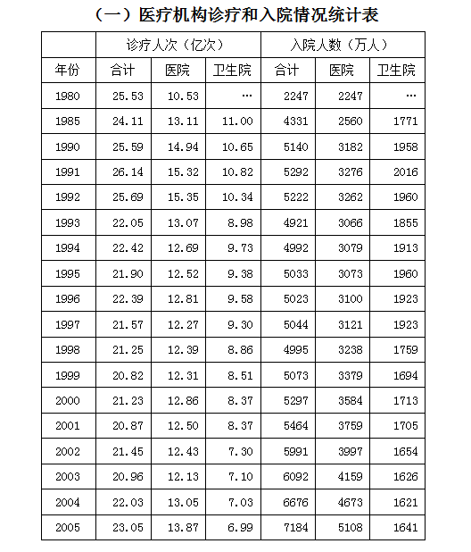

### 第 86 题

从上表可以看出，下列年份中，医院诊疗人次最多是：

A. 2001年

B. 1992年

C. 1996年

D. 1991年

第 86 题 · 答案与解析

**参考答案（粉笔题库参考内容）**

B

**解析**

分析表格，2001年、1992年、1996年和1991年医院诊疗人次分别为12.50、15.35、12.81和15.32。因此医院诊疗人次最多是1992年。

故正确答案为B。

**来源**：2008年江苏省公务员录用考试《行测》题（C类）第86题

### 第 87 题

上表中2001年的医院入院人数比1995年增长了：

A. 25.6%

B. 20.1%

C. 22.3%

D. 24.5%

第 87 题 · 答案与解析

**参考答案（粉笔题库参考内容）**

C

**解析**

根据题干“上表中2001年的医院入院人数比1995年增长了“，结合选项为百分数，可判定本题为一般增长率问题。定位统计表可得，2001年和1995年医院入院人数分别为3759万人和3073万人，根据增长率公式：r = (现期量 − 基期量)/基期量，可得2001年的医院入院人数比1995年增长了(3759-3073)/3073=686/3073≈ 686/3070 ≈ 22.3%。

故正确答案为C。

**来源**：2008年江苏省公务员录用考试《行测》题（C类）第87题

### 第 88 题

表中所列年份中卫生院接受诊疗人次最大值与最小值的差额是：

A. 3.54亿次

B. 4.01亿次

C. 2.09亿次

D. 2.08亿次

第 88 题 · 答案与解析

**参考答案（粉笔题库参考内容）**

B

**解析**

分析查找表格可以看出，卫生院接受诊疗人次最大值为1985年的11.00，最小值为2005年的6.99，所以差额为11.00-6.99=4.01。

故正确答案为B。

**来源**：2008年江苏省公务员录用考试《行测》题（C类）第88题

### 第 89 题

卫生院接受诊疗人次在当年总诊疗人次中比率最高的年份是：

A. 1998年

B. 2000年

C. 2004年

D. 2005年

第 89 题 · 答案与解析

**参考答案（粉笔题库参考内容）**

A

**解析**

根据题干“卫生院接受诊疗人次在当年总诊疗人次中比率最高的年份是”，可判定本题为现期比重问题。定位统计表，可得1998、2000、2004和2005年卫生院接受诊疗人次在当年总诊疗人次中比率分别为8.86/21.25 ≈ 42%、8.37/21.23 ≈ 40%、7.03/22.03 ≈ 32%、6.99/23.05≈30%，因此卫生院接受诊疗人次在当年总诊疗人次中比率最高的年份是1998年。

故正确答案为A。

**来源**：2008年江苏省公务员录用考试《行测》题（C类）第89题

### 第 90 题

据上表，下列说法可能正确的是：

A. 1980年到2005年，卫生院接受诊疗的人次是逐年递减的

B. 国家持续大量加强卫生院建设

C. 卫生院在我国的医疗卫生体系中承担了重要的作用

D. 入院病人中有一部分人得不到有效治疗

第 90 题 · 答案与解析

**参考答案（粉笔题库参考内容）**

C

**解析**

A项：定位统计表，发现1991年卫生院接受诊疗的人次（10.82）比1990年（10.65）要多，因此1980年到2005年，卫生院接受诊疗的人次不是逐年递减的，说法错误，排除；

B项：定位统计表，卫生院接受诊疗的人次和入院人数的整体趋势是缩小的，因此国家未持续大量加强卫生院建设，说法错误，排除；

C项：定位统计表，发现选择卫生院诊疗人次和住院人数占总体的比重都很大，因此卫生院在我国的医疗卫生体系中承担了重要的作用，说法正确，当选；

D项：从材料中无法推出，说法错误，排除。

故正确答案为C。

**来源**：2008年江苏省公务员录用考试《行测》题（C类）第90题

## 材料 3

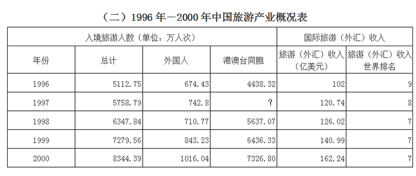

### 第 91 题

1996年至2000年中国国际旅游（外汇）收入年平均多少亿美元：

A. 126.02

B. 133.98

C. 130.398

D. 108.665

第 91 题 · 答案与解析

**参考答案（粉笔题库参考内容）**

C

**解析**

根据题干“1996年至2000年中国国际旅游（外汇）收入年平均多少亿美元”，结合材料时间给的是1996年-2000年，可判定本题为现期平均数问题。分析表格可以看出，1996年至2000年中国国际旅游（外汇）收入分别为102、120.74、126.02、140.99和162.24，所以平均值为(102+120.74+126.02+140.99+162.24)/5≈(102+121+126+141+162)/5=652/5=130.4，与C项最接近。

故正确答案为C。

**来源**：2008年江苏省公务员录用考试《行测》题（C类）第91题

### 第 92 题

上表中的？应填入下列哪一个数字：

A. 501599

B. 50159900

C. 5015.99

D. 5016

第 92 题 · 答案与解析

**参考答案（粉笔题库参考内容）**

C

**解析**

定位统计表可得，“？”处数值代表1997年港澳台同胞入境旅游人数，为总计-外国人=5758.79-742.8=5015.99。

故正确答案为C。

**来源**：2008年江苏省公务员录用考试《行测》题（C类）第92题

### 第 93 题

下列判断哪一个最准确？

A. 1996年至2000年间中国国际旅游（外汇）收入逐年增加

B. 1999年港澳台同胞占入境旅游人数的98.41%

C. 1997年中国旅游（外汇）收入世界排名第七

D. 1996年至2000年间到中国的外国人逐年增加

第 93 题 · 答案与解析

**参考答案（粉笔题库参考内容）**

A

**解析**

A项：定位统计表，发现1996年至2000年间中国国际旅游（外汇）收入分别为102、120.74、126.02、140.99、162.24亿美元，收入逐年增加，说法正确，当选；

B项：定位统计表，1999年港澳台同胞入境旅游人数、总计入境旅游人数分别为6436.33、7279.56万人次，因此1999年港澳台同胞占入境旅游人数的6436.33/7279.56 ≈ 6436.33/7300≈88%，说法错误，排除；

C项：定位统计表，发现1997年中国旅游（外汇）收入世界排名第八，并不是排名第七，说法错误，排除；

D项：定位统计表，1998年到中国的外国人为710.77万人次，1997年到中国的外国人为742.8万人次，因此1998年到中国的外国人比1997年少，说法错误，排除。

故正确答案为A。

**来源**：2008年江苏省公务员录用考试《行测》题（C类）第93题

### 第 94 题

2000年中国入境旅游人数比1996年增加百分之多少：

A. 163.2

B. 63.2

C. 162.9

D. 62.9

第 94 题 · 答案与解析

**参考答案（粉笔题库参考内容）**

B

**解析**

根据题干“2000年中国入境旅游人数比1996年增加百分之多少”，可判定本题为一般增长率问题。定位统计表可得，2000年、1996年中国入境旅游人数分别为8344.39、5112.75万人次，根据增长率公式：r = (现期量 − 基期量)/基期量，则2000年中国入境旅游人数比1996年增加(8344.39 - 5112.75)/5112.75= 3231.64/5112.75 ≈ 63.2%。

故正确答案为B。

**来源**：2008年江苏省公务员录用考试《行测》题（C类）第94题

### 第 95 题

1996年至2000年到中国旅游的外国人人次数是：

A. 3988.38万人次

B. 3987.27万人次

C. 3997.37万人次

D. 3986.67万人次

第 95 题 · 答案与解析

**参考答案（粉笔题库参考内容）**

B

**解析**

定位统计表可得，1996年-2000年来中国旅游的外国人人次数分别是674.43、742.8、710.77、843.23、1016.04万人次，因此1996年至2000年到中国旅游的外国人人次数是674.43+742.8+710.77+843.23+1016.04=3987.27万人次。

故正确答案为B。

注：尾数法，0.43+0.8+0.77+0.23+0.04=2.27，小数点后为27，只有B项符合。

**来源**：2008年江苏省公务员录用考试《行测》题（C类）第95题

## 材料 4

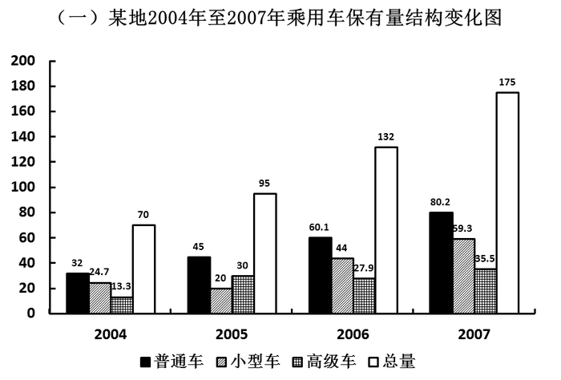

### 第 96 题

该地2007年乘用车总保有量比2006年增长约：

A. 32.6%

B. 24.5%

C. 35.6%

D. 25.2%

第 96 题 · 答案与解析

**参考答案（粉笔题库参考内容）**

A

**解析**

根据题干“该地2007年乘用车总保有量比2006年增长约”，结合选项为百分数，可判定本题为一般增长率问题。定位统计图可得，2007年乘用车总保有量为175，2006年总保有量为132。根据增长率公式：r = (现期量 − 基期量)/基期量，可得该地2007年乘用车总保有量比2006年增长约(175 - 132)/132 = 43/132≈32.6%。

故正确答案为A。

**来源**：2008年江苏省公务员录用考试《行测》题（C类）第96题

### 第 97 题

该地2007年小型车数量占该年乘用车总数的比率与2005年相比：

A. 增长了10.8个百分点

B. 减少了10.8个百分点

C. 增长了12.8个百分点

D. 减少了12.8个百分点

第 97 题 · 答案与解析

**参考答案（粉笔题库参考内容）**

C

**解析**

根据题干“该地2007年小型车数量占该年乘用车总数的比率与2005年相比”，结合选项为百分点，可判定本题为两期比重问题。定位统计图可得，2007年小型车数量占该年乘用车总数的比率为59.3/175，2005年小型车数量占该车乘用车总数的比率为20/95，则该地2007年小型车数量占该年乘用车总数的比率与2005年相比增长了59.3/175 − 20/95≈60/175-20/95≈ 34.3% - 21% = 13.3%，与C项最为接近。

故正确答案为C。

**来源**：2008年江苏省公务员录用考试《行测》题（C类）第97题

### 第 98 题

与上一年相比，乘用车保有量增幅最大的是：

A. 2006年小型车

B. 2005年小型车

C. 2007年普通车

D. 2007年高级车

第 98 题 · 答案与解析

**参考答案（粉笔题库参考内容）**

A

**解析**

根据题干“与上一年相比，乘用车保有量增幅最大的是”，可判定本题为一般增长率的比较问题。定位统计图可知每一年每种车型的现期量与基期量，代入增长率公式：(现期量 − 基期量)/基期量，则2006年小型车增长率为(44 − 20)/20 = 120%；2005年小型车增长率为(20−24.7)/24.7＜0%；2007年普通车增长率为(80.2−60.1)/60.1 = 20.1/60.1 ＜ 1；2007年高级车增长率为(35.5 − 27.9)/27.9 ＜ 1。因此增幅最大的是2006年小型车。

故正确答案为A。

**来源**：2008年江苏省公务员录用考试《行测》题（C类）第98题

### 第 99 题

相对于2004年，2005年该地哪种车型增长数占该年乘用车总数的比率最大：

A. 普通车

B. 高级车

C. 小型车

D. 以上答案都不对

第 99 题 · 答案与解析

**参考答案（粉笔题库参考内容）**

B

**解析**

分析图表，2005年比2004年乘用车总量增长95-70=25，其中普通车、小型车和高级车增长量分别为45-32=13，20-24.7=-4.7，30-13.3=16.7，因此高级车所占比率最大。

故正确答案为B。

**来源**：2008年江苏省公务员录用考试《行测》题（C类）第99题

### 第 100 题

从上图可以推断出：

A. 该地汽车发展迅速，各种车型均保持大幅增长

B. 总体该地乘用车逐年增长

C. 高级车一直以较大幅度增长

D. 小型车增长幅度稳定

第 100 题 · 答案与解析

**参考答案（粉笔题库参考内容）**

B

**解析**

根据图表对各个选项进行分析，小型车2005年出现了下降的情况，因此A、D两项错误。总体该地乘用车逐年增长，B项正确。2006年高级车的数量与2005年相比有所减少，因此C项错误。

故正确答案为B。

**来源**：2008年江苏省公务员录用考试《行测》题（C类）第100题

