# 2009年江苏省公务员录用考试《行测》题（A类）

<!-- gwy:overview:start -->
> **江苏 · 2009 · 行测 · A类** ｜ 105 题 · 图片 17 处 · 答案随题折叠

| 题型模块 | 题量 | 题号 |
| --- | ---: | ---: |
| 数量关系 | 25 | 1–25 |
| 判断推理 | 40 | 26–65 |
| 言语理解与表达 | 15 | 66–80 |
| 资料分析 | 25 | 81–105 |
| **合计** | **105** | |

导航：[题型与作答说明](#题型与作答说明) · [题目](#题目) · [材料 1](#材料-1)
<!-- gwy:overview:end -->

> 候选采集稿。参考答案及解析来自粉笔页面，不代表官方答案或真实高分答卷；来源使用许可与原卷对应关系仍需人工核实。

## 题型与作答说明

数量关系

（25题）

本部分包括数字推理与数学运算两种类型的试题。

判断推理

（40题）

本部分包括类比推理、图形推理、逻辑判断与定义判断四种类型的试题。

言语理解与表达

（15题）

本部分包括片段阅读、文章阅读两种类型的试题。

资料分析

（25题）

下列给出的文字、表格、图形资料均有5个问题要你回答，你应根据资料提供的信息进行分析、计算、处理，然后从备选择答案中选择一个最恰当的答案。

## 题目

### 第 1 题

0，7，26，63，124，（  ）

A. 125

B. 215

C. 216

D. 218

第 1 题 · 答案与解析

**参考答案（粉笔题库参考内容）**

B

**解析**

方法一：观察数列，每项周围均有幂次数，考虑幂次修正数列。观察发现：0 = 1^3 - 1，7 = 2^3 - 1，26=3^3−1，63=4^3-1，124=5^3−1。底数为连续的自然数列，下一项为6，指数均为3，修正项均为-1，故所求项为6^3 - 1 = 215。

方法二：若未观察出数列特征，考虑作差。后项减前项得到新数列：7，19，37，61，（    ），无明显特征，考虑再次作差。新数列后项减前项可得：12，18，24，（    ），是公差为6的等差数列，下一项为24+6=30，则所求项为124+61+30=215。

故正确答案为B。

**来源**：2009年江苏省公务员录用考试《行测》题（A类）第1题

### 第 2 题

8，11，13，17，20，（  ）

A. 18

B. 20

C. 25

D. 28

第 2 题 · 答案与解析

**参考答案（粉笔题库参考内容）**

C

**解析**

数列变化幅度平缓，作差无规律，考虑加和。后项加前项可得，19，24，30，37，（    ），后项减前项可得，5，6，7，（    ），为连续自然数列，则加和所得新数列下一项为37+8=45，所求项为45-20=25。

故正确答案为C。

**来源**：2009年江苏省公务员录用考试《行测》题（A类）第2题

### 第 3 题

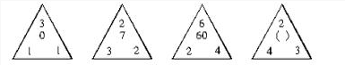

A. 8

B. 9

C. 13

D. 16

第 3 题 · 答案与解析

**参考答案（粉笔题库参考内容）**

C

**解析**

有中心的图形数阵，优先考虑凑中心数字。观察发现：

第一个数阵中，1^3 − 1 = 0；

第二个数阵中，3^2 − 2 = 7；

第三个数阵中，2^6 − 4 = 60；

即规律为：左下角数字^顶部数字 - 右下角数字=中心数字；

则第四个数阵中，所求项= 4^2 − 3 = 13。

故正确答案为C。

**来源**：2009年江苏省公务员录用考试《行测》题（A类）第3题

### 第 4 题

11，81，343，625，243，（  ）

A. 1000

B. 125

C. 3

D. 1

第 4 题 · 答案与解析

**参考答案（粉笔题库参考内容）**

D

**解析**

观察原数列发现，数字均为幂次数。原数列可表示为11^1，9^2，7^3，5^4，3^5，（    ），底数构成11为首项，公差为-2的等差数列，指数为以1为首项的连续自然数，则所求项为1^6=1。

故正确答案为D。

**来源**：2009年江苏省公务员录用考试《行测》题（A类）第4题

### 第 5 题

20002，40304，60708，（  ），10023032，12041064

A. 8013012

B. 8013016

C. 808015

D. 8011016

第 5 题 · 答案与解析

**参考答案（粉笔题库参考内容）**

B

**解析**

数列中数字项数较多，优先考虑机械划分，将原数列中数字均划分为三部分。原数列数字划分如下所示：

20|0|02，40|3|04，60|7|08，（    ），100|23|032，120|41|064

左侧为：20，40，60，（    ），100，120，构成以20为首项，公差为20的等差数列，所求项为60+20=80；

右侧为：02，04，08，（    ），032，064，构成以2为首项，公比为2的等比数列，所求项为2×8=16，即为016，排除A、C两项；

中间为：0，3，7，（    ），23，41，无明显规律特征，代入选项找规律。代入B项，0，3，7，（13），23，41，观察前后两项，有2 × 0 + 3 = 3，2×3+1=7，（2×7−1=13），2×13−3=23，2×23-5=41，规律为2 × 前项 + 修正项=后项，修正项是以3为首项，公差为-2的等差数列。B选项满足规律。

结合三部分的规律，所求项为8013016。

故正确答案为B。

**来源**：2009年江苏省公务员录用考试《行测》题（A类）第5题

### 第 6 题

1，1，3，5，11，（  ）

A. 8

B. 13

C. 21

D. 32

第 6 题 · 答案与解析

**参考答案（粉笔题库参考内容）**

C

**解析**

数列变化幅度平缓，数字无明显特征，作差加和也均无明显规律，考虑递推数列。观察可知，1 × 2 − 1 = 1，1×2+1 = 3，3 × 2 − 1 = 5，5 × 2 + 1 = 11，即前项 × 2+修正项=后项，修正项为-1、+1循环。则所求项为11 × 2 − 1 = 21。

故正确答案为C。

**来源**：2009年江苏省公务员录用考试《行测》题（A类）第6题

### 第 7 题

10，12 1/2，16 2/3，25，()

A. 25

B. 30

C. 40

D. 50

第 7 题 · 答案与解析

**参考答案（粉笔题库参考内容）**

D

**解析**

数列中出现多个分数，优先考虑分数数列。数列有整数和分数，考虑反约分。原数列可变形为100/10，100/8，100/6，100/4，（    ）。分子均为100，分母构成10为首项，公差为-2的等差数列，所求项为100/(4-2)=50。

故正确答案为D。

**来源**：2009年江苏省公务员录用考试《行测》题（A类）第7题

### 第 8 题

1/3，4/7，7/11，2/3，13/19，()

A. 16/21

B. 16/23

C. 18/21

D. 17/21

第 8 题 · 答案与解析

**参考答案（粉笔题库参考内容）**

B

**解析**

数列中数字均为分数，考虑分数数列。分子分母整体呈增加趋势，只有2/3不满足递增趋势，考虑反约分。将原数列变形为1/3，4/7，7/11，10/15，13/19，（    ）。分子、分母分别为公差为3和4的等差数列，故所求项为(13 + 3)/(19 + 4) = 16/23。

故正确答案为B。

**来源**：2009年江苏省公务员录用考试《行测》题（A类）第8题

### 第 9 题

568，488，408，246，186，（  ）

A. 105

B. 140

C. 156

D. 169

第 9 题 · 答案与解析

**参考答案（粉笔题库参考内容）**

A

**解析**

数列中均为多位数，考虑机械划分。数字均为三位数，可划分为56|8，48|8，40|8，24|6，18|6，（    ）。每项数字中左侧两位数字与右侧一位数字有明显倍数关系，左侧除以右侧得到新数列：7，6，5，4，3，（    ），构成等差数列，下一项为2。观察选项，只有A项符合。

故正确答案为A。

**来源**：2009年江苏省公务员录用考试《行测》题（A类）第9题

### 第 10 题

2，11/3，28/5，53/7，86/9，()

A. 12

B. 13

C. 123/11

D. 127/11

第 10 题 · 答案与解析

**参考答案（粉笔题库参考内容）**

D

**解析**

数列大部分是分数，考虑分数数列。数列中有分数有整数，考虑反约分。原数列可变形为2/1，11/3，28/5，53/7，86/9，（    ）。分子部分作差可得：9，17，25，33，（    ），构成公差为8的等差数列，下一项是33+8=41，则所求项分子为86+41=127；分母构成公差为2的等差数列，下一项为9+2=11。故所求项为127/11。

故正确答案为D。

**来源**：2009年江苏省公务员录用考试《行测》题（A类）第10题

### 第 11 题

[(1+14)(1+14/2)(1+14/3)…(1+14/15)]/[(1+15)(1+15/2)(1+15/3)…(1+15/14)]=（ ）

A. 14/15

B. 15/14

C. 1

D. 35/14

第 11 题 · 答案与解析

**参考答案（粉笔题库参考内容）**

C

**解析**

原式[15×(2/2+14/2)×(3/3+14/3)×...×(15/15+14/15)]/[16×(2/2+15/2)×(3/3+15/3)×...×(14/14+15/14)]=(15×16/2×17/3×...×20/15)/(16×17/2×18/3×...×20/14)=15×16/2×17/3×...× 29/15 × 1/16 × 2/17 × 3/18×...14/29 = 1。

故正确答案为C。

**来源**：2009年江苏省公务员录用考试《行测》题（A类）第11题

### 第 12 题

对正实数定义运算“\*”：若a≥b，则a*b=b^3；若a＜b，则a*b=b^2。由此可知，方程3\*x=27的解是：

A. 0

B. 9

C. √3

D. 3，3√3

第 12 题 · 答案与解析

**参考答案（粉笔题库参考内容）**

D

**解析**

方法一：根据定义运算规则可知，a\*b所得结果为b^2或b^3，即在3\*x=27中，27=x^2或x^3，可解得x=3或3√3。

方法二：选项信息充分，可依次代入选项验证。

代入A项，x=0，3>0，3*0=0^3=0≠27，排除；

代入B项，x=9，3&lt;9，3×9=9^2=81≠27，排除；

代入C项，x=√3，3＞√3，3 * √3 = (√3)^3 ≠ 27，排除；

代入D项，x=3，3=3，3*3=3^3=27，x=3√3，3＜3√3，3 * 3√3 = (3√3)^2 = 27，均符合题意。

故正确答案为D。

**来源**：2009年江苏省公务员录用考试《行测》题（A类）第12题

### 第 13 题

已知a^2 + a + 1 = 0，则a^2008 + a^2009 + 1 =（ ）

A. 0

B. 1

C. 2

D. 3

第 13 题 · 答案与解析

**参考答案（粉笔题库参考内容）**

A

**解析**

由a^2 + a + 1 = 0，则(a − 1)(a^2 + a + 1) = 0，a^3 - 1 = 0，a^3=1，a^2008 + a^2009 + 1 =a^2007(a^2+a)+1，由a^2007 = (a^3)^669 = 1，故原式 = a^2+a+1 = 0。

故正确答案为A。

**来源**：2009年江苏省公务员录用考试《行测》题（A类）第13题

### 第 14 题

若半径不相等的两个圆有公共点，那么这两个圆的公切线最多有：

A. 1条

B. 2条

C. 3条

D. 4条

第 14 题 · 答案与解析

**参考答案（粉笔题库参考内容）**

C

**解析**

半径不相等的两个圆有公共点，一共有三种情况，其切线如图所示：

故正确答案为C。

**考点**：几何其他题型、非典型最值问题

**来源**：2009年江苏省公务员录用考试《行测》题（A类）第14题

### 第 15 题

将一个表面积为36平方米的正方体等分成两个长方体，再将这两个长方体拼成一个大长方体，则大长方体的表面积是：

A. 24平方米

B. 30平方米

C. 36平方米

D. 42平方米

第 15 题 · 答案与解析

**参考答案（粉笔题库参考内容）**

D

**解析**

如下图所示，原正方体表面积为36平方米，则每个面的面积为36/6=6平方米；等分后形成的两个长方体比之前多了两个6平方米的截面，且底面积变为6/2=3平方米，总面积增加了6×2=12平方米；叠加形成长方体之后，减少了两个面积为3平方米的底面，则此时总面积为36 + 12 − 3 × 2 = 42平方米。

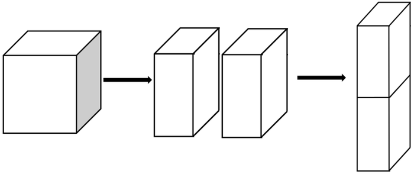

故正确答案为D。

**考点**：几何公式类-立体图形

**来源**：2009年江苏省公务员录用考试《行测》题（A类）第15题

### 第 16 题

整数15具有被它的十位上数字和个位上数字同时整除的性质，则在11和50间具有这种性质的整数的个数有：

A. 8个

B. 9个

C. 12个

D. 14个

第 16 题 · 答案与解析

**参考答案（粉笔题库参考内容）**

B

**解析**

根据题意，我们可以推出11到50之间符合要求的数字分别为：11、12、15、22、24、33、36、44、48，共9个。

故正确答案为B。

**来源**：2009年江苏省公务员录用考试《行测》题（A类）第16题

### 第 17 题

有一队士兵排成若干层的中空方阵，外层人数共有60人，中间一层共44人，则该方阵士兵的总人数是：

A. 156人

B. 210人

C. 220个

D. 280个

第 17 题 · 答案与解析

**参考答案（粉笔题库参考内容）**

C

**解析**

方阵中相邻两层人数之差为8，而(60−44) ÷ 8 = 2，可知最外层与中间层之间还有一层，则中间层与最内层之间也有一层，总层数为5层。各层人数构成公差为8，中位数为44的等差数列，总人数=44×5=220人。

故正确答案为C。

**来源**：2009年江苏省公务员录用考试《行测》题（A类）第17题

### 第 18 题

有红、黄、绿三种颜色的手套各6双，装在一个黑色的布袋里，从袋子里任意取出手套来，为确保至少有2双手套不同颜色，则至少要取出的手套只数是：

A. 15只

B. 13只

C. 12只

D. 10只

第 18 题 · 答案与解析

**参考答案（粉笔题库参考内容）**

A

**解析**

问题问“确保······至少”，可判断本题为最值问题中的最不利构造问题，对应的解题方法是“最不利情况”+1，最不利情况为取出其中一种颜色的全部6双手套和其他两种颜色的手套各1只，则至少要取出6×2+1×2+1=15只手套，才能保证至少有2双手套不同颜色。

故正确答案为A。

建议补充条件：手套不分左右手

如果分左右手，则最不利情况应为：取出一种颜色的全部12只手套（6双）和另外两种颜色其中一只手的手套（左或右任意，各6只）。当再次取出剩余手套中的任意一只，即可组成2双不同颜色的手套。故至少要取出6×2+6×2+1=25只手套，才能确保至少有2双手套不同颜色。

**考点**：最不利构造

**来源**：2009年江苏省公务员录用考试《行测》题（A类）第18题

### 第 19 题

某调查公司对甲、乙、丙三部电影的收看情况向125人进行调查，有89人看过甲片，有47人看过乙片，有63人看过丙片，其中有24人三部电影全看过，20人一部也没有看过，则只看过其中两部电影的人数是：

A. 69人

B. 65人

C. 57人

D. 46人

第 19 题 · 答案与解析

**参考答案（粉笔题库参考内容）**

D

**解析**

代入三集合容斥原理非标准型公式，A+B+C-满足两项−2×满足三项=全部−都不，89+47+63-看过两部−2×24= 125 - 20，解得看过两部电影的有46人。

故正确答案为D。

**考点**：三集合

**来源**：2009年江苏省公务员录用考试《行测》题（A类）第19题

### 第 20 题

有271位游客欲乘大、小两种客车旅游，已知大客车有37个座位，小客车有20个座位。为保证每位游客均有座位，且车上没有空座位，则需要大客车的辆数是：

A. 1辆

B. 3辆

C. 2辆

D. 4辆

第 20 题 · 答案与解析

**参考答案（粉笔题库参考内容）**

B

**解析**

设大客车有x辆，小客车有y辆。根据题意可列方程：37x+20y=271。20y的尾数一定是0，则37x的尾数必须是1，结合选项，只有x=3才满足条件。

故正确答案为B。

**来源**：2009年江苏省公务员录用考试《行测》题（A类）第20题

### 第 21 题

A、B两山村之间的路不是上坡就是下坡，相距60千米。邮递员骑车从A村到B村，用了3.5小时；再沿原路返回，用了4.5小时。已知上坡时邮递员车速是12千米/小时，则下坡时邮递员的车速是：

A. 10千米/小时

B. 12千米/小时

C. 14千米/小时

D. 20千米/小时

第 21 题 · 答案与解析

**参考答案（粉笔题库参考内容）**

D

**解析**

根据题意可知，往返全程的平均速度为(60 × 2)/(3.5 + 4.5) = 15千米/小时。邮递员往返过程中，从A到B过程中的上坡恰好是从B到A过程中的下坡，从A到B过程中的下坡恰好是从B到A过程中的上坡，因此从往返全程来看，该邮递员上坡的距离与下坡的距离是相等的，故可代入等距离平均速度公式V平均速度 = 2V1V2/(V1+V2)。设下坡车速为v，(2×12×v)/(12+v) = 15，解得v=20千米/小时。

故正确答案为D。

**考点**：平均速度

**来源**：2009年江苏省公务员录用考试《行测》题（A类）第21题

### 第 22 题

一批手机，商店按期望获得100%的利润来定价，结果只销售掉70%。为了尽早销售掉剩下的手机，商店决定打折出售，为了获得的全部利润是原来期望利润的91%，则商店所打的折是：

A. 六折

B. 七折

C. 八五折

D. 九折

第 22 题 · 答案与解析

**参考答案（粉笔题库参考内容）**

C

**解析**

赋值手机总量为10，成本为10，则期望利润为10×100% = 10，定价为10+10=20。设打折后利润为x，由题意可列式为：10 × 7 + 3x =10 × 10 × 91%，解得x=7。则所打折扣为(10+7)/20=85%，即打了八五折。

故正确答案为C。

**考点**：经济利润问题

**来源**：2009年江苏省公务员录用考试《行测》题（A类）第22题

### 第 23 题

有33个偶数的平均数，保留一位小数时是5.8，保留两位小数时，则该平均数最小是：

A. 5.76

B. 5.75

C. 5.78

D. 5.82

第 23 题 · 答案与解析

**参考答案（粉笔题库参考内容）**

A

**解析**

保留一位小数时为5.8，说明该平均数取两位小数时必介于5.75与5.84之间，则33 × 平均数 ≥33 × 5.75 = 189.75，因此这33个偶数的和最小是190，它们的平均数是190 ÷ 33 ≈ 5.76(保留两位小数)。

故正确答案为A。

**考点**：非典型最值问题

**来源**：2009年江苏省公务员录用考试《行测》题（A类）第23题

### 第 24 题

甲、乙两个工程队，甲队的人数是乙队的70%。根据工程需要，现从乙队抽出40人到甲队，此时乙队比甲队多136人，则甲队原有人数是：

A. 504人

B. 620人

C. 630人

D. 720人

第 24 题 · 答案与解析

**参考答案（粉笔题库参考内容）**

A

**解析**

根据甲队人数是乙队的70%可知，甲队总人数是7的倍数，可排除B、D两项；代入A项，甲队原有504人，则乙队原有504/70% = 720人，乙队调出40人后为720-40=680人，甲队现有504+40=544人，680-544=136人，符合题意所有条件。

故正确答案为A。

**考点**：和差倍比问题

**来源**：2009年江苏省公务员录用考试《行测》题（A类）第24题

### 第 25 题

某大学军训，军训部将学员编成8个小组，如果每组人数比预定人数多1人，那么学员总数将超过100人；如果每组人数比预定人数少1人，那么学员总额将不到90人。由此可知，预定的每组学员人数是：

A. 20人

B. 18人

C. 16人

D. 12人

第 25 题 · 答案与解析

**参考答案（粉笔题库参考内容）**

D

**解析**

方法一：设预定每组有x人，由题意可列式为：8(x+1)>100，8(x-1)&lt;90，解得11.5&lt;x&lt;12.25，人数需为整数，可知x=12。

方法二：根据题意可知，每组比预定人数少1人时，总人数低于90，即(预定人数 − 1) × 8 ＜ 90，可得预定人数&lt;12.25，观察选项，只有D项满足。

故正确答案为D。

**考点**：和差倍比问题

**来源**：2009年江苏省公务员录用考试《行测》题（A类）第25题

### 第 26 题

新疆：江苏：苏州

A. 北京：南京：长江

B. 航天：航天器：航天员

C. 云南：安徽：合肥

D. 山东：辽宁：青岛

第 26 题 · 答案与解析

**参考答案（粉笔题库参考内容）**

C

**解析**

第一步：判断题干词语间逻辑关系。

新疆和江苏是行政地位相同的省份，苏州是江苏的一个市。题干中前两词是并列关系的两个省级行政单位，第三词隶属于第二词。

第二步：判断选项词语间逻辑关系。

选项A中北京是直辖市，行政地位相当于省级，南京是江苏省省会，行政地位相当于副省级，逻辑关系与题干不对应；

选项B中航天器在太空的航行活动称为航天，两者构成对应关系，与题干逻辑不相符；

选项C中云南和安徽是地位相等的两个省级行政单位，合肥隶属于安徽省，与题干逻辑相符；

选项D中青岛隶属于山东，但山东位于第一项，不符合题干逻辑。

故正确答案为C。

**考点**：逻辑关系-包容关系、逻辑关系-并列关系

**来源**：2009年江苏省公务员录用考试《行测》题（A类）第26题

### 第 27 题

宇宙：太阳系：地球

A. 大学：哲学系：教授

B. 天空：白云：水气

C. 太阳：耀斑：黑子

D. 中国：广东：广州

第 27 题 · 答案与解析

**参考答案（粉笔题库参考内容）**

D

**解析**

第一步：判断题干词语间逻辑关系。

宇宙中必然包含太阳系，太阳系中必然包含地球。题干逻辑为，第一词必然包含第二词，第二词必然包含第三词。

第二步：判断选项词语间逻辑关系。

A项和B项的三个词虽然存在包含关系，但不属于必然包含，有的大学可能没有开设哲学系，有时天空可能没有白云，故A项和B项不选；

C项中耀斑是一种太阳活动，属于对应关系，不符合题干逻辑；

D项中，中国必然包含广东省，广东省必然包含广州市，符合题干逻辑。

故正确答案为D。

**考点**：逻辑关系-包容关系

**来源**：2009年江苏省公务员录用考试《行测》题（A类）第27题

### 第 28 题

克服：应对：危机

A. 开发：企业：产品

B. 攻克：科学：难题

C. 展望：迎接：未来

D. 登月：航天：工程

第 28 题 · 答案与解析

**参考答案（粉笔题库参考内容）**

C

**解析**

第一步：判断题干词语间逻辑关系。

克服危机和应对危机，均为动宾关系。

第二步：判断选项词语间逻辑关系。

A项：开发产品为动宾关系，但企业为名词，无法和产品构成动宾结构，与题干逻辑关系不一致，排除；

B项：攻克难题为动宾关系，但科学为名词，无法和难题构成动宾结构，与题干逻辑关系不一致，排除；

C项：展望未来和迎接未来，均为动宾关系，与题干逻辑关系一致，当选；

D项：登月本身即为动宾词组，无法和工程构成动宾结构，航天为名词，也无法和工程构成动宾结构，与题干逻辑关系不一致，排除。

故正确答案为C。

**考点**：语法关系

**来源**：2009年江苏省公务员录用考试《行测》题（A类）第28题

### 第 29 题

概率：几率：逻辑学

A. 双胞：孪生：生物学

B. 报导：报道：物理学

C. 拒绝：接受：社会学

D. 展览：战略：经济学

第 29 题 · 答案与解析

**参考答案（粉笔题库参考内容）**

A

**解析**

第一步：判断题干词语间逻辑关系。

概率和几率是同义词，概率和几率都属于逻辑学概念。题干中第一个词和第二个词构成全同关系，前两词和第三个词构成包容关系中的种属关系。

第二步：判断选项词语间逻辑关系。

选项A中，双胞和孪生是同义词，都属于生物学概念，符合题干逻辑，当选；

选项B、D中，前两个词不管是否同义，都不属于第三个词的概念，排除；

选项C中，前两个词构成反对关系，与第三个词构不成逻辑关系，排除。

故正确答案为A。

**考点**：逻辑关系-全同关系、逻辑关系-包容关系

**来源**：2009年江苏省公务员录用考试《行测》题（A类）第29题

### 第 30 题

动物：仙鹤：长寿

A. 石头：珠宝：价值

B. 富强：牡丹：富贵

C. 傍晚：黑暗：光明

D. 植物：玫瑰：爱情

第 30 题 · 答案与解析

**参考答案（粉笔题库参考内容）**

D

**解析**

第一步：判断题干词语间逻辑关系。

仙鹤是一种动物，可以象征长寿，第一词和第二词为种属关系，第二词和第三词构成比喻象征义。

第二步：判断选项词语间逻辑关系。

A项：珠宝是从珍稀程度划分的，石头是从材质角度划分的，二者是交叉关系；珠宝是有价值的，二者为属性对应关系，与题干逻辑关系不一致，排除；

B项：牡丹通常象征富贵，而非宝贵，二者不是比喻象征义，与题干逻辑关系不一致，排除；

C项：黑暗与光明为反义关系，与题干逻辑关系不一致，排除；

D项：玫瑰一种植物，可以象征爱情，第一词和第二词为种属关系，第二词和第三词构成比喻象征义。

故正确答案为D。

**考点**：语义关系-比喻象征义、逻辑关系-包容关系

**来源**：2009年江苏省公务员录用考试《行测》题（A类）第30题

### 第 31 题

黄色：红色：白色

A. 忧伤：高兴：愤怒

B. 女医生：男医生：医生

C. 科学：非科学：伪科学

D. 左手：右手：举手

第 31 题 · 答案与解析

**参考答案（粉笔题库参考内容）**

A

**解析**

第一步：判断题干词语间逻辑关系。

黄色、红色、白色都表示颜色。题干的三个词语构成并列关系。

第二步：判断选项词语间逻辑关系。

A项忧伤、高兴、愤怒都是表达情绪的词语，构成并列关系；

B项女医生和男医生都属于医生，前两项和第三项之间是包容关系；

C项科学和非科学构成的是矛盾关系，伪科学是非科学的一种；

D项左手和右手与举手构成对应关系，非并列关系。

故正确答案为A。

**考点**：逻辑关系-并列关系

**来源**：2009年江苏省公务员录用考试《行测》题（A类）第31题

### 第 32 题

翠鸟：捕鱼：动物（    ）。

A. 老虎：山林：狐狸

B. 水草：生长：海洋

C. 蜘蛛：结网：生物

D. 黄鼠狼：鸡：狼

第 32 题 · 答案与解析

**参考答案（粉笔题库参考内容）**

C

**解析**

第一步：判断题干词语间逻辑关系。

题干三个词语中，翠鸟捕鱼，翠鸟与鱼是对应关系；翠鸟是一种动物，翠鸟与动物是种属关系。

第二步：判断选项词语间逻辑关系。

A项，老虎和狐狸都是动物，不是种属关系，不符合题意。

B项，水草和海洋不是种属关系，不符合题意。

C项，蜘蛛结网，蜘蛛是一种生物，与题干逻辑关系一致，符合题意。

D项，黄鼠狼和狼都是动物，不是种属关系，不符合题意。

第三步：再次标注答案

故正确答案为C。

**考点**：语法关系、逻辑关系-包容关系

**来源**：2009年江苏省公务员录用考试《行测》题（A类）第32题

### 第 33 题

水星：金星：行星

A. 公司：管理：管理者

B. 县：省：国家

C. 水桶实验：实验：科学

D. 杨振宁：张衡：科学家

第 33 题 · 答案与解析

**参考答案（粉笔题库参考内容）**

D

**解析**

第一步：判断题干词语间逻辑关系。

水星和金星都是行星的一种，二者属于并列关系，前两个词和第三个词构成包容关系中的种属关系。

第二步：判断选项词语间逻辑关系。

A、B、C三个选项中，第一个词和第二个词不构成并列关系，故排除；

D项，杨振宁和张衡构成并列关系，杨振宁和张衡都是科学家，符合题干逻辑。

故正确答案为D。

**考点**：逻辑关系-包容关系、逻辑关系-并列关系

**来源**：2009年江苏省公务员录用考试《行测》题（A类）第33题

### 第 34 题

浙江：海南：中国

A. 纽约：东京：美国

B. 中国：新加坡：亚洲

C. 彩虹：彩霞：现象

D. 英国：加拿大：美洲

第 34 题 · 答案与解析

**参考答案（粉笔题库参考内容）**

B

**解析**

第一步：判断题干词语间逻辑关系。

浙江和海南都是省份，组成中国的一部分。第一个词和第二个词构成并列关系，前两个词和第三个词构成组成关系。

第二步：判断选项词语间逻辑关系。

A项，东京不是组成美国的一部分，与题干逻辑不符；

B项，中国和新加坡都是国家，是组成亚洲的一部分；

C项，彩虹和彩霞都是现象，但和现象不构成组成关系，与题干逻辑不符；

D项，英国不是美洲的一部分，与题干逻辑不符。

故正确答案为B。

**考点**：逻辑关系-包容关系、逻辑关系-并列关系

**来源**：2009年江苏省公务员录用考试《行测》题（A类）第34题

### 第 35 题

克隆：绵羊：技术

A. 就业：救援：生存

B. 制定：政策：管理

C. 选择：道路：政治

D. 攀登：山峰：地形

第 35 题 · 答案与解析

**参考答案（粉笔题库参考内容）**

B

**解析**

第一步：判断题干词语间逻辑关系。

克隆绵羊是一项技术。第一个词和第二个词构成动宾关系，前两个词和第三个词构成种属关系。

第二步：判断选项词语间逻辑关系。

A项，第一个词和第二个词不构成动宾关系，与题干逻辑关系不一致，排除；

B项，制定政策是一种管理手段。第一个词和第二个词构成动宾关系，前两个词和第三个词构成种属关系，与题干逻辑关系一致，当选；

C项，选择道路和政治不构成种属关系，排除；

D项，攀登山峰和地形也不构成种属关系，排除。

故正确答案为B。

**考点**：语法关系、逻辑关系-包容关系

**来源**：2009年江苏省公务员录用考试《行测》题（A类）第35题

### 第 36 题

在题干中给出一套图形，其中有五个图，这五个图呈现一定的规律性。在给出的另一套图形中，有四个图，从中选出唯一的一项作为保持左边五个图规律性的第六个图。

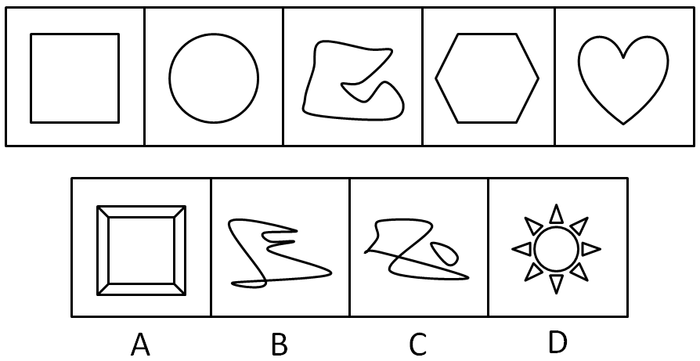

A. A

B. B

C. C

D. D

第 36 题 · 答案与解析

**参考答案（粉笔题库参考内容）**

B

**解析**

元素组成凌乱，考数数。

已知图形均可以一笔画成，四个选项中只有B项符合。

故正确答案为B。

**考点**：数量规律-线

**来源**：2009年江苏省公务员录用考试《行测》题（A类）第36题

### 第 37 题

在题干中给出一套图形，其中有五个图，这五个图呈现一定的规律性。在给出的另一套图形中，有四个图，从中选出唯一的一项作为保持左边五个图规律性的第六个图。

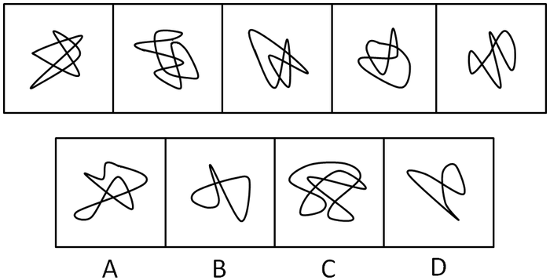

A. A

B. B

C. C

D. D

第 37 题 · 答案与解析

**参考答案（粉笔题库参考内容）**

B

**解析**

元素组成凌乱，考数数。

观察已知图形，发现复杂的线段依次把图形划分为8，7，6，5，4个封闭的部分，下一个应分为3个封闭部分，选项中面的数量分别是5、3、7、2。只有B项符合。

故正确答案为B。

**考点**：数量规律-面

**来源**：2009年江苏省公务员录用考试《行测》题（A类）第37题

### 第 38 题

在题干中给出一套图形，其中有五个图，这五个图呈现一定的规律性。在给出的另一套图形中，有四个图，从中选出唯一的一项作为保持左边五个图规律性的第六个图。

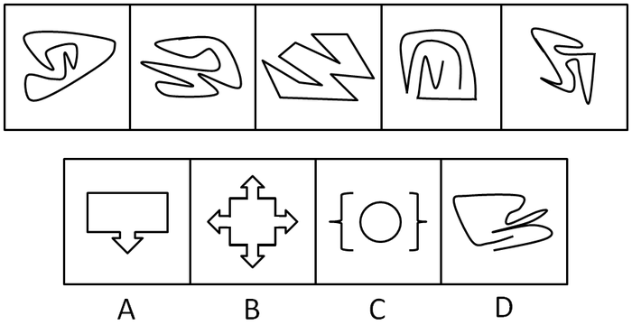

A. A

B. B

C. C

D. D

第 38 题 · 答案与解析

**参考答案（粉笔题库参考内容）**

D

**解析**

元素组成凌乱，结合选项来看，题干每幅图均为非对称图形，故选项也应遵循这一规律，只有D符合条件。

故正确答案为D。

**考点**：属性规律-对称性

**来源**：2009年江苏省公务员录用考试《行测》题（A类）第38题

### 第 39 题

在题干中给出一套图形，其中有五个图，这五个图呈现一定的规律性。在给出的另一套图形中，有四个图，从中选出唯一的一项作为保持左边五个图规律性的第六个图。

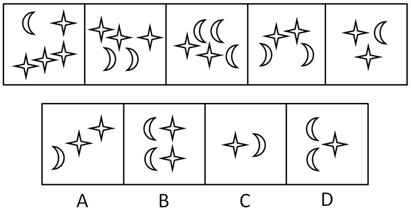

A. A

B. B

C. C

D. D

第 39 题 · 答案与解析

**参考答案（粉笔题库参考内容）**

D

**解析**

特殊考点-元素换算。一般两种或三种元素呈现数量变化时，考元素的换算。

已知图形中，假设1个星星=2个月亮，将题干图形全换算成月亮数，那么月亮数为9，8，7，6，5，下一个图形月亮数应为4。换算成星星和月亮组合，4个月亮=2个月亮+1个星星。

故正确答案为D。

**考点**：数量规律-素

**来源**：2009年江苏省公务员录用考试《行测》题（A类）第39题

### 第 40 题

在题干中给出一套图形，其中有五个图，这五个图呈现一定的规律性。在给出的另一套图形中，有四个图，从中选出唯一的一项作为保持左边五个图规律性的第六个图。

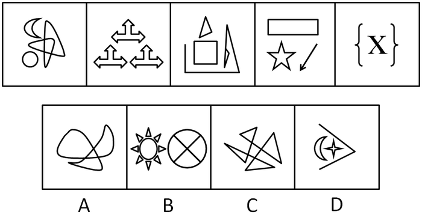

A. A

B. B

C. C

D. D

第 40 题 · 答案与解析

**参考答案（粉笔题库参考内容）**

D

**解析**

元素组成凌乱，考数数。

已知图形均由不相连的三部分组成。四个选项中，A项图形由一部分组成，B项图形由两部分组成，C项图形由一部分组成，D项图形由不连接的三部分组成。

故正确答案为D。

**考点**：数量规律-素

**来源**：2009年江苏省公务员录用考试《行测》题（A类）第40题

### 第 41 题

从所给的四个选项中，选择最合适的一个填入问号处，使之呈现一定的规律性：

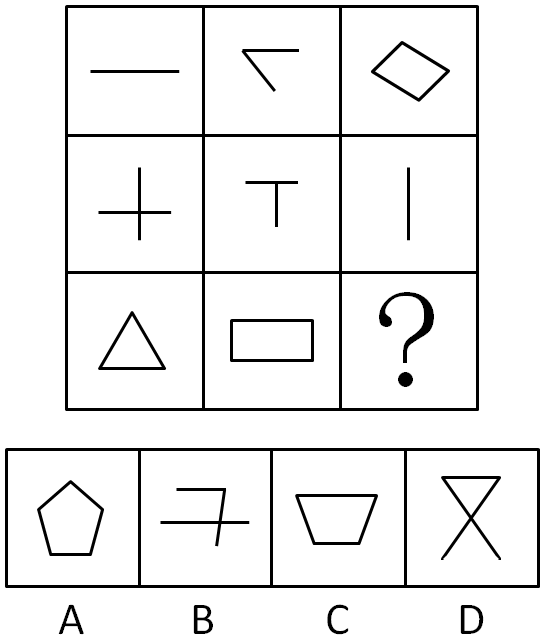

A. A

B. B

C. C

D. D

第 41 题 · 答案与解析

**参考答案（粉笔题库参考内容）**

A

**解析**

元素组成凌乱，考数数。

纵向观察，每一列中，第一个图形和第二个图形的线条数之和等于第三个图形的线条数，故第三列未知图形的线条数为 4+1=5条，A项符合。

故正确答案为A。

**考点**：数量规律-线

**来源**：2009年江苏省公务员录用考试《行测》题（A类）第41题

### 第 42 题

从所给的四个选项中，选择最合适的一个填入问号处，使之呈现一定的规律性：

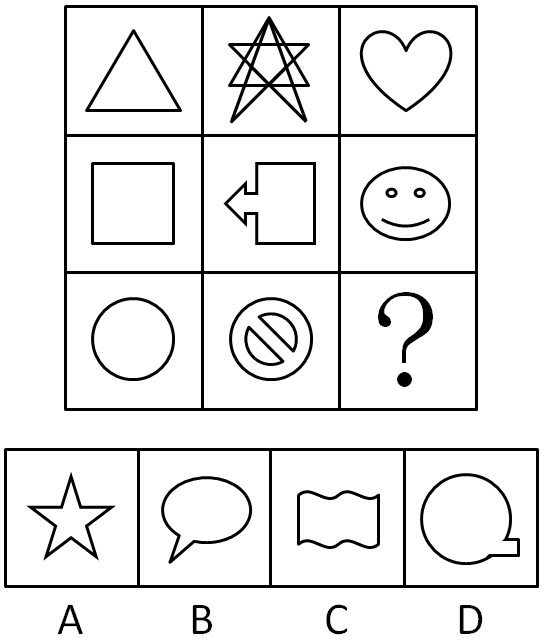

A. A

B. B

C. C

D. D

第 42 题 · 答案与解析

**参考答案（粉笔题库参考内容）**

A

**解析**

元素组成凌乱，考属性。

已知图形均为轴对称图形，符合这一规律的只有A项。

故正确答案为A。

**考点**：属性规律-对称性

**来源**：2009年江苏省公务员录用考试《行测》题（A类）第42题

### 第 43 题

从所给的四个选项中，选择最合适的一个填入问号处，使之呈现一定的规律性：

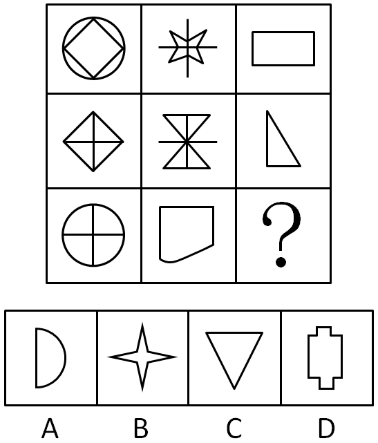

A. A

B. B

C. C

D. D

第 43 题 · 答案与解析

**参考答案（粉笔题库参考内容）**

D

**解析**

元素内部特征，已知图形均至少包含一个直角，四个选项中只有D项存在直角。

故正确答案为D。

**考点**：数量规律-角

**来源**：2009年江苏省公务员录用考试《行测》题（A类）第43题

### 第 44 题

从所给的四个选项中，选择最合适的一个填入问号处，使之呈现一定的规律性：

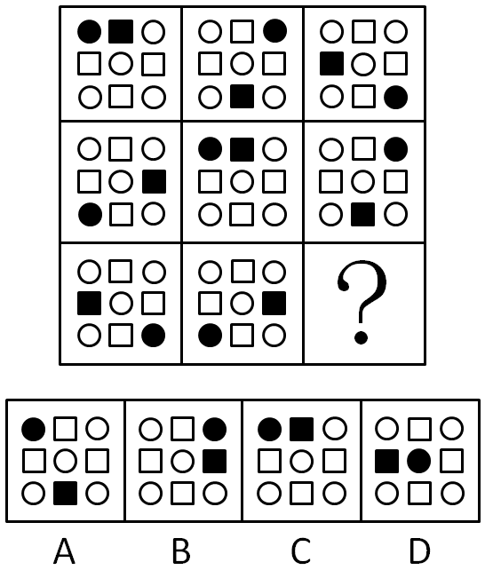

A. A

B. B

C. C

D. D

第 44 题 · 答案与解析

**参考答案（粉笔题库参考内容）**

C

**解析**

元素组成相同，优先考虑位置规律。

九宫格优先横行看，观察发现，每一行中，黑色圆圈依次顺时针移动两格，排除BD项。另外，每一行均有一个图形出现黑色圆圈和黑色小正方形并列的情况，只有C项符合。

故正确答案为C。

**考点**：位置规律-平移、数量规律-素、样式规律-遍历

**来源**：2009年江苏省公务员录用考试《行测》题（A类）第44题

### 第 45 题

从所给的四个选项中，选择最合适的一个填入问号处，使之呈现一定的规律性：

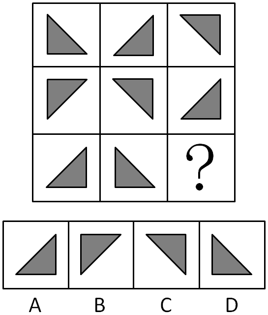

A. A

B. B

C. C

D. D

第 45 题 · 答案与解析

**参考答案（粉笔题库参考内容）**

B

**解析**

元素组成相同，考位置。

纵向观察，每一列中，第一个图形沿横轴翻转，得到第二个图形，第二个图形再沿斜边翻转180度，得到第三个图形。依此规律，第三列第三个图形应为B项图形。

故正确答案为B。

**考点**：位置规律-综合

**来源**：2009年江苏省公务员录用考试《行测》题（A类）第45题

### 第 46 题

凡是有利于两岸关系和平发展的事都应该大力推动，凡是破坏两岸关系和平发展的事都必须坚决反对。

据此，可以推出：

A. 凡应该大力推动的事都是有利于两岸关系和平发展的事

B. 凡必须坚决反对的事都是破坏两岸关系和平发展的事

C. 有些不利于两岸关系和平发展的事不应该大力推动

D. 有些不破坏两岸关系和平发展的事必须坚决反对

第 46 题 · 答案与解析

**参考答案（粉笔题库参考内容）**

C

**解析**

第一步：翻译题干。利用充分必要条件。

第一句：有利于两岸关系和平发展的事⇒应该大力推动。

第二句：破坏两岸关系和平发展的事⇒必须坚决反对。

第二步：逐一翻译选项并判断正确选项。利用逆否规则。

A项，凡是应该大力推动的事⇒有利于两岸关系和平发展的事，“应该大力推动的事”属于肯后件，无法推出绝对表达的结论，A项错误；

B项，凡是必须坚决反对的事⇒破坏两岸关系和平发展的事，“必须坚决反对的事”属于肯后件，无法推出绝对表达的结论，B项错误；

C项，-凡是有利于两岸关系和平发展的事⇒-应该大力推动，“-凡是有利于两岸关系和平发展的事”否定第一句中的前件，否定前件无法推出绝对表达的结论，但可以推出可能性结论，C项正确；

D项，-凡是破坏两岸关系和平发展的事⇒必须坚决反对，“-凡是破坏两岸关系和平发展的事”是否前件，无法推出绝对表达的结论，D项错误。

故正确答案为C。

**考点**：常规翻译

**来源**：2009年江苏省公务员录用考试《行测》题（A类）第46题

### 第 47 题

被所有人尊重的人也尊重所有人，张三不尊重李四。

据此，可以推出：

A. 所有人都尊重有些人

B. 有些人尊重所有人

C. 有些人尊重张三

D. 有些人不尊重张三

第 47 题 · 答案与解析

**参考答案（粉笔题库参考内容）**

D

**解析**

第一步：翻译题干。利用充分必要条件。

第一句：被所有人尊重的人⇒尊重所有人。

第二句：“张三不尊重李四”，即－尊重所有人。

第二步：由事实信息开始推导，并得出结论。利用逆否规则。

事实信息是张三：－尊重所有人⇒－被所有人尊重的人。即张三不是被所有人尊重的人，换句话说，不是所有人都尊重张三。A、B、C三项均无法根据题干推出。

故正确答案为D。

**考点**：集合推理

**来源**：2009年江苏省公务员录用考试《行测》题（A类）第47题

### 第 48 题

实行决策的民主化科学化就是听从专家的意见；如果听从专家的意见，就能避免决策失误。据此，可以推出（    ）。

A. 专家的意见有时并不一定正确

B. 只有听从专家的意见，才能避免决策失误

C. 如果不听从专家的意见，就不能避免决策失误

D. 如果不能避免决策失误，就不听从专家的意见

第 48 题 · 答案与解析

**参考答案（粉笔题库参考内容）**

D

**解析**

第一步：翻译题干。

①决策民主→听从专家

②听从专家→能避免失误

第二步：逐一判断选项。

A项，题干不存在体现该项意思的表述。该项不能推出，排除。

B项，由命题②可知，听从专家意见是避免决策失误的充分条件，但不一定是必要条件。该项不能推出，排除。

C项，在命题②中，否定前件后件未知，即无法推出“不听从专家→不能避免失误”。该项错误，排除。

D项，该项即“不能避免失误→不听从专家”，为命题②的逆否命题。可以推出，应选。

第三步：再次标注答案

故正确答案为D。

**考点**：常规翻译

**来源**：2009年江苏省公务员录用考试《行测》题（A类）第48题

### 第 49 题

所有行政管理专业的大四学生都报考了公务员，有的报考公务员的是党员，所有行政管理专业的大三学生都没有报考公务员。据此，可以推出（    ）。

A. 有的党员是行政管理专业的大四学生

B. 有的行政管理专业的大四学生是党员

C. 有的党员不是行政管理专业的大三学生

D. 有的行政管理专业的大三学生不是党员

第 49 题 · 答案与解析

**参考答案（粉笔题库参考内容）**

C

**解析**

第一步：翻译题干。

根据充分必要条件：

①行政管理专业的大四学生⇒报考公务员。

②有的报考公务员⇒党员。

③行政管理专业的大三学生⇒－报考公务员。

对于命题②，根据直言命题的对等关系，可得，④有的党员⇒报考公务员。

第二步：逐一判断选项。

A项，由题干可知，党员和报考公务员是交叉关系，而行政管理专业的大四学生真包含于报考公务员中，无法确定党员和行政管理专业的大四学生存在交叉关系，该项无法推出。

B项，由题干可知，党员和报考公务员是交叉关系，而行政管理专业的大四学生真包含于报考公务员中，因此无法确定党员和行政管理专业的大四学生之间是否存在交叉关系，该项无法推出。

C项，根据逆否规则，由③可知，报考公务员⇒－行政管理专业的大三学生，再加上④，可推出有的党员⇒－行政管理专业的大三学生，该项正确。

D项，所有行政管理专业的大三学生都没有报考公务员，有的报考公务员是党员，大三学生和不是党员之间无明显交叉关系，无法推知是否有的行政管理专业的大三学生不是党员，该项无法推出。

第三步：再次标注答案

故正确答案为C。

**考点**：集合推理

**来源**：2009年江苏省公务员录用考试《行测》题（A类）第49题

### 第 50 题

如果商品房价格太高，并且不注意改善质量，那么商品房的销售量就会下降。

据此，可以推出：

A. 如果商品房的销售量下降，那么，不是价格太高，就是不注意改善房屋质量

B. 如果商品房的销售量上升，那么，一定是降价售房和改善房屋质量了

C. 如果商品房价格太高，那么，如果不注意改善质量，商品房的销售量就会下降

D. 如果商品房价格太高，那么，即使注意改善质量，商品房的销售量也会下降

第 50 题 · 答案与解析

**参考答案（粉笔题库参考内容）**

C

**解析**

第一步：翻译题干。利用充分必要条件。

价格太高∧不注意改善质量⇒销售量下降。

第二步：逐一翻译选项并判断正确选项。利用逆否规则。

A项：销售量下降⇒价格太高∨不注意改善房屋质量；

B项：－销售量下降⇒－价格太高∧－不注意改善房屋质量；

C项：价格太高⇒（不注意改善质量⇒销售量下降）；

D项：价格太高⇒销售量下降。

A项，“销售量下降”是题干的后件，无法推出绝对表达的结论；

B项错误，根据逆否规则，题干的逆否命题为“-销售量下降⇒－（价格太高∧不注意改善质量）”，联言命题的否定是选言命题，即“-销售量下降⇒－（价格太高∧不注意改善质量）⇒－价格太高∨－不注意改善房屋质量”，B项不符合；

C项是嵌套关联词，其推导关系等价于“价格太高∧不注意改善质量⇒销售量下降”，与题干推导关系一致；

D项，题干前件是个联言命题，选项前件中的“价格太高”只是肯定了题干前件中的一部分，没有完全肯前，无法得出确定结论，D项错误。

故正确答案为C。

**考点**：常规翻译

**来源**：2009年江苏省公务员录用考试《行测》题（A类）第50题

### 第 51 题

某公司讨论在A、B、C、D等4处建立分公司的必要性。甲说：“分公司应建在A或D处。”乙说：“我不同意在A、D两处都建分公司。”丙说：“我经过调查确信，在A处建立分公司是非常不明智的想法。”后来事实证明，甲、乙、丙3人都说对了。

据此，可以推出分公司的应建地点是：

A. D处或B处

B. A处或C处

C. D处和C处

D. A处或B处

第 51 题 · 答案与解析

**参考答案（粉笔题库参考内容）**

A

**解析**

第一步：翻译题干。

（1）甲：建在A或D处；

（2）乙：不同意在A、D两处都建；

（3）丙：不在A处建；

（4）甲、乙、丙三人的说法都正确。

第二步：根据题干条件进行推理。

根据条件（3）和（4）可得，分公司不在A处建为真；因不在A处建，根据条件（1）可知，或关系“否一推一”，得出分公司建在D处，排除B、D两项；

条件中没有谈到B、C两处的情况，无法判断B处和C处是否应该建分公司，但分公司建在D处是确定的，或关系一真则真，故A项中的D处或B处一定成立，A项当选；

C项中的D处和C处为且关系，仅凭D处成立无法推出D处和C处一定成立，排除C项。

故正确答案为A。

**考点**：常规翻译

**来源**：2009年江苏省公务员录用考试《行测》题（A类）第51题

### 第 52 题

某班级有学生做好事不留名。甲、乙、丙、丁等4位老师对班上的4位学生表达了他们的看法。

甲说：“这件事如果不是张三做的，肯定就是赵六做的。”

乙说：“这件事如果是张三做的，那么李四或王五也会做。”

丙说：“这件事如果李四不做，则王五也不做；赵六也不会是做这件事的人。”

丁说：“这件事肯定是张三做的，而李四与王五都不会做。”

事后得知，四位老师的看法中只有一种是对的。

据此，可以推出做好事的学生是：

A. 张三

B. 李四

C. 王五

D. 赵六

第 52 题 · 答案与解析

**参考答案（粉笔题库参考内容）**

C

**解析**

第一步：翻译题干。

甲：－张三⇒赵六；

乙：张三⇒李四∨王五，［矛盾命题为：张三∧－（李四∨王五），根据摩根规则，该推导关系等价于，张三∧（－李四∧－王五）］；

丙：（－李四⇒－王五）∧－赵六；

丁：张三∧（－李四∧－王五）。

第二步：找突破口。

乙和丁构成矛盾关系。因此两人的话必有一真一假。

第三步：看其他的话。

由于四句话中只有一句是真的，因此甲和丙的话都为假。甲的话“－张三⇒赵六”为假，说明其矛盾命题“－张三∧－赵六”为真，即张三不做，赵六也不做。已知赵六不做，而丙的话为假，说明丙说的“－李四⇒－王五”必须为假。由“－李四⇒－王五”为假，可知其矛盾命题“－李四∧王五”为真，即这事李四不做，王五做。

故正确答案为C。

**考点**：只有一真/一假

**来源**：2009年江苏省公务员录用考试《行测》题（A类）第52题

### 第 53 题

在夏夜星空的某一区域，有7颗明亮的星星：A星、B星、C星、D星、E星、F星、G星，它们由北至南排列成一条直线，同时发现：（1）C星与E星相邻； （2）B星和F星相邻；（3）F星与C星相邻； （4）C星在B星北侧，且位于7颗星的正中。

据此，7颗星由北至南的顺序不可以是：

A. A星、D星、E星、C星、F星、B星、G星

B. G星、A星、E星、C星、F星、B星、D星

C. D星、G星、E星、C星、B星、A星、F星

D. G星、D星、E星、C星、F星、B星、A星

第 53 题 · 答案与解析

**参考答案（粉笔题库参考内容）**

C

**解析**

本题选项是每项均给出完整排列组合，所以可用排除法。

根据题干“F星与C星相邻”可以直接找到最不可能的排列顺序是C项。

故正确答案为C。

**考点**：排除法

**来源**：2009年江苏省公务员录用考试《行测》题（A类）第53题

### 第 54 题

某领导决定在王、陈、周、李、林、胡等6人中挑几人去执行一项重要任务，执行任务的人选应满足以下所有条件：王、李两人中只要一人参加；李、周两人中也只要一人参加；王、陈两人至少有一人参加；王、林、胡3人中应有两人参加；陈和周要么都参加，要么都不参加；如果林参加，李一定要参加。

据此，可以推出：

A. 王、陈不参加

B. 林、胡不参加

C. 周、李不参加

D. 李、林不参加

第 54 题 · 答案与解析

**参考答案（粉笔题库参考内容）**

D

**解析**

第一步：观察题干。

如题目的题干中涉及多个对象，题干条件之间的逻辑关系不是很强时，最佳的答题方法是结合选项进行排除。

第二步：逐一排除选项。

由“王、陈两人至少有一人参加”可知，A项“王、陈不参加”不正确；

由“王、林、胡3人中应有两人参加”可知，B项“林、胡不参加”不正确；

由“李、周两人中也只要一人参加”可知，C项“周、李不参加”不正确；

故正确答案为D。

**考点**：排除法

**来源**：2009年江苏省公务员录用考试《行测》题（A类）第54题

### 第 55 题

张三、李四得知，共有甲、乙、丙、丁等4支代表队分获了15个项目（分别以序数表示）的奖牌，其中，甲队获得第1、4、12项目的奖牌；乙队获得第2、4、7、8、11项目的奖牌；丙队获得第4、5、6、12、13项目的奖牌；丁队获得第1、5项目的奖牌。王五从四支代表队获奖的15个项目中挑出一个单独告诉了李四，而将获得该项目奖牌的代表队名称单独告诉了张三。王五对他们分别讲完，李四就说：“我不知道是哪支代表队获得这个项目的奖牌。”张三听了，就说：“我知道那个项目了。”李四马上也说：“我也知道那支代表队了。”

据此，可以推出王五挑出的代表队和项目分别是：

A. 甲队，第1项目

B. 乙队，第4项目

C. 丙队，第12项目

D. 丁队，第5项目

第 55 题 · 答案与解析

**参考答案（粉笔题库参考内容）**

B

**解析**

第一步：整合题目信息。

甲队获奖项目：1、4、12。

乙队获奖项目：2、4、7、8、11（2、7、8、11是单队获奖项目）。

丙队获奖项目：4、5、6、12、13（6、13是单队获奖项目）。

丁队获奖项目：1、5。

张三知道队名，李四知道项目。

第二步：结合其他的话。

李四不知道哪只队，说明李四知道的项目是个多个队伍获得的项目，因此排除单队获奖项目2、6、7、8、11、13，剩下1、4、5、12。

听李四说不知道哪只队伍，张三就知道了项目，说明张三知道的队伍，只取得了一个多队获奖的项目，就是项目4。

李四听张三确定了项目后，他也确定了队伍，说明李四知道的项目，是这个队伍中唯一的多对获奖项目，这个队伍就是乙队。

故正确答案为B。

**考点**：组合排列-单题-其他

**来源**：2009年江苏省公务员录用考试《行测》题（A类）第55题

### 第 56 题

利他行为：指人们出于自愿、不指望任何报酬的帮助他人的行为。

下列属于利他行为的是：

A. 小张营救失足落水儿童余某，事后希望余某家人付给其报酬

B. 小李制服企图抢劫的歹徒。事后，单位奖励他人民币5000元

C. 战士小李十年如一日，坚守边疆，荣立三等功

D. 丁某发现自己家中失火，迅速拨打119，并协助消防人员灭火

第 56 题 · 答案与解析

**参考答案（粉笔题库参考内容）**

B

**解析**

第一步：抓住定义中的关键词。

该定义的关键词是“出于自愿”，“不指望任何报酬”且是“帮助他人”的行为。

第二步：逐一判断选项。

A项有报酬的要求，不符合定义；

B项小李获得的5000元是单位事后奖励的，在制服歹徒时，他没有指望任何报酬，符合利他行为的定义；

C项驻守边疆是战士的职责，不是帮助他人的行为，不符合定义；

D项扑救自己家的火灾，是自助行为，也不符合定义。

故正确答案为B。

**考点**：单定义-其他句式

**来源**：2009年江苏省公务员录用考试《行测》题（A类）第56题

### 第 57 题

角色压力：指在组织或一特定的社会环境中，因有不利因素干扰角色任务的运作，致使个人陷入无所适从的困境。

下列属于角色压力的是：

A. 职场女性赶时间上班，赶时间买菜、做饭，还得抽空和家人联络感情等等，总是觉得没有真正属于自己的时间

B. 小李上班不想家务事，回家也不想工作，工作生活两不误

C. 银行要求职员对顾客笑脸相迎，但有些人感到很难做到

D. 张老师最近教学任务繁重，出版社又向他约稿，他忙得不亦乐乎

第 57 题 · 答案与解析

**参考答案（粉笔题库参考内容）**

A

**解析**

第一步：抓住定义中的关键词。

该定义中的关键词包括“不利因素干扰”，“陷入无所适从的困境”。

第二步：逐一判断选项。

A项表达的是职业女性的个人时间受到工作、家庭和感情等不利因素干扰，以致陷入了“觉得没有真正属于自己的时间”这样的困境，符合定义；

B项“工作生活两不误”没有体现出“无所适从的困境”；

C项“对顾客笑脸相迎”为角色任务，不是不利因素；

D项“忙得不亦乐乎”没有体现“无所适从的困境”。

B、C、D均不符合定义。

故正确答案为A。

**考点**：原因结果

**来源**：2009年江苏省公务员录用考试《行测》题（A类）第57题

### 第 58 题

精神磨损：指机器、设备等资产由于科学技术的进步而贬值。

下列属于精神磨损的是：

A. 某企业有一台高精度磨床，使用年限为10年，但是由于高频率使用，仅仅两年，一些主要部件已经需要更换

B. 找到新工作后，小陈购买了一价格昂贵的手提电脑。仅仅过了一年，该电脑虽然保养如新，但是已经不值多少钱了

C. 老蔡是一位远近知名的质朴木匠，对于电刨、电锯，就是觉得不顺手，因此他帮人家打家具时所用的刨、锯等木工用具仍然是传统的

D. 某企业进口了一套最先进的冶炼设备，但由于技术人员积极性不高，致使这些进口设备的效率并没有充分发挥

第 58 题 · 答案与解析

**参考答案（粉笔题库参考内容）**

B

**解析**

第一步：抓住定义中的关键词。

该定义中的关键词为“由于科学技术的进步”而“贬值”。

第二步：逐一判断选项。

A项是磨床的一些主要部件需要更换是“由于高效率使用”，不符合定义；

B项小陈电脑贬值是由于生产力的发展，技术的进步而引起的，符合定义；

C项不涉及贬值问题，不符合定义；

D项是由于技术人员没有积极地发挥设备的效率，也不符合定义。

故正确答案为B。

**考点**：原因结果

**来源**：2009年江苏省公务员录用考试《行测》题（A类）第58题

### 第 59 题

虚假安全：指在高度紧张状态下大脑处于极度兴奋中，反而不容易出问题；而在接近成功状态下精神越来越放松，顿时有了安全感，然而恰恰是这一瞬间的放松，酿成大祸。

下列属于虚假安全的是：

A. 一些唯利是图的中介机构，暗示、提醒、协助高危企业炮制虚假材料，骗取安全生产许可证

B. 利空出尽是利好，许多股票都会在出了不尽如人意的年报后走出一波蓬勃向上的行情

C. 高考前，小李总觉得睡眠不足，可是高考结束了，小李却经常睡不着

D. 在热电厂这种特殊行业，在用电高峰期、恶劣天气下，一般不会出现人为误操作的事故；但在平时，事故却是屡见不鲜

第 59 题 · 答案与解析

**参考答案（粉笔题库参考内容）**

D

**解析**

第一步：找出定义关键词。

“高度紧张状态下大脑极度兴奋，反而不容易出问题”、“接近成功状态下精神越来越放松，却酿成大祸”。

第二步：逐一分析选项。

A项：中介机构骗取安全生产许可证，不涉及精神状态的变化，不符合“高度紧张状态下大脑极度兴奋，反而不容易出问题”、“接近成功状态下精神越来越放松，却酿成大祸”，不符合定义，排除；

B项：股票行情的利空和利好，不涉及精神状态的变化，不符合“高度紧张状态下大脑极度兴奋，反而不容易出问题”、“接近成功状态下精神越来越放松，却酿成大祸”，不符合定义，排除；

C项：小李高考前睡眠不足，高考后经常失眠，不符合“高度紧张状态下大脑极度兴奋，反而不容易出问题”、“接近成功状态下精神越来越放松，却酿成大祸”，不符合定义，排除；

D项：热电厂在特殊情况下一般不会出现人为事故，而在平常放松状态下常发事故，符合“高度紧张状态下大脑极度兴奋，反而不容易出问题”、“接近成功状态下精神越来越放松，却酿成大祸”，符合定义，当选。

故正确答案为D。

**考点**：原因结果

**来源**：2009年江苏省公务员录用考试《行测》题（A类）第59题

### 第 60 题

病态怀旧心理：总是沉溺于对过去的追忆，不厌其烦地重复叙述往事和过去的环境、条件。

下列不属于病态怀旧心理的是：

A. 小张换了新单位之后，总是抱怨现状，总是说原单位多么多么好

B. 依恋过去的经历，过分看重过去的功，把所获得的奖状、勋章、奖品保存得完美无缺，时常回忆当年那辉煌的经历

C. 依恋过去的友人，难以结交新朋友，个人交际圈难以扩大

D. 独在异乡为异客，每逢佳节倍思亲

第 60 题 · 答案与解析

**参考答案（粉笔题库参考内容）**

D

**解析**

第一步：抓住定义中的关键词。

定义中的关键词为“沉溺于对过去的追忆”，“重复叙述往事和过去的环境、条件”。

第二步：逐一判断选项。

A项小张“总是说原单位多么多么好”，符合定义；

B项“依恋过去的经历”、“过分着重过去的功绩”、“时常追忆当年的经历”，符合定义；

C项“依恋过去的友人”以致难以结交新朋友和扩大个人交际圈，符合定义；

D项表达的是思乡之情，没有体现“沉溺于对过去的追忆”，不符合定义。

本题为选非题，故正确答案为D。

**考点**：拆词

**来源**：2009年江苏省公务员录用考试《行测》题（A类）第60题

### 第 61 题

定义：

①赡养：晚辈亲属对长辈亲属的扶助和供养。

②抚养：长辈亲属对晚辈亲属或兄、姐对未成年弟、妹的扶助和供养。

③扶养：在各种社会关系中，针对“弱者”所发生的经济供养和生活扶助。

典型例证：

（1）小张因失业没有收入，现由小张的弟弟为其无偿提供住宿和生活费用。

（2）出租车司机老李除了提供家庭日常生活费用外，还供养年老丧失劳动力的父母，天天忙得乐呵呵的。

（3）对于地震灾害中失去双亲的未成年孤儿，由政府提供他们的生活和学习。

上述典型例证与定义存在对应关系的数目有：

A. 0个

B. 1个

C. 2个

D. 3个

第 61 题 · 答案与解析

**参考答案（粉笔题库参考内容）**

C

**解析**

第一步：抓住每个定义中的关键词。

赡养：关键词是“晚辈亲属对长辈亲属”；

抚养：关键词是“长辈亲属对晚辈亲属”或“兄、姐对未成年弟、妹”；

扶养：关键词是“针对‘弱者’ ”。

第二步：逐一判断选项。

例证（1）：是小张的弟弟为小张无偿提供住宿和生活费用，不属于晚辈亲属对长辈亲属，也不属于长辈亲属对晚辈亲属，小张也不是“弱者”，因此不满足上述定义；

例证（2）：老李供养年老丧失劳动力的父母，符合“赡养”的定义；

例证（3）：政府提供生活和学习费用给地震中失去双亲的未成年孤儿，符合“扶养”的定义。

本题共有两个例证符合定义。

故正确答案为C。

**考点**：特殊问法

**来源**：2009年江苏省公务员录用考试《行测》题（A类）第61题

### 第 62 题

定义：

①自我意识：指一个人对自己的认识和评价，包括对自己心理倾向、个性心理特征和心理过程的认识与评价。

②原意识：指由动物（特指猿群）进化而来的适合人类个体生存的基本感知。

③显层意识：指个体在人类群体（社会）中受到教育的感知结果。

典型例证：

（1）尊老爱幼是中华民族的传统美德之一。

（2）智能机器人能够具有基本的光感、热感和电磁感。

（3）学生认为自己很优秀。

上述典型例证与定义存在对应关系的数目有：

A. 0个

B. 1个

C. 2个

D. 3个

第 62 题 · 答案与解析

**参考答案（粉笔题库参考内容）**

C

**解析**

第一步：抓住每个定义中的关键词。

自我意识：关键词是“一个人对自己”的“认识和评价”；

原意识：关键词是“由动物（特指猿群）进化而来”的“适合人类个体”；

显层意识：关键词是“个体在人类群体（社会）”“受到教育”。

第二步：逐一判断选项。

例证（1）对应“显层意识”的定义，作为中华民族的子孙，我们从小就受到教育，要做到“尊老爱幼”；

例证（2）的主体是“智能机器人”，不满足题干任一定义；

例证（3）是学生对自己的认识和评价，对应“自我意识”的定义。

故正确答案为C。

**考点**：特殊问法

**来源**：2009年江苏省公务员录用考试《行测》题（A类）第62题

### 第 63 题

定义：

①接近权：指大众即社会的每一个成员都有接近、利用媒介发表意见、观点的自由权利，实际上是通过新闻媒介而实现的表达权。

②更正权：指当与己有关的报道出现错误时，当事者拥有要求同一传媒予以更正或登载反驳文章的权利。

③知晓权：指公民能够不受阻挠地理解国家政务信息的权利，也指公民接近大众传媒产业及军事产业、公害产业所拥有的信息的权利。

典型例证：

（1）很多媒体鼓励受众参与媒介的娱乐节目或媒介发起的社会活动，在媒介上刊播新闻性、文艺性、学术性作品等等。

（2）何某被误抓后释放。在被关押期间，电视台应公安局之邀将此事制成新闻播放。为此，何某诉至法院，要求电视台为其恢复名誉，赔礼道歉并赔偿其精神损失费。

（3）小张在高考中落榜，他强烈要求了解高考命题、阅卷的详细程序及具体人员。

上述典型例证与定义存在对应关系的数目有：

A. 0个

B. 1个

C. 2个

D. 3个

第 63 题 · 答案与解析

**参考答案（粉笔题库参考内容）**

C

**解析**

第一步：抓住每个定义中的关键词。

接近权：关键词是“通过新闻媒介而实现的表达权”；

更正权：关键词是“与己有关的报道出现错误”，“要求同一传媒予以更正或登载反驳文章的权利”；

知晓权：关键词是理解“国家政务信息”的权利，“接近大众传媒产业及军事产业、公害产业”所拥有的信息。

第二步：逐一判断选项。

例证（1）“参与媒介的娱乐节目或媒介发起的社会活动，在媒介上刊播新闻性、文艺性、学术性作品”符合“接近权”的定义；

例证（2）何某是被误抓，因此电视台之前的报道有误，他要求电视台为其恢复名誉，赔礼道歉并作出赔偿，符合“更正权”的定义；

例证（3）小张要求了解的信息不属于“国家政务信息”，也不属于“大众传媒产业及军事产业、公害产业”，不符合“知晓权”的定义。

故正确答案为C。

**考点**：特殊问法

**来源**：2009年江苏省公务员录用考试《行测》题（A类）第63题

### 第 64 题

定义：

①送别诗：指抒发诗人离别之情的诗歌。

②田园诗：指歌咏田园生活的诗歌。

③咏史诗：指以历史题材为咏写对象的诗歌。

典型例证：

（1）李白乘舟将欲行，忽闻岸上踏歌声。桃花潭水深千尺，不及汪伦送我情。

——李白《赠汪伦》

（2）种豆南山下，草盛豆苗稀。晨兴理荒秽，带月荷锄归。道狭草木长，夕露沾我衣。衣沾不足惜，但使愿无违。

——陶渊明《归园田居之三》

（3）折戟沉沙铁未销，自将磨洗认前朝。东风不与周郎便，铜雀春深锁二乔。

——杜牧《赤壁》

上述典型例证与定义存在对应关系的数目有：

A. 0个

B. 1个

C. 2个

D. 3个

第 64 题 · 答案与解析

**参考答案（粉笔题库参考内容）**

D

**解析**

第一步：抓住每个定义中的关键词。

送别诗：抒发“离别之情”；

田园诗：歌咏“田园生活”；

咏史诗：咏写对象为“历史题材”。

第二步：逐一判断选项。

例证（1）根据诗句“不及汪伦送我情”可知诗人抒发了对汪伦深情送别的感激之情，属于送别诗；

例证（2）从标题《归园田居之三》及全诗描写的内容都与田园生活有关，可知此为田园诗；

例证（3）诗人杜牧以“赤壁之战”这一历史题材为对象，抒发了诗人对国家兴亡的感慨，属于咏史诗。

故正确答案为D。

**考点**：特殊问法

**来源**：2009年江苏省公务员录用考试《行测》题（A类）第64题

### 第 65 题

定义：

①社会组织：指人们为实现特定目标而建立的共同活动的群体。

②社会设置：指用来满足社会基本需要的社会结构中相对稳定的一组要素。

③社会分层：指按照一定的标准将人们区分为高低不同的等级序列。

典型例证：

（1）在古罗马，人们的社会身份有贵族、骑士、平民和奴隶。

（2）一个社会生养后代、教育年轻人的功能一般由家庭来完成。

（3）公务员之间的友好关系大多是在共同的工作中建立起来的。

上述典型例证与定义存在对应关系的数目有：

A. 0个

B. 1个

C. 2个

D. 3个

第 65 题 · 答案与解析

**参考答案（粉笔题库参考内容）**

C

**解析**

第一步：抓住每个定义中的关键词。

社会组织：关键词是“为实现特定目标而建立”的“共同活动的群体”；

社会设置：关键词是“用来满足社会基本需要”的“社会结构中”的“相对稳定的一组要素”；

社会分层：关键词是“高低不同的等级序列”。

第二步：逐一判断选项。

例证（1）：“贵族、骑士、平民和奴隶”属于“高低不同的等级序列”，符合“社会分层”的定义；

例证（2）：对于一个社会而言，它的一个基本需要就是以社会所认同的方式来生养后代、教育年轻人。这个任务是由家庭这个社会结构完成的。由家庭来完成“生养后代、教育年轻人的功能”符合“社会设置”的定义；

例证（3）：虽然提到“共同的工作”，但由此建立的是“公务员之间的友好关系”，而非某一“群体”，不符合“社会组织”的定义。

故正确答案为C。

**考点**：特殊问法

**来源**：2009年江苏省公务员录用考试《行测》题（A类）第65题

### 第 66 题

虽然中国现行文物法规中还缺少直接针对世界文化遗产的具体条款，世界文化遗产的概念与内涵和我国的文物保护单位还不能简单对接，但是中国遗产保护的实践充分证明，文物法的基本精神以及党和国家文物工作的方针，完全适用于世界文化遗产领域，世界文化遗产的特性与各级文物保护单位的本质是相同又相通的。

这段文字讨论的问题是：

A. 中国现行文物法规有哪些主要特点

B. 中国遗产保护实践与世界文化遗产的特性

C. 怎样看待中国遗产保护的实践工作

D. 中国文物法是否适用于世界文化遗产领域

第 66 题 · 答案与解析

**参考答案（粉笔题库参考内容）**

D

**解析**

由转折关系词“但是”可知，整个材料的语意重点是其后的内容，即中国文物法的基本精神以及党和国家文物工作的方针，是适用于世界文化遗产领域的。因此，可知本段文字探讨的问题是中国文物法是否适用于世界文化遗产领域，D项表述正确。A项“特点”无中生有；B、C两项，文段重点并非“中国遗产保护的实践”。

故正确答案为D。

**考点**：关联词-转折

**来源**：2009年江苏省公务员录用考试《行测》题（A类）第66题

### 第 67 题

一切历史都是现实，现实之外别无历史。所谓“现实之外”同“世界之外”一样，只在纯语言学意义上和逻辑学意义上才有可能。现实之外并不是“非历史”，现实之前也不是“前历史”。我们不能说先有历史后有现实，而只能说有历史就有现实；既不能笼统地说历史先在于现实，也不能抽象地说历史使现实得以存在。

下列说法不符合文意的是：

A. 历史存在于现实之中

B. 没有现实就没有历史

C. 历史与现实并无差别

D. “现实之外”并不存在

第 67 题 · 答案与解析

**参考答案（粉笔题库参考内容）**

C

**解析**

根据提问方式可知本题为细节判断题。

C项“历史与现实并无差别”在文中毫无提及，无从得知。

根据文中表述“现实之外别无历史”可知A项“历史存在于现实之中”表述是正确的；此外也可推知历史依托于现实，“没有现实就没有历史”，即B项也是正确的；根据文中的表述“现实之外”只在纯粹的语言学意义上和逻辑学意义上才有可能可知D项“现实之外”并不存在，故D项正确。

本题为选非题，故正确答案为C。

**考点**：细节判断题

**来源**：2019年福建省选调生考试《行政职业能力测验》第48题

### 第 68 题

有一些动物实验表明，服用阿斯巴甜能够增加白血病、淋巴癌的发病率；但FDA认为这些实验的设计、处理、解释等方面都存在缺陷。其他的研究则表明阿斯巴甜无害，例如2006年美国国家癌症研究所发布的对47万多人的研究结果表明，阿斯巴甜的使用与白血病、淋巴癌、脑瘤的发病率不存在显著相关性。

下列说法符合文意的是：

A. 阿斯巴甜对人的作用尚待证实

B. 阿斯巴甜对动物的危害已经确定

C. 阿斯巴甜不会引起人类的疾病

D. 阿斯巴甜的研究结果其实不可信

第 68 题 · 答案与解析

**参考答案（粉笔题库参考内容）**

A

**解析**

此题为细节判断题。

材料首先说一些动物实验表明“阿斯巴甜”能够增加白血病和淋巴癌的发病率，然后又提到其他的研究表明“阿斯巴甜与白血病、淋巴癌、脑瘤的发病率不存在显著的相关性”。

由此可知现在对于阿斯巴甜的作用尚无确定性结论，所以A项表述符合文意。

通过文中FDA的观点可知阿斯巴甜对于动物的危害尚无确定性结论，B项错误；C项表述过于绝对，且文段中也没有论点支撑，因此也是错误的；D项“研究结果不可信”无法从文中得出，予以排除。

故正确答案为A。

**考点**：细节判断题

**来源**：2009年江苏省公务员录用考试《行测》题（A类）第68题

### 第 69 题

市场优化资源配置的机制，要求每个人应该拥有同等的竞争和选择权利，反映到公共领域，就是确立以投票表决为中心的民主程序。因为公共事务的决策会影响到每个人的利益消长，所以民主的作用就是保障每个人拥有平等的经济权益和交易地位。

这段文字主要说明的是：

A. 市场经济与民主的关系

B. 公共事务应该怎样决策

C. 民主与个人经济权益的关系

D. 民主如何保障平等权利

第 69 题 · 答案与解析

**参考答案（粉笔题库参考内容）**

C

**解析**

由提问标志词“主要说明”可知本题为中心理解题。

文段首先引出要求确立民主程序，然后第二句话提出民主的作用是保障每个人拥有平等的经济权益和交易地位，即指出了民主与个人经济利益的关系。

所以C项正确。

题中没有提到市场经济与民主的关系，所以A项错误；B、D两个选项偏离了本题文段内容，所以也是错误的。

故正确答案为C。

**考点**：主题词

**来源**：2009年江苏省公务员录用考试《行测》题（A类）第69题

### 第 70 题

经济学家告诉投资者要分析金融资产的基本面，可是股票的价格并不是纯粹由基本面决定的。任何投资者都是影响金融市场波动的参与者，有实力的投资者必定会对金融市场施加影响，索罗斯称为“参与功能”或“操纵功能”。如果不能把参与功能或操纵功能考虑到资产估值模型中，那么所有的估值模型最终都会被证明是失败的。

下列说法不符合文意的是：

A. 金融资产基本面是投资必须注意的

B. 股票价格不是由金融资产基本面决定的

C. 投资者的参与也可能引起市场波动

D. 资产估值模型要考虑投资者施加的影响

第 70 题 · 答案与解析

**参考答案（粉笔题库参考内容）**

B

**解析**

根据文段表述“可是股票的价格并不是纯粹由基本面决定的”可知B项表述有误，过于绝对；根据文段首句“经济学家告诉投资者要分析金融资产的基本面”可知A项表述正确；根据文段表述“任何投资者都是影响金融市场波动的参与者”可知C项表述正确；根据文段尾句“如果不能把参与功能或操纵功能考虑到资产估值模型中，那么所有的估值模型最终都会被证明是失败的”可知D项表述正确。

本题为选非题，故正确答案为B。

**考点**：细节判断题

**来源**：2009年江苏省公务员录用考试《行测》题（A类）第70题

### 第 71 题

我国历来高度重视反假币工作，始终坚持“打防并举，标本兼治”，相关部门密切配合、通力协作，反假币工作逐步深入。公安机关加大打击力度，侦破了一大批大案要案。人民银行联合相关部门，加大反假币宣传，特别是在农村偏远地区，通过各种形式，持续宣传货币防伪常识，社会公众识假辨假的意识和能力得到有效提高。

下列说法准确概括文意的是：

A. 银行目前发现的假币越来越少

B. 社会公众识别假币能力提高

C. 我国反假币工作逐步得到深入

D. 公安机关打击假币力度加大

第 71 题 · 答案与解析

**参考答案（粉笔题库参考内容）**

C

**解析**

由提问标志词“概括”可判断出本题为中心理解题。

阅读可知，本题是典型的总—分式文章结构。

文段首句提到了核心的观点，即我国反假币工作逐步深入，接下来分别陈述了具体执行机构的做法，对首句核心观点进行论述说明。由此可知概括文意最准确的一项是C项。

“越来越少”在文中并未提及，无从得出，A项表述不妥；B项和D项仅仅是“分”论点中的具体内容，并非核心观点根据文段表述。

故正确答案为C。

**考点**：分述句特征-其他

**来源**：2009年江苏省公务员录用考试《行测》题（A类）第71题

### 第 72 题

尽管社会主流观点往往宣扬“做人要乐观”的信念，有些科学家还是对此持有不同观点：负面情绪也是我们与生俱来的特征，是平衡精神健康的重要一环。针对目前抗抑郁药物使用量与日俱增的情况，很多精神病学家提出了质疑，他们认为这些药物的滥用不但带来后果严重的副作用，还打破了人类情绪的平衡。

这段文字表达的主要观点是：

A. 应该质疑“做人要乐观”的信念

B. 负面情绪对精神健康并非无益

C. 使用抗抑郁药物不要过多过滥

D. 平衡精神健康就不能一味乐观

第 72 题 · 答案与解析

**参考答案（粉笔题库参考内容）**

B

**解析**

由提问方式可知本题为中心理解题。

文段首句就提到“有些科学家还是对此持有不同观点”之后用冒号连接，即其后的内容即为答案，“负面情绪也是我们与生俱来的特征，是平衡精神健康的重要一环”，之后的语句都是对此观点的解释说明，说明负面情绪的作用。

符合该观点的选项即为B项。

A选项片面的截取了文段开头的观点，不正确；C选项是支撑B选项的论点，不全面；D选项无法从文中得到考证。

故正确答案为B。

**考点**：关联词-转折

**来源**：2009年江苏省公务员录用考试《行测》题（A类）第72题

### 第 73 题

在古代科学文化巅峰的雅典，哲学家苏格拉底被视为“最有智慧的人”。哲学家却总是强调：“我只知道我一无所知。”他向人们解释说：如果说他的智慧有什么与众不同的话，那就是他知道自己的无知；其他人虽然也与他一样的无知，却不知道自己的无知。

下列说法准确概括文意的是：

A. 苏格拉底不愿被称为“最智慧的人”

B. 苏格拉底实际上不是“最智慧的人”

C. 苏格拉底的“智慧”在于知道自己“无知”

D. 苏格拉底的“智慧”与他人没有不同

第 73 题 · 答案与解析

**参考答案（粉笔题库参考内容）**

C

**解析**

由提问标志词“概括”可判断出本题为中心理解题。

根据转折关系词“却”可知，整个材料的语意重点在于其后的内容，即苏格拉底的“智慧”在于知道自己的“无知”，C项表述正确。

A项“不愿被称”表述有误，文中并无此意；B项实际上也不是本文段含义；D项“与他人没有不同”一句表述有误，实际上是有区别的，即是否知道自己无知的区别。

故正确答案为C。

**考点**：关联词-转折

**来源**：2009年江苏省公务员录用考试《行测》题（A类）第73题

### 第 74 题

西方近代科学的发展，很大程度上建立在对客观对象的分析以及认识手段不断更新的基础之上。中国传统思维方式注重直观判断与综合，强调对客观世界的整体性认识。在对具体对象的细究与深层次分析方面，中国传统思维方式不具有近代以来西方思维方式的优势，从而限制了近代科学技术在中国的产生与发展。

这段文字主要说明的是（  ）。

A. 西方近代科学发展的主要原因

B. 中国传统思维方式的主要特点

C. 中国科技落后有思维方式的影响

D. 中国与西方的思维方式各具特点

第 74 题 · 答案与解析

**参考答案（粉笔题库参考内容）**

C

**解析**

本题属于中心理解题。文段首句先提出了西方近代科学发展所依靠的思维方式，接着又介绍了中国传统思维方式与西方的差别。最后指出正是由于这种差别造成了“中国传统思维方式不具有近代以来西方思维方式的优势，从而限制了近代科学技术在中国的产生与发展”。可知，文段强调的是我国的传统思维方式对我国科技发展的影响。结合选项，C项是对文段中心的同义转换，当选。

A、B、D三项均偏离文段中心，排除。

故正确答案为C。

**考点**：主题词

**来源**：2009年江苏省公务员录用考试《行测》题（A类）第74题

### 第 75 题

对后现代文化有一种概括就是：中心变成了边缘，系统变成了断裂，整体变成了碎片，深度变成了平面，价值变成了虚无。在后现代艺术中，复制取代了原创，操作取代了想象，破碎取代了整体，过程取代了作品。艺术形象完全变成了模型的模型、模仿的模仿。

这段文字反映出作者对后现代文化的态度是（  ）。

A. 欣然认同

B. 不能接受

C. 勉强接受

D. 不置可否

第 75 题 · 答案与解析

**参考答案（粉笔题库参考内容）**

B

**解析**

本题属于中心理解题。由文段中“边缘”、“断裂”、“碎片”、“虚无”、“复制”、“破碎”、“模型的模型”、“模仿的模仿”等词可知，作者对后现代文化的态度是消极、否定的。结合选项，只有B项符合。

故正确答案为B。

**来源**：2009年江苏省公务员录用考试《行测》题（A类）第75题

## 材料 1

地震发生时，最基本的现象是地面的连续振动，主要是明显的晃动。极震区的人在感到大的晃动之前，有时首先感到上下跳动。这是因为地震波从地内向地面传来，纵波首先到达的缘故。横波接着产生大振幅的水平方向的晃动，是造成地震灾害的主要原因。1960年智利大地震时，最大的晃动持续了3分钟。地震造成的灾害首先是破坏房屋和构筑物，如1976年中国河北唐山地震中，70%～80%的建筑物倒塌，人员伤亡惨重。

        地震对自然界景观也有很大影响。最主要的后果是地面出现断层和地裂缝。大地震的地表断层常绵延几十至几百千米，往往具有较明显的垂直错距和水平错距，能反映出震源处的构造变动特征。但并不是所有的地表断裂都直接与震源的运动相联系，它们也可能是由于地震波造成的次生影响。特别是地表沉积层较厚的地区，坡地边缘、河岸和道路两旁常出现地裂缝，这往往是由于地形因素，在一侧没有依托的条件下晃动使表土松垮和崩裂。地震的晃动使表土下沉，浅层的地下水受挤压会沿地裂缝上升到地表，形成喷沙冒水现象。大地震能使局部地形改观，或隆起，或沉降，使城乡道路坼裂、铁轨扭曲、桥梁折断。在现代化城市中，由于地下管道破裂和电缆被切断造成停水、停电和通讯受阻。煤气、有毒气体和放射性物质泄漏可导致火灾和毒物、放射性污染等次生灾害。在山区，地震还能引起山崩和滑坡，常造成掩埋村镇的惨剧。崩塌的山石堵塞江河，在上游形成地震湖。

### 第 76 题

文中提到“唐山地震中，70%～80%的建筑物倒塌，人员伤亡惨重”，旨在说明：

A. 地震的表现即地面的破坏

B. 地震首先破坏地面建筑物

C. 地震灾害后的主要表现

D. 地震带给人类巨大的伤害

第 76 题 · 答案与解析

**参考答案（粉笔题库参考内容）**

B

**解析**

此题属于词句理解题。该句子位于第一自然段最后一句所举得例子“唐山地震中，70％～80％的建筑物倒塌，人员伤亡惨重”，这句话的主要作用就是说明之前出现的观点，也就是该句的前一句“地震造成的灾害首先是破坏房屋和构筑物”一句。B项表述正确，当选。

A、C、D三项均与题意不符，排除。

故正确答案为B。

**来源**：2009年江苏省公务员录用考试《行测》题（A类）第76题

### 第 77 题

属于地震“次生灾害”的是：

A. 桥梁断裂

B. 管道破裂

C. 山体滑坡

D. 通讯中断

第 77 题 · 答案与解析

**参考答案（粉笔题库参考内容）**

D

**解析**

本题为细节判断题。

“次生灾害”出现在文章的第二自然段倒数第三句，“由于地下管道破裂和电缆被切断造成停水、停电和通讯受阻。煤气、有毒气体和放射性物质泄漏可导致火灾和毒物、放射性污染”一句。

可知D项属于次生灾害。

A项和C项在文中均未提及；B项表述有误，“管道破裂”属于造成次生灾害的原因，而并非次生灾害本身。

故正确答案为D。

**来源**：2009年江苏省公务员录用考试《行测》题（A类）第77题

### 第 78 题

下列说法不符合文意的是：

A. 地震中道路旁出现的地裂缝直接与震源的运动相关

B. 造成地震灾害的主要原因是横波产生的大振幅晃动

C. 地震中发生的火灾很可能是地震波造成的次生影响

D. 地震中喷沙冒水的现象也是地震晃动产生的结果

第 78 题 · 答案与解析

**参考答案（粉笔题库参考内容）**

A

**解析**

本题为细节判断题。

根据文中第二自然段第四句话“但并不是所有的地表断裂都直接与震源的运动相联系”一句，可知A项表述过于绝对，不符合文意，当选。

由文中第一段“横波接着产生大振幅的水平方向的晃动，是造成地震灾害的主要原因”可知，B项表述正确，排除；由文中“煤气、有毒气体和放射性物质泄漏可导致火灾和毒物、放射性污染等次生灾害”一句可知，C项正确，排除；根据文中“地震的晃动······形成喷沙冒水现象”一句可知，D项表述正确，排除。

本题为选非题，故正确答案为A。

**来源**：2009年江苏省公务员录用考试《行测》题（A类）第78题

### 第 79 题

下列说法符合文意的是：

A. 地震极震区的人首先必定感受到上下跳动

B. 山区发生地震就会造成掩埋村镇的惨剧

C. 地震造成地形的改变既有隆起也有下降

D. 地震崩塌的山石往往在山下形成地震湖

第 79 题 · 答案与解析

**参考答案（粉笔题库参考内容）**

C

**解析**

本题为细节判断题。

根据文中第二段“大地震能使局部地形改观，或隆起，或沉降”一句。

可知C项表述正确。

根据文段第一段第二句“极震区的人在感到大的晃动之前，有时首先感到上下跳动”可知A项表述过于绝对，是“有时”而并非“必定”；根据文中最后一句“常造成掩埋村镇的惨剧”可知B项表述过于绝对；根据文中最后一句“在上游形成地震湖”可知D项表述有误，并非“山下”而是“上游”。

故正确答案为C。

**来源**：2009年江苏省公务员录用考试《行测》题（A类）第79题

### 第 80 题

本文主要讨论的问题是：

A. 地震产生的原因

B. 地震的次生灾害

C. 地震的各种现象

D. 地震造成的危害

第 80 题 · 答案与解析

**参考答案（粉笔题库参考内容）**

C

**解析**

本题为表面主旨题。

文章提到了地震发生后的一系列现象，并对造成的一系列危害等进行论述。

由此可知主要讨论的问题为C项即“地震的各种现象”。

A、B和D表述都比较片面，是不正确的。

故正确答案为C。

**来源**：2009年江苏省公务员录用考试《行测》题（A类）第80题

## 材料 2

2008年1月24日在国务院新闻办举行的新闻发布会上，国家统计局局长谢伏瞻宣布，初步核算，2007年国内生产总值为246619亿元，比上年增长11.4%，增速加快0.3个百分点，连续五年增速到或超过10%。国民经济保持平稳快速发展，呈现出增长较快、结构优化、效益提高、民生改善的良好运行态势。

——农业生产继续稳定发展，粮食再获丰收。全年粮食总产量达到50150万吨，比上年增产350万吨，增长0.7%，成为历史上第四个高产年，这是1985年以来我国粮食生产首次实现连续4年增产。

——固定资产投资快速增长，房地产开发投资明显加快。全年全社会固定资产投资137239亿元，比上年增长24.8%，增速加快0.9个百分点。房地产开发投资25280亿元，比上年增长30.2%，增速加快8.4个百分点。

——消费价格上涨较快，房屋销售价格上涨较多。全国居民消费价格上涨4.8%，涨幅比上年提高3.3个百分点(12月份上涨6.5%)，其中，城市上涨4.5%，农村上涨5.4%。

——对外贸易快速增长，外商直接投资继续增长。全年进出口总额21738亿美元，比上年增长23.5%，增速回落0.3个百分点。进出口相抵，贸易顺差2622亿美元，比上年增加847亿美元。年末国家外汇储备余额达到15300亿美元，比上年增长43.3%。

——国民收入快速增长，就业增加较多。全年城镇居民人均可支配收入13786元，比上年增长17.2%，扣除价格因素，实际增长12.2%，增速加快1.8个百分点。农村居民人均纯收入4140元，比上年增长15.4%，扣除价格因素，实际增长8.5%，加快2.1个百分点。全年城镇新增就业1204万人，比上年多增加20万人；年末城镇登记失业率为4.0%，比上年末回落0.1个百分点。

### 第 81 题

下列关于我国2003年粮食产量的说法正确的是：

A. 增产约210万吨

B. 增产约0.7%

C. 增产量高于2004年

D. 没有增产

第 81 题 · 答案与解析

**参考答案（粉笔题库参考内容）**

D

**解析**

定位材料第二段可得，2007年全年粮食总产量达到50150万吨······是1985年以来我国粮食生产首次实现连续4年增产。可知2004-2007年这四年为增产，2003年未能增产。

故正确答案为D。

**来源**：2009年江苏省公务员录用考试《行测》题（A类）第81题

### 第 82 题

我国2006年全社会固定资产投资增速比房地产开发投资增速：

A. 快5.4个百分点

B. 快2.1个百分点

C. 慢5.4个百分点

D. 慢2.1个百分点

第 82 题 · 答案与解析

**参考答案（粉笔题库参考内容）**

B

**解析**

定位材料第三段可得，2007年全年全社会固定资产投资137239亿元，比上年增长24.8%，增速加快0.9个百分点。房地产开发投资25280亿元，比上年增长30.2%，增速加快8.4个百分点。则2006年全社会固定资产投资增速为24.8%-0.9%=23.9%，房地产开发投资为30.2%-8.4%=21.8%。故2006年全社会固定资产投资增速比房地产开发投资增速快23.9%-21.8%=2.1%，即快2.1个百分点。

故正确答案为B。

**来源**：2009年江苏省公务员录用考试《行测》题（A类）第82题

### 第 83 题

我国2007年居民消费价格涨幅与2006年居民消费价格涨幅的比值是：

A. 1.6

B. 3.2

C. 4.5

D. 5.6

第 83 题 · 答案与解析

**参考答案（粉笔题库参考内容）**

B

**解析**

根据题干“我国······与······的比值是”，可判定本题为比值计算问题。定位材料第四段可得，2007年全国居民消费价格上涨4.8%，涨幅比上年提高3.3个百分点。2006年涨幅为4.8%-3.3%=1.5%，所求比值为4.8%/1.5% = 3.2。

故正确答案为B。

**来源**：2009年江苏省公务员录用考试《行测》题（A类）第83题

### 第 84 题

我国2007年的进口总额是：

A. 6878亿美元

B. 8126亿美元

C. 9558亿美元

D. 12180亿美元

第 84 题 · 答案与解析

**参考答案（粉笔题库参考内容）**

C

**解析**

定位材料第五段可得，2007年全年进出口总额21738亿美元······进出口相抵，贸易顺差2622亿美元。贸易顺差额=出口额-进口额，则有

出口额+进口额=21738

出口额-进口额=2622

解得进口额=(21738-2622)/2=9558亿美元。

故正确答案为C。

**来源**：2009年江苏省公务员录用考试《行测》题（A类）第84题

### 第 85 题

我国2007年农村居民人均纯收入与城镇居民人均可支配收入的差距是：

A. 9646元

B. 8259元

C. 8035元

D. 7674元

第 85 题 · 答案与解析

**参考答案（粉笔题库参考内容）**

A

**解析**

定位材料第六段可得，2007年全年城镇居民人均可支配收入13786元······农村居民人均纯收入4140元。所求差值为13786-4140=9646元。

故正确答案为A。

**来源**：2009年江苏省公务员录用考试《行测》题（A类）第85题

## 材料 3

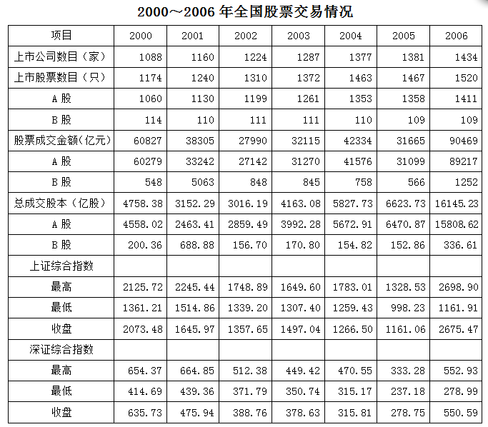

| 项目 | 2000 | 2001 | 2002 | 2003 | 2004 | 2005 | 2006 |
| --- | ---: | ---: | ---: | ---: | ---: | ---: | ---: |
| 上市公司数目（家） | 1088 | 1160 | 1224 | 1287 | 1377 | 1381 | 1434 |
| 上市股票数目（只） | 1174 | 1240 | 1310 | 1372 | 1463 | 1467 | 1520 |
| A 股 | 1060 | 1130 | 1199 | 1261 | 1353 | 1358 | 1411 |
| B 股 | 114 | 110 | 111 | 111 | 110 | 109 | 109 |
| 股票成交金额（亿元） | 60827 | 38305 | 27990 | 32115 | 42334 | 31665 | 90469 |
| A 股 | 60279 | 33242 | 27142 | 31270 | 41576 | 31099 | 89217 |
| B 股 | 548 | 5063 | 848 | 845 | 758 | 566 | 1252 |
| 总成交股本（亿股） | 4758.38 | 3152.29 | 3016.19 | 4163.08 | 5827.73 | 6623.73 | 16145.23 |
| A 股 | 4558.02 | 2463.41 | 2859.49 | 3992.28 | 5672.91 | 6470.87 | 15808.62 |
| B 股 | 200.36 | 688.88 | 156.70 | 170.80 | 154.82 | 152.86 | 336.61 |
| 上证综合指数 |  |  |  |  |  |  |  |
| 最高 | 2125.72 | 2245.44 | 1748.89 | 1649.60 | 1783.01 | 1328.53 | 2698.90 |
| 最低 | 1361.21 | 1514.86 | 1339.20 | 1307.40 | 1259.43 | 998.23 | 1161.91 |
| 收盘 | 2073.48 | 1645.97 | 1357.65 | 1497.04 | 1266.50 | 1161.06 | 2675.47 |
| 深证综合指数 |  |  |  |  |  |  |  |
| 最高 | 654.37 | 664.85 | 512.38 | 449.42 | 470.55 | 333.28 | 552.93 |
| 最低 | 414.69 | 439.36 | 371.79 | 350.74 | 315.17 | 237.18 | 278.99 |
| 收盘 | 635.73 | 475.94 | 388.76 | 378.63 | 315.81 | 278.75 | 550.59 |

### 第 86 题

2006年全国A股成交金额比2005年增长：

A. 65%

B. 98%

C. 156%

D. 187%

第 86 题 · 答案与解析

**参考答案（粉笔题库参考内容）**

D

**解析**

根据题干“2006年······比2005年增长”，结合选项为百分数，可判定本题为一般增长率计算问题。定位表格可得，2006年全国A股成交89217亿元，2005年成交31099亿元，所求增长率= (现期量−基期量)/基期量= (89217−31099)/31099≈ 58100/31100 ≈ 190%，与D项最接近。

故正确答案为D。

**来源**：2009年江苏省公务员录用考试《行测》题（A类）第86题

### 第 87 题

2001~2006年，我国上市公司数目增加最多的年份是：

A. 2006年

B. 2004年

C. 2003年

D. 2001年

第 87 题 · 答案与解析

**参考答案（粉笔题库参考内容）**

B

**解析**

根据题干“······增加最多的年份是”，可判定本题为增长量比较问题。定位表格材料可得：2000-2006年，我国上市公司数目分别为1088家、1160家、1224家、1287家、1377家、1381家、1434家。根据公式：增长量=现期量-基期量，可得选项各年的增长量分别为：

2006年：1434-1381=53家；

2004年：1377-1287=90家；

2003年：1287-1224=63家；

2001年：1160-1088=72家；

因此我国上市公司数目增加最多的年份是2004年。

故正确答案为B。

**来源**：2009年江苏省公务员录用考试《行测》题（A类）第87题

### 第 88 题

下列关于2000~2006年全国股票交易情况的说法不正确的是：

A. 2005年的全国股市行情最差

B. A股上市股票数目不断增加

C. 上证综合指数、深证综合指数的最高点都出现在2006年

D. 2000年的B股上市股票数目最多

第 88 题 · 答案与解析

**参考答案（粉笔题库参考内容）**

C

**解析**

A项：定位表格材料可得：2005年上证综合指数最高、最低、收盘均为表中数值最低，2005年深证综合指数最高、最低、收盘也均为表中数值最低，正确；

B项：定位表格材料可得：2000-2006年A股上市股票数目分别为1060只、1130只、1199只、1261只、1353只、1358只、1411只，逐年增加，正确；

C项：定位表格材料可得：2001年深证综合指数最高为664.85，2006年深证综合指数最高为552.93，最高点出现在2001年，错误；

D项：定位表格材料可得：2000~2006年B股上市股票数目分别为114只、110只、111只、111只、110只、109只、109只。故2000年的B股上市股票数目最多，正确。

本题为选非题，故正确答案为C。

**来源**：2009年江苏省公务员录用考试《行测》题（A类）第88题

### 第 89 题

2006年全国A股票的平均成交价格是：

A. 3.81元/股

B. 4.22元/股

C. 5.64元/股

D. 6.31元/股

第 89 题 · 答案与解析

**参考答案（粉笔题库参考内容）**

C

**解析**

根据题干“2006年······平均成交价格是”，结合材料给出2006年相应数据，可判定本题为现期平均数问题。定位表格材料可得：2006年，A股的股票成交金额为89217亿元，总成交股本为15808.62亿股。因此2006年全国A股票的平均成交价格是89217亿元/15808.62亿股 = 5^+元/股，只有C项符合。

故正确答案为C。

**来源**：2009年江苏省公务员录用考试《行测》题（A类）第89题

### 第 90 题

下列关于2001~2006年我国上市公司数目、上市股票数目、A股上市股票数目、B股上市股票数目年平均增长速度（顺次记为V1、V2、V3、V4）的比较正确的是：

A. V1＞V2，V3＞V4

B. V1＞V2，V3＜V4

C. V1＜V2，V3＞V4

D. V1＜V2，V3＜V4

第 90 题 · 答案与解析

**参考答案（粉笔题库参考内容）**

A

**解析**

根据题干“······年平均增长速度······”，可判定本题为年均增长率问题。定位表格材料可得：2000年和2006年，我国上市公司数目为1088家和1434家，上市股票数目为1174只和1520只，A股上市股票数目为1060只和1411只，B股上市股票数目为114只和109只。根据年均增长率公式(1+r)^n=现期/基期，年份差n相同时，比较年均增长率r的大小，只需比较现期/基期的大小。我国上市公司数目：1434/1088 = 1.3^+，上市股票数目：1520/1174=1.2^+，A股上市股票数目：1411/1060 ＞ 1，B股上市股票数目：109/114＜1，因此V1＞V2，V3＞V4。

故正确答案为A。

**来源**：2009年江苏省公务员录用考试《行测》题（A类）第90题

## 材料 4

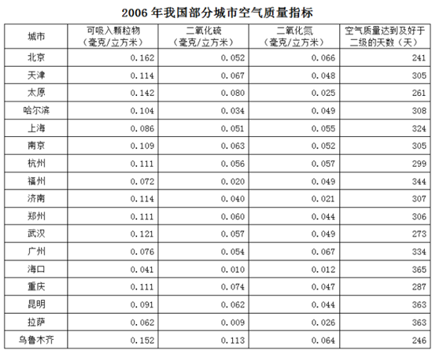

| 城市 | 可吸入颗粒物（毫克/立方米） | 二氧化硫（毫克/立方米） | 二氧化氮（毫克/立方米） | 空气质量达到及好于二级的天数（天） |
| --- | ---: | ---: | ---: | ---: |
| 北京 | 0.162 | 0.052 | 0.066 | 241 |
| 天津 | 0.114 | 0.067 | 0.048 | 305 |
| 太原 | 0.142 | 0.080 | 0.025 | 261 |
| 哈尔滨 | 0.104 | 0.034 | 0.049 | 308 |
| 上海 | 0.086 | 0.051 | 0.055 | 324 |
| 南京 | 0.109 | 0.063 | 0.052 | 305 |
| 杭州 | 0.111 | 0.056 | 0.057 | 299 |
| 福州 | 0.072 | 0.020 | 0.049 | 344 |
| 济南 | 0.114 | 0.040 | 0.021 | 307 |
| 郑州 | 0.111 | 0.060 | 0.044 | 306 |
| 武汉 | 0.121 | 0.057 | 0.049 | 273 |
| 广州 | 0.076 | 0.054 | 0.067 | 334 |
| 海口 | 0.041 | 0.010 | 0.012 | 365 |
| 重庆 | 0.111 | 0.074 | 0.047 | 287 |
| 昆明 | 0.091 | 0.062 | 0.044 | 363 |
| 拉萨 | 0.062 | 0.009 | 0.026 | 363 |
| 乌鲁木齐 | 0.152 | 0.113 | 0.064 | 246 |

### 第 91 题

表中所列城市2006年空气质量达到及好于二级的天数占全年的比重最高是：

A. 93.7%

B. 99.5%

C. 99.7%

D. 100%

第 91 题 · 答案与解析

**参考答案（粉笔题库参考内容）**

D

**解析**

根据题干“······2006年······占全年的比重······”，结合材料给出2006年数据，可判定本题为现期比重问题。定位表格材料可得：海口的空气质量达到及好于二级的天数最多，为365天。因为2006全年有365天，所以空气质量达到及好于二级的天数占全年的比重= 部分/整体 = 365/365 = 100%。

故正确答案为D。

**来源**：2009年江苏省公务员录用考试《行测》题（A类）第91题

### 第 92 题

2006年南京空气中可吸入颗粒物含量比上海高：

A. 24.9%

B. 26.7%

C. 30.5%

D. 32.6%

第 92 题 · 答案与解析

**参考答案（粉笔题库参考内容）**

B

**解析**

根据题干“2006年······比······高”，结合选项为百分数，可判定本题为一般增长率问题。定位表格材料可得：2006年空气中可吸入颗粒物含量南京为0.109毫克/立方米，上海为0.086毫克/立方米。因此2006年南京空气中可吸入颗粒物含量比上海高(0.109 − 0.086)/0.086 = 0.023/0.086≈26.7%。

故正确答案为B。

**来源**：2009年江苏省公务员录用考试《行测》题（A类）第92题

### 第 93 题

下列关于表中所列城市2006年空气质量的说法不正确的是：

A. 总体上说，太原的空气质量比乌鲁木齐好

B. 总体上说，海口的空气质量最好

C. 南京空气质量达到及好于二级的天数仅少于海口、昆明、拉萨、广州和上海

D. 南京空气中二氧化氮含量是拉萨的2倍

第 93 题 · 答案与解析

**参考答案（粉笔题库参考内容）**

C

**解析**

A项：定位表格材料可得：太原和乌鲁木齐的空气质量指标分别为：可吸入颗粒物：0.142毫克/立方米＜0.152毫克/立方米，二氧化硫：0.080毫克/立方米＜0.113毫克/立方米，二氧化氮：0.025毫克/立方米＜0.064毫克/立方米，空气质量达到及好于二级的天数：261＞246。因此总体上说，太原的空气质量比乌鲁木齐好，正确；

B项：定位表格材料可得：海口可吸入颗粒物为0.041毫克/立方米，是最少的；二氧化硫为0.010毫克/立方米，是除了拉萨外最少的；二氧化氮为0.012毫克/立方米，是最少的；空气质量达到及好于二级的天数为365天，是最多的；因此总体上说，海口的空气质量最好，正确；

C项：定位表格材料可得：空气质量达到及好于二级的天数福州为344天，南京为305天，南京少于福州，错误；

D项：定位表格材料可得：南京空气中二氧化氮含量为0.052毫克/立方米，拉萨空气中二氧化氮含量为0.026毫克/立方米。南京空气中二氧化氮含量是拉萨的0.052/0.026 = 2倍，正确。

本题为选非题，故正确答案为C。

**来源**：2009年江苏省公务员录用考试《行测》题（A类）第93题

### 第 94 题

按从高到低排序，2006年南京空气中二氧化硫含量在表内所列城市中的排名是：

A. 第三

B. 第四

C. 第五

D. 第六

第 94 题 · 答案与解析

**参考答案（粉笔题库参考内容）**

C

**解析**

定位表格材料可得：2006年空气中二氧化硫含量南京为0.063毫克/立方米，高于南京的有天津（0.067毫克/立方米）、太原（0.080毫克/立方米）、重庆（0.074毫克/立方米）、乌鲁木齐（0.113毫克/立方米），故南京排在第五。

故正确答案为C。

**来源**：2009年江苏省公务员录用考试《行测》题（A类）第94题

### 第 95 题

表中所列城市2006年空气中二氧化氮含量最低的三个依次是：

A. 海口、济南、太原

B. 太原、济南、海口

C. 海口、济南、拉萨

D. 海口、太原、拉萨

第 95 题 · 答案与解析

**参考答案（粉笔题库参考内容）**

A

**解析**

定位表格材料可得：2006年空气中二氧化氮含量最低的三个城市依次是海口（0.012毫克/立方米）、济南（0.021毫克/立方米）、太原（0.025毫克/立方米）。

故正确答案为A。

**来源**：2009年江苏省公务员录用考试《行测》题（A类）第95题

## 材料 5

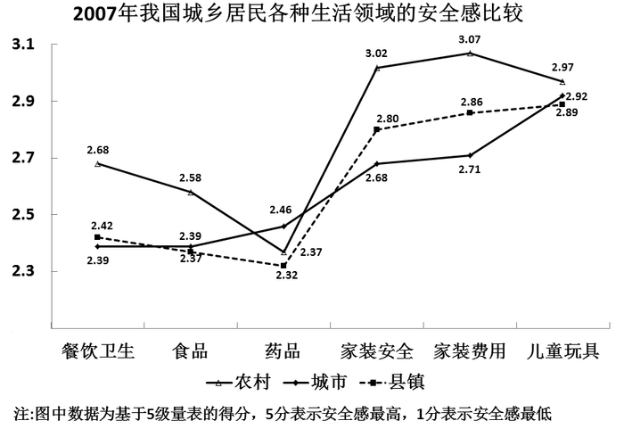

### 第 96 题

2007年我国城市、县镇、农村居民安全感得分最接近的生活领域是：

A. 食品

B. 药品

C. 家装费用

D. 儿童玩具

第 96 题 · 答案与解析

**参考答案（粉笔题库参考内容）**

D

**解析**

定位图形材料可得：农村、城市、县镇的儿童玩具安全感分别为2.97、2.92、2.89，均在2.90附近，是最为接近的。

故正确答案为D。

**来源**：2009年江苏省公务员录用考试《行测》题（A类）第96题

### 第 97 题

2007年我国农村居民的餐饮卫生安全感得分比城市居民高：

A. 15.3%

B. 12.1%

C. 10.2%

D. 9.7%

第 97 题 · 答案与解析

**参考答案（粉笔题库参考内容）**

B

**解析**

根据题干“2007年我国农村居民······比城市居民高”，结合选项为百分数，可判定本题为一般增长率问题。定位图形材料可得：2007年我国农村居民的餐饮卫生安全感得分2.68，城市居民为2.39。因此我国农村居民的餐饮卫生安全感得分比城市居民高(2.68−2.39)/2.39=0.29/2.39≈12.1%。

故正确答案为B。

**来源**：2009年江苏省公务员录用考试《行测》题（A类）第97题

### 第 98 题

下列关于2007年我国城乡居民各种生活领域安全感得分的说法不正确的是：

A. 城乡居民的药品安全感平均得分为2.38分

B. 城乡居民在图中各生活领域的安全感得分大多低于3.0分

C. 除药品外，农村居民在图中各生活领域的安全感得分均高于城市、县镇居民

D. 总体上说，县镇居民的安全感得分与农村较接近，与城市差别较大

第 98 题 · 答案与解析

**参考答案（粉笔题库参考内容）**

D

**解析**

A项：定位图形材料可得：2007年我国城乡居民的药品安全感得分分别为2.46分、2.37分、2.32分，则平均得分= (2.46+2.37+2.32)/3 ≈ 2.38分，正确；

B项：定位图形材料可知，只有农村居民在家装安全和家装费用的得分超过3.0分，其余得分低于3.0分，正确；

C项：定位图形材料可知，只有药品的安全感得分是农村居民（2.37）＜城市居民（2.46），农村居民在其它各生活领域的安全感得分均高于城市、县镇居民，正确；

D项：定位图形材料可知，除药品领域县镇居民的安全感得分与农村更接近外，其余5个领域县镇居民的安全感得分均与城市更为接近，错误。

本题为选非题，故正确答案为D。

**来源**：2009年江苏省公务员录用考试《行测》题（A类）第98题

### 第 99 题

2007年我国城市居民、农村居民安全感得分差距最大的生活领域及其得分差距分别是：

A. 家装费用、0.36分

B. 家装安全、0.38分

C. 药品、0.09分

D. 餐饮卫生、0.37分

第 99 题 · 答案与解析

**参考答案（粉笔题库参考内容）**

A

**解析**

定位图形材料可得：2007年我国城市居民和农村居民在家装费用、家装安全、药品、餐饮卫生领域的得分分别为：2.71和3.07、2.68和3.02、2.46和2.37、2.39和2.68。得分差距分别为：

家装费用：3.07-2.71=0.36；

家装安全：3.02-2.68=0.34；

药品：2.46-2.37=0.09；

餐饮卫生：2.68-2.39=0.29；

因此安全感得分差距最大的是家装费用，相差0.36分。

故正确答案为A。

**来源**：2009年江苏省公务员录用考试《行测》题（A类）第99题

### 第 100 题

2007年我国县镇居民在图中各生活领域的安全感平均得分是：

A. 2.42分

B. 2.51分

C. 2.61分

D. 2.70分

第 100 题 · 答案与解析

**参考答案（粉笔题库参考内容）**

C

**解析**

根据题干“2007年······安全感平均得分是”，结合材料给出2007年相应数据，可判定本题为现期平均数问题。定位图形材料可得：县镇居民在各生活领域的安全感得分分别为2.42、2.39、2.32、2.80、2.86、2.89。因此2007年我国县镇居民各生活领域的安全感平均得分=(2.42+2.39+2.32+2.80+2.86+2.89)/6≈2.61分。

故正确答案为C。

**来源**：2009年江苏省公务员录用考试《行测》题（A类）第100题

## 材料 6

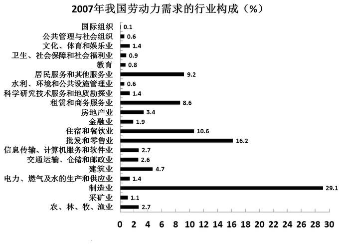

### 第 101 题

2007年我国文化、体育和娱乐业劳动力需求人数比水利、环境和公共设施管理业多：

A. 75%

B. 133%

C. 176%

D. 198%

第 101 题 · 答案与解析

**参考答案（粉笔题库参考内容）**

B

**解析**

根据题干“······比······多”，结合选项为百分数，可判定本题为一般增长率问题。定位图形材料可得：2007年我国文化、体育和娱乐业劳动力需求人数为1.4%，水利、环境和公共设施管理业为0.6%。因此2007年我国文化、体育和娱乐业劳动力需求人数比水利、环境和公共设施管理业多(1.4% − 0.6%)/0.6% = 0.8%/0.6% ≈ 133%。

故正确答案为B。

**来源**：2009年江苏省公务员录用考试《行测》题（A类）第101题

### 第 102 题

2007年劳动力需求最少的五个行业的劳动力总需求占我国劳动力总需求的比重是：

A. 2.8%

B. 3.0%

C. 3.5%

D. 3.7%

第 102 题 · 答案与解析

**参考答案（粉笔题库参考内容）**

B

**解析**

定位图形材料可得：2007年劳动力需求最少的五个行业分别是：国际组织(0.1%)，公共管理与社会组织(0.6%)，水利、环境和公共设施管理业(0.6%)，教育(0.8%)，卫生、社会保障和社会福利业(0.9%)。五个行业的劳动力需求占比之和=0.1%+0.6%+0.6%+0.8%+0.9%=3.0%。

故正确答案为B。

**来源**：2009年江苏省公务员录用考试《行测》题（A类）第102题

### 第 103 题

下列关于2007年我国劳动力需求构成的说法不正确的是：

A. 需求最多的三个行业的劳动力总需求超过了我国劳动力总需求的50%

B. 农、林、牧、渔业劳动力需求占我国劳动力总需求的比重为2.7%

C. 建筑业的劳动力需求人数是采矿业的4.3倍

D. 房地产业的劳动力需求人数比金融业多1.5%

第 103 题 · 答案与解析

**参考答案（粉笔题库参考内容）**

D

**解析**

A项：定位图形材料可得：需求最多的三个行业为制造业(29.1%)、批发和零售业(16.2%)、住宿和餐饮业(10.6%)，总需求=29.1%+16.2%+10.6%=55.9%＞50%，正确；

B项：定位图形材料可得：农、林、牧、渔业劳动力需求占我国劳动力总需求的比重为2.7%，正确；

C项：定位图形材料可得：建筑业的劳动力需求占比为4.7%，采矿业的劳动力需求占比为1.1%。因此建筑业的劳动力需求人数是采矿业的4.7%/1.1% ≈ 4.3倍，正确；

D项：定位图形材料可得：房地产业的劳动力需求占比为3.4%，金融业的劳动力需求占比为1.9%。因此房地产业的劳动力需求人数比金融业多(3.4%−1.9%)/1.9%=1.5%/1.9%≈80%，错误。

本题为选非题，故正确答案为D。

**来源**：2009年江苏省公务员录用考试《行测》题（A类）第103题

### 第 104 题

将2007年我国各行业的劳动需求按从多到少排序，排在第一、第二位的两个行业的劳动力需求差距与排在第二、第三位的两个行业的劳动力需求差距的比值是：

A. 1.9

B. 2.1

C. 2.3

D. 2.5

第 104 题 · 答案与解析

**参考答案（粉笔题库参考内容）**

C

**解析**

根据题干“······比值是”，可判定本题为比值计算问题。定位图形材料可得：劳动需求前三位的是制造业(29.1%)、批发和零售业(16.2%)，住宿和餐饮业(10.6%)。因此排在第一、第二位的两个行业的劳动力需求差距与排在第二、第三位的两个行业的劳动力需求差距的比值= (29.1% - 16.2%)/(16.2% - 10.6%)= 12.9%/5.6% ≈ 2.3。

故正确答案为C。

**来源**：2009年江苏省公务员录用考试《行测》题（A类）第104题

### 第 105 题

2007年我国第一产业（农、林、牧、渔业）、第二产业（采矿业，制造业，电力、燃气及水的生产和供应业，建筑业）劳动力需求占劳动力总需求的比重之差是：

A. 33.6%

B. 36.2%

C. 38.9%

D. 39.2%

第 105 题 · 答案与解析

**参考答案（粉笔题库参考内容）**

A

**解析**

定位图形材料可得：2007年我国第一产业（农、林、牧、渔业）的劳动力需求占比为2.7%，第二产业（采矿业，制造业，电力、燃气及水的生产和供应业，建筑业）的劳动力需求占比分别为1.1%、29.1%、1.4%、4.7%。因此2007年我国第一产业、第二产业劳动力需求占劳动力总需求的比重之差=1.1%+29.1%+1.4%+4.7%-2.7%=33.6%。

故正确答案为A。

**来源**：2009年江苏省公务员录用考试《行测》题（A类）第105题

