# 2009年江苏省公务员录用考试《行测》题（C类）

<!-- gwy:overview:start -->
> **江苏 · 2009 · 行测 · C类** ｜ 100 题 · 图片 175 处 · 答案随题折叠

| 题型模块 | 题量 | 题号 |
| --- | ---: | ---: |
| 数量关系 | 20 | 1–20 |
| 判断推理 | 40 | 21–60 |
| 言语理解与表达 | 15 | 61–75 |
| 资料分析 | 25 | 76–100 |
| **合计** | **100** | |

导航：[题型与作答说明](#题型与作答说明) · [题目](#题目) · [材料 1](#材料-1)
<!-- gwy:overview:end -->

> 候选采集稿。参考答案及解析来自粉笔页面，不代表官方答案或真实高分答卷；来源使用许可与原卷对应关系仍需人工核实。

## 题型与作答说明

数量关系

（20题）

本部分包括数字推理与数学运算两种类型的试题。

判断推理

（40题）

本部分包括类比推理、图形推理、逻辑判断与定义判断四种类型的试题。

言语理解与表达

（15题）

每道题包含一段文字，要求你从四个选项中选出最恰当的一项，你的选择必须与题干要求相符合。

资料分析

（25题）

下列给出的文字、表格、图形资料均有5个问题要你回答。你应根据资料提供的信息进行分析、计算、处理，然后从备选答案中选择一个最恰当的答案。

## 题目

### 第 1 题

0，3，8，15，（    ），35

A. 12

B. 24

C. 26

D. 30

第 1 题 · 答案与解析

**参考答案（粉笔题库参考内容）**

B

**解析**

方法一：数列无明显特征，优先考虑多级数列。后项减前项得到新数列：3，5，7，（    ），（    ），观察新数列，猜测新数列是公差为2的等差数列，则新数列下两项为9，11，所求项为15+9=24，向后验证，35-24=11，规律成立。

方法二：数列各项均在幂次数附近，优先考虑幂次修正数列。原数列可转化为：，，，，（    ），。底数为1，2，3，4，（    ），6，是自然数列，则所求项底数为5；幂次数为2，修正项为-1，故所求项。

故正确答案为B。

**来源**：2009年江苏省公务员录用考试《行测》题（C类）第1题

### 第 2 题

1，1，3，4，7，（　 ）

A. 7

B. 8

C. 9

D. 10

第 2 题 · 答案与解析

**参考答案（粉笔题库参考内容）**

C

**解析**

数列起伏较小且无明显特征，优先考虑作差，后项减前项得到新数列：0，2，1，3，（    ），观察新数列，新数列的奇数项：0，1，（    ），为公差是1的等差数列，偶数项2，3也为公差是1的等差数列，则新数列的下一项为2，所求项为7+2=9。

故正确答案为C。

**来源**：2009年江苏省公务员录用考试《行测》题（C类）第2题

### 第 3 题

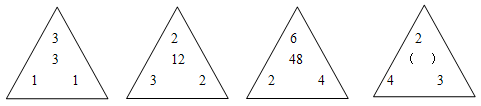

A. 24

B. 30

C. 18

D. 16

第 3 题 · 答案与解析

**参考答案（粉笔题库参考内容）**

A

**解析**

图形数阵，有中间数字，优先考虑由周边数字推出中间数字。观察发现：

第一个数阵中，；

第二个数阵中，；

第三个数阵中，；

即规律为：上面数字×左下数字×右下数字=中间数字。

则第四个数阵中：中间数字。

故正确答案为A。

**来源**：2009年江苏省公务员录用考试《行测》题（C类）第3题

### 第 4 题

121，729，2401，3125，729，（ 　）

A. 100

B. 1

C. 0.5

D. 125

第 4 题 · 答案与解析

**参考答案（粉笔题库参考内容）**

B

**解析**

观察数列，每项均是幂次数，考虑幂次数列。，729=9^3，，，729 = 3^6，底数是公差为-2的等差数列，指数是公差为1的等差数列，故所求项为：。

故正确答案为B。

**来源**：2009年江苏省公务员录用考试《行测》题（C类）第4题

### 第 5 题

22，44，86，（　 ），3210，6412

A. 108

B. 168

C. 78

D. 1118

第 5 题 · 答案与解析

**参考答案（粉笔题库参考内容）**

B

**解析**

数列变化无明显规律，且各项数字的位数较多，考虑机械划分。将数列各项划分为：(2│2)，(4│4)，(8│6)，(    )，(32│10)，(64│12)，观察发现，左侧部分：2，4，8，（    ），32，64，是公比为2的等比数列，所求项左侧为：；右侧部分：2，4，6，（    ），10，12，是公差为2的等差数列，所求项右侧为：6+2=8，故所求项为168。

故正确答案为B。

**来源**：2009年江苏省公务员录用考试《行测》题（C类）第5题

### 第 6 题

0，1，1，3，5，（　 ）

A. 8

B. 10

C. 11

D. 14

第 6 题 · 答案与解析

**参考答案（粉笔题库参考内容）**

C

**解析**

方法一：观察数列无明显特征，作差后无规律，考虑作和。相邻两项相加得到新数列：1，2，4，8，（    ），是公比为2的等比数列，新数列下一项。则所求项=16-5=11。

方法二：观察数列无明显特征，作差后无规律，考虑递推。圈三数，找规律。发现，，推测该数列规律为：第一项第二项=第三项，做验证：，符合此规律，推测正确，则所求项。

故正确答案为C。

**来源**：2009年江苏省公务员录用考试《行测》题（C类）第6题

### 第 7 题

1/2，3/2，11/8，1，21/32，（    ）

A. 7/64

B. 25/64

C. 13/32

D. 13/64

第 7 题 · 答案与解析

**参考答案（粉笔题库参考内容）**

C

**解析**

数列大部分为分数，判定为分数数列。分子、分母呈递增趋势，考虑反约分，将分母转化为单调递增，则原数列可转化为：1/2，6/4，11/8，16/16，21/32，（    ），发现分母是公比为2的等比数列，分子是公差为5的等差数列，故所求项为：。

故正确答案为C。

**来源**：2009年江苏省公务员录用考试《行测》题（C类）第7题

### 第 8 题

4736，3728，3225，2722，2219，（    ）

A. 1514

B. 1532

C. 1915

D. 1562

第 8 题 · 答案与解析

**参考答案（粉笔题库参考内容）**

A

**解析**

数列变化无明显规律，且各项数字的位数较多，考虑机械划分。将数列各项划分为：(47│36)，(37│28)，(32│25)，(27│22)，(22│19)，(    )，观察发现，左侧部分减右侧部分得到新数列：11，9，7，5，3，（    ），是公差为-2的等差数列，故所求项左侧部分减右侧部分应为3-2=1，只有A项符合，15-14=1。

故正确答案为A。

**来源**：2009年江苏省公务员录用考试《行测》题（C类）第8题

### 第 9 题

－3，10，7，17，（    ），41

A. 18

B. 21

C. 24

D. 31

第 9 题 · 答案与解析

**参考答案（粉笔题库参考内容）**

C

**解析**

观察数列无明显特征，作差后无规律，考虑递推。圈三数，找规律。发现7=-3+10，17=10+7，推测该数列规律为：第一项+第二项=第三项，则所求项=7+17=24，向后验证，17+24=41，符合此规律。

故正确答案为C。

**来源**：2009年江苏省公务员录用考试《行测》题（C类）第9题

### 第 10 题

0，7/3，22/5，45/7，76/9，（   ）

A. 12

B. 13

C. 106/11

D. 115/11

第 10 题 · 答案与解析

**参考答案（粉笔题库参考内容）**

D

**解析**

数列大部分为分数，判定为分数数列。分子、分母呈递增趋势，考虑反约分，将分母转化为单调递增，则原数列可转化为：0/1，7/3，22/5，45/7，76/9，（    ），发现分母是公差为2的等差数列，分子形成新数列：0，7，22，45，76，（    ），新数列后项减前项得到：7，15，23，31，（    ），是公差为8的等差数列，故下一项=31+8=39，分子新数列下一项=76+39=115，故所求项为：。

故正确答案为D。

**来源**：2009年江苏省公务员录用考试《行测》题（C类）第10题

### 第 11 题

x-y=1，

A. 1

B. 2

C. 3

D. 5

第 11 题 · 答案与解析

**参考答案（粉笔题库参考内容）**

A

**解析**

将题干计算式进行分解：，已知(x-y)=1，可化简为：。

故正确答案为A。

**来源**：2009年江苏省公务员录用考试《行测》题（C类）第11题

### 第 12 题

，则

A. 14

B. 15

C. 3

D. 1

第 12 题 · 答案与解析

**参考答案（粉笔题库参考内容）**

A

**解析**

已知，可推出：，，，推出：，，，推出：a=1，b=2，c=3，故。

故正确答案为A。

**来源**：2009年江苏省公务员录用考试《行测》题（C类）第12题

### 第 13 题

A. 0

B. 0.5

C. 1

D. 2

第 13 题 · 答案与解析

**参考答案（粉笔题库参考内容）**

C

**解析**

题干原式可分解为：，当n越大，1/(n+1)越小越接近于0，越接近于1-0=1，最接近C项。

故正确答案为C。

备注：本题并没有准确答案，结合选项只能选择最接近的C项。

**来源**：2009年江苏省公务员录用考试《行测》题（C类）第13题

### 第 14 题

若正四面体的棱长增长10％，则该正四面体的表面积增加：

A. 21％

B. 15％

C. 44％

D. 40％

第 14 题 · 答案与解析

**参考答案（粉笔题库参考内容）**

A

**解析**

根据题意，设原正四面体棱长为1，表面积为√3×1^2，棱长增加10%变为1.1，新正四面体表面积为，表面积增加。

故正确答案为A。

**考点**：几何公式类-立体图形、几何结论类-相似图形

**来源**：2009年江苏省公务员录用考试《行测》题（C类）第14题

### 第 15 题

甲、乙两人骑车在路上追逐，甲的速度为27千米/小时，每骑5分钟休息1分钟，乙的速度是300米/分，现在已知乙先行1650米，甲开始追乙，追到乙所需的时间是：

A. 10分钟

B. 15分钟

C. 16分钟

D. 17分钟

第 15 题 · 答案与解析

**参考答案（粉笔题库参考内容）**

D

**解析**

根据题意，可知甲的速度可转化为450米/分，“甲每骑5分钟休息1分钟”，即以6分钟为一个周期，一个周期内行驶米，乙6分钟行驶米，可推出一个周期甲可追上乙2250-1800=450米，由于甲追上乙的最后一个周期不休息，乙只行驶5分钟，所以1650米需要个周期，共需要分钟。

故正确答案为D。

**考点**：相遇追及

**来源**：2009年江苏省公务员录用考试《行测》题（C类）第15题

### 第 16 题

整数15具有被它的十位上数字和个位数上数字同时整除的性质，则在11和40之间具有这样性质的整数个数有：

A. 7

B. 10

C. 12

D. 14

第 16 题 · 答案与解析

**参考答案（粉笔题库参考内容）**

A

**解析**

根据题意，可利用枚举法将11-40之间符合要求的整数列出，得知具有被十位上数字和个位数上数字同时整除的性质的数字有：11、12、15、22、24、33、36，共7个。

故正确答案为A。

**来源**：2009年江苏省公务员录用考试《行测》题（C类）第16题

### 第 17 题

去商店买东西，如果买7件A商品，3件B商品，1件C商品，一共需要50元，如果是买10件A商品，4件B商品，1件C商品，一共需要69元，若A、B、C三种商品各买2件，需要多少钱：

A. 28元

B. 26元

C. 24元

D. 20元

第 17 题 · 答案与解析

**参考答案（粉笔题库参考内容）**

C

**解析**

设一件A商品a元，一件B商品b元，一件C商品c元，根据题意可列方程：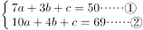，利用赋零法求解，赋值a=0，联立①②，解得b=19，c=-7，则A、B、C三种商品各买2件需要：元

故正确答案为C。

**来源**：2009年江苏省公务员录用考试《行测》题（C类）第17题

### 第 18 题

某商店搞店庆，购物满198元可以抽奖一次。一个袋中装有编号为0到9的十个完全相同的球，满足抽奖条件的顾客在袋中摸球，一共摸两次，每次摸出一个球（球放回），如果第一次摸出球的数字比第二次大，则可获奖，则某抽奖顾客获奖概率是：

A. 5%

B. 25%

C. 45%

D. 85%

第 18 题 · 答案与解析

**参考答案（粉笔题库参考内容）**

C

**解析**

给情况求概率，概率。总的情况为第一次在10个球中摸一个球，第二次仍在10个球中摸一个球，故总情况数。满足的情况为：第一次抽1，第二次抽比1小的数0，共1种情况；第一次抽2，第二次抽1或0，共2种情况；第一次抽3，第二次抽2、1或0，共3种情况；以此类推，第一次抽9，第二次抽比9小的数共9种情况，可知满足的情况数=1+2+3+…+9=45，故概率。

故正确答案为C。

**考点**：给情况求概率

**来源**：2009年江苏省公务员录用考试《行测》题（C类）第18题

### 第 19 题

某大学军训，军训部将学员编成8个小组，如果每组人数比预定人数多1人，那么学员总数将超过100人；如果每组人数比预定人数少1人，那么学员总数将不到90人，由此可知，预定的每组学员人数是：

A. 20人

B. 18人

C. 16人

D. 12人

第 19 题 · 答案与解析

**参考答案（粉笔题库参考内容）**

D

**解析**

方法一：设每组预定的成员数为x人，根据题意可列：······①，······②，联立①②，整理可得：92＜8x＜98，即11.5＜x＜12.25，已知人数必为整数，则x=12人。

方法二：利用代入排除法解题。

A选项：若每组预定成员数为20人，则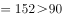，不符合题干要求，排除；

B选项：若每组预定成员数为18人，则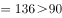，不符合题干要求，排除；

C选项：若每组预定成员数为16人，则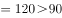，不符合题干要求，排除；

D选项：若每组预定成员数为12人，则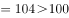，，符合题干要求，当选。

故正确答案为D。

**考点**：和差倍比问题

**来源**：2009年江苏省公务员录用考试《行测》题（C类）第19题

### 第 20 题

某商店商品，单价为75元，可卖500个，单价每涨1元，就会少卖20个，为了使销售额最大，那么单价可定为：

A. 50元

B. 28元

C. 27元

D. 20元

第 20 题 · 答案与解析

**参考答案（粉笔题库参考内容）**

A

**解析**

设共涨价x次，根据题意，可知总销售额，根据函数最值两点式，解得，x_2=25，当时，即降价25次时，销售额取到最大值，此时单价定为元。

故正确答案为A。

**考点**：函数最值问题、经济利润问题

**来源**：2009年江苏省公务员录用考试《行测》题（C类）第20题

### 第 21 题

人才：优秀：提拔

A. 干燥：农业：灌溉

B. 环境：失衡：规划

C. 社会：和谐：建设

D. 固执：批评：教育

第 21 题 · 答案与解析

**参考答案（粉笔题库参考内容）**

C

**解析**

第一步：判断题干词语间第一重逻辑关系，并在选项中进行选择。

题干中“优秀”是对“人才”的描述，符合此逻辑的有B、C两项。

第二步：再判断题干词语间第二重逻辑关系，并在选项中进行选择。

题干中“提拔”与前两项形成动宾关系，与此逻辑相似的是C项“建设和谐社会”。

故正确答案为C。

**考点**：语法关系

**来源**：2009年江苏省公务员录用考试《行测》题（C类）第21题

### 第 22 题

鱼：鲤鱼：鲢鱼

A. 营养：青菜：萝卜

B. 植物：荔枝：柑橘

C. 座机：手机：小灵通

D. 木匠：电工：工程师

第 22 题 · 答案与解析

**参考答案（粉笔题库参考内容）**

B

**解析**

第一步：判断题干词语间逻辑关系。

题干的词语间构成包容关系中的种属关系，“鲤鱼”和“鲢鱼”都是“鱼”。

第二步：判断选项词语间逻辑关系。

A项：“萝卜”和“青菜”含有营养但不属于“营养”；

B项：“荔枝”和“柑橘”都是“植物”，符合；

C、D两项中的词语间是并列关系。

故正确答案为B。

**考点**：逻辑关系-包容关系、逻辑关系-并列关系

**来源**：2009年江苏省公务员录用考试《行测》题（C类）第22题

### 第 23 题

郑重：谨慎：慎重

A. 自豪：信心：满意

B. 精美：雅致：精致

C. 认真：细致：刻苦

D. 懒惰：懈怠：消极

第 23 题 · 答案与解析

**参考答案（粉笔题库参考内容）**

B

**解析**

第一步：判断题干词语间逻辑关系。

“慎重”意思为谨慎持重，与“郑重”“谨慎”为近义关系。

第二步：判断选项词语间逻辑关系。

A项：“满意”和“自豪”“信心”均非近义关系，与题干逻辑关系不一致，排除；

B项：“精致”意思为精巧细致，与“精美”“雅致”均为近义关系，与题干逻辑关系一致，当选；

C项：“刻苦”和“认真”“细致”均非近义关系，与题干逻辑关系不一致，排除；

D项：“消极”和“懒惰”“懈怠”均非近义关系，与题干逻辑关系不一致，排除。

故正确答案为B。

**考点**：语义关系-近义关系

**来源**：2009年江苏省公务员录用考试《行测》题（C类）第23题

### 第 24 题

玻璃：镜子：灯具

A. 黄金：首饰：货币

B. 泥土：素材：房层

C. 木材：钢铁：桥梁

D. 透明：反射：照明

第 24 题 · 答案与解析

**参考答案（粉笔题库参考内容）**

A

**解析**

第一步：判断题干词语间逻辑关系。

题干中“玻璃”和“镜子”“灯具”构成对应关系，“玻璃”可以用来制作“镜子”，也可以制作“灯具”。

第二步：判断选项词语间逻辑关系。

A项：“黄金”可以用来制作“首饰”，也可以当作“货币”，与题干逻辑相似；

B项：“泥土”是材料不是“素材”；

C项：“木材”不可能制造“钢铁”；

D项：“透明”和“照明”“反射”无明显逻辑关系。

故正确答案为A。

**考点**：逻辑关系-对应关系、逻辑关系-并列关系

**来源**：2009年江苏省公务员录用考试《行测》题（C类）第24题

### 第 25 题

木材：纸张：图书

A. 高粱：小麦：汽车

B. 钢铁：桥梁：铁路

C. 小麦：面粉：面包

D. 水稻：大米：温饱

第 25 题 · 答案与解析

**参考答案（粉笔题库参考内容）**

C

**解析**

第一步：判断题干词语间第一重逻辑关系，并在选项中进行选择。

题干中“纸张”和“木材”是对应关系。“木材”是原料，“纸张”是成品，“木材”做成“纸张”，符合此逻辑的有B、C两项。

第二步：再判断题干词语间第二重逻辑关系，并在选项中进行选择。

题干中“纸张”做成“图书”，C项中“面粉”做成“面包”，符合；

B项中“桥梁”做不出“铁路”，排除。

故正确答案为C。

**考点**：逻辑关系-对应关系

**来源**：2009年江苏省公务员录用考试《行测》题（C类）第25题

### 第 26 题

文明：礼貌：野蛮

A. 诚实：实际：虚伪

B. 谦逊：和逊：卑逊

C. 盲目：盲动：激动

D. 和谐：协调：冲突

第 26 题 · 答案与解析

**参考答案（粉笔题库参考内容）**

D

**解析**

第一步：判断题干词语间逻辑关系。

题干中“文明”和“礼貌”是近义词，“文明”和“野蛮”是反义词。

第二步：判断选项词语间逻辑关系。

A项：“诚实”是“实际”不是近义词；

B项：“谦逊”和“卑逊”不是反义词；

C项：“盲目”和“激动”不是反义词；

D项：“和谐”和“协调”是近义词，“和谐”和“冲突”是反义词。

故正确答案为D。

**考点**：语义关系-反义关系、语义关系-近义关系

**来源**：2009年江苏省公务员录用考试《行测》题（C类）第26题

### 第 27 题

偶数：奇数：整数

A. 植物：动物：生物

B. 助教：讲师：教授

C. 排长：连长：营长

D. 有理：无理：公理

第 27 题 · 答案与解析

**参考答案（粉笔题库参考内容）**

A

**解析**

第一步：判断题干词语间逻辑关系。

题干中“偶数、奇数”和“整数”是包容关系中的种属关系。“偶数”和“奇数”都属于“整数”。

第二步：判断选项词语间逻辑关系。

A项：“植物”和“动物”都属于“生物”；

B、C两项中的词语间是并列关系；

D项：“有理”不一定是“公理”“无理”不属于“公理”。

故正确答案为A。

**考点**：逻辑关系-包容关系、逻辑关系-并列关系

**来源**：2009年江苏省公务员录用考试《行测》题（C类）第27题

### 第 28 题

性格：外向：内向

A. 品质：谦虚：骄傲

B. 股市：熊市：牛市

C. 心情：卑微：诚恳

D. 善良：险恶：美德

第 28 题 · 答案与解析

**参考答案（粉笔题库参考内容）**

A

**解析**

第一步：判断题干词语间逻辑关系。

“外向”和“内向”是反义关系，且“外向”和“内向”是两种不同的“性格”，分别构成种属关系。

第二步：判断选项词语间逻辑关系。

A项：“谦虚”和“骄傲”是反义关系，且“谦虚”和“骄傲”是两种不同的“品质”，分别构成种属关系，与题干逻辑关系一致，当选；

B项：“熊市”和“牛市”是股票市场行情预料的两种不同趋势，分别构成对应关系，与题干逻辑关系不一致，排除；

C项：“卑微”和“诚恳”不是反义关系，与题干逻辑关系不一致，排除；

D项：“险恶”和“美德”不是反义关系，与题干逻辑关系不一致，排除。

故正确答案为A。

**考点**：语义关系-反义关系、逻辑关系-包容关系

**来源**：2009年江苏省公务员录用考试《行测》题（C类）第28题

### 第 29 题

青椒：维生素：胡萝卜

A. 菠菜：淀粉：黄瓜

B. 鸡蛋：蛋白质：大豆

C. 面粉：纤维素：芹菜

D. 西瓜：脂肪：牛肉

第 29 题 · 答案与解析

**参考答案（粉笔题库参考内容）**

B

**解析**

第一步：判断题干词语间逻辑关系。

题干中“青椒”和“胡萝卜”都含有大量“维生素”。

第二步：判断选项词语间逻辑关系。

A项：“菠菜”不含“淀粉”，“黄瓜”含极少“淀粉”；

B项：“鸡蛋”和“大豆”都含有大量“蛋白质”；

C项：“面粉”不含“纤维素”；

D项：“西瓜”不含“脂肪”。

故正确答案为B。

**考点**：逻辑关系-对应关系、逻辑关系-并列关系

**来源**：2009年江苏省公务员录用考试《行测》题（C类）第29题

### 第 30 题

学校：大学：北京大学

A. 工业：重工业：钢铁

B. 工艺：手工艺：玉器

C. 军事：军队：海军

D. 建筑物：桥梁：赵州桥

第 30 题 · 答案与解析

**参考答案（粉笔题库参考内容）**

D

**解析**

第一步：判断题干词语间逻辑关系。

题干中“学校”和“大学”是包容关系，“大学”和“北京大学”也是包容关系。

第二步：判断选项词语间逻辑关系。

A项中“工业”和“重工业”是包容关系，“重工业”和“钢铁”是对应关系，错误；

B项中“工艺”和“手工艺”是包容关系，“手工艺”和“玉器”是对应关系，错误；

C项中“军事”和“军队”是对应关系，“军队”和“海军”是包容关系，错误；

D项中“建筑物”和“桥梁”是包容关系，“桥梁”和“赵州桥”也是包容关系，正确。

故正确答案为D。

**考点**：逻辑关系-包容关系

**来源**：2009年江苏省公务员录用考试《行测》题（C类）第30题

### 第 31 题

选项四个图形中，只有一个是由题干的四个图形拼合（只能通过上、下、左、右平移）而成的，请把它找出来。

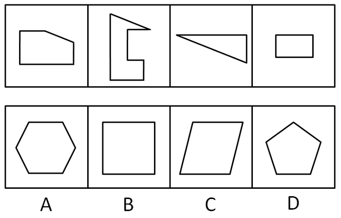

A. A

B. B

C. C

D. D

第 31 题 · 答案与解析

**参考答案（粉笔题库参考内容）**

B

**解析**

题干中四个图形拼合在一起得到如下图形。

故正确答案为B。

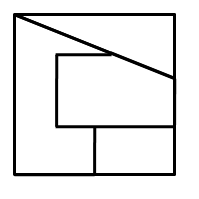

**来源**：2009年江苏省公务员录用考试《行测》题（C类）第31题

### 第 32 题

选项四个图形中，只有一个是由题干的四个图形拼合（只能通过上、下、左、右平移）而成的，请把它找出来。

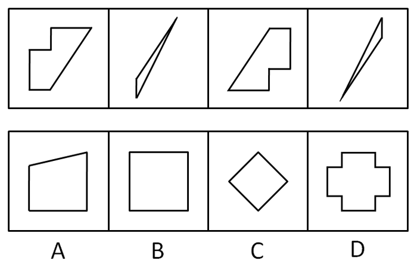

A. A

B. B

C. C

D. D

第 32 题 · 答案与解析

**参考答案（粉笔题库参考内容）**

D

**解析**

题干中四个图形拼合在一起得到如下图形。

故正确答案为D。

**来源**：2009年江苏省公务员录用考试《行测》题（C类）第32题

### 第 33 题

选项四个图形中，只有一个是由题干的四个图形拼合（只能通过上、下、左、右平移）而成的，请把它找出来。

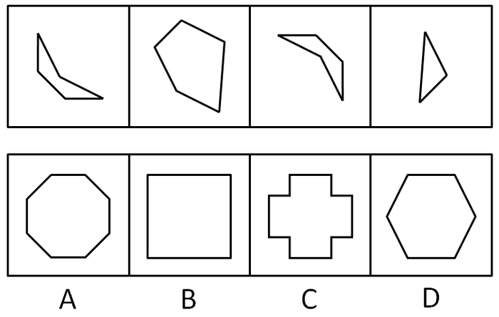

A. A

B. B

C. C

D. D

第 33 题 · 答案与解析

**参考答案（粉笔题库参考内容）**

A

**解析**

题干中四个图形拼合在一起得到如下图形。

故正确答案为A。

**来源**：2009年江苏省公务员录用考试《行测》题（C类）第33题

### 第 34 题

选项四个图形中，只有一个是由题干的四个图形拼合（只能通过上、下、左、右平移）而成的，请把它找出来。

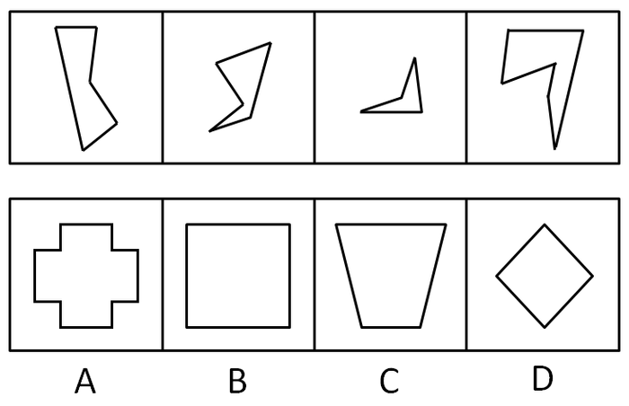

A. A

B. B

C. C

D. D

第 34 题 · 答案与解析

**参考答案（粉笔题库参考内容）**

C

**解析**

题干中四个图形拼合在一起得到如下图形。

故正确答案为C。

**来源**：2009年江苏省公务员录用考试《行测》题（C类）第34题

### 第 35 题

选项四个图形中，只有一个是由题干的四个图形拼合而成的，请把它找出来。

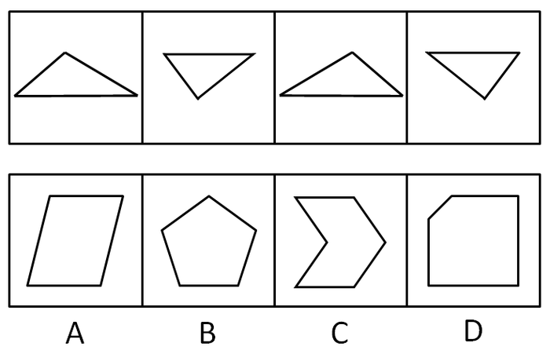

A. A

B. B

C. C

D. D

第 35 题 · 答案与解析

**参考答案（粉笔题库参考内容）**

A

**解析**

题干中四个图形拼合在一起得到如下图形。

故正确答案为A。

**来源**：2009年江苏省公务员录用考试《行测》题（C类）第35题

### 第 36 题

从所给四个选项中，选择最合适的一个填入问号处，使之呈现一定的规律性：

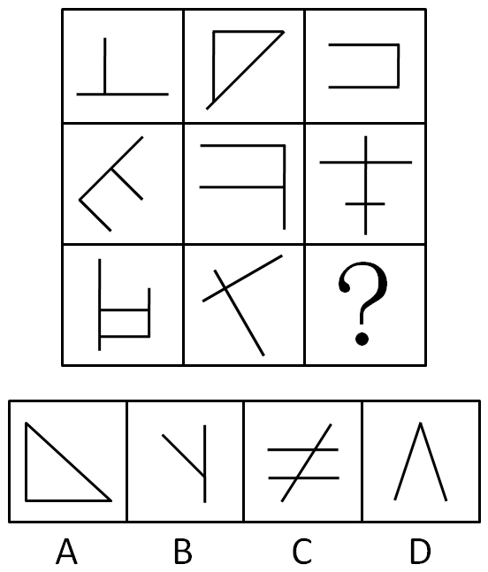

A. A

B. B

C. C

D. D

第 36 题 · 答案与解析

**参考答案（粉笔题库参考内容）**

A

**解析**

元素组成相似，元素求同，九宫图内的每幅图都含有直角。

故正确答案为A。

**考点**：数量规律-素、样式规律-遍历

**来源**：2009年江苏省公务员录用考试《行测》题（C类）第36题

### 第 37 题

从所给四个选项中，选择最合适的一个填入问号处，使之呈现一定的规律性：

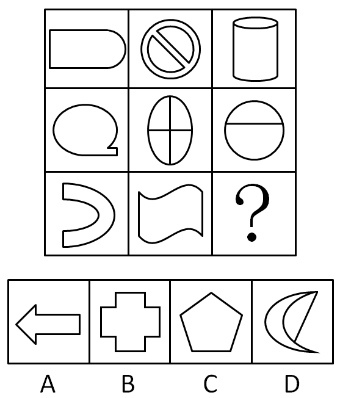

A. A

B. B

C. C

D. D

第 37 题 · 答案与解析

**参考答案（粉笔题库参考内容）**

D

**解析**

元素组成凌乱，先考虑属性，九宫图内每幅图都由直线和曲线构成，A、B、C项都是直线构成。

故正确答案为D。

题目适合结合选项来破题。

**考点**：属性规律-曲直性

**来源**：2009年江苏省公务员录用考试《行测》题（C类）第37题

### 第 38 题

从所给四个选项中，选择最合适的一个填入问号处，使之呈现一定的规律性：

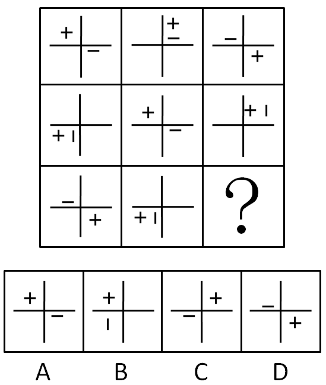

A. A

B. B

C. C

D. D

第 38 题 · 答案与解析

**参考答案（粉笔题库参考内容）**

A

**解析**

元素组成相同，考查位置规律。

每幅图分为四个区域。每幅图内的“＋”按顺时针方向依次出现在下一区域，“－”按逆时针方向依次出现在下一区域。

故正确答案为A。

**考点**：位置规律-平移

**来源**：2009年江苏省公务员录用考试《行测》题（C类）第38题

### 第 39 题

从所给四个选项中，选择最合适的一个填入问号处，使之呈现一定的规律性：

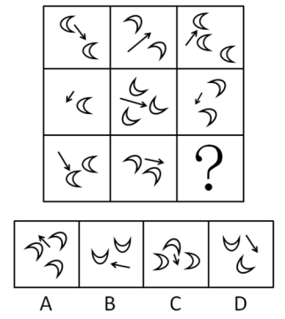

A. A

B. B

C. C

D. D

第 39 题 · 答案与解析

**参考答案（粉笔题库参考内容）**

B

**解析**

题干每幅图均出现箭头，优先考虑功能元素。功能元素考虑标记作用，观察发现，第一行箭头依次指向月亮、空白、月亮；第二行箭头依次指向空白、月亮、空白；第三行箭头依次指向月亮、空白、？，则？处图形中的箭头应指向月亮，只有B项符合。

故正确答案为B。

**考点**：特殊规律-功能元素

**来源**：2009年江苏省公务员录用考试《行测》题（C类）第39题

### 第 40 题

从所给四个选项中，选择最合适的一个填入问号处，使之呈现一定的规律性：

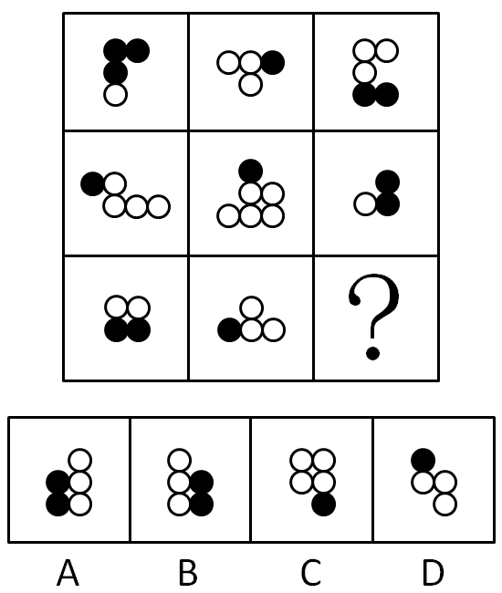

A. A

B. B

C. C

D. D

第 40 题 · 答案与解析

**参考答案（粉笔题库参考内容）**

D

**解析**

本题考查相对位置变换，九宫格从第一幅图到第九幅图黑球相对于白球的位置呈顺时针旋转变换，即黑球分别在白球的上面、右面、下面、左面、上面、右面、下面、左面、（上面）。观察选项，只有D项黑球在白球的上面。

故正确答案为D。

**考点**：特殊规律-图形间关系

**来源**：2009年江苏省公务员录用考试《行测》题（C类）第40题

### 第 41 题

可能今年有的城市房地产价格会下降。

据此，可以推出：

A. 可能今年有的城市房地产价格不会下降

B. 可能今年所有城市的房地产价格都不会下降

C. 必然今年有的城市房地产价格会下降

D. 不必然今年所有城市房地产价格都不会下降

第 41 题 · 答案与解析

**参考答案（粉笔题库参考内容）**

D

**解析**

第一步：转化题干。

“可能P”与“必然非P”构成矛盾关系，肯定前者推出否定后者。因此，由“房价可能下降”推出“并非房价必然不下降”。同理，由“某些城市房价下降”推出“并非所有城市房价不下降”。

第二步：对转化后的题干进行推导并判断选项。

合并第一步中两个命题可推出：“并非所有城市房价必然不下降”，即“不必然所有城市房价不下降”。

故正确答案为D。

**来源**：2009年江苏省公务员录用考试《行测》题（C类）第41题

### 第 42 题

小李和朋友相约：“如果明天阳光灿烂，我就和你一起去踏青。”

据此，可以推出小李爽约的情形是：

A. 明天阳光灿烂，小李的确和朋友一起踏青去了

B. 明天阳光灿烂，但小李没有和朋友一起去踏青

C. 明天下雨，小李仍和朋友一起踏青去了

D. 明天下雨，小李没有和朋友一起去踏青

第 42 题 · 答案与解析

**参考答案（粉笔题库参考内容）**

B

**解析**

第一步：翻译题干。

约定：天气好→小李和朋友一起去踏青。

爽约：-（天气好→小李和朋友一起去踏青）。

第二步：看其他的话。

题干中的“爽约”是对原先的命题予以否定。“如果A······那么B······”的负命题是“A 且 非B”。因此“-（天气好→小李和朋友一起去踏青）”等值于：天气好 且 小李和朋友没有一起去踏青。

故正确答案为B。

**考点**：常规翻译

**来源**：2009年江苏省公务员录用考试《行测》题（C类）第42题

### 第 43 题

有些想从事行政管理工作的大学生报考了公务员，所有艺术专业的大学生都不想从事行政管理工作。

据此，可以推出：

A. 有些艺术专业的大学生没有报考公务员

B. 有些艺术专业的大学生报考了公务员

C. 所有艺术专业的大学生都没有报考公务员

D. 有些报考了公务员的不是艺术专业的大学生

第 43 题 · 答案与解析

**参考答案（粉笔题库参考内容）**

D

**解析**

第一步：分析题干信息。

条件一：有些报考公务员和想从事行政管理工作的大学生的关系。

条件二：不想从事行政管理工作的大学生和艺术专业的关系。

第二步：根据三段论特点得到以下步骤，直接得出结论。

条件一和条件二的公共项：想从事行政管理工作的大学生。

去掉公共项：有些报考了公务员；不是艺术专业。

合并得出结论：有些报考了公务员的不是艺术专业的大学生。

故正确答案为D。

**考点**：集合推理

**来源**：2009年江苏省公务员录用考试《行测》题（C类）第43题

### 第 44 题

如果张生喜欢摄影，则他会喜欢旅游；如果他不喜欢摄影，则他会喜欢驾车；但是，如果张生不喜欢旅游，则他对驾车也就不感兴趣了。

据此，可以推出张生：

A. 喜欢旅游

B. 喜欢驾车

C. 不喜欢驾车

D. 喜欢摄影

第 44 题 · 答案与解析

**参考答案（粉笔题库参考内容）**

A

**解析**

第一步：翻译题干。

第一句：摄影→旅游。

第二句：不摄影→驾车。

第三句：不旅游→不驾车。

第二步：对题干进行进一步推导。

根据逆否规则，由第三句可推出：驾车→旅游。将第二句和第三句的逆否命题连起来可以得到：不摄影→旅游。

第三步：根据推导判断选项正确与否。

因为“摄影→旅游”“不摄影→旅游”，所以无论张生喜不喜欢摄影，他一定喜欢旅游。

故正确答案为A。

**考点**：常规翻译

**来源**：2009年江苏省公务员录用考试《行测》题（C类）第44题

### 第 45 题

某省举行“文明城市”评比。4位评委对大家普遍看好的A、B、C等3市获得“文明城市”称号的可能性进行了分析预测。

评委甲说：“要么A市能获得，要么C市能获得。”

评委乙说：“如果A市与C市能获得，则B市也能获得。”

评委丙说：“只有当B市不能获得或者C市能获得时，A市才不能获得。”

评委丁说：“我看B市能获得的可能性为零，而A市与C市一定能获得。”

评比结束后发现，4位评委中只有一人预测成立。

据此，可以推出获得“文明城市”称号的城市是：

A. A市

B. B市

C. C市

D. A、B、C等3市

第 45 题 · 答案与解析

**参考答案（粉笔题库参考内容）**

B

**解析**

第一步：翻译题干。

甲：A→\-C，A、C只能有一个；

乙：A 且 C→B；

丙：-A→\-B 或 C；

丁：-B 且 A 且 C。

第二步：找矛盾关系。

发现乙、丁矛盾，必有一真。

第三步：确定其他命题的真假。

只有一人预测准确，则甲、丙均预测错误，则丙的矛盾命题为真，即-A 且 B 且 -C，只有B市获得了文明城市的称号。

故正确答案为B。

**考点**：只有一真/一假

**来源**：2009年江苏省公务员录用考试《行测》题（C类）第45题

### 第 46 题

某体育代表队在一次比赛中共获A、B、C、D4个项目的奖牌若干枚。其中，A项目奖牌数大于C、D两项目奖牌数之和，C项目奖牌数大于D项目奖牌数，并且，在D项目上至少获得两枚奖牌，在B项目上至少获得一枚奖牌。

据此，可以推出该队在此次比赛中共获奖牌数至少是：

A. 10

B. 11

C. 12

D. 13

第 46 题 · 答案与解析

**参考答案（粉笔题库参考内容）**

C

**解析**

第一步：翻译题干。

（1）：A＞C+D；

（2）：C＞D；

（3）：D ≥ 2 且 B≥1。

第二步：寻找突破口。

本题的突破口是（3）。由D ≥ 2联系（2）可知，C＞2，C至少有3枚。再联系（1）可知，A＞5，A至少有6枚。

综上，≥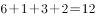。

故正确答案为C。

**考点**：组合排列-单题-其他

**来源**：2009年江苏省公务员录用考试《行测》题（C类）第46题

### 第 47 题

如果选购了股票，则不能投资期货；只有投资期货，才能投资邮票；或者投资邮票，或者投资外汇；但是最近投资外汇风险太大，不能操作。

据此，可以推出：

A. 选购股票

B. 不选购股票

C. 不投资邮票

D. 不投资期货

第 47 题 · 答案与解析

**参考答案（粉笔题库参考内容）**

B

**解析**

第一步：翻译题干。

①选购股票→\-投资期货；

②投资邮票→投资期货；

③投资邮票 或 投资外汇；

④-投资外汇。

第二步：根据题干条件进行推理。

从确定信息条件④入手，-投资外汇是对条件③或关系的其中一项进行否定，根据“或关系否一推一”，可以推出投资邮票；投资邮票是对条件②的肯前，肯前必肯后，可以推出投资期货；投资期货是对条件①的否后，否后必否前，可以推出不选购股票，对应B项。

故正确答案为B。

**考点**：常规翻译

**来源**：2020年重庆市选调优秀大学生到基层工作考试《行测》题第74题

### 第 48 题

某公司要从赵、钱、孙、李、周、吴6位职员中挑选两人出国洽谈项目，在挑选时注意到了以下情况：

（1）吴与钱不能同去；（2）只有孙去时，钱才能去；

（3）若李去，则周也去；（4）要么赵去，要么李去；

（5）如果钱不去，则赵也不能去；（6）由于某种原因，孙不能去。

据此，可以推出：

A. 赵、周两人去

B. 李、吴两人去

C. 李、周两人去

D. 钱、吴两人去

第 48 题 · 答案与解析

**参考答案（粉笔题库参考内容）**

C

**解析**

第一步：翻译题干。

（1）：吴不去 或 钱不去；

（2）：钱去→孙去，即孙不去→钱不去；

（3）：李去→周去；

（4）：要么赵去，要么李去；

（5）：钱不去→赵不去；

（6）：孙不去。

第二步：寻找突破口。

本题的突破口是（6）孙不去。孙不去联系（2）可知钱不去。钱不去联系（5）可知赵不去。赵不去联系（4）可知李必去。李去联系（3）可知周去。钱不去联系（1）可知吴不一定去。又由题干知道只有两人去，所以吴不去。

综上，李、周两人去。

故正确答案为C。

**考点**：常规翻译

**来源**：2009年江苏省公务员录用考试《行测》题（C类）第48题

### 第 49 题

在夏夜星空的某一区域，有7颗明亮的星星：A星、B星、C星、D星、E星、F星、G星，它们由北至南排列成一条直线，同时发现：

（1）C星与E星相邻；

（2）B星和F星相邻；

（3）F星与C星相邻；

（4）G星与位于最南侧的那颗星相邻。

据此，7颗星由北至南的顺序可以是：

A. D星、B星、C星、A星、E星、F星、G星

B. A星、F星、B星、C星、E星、G星、D星

C. D星、B星、F星、E星、C星、G星、A星

D. A星、E星、C星、F星、B星、G星、D星

第 49 题 · 答案与解析

**参考答案（粉笔题库参考内容）**

D

**解析**

第一步：观察题干和选项。

本题选项信息完整，适合用排除法。

第二步：利用题干中的条件排除选项。

首先根据条件（4）“G星与位于最南侧的那颗星相邻”推测出G位于由北到南第六位，可以排除A项；

其次根据条件（3）“F星与C星相邻”可以排除B、C两项；

最后代入D项检验，没有与条件矛盾之处。

故正确答案为D。

**考点**：排除法

**来源**：2009年江苏省公务员录用考试《行测》题（C类）第49题

### 第 50 题

在夏夜星空的某一区域，有7颗明亮的星星：A星、B星、C星、D星、E星、F星、G星，它们由北至南排列成一条直线，同时发现：

（1）C星与E星相邻；

（2）B星和F星相邻；

（3）F星与C星相邻；

（4）G星与位于最南侧的那颗星相邻。

假定F星在E星的北侧和A星的南侧，可以推出位于正中的星是：

A. C星

B. D星

C. E星

D. F星

第 50 题 · 答案与解析

**参考答案（粉笔题库参考内容）**

A

**解析**

第一步：寻找突破口。

本题突破口是信息量最大的对象，即F星。由“C星与E星相邻”“B星和F星相邻”“F星与C星相邻”可知这四颗星以B、F、C、E的顺序相邻，由“F星在E星的北侧和A星的南侧”可知A在B的北侧。

第二步：将信息集中画在一条直线上。

联系第一步，由“G星与位于最南侧的那颗星相邻”可知A、B、F、C、E在G的北侧。

                 A             B             F          C           E          G

北                                                                       。                。南

        A           B           F          C           E          G         （D）

北。          。           。           。            。            。            。南

由图可知，位于正中心的星是C星。

故正确答案为A。

**考点**：从最大信息开始推

**来源**：2009年江苏省公务员录用考试《行测》题（C类）第50题

### 第 51 题

公共产品：由公共部门提供的用来满足社会公共需要的产品。其中，纯公共产品是指任何一个人对某种物品的消费不会减少其他人对其消费的物品。

下列属于纯公共产品的是：

A. 一国的国防

B. 因拥挤而收费的高速公路

C. 城市中建设的免费公园

D. 商场提供的免费赠品

第 51 题 · 答案与解析

**参考答案（粉笔题库参考内容）**

A

**解析**

第一步：抓住定义中的关键词。

纯公共产品首先是“公共部门提供的产品”，其次强调“不会减少其他人对其消费的物品”。

第二步：逐一判断选项。

A项中一国在国防方面的消费不会减少他国在国防上的消费，正确；

B、C两项中收费高速公路和免费公园体现出资源的有限性，一个人对该物品的消费会影响到另一个人对该物品的消费，错误；

D项不是由公共部门提供的物品，错误。

故正确答案为A。

**考点**：常规问法

**来源**：2009年江苏省公务员录用考试《行测》题（C类）第51题

### 第 52 题

精神磨损：机器、设备等固定资产由于科学技术的进步而贬值。

下列属于精神磨损的是：

A. 某企业有一台高精度磨床，使用年限为10年，但是由于高效率使用，仅仅两年，一些主要部件已经需要更换

B. 找到新工作后，小陈购买了一台价格昂贵的手提电脑。仅仅过了一年，该电脑虽然保养如新，但是已经不值多少钱了

C. 老蔡是一位远近知名的质朴木匠，对于电刨、电锯，就是觉得不顺手，因此他帮人家打家具时所用的刨、锯等木工用具仍然是传统的

D. 某企业进口了一套最先进的冶炼设备，但由于技术人员积极性不高，致使这些进口设备的效率并没有充分发挥

第 52 题 · 答案与解析

**参考答案（粉笔题库参考内容）**

B

**解析**

第一步：抓住定义中的关键词。

精神磨损强调“固定资产”因“科技进步”而“贬值”。

第二步：逐一判断选项。

A项中磨床贬值不是因为“科技进步”所致；

B项中手提电脑买时昂贵，可一年后虽然保养得很好但仍旧贬值，说明是由于“科技进步”所致；

C、D两项中不存在机器、设备“贬值”的问题。

故正确答案为B。

**考点**：原因结果

**来源**：2009年江苏省公务员录用考试《行测》题（C类）第52题

### 第 53 题

间接正犯：利用他人作为工具来作案，其与被利用者不存在共同犯罪。

下列属于间接正犯的是：

A. 在一起入室盗窃案中，某甲只负责望风，没有实施具体的盗窃

B. 某甲预谋毒杀一个病人，想方设法将毒药交与不知情的护士

C. 某甲将抢劫得到的珠宝卖给了不知情的收购商

D. 某甲将非法获得的照片免费发送给网友传阅

第 53 题 · 答案与解析

**参考答案（粉笔题库参考内容）**

B

**解析**

第一步：抓住定义中的关键词。

间接正犯强调“以他人为工具”作案，且“与被利用者不存在共同犯罪”。

第二步：逐一判断选项。

A项中甲参与了具体作案过程，和其他人构成共同犯罪；

B项中护士是被利用者，且甲和护士不构成共同犯罪；

C项是销赃行为，不存在利用他人作案；

D项中甲没有利用他人作案的行为存在，因为网友并非是被利用者。

故正确答案为B。

**考点**：方式目的

**来源**：2009年江苏省公务员录用考试《行测》题（C类）第53题

### 第 54 题

合同诈骗罪：指以非法占有为目的，在签订、履行合同过程中，采取虚构事实或者隐瞒真相等欺骗手段骗取对方财物，并且数额较大的行为。

下列不属于合同诈骗罪的是：

A. 周某使用伪造的金融票据，在签订、履行合同的过程中，骗取对方当事人的信任，并骗得其财物，数额较大

B. 宋某为扩大经营，与甲公司签订合同，购买甲公司价值50万元的电器产品，言明款到发货。次日，宋某汇出5万元现金后，将汇票存根上的金额涂改为50万元，复印、传真给甲公司，骗取甲公司将货物全部发出

C. 吴某使用宋某的假名，分别与永安财产保险北京分公司和中华联合财产保险房山支公司签订保险代理合同，约定为该公司代销保险业务，并取得一定比例的手续费。截至当年年底，吴某共获取代收的保险费近31.5万元，但拒不向永安公司交付，并挥霍一空

D. 林某利用任某市工商局会计保管本单位支票之便利，私刻出纳员邓某、局长陈某的印鉴和单位公章，先后多次私自开具支票，骗取本单位资金合计20万元

第 54 题 · 答案与解析

**参考答案（粉笔题库参考内容）**

D

**解析**

第一步：抓住定义中的关键词。

合同诈骗罪强调“以非法占有为目的”“发生在签订、履行合同过程中”和“用欺骗手段骗取对方财物，并且数额较大”。

第二步：逐一判断选项。

A、B、C三项均符合“合同诈骗罪”的三个要素；D项中“骗取本单位资金合计20万元”符合“以非法占有为目的”和“用欺骗手段骗取对方财物，并且数额较大”，但是犯罪行为并非发生在“签订、履行合同过程中”。

本题为选非题，故正确答案为D。

**考点**：大前提

**来源**：2009年江苏省公务员录用考试《行测》题（C类）第54题

### 第 55 题

疑病现象：人们将轻微的身体不适现象看成严重疾病，反复多次检查。特别是当亲友、邻居、同事因某病英年早逝和意外死亡后更容易出现这种现象。

下列属于疑病现象的是：

A. 好友因病去世，王某情绪低落，一段时间对工作毫无积极性

B. 由于工作压力太大，再加上亲友的去世，李某操劳过度住院了

C. 一工友因肺病去世，由于工作于同样的环境，大家都觉得自己也患了肺病

D. 小王在职称晋升中受阻，她怀疑单位个别同事在其中捣鬼

第 55 题 · 答案与解析

**参考答案（粉笔题库参考内容）**

C

**解析**

第一步：抓住定义中的关键词。

疑病现象强调把“轻微的不适”当作重病，实际上并“未得病”。

第二步：逐一判断选项。

A项中“工作没有积极性”和D项中“怀疑别人捣鬼”并不是“身体不适”，错误；

B项中李某确实是生病了，错误；

C项中大家因同事患肺病去世而把自己的不适看作患了肺病，正确。

故正确答案为C。

**考点**：拆词

**来源**：2009年江苏省公务员录用考试《行测》题（C类）第55题

### 第 56 题

蔡戈尼效应：指对未完成的工作比对已完成的工作有较好的记忆效果的现象。1927年由德国心理专家蔡戈尼在记忆实验中发现。

下列属于蔡戈尼效应的是：

A. 妻子为使爱睡懒觉的作曲家丈夫起床，在钢琴上不停弹出一组乐句的头三个和弦，作曲家听了之后，辗转反侧，终于不得不爬起来，弹完最后一个和弦

B. 温故而知新

C. 只要是自己认准的事情，不管多难，小李都坚持不懈努力完成，从不半途而废

D. 小李看一本书的时候，总尝试停一下，想想自己是否在浪费时间和精力，如果是的，就会针对要不要继续看下去作出取舍

第 56 题 · 答案与解析

**参考答案（粉笔题库参考内容）**

A

**解析**

第一步：抓住定义中的关键词。

蔡戈尼效应强调对“未完成的工作”记忆较深。

第二步：逐一判断选项。

B项中“温故”，C项中“认准的事情”和D项中“看书回想”都不是“未完成的工作”，均错误；

A项中“乐句的最后一个和弦”是作曲家“未完成的工作”，正确。

故正确答案为A。

**考点**：主客体

**来源**：2009年江苏省公务员录用考试《行测》题（C类）第56题

### 第 57 题

网络成瘾：个体反复过度使用网络导致的一种精神行为障碍，表现为对网络的再度使用产生强烈的欲望，停止或减少网络使用时出现戒断反应，同时可伴有精神及躯体症状。

下列属于网络成瘾的是：

A. 小丽每天上网处理文字材料，现在几乎不用纸和笔

B. 小王喜欢网络游戏，整日整夜地泡在网吧里，一天不上网，就好像掉了魂似的

C. 网络公司破产后，工程师小李失魂落魄，不知道自己能干什么

D. 李先生热衷于炒股，他每天都要到网上观看股市行情，一天不看心里都不安

第 57 题 · 答案与解析

**参考答案（粉笔题库参考内容）**

B

**解析**

第一步：抓住定义中的关键词。

网络成瘾强调由于“过度使用网络”而导致的一种“精神行为障碍”。

第二步：逐一判断选项。

A项只是一种工作状态，不存在“精神行为障碍”；

B项中沉迷于网络游戏是“过度使用网络”，离开网络像掉魂是“精神行为障碍”；

C项和“使用网络”无关；

D项中“使用网络”只是载体而不是原因，炒股才是造成精神障碍的主因。

故正确答案为B。

**考点**：拆词

**来源**：2009年江苏省公务员录用考试《行测》题（C类）第57题

### 第 58 题

多态现象：同种生物的个体对于某些形态、形质所表现的多样性的状态。

下列属于多态现象的一项是：

A. “雄兔脚扑朔，雌兔眼迷离”

B. “世界上没有两片完全相同的树叶”

C. 普通的马大多单色，而斑马是黑白相间

D. 人不能两次踏进同一条河流

第 58 题 · 答案与解析

**参考答案（粉笔题库参考内容）**

B

**解析**

第一步：抓住定义中的关键词。

多态现象强调“同种生物个体”表现的多样性的状态。

第二步：逐一判断选项。

A、C两项中不同性别的兔，普通马与斑马不能视为“同种生物”；

B项指出即使是同一种树叶，它们的形态也是不同的，体现了树叶的多样性状态；

D项中河流并不是“生物个体”。

故正确答案为B。

**考点**：主客体

**来源**：2009年江苏省公务员录用考试《行测》题（C类）第58题

### 第 59 题

延伸产品：顾客在购买产品时，附带获得的各种利益的总和。

下列属于延伸产品的是：

A. 某4S店承诺，顾客只要购买价值25万以上的车，就赠送一年的保险

B. 持有白金卡的用户在某商场购物享受八折优惠

C. 某商场新年的优惠是前100名顾客可以只花100元就能买一新款手机

D. 微软公司在XP系统后又推出了其升级版的Vista操作系统，以满足客户的需求

第 59 题 · 答案与解析

**参考答案（粉笔题库参考内容）**

A

**解析**

第一步：抓住定义中的关键词。

延伸产品强调顾客购买该产品之外“获得附带利益”。

第二步：逐一判断选项。

A项中“赠送的一年保险”是买车时的“附带利益”；

B、C两项是就产品本身而获得的价格减让，而非产品之外的“附带利益”；

D项中Vista系统并非无偿提供给XP系统用户使用，因此不是“附带利益”。

故正确答案为A。

**考点**：单定义-其他句式

**来源**：2009年江苏省公务员录用考试《行测》题（C类）第59题

### 第 60 题

洁癖：强迫症的一种，即把正常卫生范围内的事物认为是肮脏的，感到焦虑，强迫性地清洗、检查及排斥“不洁”之物。

下列不属于洁癖的是：

A. 胡某害怕自己染上病菌，他每天必须多次、长时间地洗手、洗衣

B. 斯密司先生出差一律入住白色的房间，甚至地毯也必须是白色的才行

C. 有位年轻小姐为了避免在公共汽车与他人接触，每天竟花三个小时走路上下班

D. 李某不允许孩子在外面乱吃东西，也不允许孩子接近生病的小朋友

第 60 题 · 答案与解析

**参考答案（粉笔题库参考内容）**

B

**解析**

第一步：抓住定义中的关键词。

洁癖强调把“正常卫生范围内”的事物认为是“不洁”之物而“清洗、排斥”。

第二步：逐一判断选项。

A项中胡某把“正常卫生范围内”的“病菌”当作大敌而不断清洗，这是洁癖；

B项中斯密司先生用白色物品可能是出于对颜色的偏好，而非认为物品“不洁”，这不是洁癖；

C项中年轻小姐把“公共汽车与他人接触”当作“不洁”之事而排斥，这是洁癖；

D项中李某把“生病的小朋友”当作“不洁”之人而排斥，这是洁癖。

本题为选非题，故正确答案为B。

**考点**：拆词

**来源**：2009年江苏省公务员录用考试《行测》题（C类）第60题

### 第 61 题

从“娱乐化应用”到“价值应用”，互联网为我们的日常生活提供着实实在在的服务：中学生的“网络课堂”，大学生求职的“网申”，农民土特产的“网络推销”，都市白领热衷的网上“淘宝”······互联网的价值应用正在走近每一个人；更有专家预言“数字化生存”的诱人前景。

对文意概括最准确的是：

A. 互联网走进价值应用的新时代

B. 互联网给予人们生活上的便利

C. 互联网引导进入数字化生存

D. 互联网参与人们的日常生活

第 61 题 · 答案与解析

**参考答案（粉笔题库参考内容）**

A

**解析**

据“文意概括”知此题属中心理解题。

文段属于总-分-总结构。注意首句出现的“价值应用”核心词，接下来举例“价值应用”的各个层面，最后再总结“价值应用”走近每一个人，只有A项与本文所说的重点“价值应用”明确相关。

B项“生活上的便利”概括不全面；C项“数字化生存”还仅仅是“预言”；D项主体错误。

故正确答案为A。

**考点**：主题词

**来源**：2009年江苏省公务员录用考试《行测》题（C类）第61题

### 第 62 题

要最大限度地提高老年人的生命质量，就必须最大限度地了解衰老的机制。就目前所知，人体衰老是由器官衰老引起的，而器官衰老是由组织衰老引起的，人体的所有器官和组织又都由细胞组成，引起组织衰老的主要是干细胞功能的衰竭。

以此作为开头的一篇文章，最有可能讨论的问题是：

A. 如何提高老年人的生命质量

B. 人体衰老是如何发生的

C. 人体衰老与器官衰老的关系

D. 干细胞功能衰竭的过程

第 62 题 · 答案与解析

**参考答案（粉笔题库参考内容）**

D

**解析**

重点看文段最后一句，引出人体衰老的原因主要是干细胞功能的衰竭，即引出“干细胞”这一话题，接下来文段应围绕这一话题展开论述，对应D项。

A、B、C三项均没有谈到干细胞功能衰竭这一话题，故排除。

故正确答案为D。

**考点**：接语选择题

**来源**：2009年江苏省公务员录用考试《行测》题（C类）第62题

### 第 63 题

研究人员比较了在乡间公园步行30分钟和在室内购物中心步行30分钟的两组抑郁者。结果表明，在公园步行的一组中，71%的人表示心情感到舒畅许多，90%的人表示觉得拥有更多自信了；而室内步行的一组中，只有45%的人表示心情变得更好，22%的人表示觉得更郁闷了，50%的人更加紧张，44%的人自信心下降。

对文段概括最恰当的是：

A. 散步有利于治疗抑郁

B. 室内散步对治疗抑郁没有疗效

C. 抑郁者更喜欢在室外散步

D. 户外散步对缓解抑郁有作用

第 63 题 · 答案与解析

**参考答案（粉笔题库参考内容）**

D

**解析**

据提问知此题属于中心理解题。

文段属于总-分结构。首句点明研究对象是抑郁者在不同环境步行30分钟的状态。然后分别提出两个数据对比，指出在户外散步要比室内散步对人心情的调节作用更为明显，尤其是那些有着抑郁情绪的人。

因此符合文段意思的应该是D项。

A项“治疗”过于绝对，本题研究是影响的相关性；B项“没有疗效”也不准确；C项“更喜欢”的比较与调查无关。

故正确答案为D。

**考点**：分述句特征-引入铺垫

**来源**：2009年江苏省公务员录用考试《行测》题（C类）第63题

### 第 64 题

一个社会有希望，有可以让人讴歌与向往的前景，关键就在于公民既有权利追求自由，又有义务担负责任。“只讲自由，不讲责任”和“只讲责任，不讲自由”一样，都因为权利与义务的不对等而使社会迷失于个人和集体两个极端，使社会最终失去前途，而身处其中的任何个人也因此难以获得真正的安全与幸福。

这段话强调的是：

A. 公民不能只讲自由或只讲责任

B. 公民既要追求自由也要承担责任

C. 公民权利与义务应该相应对等

D. 公民权利和义务与自由和责任共存

第 64 题 · 答案与解析

**参考答案（粉笔题库参考内容）**

D

**解析**

据提问“强调”可知此题属于中心理解题。

文段为总-分结构。首句明确提出公民有权追求自由也有义务承担责任。接下来都在论述只有自由没有责任或只有责任没有自由的后果，属于对总论点的分述。

选项中只有D项对总论点的概括最为准确。

A、B两项都是分述的概括或者延伸；C项中本文没有重点阐述“应该相应对等”的原因。

故正确答案为D。

**考点**：分述句特征-多角度论述

**来源**：2009年江苏省公务员录用考试《行测》题（C类）第64题

### 第 65 题

社会上对于诚信危机早已见怪不怪。轻者，说话带水分，做事留一手，约定不确定；重者，市场上满布弄虚作假的信息和产品，社会上充斥尔虞我诈、真假莫辨的丑行。如此一来，殷实商人受骗受疑，受害受气；诚信企业对内对外，时刻提防真假。

所谓“见怪不怪”指的是：

A. 商家对诚信危机并不重视

B. 企业早已习惯诚信危机

C. 个人对诚信危机无动于衷

D. 诚信危机现象非常普遍

第 65 题 · 答案与解析

**参考答案（粉笔题库参考内容）**

D

**解析**

此题属于词语指代类的词句理解题。

文段为总-分的阐述方式，介绍诚信危机的问题，首句就提出观点诚信危机在社会上很普遍，二三句分别从个人、商家、企业等角度论证了诚信危机普遍存在的情况。

因此，结合选项应该选择D项。

A、B、C三项都是论据的阐述，而不是论点概括。

故正确答案为D。

**考点**：实词

**来源**：2009年江苏省公务员录用考试《行测》题（C类）第65题

### 第 66 题

由于原有积累、受害程度乃至各自心理承受能力等因素的差异，灾区居民会逐渐显示其需求的差异性和多样化，对由政策带来的实际受益表现出不同的思考与评价。为此，有必要实施差别化的公共政策，满足灾区居民多样化的需求。

这段文字重在说明：

A. 如何看待灾区居民的需求

B. 如何满足灾区居民的需求

C. 政策应考虑灾民的不同需求

D. 政策应容许居民的评价意见

第 66 题 · 答案与解析

**参考答案（粉笔题库参考内容）**

C

**解析**

据提问知此题属于中心理解题。

关键词是“为此”，之前说的是灾区居民需求多样化的原因，之后强调的就是政策必须重视这种多样化的需求。

因此，结合选项应该选择C项。

A、B两项只是提到需求，未提及政策，与文意不符；D项“评价”与文意不符，故排除。

故正确答案为C。

**考点**：关联词-因果

**来源**：2009年江苏省公务员录用考试《行测》题（C类）第66题

### 第 67 题

法律并不只是解决纠纷的手段，它也是传达意义的符号。换言之，法律是安排社会生活和解决社会问题的工具和手段，也是特定人群价值追求的某种显现，归根到底，法律是人创造出来的具有某种功能的“技术手段”，人对于世界的反应最终必须借助于文化这一中介。

这段文字主要讨论的是（　）。

A. 法律的根本精神

B. 法律的最高价值

C. 法律的基本功能

D. 法律的绝对作用

第 67 题 · 答案与解析

**参考答案（粉笔题库参考内容）**

A

**解析**

本题属于中心理解题。从文段“也是”“归根到底”“最终”等词语可以看出其后的语句是文段想要强调的内容，而“传达意义的符号”“特定人群价值追求的某种显现”“人对于世界的反应最终必须借助于文化这一中介”是从文化的角度来阐释法律，阐述法律精神层面的意义，是法律的精神所在。所以A项正确。

B项，文段提到“法律是特定人群价值追求的某种显现”，与该项所说的“最高价值”不是同一概念，故排除；

C项，文段提到“法律是人创造出来的具有某种功能的‘技术手段’”，与该项所说的“法律的基本功能”不是同一概念，故排除；

D项，文段未提及“法律的绝对作用”，属于无中生有，故排除。

故正确答案为A。

【文段出处】《法律与文化》

**来源**：2009年江苏省公务员录用考试《行测》题（C类）第67题

### 第 68 题

在那个时代的欧洲学者心中，中国形象跟乌托邦一样完美无缺。当他们建构一个乌托邦式的中国形象时，并没有足够的现实材料，也没有一本扎实的专门著作进行学术论证。严格说来，这只是一场思想上的虚构。

从这段文字可以推出的是：

A. 当时欧洲学者理想化看待中国

B. 当时欧洲学者不注重实证研究

C. 乌托邦式的中国形象并不存在

D. 乌托邦式的中国形象并不完美

第 68 题 · 答案与解析

**参考答案（粉笔题库参考内容）**

A

**解析**

据题目“可以推出”可知此题属于隐含主旨题。

首句说那时的欧洲学者认为中国像乌托邦一样完美，然后阐述这种形象为何是建构出来的。

因此，结合选项应该选择A项。

第二句提到没有足够的现实材料并不能说明欧洲学者不注重实证研究，故排除B项；文段强调的是欧洲学者心目中的完美中国形象，根本没涉及乌托邦式的中国形象存不存在的问题，故排除C项；D项为干扰项，整个文段强调的是欧洲学者心中的中国形象，D项是从现实角度谈的，故排除。

故正确答案为A。

**考点**：细节判断题

**来源**：2009年江苏省公务员录用考试《行测》题（C类）第68题

### 第 69 题

世界银行在国际上享有盛誉并具有相当的约束力，它既能要求得资方国家进行产权保护等制度性改革，又能直接参与投资，后者本身也让民间投资者更有信心，因而使发展中国家的投资项目风险降低。这不仅能增加对发展中国家的投资，而且使他们的融资成本降低。

这段话讨论的是：

A. 世界银行如何帮助发展中国家

B. 世界银行如何降低投资风险

C. 世界银行具有什么样的作用

D. 世界银行如何建立投资者的信心

第 69 题 · 答案与解析

**参考答案（粉笔题库参考内容）**

A

**解析**

据提问可知此题属于中心理解题。

本题从关键词“发展中国家”入手，文段重点阐述的世界银行在发展中国家融资方面发挥的作用。

而B、C、D三项都单方面说世界银行，并未提及与“发展中国家”的关系，均排除。另外，通过“因而······”这个连接词来看，重点也是后面所要说明的，世界银行的约束力对发展中国家的作用。

故正确答案为A。

**考点**：主题词

**来源**：2009年江苏省公务员录用考试《行测》题（C类）第69题

### 第 70 题

现在国内每年创作歌曲10万多首，作品虽多，但好歌难求。尽管也有歌曲通过网络一时蹿红，但无论在知名度还是传唱度上，都与“30年30首歌”难以媲美，更谈不上久唱不衰。创作乏善可陈，通俗歌曲不通俗、流行歌曲不流行，已成为目前流行歌坛的致命症结。

这段话要表达的意思是：

A. 我国每年创作的歌曲数量过多

B. 网络歌曲只能流行一时

C. 好歌难求是流行歌坛最大问题

D. 流行歌曲无法长久传唱

第 70 题 · 答案与解析

**参考答案（粉笔题库参考内容）**

C

**解析**

据提问可知此题属于中心理解题。

文段主要谈了现在国内歌曲创作的现状——作品虽多，好歌难求。第二、三句话分别介绍了网络歌曲和流行歌曲存在的问题，进而指出流行歌坛的致命症结是创作乏善可陈。

因此，结合选项应该选择C项。

A项是陈述的一种现象，故排除；B、D两项分别是歌坛目前出现的问题的一部分。

故正确答案为C。

**考点**：关联词-对策

**来源**：2009年江苏省公务员录用考试《行测》题（C类）第70题

## 材料 1

从“横空出世”到随后的“星火燎原”再到近几年的“穷途末路”，小灵通终于即将完成其历史使命。在表面上，小灵通占用了TD的频段，随着3G的启动，小灵通必然因为频段的清理而被“清退”；从深层看，其根本原因则是原固网运营商中国电信以及中国网通(现在的中国联通)都已经获得了移动牌照，在其他通信技术的竞争压力之下，小灵通唯有选择主动退出。对于中国通信业，因为小灵通既不属于“手机”，也不属于固定电话，它的退出，将意味着一个“有中国特色的通信时代”的终结；对于消费者，小灵通更是打破移动资费垄断坚冰的一把利斧，凭借绿色环保，尤其是费用低廉的双重优势，它迅速受到市场的广泛认可和消费者的普遍欢迎。到目前为止，小灵通在农村三、四级市场仍然拥有较高的占有率，2006年，小灵通用户突破9000万，逼近1亿，达到历史最高峰。此后，随着移动电话对固定电话功能替代的加强，小灵通的迅猛增速“戛然而止”。随着移动资费的明显下降，小灵通费用低廉的优势不再明显，同时，由于电信和网通逐步停止对小灵通的投资更新，其服务质量也开始下降，加上无法漫游的先天性不足，它的局限性日益突出。2008年的电信重组和3G发牌，让中国电信和原中国网通正式获得了梦寐以求的移动牌照，小灵通——这一曾经代表了中国电信发展移动业务冲动的特定通信产品也即将完成其历史使命。

### 第 71 题

不属于“小灵通的迅猛增速‘戛然而止’”的原因是：

A. 2008年电信重组和3G发牌

B. 小灵通的更新力度和服务质量都有所下降

C. 小灵通无法漫游是根本性弱点

D. 移动资费下降使小灵通资费优势不再明显

第 71 题 · 答案与解析

**参考答案（粉笔题库参考内容）**

A

**解析**

此题属于细节判断题。

A项是小灵通不得不退出历史舞台的背景，而非其增速停止的原因。

在文中小灵通的迅猛增速“戛然而止”前后提到相关的原因有“移动电话对固定电话功能替代的加强”“移动资费的明显下降，小灵通费用低廉的优势不再明显”“电信和网通逐步停止对小灵通投资更新，其服务质量也开始下降”、“无法漫游的先天性不足”这四项，B、C、D三项均有提到。

本题为选非题，故正确答案为A。

**来源**：2009年江苏省公务员录用考试《行测》题（C类）第71题

### 第 72 题

最足以阐述“穷途末路”含义的现实状况是：

A. 小灵通终于即将完成其历史使命

B. 中国电信以及中国网通（现在的中国联通）都已经获得了移动牌照，在其他通信技术的竞争压力之下，小灵通唯有选择主动退出

C. 随着移动对固定电话功能替代的加强，小灵通的迅猛增速“嘎然而止”

D. 随着移动资费的明显下降，小灵通费用低廉的优势不再明显；同时，由于电信和网通逐步停止对小灵通投资更新，其服务质量也开始下降，加上无法漫游的先天性不足，它的局限性日益突出

第 72 题 · 答案与解析

**参考答案（粉笔题库参考内容）**

B

**解析**

此题属于词句理解题。

“穷途末路”意味着已经到了无路可走的地步，根据文章意思应该在深层原因上找，也就是“原固网运营商中国电信以及中国网通(现在的中国联通)都已经获得了移动牌照，在其他通信技术的竞争压力之下，小灵通唯有选择主动退出。”

因此，结合选项应该选择B项。

A项与现实状况不符，小灵通的“历史使命”不是预设的，而是不得不面临的现状；C项只是在说小灵通的迅速增长停止；D项是对增速“戛然而止”的原因的阐释。

故正确答案为B。

**来源**：2009年江苏省公务员录用考试《行测》题（C类）第72题

### 第 73 题

对于市场和消费者，小灵通的重要意义在于：

A. 不需要移动牌照就可以提供移动服务

B. 不需要更新技术就可以提供优质服务

C. 突破自身缺陷实现中国电信发展移动业务的创业冲动

D. 凭借自身廉价而优质服务打破了移动业务的价格垄断

第 73 题 · 答案与解析

**参考答案（粉笔题库参考内容）**

D

**解析**

此题属于细节判断题。

文中提到“对于消费者，小灵通更是打破移动资费垄断坚冰的一把利斧，凭借绿色环保，尤其是费用低廉的双重优势，它迅速受到市场的广泛认可和消费者的普遍欢迎”。由此可以看出，小灵通对于市场和消费者的主要意义在于，利用价格优势打破了移动资费的垄断局面。

因此，结合选项应该选择D项。

题干要求从“市场和消费者”的要求出发，A、B、C三项中“提供移动服务”“发展移动业务”都是从运营商的角度说的，故排除。

故正确答案为D。

**来源**：2009年江苏省公务员录用考试《行测》题（C类）第73题

### 第 74 题

下列说法符合文意的是：

A. 小灵通如果不用TD频段就不必退市

B. 小灵通如果不退市用户就将继续猛增

C. 小灵通即将完成中国电信发展移动业务的任务

D. 小灵通如果受到3G的打压就失去资费的优势

第 74 题 · 答案与解析

**参考答案（粉笔题库参考内容）**

C

**解析**

此题属于细节判断题。

文章首尾句均明确指出，小灵通即将完成其历史使命，最终退出市场，因此C项说法是符合文意的。

A项，TD频段只是小灵通退市的表面原因，不是小灵通退市的根本原因，故错误；B项，文中最后二三句已经提到小灵通即使不退市，其迅猛增速“戛然而止”，故错误；D项，小灵通资费优势的丧失是因为移动资费的明显下降，而并不是因为受到3G的打击，故错误。

故正确答案为C。

**来源**：2009年江苏省公务员录用考试《行测》题（C类）第74题

### 第 75 题

本文标题可以为：

A. 小灵通的市场优势

B. 小灵通的退市命运

C. 小灵通与移动牌照

D. 小灵通的历史使命

第 75 题 · 答案与解析

**参考答案（粉笔题库参考内容）**

B

**解析**

此题属于标题选择题。

整篇文章主要介绍了小灵通不得不退市的原因，且一直围绕退市展开论述。

因此，本文的标题中应体现退市，应选B项。

A、C两项都不是文章所指的重点；D项文中有提及，但是作为标题而言，此提法不够具体。

故正确答案为B。

**来源**：2009年江苏省公务员录用考试《行测》题（C类）第75题

## 材料 2

1978年，我国国内生产总值（GDP）只有1473亿美元，到了2007年我国国内生产总值（CDP）达到32801亿美元，2000年，我国GDP超过意大利，位于世界第六位，占美国国内生产总值GDP的12.3%，占日本国内生产总值的25.7%，占德国国内生产总值的63.1%，占英国国内生产总值的83.1%，占法国国内生产总值的90.2%。2005年，我国GDP超过英国与法国，位于世界第四位，是美国国内生产总值的18.1%，比2000年提高了5.8个百分点。是日本国内生产总值的49.3%，接近日本国内生产总值的一半，比2000年提高近一倍；是德国国内生产总值的80.5%，比2000年提高了17.4个百分点，2007年仍然位于第四位，但是位于第三位的德国的99.5%，比2005年提高19个百分点。

        随着经济快速发展和经济总量大幅提高，国民总收入（GNI）得到大幅提高，1978年，人均国民收入为190美元，2001年人均国民收入为1000美元，2007年我国国民经济走上新台阶，达到2360美元，比1978年增长了11倍。我国人均GNI与世界人均GNI水平差距逐渐缩小，1978年我国人均GNI相当于世界人均国民收入水平的10.1%，2001年我国人均GNI相当于世界人均国民收入水平的19.2%，比1978年高9.1个百分点，2007年相当于世界平均国民收入的29.7%，比1978年高19.6个百分点，在世界银行的209个国家、地区排名中，我国人均GNI在世界排名中由1997年145位提升到2007年的132位。

### 第 76 题

根据以上材料，下列说法中正确的有：

（1）2000年德国GDP不到日本的二分之一

（2）2000年日本GDP不到美国的二分之一

（3）2000年法国GDP不到日本的三分之一

（4）2000年中国GDP不到日本的四分之一

A. 4项

B. 3项

C. 2项

D. 1项

第 76 题 · 答案与解析

**参考答案（粉笔题库参考内容）**

B

**解析**

（1）定为文字材料第一段，“2000年，我国GDP超过意大利······占日本国内生产总值的25.7%，占德国国内生产总值的63.1%”，可知，，推出德国GDP是日本GDP的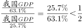，正确；

（2）定为文字材料第一段，“2000年，我国GDP超过意大利······占美国国内生产总值GDP的12.3%，占日本国内生产总值的25.7%”，可知，，推出日本GDP是美国GDP的，正确；

（3）定为文字材料第一段，“2000年，我国GDP超过意大利······占日本国内生产总值的25.7%······占法国国内生产总值的90.2%”，可知，，推出法国GDP是日本GDP的，正确；

（4）定为文字材料第一段，“2000年，我国GDP超过意大利······占日本国内生产总值的25.7%”，可知中国GDP占日本GDP的25.7%，超过1/4，错误。

综上所述，（1）（2）（3）均正确，共3项。

故正确答案为B。

**来源**：2009年江苏省公务员录用考试《行测》题（C类）第76题

### 第 77 题

2001年、2007年世界人均GNI分别是（　　）和（　　）。

A. 5208美元 7946美元

B. 5208美元 12365美元

C. 1946美元 11889美元

D. 11889美元 12365美元

第 77 题 · 答案与解析

**参考答案（粉笔题库参考内容）**

A

**解析**

据题干“2001年、2007年······世界人均GNI······”，结合材料给出我国人均GNI和相对于世界人均GNI的比重，可判定本题为现期比重问题。定位文字材料第二段可知：“2001年人均国民收入为1000美元，2007年我国国民经济走上新台阶，达到2360美元······2001年我国人均GNI相当于世界人均国民收入水平的19.2%······2007年相当于世界平均国民收入的29.7%”,根据整体量，故2001年世界人均GNI美元；2007年世界人均GNI美元，与A项最接近。

故正确答案为A。

**来源**：2009年江苏省公务员录用考试《行测》题（C类）第77题

### 第 78 题

1979~2007年我国GDP的年平均增长速度比人均GNI：

A. 高10.05个百分点

B. 低0.3个百分点

C. 低3.56个百分点

D. 高2.21个百分点

第 78 题 · 答案与解析

**参考答案（粉笔题库参考内容）**

D

**解析**

根据题干“1979~2007年我国GDP的年平均增长速度比人均GNI”，可判定本题为年均增长率问题。定位文字材料第一段和第二段可知：“1978年我国GDP为1473亿美元，人均GNI为190美元，2007年我国GDP为32801亿美元，人均GNI为2360美元”，根据年均增长率公式：，即本题现期量为2007年的量，基期量为1978年的量，年份差n=2007-1978=29，可推出，，前者大于后者，即高于，排除B、C两项，若取值10%，，与22接近，可判断略大于10%，根据，推测不会特别小，可判断不可能比高10.05个百分点，故排除A项。

故正确答案为D。

**来源**：2009年江苏省公务员录用考试《行测》题（C类）第78题

### 第 79 题

2001～2005年，美国、日本、德国GDP年平均增长速度由快到慢的排序是：

A. 美国、日本、德国

B. 日本、德国、美国

C. 德国、美国、日本

D. 德国、日本、美国

第 79 题 · 答案与解析

**参考答案（粉笔题库参考内容）**

C

**解析**

根据题干“2001～2005年，······平均增长速度由快到慢的排序是”，可判定本题为年均增长率问题。定位文字材料第一段可知：“2000年，我国GDP超过意大利，······占美国国内生产总值GDP的12.3%，占日本国内生产总值的25.7%，占德国国内生产总值的63.1%。2005年，我国GDP······是美国国内生产总值的18.1%，是日本国内生产总值的49.3%，是德国国内生产总值的80.5%”，设2000年我国GDP为a，2005年我国GDP为b，根据年均增长率公式：，即本题现期量为2005年的量，基期量为2000年的量，年份差n=2005-2000=5，可推出：≈0.68b/a，，，可推出平均增长速度由快到慢依次为：德国、美国、日本。

故正确答案为C。

**来源**：2009年江苏省公务员录用考试《行测》题（C类）第79题

### 第 80 题

1979～2007年，我国人均GNI相当于世界平均水平的比例平均每年上升：

A. 0.26个百分点

B. 0.68个百分点

C. 0.96个百分点

D. 1.21个百分点

第 80 题 · 答案与解析

**参考答案（粉笔题库参考内容）**

B

**解析**

根据题干“1979～2007年，我国人均GNI相当于世界平均水平的比例平均每年上升”，结合选项为百分点，可判定本题为年均增长量问题。定位文字材料第二段可知：“2007年相当于世界平均······，比1978年高19.6个百分点”，故在1979～2007年间平均每年上升：，即0.68个百分点。

故正确答案为B。

**来源**：2009年江苏省公务员录用考试《行测》题（C类）第80题

## 材料 3

**第二次农业普查南京市各区县农村劳动力资源总量及构成表**

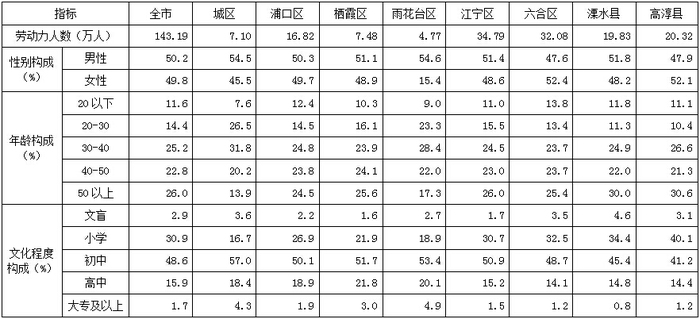

### 第 81 题

南京市各区县农村劳动力中，年龄在50岁以上的劳动力有：

A. 30.52万人

B. 37.23万人

C. 46.56万人

D. 53.35万人

第 81 题 · 答案与解析

**参考答案（粉笔题库参考内容）**

B

**解析**

根据题干“年龄在50岁以上的劳动力有”，结合材料给出的南京全市劳动力人数以及年龄在50岁以上的劳动力人数占全市总人数的比重，可判定本题为现期比重问题。定位表格材料可得，南京全市的劳动力人数为143.19万人，年龄在50岁以上的劳动力人数占比为26.0%。则年龄在50岁以上的劳动力有=37.5万人，与B项最接近。

故正确答案为B。

**来源**：2009年江苏省公务员录用考试《行测》题（C类）第81题

### 第 82 题

南京市农村劳动力中，年龄在20—50岁的劳动力的平均年龄最可能落入的区间是：

A. 25—30岁

B. 30—50岁

C. 35—40岁

D. 40岁以上

第 82 题 · 答案与解析

**参考答案（粉笔题库参考内容）**

B

**解析**

观察图表可知，年龄在30—40，40—50之间的百分比比较大，所以平均年龄落在30—50区间的可能性较大。

故正确答案为B。

**来源**：2009年江苏省公务员录用考试《行测》题（C类）第82题

### 第 83 题

南京市农村劳动力文化程度构成中比例最高的是：

A. 高中

B. 大专及以上

C. 小学

D. 初中

第 83 题 · 答案与解析

**参考答案（粉笔题库参考内容）**

D

**解析**

观察图表可知，全市有48.6%的农村劳动力为初中学历，其所占比例最高。

故正确答案为D。

**来源**：2009年江苏省公务员录用考试《行测》题（C类）第83题

### 第 84 题

南京市农村劳动力最集中的年龄段是：

A. 20岁以下

B. 20—30岁

C. 30—50岁

D. 50岁以上

第 84 题 · 答案与解析

**参考答案（粉笔题库参考内容）**

C

**解析**

观察图表可知，30—50岁劳动力最集中，占到25.2%＋22.8%＝48%。

故正确答案为C。

**来源**：2009年江苏省公务员录用考试《行测》题（C类）第84题

### 第 85 题

南京市各区县农村劳动力人数的中位数是：

A. 18.33万人

B. 16.82万人

C. 16.12万人

D. 15.19万人

第 85 题 · 答案与解析

**参考答案（粉笔题库参考内容）**

A

**解析**

定位表格材料，将各区县的劳动力人数从小到大依次排列：4.77、7.10、7.48、16.82、19.83、20.32、32.08、34.79，共8个数据，为偶数项，则此时中位数为中间两个数字的平均数，即为万人。

故正确答案为A。

**来源**：2009年江苏省公务员录用考试《行测》题（C类）第85题

## 材料 4

**1995年、2006年世界前十位国家或地区国际旅游支出及出境旅游人数**

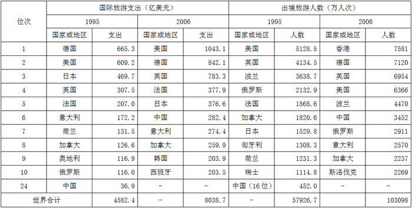

### 第 86 题

2006年世界出境旅游的平均支出是：

A. 760美元/人次

B. 772美元/人次

C. 780美元/人次

D. 791美元/人次

第 86 题 · 答案与解析

**参考答案（粉笔题库参考内容）**

C

**解析**

由问题所求“2006年······平均支出······”可判定此题为现期平均数计算问题。定位表格可得，“2006年世合计支出8038.7亿美元，世界合计人数103098万人次”。则2006年世界出境旅游的平均支出为美元/人次。

故正确答案为C。

**来源**：2009年江苏省公务员录用考试《行测》题（C类）第86题

### 第 87 题

在2006年出境旅游人数前十位的国家或地区中，国际旅游平均支出相对较低的三个国家或地区是：

A. 中国、波兰、俄罗斯

B. 波兰、斯洛伐克、意大利

C. 英国、香港、加拿大

D. 香港、俄罗斯、波兰

第 87 题 · 答案与解析

**参考答案（粉笔题库参考内容）**

D

**解析**

根据表格材料可得，2006年国家和地区中，出境旅游人数排在前10的有香港、德国、英国、美国、波兰、中国、俄罗斯、意大利、加拿大、斯洛伐克。其中香港、波兰、俄罗斯、斯洛伐克的国际旅游支出却没有排在前10位，因此，它们的平均支出相对较低些。

故正确答案为D。

**来源**：2009年江苏省公务员录用考试《行测》题（C类）第87题

### 第 88 题

1996-2006年中国国际旅游支出的年平均增长量是：

A. 22.3亿美元

B. 24.6亿美元

C. 34.0亿美元

D. 39.5亿美元

第 88 题 · 答案与解析

**参考答案（粉笔题库参考内容）**

A

**解析**

根据题干“1996-2006年······年平均增长量”，可判定本题为年均增长量问题。定位表格可得，1995年、2006年中国国际旅游支出分别为36.9亿美元、282.4亿美元。根据年均增长量公式：年均增长量，则1996-2006年中国国际旅游支出的年平均增长量为亿美元。

故正确答案为A。

**来源**：2009年江苏省公务员录用考试《行测》题（C类）第88题

### 第 89 题

1995年美国国际旅游平均支出与德国相比：

A. 美国高于德国

B. 美国低于德国

C. 美国与德国相等

D. 无法比较

第 89 题 · 答案与解析

**参考答案（粉笔题库参考内容）**

B

**解析**

观察图表可知，1995年德国国际旅游支出高于美国，而德国的出境旅游人数（没有进入前10名）低于美国，则美国的平均支出低于德国。

故正确答案为B。

**来源**：2009年江苏省公务员录用考试《行测》题（C类）第89题

### 第 90 题

下列说法正确的有：

（1）1995年国际旅游支出位于前三位的国家或地区，其国际旅游支出总额占当年世界国际旅游支出的比重已超过三分之一；

（2）1995年出境旅游人数位于前三位的国家或地区，其出境旅游人数之和占当年世界出境旅游人数总和的比重没有超过五分之一；

（3）2006年国际旅游支出位于前三位的国家或地区，其国际旅游支出总额占当年世界国际旅游支出的比重已超过三分之一；

（4）2006年出境旅游人数位于前三位的国家或地区，其出境旅游人数之和占当年世界出境旅游人数总和的比重没有超过五分之一。

A. 4项

B. 3项

C. 2项

D. 1项

第 90 题 · 答案与解析

**参考答案（粉笔题库参考内容）**

D

**解析**

（1）根据表格可知，1995年国际旅游支出位于前三位的国家或地区分别为德国665.3亿美元、美国609.2亿美元、日本469.7亿美元，世界国际旅游总支出为4582.4亿美元，其国际旅游支出总额占当年世界国际旅游支出的比重为，正确；

（2）根据表格可知，1995年出境旅游人数位于前三位的国家或地区分别为美国5128.5万人次、英国4134.5万人次、波兰3638.7万人次，世界出境旅游人数总和为57926.7万人次，其出境旅游人数之和占当年世界出境旅游人数总和的比重为，错误；

（3）根据表格可知，2006年国际旅游支出位于前三位的国家或地区分别为美国1043.1亿美元、德国842.1亿美元、英国783.3亿美元，世界国际旅游总支出为8038.7亿美元，其国际旅游支出总额占当年世界国际旅游支出的比重为，错误；

（4）根据表格可知，2006年出境旅游人数位于前三位的国家或地区分别为香港7581万人次、德国7120万人次、英国6954万人次，世界出境旅游人数总和为103098万人次，其出境旅游人数之和占当年世界出境旅游人数总和的比重为，错误。

所以只有1项说法正确。

故正确答案为D。

**来源**：2009年江苏省公务员录用考试《行测》题（C类）第90题

## 材料 5

**2000一2005年中国污染治理资金来源构成 (亿元)**

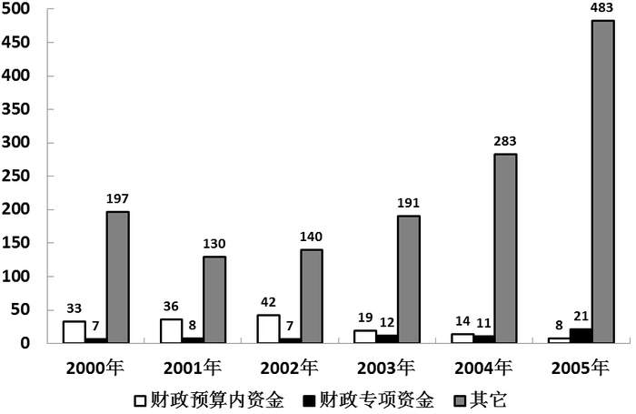

### 第 91 题

下列关于2002-2005年中国污染治理资金来源的说法正确的是：

A. “财政预算内资金”逐年增加

B. “其它资金”逐年增加

C. “财政专项资金”逐年增加

D. “财政专项资金”的比重逐年增加

第 91 题 · 答案与解析

**参考答案（粉笔题库参考内容）**

B

**解析**

A项：根据柱状图可得，2002-2005年“财政预算内资金”逐年减少，错误；

B项：根据柱状图可得，2002-2005年“其它资金”逐年增加，正确；

C项：根据柱状图可得，2002-2005年“财政专项资金”2004年较2003年下降，不满足“逐年增加”，错误；

D项：根据柱状图可得2000-2005年各年中国污染治理资金来源构成。结合公式：比重=部分/整体，2001年财政专项资金占比为，2002年财政专项资金占比为，，即2002年财政专项资金占比低于2001年，不满足“逐年增加”，错误。

故正确答案为B。

**来源**：2009年江苏省公务员录用考试《行测》题（C类）第91题

### 第 92 题

2000-2005年中国污染治理资金来源中，“财政预算内资金”比重最大的年份是：

A. 2000年

B. 2001年

C. 2002年

D. 2003年

第 92 题 · 答案与解析

**参考答案（粉笔题库参考内容）**

C

**解析**

根据题干“2000-2005年······比重最大的年份是”，可判定本题为比重比较问题。定位柱状图可得2000-2005年各年中国污染治理资金来源构成。结合公式：比重=部分/总体，2000年比重为，2001年比重为，2002年比重为，2003年比重为，因此2002年比重较大。

故正确答案为C。

**来源**：2009年江苏省公务员录用考试《行测》题（C类）第92题

### 第 93 题

2002-2005年中国污染治理资金来源，“其它资金”的年平均增长量是：

A. 60亿元

B. 65亿元

C. 114.3亿元

D. 75亿元

第 93 题 · 答案与解析

**参考答案（粉笔题库参考内容）**

C

**解析**

根据题干“2002-2005年······年平均增长量是”，可判定本题为年均增长量问题。定位柱状图可得，2002年、2005年“其它资金”分别为140亿元、483亿元，根据公式：年均增长量，则2002-2005年 “其它资金”的年平均增长量为亿元。

故正确答案为C。

备注：本题为江苏省考题，若基期前推一年为2001年，数据为130亿元时，年平均增长量为亿元，无答案，故本题基期不前推。

**来源**：2009年江苏省公务员录用考试《行测》题（C类）第93题

### 第 94 题

2000年到2005年的6年中，在中国污染治理资金来源中，“财政预算内资金”的6年总和相当于2005年“其它资金”的：

A. 31.5%

B. 40.6%

C. 43.2%

D. 51.8%

第 94 题 · 答案与解析

**参考答案（粉笔题库参考内容）**

A

**解析**

根据题干“······相当于······”，结合选项为百分数，可判定此题为比值计算问题。定位柱状图可得，2000-2005年“财政预算内资金”分别为33亿元、36亿元、42亿元、19亿元、14亿元、8亿元，2005年“其它资金”为483亿元，则“财政预算内资金”的6年总和与2005年“其它资金”的比值为。

故正确答案为A。

**来源**：2009年江苏省公务员录用考试《行测》题（C类）第94题

### 第 95 题

2001-2005年，中国污染治理资金总额增速最小的年份是：

A. 2004年

B. 2003年

C. 2002年

D. 2001年

第 95 题 · 答案与解析

**参考答案（粉笔题库参考内容）**

D

**解析**

根据题干“2001-2005年······增速最小的年份是”，可判定此题为一般增长率比较问题。由柱状图中数据比较可得，2001年污染治理资金总额比2000年少，即增长率&lt;0。而2002、2003、2004年持续增长，即增长率均>0。显然2001年的增速最小。

故正确答案为D。

**来源**：2009年江苏省公务员录用考试《行测》题（C类）第95题

## 材料 6

**2003－2008年中国货物进出口总额（亿美元）**

 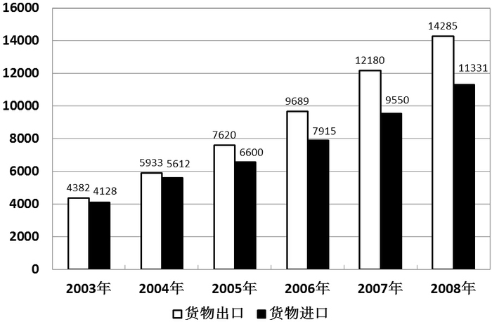

### 第 96 题

2004～2008年中国货物进出口总额增长最快的是哪一年：

A. 2004年

B. 2005年

C. 2007年

D. 2008年

第 96 题 · 答案与解析

**参考答案（粉笔题库参考内容）**

A

**解析**

根据题干“2004～2008年中国货物进出口总额增长最快的是哪一年”，可判定此题为一般增长率比较问题。定位柱状图可得：

2003年进出口总额为4382+4128=8510；

2004年进出口总额为5933+5612=11545；

2005年进出口总额为7620+6600=14220；

2006年进出口总额为9689+7915=17604；

2007年进出口总额为12180+9550=21730；

2008年进出口总额为14285+11331=25616。

2004年增长率为；

2005年增长率为；

2007年增长率为；

2008年增长率为。

显然3035/8510的分子与分母量级相当，而其他分数的分子比分母低一量级，则2004年的增长率最大。

故正确答案为A。

**来源**：2009年江苏省公务员录用考试《行测》题（C类）第96题

### 第 97 题

下列说法正确的是：

A. 2004～2008年进口总额增长率呈逐年增大趋势

B. 2004～2008年出口总额增长率呈逐年增大趋势

C. 2005～2008年进口总额增长率呈逐年减缓趋势

D. 2005～2008年出口总额增长率呈逐年减缓趋势

第 97 题 · 答案与解析

**参考答案（粉笔题库参考内容）**

D

**解析**

A项：根据题意可知各年份进口总额增长率依次为：

2004年为≈35.9%；

2005年为≈17.6%；

2006年为≈19.9%；

2007年为≈20.7%；

2008年为≈18.6%。

增长率先下降后上升再下降，错误。

B项：根据题意可知各年份出口总额增长率依次为：

2004年为≈35.4%；

2005年为≈28.4%；

2006年为≈27.2%；

2007年为≈25.7%；

2008年为≈17.3%。

增长率逐年下降，错误。

C项：由A项计算结果可知，2005～2008年进口总额增长率先下降后上升再下降，错误。

D项：由B项计算结果可知，2005～2008年出口总额增长率逐年下降，正确。

故正确答案为D。

**来源**：2009年江苏省公务员录用考试《行测》题（C类）第97题

### 第 98 题

2003～2008年中国进出口差额占当年货物进出口总额比重最小的年份是：

A. 2003年

B. 2004年

C. 2007年

D. 2008年

第 98 题 · 答案与解析

**参考答案（粉笔题库参考内容）**

B

**解析**

根据题干“中国进出口差额占当年货物进出口总额比重最小的年份”，可判定本题为比重比较问题。定位柱状图数据，结合公式：比重=部分/总体，可得2003～2008年中国进出口差额占当年货物进出口总额比重分别为：

2003年为≈2.98%；

2004年为≈2.78%；

2007年为≈12.1%；

2008年为≈11.5%。

则2004年中国进出口差额占当年的进出口总额比重最小。

故正确答案为B。

**来源**：2009年江苏省公务员录用考试《行测》题（C类）第98题

### 第 99 题

2008年中国进出口总额是2003年进出口总额的几倍：

A. 3

B. 4

C. 5

D. 6

第 99 题 · 答案与解析

**参考答案（粉笔题库参考内容）**

A

**解析**

根据题干“2008年中国进出口总额是2003年进出口总额的几倍”，可判定本题为现期倍数问题。定位柱状图可得，2003年的进出口总额为4382＋4128＝8510亿美元，2008年的进出口总额为14285＋11331＝25616亿美元，则2008年中国进出口总额是2003年进出口总额的倍。

故正确答案为A。

**来源**：2009年江苏省公务员录用考试《行测》题（C类）第99题

### 第 100 题

下列说法正确的是：

A. 在2008年中国货物进出口增长总额中，出口占到三分之二以上

B. 在2008年中国货物进出口增长总额中，进口仅占四分之一

C. 在2008年中国货物进出口增长总额中，出口仅占三分之一

D. 在2008年中国货物进出口增长总额中，进口占到三分之一以上

第 100 题 · 答案与解析

**参考答案（粉笔题库参考内容）**

D

**解析**

根据柱状图可得，2008年中国货物进出口总额为14285+11331=25616亿美元，则出口额所占比重为14285/25616≈，进口额所占比重为1-54.9%=45.1%。

故正确答案为D。

**来源**：2009年江苏省公务员录用考试《行测》题（C类）第100题

