# 2010年江苏省公务员录用考试《行测》题（A类）

<!-- gwy:overview:start -->
> **江苏 · 2010 · 行测 · A类** ｜ 105 题 · 图片 16 处 · 答案随题折叠

| 题型模块 | 题量 | 题号 |
| --- | ---: | ---: |
| 言语理解与表达 | 15 | 1–15 |
| 数量关系 | 25 | 16–40 |
| 判断推理 | 40 | 41–80 |
| 资料分析 | 25 | 81–105 |
| **合计** | **105** | |

导航：[题型与作答说明](#题型与作答说明) · [题目](#题目) · [材料 1](#材料-1)
<!-- gwy:overview:end -->

> 候选采集稿。参考答案及解析来自粉笔页面，不代表官方答案或真实高分答卷；来源使用许可与原卷对应关系仍需人工核实。

## 题型与作答说明

言语理解与表达

（15题）

本部分包括片段阅读、文章阅读两类。

数量关系

（25题）

本部分包括数字推理与数学运算两种类型的试题。

判断推理

（40题）

本部分包括类比推理、图形推理、逻辑判断与定义判断四种类型的试题。

资料分析

（25题）

下列给出的文字、表格、图形资料均有5个问题要你回答，你应根据资料提供的信息进行分析、计算、处理，然后从备选答案中选择一个最恰当的答案。

## 题目

### 第 1 题

五十年代，人们对幸福的憧憬是“楼上楼下，电灯电话”；六七十年代，是“三转一响”（自行车、缝纫机、电风扇、收音机），是进国营工厂或穿上军装；八十年代是“万元户”；九十年代是有房有车；新世纪的幸福感呢，则和总理最近提出的“尊严”息息相关。 这段文字的关键词是（    ）。

A. 新世纪

B. 幸福

C. 尊严

D. 幸福感

第 1 题 · 答案与解析

**参考答案（粉笔题库参考内容）**

D

**解析**

第一步：分析文段（找到突破口）。

本题为中心理解题。

据文中的4个分号可知各分句是并列关系，分述不同时期对于幸福感的不同诉求，它们的共同主题词是“幸福感”。此外，最后一句“新世纪的幸福感呢”直接点明了关键词是“幸福感”。

因此，结合选项应该选择D。

第二步：分析选项（逐一分析选项）。

A项仅是一个时期；

B项表述笼统，不具有针对性；

C项仅是新时期的幸福感诉求内容，都由最后一个分句得来，并非文段的主旨，所以不选。

故正确答案为D。

**考点**：主题词、关联词-并列

**来源**：2010年江苏省公务员录用考试《行测》题（A类）第1题

### 第 2 题

一个体系中的各种制度具有战略互补性，某一项或几项制度发生变革，其他的制度要么进行相应的变化，要么就会与新制度难以配合，对新制度的实施产生阻碍。因此，制度变革本质上就应该是整体推进的，但是在事实上可以分步进行，否则，就会存在巨大的制度运行成本。

下列对文意的概括最恰当的一项是（  ）。

A. 各种制度之间具有战略互补性

B. 实施新制度往往有阻碍

C. 制度变革应整体上推进，可分步实施

D. 实施新制度运行成本巨大

第 2 题 · 答案与解析

**参考答案（粉笔题库参考内容）**

C

**解析**

本题属于中心理解题。

文段第一句介绍具有战略互补性的各种制度，如果其中一项发生变革，会引起其他制度的变化，或制度之间因为难配合而阻碍新制度的实施；第二句通过“因此”引导，得出结论，即“制度变革应整体推进”，但是“可以分步进行”。文段的中心句就是“因此”后面的内容。结合选项，可知C项是对文段中心句的全面准确概括，当选。

A项，是结论前的内容，非文段重点，故排除；

B项，文段强调的重点是如何推进制度变革，而该项表述的是实施新制度的困难，显然不符合文段的中心意思，故排除；

D项，对应原文最后一句话“否则，就会存在巨大的制度运行成本”，反面论证是为了强调“制度变革应整体推进，但是可以分步进行”这一中心论点，反面论证本身并不是文段重点，故排除。

故正确答案为C。

【文段出处】

《中国改革进入深水区：挑战权贵资本主义》

**考点**：关联词-因果

**来源**：2010年江苏省公务员录用考试《行测》题（A类）第2题

### 第 3 题

上海市新闻出版局对特许出版物经营活动统一管理，按产品向世博会特许办申领防伪标识。特许办负责特许出版物的世博标识授权审批，新闻出版局负责出版物内容审批。特许办为经新闻出版局审批的产品提供授权审批的绿色通道。双方分别通过各自的零售渠道（含外省市零售通道），推进特许出版物的销售工作，并给予对方零售网点集中报批、免许可费等支持。

这段文字的议题是：

A. 特许出版物

B. 世博会特许办

C. 新闻出版局

D. 绿色通道

第 3 题 · 答案与解析

**参考答案（粉笔题库参考内容）**

A

**解析**

文段首先介绍了上海市新闻出版局对特许出版物经营活动的统一管理，接着围绕“特许出版物”这一话题介绍了其审批以及零售渠道，故文段论述的核心话题为“特许出版物”，对应A项。

B项“世博会特许办”、C项“新闻出版局”均为办理与特许出版物相关工作的两个部门机构，并非文段重点，排除；

D项，“绿色通道”是特许办起到的作用，并非文段重点，排除。

故正确答案为A。

**考点**：主题词

**来源**：2010年江苏省公务员录用考试《行测》题（A类）第3题

### 第 4 题

禾苗干了，需要浇水，但不能太多，水多了就会淹死。车胎瘪了，需要充气，但不能太足，充得太足就会爆炸。生命短暂，需要关爱，爱不能太多，爱得多了，就成了伤害。教育固然需要慈母般的温存，也应当来点严父般的“狠心”；温室中的幼苗鲜嫩可爱，烈日下的万物更加茁壮。

这段话的中心议题是：

A. 幼苗和万物

B. 生命

C. 哲理

D. 教育

第 4 题 · 答案与解析

**参考答案（粉笔题库参考内容）**

D

**解析**

本题为中心理解题。

阅读材料可知材料构成“举例说明——提出观点”的分——总结构，前面三句枚举三个类似的例子加强议题，最后一句“总”的部分的核心主体是“教育”。

因此，结合选项应该选择D。

A项“幼苗”是例子，“万物”提法无依据；B项同样是分句的例子；C项过于空泛，缺乏针对性，故A、B、C均不选。

故正确答案为D。

**考点**：主题词

**来源**：2010年江苏省公务员录用考试《行测》题（A类）第4题

### 第 5 题

德国莱比锡“世界最美的书”评选工作圆满结束，获得2009年度“中国最美的书”称号的《诗经》一书，荣获今年“世界最美的书”称号。参加评选活动的共有32个国家和地区，参评图书达到634种，总品种数较去年增长1.28%。中国获奖图书《诗经》由刘晓翔设计，因其典雅、质朴而不失创意获得专家们的青睐。

下列说法与文意相符的是：

A. “世界最美的书”评选依据的是图书的装帧设计

B. “中国最美的书”注重图书的形式之美同时兼顾图书内容

C. 中国最美图书的总品种数比去年增长1.28%

D. “世界最美的书”总品种数比去年增长1.28%

第 5 题 · 答案与解析

**参考答案（粉笔题库参考内容）**

A

**解析**

“参加‘世界最美的书’评选的书的总品种数”据最后一句表述中国《诗经》获奖是因为其设计，能够得知“世界最美的书”评选依据是图书的装帧设计，对应A项。B项无中生有，材料并没有提到“中国最美的书”的标准；C、D两项都属于主语偷换，材料中说的主体对象是“参加世界最美的书评选的书的总品种数”，并非“中国最美图书”，也不是“世界最美的书”，所以不选。

故正确答案为A。

**考点**：细节判断题

**来源**：2010年江苏省公务员录用考试《行测》题（A类）第5题

### 第 6 题

远在异国他乡的国家大剧院、鸟巢以及央视大楼的设计者们，在对中国所知无多的情况下开始工作，令他们获得灵感的，既不是中国政府的规划意愿，也远非中国传统文化。这两者始终没有成为他们想象力和审美价值的来源，没有人规定他们该做什么不该做什么。

作者通过这段文字意在强调：

A. 这些设计者对中国了解较少

B. 这些设计者拥有创作自由

C. 这些建筑不能体现中国文化

D. 这些建筑的审美价值奇特

第 6 题 · 答案与解析

**参考答案（粉笔题库参考内容）**

B

**解析**

本题为中心理解题。

材料由“既不是······也远非······”否定了设计者们在创作时会受到各方面的条件限制，之后引出的是材料的重点，“没有人规定他们该做什么不该做什么”，由此可推出这些设计者们拥有自由创作的权利。

因此，结合选项应该选择B。

A项只包括了材料中第2个短句的内容，没有抓住文段的重点，排除；C、D两项的主体都是“这些建筑”，而文段讨论的主体是“设计者”，过度引申，排除。

故正确答案为B。

**考点**：分述句特征-引入铺垫

**来源**：2010年江苏省公务员录用考试《行测》题（A类）第6题

### 第 7 题

在临床使用抗菌药物时，依患者个人情况选择药品种类、严格要求第一次用药的剂量与浓度并在随后的药物使用频率、药物配比方面都遵行严格的规定的话，尽管不能完全防止耐药菌株的出现，也应该能控制耐药状况的泛滥和恶化。

作者对使用抗菌药物后是否会出现耐药状况的看法是：

A. 不可避免

B. 未置可否

C. 可以控制

D. 无法确定

第 7 题 · 答案与解析

**参考答案（粉笔题库参考内容）**

A

**解析**

根据文段“尽管不能完全防止耐药菌株的出现，也应该能控制耐药状况的泛滥和恶化”可知，耐药菌株还是会出现，不能完全防止，对应A项。C项“可以控制”表示能够防止耐药菌株出现，与文意相悖，排除。B、D两项不合文意，文段已经表明了作者的态度，排除。

故正确答案为A。

**考点**：关联词-对策

**来源**：2010年江苏省公务员录用考试《行测》题（A类）第7题

### 第 8 题

权利的贫困，很容易使人进入失败的循环，继续失败仿佛成为宿命，而改变命运则几乎不可能。一个被失败情绪笼罩的人，极易从开始的被动边缘化逐渐进入到主动边缘化，成为敌视社会的他者。

下列符合文意的是：

A. 长久沉浸于失败的颓唐中，必定敌视社会

B. 长久沉浸于失败的颓唐中，容易敌视社会

C. 缺乏权利的人必定失败

D. 缺乏权力的人容易失败

第 8 题 · 答案与解析

**参考答案（粉笔题库参考内容）**

B

**解析**

本题考查细节判断。

由原文“极易从开始的被动边缘化逐渐进入到主动边缘化，成为敌视社会的他者”可以推出B项表述符合文意。

因此，结合选项应该选择B。

A项中“必定”的表述过于绝对，材料说的是“极易······成为敌视社会的他者”，而不是一定会敌视社会，所以不选；C项也是表述绝对化，缺乏权利的人“很容易”失败，而不是“必定”会失败，所以不选；D项偷换概念，“权利”和“权力”有所区别，“权力”是一个政治概念，一般是指有权支配他人的强制之力，它总是和服从联结在一起，而“权利”是一个法律概念，一般指赋予人们的权力和利益，即自身拥有的维护利益之权。

故正确答案为B。

**考点**：细节判断题

**来源**：2010年安徽省公务员录用考试《行测》题第41题

### 第 9 题

相对于人的一生，岁月的长河沉静缓慢，一个小小转弯，也往往会耗上一代人甚至几代人的时间。而历史的记录，浓缩这缓慢过程中关键性的拐点，放大这冗长沉闷中戏剧化的细节，甚至是剑拔弩张的氛围，慷慨激昂的情绪······读史，确实让人沉迷。

这段话的中心议题是：

A. 记录历史

B. 岁月

C. 读史

D. 历史记录

第 9 题 · 答案与解析

**参考答案（粉笔题库参考内容）**

C

**解析**

根据提问句中“议题”一词可知此题是中心理解题。

材料首先讲述岁月中小小的拐弯也需经历缓慢的过程，之后用转折词“而”引入重点语意部分，最后一句总结，是材料的主旨，作者想表达的重点是“读史”。

因此，结合选项应该选择C。

D项易引起干扰，材料前面是对“历史记录”的描述，但落脚点并不在此，关于“历史记录”的描述不过是对“读史，确实让人着迷”的原因的解释，因此不选；A、B项也不是材料的重点，均不选。

故正确答案为C。

**考点**：主题词

**来源**：2010年江苏省公务员录用考试《行测》题（A类）第9题

### 第 10 题

所有的作物都是自野生品种演化而来的，这意味着，用达尔文主义的说法就是，野生品种在漫长的时间里获得了生存所需的适应能力。然而在驯化与种植中，发生了遗传侵蚀，这种适应力也遭受损失，甚至其野生祖先也可能灭绝。因此今天的很多作物一旦突然间无人种植，直接就会消亡。

这段文字的关键词是：

A. 适应能力

B. 驯化过程

C. 遗传侵蚀

D. 野生物种

第 10 题 · 答案与解析

**参考答案（粉笔题库参考内容）**

C

**解析**

文段第一句话是对野生品种进化的简要说明，并指出这一过程使得野生品种获得了适应能力，接着作者用转折词“然而”引出重点部分，主要讲述了“遗传侵蚀”及其带来的后果，其中的核心主题是“遗传侵蚀”，所以文段的关键词是“遗传侵蚀”。结合选项应该选择C项。

A项主要在转折前讲述；B项“驯化”出现在“在······中”，为状语，是句子的非主要成分；D项文段是借助物种演化情况来分析遗传侵蚀的影响，所以“野生物种”不是关键词，且文段讲的是野生品种而非野生物种，概念扩大。

故正确答案为C。

**考点**：主题词

**来源**：2010年江苏省公务员录用考试《行测》题（A类）第10题

## 材料 1

替《王干随笔选》“帮腔”者有两位，其中一位是原文化部长、著名作家王蒙。王氏以短短数行，披露往事一桩：父亲辈的王蒙，结识儿子辈的王干，仰仗的是爷爷辈的胡乔木。王蒙叙事，素有讲究。这段“忆旧”，列出风云学界的圣贤任继愈、金克木、季羡林，言之凿凿。寥寥数十字中，五六个人抱团纠结，互为策应，大有深意存焉。对小王来说，借老王之嘴，为自家新书鸣锣，绝非谬托知己。

        新时期以来，言路广开，催生出文坛无数“对话录”。只是泥沙俱下，多数讨人厌烦，有的一味偏激，只顾凸显个性，有的插科打诨，止于相互调情。而对话之应有货色，诸如问题探讨、理念交锋、志趣对决等，则几近于无。有此前因，“二王”对话出笼之际，众人并不看好，即使闪耀出“王干干王蒙，王蒙蒙王干”的亮点，仍被误为二人心领神会的噱头。乃至读对话，学问一点点水落石出，价值一点点雾去山明，人们方明白何谓铜与金，何谓骡子与马不一般。

        打出道算起，王干舞文弄墨近30余载。虽童颜依旧，但已脱尽生涩。就说这本《随笔选》，文字活泼如蝴蝶，气韵爽然如晨光，道行深幽如潭水，格局早已逸出小文坛，放眼大文化。如将他归类于杂家，并无不当，其品相、质地，皆纯正可靠，不乏“高人”端倪。一位成天读书的朋友，摇头晃脑向我鼓吹此书。他的意见是，假如手头不空，就先干正事；如果你闲着是闲着，就不妨翻翻，多数篇什，是会叫人开卷释怀的。

        前几日上街买书，老板温文尔雅，喜欢阅读，尤爱随笔类，将一段句子背给我听：“随笔的功夫不在笔头上，而在人身上。一个工于心计的人写不好随笔，一个缺乏幽默感不能自我解嘲自我反思的人写不好随笔，一个不学无术的人不配写随笔，一个光知道掉书袋的人与随笔无缘。”此乃王干随笔生涯之心得，写在书尾“后记”里。老板背完，含笑相问：“任老师，王干的体会是不是很有见地？”

        我替王干高兴，十位评论家对你的弘扬，抵不过一位书店老板对你的欣赏。前者言而无信，常常被人识破；后者借助切磋，可直接让读者掏出钱来，抱书回家。“名人为你助兴，固然雅致；生人替你卖书，才算实惠。老弟，你就偷着乐吧！”

### 第 11 题

文中画线“言之凿凿”是说：

A. 王蒙的说法值得怀疑

B. 王蒙的说法足以凭信

C. 王蒙的说法貌似可靠

D. 王蒙的说法属于噱头

第 11 题 · 答案与解析

**参考答案（粉笔题库参考内容）**

B

**解析**

本题考查词语理解。

“言之凿凿”形容说得非常确实，根据材料，作者先提到王蒙叙事素有讲究，接着又列出几位风云学界的圣贤为证，由此可知“言之凿凿”在文段中的含义即是王蒙的说法是足以凭信的。

因此，结合选项应该选择B。

A、C、D三项都是对王蒙说法的否定态度，不合原文含义，均不选。

故正确答案为B。

**来源**：2010年江苏省公务员录用考试《行测》题（A类）第11题

### 第 12 题

文中画线“心领神会”可以替换为：

A. 惺惺相惜

B. 心心相印

C. 心照不宣

D. 暗藏玄机

第 12 题 · 答案与解析

**参考答案（粉笔题库参考内容）**

C

**解析**

本题考查语境中词句理解。

文中画线“心领神会”的意思是对方没有明说，心里已经领会。C项“心照不宣”是指彼此心里明白而不公开说出来，也指互相之间明白或共同认可一件事物，做出相同的判断。同时，对对方心中所想所希望的予以回应，而无需对方提醒，与“心领神会”的意思相近，可以互相替换。

因此，结合选项应该选择C。

A项“惺惺相惜”指性格、志趣、境遇相同的人互相爱护、同情、支持，与“心领神会”强调的没有明说就同时领会不同；B项“心心相印”指彼此的心意不用说出，就可以互相了解，但多用于男女之间；D项“暗藏玄机”指表面看似无奇的东西，却有想象不到的事件或阴谋，与“心领神会”含义相差甚远，故均不选。

故正确答案为C。

**来源**：2010年江苏省公务员录用考试《行测》题（A类）第12题

### 第 13 题

与文意不一致的是：

A. 新时期文坛“对话录”多数讨人嫌

B. 营销人士推崇就能拥有市场，使得名人对好书的鼓吹成多余

C. 随笔要幽默有趣味有思想光辉，王干因此受到名人的吹捧和市场追捧

D. “王干干王蒙，王蒙蒙王干”意味着有人认为《王干随笔选》不值得期待

第 13 题 · 答案与解析

**参考答案（粉笔题库参考内容）**

D

**解析**

根据原文“‘二王’对话出笼之际，众人并不看好，即使闪耀出‘王干干王蒙，王蒙蒙王干’的亮点，仍被误为二人心领神会的噱头”可知，此句论述的主体是“二王”对话，而并非《王干随笔选》，D项表述错误。

A项，由原文“新时期以来，言路广开，催生出文坛无数‘对话录’。只是泥沙俱下，多数讨人厌烦”可以推出；B项，文章最后引用书店老板的例子道明作者的观点，“十位评论家对你的弘扬，抵不过一位书店老板对你的欣赏”，由此可推出B项表述正确；C项，根据文章，从一些名人的评价和书店老板的推荐来看，王干的作品之所以得到市场的青睐和名人的吹捧，主要是因为其幽默风趣的写作风格以及作品中透露出的思想光辉，因此C项表述也正确。

本题为选非题，故正确答案为D。

**来源**：2010年江苏省公务员录用考试《行测》题（A类）第13题

### 第 14 题

“格局早已逸出小文坛，放眼大文化，如将它归类于杂家，并无不当，其品相、质地皆纯正可靠，不乏‘高人’端倪”，意思是说：

A. 王干善于把握机会和人脉，足以成为高人般的杂家

B. 王干善于拓展自己的学术范围，超越一般评论家

C. 王干的幽默感和学术水平，胜过大多数评论家

D. 王干的见识和文品，胜过一般作家和评论家

第 14 题 · 答案与解析

**参考答案（粉笔题库参考内容）**

D

**解析**

本题考查语句理解。

由“格局早已逸出小文坛，放眼大文化”可知王干的见识卓远，并非局限于小文坛，再由“其品相、质地，皆纯正可靠，不乏‘高人’端倪”可知王干的学术水平和人品极高，即文品很高。

因此，结合选项应该选择D。

A项无中生有，这句话并没有体现“把握机会和人脉”；B项“善于拓展自己的学术范围”只理解前半句话，不够全面；C项“幽默感”在句中也没有提及，故A、B、C三项均不选。

故正确答案为D。

**来源**：2010年江苏省公务员录用考试《行测》题（A类）第14题

### 第 15 题

作者对《王干随笔选》的直接评价是：

A. “任老师，王干的体会是不是很有见地？”

B. 学问一点点水落石出，价值一点点雾去山明

C. 对小王来说，借老王之嘴为自家新书鸣锣，绝非谬托知己

D. 十位评论家对你的弘扬，抵不过一位书店老板对你的欣赏

第 15 题 · 答案与解析

**参考答案（粉笔题库参考内容）**

D

**解析**

作者的观点在文章的最后一段中体现出来，“十位评论家对你的弘扬，抵不过一位书店老板对你的欣赏”是作者对《王干随笔选》的直接评价。

因此，结合选项应该选择D。

A项出自书店老板之口，并非作者对《王干随笔选》的直接评价，不选；B项虽然更适合作为评价，但由原文可知这句话是针对“二王”对话录的感想，与《王干随笔选》无直接关系，故也不选；C项表述针对的是王蒙为《王干随笔选》帮腔一事，也不是对《王干随笔选》的直接评价， 也不选。

故正确答案为D。

**来源**：2010年江苏省公务员录用考试《行测》题（A类）第15题

### 第 16 题

-1/3，1，5，17，53，（  ）

A. 153

B. 157

C. 161

D. 164

第 16 题 · 答案与解析

**参考答案（粉笔题库参考内容）**

C

**解析**

数列无明显特征，优先考虑作差。后项减前项得到新数列：4/3，4，12，36，（    ），是公比为3的等比数列，则新数列下一项为36×3=108，故所求项为53+108=161。

故正确答案为C。

**来源**：2010年江苏省公务员录用考试《行测》题（A类）第16题

### 第 17 题

8，11，18，34，66，（  ）

A. 97

B. 89

C. 154

D. 123

第 17 题 · 答案与解析

**参考答案（粉笔题库参考内容）**

D

**解析**

数列无明显特征，优先考虑作差。后项减前项得到新数列：3，7，16，32，（    ），仍无明显特征；再次作差得到新数列：4，9，16，（    ），为平方数数列，则二次作差后括号内为25，一次作差后括号内为32+25=57，故原数列所求项为66+57=123。

故正确答案为D。

**来源**：2010年江苏省公务员录用考试《行测》题（A类）第17题

### 第 18 题

2137，4036，2380，3532，4702，（  ）

A. 5257

B. 5053

C. 3948

D. 3833

第 18 题 · 答案与解析

**参考答案（粉笔题库参考内容）**

B

**解析**

数列均为四位数，考虑机械划分。观察发现：2+1+3+7=13，4+0+3+6=13，2+3+8+0=13，3+5+3+2=13，4+7+0+2=13，即每一项各位数字加和均为13，故所求项各项数字之和也为13，观察选项，只有B项满足。

故正确答案为B。

**来源**：2010年江苏省公务员录用考试《行测》题（A类）第18题

### 第 19 题

7，19，33，71，137，（  ）

A. 279

B. 268

C. 259

D. 258

第 19 题 · 答案与解析

**参考答案（粉笔题库参考内容）**

A

**解析**

方法一：观察数列，作差无规律，考虑作和。前项加后项得到新数列：26，52，104，208，（    ），是公比为2的等比数列，则新数列下一项为208×2=416。故所求项为416-137=279。

方法二：观察数列，作差无规律，且前项约为后项的2倍，考虑倍数关系。计算发现：7×2+5=19，19 × 2 - 5 = 33，33×2+5=71，71×2-5=137，即规律为：前一项×2＋修正项＝后一项，修正项为5、-5的周期数列，故所求项=137×2+5=279。

方法三：观察数列，作差无规律，考虑递推。观察发现：7×2+19=33，19×2+33=71，33×2+71=137，即规律为：第一项×2+第二项=第三项，故所求项=71×2+137=279。

故正确答案为A。

**来源**：2010年江苏省公务员录用考试《行测》题（A类）第19题

### 第 20 题

6，8，8，0，-32，（  ）

A. \-128

B. 64

C. \-64

D. \-96

第 20 题 · 答案与解析

**参考答案（粉笔题库参考内容）**

A

**解析**

数列无明显特征，作差作和均无规律，考虑递推。观察发现：(8-6)×4=8，(8-8)×4=0，(0-8)×4=-32，即规律为：(第二项-第一项)×4=第三项，故所求项=(-32-0)×4=-128。

故正确答案为A。

**来源**：2010年江苏省公务员录用考试《行测》题（A类）第20题

### 第 21 题

21/32，1，25/24，17/18，43/54，（  ）

A. 2/3

B. 53/80

C. 51/81

D. 52/81

第 21 题 · 答案与解析

**参考答案（粉笔题库参考内容）**

D

**解析**

数列大部分为分数，考虑分数数列。反约分后，原数列可转化为：7/(32/3)，16/16，25/24，34/36，43/54。分子部分为：7，16，25，34，43，是公差为9的等差数列，则所求项分子为43+9=52；分母部分为：32/3，16，24，36，54，是公比为3/2的等比数列，则所求项分母为54 × 3/2 = 81。故所求项为52/81。

故正确答案为D。

**来源**：2010年江苏省公务员录用考试《行测》题（A类）第21题

### 第 22 题

262，264，267，272，280，（  ）

A. 309

B. 282

C. 292

D. 302

第 22 题 · 答案与解析

**参考答案（粉笔题库参考内容）**

C

**解析**

数列无明显特征，优先考虑作差。后项减前项得到新数列：2，3，5，8，（    ）；再次作差得到新数列：1，2，3，（    ），为连续自然数列，则二次作差后括号内为4，一次作差后括号内为8+4=12，故原数列所求项为280+12=292。

故正确答案为C。

**来源**：2010年江苏省公务员录用考试《行测》题（A类）第22题

### 第 23 题

2，3，7，19，136，（  ）

A. 2580

B. 2688

C. 2684

D. 2584

第 23 题 · 答案与解析

**参考答案（粉笔题库参考内容）**

A

**解析**

数列变化幅度较大，考虑递推数列。观察可知：2×3+1=7，3×7-2=19，7×19+3=136，即规律为：第一项×第二项+修正项=第三项，修正项为正负号循环交替的连续自然数列，故所求项为19×136-4=2580。

故正确答案为A。

备注：考场上最后一步可结合尾数法验证。

**来源**：2010年江苏省公务员录用考试《行测》题（A类）第23题

### 第 24 题

3~2~12，5~8~28，8~15~48，19~23~（    ）

A. 90

B. 84

C. 86

D. 88

第 24 题 · 答案与解析

**参考答案（粉笔题库参考内容）**

C

**解析**

数列分为4组，组内以波浪号连接，优先考虑组内找规律。观察发现：(3+2+1)×2=12，(5+8+1)×2=28，(8+15+1)×2=48，即规律为每组的(第一项+第二项+1)×2=第三项，故所求项=(19+23+1)×2=86。

故正确答案为C。

**来源**：2010年江苏省公务员录用考试《行测》题（A类）第24题

### 第 25 题

23，56，1130，5330，（  ）

A. 112430

B. 111580

C. 111590

D. 121540

第 25 题 · 答案与解析

**参考答案（粉笔题库参考内容）**

C

**解析**

数列变化幅度较大，且均为多位数，考虑机械划分。将原数列中的数字拆开去看，发现23中：2+3=5，2×3=6，合起来即为56；56中：5+6=11，5×6=30，合起来即为1130；1130中：1+1+3+0=5，11×30=330，合起来即为5330。即规律为：上一项各位数字之和为下一项前面的数字，上一项对半拆开后两个数字的乘积为下一项后面的数字。因此，5+3+3+0=11，53×30=1590，合起来为111590，即为所求项。

故正确答案为C。

**来源**：2010年江苏省公务员录用考试《行测》题（A类）第25题

### 第 26 题

一个正方体与其内切球体的表面积比值是：

A. 1/π

B. 2/π

C. 6/π

D. 8/π

第 26 题 · 答案与解析

**参考答案（粉笔题库参考内容）**

C

**解析**

一个正方体内切球的半径是正方体棱长的一半。设正方体棱长为2，则其内切球的半径为1，故正方体的表面积= 6a^2 = 6×2^2 = 24，内切球的表面积为4πr^2=4π×1^2=4π，则正方体的表面积与其内切球体的表面积之比为24/4π=6/π。

故正确答案为C。

**考点**：几何公式类-立体图形、几何结论类-几何小题型

**来源**：2010年江苏省公务员录用考试《行测》题（A类）第26题

### 第 27 题

2010年2月15日后第80天的日期是：

A. 5月6日

B. 5月3日

C. 5月4日

D. 5月5日

第 27 题 · 答案与解析

**参考答案（粉笔题库参考内容）**

A

**解析**

2010年是平年，2月有28天，则2月还剩28-15=13天；3月有31天，4月有30天，共13+31+30=74天，还剩80-74=6天，即4月份过完以后还有6天。则2010年2月15日后第80天为5月6日。

故正确答案为A。

**考点**：星期日期问题

**来源**：2010年江苏省公务员录用考试《行测》题（A类）第27题

### 第 28 题

把自然数A的十位数、百位数和千位数相加，再乘以个位数字，将所得积的个位数字续写在A的末尾，称为对A的一次操作。设A=4626，对A进行一次操作得到46262，再对46262操作，如此进行下去，直到得出一个2010位的数为止，则这个2010位数的各位数字之和是：

A. 28

B. 32

C. 24

D. 26

第 28 题 · 答案与解析

**参考答案（粉笔题库参考内容）**

A

**解析**

对数字46262进行一次操作得出新数为462628，再对数字462628进行一次操作得出新数为4626280。根据题意可知，每次操作中均需与个位数字相乘，因4626280个位数为0，则直至2010位，后面的所有数均为0，各位数之和为4+6+2+6+2+8=28。

故正确答案为A。

**来源**：2010年江苏省公务员录用考试《行测》题（A类）第28题

### 第 29 题

桌面上有两个半径分别为2厘米和40厘米的圆环，如固定大圆环，让小圆环沿着大圆环外边缘滚动一圈，则小圆环滚动的圈数是：

A. 10

B. 20

C. 40

D. 80

第 29 题 · 答案与解析

**参考答案（粉笔题库参考内容）**

B

**解析**

小圆环的周长为2πr =2 × π × 2 = 4π厘米，大圆环的周长为2 × π × 40 = 80π厘米。小圆环所走路程即为大圆环周长，则小圆环所走圈数为80π/4π=20圈。

故正确答案为B。

**考点**：几何公式类-平面图形

**来源**：2010年江苏省公务员录用考试《行测》题（A类）第29题

### 第 30 题

有8个盒子分别装有17个、24个、29个、33个、35个、36个、38个和44个乒乓球，小赵取走一盒，其余各盒被小钱、小孙、小李取走。已知小钱和小孙取走的乒乓球个数相同，并且是小李取走的两倍，则小钱取走的各个盒子中的乒乓球最可能是：

A. 17个、44个

B. 24个、38个

C. 24个、29个、36个

D. 24个、29个、35个

第 30 题 · 答案与解析

**参考答案（粉笔题库参考内容）**

D

**解析**

根据题意可知，小钱=小孙=2小李，因乒乓球个数为整数，则小钱所取球的总个数为偶数，排除A、C两项；代入B项，若小钱取走24+38=62个，则小李为62÷2=31个，单盒或几盒相加均无法取到31个，与题意不符，排除；正确答案有且仅有一个，无需验证剩余选项。

故正确答案为D。

**考点**：和差倍比问题

**来源**：2010年江苏省公务员录用考试《行测》题（A类）第30题

### 第 31 题

从1开始的自然数中，第100个不能被3整除的数是：

A. 149

B. 152

C. 123

D. 142

第 31 题 · 答案与解析

**参考答案（粉笔题库参考内容）**

A

**解析**

从1开始的自然数里，每3个数即有一个数可以被3整除。将每3个数划为一组，每组中前两个数不能被3整除。100/2 = 50，可知第100个不可以被3整除的数，是第50组中的第二个数。50组数共50×3=150个，第50组的第三个数是150，第二个数为149，即第100个不能被3整除的数是149。

故正确答案为A。

**考点**：周期问题-其他

**来源**：2010年江苏省公务员录用考试《行测》题（A类）第31题

### 第 32 题

某学校组织一批学生乘坐汽车出去参观，要求每辆车上乘坐的学生人数相同，如果每辆车乘20人，结果多3人；如果少派一辆车，则所有学生正好能平均分乘到其他各车上，已知每辆汽车最多能乘坐25人，则该批学生人数是：

A. 583

B. 483

C. 324

D. 256

第 32 题 · 答案与解析

**参考答案（粉笔题库参考内容）**

B

**解析**

方法一：根据题意可知，每辆车坐20人将会多出3人，则（总人数-3）是20的倍数，可排除C、D两项；代入A项，总人数为583人，每辆车坐20人，  583/20=29……3，少派一辆车为28辆，583/28为非整数，排除；代入B项，总人数为483人，每辆车坐20人，  483/20 = 24······3，少派一辆车为23辆，483/23 = 21，符合所有条件，当选。

方法二：若每辆车乘坐20人时少派一辆车，共多出20+3=23人，根据题意可知，这23人能够正好平均分到其他车上，可知其他车的数量应为1或23。若剩余车辆为1时，一辆车上人数为20+23=43人，与每辆汽车最多能坐25人不符，可知剩余车辆为23辆。每辆车加1人，为21人，即这批学生的人数为23×21=483人。

故正确答案为B。

**考点**：和差倍比问题

**来源**：2010年江苏省公务员录用考试《行测》题（A类）第32题

### 第 33 题

小张去机票代理处为单位团购机票10张，商务舱定价每张1200元，经济舱定价700元。由于买的数量较多，代理商就给予了优惠，商务舱按定价的9折付钱，经济舱按定价6折付钱，如果他付的钱比按定价少31%，那么小张一共买了经济舱票的张数是：

A. 7

B. 6

C. 9

D. 8

第 33 题 · 答案与解析

**参考答案（粉笔题库参考内容）**

D

**解析**

商务舱打折后为1200×0.9=1080元/张，经济舱打折后为700×0.6=420元/张。设经济舱买了x张，则有420x+1080×(10−x)=(1-31%)×[700x+1200×(10-x)]，解得x=8。

故正确答案为D。

**考点**：经济利润问题

**来源**：2010年江苏省公务员录用考试《行测》题（A类）第33题

### 第 34 题

有甲、乙两项工程，张师傅单独完成甲工程需6天，单独完成乙工程需30天，李师傅单独完成甲工程需18天，单独完成乙工程需24天，若两人合作完成这两项工程，则最少需要的天数为：

A. 16

B. 15

C. 12

D. 10

第 34 题 · 答案与解析

**参考答案（粉笔题库参考内容）**

A

**解析**

甲工程中，张师傅效率高于李师傅；乙工程中，李师傅效率高于张师傅。因此由张师傅单独完成甲工程，同时李师傅进行乙工程。在张师傅完成甲工程同时，即6天后，乙工程已完成6/24=1/4。假设乙的工程量为24与30的公倍数120，则张师傅干乙工程的效率为120÷30=4，李师傅干乙工程的效率为120÷24=5，剩余工程量为120 × (1 − 1/4) = 90，完成乙剩余工程量所需天数为90/(4+5) = 10天。所以两人合作完成这两项工程最少需要10+6=16天。

故正确答案为A。

**考点**：工程问题-其他、统筹规划问题

**来源**：2010年江苏省公务员录用考试《行测》题（A类）第34题

### 第 35 题

若一个三角形的所有边长都是整数，其周长是偶数，且已知其中的两边长分别为10和2000，则满足条件的三角形总个数是：

A. 10

B. 7

C. 8

D. 9

第 35 题 · 答案与解析

**参考答案（粉笔题库参考内容）**

D

**解析**

根据三角形两边和大于第三边，两边差小于第三边可知，该三角形的第三边长的集合为（1990，2010），共有19种可能。又由于周长为偶数，则第三边的边长不可能为奇数，去掉在此区间内的10个奇数，共有9种可能。

故正确答案为D。

**考点**：几何公式类-平面图形、几何结论类-三角形相关

**来源**：2010年江苏省公务员录用考试《行测》题（A类）第35题

### 第 36 题

有7件产品，其中有3件是次品。每次抽查一件产品（不放回），能够恰好在第四次找出3件次品的概率为：

A. 9/56

B. 3/35

C. 3/28

D. 1/7

第 36 题 · 答案与解析

**参考答案（粉笔题库参考内容）**

B

**解析**

方法一：

恰好在第四次找出第3件次品，则前三次抽查中有1件合格品。

（1）合格品在第一次找出：4/7 × 3/6 × 2/5 × 1/4 = 1/35；

（2）合格品在第二次找出：3/7 × 4/6 × 2/5 × 1/4 = 1/35；

（3）合格品在第三次找出：3/7 × 2/6 × 4/5 × 1/4 = 1/35。

则能够恰好在第四次找出3件次品的概率为1/35 + 1/35 + 1/35 = 3/35。

方法二：

恰好在第四次找出第3件次品，则前三次抽查到2件次品、1件合格品。前三次抽查符合情况的概率为(C_3^2 C_4^1)/C_7^3 = (3×4)/35 = 12/35种情况；第四次要在3个合格品和1个次品中找出次品，符合情况的概率为1/4。则能够恰好在第四次找出3件次品的概率为12/35 × 1/4 = 3/35。

故正确答案为B。

注：其实本题还有一种情况，只不过没有这样的选项，说明出题人并未考虑到。

如果前面四次是把四个正品找出来了，那么抽查四次剩下的刚好是3件次品，这种情况概率为：4/7 × 3/6 × 2/5 × 1/4 = 1/35，则能够恰好在第四次找出3件次品的概率为1/35 + 1/35 + 1/35 + 1/35 = 4/35。

**考点**：给情况求概率

**来源**：2010年江苏省公务员录用考试《行测》题（A类）第36题

### 第 37 题

不等式组{2x−b≤8, x+2a≥8}中x的最大解区间为\[-2，1\]，则(a+b)^2010的值为：

A. 2^2010

B. 2^4020

C. 0

D. 1

第 37 题 · 答案与解析

**参考答案（粉笔题库参考内容）**

D

**解析**

由第一个不等式2x − b ≤ 8，可知x ≤ (8 + b)/2；又由第二个不等式x + 2a ≥ 8，可知x ≥ 8 − 2a，即8 − 2a ≤ x ≤ (8 + b)/2。因为x的最大解区间为[-2,1]，则有8-2a=-2，(8+b)/2=1，解得a=5，b=-6。(a+b)^2010 = [5+(-6)]^2010= (−1)^2010 = 1。

故正确答案为D。

**来源**：2010年江苏省公务员录用考试《行测》题（A类）第37题

### 第 38 题

某单位有宿舍11间，可以住67人，已知每间小宿舍住5人，中宿舍住7人，大宿舍住8人，则小宿舍间数是：

A. 6

B. 7

C. 8

D. 9

第 38 题 · 答案与解析

**参考答案（粉笔题库参考内容）**

A

**解析**

设有a间小宿舍，b间中宿舍，c间大宿舍，根据题意可列方程组为：a+b+c=11······①，5a+7b+8c=67······②，①×8-②可得，3a+b=21。3a与21均为3的倍数，则b为3的倍数，b可为3、6、9。b=3时，a=6；b=6时，a=5；b=9时，a=4，观察选项，只有A项在取值范围中。

故正确答案为A。

注：若不要求所有宿舍中必须包括小、中、大宿舍三种类型，则b取值为0时也满足情况，此时a=7，正确答案有且仅有一个，粉笔倾向于题干条件意为三种宿舍必须全部包含，且全部住满的情况。

**来源**：2010年江苏省公务员录用考试《行测》题（A类）第38题

### 第 39 题

一瓶浓度为80%酒精溶液倒出1/3后再加满水，再倒出1/4后仍用水加满，再倒出1/5后还用水加满，这时瓶中溶液的酒精浓度是：

A. 50%

B. 30%

C. 35%

D. 32%

第 39 题 · 答案与解析

**参考答案（粉笔题库参考内容）**

D

**解析**

赋值原有溶液质量为100，则原有溶质为100 × 80% = 80，进行三次倒出稀释后，溶质变为80×(1-1/3)×(1-1/4)×(1-1/5)= 80 × 2/5=32，浓度为32/100 = 32%。

故正确答案为D。

**来源**：2010年江苏省公务员录用考试《行测》题（A类）第39题

### 第 40 题

甲、乙两人同时从A、B两地出发，相向而行，甲到达B地后，立即往回走，回到A地后，又立即向B地走去；乙到达A地后，立即往回走，回到B地后又立即向A地走去。如此往复，行走的速度不变，若两人第二次迎面相遇的地点距A地500米，第四次迎面相遇地点距B地700米，则A、B两地的距离是：

A. 1350米

B. 1460米

C. 1120米

D. 1300米

第 40 题 · 答案与解析

**参考答案（粉笔题库参考内容）**

C

**解析**

根据多次相遇S总 = (2n−1)S，可知甲、乙两人两次相遇的路程和之比为S_2:S_4=(2×2-1)S:(2×4-1)S=3:7，因为甲、乙速度和不变，所以两次相遇时间之比为3：7，又知甲的速度不变，所以S甲2 : S甲4 = 3 : 7。如图所示，可知S甲2/S甲4=(2S−500)/(3S+700)=3/7，解得S=1120。

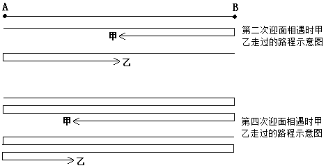

故正确答案为C。

**考点**：相遇追及

**来源**：2010年江苏省公务员录用考试《行测》题（A类）第40题

### 第 41 题

飞行器 ：神六

A. 互联网：信息

B. 电视机：电影

C. 奥运会：金牌

D. 政治家：曹操

第 41 题 · 答案与解析

**参考答案（粉笔题库参考内容）**

D

**解析**

第一步：判断题干词语间逻辑关系。

题干两词是包容关系中的种属关系，神六是一种飞行器。

第二步：判断选项词语间逻辑关系。

与题干相同的逻辑关系即为D，曹操是一个政治家。A、B、C均不是种属关系。

故正确答案为D。

**考点**：逻辑关系-包容关系

**来源**：2010年江苏省公务员录用考试《行测》题（A类）第41题

### 第 42 题

推荐：推选

A. 安宁：安定

B. 杂志：杂技

C. 稳定：淡定

D. 鲜艳：鲜美

第 42 题 · 答案与解析

**参考答案（粉笔题库参考内容）**

A

**解析**

第一步：判断题干词语间逻辑关系。

题干两词是近义词。

第二步：判断选项词语间逻辑关系。

A项，安宁是安定，安康的意思，同时也指心情、环境、气氛安定平静。安定指（生活、形势等）平静正常，稳定。两者是近义词，符合题意；

B项，杂志和杂技无明显逻辑关系，与题干不符；

C项，稳定的近义词为稳固或安定，淡定一般是指沉着、镇定。两者不是近义词，与题干不符；

D项，鲜艳是形容色彩的，而鲜美是形容食物的，两者不是近义词，与题干不符。

故正确答案为A。

**考点**：语义关系-近义关系

**来源**：2010年江苏省公务员录用考试《行测》题（A类）第42题

### 第 43 题

房屋：墙壁

A. 鹿茸：鹿角

B. 银耳：菌类

C. 大象：象牙

D. 坦克：兵器

第 43 题 · 答案与解析

**参考答案（粉笔题库参考内容）**

C

**解析**

第一步：判断题干词语间逻辑关系。

题干两词是包容关系中的组成关系，墙壁是房屋的一个组成部分。

第二步：判断选项词语间逻辑关系。

A项不是组成关系，鹿茸是指梅花鹿或马鹿的雄鹿未骨化而带茸毛的幼角；B项是包容关系中的种属关系；C项是组成关系，象牙是大象的一个组成部分；D项是种属关系。

故正确答案为C。

**考点**：逻辑关系-包容关系

**来源**：2010年江苏省公务员录用考试《行测》题（A类）第43题

### 第 44 题

钢笔：笔筒

A. 墙壁：灯具

B. 壁挂：墙壁

C. 衣橱：衣柜

D. 茶杯：衣橱

第 44 题 · 答案与解析

**参考答案（粉笔题库参考内容）**

B

**解析**

第一步：判断题干词语间逻辑关系。

题干两词是对应关系，且是物体和其放置地点的一一对应关系，前词为物体，后词为安置地点，钢笔放在笔筒里。

第二步：逐一分析选项。

A项，墙壁和灯具是对应关系，但前词是地点，后词是物体，与题干顺序不一致，排除；

B项，壁挂挂在墙壁上，与题干逻辑关系一致，应选；

C项，衣橱和衣柜是近义词，排除；

D项，茶杯和衣橱之间无明显逻辑关系，排除。

故正确答案为B。

**考点**：逻辑关系-对应关系

**来源**：2010年江苏省公务员录用考试《行测》题（A类）第44题

### 第 45 题

攻击：发动

A. 注释：文档

B. 前进：勇敢

C. 披荆：斩棘

D. 工作：开展

第 45 题 · 答案与解析

**参考答案（粉笔题库参考内容）**

D

**解析**

第一步：判断题干词语间逻辑关系。

发动攻击是一组动宾结构的短语。

第二步：判断选项词语间逻辑关系。

A项注释文档是一组动宾结构的短语，但顺序错了，排除；B项勇敢前进是一组偏正结构的短语，排除；C项披荆斩棘是一组并列结构的短语，排除；D项开展工作是一组动宾结构的短语，当选。

故正确答案为D。

**考点**：语法关系

**来源**：2010年江苏省公务员录用考试《行测》题（A类）第45题

### 第 46 题

正义：非正义

A. 有理数：无理数

B. 早晨：今晚

C. 植物：动物

D. 宽恕：怨恨

第 46 题 · 答案与解析

**参考答案（粉笔题库参考内容）**

A

**解析**

第一步：判断题干词语间逻辑关系。

题干两词是并列关系，且是并列关系中的矛盾关系。

第二步：判断选项词语间逻辑关系。

A项与题干逻辑关系相同，有理数和无理数之间是矛盾关系；B项不是矛盾关系；C项植物和动物是并列关系中的反对关系；D项是反义词，排除。

故正确答案为A。

**考点**：逻辑关系-并列关系

**来源**：2010年江苏省公务员录用考试《行测》题（A类）第46题

### 第 47 题

澎湃：蜿蜒

A. 犹豫：彷徨

B. 踯躅：浏览

C. 疯狂：坎坷

D. 激荡：逶迤

第 47 题 · 答案与解析

**参考答案（粉笔题库参考内容）**

A

**解析**

第一步：判断题干词语间的逻辑关系。

本题可从词语的拼音上找规律。“澎湃”两个字的拼音中都含有声母“p”；“蜿蜒”两个字的拼音中都含有韵母“an”，也就是说第一个词中声母相同，第二个词中韵母相同。

第二步：判断选项词语间的逻辑关系。

A项：“犹豫”两个字的拼音中都含有声母“y”；“彷徨”两个字的拼音中都含有韵母 “ang”,与题干逻辑关系一致，当选；

B项：“踯躅”两个字的拼音中都含有声母“zh”；“浏览”两个字的拼音中韵母不相同，与题干逻辑关系不一致，排除；

C项：“疯狂”两个字的拼音中声母不相同，与题干逻辑关系不一致，排除；

D项：“激荡”两个字的拼音中声母不相同，与题干逻辑关系不一致，排除。

故正确答案为A。

注：此种考法相对较少，但2010年江苏ABC类均有一道题涉及，大家了解即可。

**考点**：逻辑关系-对应关系

**来源**：2010年江苏省公务员录用考试《行测》题（A类）第47题

### 第 48 题

尘：伐

A. 信：嵩

B. 眉：鸟

C. 明：清

D. 让：休

第 48 题 · 答案与解析

**参考答案（粉笔题库参考内容）**

A

**解析**

第一步：判断题干词语间的逻辑关系。

题干中“尘”与“伐”都是单音节语素，不存在短语结构问题，意义之间也不存在联系。因此，只能从词的本身结构或者造字方法出发解题。题中“尘”是上下结构，“伐”是左右结构，结构不一样。

第二步：判断选项词语间的逻辑关系。

A项：“信”是左右结构，“嵩”是上下结构，结构不一样，与题干逻辑关系一致，先保留；

B项：“眉”是半包围结构，“鸟”是单一结构，结构不一样，与题干逻辑关系一致，先保留；

C项：“明”是左右结构，“清”是左右结构，结构一样，与题干逻辑关系不一致，排除；

D项：“让”是左右结构，“休”是左右结构，结构一样，与题干逻辑关系不一致，排除。

对比A、B两项，题中“尘”与“伐”都是会意字。“尘”拆开为小土，符合尘的含义；“伐”拆开为人（执）戈，即是伐的意思：征战。A项中“信”拆开是人言，其本意是消息、函件，本身就是人言或记录人言；“嵩”拆开是山高，本意就是高（山）。

故正确答案为A。

**考点**：逻辑关系-对应关系

**来源**：2010年江苏省公务员录用考试《行测》题（A类）第48题

### 第 49 题

头领：石头

A. 黄昏：蛋黄

B. 动物：行动

C. 桌椅：圆桌

D. 子女：袜子

第 49 题 · 答案与解析

**参考答案（粉笔题库参考内容）**

D

**解析**

第一步：判断题干两词的构成关系。

题干中“头领”指的是人，“石头”指的是物；只有“头”这个字是相同的，在“头领”中有实义，而“石头”中没有实义。

第二步：逐一判断选项。

与题干构词关系相同的只有D项中的“子女”和“袜子”，“子”在“子女”中有实义，在“袜子”中无实义。

故正确答案为D。

**考点**：拆分思维、逻辑关系-对应关系

**来源**：2010年江苏省公务员录用考试《行测》题（A类）第49题

### 第 50 题

实数：木耳

A. 长江：河流

B. 硕士：法官

C. 黄山：牛顿

D. 燕雀：鸿鹄

第 50 题 · 答案与解析

**参考答案（粉笔题库参考内容）**

C

**解析**

第一步：判断题干两词间的逻辑关系。

实数和木耳是没有任何关系的两个词语，题干两词间无任何逻辑关系。

第二步：逐一判断选项。

A项为包容关系；B项为交叉关系；D项为对应关系。与题干规律相同的只有C项的黄山和牛顿，无任何逻辑关系。

故正确答案为C。

**考点**：逻辑关系-对应关系

**来源**：2010年江苏省公务员录用考试《行测》题（A类）第50题

### 第 51 题

在题干中给出一套图形，其中有五个图，这五个图呈现一定的规律性。在给出的另一套图形中，有四个图，从中选出唯一的一项作为保持左边五个图规律性的第六个图。

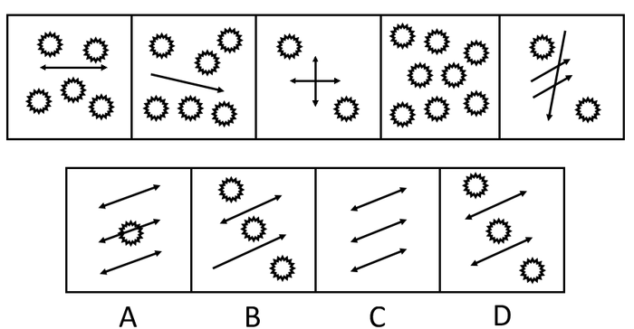

A. A

B. B

C. C

D. D

第 51 题 · 答案与解析

**参考答案（粉笔题库参考内容）**

B

**解析**

元素组成相似，考虑元素数量。 观察已有的五个图形，可以发现第一个图形中有5个小太阳、1个直线、2个箭头，合计为8个元素；第二个图形中有6个小太阳、1个直线、1个箭头，合计也为8个元素；每个图形都是8个元素，下一个图形也应当符合这一规律。

故正确答案为B。

**考点**：数量规律-素

**来源**：2010年江苏省公务员录用考试《行测》题（A类）第51题

### 第 52 题

在题干中给出一套图形，其中有五个图，这五个图呈现一定的规律性。在给出的另一套图形中，有四个图，从中选出唯一的一项作为保持左边五个图规律性的第六个图。

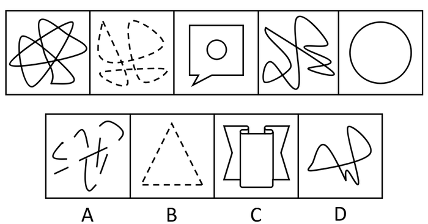

A. A

B. B

C. C

D. D

第 52 题 · 答案与解析

**参考答案（粉笔题库参考内容）**

D

**解析**

观察已有的五个图形，可以发现第一、三、四、五个图形都包含有封闭区间，而且封闭区间是由曲线构成的，第二个图形是用虚线绘制的，沿虚线连接后也是包含了封闭区间，而且封闭区间是由曲线构成的。那么下一个图形也应当包含有由曲线构成的封闭区间。

故正确答案为D。

**考点**：属性规律-复合

**来源**：2010年江苏省公务员录用考试《行测》题（A类）第52题

### 第 53 题

在题干中给出一套图形，其中有五个图，这五个图呈现一定的规律性。在给出的另一套图形中，有四个图，从中选出唯一的一项作为保持左边五个图规律性的第六个图。

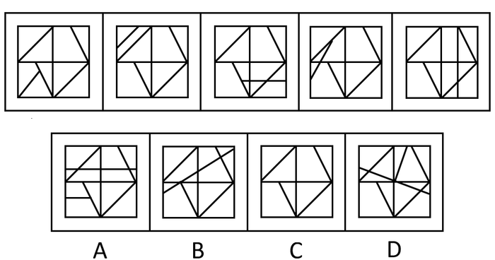

A. A

B. B

C. C

D. D

第 53 题 · 答案与解析

**参考答案（粉笔题库参考内容）**

B

**解析**

已有的五个图形中，只有一条线在变动，其他线均没有任何变动。线条数量每个图形内部都是七条，下一个图形不应该增加或减少线条的数量。只有B项的线条数符合这一规律。

故正确答案为B。

**考点**：数量规律-线

**来源**：2010年江苏省公务员录用考试《行测》题（A类）第53题

### 第 54 题

在题干中给出一套图形，其中有五个图，这五个图呈现一定的规律性。在给出的另一套图形中，有四个图，从中选出唯一的一项作为保持左边五个图规律性的第六个图。

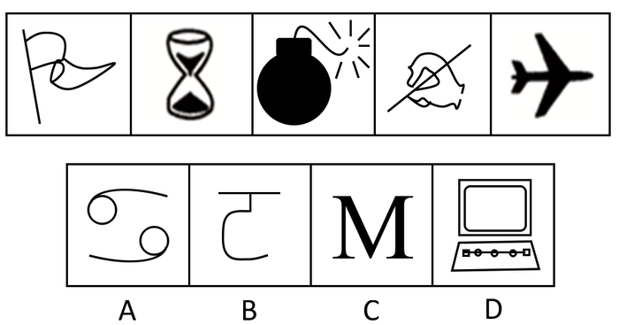

A. A

B. B

C. C

D. D

第 54 题 · 答案与解析

**参考答案（粉笔题库参考内容）**

D

**解析**

题干五个图形均描绘了不同的实体物品，先排除A、C两项。此外， B项和D项相比，B项是挂钩，D项是电脑，D项比B项更像是实体物品。

故正确答案为D。

**来源**：2010年江苏省公务员录用考试《行测》题（A类）第54题

### 第 55 题

在题干中给出一套图形，其中有五个图，这五个图呈现一定的规律性。在给出的另一套图形中，有四个图，从中选出唯一的一项作为保持左边五个图规律性的第六个图。

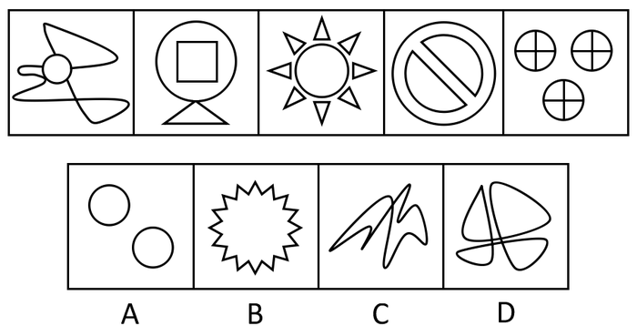

A. A

B. B

C. C

D. D

第 55 题 · 答案与解析

**参考答案（粉笔题库参考内容）**

A

**解析**

元素求同。题干的每个图形中都含有共同的元素圆，故在选项中应该选择包含有元素圆的图形，只有A项符合。

故正确答案为A。

**考点**：数量规律-素、样式规律-遍历

**来源**：2010年江苏省公务员录用考试《行测》题（A类）第55题

### 第 56 题

从所给的四个选项中，选择最合适的一个填入问号处，使之呈现一定的规律性：

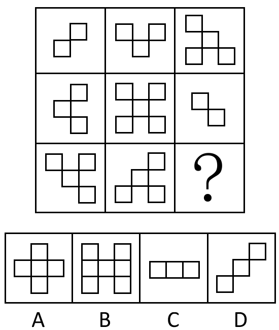

A. A

B. B

C. C

D. D

第 56 题 · 答案与解析

**参考答案（粉笔题库参考内容）**

D

**解析**

题干每一行都是由小方格组成，考虑数面，发现并没有规律；进一步观察发现，已有的八个图形中，小方格与另一个小方格的联系是通过顶点相连，而不是边相连，A、B、C三个选项均是边相连，而不仅是顶点相连，D选项仅是通过顶点连接。

故正确答案为D。

**考点**：特殊规律-图形间关系

**来源**：2010年江苏省公务员录用考试《行测》题（A类）第56题

### 第 57 题

从所给的四个选项中，选择最合适的一个填入问号处，使之呈现一定的规律性：

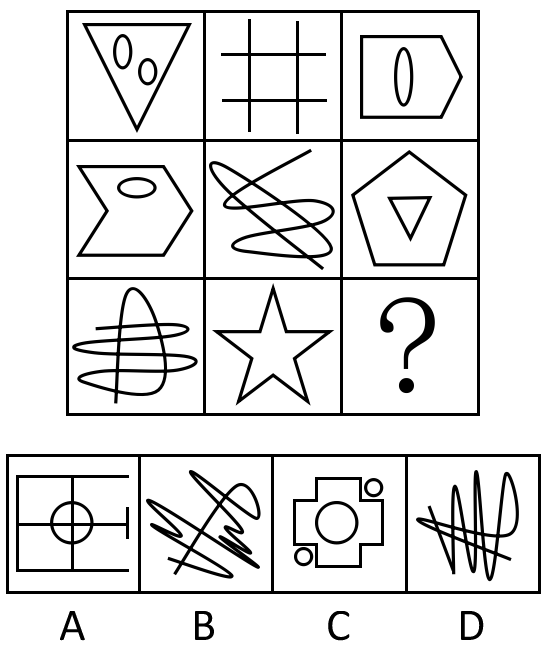

A. A

B. B

C. C

D. D

第 57 题 · 答案与解析

**参考答案（粉笔题库参考内容）**

A

**解析**

元素组成不同，属性无明显规律，考虑数量规律。观察发现，题干出现了很多一团线的点数量特征图，优先考虑数点。经过验证，已有图形从左至右、自上而下每个图形的交点数依次为3、4、5、6、7、8、9、10个，则下一个图形的交点数应当为11个，选项中点数量分别为11、5、12、12。

故正确答案为A。

**考点**：数量规律-点

**来源**：2010年江苏省公务员录用考试《行测》题（A类）第57题

### 第 58 题

从所给的四个选项中，选择最合适的一个填入问号处，使之呈现一定的规律性：

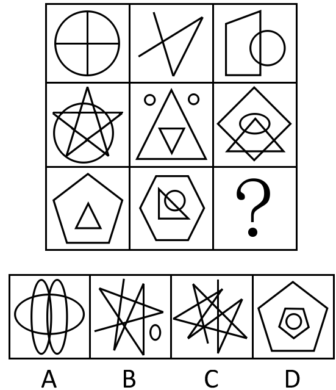

A. A

B. B

C. C

D. D

第 58 题 · 答案与解析

**参考答案（粉笔题库参考内容）**

D

**解析**

元素组成凌乱，考虑数数。已有图形从左至右、自上而下每个图形的直线数依次为2、3、4、5、6、7、8、9条，则下一个图形的直线数应当为10条，A项为0条，B项为6条，C项为8条，D项为10条。

故正确答案为D。

**考点**：数量规律-线

**来源**：2010年江苏省公务员录用考试《行测》题（A类）第58题

### 第 59 题

从所给的四个选项中，选择最合适的一个填入问号处，使之呈现一定的规律性：

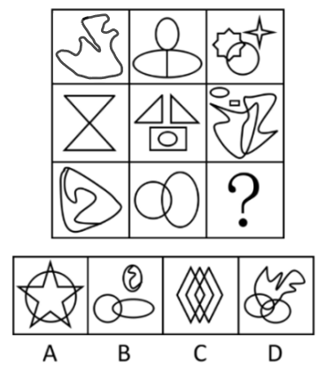

A. A

B. B

C. C

D. D

第 59 题 · 答案与解析

**参考答案（粉笔题库参考内容）**

C

**解析**

元素组成不同，无明显属性规律，考虑数量规律。题干第一行图1明显出现了单一曲线，优先考虑曲线数。九宫格优先横着看，第一行曲线数分别为1、2、1；第二行曲线数分别为0、1、3；第三行曲线数分别为2、2、？，单独看数字并不成规律，但是将每行曲线数相加发现，均为4条曲线，故？处图形曲线数应为0，只有C项符合规律。

故正确答案为C。

**考点**：数量规律-线

**来源**：2010年江苏省公务员录用考试《行测》题（A类）第59题

### 第 60 题

从所给的四个选项中，选择最合适的一个填入问号处，使之呈现一定的规律性：

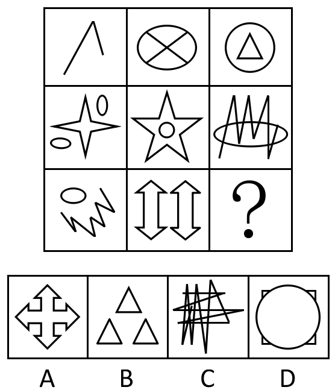

A. A

B. B

C. C

D. D

第 60 题 · 答案与解析

**参考答案（粉笔题库参考内容）**

B

**解析**

元素组成不同，属性无明显规律，考虑数量规律。观察发现，题干出现了很多折线的特征图，优先考虑角数量。观察题干，在这个九宫格图形中，从横向数，图形中锐角的个数依次为1、2、3、4、5、6、7、8、？，所以应选择含有9个锐角的图形。

故正确答案为B。

**考点**：数量规律-角

**来源**：2010年江苏省公务员录用考试《行测》题（A类）第60题

### 第 61 题

S市一所小学的学生户籍情况比较复杂，所有三年级学生的户籍都在本市，有些二年级学生的户籍也在本市，有些一年级学生是农民工子弟，而农民工子弟的户籍都不在本市。

据此，可以推出：

A. 所有二年级学生都不是农民工子弟

B. 有些农民工子弟是三年级学生

C. 有些户籍在本市的学生是三年级学生

D. 有些一年级学生不是农民工子弟

第 61 题 · 答案与解析

**参考答案（粉笔题库参考内容）**

C

**解析**

第一步：翻译题干，利用充分必要条件。

题干可翻译为：三年级学生→户籍在本市，有些二年级学生→户籍在本市，有些一年级学生→农民工子弟，农民工子弟→户籍不在本市。

第二步：逐一翻译选项并判断正确选项。

A项：二年级学生→—农民工子弟，由题干无法得知这两者有关系，错误；

B项：有些农民工子弟→三年级学生，由题干只能推出户籍不在本市，错误；

C项：有些户籍在本市→三年级学生，属于肯后件，可以推出可能性的结论，正确；

D项：有些一年级学生→—农民工子弟，由题干推不出。注意由有些一年级学生→农民工子弟，只能知道这一些一年级学生的情况，并不能知道没有提及的余下的一年级学生是不是农民工子弟，错误。

故正确答案为C。

**考点**：集合推理

**来源**：2010年江苏省公务员录用考试《行测》题（A类）第61题

### 第 62 题

在市场经济条件下，只要机会均等，合法竞争，不坑蒙拐骗、不搞特权和腐败，社会中贫富差别的出现，就只能归结为个人的先天差异、后天努力及机会运气等原因。

据此，可以推出：

A. 社会中的贫富差距总是需要改变的

B. 社会中贫富差别的出现，如果不是因为个人的先天差异，那可能是因为社会中存在着特权和腐败

C. 社会中贫富差别的出现，如果不是因为个人的后天努力，那肯定是因为个人的机会不均等

D. 如果社会中坑蒙拐骗、特权和腐败到处横行，则贫富差别的出现就不能归结为个人的先天差异、后天努力及机会运气等原因了

第 62 题 · 答案与解析

**参考答案（粉笔题库参考内容）**

B

**解析**

第一步：翻译题干。

机会均等 且 合法竞争 且 不坑蒙拐骗 且 不搞特权和腐败→贫富差别出现的原因是个人的先天差异 或 后天努力 或 机会运气

第二步：逐一分析选项。

A项：题干并未提及社会中的贫富差距是否需要改变，无中生有，排除；

B项：可能是因为社会中存在着特权和腐败，推出的是可能性原因，能推出，当选；

C项：肯定是因为个人的机会不均等，说法过于绝对，有可能是因为个人的先天差异，不能推出，排除；

D项：“社会中坑蒙拐骗、特权和腐败到处横行”是否前，否前得不到任何确定性结论，不能推出，排除。

故正确答案为B。

**考点**：常规翻译

**来源**：2010年江苏省公务员录用考试《行测》题（A类）第62题

### 第 63 题

小岛国联盟中的一些国家地处热带地区，这些热带地区的小岛国风景优美、物产丰富。近年来，这些风景优美的小岛国日益被世人所关注，逐渐成为世界各国游客境外游的首选。在小岛国旅游热潮的推动下，这些小岛国的经济正在高速发展。

据此，可以推出：

A. 小岛国联盟国家都地处热带地区

B. 热带地区的国家都风景优美、物产丰富

C. 有些经济正在高速发展的国家风景优美、物产丰富

D. 小岛国联盟国家的经济都在高速发展

第 63 题 · 答案与解析

**参考答案（粉笔题库参考内容）**

C

**解析**

第一步：抓住题干的中心思想。

题干叙述了小岛国联盟中的一些国家地处热带地区，这些热带地区的小岛国风景优美、物产丰富，且经济正在高速发展。

第二步：根据题干判断正确选项。

题干中“小岛国联盟中的一些国家地处热带地区”强调“一些”，故可排除A项；由“这些热带地区的小岛国风景优美、物产丰富”可排除B项；由“这些小岛国的经济正在高速发展”可排除D项；由题干“这些热带地区的小岛国风景优美、物产丰富”和“这些小岛国的经济正在高速发展”可推出可能性的结论：有些经济正在高速发展的国家风景优美、物产丰富。

故正确答案为C。

**考点**：日常结论

**来源**：2010年江苏省公务员录用考试《行测》题（A类）第63题

### 第 64 题

自工业革命以来，人类大量焚烧化石燃料和毁林，排放的温室气体不断增加，导致了20世纪全球明显升温。如果要控制大气中温室气体浓度的长期增长，各国就要进行人为干预，或者从源头上限制化石能源的使用，减少温室气体排放；或者增加温室气体的汇，即通过植树造林把排放到大气中的温室气体重新吸收起来。

据此，可以推出：

A. 如果从源头上限制化石能源的使用，就能避免全球明显升温

B. 如果通过植树造林增加温室气体的汇，就能避免全球明显升温

C. 如果各国既不从源头上限制化石能源的使用，又不增加温室气体的汇，就不能控制大气中温室气体浓度的长期增长

D. 如果各国从源头上限制化石能源的使用或通过植树造林增加温室气体的汇，就能控制大气中温室气体浓度的长期增长

第 64 题 · 答案与解析

**参考答案（粉笔题库参考内容）**

C

**解析**

第一步：翻译题干，利用充分必要条件。

温室气体增加→全球升温，利用逆否规则，即：-全球升温→—温室气体增加

控制温室气体浓度增长→限制化石能源的使用（减少温室气体排放） 或 增加温室气体的汇（植树造林）。

将以上两个推导联系起来可以得到：-全球升温→控制温室气体浓度增长→限制化石能源的使用（减少温室气体排放） 或 增加温室气体的汇（植树造林）。

第二步：逐一翻译选项并判断正确选项。

A项，从源头上限制化石能源的使用→—全球升温（大气中温室气体浓度的长期增长）。肯定题干后件中的一支不能得到肯定题干前件的结论，错误。

B项，增加温室气体的汇→—全球升温。肯定题干后件中的一支不能得到肯定题干前件的结论，错误。

C项，-从源头上限制化石能源的使用 且 -增加温室气体的汇→—控制大气中温室气体浓度的长期增长。“-从源头上限制化石能源的使用 且 -增加温室气体的汇”是否定题干的后件，由此可以得到否定题干前件的结论“-大气中温室气体浓度的长期增长”，正确。

D项，从源头上限制化石能源的使用 或 增加温室气体的汇→控制大气中温室气体浓度的长期增长。肯定题干后件不能得到肯定题干前件的结论，错误。

故正确答案为C。

**考点**：常规翻译

**来源**：2010年江苏省公务员录用考试《行测》题（A类）第64题

### 第 65 题

滨海市政府决定上马一项园林绿化工程，政府有关部门在调研论证的基础上，就特色树种的选择问题形成如下几项决定：

（1）樟树、柳树至少选择一样；

（2）如果不种桂树，那么就要种雪松；

（3）如果种柳树，那么就要种桃树；

（4）桃树、雪松至少要舍弃一样。

据此，可以推出该市应选择的特色树种是：

A. 柳树或者桃树

B. 樟树或者桂树

C. 雪松或者柳树

D. 雪松或者樟树

第 65 题 · 答案与解析

**参考答案（粉笔题库参考内容）**

B

**解析**

第一步：翻译题干。

（1）樟 或 柳；（2）-桂→雪；（3）柳→桃；（4）-桃 或 -雪

将“或”关系翻译箭头的形式，根据否一推一可得：（1）-樟→柳；（4）桃→—雪。将题干串联可知“-樟→柳→桃→\-雪→桂”。

第二步：逐一分析选项。

A项：题干“柳→桃”，翻译成“或”关系，应该是“-柳 或 桃”，不能推出“柳树或者桃树”，排除；

B项：题干“-樟→桂”，翻译成“或关系”，应该是“樟 或 桂”，能推出，当选；

C项：题干“柳→—雪”，翻译成“或”关系，应该是“-柳 或 -雪”，不能推出“雪松或者柳树”，排除；

D项：题干“-樟→—雪”，翻译成“或”关系，应该是“樟 或 -雪”，不能推出“雪松或者樟树”，排除。

故正确答案为B。

【拓展】这题实质是考查选言命题的真假问题。选言命题也是可以通过翻译推理的方式，翻译成符号语言：“A、B中至少选一个”等价于“-A→B”；“A、B中至多选一个”等价于“A→—B”。

**考点**：常规翻译

**来源**：2010年江苏省公务员录用考试《行测》题（A类）第65题

### 第 66 题

江天市财政局根据上级指示要求，决定派出一名同志前往农村扶贫。财政局甲、乙、丙、丁、戊等多名同志知道消息后积极报名，申请前往。根据报名情况及本局自身工作需要，领导做出以下几项决定：

（1）在甲、乙两人中至少挑选1人；

（2）在乙、丙两人中至多挑选1人；

（3）在甲、丁两人中也至多挑选1人；

（4）如果挑选了丁，那么丙、戊两人缺一不可。

据此，可以推出：

A. 不挑选丁

B. 挑选甲

C. 不挑选甲

D. 挑选丁

第 66 题 · 答案与解析

**参考答案（粉笔题库参考内容）**

A

**解析**

题干要求“派出一名同志”，再由决定（1）“在甲、乙两人中至少挑选1人”和（4）“如果挑选了丁，那么丙、戊两人缺一不可”都可知丁不可以选。

故正确答案为A。

**考点**：常规翻译

**来源**：2010年江苏省公务员录用考试《行测》题（A类）第66题

### 第 67 题

在一列国际列车上，来自英、意、日、德四国的甲、乙、丙、丁四位旅客恰好相聚在某个车厢中。他们每人除了会说自己本国语言外，还会说其他三国语言中的一种，有一种语言三个人都会说。这四位旅客交谈的有关情况如下：

（1）乙不会说英语，当甲与丙交谈时，他却能替他们作翻译；

（2）甲是日本人，丁不会说日语，但他俩却能毫无困难地交谈；

（3）乙、丙、丁三人找不到一种共同的语言进行交谈；

（4）在四人中，没有一人既能用日语交谈，又能用意大利语交谈。

据此，可以推出三个人都会说的那种语言是：

A. 日语

B. 德语

C. 英语

D. 意大利语

第 67 题 · 答案与解析

**参考答案（粉笔题库参考内容）**

B

**解析**

由（1）可知甲、丙不能说同一种语言，而有一种语言三个人都会说，因此这三个人可能为“甲、乙和丁”或者“乙、丙和丁”。又由（3）可知乙、丙、丁三人找不到一种共同的语言进行交谈，所以会说共同语言的一定是甲、乙和丁。

又由（4）可知，会说日语的不会说意大利语，（2）甲会说日语，所以甲不会意大利语，丁不会说日语，但是甲、丁之间可以交流，说明甲、丁之间说的是德语或英语。

又因有一种语言甲、乙、丁三人都会说，（1）中乙不会说英语，因此甲、乙、丁三人都会说德语。

故正确答案为B。

**考点**：从确定信息开始推

**来源**：2010年江苏省公务员录用考试《行测》题（A类）第67题

### 第 68 题

因某种原因，甲、乙两人现面临A、B两种方案的选择，如果两人都选择A方案，则甲得到5个单位利益，而乙得到2个单位利益；如果甲选择A方案，乙选择B方案，则甲、乙均得到4个单位利益；如果甲选择B方案，乙选择A方案，则甲得到6个单位利益，乙得到1个单位利益；如果甲、乙均选择B方案，则各得到3个单位利益。假定甲、乙两人都按照自己利益最大化标准来进行算计和行动，都明白上述的利益得失情况，两人的选择不分先后。

据此，可推出：

A. 甲选择B方案，乙选择B方案

B. 甲选择A方案，乙选择B方案

C. 甲选择A方案，乙选择A方案

D. 甲选择B方案，乙选择A方案

第 68 题 · 答案与解析

**参考答案（粉笔题库参考内容）**

B

**解析**

解析1：

第一步：翻译题干。

将题干中选择两种方案时两人所能得到的利益表示如下（逗号左边为甲所能得到的利益，右边为乙所能得到的利益）：

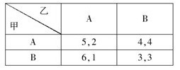

第二步：分析判断得出正确答案。

由上图可知，无论甲选择什么方案，当乙选择B方案时，乙所得到的利益最大。根据甲乙两人都按照自己利益最大化标准来进行算计和行动，可知，乙一定会选择B方案。又两人都明白这一利益得失，所以甲应该是在乙选择B方案的同时考虑使自己得到的利益最大化。由图可得，甲会选择A方案。故正确答案为B。

解析2：虽然是甲、乙两人都按自己利益最大化来算计和行动，但是最终所选方案是由两个人的共同选择结果而定的。甲、乙两人既然都明白利益的得失情况，因此都会避开在对方选择后有可能会使自己利益反而减少的情形。也就是说，甲如果选择了B方案，他必须考虑到自己有可能得到6单位利益，也有可能因为乙同样选择B方案而得到3单位利益；甲如果选择A方案，则至多得到5单位利益，但至少也会得到4单位利益。出于个人利益最大化的考虑，甲会选择A方案。同理，乙会选择B方案。

故正确答案为B。

**考点**：从确定信息开始推

**来源**：2010年江苏省公务员录用考试《行测》题（A类）第68题

### 第 69 题

M大学学生小段突患重病，有一同学暗中捐款相助。小段转危为安后，想知道是谁捐款了。他询问了五位同学，分别得到以下回答：

（1）或者甲捐了，或者乙捐了；

（2）如果甲捐了，那么丙也捐了；

（3）如果乙没捐，那么丁捐了；

（4）甲和乙都没有捐；

（5）丙和丁都没有捐。

实际上，这五位同学的回答中只有一句是假的。据此，可以推出：

A. 丙捐了

B. 丁捐了

C. 甲捐了

D. 乙捐了

第 69 题 · 答案与解析

**参考答案（粉笔题库参考内容）**

D

**解析**

第一步：找突破口。

本题突破口为（1）和（4）之间的矛盾关系，两句话必有一真一假。

第二步：看其他的条件。

由题干可知，只有一句话为假话，则（2）（3）（5）都是真话。假设甲捐了，由（2）如果甲捐了，那么丙也捐了，则有两人捐款，与题干的“只有一人”捐款不符合，故假设不能成立，即甲没有捐。由（5）得出，丙、丁没有捐，代入（3）中，得出乙捐了。

故正确答案为D。

**考点**：只有一真/一假

**来源**：2010年江苏省公务员录用考试《行测》题（A类）第69题

### 第 70 题

N中学在进行高考免试学生的推荐时，共有甲、乙、丙、丁、戊、己、庚等7位同学入围。在7人中，有3位同学是女生，4位同学是男生，有4位同学的年龄为18岁，而另3位同学年龄则为17岁。已知，甲、丙和戊年龄相同，而乙、庚的年龄则不相同；乙、丁与己的性别相同，而甲与庚的性别则不相同。最后，只有一位17岁的女生得到推荐资格。

据此，可以推出获得推荐资格的是：

A. 庚

B. 戊

C. 乙

D. 甲

第 70 题 · 答案与解析

**参考答案（粉笔题库参考内容）**

A

**解析**

第一步：总结题干。

由题干可知，有3女4男，4个18岁，3个17岁。

在年龄上：甲＝丙＝戊，乙≠庚，在性别上：乙＝丁＝己，甲≠庚。

第二步：找突破口并展开推导。

（1）根据性别判断：由“3女4男”以及在性别上“乙＝丁＝己，甲≠庚”可知，甲与庚中必有一人与乙、丁、己三人的性别相同，可知乙、丁、己三人是男生，甲与庚中必是一男一女。最后推荐的是女生，故乙、丁、己不被推荐。

（2）根据年龄判断：由在年龄上“甲＝丙＝戊，乙≠庚”和“4个18岁，3个17岁”可推知，乙和庚中必有一人与甲、丙、戊年龄相同，他们四人为18岁，最后推荐人的是17岁，则甲、丙、戊都不被推荐。

（3）一共有甲、乙、丙、丁、戊、己、庚等7位同学入围，排除乙、丁、己、甲、丙、戊后，必然是庚入围。

故正确答案为A。

**考点**：排除法

**来源**：2010年江苏省公务员录用考试《行测》题（A类）第70题

### 第 71 题

舆情，指在经过收集整理之后所分析归纳出的具有一定系统性和典型性的舆论意见、情况和信息的综合。

下列不涉及舆情的是：

A. 为进一步加强和改善房地产市场调控，国务院办公厅2010年1月10日下发《关于促进房地产市场平衡健康发展的通知》

B. 我国反腐工作创造了一种新方法，即借助网络技术及所引起的社会效应对执政行为的监督和对权力的约束来有效预防、遏制、惩戒腐败行为

C. 某地方政府近年来一直坚持对人事工作采取社会公示制度，在人才培养方面更具有透明度，选拔任用的干部素质不断提高

D. “新意见阶层”的网民凭借互联网“所有人对所有人的传播”优势，对中国社会发展中的种种问题畅所欲言，能在极短时间内凝聚共识，影响社会

第 71 题 · 答案与解析

**参考答案（粉笔题库参考内容）**

A

**解析**

第一步：找出定义关键词。

“收集整理之后”、“归纳出的具有一定系统性和典型性的舆论意见、情况和信息的综合”。

第二步：逐一分析选项。

A项：国务院办公厅下发的通知不是对“舆论意见、情况和信息的综合”，不符合定义，当选；

B项：借助网络技术及所引起的社会效应，即借助网络的方便快捷传播舆论信息，符合关键词“归纳出的具有一定系统性和典型性的舆论意见、情况和信息的综合”，符合定义，排除；

C项：公示制度本身就是征集舆论意见的形式，符合关键词“归纳出的具有一定系统性和典型性的舆论意见、情况和信息的综合”，符合定义，排除；

D项：对中国社会发展中的种种问题畅所欲言，能在极短时间内凝聚共识，符合关键词“归纳出的具有一定系统性和典型性的舆论意见、情况和信息的综合”，符合定义，排除。

本题为选非题，故正确答案为A。

**考点**：单定义-其他句式

**来源**：2010年江苏省公务员录用考试《行测》题（A类）第71题

### 第 72 题

行政确认，指行政机关和法定授权的组织依照法定权限和程序对有关法律事实进行甄别，通过确定、证明等方式决定管理相对人某种法律地位的行政行为。

下列不属于行政确认的是：

A. 某法院依据《招标投标法》，认定某招标代理机构在一次招标活动中违反相关法律规定，与招标人私下串通，谋取不当利益，并确认此次招标无效

B. 某高速公路发生一起交通事故，并引起责任纠纷，交警到达现场后，经过勘察了解，认定甲司机应负主要责任

C. 某市地税局干部小丁和小杨因工作中产生的一些矛盾吵得不可开交，一直闹到李局长那里，李局长了解情况后认为小杨应负主要责任，并批评教育了小杨

D. 赵某是养鱼专业户，去年冬天因抢救落水者而不幸死亡，政府相关部门依据法律，追认其为烈士

第 72 题 · 答案与解析

**参考答案（粉笔题库参考内容）**

C

**解析**

第一步：抓住定义中的关键词。

关键词强调“行政机关和法定授权的组织”、“法律事实”、“管理相对人”和“行政行为”。

第二步：逐一判断选项。

A项中的法院认定某招标代理机构在一次招标活动中违反相关法律规定，符合定义中的关键词，属于司法行政管理中的确认，是行政确认；

B项中交警管理交通事故，并确认责任，“交警”归属公安机关，符合“行政机关和法定授权的组织”，“管理交通事故，并确认责任”符合“管理相对人”和“行政行为”，故属于行政确认；

C项中小丁和小杨工作中的一些矛盾不是“法律事实”，只是普通的争吵，而李局长也只是对其二人之间的矛盾进行调解，不是“行政行为”，故不属于行政确认；

D项政府相关部门依据法律，追认赵某为烈士，也是行政机关对有关法律事实进行甄别，确定后管理相对人某种法律地位的行政行为，属于行政确认。

故正确答案为C。

**考点**：主客体

**来源**：2010年江苏省公务员录用考试《行测》题（A类）第72题

### 第 73 题

合理化防御，指为了替自己的行为提供解释而给出某些看似合理但并不真实的理由。

下列属于合理化防御的是：

A. 小刘的婚宴盛邀老同学小吕亲临，而小吕那时已参与高考命题。于是小吕对小刘说：“我明天要与校长出差半个月，南下考察项目。你的婚宴恕不能参加，回来后我请你们夫妇。”

B. 有评论家称，不良传播媒介如黄色小说、照片、录像等，具有诱发青少年犯罪的恶性功能，净化传播媒介的工作应常抓不懈

C. 小明这次考试不及格，知道自己最近对学习不太用心，于是就和妈妈坦白了，并保证以后会努力做功课

D. 邻居大妈的猫死了，妈妈安慰她说：“这只猫已经养了十多年了，已经活得很久了，死了很正常。”

第 73 题 · 答案与解析

**参考答案（粉笔题库参考内容）**

A

**解析**

第一步：抓住定义中的关键词。

关键词强调“替自己的行为提供解释”、“并不真实”。

第二步：逐一判断选项。

A项中的小吕由于参与高考命题，不能参加小刘的婚姻，故解释说自己与校长出差半个月，这个解释并不真实，但他是“替自己的行为提供解释”，故A项属于合理化防御；

B项不是“替自己的行为提供解释”，不属于合理化防御；

C项小明向妈妈坦白了，并没有给出不真实的理由，故不属于合理化防御；

D项是安慰，而不是“替自己的行为提供解释”。

故正确答案为A。

**考点**：方式目的

**来源**：2010年江苏省公务员录用考试《行测》题（A类）第73题

### 第 74 题

商标反向假冒，指经营者将他人拥有注册商标的商品合法取得后，未经商标注册人同意，更改其注册商标并将该更换商标的商品又投入市场的行为。

下列属于商标反向假冒的是：

A. 某服装商向某外贸公司订了一批羽绒服，由于生产厂家的货源不足，该公司便在市场上购买了一批其他品牌的羽绒服，拆除原商标缝上自己的商标

B. 某一外商独资企业曾多次假冒我国的质优价廉的商品，进行大规模生产并不断投向市场从中获利

C. 小王买了一条裤子，款式很好，面料也好，就是品牌不著名，于是他回家把自己另一条名牌裤的商标缝制到新买的裤子上，自鸣得意地把裤子穿在身上

D. 某工商局最近查获了专门制作各种名牌酱油的一家私人作坊，这家作坊采用收购名牌酱油旧瓶来装自己所生产酱油的方式从中牟利

第 74 题 · 答案与解析

**参考答案（粉笔题库参考内容）**

A

**解析**

第一步：抓住定义中的关键词。

关键词强调“合法取得”、“更改其注册商标”、“又投入市场”。

第二步：逐一判断选项。

A项中该服装公司购买了其他品牌的羽绒服后拆除原商标符合定义中的“合法取得”和“更改其注册商标”，然后缝上自己的商标“又投入市场”，属于商标反向假冒；

B项的外商独资企业的假冒行为并未提到曾将他人拥有的注册商标的商品合法获得的过程，故不属于商标反向假冒；

C项小王更改了裤子的商标但并未“投入市场”，而是自己穿着，故不属于商标反向假冒；

D项是将自己生产的酱油装入名牌酱油瓶中，属于假冒行为，不是商标反向假冒。

故正确答案为A。

**考点**：方式目的

**来源**：2010年江苏省公务员录用考试《行测》题（A类）第74题

### 第 75 题

手表定律，指一个人拥有两只走时不一致的手表时反而会失去判定准确时间的信心，用以比喻同时面对几种不同的工作目标或价值观念等时，人的工作和生活可能会陷入混乱。

下列不属于手表定律的是：

A. 私下想跳槽的某会计，最近有一家公司答应聘她为财务经理，年薪丰厚，还有一家著名公司也答应录用，但须从基层做起，她拿不定主意，寝食不安，又不敢张扬此事

B. 某公司成立不久，各项规章制度都还没有制定到位，公司的日常运作和管理还不能规范运行，各个部门之间的工作经常出现不太协调的情况

C. 某保健品企业老总见房地产市场火爆，投身其中，想获取更多利润，结果被深深套牢，而主营的保健品也因研发滞后，不再受消费者青睐，公司面临倒闭

D. 某水库负责人抱怨说，水库受到水利、环保、城建、交通、林业等多个互不隶属部门的管理，导致水库经常无所适从，直接影响了水库的合理利用和有效治理

第 75 题 · 答案与解析

**参考答案（粉笔题库参考内容）**

B

**解析**

第一步：找出定义关键词。

“几种不同的工作目标或价值观念”、“陷入混乱”。

第二步：逐一分析选项。

A项：会计在面对两家公司的聘用选择时由于拿不定主意而寝食不安，符合“几种不同的工作目标或价值观念”、“陷入混乱”，属于手表定律，符合定义，排除；

B项：各个部门出现不太协调的状况并不是因为面对几种不同的工作目标或价值观念，而是因为各项规章制度不完善，日常运作和管理还不够规范导致的，不属于手表定律，不符合定义，当选；

C项：老总在面对房地产市场和保健品市场时为了获取更多利润而“陷入混乱”，公司倒闭，属于手表定律，符合定义，排除；

D项：由于水库受到多个部门的管理，因为“不同的工作目标或价值观念”而导致水库管理无法适从，属于手表定律，符合定义，排除。

本题为选非题，故正确答案为B。

**考点**：故事类

**来源**：2010年江苏省公务员录用考试《行测》题（A类）第75题

### 第 76 题

定义：

①自恋型人格：指过于重视自我价值而缺乏对自身和他人进行理性和客观认识的一种人格。

②回避型人格：指行为退缩、心理自卑，面对挑战多采取回避态度或无能力应付的一种人格。

③强迫型人格：指过于要求严格和完美，具有强烈的自制心理和自控行为的一种人格。

典型例证：

（1）小肖敏感羞涩，害怕参加社交活动，担心自己的言行不当而被人讥笑讽刺，也从来不去做那些冒险的事情。

（2）小吴经常无根据地夸大自己的成就和才干，认为自己应当被视作“特殊人才”，幻想自己拥有比他人更多的智慧、聪明。

（3）小栾十分注意自己的行为是否正确、举止是否适当，往往用十全十美的高标准要求自己，追求完美，同时又墨守陈规。

对上述典型例证与定义的关系判断正确的是：

A. 例证（2）（1）（3）分别与定义③②①相符

B. 例证（2）（3）分别与定义③①相符

C. 例证（1）（3）分别与定义①②相符

D. 例证（1）（2）（3）分别与定义②①③相符

第 76 题 · 答案与解析

**参考答案（粉笔题库参考内容）**

D

**解析**

第一步：抓住每个定义中的关键词。

自恋型人格：关键词是“过于重视自我价值”；

回避型人格：关键词是“行为退缩、心理自卑”、“回避”；

强迫型人格：关键词是“过于要求严格和完美”。

第二步：逐一判断例证与定义之间的关系。

例证（1）的小肖害怕参加社交活动，且从来不去做那些冒险的事情，满足回避型人格的关键词；例证（2）的小吴无根据地夸大自己的成就和才干是“过于重视自我价值”，属于自恋型人格；例证（3）小栾是“过于要求严格和完美”，属于强迫型人格。

故正确答案为D。

**考点**：特殊问法

**来源**：2010年江苏省公务员录用考试《行测》题（A类）第76题

### 第 77 题

定义：

①边缘科学：指以两种或多种学科为基础而发展起来的科学，其特点是运用一门学科或几门学科的概念和方法，研究另一门学科的对象或交叉领域的对象。

②分支科学：指在原本科学的基础上，以原本科学的某一特征、方面、部分为对象而产生的科学学科。

③横向科学：指以相关科学的对象、方法中的共同特征或普遍关系为研究对象的科学。

典型例证：

（1）法医学以医学对人体生理机制的研究为基础，通过尸体解剖，可以为有关刑事诉讼提供死者死亡原因、死亡时间等科学的、有力的证据。

（2）在中国的官窑制瓷史上，明代成化年间的瓷器素来备受推崇，究其原因，主要是因为当时的朝廷为制瓷业付出了大量的心血及费用。

（3）水文科学开始主要研究河流、湖泊、沼泽、冰川和积雪，以后扩展到地下水、大气中的水和海洋中的水，主要有河流水文学、冰川水文学、雪水文学、海洋水文学等。

对上述典型例证与定义的关系判断正确的是（    ）。

A. 例证（2）（3）分别与定义①③相符

B. 例证（1）（2）（3）分别与定义③②①相符

C. 例证（1）（2）（3）分别与定义①②③相符

D. 例证（1）（3）分别与定义①②相符

第 77 题 · 答案与解析

**参考答案（粉笔题库参考内容）**

D

**解析**

第一步：找出定义关键词。

①边缘科学：以两种或多种学科为基础而发展起来的科学；

②分支科学：以原本科学的某一特征、方面、部分为对象而产生的科学学科；

③横向科学：以相关科学的对象、方法中的共同特征或普遍关系为研究对象的科学。

第二步：逐一分析例证。

例证（1）：在法学和医学基础上发展起来的，与定义①边缘科学相符；

例证（2）：制瓷史并不是制瓷业和史学的交叉学科，句中并没有涉及制瓷业的研究，主要是从史学方面阐述的，不符合任一定义；

例证（3）：水文科学开始主要研究河流、湖泊等，以后扩展到地下水、大气中的水和海洋中的水，与定义②分支科学相符。

故正确答案为D。

**考点**：特殊问法

**来源**：2010年江苏省公务员录用考试《行测》题（A类）第77题

### 第 78 题

定义：

①人才团：指在一个较小空间和时间段内人才以相同或相似的风格、方法、表达方式及共同的追求方向和目标为纽带结成的人才群体。

②人才链：指有血缘关系或师徒关系的两代或两代以上的人才以技艺、知识为纽带而前后相承的现象。

③潜人才：指已具备从事某种创造性劳动的能力，有可能为社会作出较大贡献，但由于缺乏某种外部条件和机会，还未被发现、还未得到社会承认的人才。

典型例证：

（1）长征途中，红二师四团为抢渡乌江而架设的浮桥数次被激流冲走，是战士和群众发明了“河底坠石稳固桥面”的方法，确保了架桥成功。

（2）三国时代，为了完成统一大业，魏、蜀、吴都十分注意网罗人才，就蜀国而言，名相诸葛亮自不消说，就是关羽、张飞、赵云、马超、黄忠，也各有千秋。

（3）中国戏曲中的生、旦、净、丑各行当均有自己的流派，如老生行中的马、谭、奚、杨、麒派等；旦行中的四大名旦、四小名旦等。

对上述典型例证与定义的关系判断正确的是：

A. 例证（2）（3）分别与定义①②相符

B. 例证（1）（3）（2）分别与定义①②③相符

C. 例证（1）（2）分别与定义②③相符

D. 例证（3）（1）（2）分别与定义①③②相符

第 78 题 · 答案与解析

**参考答案（粉笔题库参考内容）**

A

**解析**

第一步：抓住每个定义中的关键词。

人才团：关键词为“较小空间和时间段内”、“共同的追求方向和目标”；

人才链：关键词为“血缘关系或师徒关系”、“技艺”、“前后相承”；

潜人才：关键词为“已具备”、“缺乏某种外部条件和机会”。

第二步：逐一判断例证与定义之间的关系。

例证（1）陈述了长征途中，战士和群众发明了“河底坠石稳固桥面”的方法这样一个事实，其中的战士和群众与三个定义都不符合；

例证（2）中的“三国时代”符合“较小空间和时间段内”，“为了完成统一大业”符合“共同的追求方向和目标”，故例证（2）符合人才团的定义；

例证（3）的各流派体现了“师徒关系”和“前后相承”，符合人才链的定义。

故正确答案为A。

**考点**：特殊问法

**来源**：2010年江苏省公务员录用考试《行测》题（A类）第78题

### 第 79 题

定义：

①信心：指一个人对自身信仰的坚定，可包括宗教与非宗教的信仰，是对于尚未见到事物的信念和凭据，它包括相信和敢于将自己完全委托两个层面。

②恒心：指坚持达到目的或执行某项计划的决心，也指持久不变的意志。

③爱心：指同情怜悯之心，包括相应的一定行动。如对象为人类时，就基于彼此都是人类的认识而同情怜悯。如对象为非人类时，则基于彼此都是动物或生命的认识而同情怜悯。

典型例证：

（1）小秦认为没有一个人是完美的，但是每个人都有自己优秀的地方，只要拥有自己的特长和优点，就应该感到自豪，毕竟自己还是挺厉害的嘛。

（2）老李体检时发现“三高”，医生提醒他要坚持锻炼，于是老李不论三伏三九都坚持每天晨练一小时，结果“三高”果真都不“高”了。

（3）张某与妻子离婚后承担对孩子的抚养义务，不久张某因抢劫被逮捕，孩子无人照料，民警小戴主动为张某照看孩子。

对上述典型例证与定义的关系判断不正确的是：

A. 例证（1）（2）（3）分别与定义①②③相符

B. 例证（3）（2）分别与定义②③相符

C. 例证（1）（3）分别与定义①③相符

D. 例证（2）（3）分别与定义②③相符

第 79 题 · 答案与解析

**参考答案（粉笔题库参考内容）**

B

**解析**

第一步：找出定义关键词。

①信心：关键词是“对自身信仰的坚定”；

②恒心：关键词是“坚持”、“持久不变的意志”；

③爱心：关键词是“同情怜悯”、“都是人类”、“都是动物或生命”。

第二步：逐一分析例证。

例证（1）：小秦认为自己厉害是一种自信的表现，与定义①信心相符；

例证（2）：老李不论三伏三九都坚持每天晨练一小时，符合“坚持”和“持久不变的意志”，与定义②恒心相符；

例证（3）：民警小戴主动为张某照看孩子，这是对无人照料的孩子的“同情怜悯”，与定义③爱心相符。

本题为选非题，故正确答案为B。

**考点**：特殊问法

**来源**：2010年江苏省公务员录用考试《行测》题（A类）第79题

### 第 80 题

定义：

①文化惰性：指既定文化在其赖以形成和发挥作用的环境发生变化后，仍按原有的惯性运行所表现出来的排斥一切变化的倾向。

②文化核心：指一种文化类型的代表性价值导向，它既包含自身文化的特质，又具有超越自身的人类文明共有的内涵，代表一种文化类型的历史与时代价值。

③文化变迁：指由于族群社会内部的发展或由于不同族群之间的接触而引起的一个族群文化的改变。

典型例证：

（1）传统的白裤瑶与外族通婚会遭到本族的阻挠、讽刺和轻视，随着白裤瑶青年外出读书、打工的越来越多，不与外族人通婚已渐被打破。

（2）羌族优美的叙事抒情山歌、丰富多彩的民间故事、潇洒大方的莎朗舞、别具特色的风情习俗，处处洋溢着对自然的崇敬及对生活的热爱之情。

（3）小张、小李、小吴多年在一起工作，他们能够以最简单的语言或符号表达深层次的含义，即以最小的物质媒介承载着最大的信息量。

对上述典型例证与定义的关系判断正确的是：

A. 例证（2）与定义②不相符

B. 例证（2）（3）分别与定义①③不相符

C. 例证（1）与定义①相符

D. 例证（1）（2）分别与定义②③相符

第 80 题 · 答案与解析

**参考答案（粉笔题库参考内容）**

B

**解析**

第一步：抓住每个定义中的关键词。

文化惰性：关键词是“既定文化”、“排斥一切变化”；

文化核心：关键词是“代表性价值导向”、“内涵”、“历史与时代价值”；

文化变迁：关键词是“接触”、“文化的改变”。

第二步：逐一判断例证与定义之间的关系。

例证（1）中随着白裤瑶青年外出读书、打工的越来越多，不与外族人通婚已渐被打破，说明白裤瑶青年与外界接触后，他们的文化发生了改变，属于文化变迁；

例证（2）中羌族优美的叙事抒情山歌、丰富多彩的民间故事、潇洒大方的莎朗舞、别具特色的风情习俗等等，这些是羌族文化的内涵，符合“历史与时代价值”和“文化类型的代表性价值导向”，故例证（2）属于文化核心；

例证（3）中的小张、小李、小吴之间是一种默契和习惯，并不属于文化，不符合任何定义。

故正确答案为B。

**考点**：特殊问法

**来源**：2010年江苏省公务员录用考试《行测》题（A类）第80题

## 材料 2

2009年江苏省实现地区生产总值34061.19亿元，比上年增长12.4%。其中，第一产业增加值2201.64亿元，增长4.5%；第二产业增加值18416.13亿元，增长12.5%；第三产业增加值13443.42亿元，增长13.6%。主要经济指标迈上新台阶，人均GDP按当年汇率（1美元=6.8282元人民币）折算超过6400美元，财政总收入突破8000亿元，城镇居民人均可支配收入突破2万元，农村居民人均纯收入突破8000元，社会消费品零售总额突破1万亿元，实际利用外资、专利授权量均继续居全国第一。

        2009年江苏省规模以上工业实现增加值16727.1亿元，增长14.6%。先进制造业保持较快增长，其中通用设备制造业产值增长13.4%，交通运输设备制造业产值增长36.7%，电气机械及器材制造业产值增长14.6%，专用设备制造业产值增长20.5%，医药制造业产值增长27.3%。全年民营工业实现增加值8288.8亿元，增长18.9%，增幅同比提高4.2个百分点。深入实施高新技术产业“双倍增”计划，全省高新技术产业产值达21987亿元，增长19.5%。软件业销售收入增长30%以上。

### 第 81 题

2008年江苏第一、第二、第三产业增加值之比是：

A. 10：51：39

B. 5：54：41

C. 7：54：39

D. 9：54：37

第 81 题 · 答案与解析

**参考答案（粉笔题库参考内容）**

C

**解析**

根据题干“2008年······增加值之比是”，结合材料时间为2009年，可判定本题为基期比值计算问题。定位材料第一段可得，2009年江苏省第一产业增加值2201.64亿元，增长4.5%；第二产业增加值18416.13亿元，增长12.5%；第三产业增加值13443.42亿元，增长13.6%。则2008年第一产业增加值为2201.64/(1+4.5%)≈ 2201.64/1.05≈2100亿元，第二产业增加值为18416.13/(1+12.5%)≈18416.13/1.13≈16300亿元，第三产业增加值为13443.42/(1+13.6%)≈13443.42/1.14≈11800亿元，所求比值为2100 : 16300 : 11800 ≈ 7 : 54.3 : 39.3，与C项最接近。

故正确答案为C。

**来源**：2010年江苏省公务员录用考试《行测》题（A类）第81题

### 第 82 题

2009年末江苏省人口总数：

A. 在7796万~7799万人之间

B. 不超过7795万人

C. 超过7805万人

D. 在7800万~7805万人之间

第 82 题 · 答案与解析

**参考答案（粉笔题库参考内容）**

B

**解析**

根据题干“2009年末江苏省人口总数”，结合材料给出2009年江苏省地区生产总值及人均GDP，可判定本题为现期比重问题。定位材料第一段可得，2009年江苏省实现地区生产总值34061.19亿元，人均GDP按当年汇率（1美元=6.8282元人民币）折算超过6400美元。根据人均GDP= 地区生产总值/人口总数，2009年江苏省人口总数＜34061.19亿元/(6.8282 × 6400元)≈34061.19亿元/43700元≈7794万人，与B项范围最为一致。

故正确答案为B。

**来源**：2010年江苏省公务员录用考试《行测》题（A类）第82题

### 第 83 题

2009年江苏省先进制造业中产值增长数额最大的是：

A. 无法确定

B. 医药制造业

C. 交通运输设备制造业

D. 通用设备制造业

第 83 题 · 答案与解析

**参考答案（粉笔题库参考内容）**

A

**解析**

根据题干“2009年······增长数额最大的是”，可判定本题为增长量比较问题。定位材料查找可知，只给出了各项先进制造业产值的同比增速，并未给出产值的现期值或基期值，无法计算增长量进行比较。

故正确答案为A。

**来源**：2010年江苏省公务员录用考试《行测》题（A类）第83题

### 第 84 题

与2008年相比，2009年江苏省民营工业实现增加值在全省地区生产总值所占比重：

A. 无法确定

B. 上升了

C. 下降了

D. 不变

第 84 题 · 答案与解析

**参考答案（粉笔题库参考内容）**

B

**解析**

根据题干“与2008年相比，2009年······在······所占比重”，可判定本题为两期比重比较问题。定位材料第一、二段可得，2009年江苏省实现地区生产总值34061.19亿元（B），比上年增长12.4%（b）。全年民营工业实现增加值8288.8亿元（A），增长18.9%（a）。根据两期比重比较结论，当a＞b时，比重上升。18.9%＞12.4%，可知与2008年相比，2009年所占比重有所上升。

故正确答案为B。

**来源**：2010年江苏省公务员录用考试《行测》题（A类）第84题

### 第 85 题

下列分析不正确的是：

A. 2008、2009年江苏省实际利用外资、专利授权量均居全国第一

B. 2009年江苏省规模以上工业实现增加值与高技术产业增加值的比值为0.76

C. 2009年江苏省城镇居民人均可支配收入大于农村居民人均纯收入

D. 2009年江苏省第三产业增加值在三个产业增加值中增速最快

第 85 题 · 答案与解析

**参考答案（粉笔题库参考内容）**

B

**解析**

A项：定位文字材料第一段可得，2009年江苏省实际利用外资、专利授权量均继续居全国第一，可知2008、2009年均为第一，正确；

B项：定位文字材料第二段可得，21987亿元是全省高新技术产业产值，而不是高新技术产业增加值，故无法计算比值，错误；

C项：定位文字材料第一段可得，2009年江苏省城镇居民人均可支配收入突破2万元，农村居民人均纯收入突破8000元，可知城镇居民人均可支配收入大于农村居民人均纯收入，正确；

D项：定位文字材料第一段可得，2009年江苏省第一产业增加值2201.64亿元，增长4.5%；第二产业增加值18416.13亿元，增长12.5%；第三产业增加值13443.42亿元，增长13.6%。比较可知，第三产业增加值增速最快，正确。

本题为选非题，故正确答案为B。

**来源**：2010年江苏省公务员录用考试《行测》题（A类）第85题

## 材料 3

据统计，全球讲英语的人口达17亿，说英语的国家国内生产总值占全球的40%，全世界半数以上的科技书刊和译著都用英语，全球开设国际广播电台的86个国家中，只有8个没有使用英语，互联网上80%以上的网页使用英文；而开设汉语广播的只有20个国家，中文网页只占12%。

        现在全球80%以上的网上信息和95%以上的服务信息，由美国提供。中国具有代表性的16家上市互联网企业，有14家在美国上市，仅有2家在香港上市。外资在国内互联网形成了完整的产业链。

        2001年以来，中央重点新闻网站的访问量，以平均每月递增12%的速度上升。目前中国互联网产业对GDP的贡献达到7%，而未来三年有可能达到15%。营造与中国发展相称的一流互联网迫在眉睫。

2009年9月全球主要地区互联网普及情况见下表：

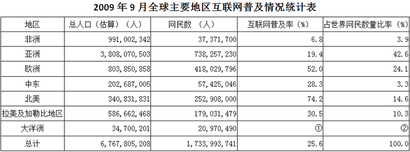

| 地区 | 总人口（估算）（人） | 网民数（人） | 互联网普及率（%） | 占世界网民数量比率（%） |
| --- | ---: | ---: | ---: | ---: |
| 非洲 | 991002342 | 37371700 | 6.8 | 3.9 |
| 亚洲 | 3808070503 | 738257230 | 19.4 | 42.6 |
| 欧洲 | 803850858 | 418029796 | 52.0 | 24.1 |
| 中东 | 202687005 | 57425046 | 28.3 | 3.3 |
| 北美 | 340831831 | 252908000 | 74.2 | 14.6 |
| 拉美及加勒比地区 | 586662468 | 179031479 | 30.5 | 10.3 |
| 大洋洲 | 34700201 | 20970490 | ① | ② |
| 总计 | 6767805208 | 1733993741 | 25.6 | 100.0 |

### 第 86 题

表中①、②处所缺数字分别是：

A. 50.3，1.2

B. 50.3，1.8

C. 60.4，1.2

D. 60.4，1.8

第 86 题 · 答案与解析

**参考答案（粉笔题库参考内容）**

C

**解析**

根据题干“表中①、②处所缺数字分别是”，结合材料中①②所在列为占比，可判定本题为现期比重计算问题。定位表格材料可得，2009年9月大洋洲总人口34700201人，网民数20970490人，全球网民数1733993741人，则①处的互联网普及率为20970490/34700201≈20970490/35000000≈60%，②处的大洋洲网民数占世界网民数量比重为20970490/1733993741≈20970490/1700000000≈1.2%，与C项最接近。

故正确答案为C。

**来源**：2010年江苏省公务员录用考试《行测》题（A类）第86题

### 第 87 题

下列分析正确的有：

（1）中国具有代表性的16家上市互联网企业有87.5%在美国上市。

（2）据统计，全球开设国际广播电台的国家中，开设英语广播的有90.7%。

（3）2009年9月中东网民数只占全球的3.3%，互联网普及率低于全球总体水平。

（4）目前中国互联网产业对GDP的贡献达到7%，与经济社会发展基本相称。

A. 4个

B. 3个

C. 2个

D. 1个

第 87 题 · 答案与解析

**参考答案（粉笔题库参考内容）**

C

**解析**

（1）：定位文字材料第二段可得，中国具有代表性的16家上市互联网企业，有14家在美国上市，仅有2家在香港上市。在美国上市的企业占比为14/16=87.5%，正确；

（2）：定位文字材料第一段可得，全球开设国际广播电台的86个国家中，只有8个没有使用英语。则使用英语的国际广播电台占比为(86-8)/86≈90.7%，正确；

（3）：定位表格材料可得，2009年9月中东网民数占全球的3.3%，互联网普及率为28.3%，高于全球平均的25.6%，错误；

（4）：定位文字材料第三段可得，目前中国互联网产业对GDP的贡献达到7%，而未来三年有可能达到15%。营造与中国发展相称的一流互联网迫在眉睫。因此当前中国互联网产业发展与经济社会发展不相称，错误。

综上，分析正确的有（1）（2）两个。

故正确答案为C。

**来源**：2010年江苏省公务员录用考试《行测》题（A类）第87题

### 第 88 题

2001年以来，中央重点新闻网站访问量的年平均递增速度是：

A. 1.12^12−2

B. 1.12^12−1

C. 1.12^12

D. 0.12

第 88 题 · 答案与解析

**参考答案（粉笔题库参考内容）**

B

**解析**

根据题干“2001年以来······的年平均递增速度是”，可判定本题为年均增长率计算问题。定位文字材料第三段可得，2001年以来，中央重点新闻网站的访问量，以平均每月递增12%的速度上升。设2000年末的访问量为A，2001年末的访问量为A(1 + 12%)^12，则2001年的同比增速为(A(1+12%)^12 - A)/A = 1.12^12 - 1。2001年以来，月均增速均为12%，则此后每年同比增速均为1.12^12−1，年均增速也为1.12^12−1。

故正确答案为B。

**来源**：2010年江苏省公务员录用考试《行测》题（A类）第88题

### 第 89 题

2009年9月亚洲网民数比欧洲多：

A. 18.50%

B. 2302.27万人

C. 30.04亿人

D. 76.60%

第 89 题 · 答案与解析

**参考答案（粉笔题库参考内容）**

D

**解析**

根据题干“2009年9月亚洲网民数比欧洲多”，结合选项为百分数/具体值，可判定本题为一般增长率及简单加减计算问题。定位表格材料可得，2009年9月，亚洲网民数为738257230人，欧洲网民数为418029796人。738257230-418029796=320227434人≈3.2亿人，排除B、C两项；亚洲网民数比欧洲多 320227434/418029796 ≈ 320227434/420000000 ≈ 76%，与D项最接近。

故正确答案为D。

**来源**：2010年江苏省公务员录用考试《行测》题（A类）第89题

### 第 90 题

据统计，互联网上中文网页数量是英文网页数量的：

A. 16%以上

B. 不到15%

C. 16%

D. 15%

第 90 题 · 答案与解析

**参考答案（粉笔题库参考内容）**

B

**解析**

根据题干“互联网上中文网页数量是英文网页数量的”，结合选项为百分数，可判定本题为比值计算问题。定位文字材料第一段可得，据统计，互联网上80%以上的网页使用英文；而开设汉语广播的只有20个国家，中文网页只占12%。可知英文网页的数量大于80%，则中文网页数量÷英文网页数量＜ 12%/80% = 15%，即中文网页数量不到英文网页数量的15%。

故正确答案为B。

**来源**：2010年江苏省公务员录用考试《行测》题（A类）第90题

## 材料 4

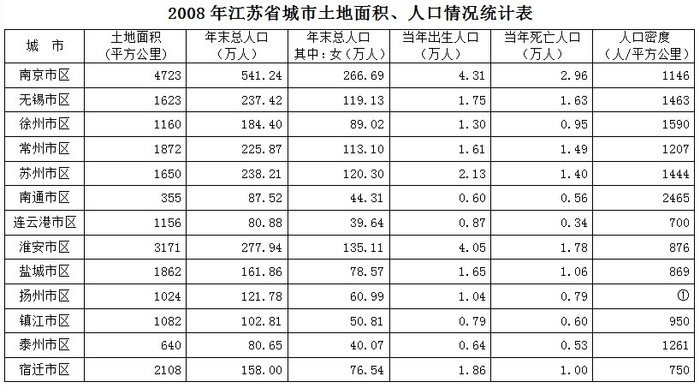

| 城市 | 土地面积（平方公里） | 年末总人口（万人） | 年末总人口 其中：女（万人） | 当年出生人口（万人） | 当年死亡人口（万人） | 人口密度（人/平方公里） |
| --- | ---: | ---: | ---: | ---: | ---: | ---: |
| 南京市区 | 4723 | 541.24 | 266.69 | 4.31 | 2.96 | 1146 |
| 无锡市区 | 1623 | 237.42 | 119.13 | 1.75 | 1.63 | 1463 |
| 徐州市区 | 1160 | 184.40 | 89.02 | 1.30 | 0.95 | 1590 |
| 常州市区 | 1872 | 225.87 | 113.10 | 1.61 | 1.49 | 1207 |
| 苏州市区 | 1650 | 238.21 | 120.30 | 2.13 | 1.40 | 1444 |
| 南通市区 | 355 | 87.52 | 44.31 | 0.60 | 0.56 | 2465 |
| 连云港市区 | 1156 | 80.88 | 39.64 | 0.87 | 0.34 | 700 |
| 淮安市区 | 3171 | 277.94 | 135.11 | 4.05 | 1.78 | 876 |
| 盐城市区 | 1862 | 161.86 | 78.57 | 1.65 | 1.06 | 869 |
| 扬州市区 | 1024 | 121.78 | 60.99 | 1.04 | 0.79 | ① |
| 镇江市区 | 1082 | 102.81 | 50.81 | 0.79 | 0.60 | 950 |
| 泰州市区 | 640 | 80.65 | 40.07 | 0.64 | 0.53 | 1261 |
| 宿迁市区 | 2108 | 158.00 | 76.54 | 1.86 | 1.00 | 750 |

### 第 91 题

2008年人口自然增长数量最少的是：

A. 镇江市区

B. 南通市区

C. 连云港市区

D. 泰州市区

第 91 题 · 答案与解析

**参考答案（粉笔题库参考内容）**

B

**解析**

根据题干“2008年人口自然增长数量最少的是”，可判定本题为增长量比较问题。定位表格材料可得各市区2008年出生与死亡人口数，根据人口自然增长数量=出生人口-死亡人口，计算各市区自然增长量进行比较即可。

A项，镇江市区：0.79-0.60=0.19万人；B项，南通市区：0.60-0.56=0.04万人；C项，连云港市区：0.87-0.34=0.53万人；D项，泰州市区：0.64-0.53=0.11万人。比较可知，南通市区人口自然增长量最少。

故正确答案为B。

**来源**：2010年江苏省公务员录用考试《行测》题（A类）第91题

### 第 92 题

表中①处所缺数字是：

A. 1330

B. 1189

C. 903

D. 769

第 92 题 · 答案与解析

**参考答案（粉笔题库参考内容）**

B

**解析**

根据题干“表中①处所缺数字是”，结合表格中①所处列为人口密度，可判定本题为比值计算问题。定位表格材料可得，2008年扬州市区土地面积1024平方公里，年末总人口121.78万人，所求比值为121.78万/1024≈1217800/1000=1217.8人/平方公里，与B项最接近。

故正确答案为B。

**来源**：2010年江苏省公务员录用考试《行测》题（A类）第92题

### 第 93 题

在江苏省13个省辖市中，2008年末市区人口密度最大的比最小的多：

A. 4.5倍

B. 1.5倍

C. 2.5倍

D. 3.5倍

第 93 题 · 答案与解析

**参考答案（粉笔题库参考内容）**

C

**解析**

根据题干“······人口密度最大的比最小的多”，结合选项为倍数，可判定本题为现期倍数计算问题。定位表格查找可知，2008年江苏人口密度最大的是南通市区，为2465人/平方公里，人口密度最小的是连云港市区，为700人/平方公里。所求倍数为2465/700 − 1 ≈ 3.5 − 1=2.5倍。

故正确答案为C。

**来源**：2010年江苏省公务员录用考试《行测》题（A类）第93题

### 第 94 题

2008年末市区男性人口多于女性的城市有：

A. 10个

B. 11个

C. 8个

D. 9个

第 94 题 · 答案与解析

**参考答案（粉笔题库参考内容）**

C

**解析**

定位表格可得，2008年各市区总人口数及女性人口数，要找到男性人口多于女性的城市，只需要该城市女性人口数×2＜总人口数。观察表格数据，南京、徐州、连云港、淮安、盐城、镇江、泰州、宿迁8个市区符合。

故正确答案为C。

**来源**：2010年江苏省公务员录用考试《行测》题（A类）第94题

### 第 95 题

下列分析正确的有：

（1）2008年出生人口最多的是南京市区

（2）2008年末泰州市区人口与连云港市区人口相差约2300人

（3）2008年人口增加最多的是淮安市区，增加2.27万人

A. 0个

B. 1个

C. 2个

D. 3个

第 95 题 · 答案与解析

**参考答案（粉笔题库参考内容）**

D

**解析**

（1）：定位表格材料可得，2008年江苏省各市区中，南京市区出生4.31万人，大于其他城市，正确；

（2）：定位表格材料可得，2008年末泰州市区人口为80.65万人，连云港市区人口为80.88万人，80.88-80.65=0.23万人=2300人，正确；

（3）：定位表格材料可得，2008年淮安市区出生人口为4.05万人，死亡人口为1.78万人，增加人口数4.05-1.78=2.27万人。除南京市区外，其他市区的出生人口数均小于2.27万人，而南京市区的人口增长数量为4.31-2.96=1.35万人，小于淮安市区，正确。

综上，（1）（2）（3）均正确。

故正确答案为D。

**来源**：2010年江苏省公务员录用考试《行测》题（A类）第95题

## 材料 5

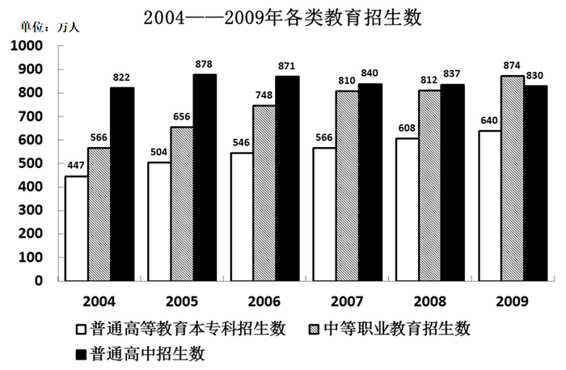

### 第 96 题

2004~2009年普通高等教育本专科、中等职业教育招生数之和占图中三类教育招生总数比重最大的那一年普通高等教育本专科招生数为：

A. 566万人

B. 546万人

C. 640万人

D. 608万人

第 96 题 · 答案与解析

**参考答案（粉笔题库参考内容）**

C

**解析**

由选项可知，只需比较2006年、2007年、2008年、2009年普通高等教育本专科、中等职业教育招生数之和占图中三类教育招生总数比重即可。在这四年中，2009年普通高等教育本专科和中等职业教育招生数最多，普通高中招生人数最少，即2009年普通高等教育本专科、中等职业教育招生数之和占三类教育招生总数比重最大，当年普通高等教育本专科招生数为640万人。

故正确答案为C。

**来源**：2010年江苏省公务员录用考试《行测》题（A类）第96题

### 第 97 题

2005-2009年中等职业教育招生数增长率最小的一年是：

A. 2009年

B. 2006年

C. 2007年

D. 2008年

第 97 题 · 答案与解析

**参考答案（粉笔题库参考内容）**

D

**解析**

由题干“2005-2009年······增长率最小的一年是”，可判定本题为增长率比较问题。根据公式：增长率 = (现期量 - 基期量)/基期量，定位表格数据可得，A项2009年：(874−812)/812=62/812；B项2006年：(748−656)/656 = 92/656；C项2007年：(810 - 748)/748 = 62/748；D项2008年：(812-810)/810=2/810。四个分数比较，发现分母相差不大，分子倍数关系明显，分子小的分数小，D项2008年的增长率最小。

故正确答案为D。

**来源**：2010年江苏省公务员录用考试《行测》题（A类）第97题

### 第 98 题

按从大到小排，中等职业教育、普通高中招生数之和最大的那一年普通高等教育本专科招生数在六年中排：

A. 第一位

B. 第四位

C. 第三位

D. 第二位

第 98 题 · 答案与解析

**参考答案（粉笔题库参考内容）**

A

**解析**

观察图表可知，中等职业教育、普通高中招生数之和最大的年份为2009年，当年普通高等教育本专科招生数为640万人，在各年份中居第一位。

故正确答案为A。

**来源**：2010年江苏省公务员录用考试《行测》题（A类）第98题

### 第 99 题

2004-2009年普通高等教育本专科平均每年招生数和中等职业教育平均每年招生数的比值为：

A. 0.95

B. 0.86

C. 0.74

D. 0.51

第 99 题 · 答案与解析

**参考答案（粉笔题库参考内容）**

C

**解析**

由题干“······和······的比值为”，可判定本题为比值计算问题。定位图形可得，2004-2009年普通高等教育本专科招生数为447+504+546+566+608+640=3311万人，2004-2009年中等职业教育招生数为566+656+748+810+812+874=4466万人。问两者平均每年招数人数的比值，根据公式平均数=总数/年份数，一共是6年，则比值为3311/6 ÷ 4466/6 =3311/4466≈3300/4400=0.75，与C项最为接近。

故正确答案为C。

**来源**：2010年江苏省公务员录用考试《行测》题（A类）第99题

### 第 100 题

下列分析不正确的有：

（1）普通高等教育本专科招生数占图中三类教育招生总数的比重逐年增加。

（2）图中三类教育招生总数增加幅度逐年减少。

（3）2005~2009年普通高等教育本专科与中等职业教育招生数的比值逐年增加。

A. 3个

B. 0个

C. 1个

D. 2个

第 100 题 · 答案与解析

**参考答案（粉笔题库参考内容）**

D

**解析**

（1）正确，各年普高本专科占三类教育招生总数的比重依次为447/(447 + 566 + 822) = 447/1835 ≈ 24.4%，504/(504 + 656 + 878) = 504/2038 ≈ 24.7%，546/(546+748+871) = 546/2165 ≈ 25.2%，566/(566+810+840)=566/2216≈25.5%，608/(608+812+837)=608/2257≈26.9%，640/(640 + 874 + 830) = 640/2344 ≈ 27.3%，其比重的确是逐年增加的；

（2）错误，三类教育招生总数的增加幅度在2009年明显较2008年上升；

（3）错误，各年普高本专科与中职教育招生数的比值依次为447÷566≈0.79、504÷656≈0.77、546 ÷ 748 ≈ 0.73、566÷810 ≈ 0.70、608÷812≈0.75、640 ÷ 874 ≈ 0.73，可见普高本专科与中职教育招生数的比值并不是单向变化的，而是有增有减。

不正确的有2个。

故正确答案为D。

**来源**：2010年江苏省公务员录用考试《行测》题（A类）第100题

## 材料 6

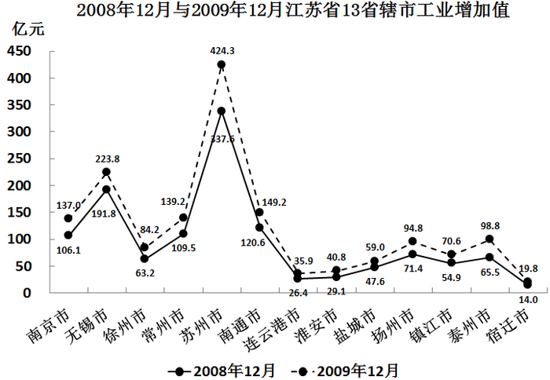

### 第 101 题

在江苏省13个省辖市中，2009年工业增加值月平均增量最多的是：

A. 泰州市

B. 扬州市

C. 苏州市

D. 无锡市

第 101 题 · 答案与解析

**参考答案（粉笔题库参考内容）**

C

**解析**

根据题干“2009年工业增加值月平均增量最多的是”，可判定本题为增长量比较问题。因月均增量=年增量/12，则年增量最多的城市即为月均量最多的城市。定位折线图可得各城市2008年12月与2009年12月工业增加值，根据增长量=现期值-基期值，计算各选项增长量进行比较即可。

A项，泰州市：98.8-65.5=33.3亿元；B项，扬州市：94.8-71.4=23.4亿元；C项，苏州市：424.3-337.6=86.7亿元；D项，无锡市：223.8-191.8=32亿元。比较可知，2009年工业增加值月平均增量最多的是苏州市。

故正确答案为C。

**来源**：2010年江苏省公务员录用考试《行测》题（A类）第101题

### 第 102 题

在江苏省13个省辖市中，2009年工业增加值月平均增速最快的是：

A. 泰州市

B. 南京市

C. 苏州市

D. 宿迁市

第 102 题 · 答案与解析

**参考答案（粉笔题库参考内容）**

A

**解析**

根据题干“2009年工业增加值月平均增速最快的是”，可判定本题为一般增长率比较问题。因月均增速= ^12√年增速，则年增速最快的城市即为月均增速最快的城市。定位折线图可得各城市2008年12月与2009年12月工业增加值，根据增长率=(现期值-基期值)/基期值，计算各选项增长率进行比较即可。

A项，泰州市：(98.8 − 65.5)/65.5 = 33.3/65.5 ＞ 1/2；B项，南京市：(137.0 − 106.1)/106.1 = 30.9/106.1 ＜ 1/2；C项，苏州市：(424.3 − 337.6)/337.6 = 86.7/337.6 ＜ 1/2；D项，宿迁市：(19.8−14.0)/14.0=5.8/14＜1/2。比较可知，2009年工业增加值月平均增速最快的是泰州市。

故正确答案为A。

**来源**：2010年江苏省公务员录用考试《行测》题（A类）第102题

### 第 103 题

2009年12月，苏州市、无锡市和常州市工业增加值之和占江苏省工业增加值的比重是：

A. 58.67%

B. 62.87%

C. 40.55%

D. 49.91%

第 103 题 · 答案与解析

**参考答案（粉笔题库参考内容）**

D

**解析**

根据题干“2009年12月······占······的比重是”，可判定本题为现期比重计算问题。定位折线图可得，2009年12月，苏州市、无锡市和常州市工业增加值分别为424.3、223.8、139.2亿元，其余市为137.0、84.2、149.2、35.9、40.8、59.0、94.8、70.6、98.8、19.8亿元。所求比重为(424.3+223.8+139.2)/(424.3+223.8+139.2+137.0+84.2+149.2+35.9+40.8+59.0+94.8+70.6+98.8+19.8)≈ 800/1600 = 50%，与D项最接近。

故正确答案为D。

**来源**：2010年江苏省公务员录用考试《行测》题（A类）第103题

### 第 104 题

按2009年的月平均增长速度估算，2010年12月南京市可望实现工业增加值：

A. 157.7亿元

B. 159.4亿元

C. 168.9亿元

D. 178.6亿元

第 104 题 · 答案与解析

**参考答案（粉笔题库参考内容）**

D

**解析**

根据题干“······2010年12月南京市可望实现工业增加值······”，结合材料时间为2009年，判定本题为现期计算问题。定位统计图可得，2009年12月与2008年12月南京市工业增加值分别为137.0亿元、106.1亿元。根据题意可知，2010年的月平均增速2009年相同，故有(1+r)^12= 2010年12月南京市工业增加值/2009年12月南京市工业增加值= 2009年12月南京市工业增加值/2008年12月南京市工业增加值，则2010年12月南京市工业增加值= 2009年12月南京市工业增加值× (1 + r)^12=137.0×137.0/106.1≈ 137 × 1.3 ≈ 178亿元，与D项最接近。

故正确答案为D。

**来源**：2010年江苏省公务员录用考试《行测》题（A类）第104题

### 第 105 题

下列分析不正确的有：

（1）2009年12月扬州市工业增加值同比增长了32.77%。

（2）按2009年的月平均增量估算，2010年4月南通市工业增加值可望达到158.7亿元。

（3）2009年12月江苏省各省辖市工业增加值均比2008年12月至少增加8亿元。

A. 0个

B. 3个

C. 2个

D. 1个

第 105 题 · 答案与解析

**参考答案（粉笔题库参考内容）**

D

**解析**

（1）定位统计图可得：2008年12月和2009年12月扬州市工业增加值分别为71.4亿元和94.8亿元。根据公式：增长率= (现期量−基期量)/基期量，可知2009年12月扬州市工业增加值同比增长了= (94.8-71.4)/71.4 = 23.4/71.4 ≈ 32.77%，正确；

（2）定位统计图可得：2008年12月和2009年12月南通市工业增加值分别为120.6亿元和149.2亿元。因此南通市2009年的月平均增量= (149.2 - 120.6)/12 = 28.6/12 ≈ 2.38亿元。2009年12月末至2010年4月末共4个月，则2010年4月南通市工业增加值可望达到149.2 + 4 × 2.38 ≈ 158.7亿元，正确；

（3）定位统计图可得：2008年12月和2009年12月宿迁市工业增加值分别为14.0亿元和19.8亿元。故2009年12月宿迁市工业增加值比2008年12月增加了19.8-14.0=5.8亿元＜8亿元，错误。

故正确答案为D。

**来源**：2010年江苏省公务员录用考试《行测》题（A类）第105题

