# 2010年江苏省公务员录用考试《行测》题（B类）

<!-- gwy:overview:start -->
> **江苏 · 2010 · 行测 · B类** ｜ 155 题 · 图片 35 处 · 答案随题折叠

| 题型模块 | 题量 | 题号 |
| --- | ---: | ---: |
| 知觉速度与准确性 | 60 | 1–60 |
| 言语理解与表达 | 15 | 61–75 |
| 数量关系 | 20 | 76–95 |
| 判断推理 | 40 | 96–135 |
| 资料分析 | 20 | 136–155 |
| **合计** | **155** | |

导航：[题型与作答说明](#题型与作答说明) · [题目](#题目) · [材料 1](#材料-1)
<!-- gwy:overview:end -->

> 候选采集稿。参考答案及解析来自粉笔页面，不代表官方答案或真实高分答卷；来源使用许可与原卷对应关系仍需人工核实。

## 题型与作答说明

知觉速度与准确性

（60题）

该部分的题目主要考测你对信息进行筛选，从几个同时性的信息中选择一定对象的能力。总题量为60道，包括三种类型，时限为10分钟。1~35题为同符查找，36~50题为数字区间定位，51~60题为字符替换。

言语理解与表达

（15题）

本部分包括片段阅读与文章阅读两种类型的试题。

数量关系

（20题）

本部分包括数字推理与数学运算两种类型的试题。

判断推理

（40题）

本部分包括类比推理、图形推理、逻辑判断与定义判断四种类型的试题。

资料分析

（20题）

下列给出了文字、表格、图形资料均有5个问题要你回答，你应根据资料提供的信息进行分析、计算、处理，然后从备选答案中选择一个最恰当的答案。

## 题目

### 第 1 题

9AGUKL   RHGJA

A. 2

B. 3

C. 4

D. 5

第 1 题 · 答案与解析

**参考答案（粉笔题库参考内容）**

A

**解析**

题干给出的两个字符组中重复的字符为A、G，共2个。

故正确答案为A。

**来源**：2010年江苏省公务员录用考试《行测》题（B类）第1题

### 第 2 题

A. 2

B. 3

C. 5

D. 6

第 2 题 · 答案与解析

**参考答案（粉笔题库参考内容）**

B

**解析**

题干给出的两个字符组中重复的字符为⊕、△、⌒，共3个。

故正确答案为B。

**来源**：2010年江苏省公务员录用考试《行测》题（B类）第2题

### 第 3 题

M1842067   3712W0594

A. 2

B. 3

C. 5

D. 6

第 3 题 · 答案与解析

**参考答案（粉笔题库参考内容）**

C

**解析**

题干给出的两个字符组中重复的字符为1、4、2、0、7，共5个。

故正确答案为C。

**来源**：2010年江苏省公务员录用考试《行测》题（B类）第3题

### 第 4 题

“是金子都会发光”？   “失败是成功之母”

A. 5

B. 3

C. 2

D. 1

第 4 题 · 答案与解析

**参考答案（粉笔题库参考内容）**

B

**解析**

题干给出的两个字符组中重复的字符为“、是、 ”，共3个。

故正确答案为B。

**来源**：2010年江苏省公务员录用考试《行测》题（B类）第4题

### 第 5 题

A. 6

B. 5

C. 4

D. 2

第 5 题 · 答案与解析

**参考答案（粉笔题库参考内容）**

B

**解析**

题干给出的两个字符组中重复的字符为，共5个。

故正确答案为B。

**来源**：2010年江苏省公务员录用考试《行测》题（B类）第5题

### 第 6 题

XPAMWKE        MKFXBVI

A. 0

B. 1

C. 3

D. 4

第 6 题 · 答案与解析

**参考答案（粉笔题库参考内容）**

C

**解析**

题干给出的两个字符组中重复的字符为X、M、K，共3个。

故正确答案为C。

**来源**：2010年江苏省公务员录用考试《行测》题（B类）第6题

### 第 7 题

Π∷%⊙∮≥ f≯:%‖◎

A. 3

B. 1

C. 0

D. 2

第 7 题 · 答案与解析

**参考答案（粉笔题库参考内容）**

B

**解析**

题干给出的两个字符组中重复的字符为%，共1个。

故正确答案为B。

**来源**：2010年江苏省公务员录用考试《行测》题（B类）第7题

### 第 8 题

A. 4

B. 6

C. 7

D. 5

第 8 题 · 答案与解析

**参考答案（粉笔题库参考内容）**

B

**解析**

题干给出的两个字符组中重复的字符为，共6个。

故正确答案为B。

**来源**：2010年江苏省公务员录用考试《行测》题（B类）第8题

### 第 9 题

零露寮寒需雾        霜零凿赛露骞

A. 0

B. 1

C. 2

D. 3

第 9 题 · 答案与解析

**参考答案（粉笔题库参考内容）**

C

**解析**

题干给出的两个字符组中重复的字符为零、露，共2个。

故正确答案为C。

**来源**：2010年江苏省公务员录用考试《行测》题（B类）第9题

### 第 10 题

ΘαMKAB αρNψλΘ βθγακS

A. 1

B. 2

C. 3

D. 4

第 10 题 · 答案与解析

**参考答案（粉笔题库参考内容）**

A

**解析**

题干给出的三个字符组中重复的字符为α，共1个。

故正确答案为A。

**来源**：2010年江苏省公务员录用考试《行测》题（B类）第10题

### 第 11 题

A. 1

B. 2

C. 3

D. 4

第 11 题 · 答案与解析

**参考答案（粉笔题库参考内容）**

C

**解析**

题干给出的三个字符组中重复的字符为L、△、≡，共3个。

故正确答案为C。

**来源**：2010年江苏省公务员录用考试《行测》题（B类）第11题

### 第 12 题

Wonderfull   oilman6

A. 5

B. 4

C. 3

D. 2

第 12 题 · 答案与解析

**参考答案（粉笔题库参考内容）**

C

**解析**

题干给出的两个字符组中重复的字符为o、n、l，共3个。

故正确答案为C。

**来源**：2010年江苏省公务员录用考试《行测》题（B类）第12题

### 第 13 题

虍虎威兽象鲁莽   象鱼虚咸兽奔

A. 3

B. 2

C. 1

D. 0

第 13 题 · 答案与解析

**参考答案（粉笔题库参考内容）**

B

**解析**

题干给出的两个字符组中重复的字符为兽、象，共2个。

故正确答案为B。

**来源**：2010年江苏省公务员录用考试《行测》题（B类）第13题

### 第 14 题

A. 0

B. 1

C. 2

D. 3

第 14 题 · 答案与解析

**参考答案（粉笔题库参考内容）**

B

**解析**

题干给出的三个字符组中重复的字符为b，共1个。

故正确答案为B。

**来源**：2010年江苏省公务员录用考试《行测》题（B类）第14题

### 第 15 题

Hcnestm6   bighouse

A. 2

B. 3

C. 4

D. 5

第 15 题 · 答案与解析

**参考答案（粉笔题库参考内容）**

A

**解析**

题干给出的两个字符组中重复的字符为e、s，共2个。

故正确答案为A。

**来源**：2010年江苏省公务员录用考试《行测》题（B类）第15题

### 第 16 题

（1+5）\*7＝42   24/（9-6）＝8

A. 2

B. 3

C. 4

D. 5

第 16 题 · 答案与解析

**参考答案（粉笔题库参考内容）**

D

**解析**

题干给出的两个字符组中重复的字符为(、)、＝、4、2，共5个。

故正确答案为D。

**来源**：2010年江苏省公务员录用考试《行测》题（B类）第16题

### 第 17 题

脎虹瑁娃伐搭载   蛙搭噶佤戴

A. 1

B. 2

C. 3

D. 4

第 17 题 · 答案与解析

**参考答案（粉笔题库参考内容）**

A

**解析**

题干给出的两个字符组中重复的字符为“搭”，共1个。

故正确答案为A。

**来源**：2010年江苏省公务员录用考试《行测》题（B类）第17题

### 第 18 题

@ШβДЮЪ ЮЖӨШδД⊖

A. 2

B. 3

C. 5

D. 6

第 18 题 · 答案与解析

**参考答案（粉笔题库参考内容）**

B

**解析**

题干给出的两个字符组中重复的字符为Ш、Д、Ю，共3个。

故正确答案为B。

**来源**：2010年江苏省公务员录用考试《行测》题（B类）第18题

### 第 19 题

高亜亳廉東产   亚事亳亨京亶

A. 1

B. 2

C. 3

D. 0

第 19 题 · 答案与解析

**参考答案（粉笔题库参考内容）**

A

**解析**

题干给出的两个字符组中重复的字符为亳，共1个。

故正确答案为A。

**来源**：2010年江苏省公务员录用考试《行测》题（B类）第19题

### 第 20 题

ympathies   chaperon

A. 1

B. 2

C. 3

D. 4

第 20 题 · 答案与解析

**参考答案（粉笔题库参考内容）**

D

**解析**

题干给出的两个字符组中重复的字符为p、a、h、e，共4个。

故正确答案为D。

**来源**：2010年江苏省公务员录用考试《行测》题（B类）第20题

### 第 21 题

大MP才3上   八长ph民one

A. 0

B. 2

C. 3

D. 4

第 21 题 · 答案与解析

**参考答案（粉笔题库参考内容）**

A

**解析**

题干给出的两个字符组中没有重复的字符。

故正确答案为A。

**来源**：2010年江苏省公务员录用考试《行测》题（B类）第21题

### 第 22 题

生命在于平衡   水是人类生存的条件

A. 1

B. 2

C. 3

D. 4

第 22 题 · 答案与解析

**参考答案（粉笔题库参考内容）**

A

**解析**

题干给出的两个字符组中重复的字符为生，共1个。

故正确答案为A。

**来源**：2010年江苏省公务员录用考试《行测》题（B类）第22题

### 第 23 题

圼埑坙垕垔垦垚   垦埅埑堃基堥垕

A. 5

B. 4

C. 3

D. 1

第 23 题 · 答案与解析

**参考答案（粉笔题库参考内容）**

C

**解析**

题干给出的两个字符组中重复的字符为埑、垕、垦，共3个。

故正确答案为C。

**来源**：2010年江苏省公务员录用考试《行测》题（B类）第23题

### 第 24 题

&※★▼# §◆※★⊙

A. 0

B. 1

C. 2

D. 3

第 24 题 · 答案与解析

**参考答案（粉笔题库参考内容）**

C

**解析**

题干给出的两个字符组中重复的字符为※、★，共2个。

故正确答案为C。

**来源**：2010年江苏省公务员录用考试《行测》题（B类）第24题

### 第 25 题

PREFLIKA   VALUEpref

A. 2

B. 3

C. 4

D. 5

第 25 题 · 答案与解析

**参考答案（粉笔题库参考内容）**

B

**解析**

题干给出的两个字符组中重复的字符为E、L、A，共3个。

故正确答案为B。

**来源**：2010年江苏省公务员录用考试《行测》题（B类）第25题

### 第 26 题

律涯讧湛汉法洒脱   法律汉语谌订   仅律汪洒脱汉

A. 1

B. 2

C. 3

D. 5

第 26 题 · 答案与解析

**参考答案（粉笔题库参考内容）**

B

**解析**

题干给出的三个字符组中重复的字符为律、汉，共2个。

故正确答案为B。

**来源**：2010年江苏省公务员录用考试《行测》题（B类）第26题

### 第 27 题

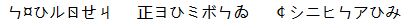

A. 1

B. 2

C. 4

D. 5

第 27 题 · 答案与解析

**参考答案（粉笔题库参考内容）**

B

**解析**

题干给出的三个字符组中重复的字符为ら、ひ，共2个。

故正确答案为B。

**来源**：2010年江苏省公务员录用考试《行测》题（B类）第27题

### 第 28 题

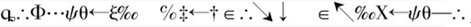

A. 6

B. 4

C. 3

D. 2

第 28 题 · 答案与解析

**参考答案（粉笔题库参考内容）**

D

**解析**

题干给出的三个字符组中重复的字符为∴、←，共两个。

故正确答案为D。

**来源**：2010年江苏省公务员录用考试《行测》题（B类）第28题

### 第 29 题

柔袁袋虐岩羁   罚喜虞贷盏悬   罪崖牮泉瞽

A. 5

B. 3

C. 1

D. 0

第 29 题 · 答案与解析

**参考答案（粉笔题库参考内容）**

D

**解析**

题干给出的三个字符组中没有重复的字符。

故正确答案为D。

**来源**：2010年江苏省公务员录用考试《行测》题（B类）第29题

### 第 30 题

KEJLFSV   MEKQIZ   OZEDSK

A. 1

B. 2

C. 3

D. 4

第 30 题 · 答案与解析

**参考答案（粉笔题库参考内容）**

B

**解析**

题干给出的三个字符组中重复的字符为K、E，共2个。

故正确答案为B。

**来源**：2010年江苏省公务员录用考试《行测》题（B类）第30题

### 第 31 题

花木兰锦衣卫   刘胡兰小花   木棉花孔子

A. 1

B. 2

C. 3

D. 4

第 31 题 · 答案与解析

**参考答案（粉笔题库参考内容）**

A

**解析**

题干给出的三个字符组中重复的字符为花，共1个。

故正确答案为A。

**来源**：2010年江苏省公务员录用考试《行测》题（B类）第31题

### 第 32 题

《四渡赤水战役》   《忆秦娥·娄山关》   《边城》

A. 0

B. 1

C. 2

D. 3

第 32 题 · 答案与解析

**参考答案（粉笔题库参考内容）**

C

**解析**

题干给出的三个字符组中重复的字符为《、》，共2个。

故正确答案为C。

**来源**：2010年江苏省公务员录用考试《行测》题（B类）第32题

### 第 33 题

A. 0

B. 1

C. 2

D. 3

第 33 题 · 答案与解析

**参考答案（粉笔题库参考内容）**

C

**解析**

题干给出的三个字符组中重复的字符为一、目，共2个。

故正确答案为C。

**来源**：2010年江苏省公务员录用考试《行测》题（B类）第33题

### 第 34 题

西风烈长空雁叫霜晨月   雄关温道真如铁而今迈步从头越

A. 0

B. 1

C. 2

D. 3

第 34 题 · 答案与解析

**参考答案（粉笔题库参考内容）**

A

**解析**

题干给出的两个字符组中没有重复的字符。

故正确答案为A。

**来源**：2010年江苏省公务员录用考试《行测》题（B类）第34题

### 第 35 题

笸J端糍笔W   M笔竼竭W笸糕   W竾竬糍竿F笸笔

A. 5

B. 3

C. 2

D. 1

第 35 题 · 答案与解析

**参考答案（粉笔题库参考内容）**

B

**解析**

题干给出的三个字符组中重复的字符为笸、笔、W，共3个。

故正确答案为B。

**来源**：2010年江苏省公务员录用考试《行测》题（B类）第35题

### 第 36 题

9315

| A | B | C | D |
| --- | --- | --- | --- |
| 8802—9876 | 1234—3021 | 9937—10118 | 3222—8640 |
| 36541—52896 | 55318—75631 | 77853—98719 | 10216—35294 |

A. A

B. B

C. C

D. D

第 36 题 · 答案与解析

**参考答案（粉笔题库参考内容）**

A

**解析**

数字9315位于区间8802-9876。

故正确答案为A。

**来源**：2010年江苏省公务员录用考试《行测》题（B类）第36题

### 第 37 题

65006

| A | B | C | D |
| --- | --- | --- | --- |
| 8802—9876 | 1234—3021 | 9937—10118 | 3222—8640 |
| 36541—52896 | 55318—75631 | 77853—98719 | 10216—35294 |

A. A

B. B

C. C

D. D

第 37 题 · 答案与解析

**参考答案（粉笔题库参考内容）**

B

**解析**

数字65006位于区间55318-75631。

故正确答案为B。

**来源**：2010年江苏省公务员录用考试《行测》题（B类）第37题

### 第 38 题

52220

| A | B | C | D |
| --- | --- | --- | --- |
| 8802—9876 | 1234—3021 | 9937—10118 | 3222—8640 |
| 36541—52896 | 55318—75631 | 77853—98719 | 10216—35294 |

A. A

B. B

C. C

D. D

第 38 题 · 答案与解析

**参考答案（粉笔题库参考内容）**

A

**解析**

数字52220位于区间36541-52896。

故正确答案为A。

**来源**：2010年江苏省公务员录用考试《行测》题（B类）第38题

### 第 39 题

8425

| A | B | C | D |
| --- | --- | --- | --- |
| 8802—9876 | 1234—3021 | 9937—10118 | 3222—8640 |
| 36541—52896 | 55318—75631 | 77853—98719 | 10216—35294 |

A. A

B. B

C. C

D. D

第 39 题 · 答案与解析

**参考答案（粉笔题库参考内容）**

D

**解析**

数字8425位于区间3222-8640。

故正确答案为D。

**来源**：2010年江苏省公务员录用考试《行测》题（B类）第39题

### 第 40 题

9991

| A | B | C | D |
| --- | --- | --- | --- |
| 8802—9876 | 1234—3021 | 9937—10118 | 3222—8640 |
| 36541—52896 | 55318—75631 | 77853—98719 | 10216—35294 |

A. A

B. B

C. C

D. D

第 40 题 · 答案与解析

**参考答案（粉笔题库参考内容）**

C

**解析**

数字9991位于区间9937-10118。

故正确答案为C。

**来源**：2010年江苏省公务员录用考试《行测》题（B类）第40题

### 第 41 题

56323

| A | B | C | D |
| --- | --- | --- | --- |
| 8802—9876 | 1234—3021 | 9937—10118 | 3222—8640 |
| 36541—52896 | 55318—75631 | 77853—98719 | 10216—35294 |

A. A

B. B

C. C

D. D

第 41 题 · 答案与解析

**参考答案（粉笔题库参考内容）**

B

**解析**

数字56323位于区间55318-75631。

故正确答案为B。

**来源**：2010年江苏省公务员录用考试《行测》题（B类）第41题

### 第 42 题

35196

| A | B | C | D |
| --- | --- | --- | --- |
| 8802—9876 | 1234—3021 | 9937—10118 | 3222—8640 |
| 36541—52896 | 55318—75631 | 77853—98719 | 10216—35294 |

A. A

B. B

C. C

D. D

第 42 题 · 答案与解析

**参考答案（粉笔题库参考内容）**

D

**解析**

数字35196位于区间10216-35294。

故正确答案为D。

**来源**：2010年江苏省公务员录用考试《行测》题（B类）第42题

### 第 43 题

42894

| A | B | C | D |
| --- | --- | --- | --- |
| 8802—9876 | 1234—3021 | 9937—10118 | 3222—8640 |
| 36541—52896 | 55318—75631 | 77853—98719 | 10216—35294 |

A. A

B. B

C. C

D. D

第 43 题 · 答案与解析

**参考答案（粉笔题库参考内容）**

A

**解析**

数字42894位于区间36541-52896。

故正确答案为A。

**来源**：2010年江苏省公务员录用考试《行测》题（B类）第43题

### 第 44 题

7614

| A | B | C | D |
| --- | --- | --- | --- |
| 8802—9876 | 1234—3021 | 9937—10118 | 3222—8640 |
| 36541—52896 | 55318—75631 | 77853—98719 | 10216—35294 |

A. A

B. B

C. C

D. D

第 44 题 · 答案与解析

**参考答案（粉笔题库参考内容）**

D

**解析**

数字7614位于区间3222-8640。

故正确答案为D。

**来源**：2010年江苏省公务员录用考试《行测》题（B类）第44题

### 第 45 题

56855

| A | B | C | D |
| --- | --- | --- | --- |
| 8802—9876 | 1234—3021 | 9937—10118 | 3222—8640 |
| 36541—52896 | 55318—75631 | 77853—98719 | 10216—35294 |

A. A

B. B

C. C

D. D

第 45 题 · 答案与解析

**参考答案（粉笔题库参考内容）**

B

**解析**

数字56855位于区间55318-75631。

故正确答案为B。

**来源**：2010年江苏省公务员录用考试《行测》题（B类）第45题

### 第 46 题

10016

| A | B | C | D |
| --- | --- | --- | --- |
| 8802—9876 | 1234—3021 | 9937—10118 | 3222—8640 |
| 36541—52896 | 55318—75631 | 77853—98719 | 10216—35294 |

A. A

B. B

C. C

D. D

第 46 题 · 答案与解析

**参考答案（粉笔题库参考内容）**

C

**解析**

数字10016位于区间9937-10118。

故正确答案为C。

**来源**：2010年江苏省公务员录用考试《行测》题（B类）第46题

### 第 47 题

93209

| A | B | C | D |
| --- | --- | --- | --- |
| 8802—9876 | 1234—3021 | 9937—10118 | 3222—8640 |
| 36541—52896 | 55318—75631 | 77853—98719 | 10216—35294 |

A. A

B. B

C. C

D. D

第 47 题 · 答案与解析

**参考答案（粉笔题库参考内容）**

C

**解析**

数字93209位于区间77853-98719。

故正确答案为C。

**来源**：2010年江苏省公务员录用考试《行测》题（B类）第47题

### 第 48 题

2745

| A | B | C | D |
| --- | --- | --- | --- |
| 8802—9876 | 1234—3021 | 9937—10118 | 3222—8640 |
| 36541—52896 | 55318—75631 | 77853—98719 | 10216—35294 |

A. A

B. B

C. C

D. D

第 48 题 · 答案与解析

**参考答案（粉笔题库参考内容）**

B

**解析**

数字2745位于区间1234-3021。

故正确答案为B。

**来源**：2010年江苏省公务员录用考试《行测》题（B类）第48题

### 第 49 题

79639

| A | B | C | D |
| --- | --- | --- | --- |
| 8802—9876 | 1234—3021 | 9937—10118 | 3222—8640 |
| 36541—52896 | 55318—75631 | 77853—98719 | 10216—35294 |

A. A

B. B

C. C

D. D

第 49 题 · 答案与解析

**参考答案（粉笔题库参考内容）**

C

**解析**

数字79639位于区间77853-98719。

故正确答案为C。

**来源**：2010年江苏省公务员录用考试《行测》题（B类）第49题

### 第 50 题

6614

| A | B | C | D |
| --- | --- | --- | --- |
| 8802—9876 | 1234—3021 | 9937—10118 | 3222—8640 |
| 36541—52896 | 55318—75631 | 77853—98719 | 10216—35294 |

A. A

B. B

C. C

D. D

第 50 题 · 答案与解析

**参考答案（粉笔题库参考内容）**

D

**解析**

数字6614位于区间3222-8640。

故正确答案为D。

**来源**：2010年江苏省公务员录用考试《行测》题（B类）第50题

## 材料 1

**字符替换：**

图例：

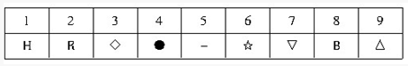

| 1 | 2 | 3 | 4 | 5 | 6 | 7 | 8 | 9 |
| --- | --- | --- | --- | --- | --- | --- | --- | --- |
| H | R | ◇ | ● | − | ☆ | ▽ | B | △ |

数字表（表中所含数字为1至9的自然数）：

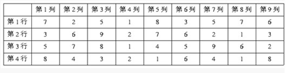

|  | 第1列 | 第2列 | 第3列 | 第4列 | 第5列 | 第6列 | 第7列 | 第8列 | 第9列 |
| --- | ---: | ---: | ---: | ---: | ---: | ---: | ---: | ---: | ---: |
| 第1行 | 7 | 2 | 5 | 1 | 8 | 3 | 5 | 7 | 6 |
| 第2行 | 3 | 6 | 9 | 2 | 7 | 6 | 2 | 1 | 3 |
| 第3行 | 5 | 7 | 8 | 1 | 4 | 5 | 9 | 6 | 2 |
| 第4行 | 8 | 4 | 3 | 2 | 1 | 6 | 4 | 1 | 8 |

根据图例和数字表回答下列各题：

### 第 51 题

数字表中第2列和第9列相同数字的符号是：

A. B●

B. R☆

C. ？革R

D. ●★

第 51 题 · 答案与解析

**参考答案（粉笔题库参考内容）**

B

**解析**

数字表中第2列与第9列都有的数字是2、6，由对应表可知对应的符号是R ☆。

故正确答案为B。

**来源**：2010年江苏省公务员录用考试《行测》题（B类）第51题

### 第 52 题

数字表中第4行重复数字对应的符号是：

A. H△B

B. HR●

C. H●B

D. B△☆

第 52 题 · 答案与解析

**参考答案（粉笔题库参考内容）**

C

**解析**

数字表中第4行重复的数字是1、4、8，由对应表可知对应的符号为H、●、B。

故正确答案为C。

**来源**：2010年江苏省公务员录用考试《行测》题（B类）第52题

### 第 53 题

数字表中第3行前4列数字对应的符号是：

A. -▽BH

B. -●H◇

C. ◇△☆R

D. -●◇H

第 53 题 · 答案与解析

**参考答案（粉笔题库参考内容）**

A

**解析**

数字表中第3行前4列数字为5、7、8、1，由对应表可知对应的符号为。

故正确答案为A。

**来源**：2010年江苏省公务员录用考试《行测》题（B类）第53题

### 第 54 题

数字表中第5列四个数字之积各位数字对应的符号是：

A. R●●

B. HR●

C. R◇●

D. RR●

第 54 题 · 答案与解析

**参考答案（粉笔题库参考内容）**

D

**解析**

数字表中第5列的四个数字乘积为8×7×4×1＝224，各位数字依次为2、2、4，由对应表可知对应的符号为R、R、●。

故正确答案为D。

**来源**：2010年江苏省公务员录用考试《行测》题（B类）第54题

### 第 55 题

数字表中第2列四个数字之积的个位对应的符号是：

A. ●

B. △

C. ★

D. ▽

第 55 题 · 答案与解析

**参考答案（粉笔题库参考内容）**

C

**解析**

数字表中第2列的四个数字乘积为2×6×7×4＝336，个位数字为6，由对应表可知对应的符号为☆。

故正确答案为C。

**来源**：2010年江苏省公务员录用考试《行测》题（B类）第55题

### 第 56 题

数字表中对应R的数字有：

A. 4个

B. 5个

C. 3个

D. 6个

第 56 题 · 答案与解析

**参考答案（粉笔题库参考内容）**

B

**解析**

由对应表可知R对应的数字为2，在数字表中共出现5次。

故正确答案为B。

**来源**：2010年江苏省公务员录用考试《行测》题（B类）第56题

### 第 57 题

数字表中第7列四个数字对应的符号是：

A. HR△B

B. HR●◇

C. -R△●

D. -B△☆

第 57 题 · 答案与解析

**参考答案（粉笔题库参考内容）**

C

**解析**

数字表中第7列四个数字为5、2、9、4，由对应表可知对应的符号是-、R、△、●。

故正确答案为C。

**来源**：2010年江苏省公务员录用考试《行测》题（B类）第57题

### 第 58 题

数字表中第4行所缺失的数字对应的符号是：

A. -▽△

B. -▽

C. -▽◇

D. ◇−●

第 58 题 · 答案与解析

**参考答案（粉笔题库参考内容）**

A

**解析**

数字表中第4行缺失的数字为5、7、9，由对应表可知对应的符号是−、▽、△。

故正确答案为A。

**来源**：2010年江苏省公务员录用考试《行测》题（B类）第58题

### 第 59 题

数字表中代表●的数字在：

A. 第2，9列

B. 第3，5，7列

C. 第2，6，9列

D. 第2，5，7列

第 59 题 · 答案与解析

**参考答案（粉笔题库参考内容）**

D

**解析**

由对应表可知●对应的数字为4，出现在数字表中的第2，5，7列。

故正确答案为D。

**来源**：2010年江苏省公务员录用考试《行测》题（B类）第59题

### 第 60 题

数字表中第3行缺失的数字对应的符号是：

A. ●

B. △

C. ◇

D. -

第 60 题 · 答案与解析

**参考答案（粉笔题库参考内容）**

C

**解析**

数字表中第3行缺失的数字为3，由对应表可知对应的符号为◇。

故正确答案为C。

**来源**：2010年江苏省公务员录用考试《行测》题（B类）第60题

### 第 61 题

据报道，针对不少冬奥会运动员带伤参赛的情况，德国奥委会总干事米夏埃尔·费斯佩尔对奥运会“更快、更高、更强”的口号提出质疑。他认为“应该放弃‘更快、更高、更强’的原则，回归到体育最基本的理念——安全第一”。他呼吁各体育联合会根据顶级运动员和相对缺乏体育经验的运动员的不同需要，重新制定相应的规则和设施标准。

这段话要表达的中心意思是：

A. 运动员带伤参加冬奥会违背奥林匹克精神

B. “更快、更高、更强”这一口号不适用于冬奥运

C. 各体育联合会应该制定规则和设施标准以确保安全

D. 奥运会应该回归安全第一的基本理念

第 61 题 · 答案与解析

**参考答案（粉笔题库参考内容）**

D

**解析**

由提问方式可知本题为中心理解题。

这段文字的主旨是文段的第二句“放弃······回归安全”，而最后一句“他呼吁各体育联合会根据顶级运动员和相对缺乏体育经验的运动员的不同需要，重新制定相应的规则和设施标准”是该主旨的具体实施方法。

因此，结合选项应该选择D。

A、B项只是文段中的细节信息，没有抓住材料的语意重点，予以排除；

C项只是主旨的具体实施方法，而非主旨，予以排除。

故正确答案为D。

**考点**：关联词-对策

**来源**：2010年江苏省公务员录用考试《行测》题（B类）第61题

### 第 62 题

古代人看到龋齿的形态和被虫蚁啃噬后的木材很相似，他们推断，在口腔里有一种叫做“牙虫”的虫子，像白蚁啃噬木头那样侵蚀我们的牙齿。很可能是因为白蚁的危害曾经遍及全球，这一理论出现在所有的古代文明里，包括两河流域、古印度、古埃及以及古代中国。

这段文字重在说明：

A. 古代人很早就发现了龋齿

B. 龋齿在古代分布的区域很广

C. 古代白蚁的危害已遍及全球

D. 古人对龋齿的认识非常相似

第 62 题 · 答案与解析

**参考答案（粉笔题库参考内容）**

D

**解析**

由提问方式可知本题为中心理解题。

文段由古人因龋齿形态和被虫蚁啃噬后的木材的相似性，进而推断出口腔中有类似于白蚁的叫“牙虫”的虫子；再由白蚁危害的普遍性，得出几乎所有的古代文明对这一认识是相似的结论，由此可推出古人对龋齿的认识非常相似。D项表达符合题意，为正确答案。

A项，文段的重点并不是古代人发现龋齿的时间，应排除。

B项，龋齿的分布区域也不是文段的重点，文段提到两河流域、古印度、古埃及以及古代中国是为了突出古人对龋齿认识的相似性，应排除。

C项，主体为古代白蚁，显然未抓住材料的语意重点，应排除。

故正确答案为D。

**考点**：主题词

**来源**：2010年江苏省公务员录用考试《行测》题（B类）第62题

### 第 63 题

人们很少能注意到自己脚下的土地正遭受着严重污染。专家说，看得见的污染不一定是最要命的污染。土壤的物理特性决定土壤易被污染，而土壤污染是个不断累积的过程，一般不易觉察。跟大气和水体比较起来，土壤对污染物的容纳能力要大很多，一旦被污染就很难清除。

文中“看得见的污染不一定是最要命的污染”一句强调的是：

A. 土壤污染是看不见的，渐进的

B. 土壤污染具有隐蔽性，很难清除

C. 土壤污染对生命的危害最直接

D. 土壤污染的治理尚无可行办法

第 63 题 · 答案与解析

**参考答案（粉笔题库参考内容）**

B

**解析**

定位原文，作者提出“看得见的污染不一定是最要命的污染”这个观点后，接下来对其进行了解释。“土壤污染是个不断累积的过程，一般不易觉察”，说明土壤污染具有隐蔽性，同时又说明土壤对污染物的容纳能力要大很多，一旦被污染就很难清除。由此可以推知，“看得见的污染不一定是最要命的污染”这句话强调的是土壤污染有隐蔽性以及清除难度很大，对应B项。

A项，文段重在指出土壤污染“一般不易觉察”，而非“看不见”，与文意不符，排除；

C项“危害直接”、D项“尚无可行办法”在文段中并未提及，无中生有，排除。

故正确答案为B。

**考点**：句子

**来源**：2010年江苏省公务员录用考试《行测》题（B类）第63题

### 第 64 题

基于中国长期的宗法社会土壤，中国建筑以宫殿和都城规划建设的成就最高，突出了皇权至上的思想和严密的等级观念，体现了古代中国占统治地位的政治伦理观，与欧洲、伊斯兰或古印度建筑以神庙、教堂和清真寺等宗教建筑成就更高明显不同。

下列符合文意的一项是：

A. 中国古代建筑主要是宫殿和都城两种

B. 中国古代建筑的成就比不上欧洲等地

C. 成就最高的中国古代建筑体现了当时的政治伦理观

D. 中国古代的宗教神庙建筑水平不是很高

第 64 题 · 答案与解析

**参考答案（粉笔题库参考内容）**

C

**解析**

由提问方式可知本题为细节判断题。

C项正确，由“中国建筑以宫殿和都城规划建设的成就最高……体现了古代中国占统治地位的政治伦理观”可以推断得出；

A项错误，“中国建筑以宫殿和都城规划建设的成就最高”不能说明宫殿和都城就是中国古代建筑的主要形式；

B项错误，曲解文意。题干说的是中国建筑以宫殿和都城规划建设的成就最高，而欧洲、伊斯兰或古印度建筑以神庙、教堂和清真寺等宗教建筑成就更高，这两者之间体现的是伦理观念的差异，而非成就孰高孰低；

D项错误，文段提到“中国建筑以宫殿和都城规划建设的成就最高”，并不能由此推出中国古代的宗教神庙建筑水平不是很高。

故正确答案为C。

**考点**：细节判断题

**来源**：2010年江苏省公务员录用考试《行测》题（B类）第64题

### 第 65 题

很多音乐评论者在阐述音乐时，往往借助浪漫主义的理念给音乐附加上许多文学性的描写。于是，那音符一跑起来，就是什么疯狂的、愤怒的、社会的，这些字眼总是先于音乐出来了。在评论者本人，这或许是一种很自我的感觉；但对一般听众而言，他们由此获得的参考却未必有益；很多人可能把阅读那些貌似优美的文字代替亲耳聆听感受音乐。

这段话的真正含义是：

A. 知识分子阐述音乐过于浪漫主义

B. 音乐是无法用语言文字来阐释的

C. 真正听音乐才能感受音乐的含义

D. 通过文字来理解音乐是不可能的

第 65 题 · 答案与解析

**参考答案（粉笔题库参考内容）**

C

**解析**

根据提问方式可知本题为中心理解题。

“很多音乐评论者……这些字眼总是先于音乐出来了”，说明音乐评论者没有认真倾听音乐。“很多人可能把阅读那些貌似优美的文字代替亲耳聆听感受音乐”，说明这些人是阅读文字而非真正听音乐。因此，只有真正去听音乐才能感受音乐的含义。

因此，结合选项应该选择C。

A选项在文章中并未体现，原文只是说“往往借助浪漫主义的理念”而已；

B、D项表述过于绝对，与文意也不符。

故正确答案为C。

**考点**：关联词-对策、关联词-转折

**来源**：2010年江苏省公务员录用考试《行测》题（B类）第65题

### 第 66 题

“君子固穷，小人穷斯滥矣！”箪食瓢饮在陋巷也不改其乐的颜回，是孔子赞赏的得意门生，他的精神有着穿越时空的典型意义。如今，还能看到几个“固穷”的学者，还有几个“板凳甘坐十年冷，文章不写半句空”的文人呢？我们确实需要反躬自省，毕竟学术造假已经成为学术界的一个毒瘤， 如果听之任之，只能毁掉我们的学术研究。

这段话的中心议题是：

A. 学术造假

B. 颜回式的学者

C. 肯坐冷板凳的学者

D. 孔子精神

第 66 题 · 答案与解析

**参考答案（粉笔题库参考内容）**

A

**解析**

由提问可知本题为中心理解题。

通览材料，可以判断出文段整体上属于“分—总”结构，其主旨是最后一句“毕竟学术造假已经成为学术界的一个毒瘤，如果听之任之，只能毁掉我们的学术研究”。所以，这段话的中心议题是学术造假。

因此，结合选项应该选择A。

题干只是借颜回和论语中的语句做引语，重点并不在那些文言古文上，所以B、C表述片面，没有抓住材料的语意重点；

D项在题干中并未涉及，予以排除。

故正确答案为A。

**考点**：主题词

**来源**：2010年江苏省公务员录用考试《行测》题（B类）第66题

### 第 67 题

有评论家说，真正的文学永远出自与现实冲突的高贵而不屈、纯洁而温柔的心灵。当代文学研究和批评的一个特点，就是它面对的是一个正在生成的不稳定、不明晰的对象世界，而批评意味着道路和光明，意味着改变生活的巨大力量，真正的批评应该充满热情和责任感，应该充满担当的精神和行动的勇气。

这段话隐含的一个说法是：

A. 当代文学研究和批评面对的是尚未定型的对象世界

B. 过去的文学批评面对的是已经稳定和明晰的对象世界

C. 当代有热情和责任感的文学研究者的目标是改变生活

D. 真正的文学批评有赖于与现实冲突的高贵不屈的心灵

第 67 题 · 答案与解析

**参考答案（粉笔题库参考内容）**

C

**解析**

提问方式为“隐含的一个说法”，即概括文段的中心。文段首句引出论题“真正的文学”，接下来概括了当代文学研究和批评的特点，最后通过转折“而”强调批评的使命——“改变生活的巨大力量”，即改变生活是其目标之一，对应C项表述正确。

A项对应文段“它面对的是一个正在生成的不稳定、不明晰的对象世界”，非重点，并且也不是文段的隐含说法，排除；

B项“过去的文学批评”无中生有，排除；

D项偷换主体，文段引入部分主体为“真正的文学”而非“文学批评”，排除。

故正确答案为C。

**考点**：关联词-转折、特殊问法

**来源**：2010年江苏省公务员录用考试《行测》题（B类）第67题

### 第 68 题

春运不全是农民工“半城市化”带来的“副产品”。在许多大城市里，即使有了学历、有了户籍、有了事业的人，包括许多“白领”、成功人士等，到了春节也经常要举家返乡。这是长期农耕文明所形成的“家”文化和“年”文化，是在中国人心里保存的一种对亲情家庭和乡里故土的特殊感情和精神寄托。

下列符合文意的说法是：

A. 春运是中国“家”、“年”文化造就的社会现象

B. 农民工并未“半城市化”

C. 大城市的“白领”春节都要举家返乡

D. 春运的主角是农民工

第 68 题 · 答案与解析

**参考答案（粉笔题库参考内容）**

A

**解析**

A项，根据“这是长期农耕文明所形成的‘家’文化和‘年’文化”可知，表述正确，当选；

B项，根据“春运不全是农民工‘半城市化’带来的‘副产品’”可知，文段说明农民工已经“半城市化”，与文意相悖，排除；

C项，根据“包括许多‘白领’、成功人士等，到了春节也经常要举家返乡”可知，选项“都要”表述过于绝对，排除；

D项，根据“即使有了学历、有了户籍、有了事业的人，包括许多“白领”、成功人士等”可知，春运的主角不光是农民工，与文段不符，排除。

故正确答案为A。

**考点**：细节判断题

**来源**：2010年江苏省公务员录用考试《行测》题（B类）第68题

### 第 69 题

管理学上一个有趣的定律叫“酒与污水定律”，意思是一匙酒倒进一桶污水，得到的是一桶污水；把一匙污水倒进一桶酒里，得到的还是一桶污水。显而易见，污水和酒的比例并不能决定这桶东西的性质，真正起决定作用的就是那一勺污水，只要有它，再多的酒都成了污水。

这段话想要说明的道理是：

A. 管理者要掌握酒与污水冲突的协调技巧

B. 少量污水也具有使整体变质的破坏力

C. 几乎在任何组织里都存在污水一类的事物

D. 污水和酒的比例可能决定整桶液体的品质

第 69 题 · 答案与解析

**参考答案（粉笔题库参考内容）**

B

**解析**

据提问标志词“道理”可知本题属于中心理解题。

第一句话抛出定义并进行了解释，第二句“显而易见，污水和酒的比例并不能决定这桶东西的性质，真正起决定作用的就是那一匙污水”点明了主旨并对其加以总结。

因此，结合选项应该选择B项，因为B项是它的同义转换。

这里并没有谈到管理者管理技巧的内容，也没有提示管理者应如何的问答，所以A项不正确；

C项属于答非所问，并不是本文段的核心内容；

D项有悖于“比例并不能决定这桶东西的性质”，也不正确。

故正确答案为B。

**来源**：2010年江苏省公务员录用考试《行测》题（B类）第69题

### 第 70 题

病来如山倒，病去如抽丝。对于世界经济而言，状况同样如此。在金融海啸的冲击下，短短几个月内，危机愈演愈烈，世界经济呈现出风雨飘摇之势。而相对于危机来势之迅猛，危机消退则要缓慢得多。2010年，世界经济注定将走在“病后初愈”的漫漫康复之路上。

文中“病来如山倒，病去如抽丝”中的“病”指的是：

A. 世界经济

B. 金融海啸

C. 世界经济危机

D. 正在复苏的世界经济

第 70 题 · 答案与解析

**参考答案（粉笔题库参考内容）**

C

**解析**

分析文意可知，整个文段围绕“世界经济”这一核心话题展开，这里引用“病来如山倒，病去如抽丝”，将世界经济拟人化，后面“相对于危机来势之迅猛，危机消退则要缓慢得多”对应第一句“病来如山倒，病去如抽丝”，可知“病”指的是世界经济的“病”，也就是经济危机，对应C项。

A项“世界经济”是这段话谈论的主题，但并不是“病”所指代的内容，排除；

B项“金融海啸”只是经济危机中的一例，范围过小，排除；

D项“复苏”和“病”的语义相悖，排除。

故正确答案为C。

**考点**：实词

**来源**：2010年江苏省公务员录用考试《行测》题（B类）第70题

## 材料 2

①科学家已经分离出一种看起来能决定人体衰老速度的基因序列。这一发现首次将DNA与人类寿命联系起来。②这项研究有望为创建筛查程序铺平道路，可用于检验哪些人更容易衰老，并在年轻时更容易患心脏病或其他疾病。③尽管这项突破不太可能带来大幅延长人类寿命的药物，但也许有助于延长那些由于自身基因而更易早逝的病人的寿命。④这项研究显示出了时间性衰老和生物性衰老的区别，其中生物性衰老取决于人体基因组成和生活方式，比如饮食组成和是否吸烟。两个年龄相同的人，其生物年龄可能会有十多年差异。⑤由桑尼教授带领的研究小组发现，一段普通DNA序列与人体的生物性衰老有密切关系。对近三千人的研究显示，约有38％的人带有遗传性基因变体，与没有这一基因序列的人相比，他们的生物年龄要老三到四岁。占总数7％的人带有两个这种基因变体，他们的生物年龄比没有该变体的人要老六到七岁。⑥通常被认为是老年病的发病年龄有很大的                   ，正是这一点促使研究者展开了这项研究。⑦我们身体中的大部分细胞都含有叫做染色体的DNA分子链。染色体在其两端有保护帽，叫做端粒。细胞每次分裂时，端粒会缩短，就像鞋带两端的塑料会被磨损一样。当端粒变得非常短时，细胞就无法正常工作，会显现衰老的征兆。⑧通过对血液样本的分析，桑尼发现，这些人具有与其年龄不相称的过短染色体端粒。而一种特定的基因序列在这些人中更常见。这段DNA位于3号染色体，与基因TERC相邻。⑨基因TERC可以制造出一种酶，能在端粒缩短时对端粒进行修复。携带有一个或两个该基因序列的人，在母体子宫中发育时，制造出的这种酶（端粒酶）可能比较少。这意味着，这些人在出生时端粒就比较短，所以更容易衰老。⑩科学家不可能通过增加人体中的端粒酶的数量来逆转人体老化的过程。人出生后，体内的端粒酶几乎全处于被抑制状态，但在癌细胞中端粒酶被激活，所以癌细胞就会无限分裂下去而不会死亡。因此桑尼指出：“激活端粒酶也许可以让你不得心脏病，但如果不加控制地激活端粒酶，你也许会得癌症。”

### 第 71 题

与文中提到影响人生物性衰老的因素无关的一项是：

A. 是否抽烟

B. 饮食组成

C. 特定基因

D. 母体子宫

第 71 题 · 答案与解析

**参考答案（粉笔题库参考内容）**

D

**解析**

本题属于细节判断题。

由文中“生物性衰老取决于人体基因组成和生活方式，比如饮食组成和是否吸烟”可知，A、B、C项都是影响人生物性衰老的因素。

由“携带有一个或两个该基因序列的人，在母体子宫中发育时，制造出的这种酶（端粒酶）可能比较少……所以更容易衰老”可知，衰老和基因有关，而母体子宫只是发育环境，与衰老并没有关系。

故正确答案为D。

**来源**：2010年江苏省公务员录用考试《行测》题（B类）第71题

### 第 72 题

填入文中划横线处最恰当的一项是：

A. 不同

B. 区别

C. 跨度

D. 幅度

第 72 题 · 答案与解析

**参考答案（粉笔题库参考内容）**

C

**解析**

本题为逻辑填空题。

定位原文，“通常被认为是老年病的发病年龄有很大的           ，正是这一点促使研究者展开了这项研究。”该句的主语为“发病年龄”，未涉及任何其他事物的比较，故排除A、B；

根据上下文，文中谈论的是发病年龄的“跨度”；

D项“幅度”属于搭配不当，予以排除。

故正确答案为C。

**来源**：2010年江苏省公务员录用考试《行测》题（B类）第72题

### 第 73 题

下列说法与该项研究中证明的人类提早衰老的原因无关的是：

A. 老年病的发病年龄

B. 体内缺少端粒酶

C. 一两种基因序列异常

D. 染色体两端的端粒太短

第 73 题 · 答案与解析

**参考答案（粉笔题库参考内容）**

A

**解析**

本题为细节判断题。

由“科学家不可能通过增加人体中的端粒酶的数量来逆转人体老化的过程”可知B项是有关的；

由“一段普通DNA序列与人体的生物性衰老有密切关系”可知C项是有关的；

由“这些人在出生时端粒就比较短，所以更容易衰老”可知D项也与人类提早衰老的原因有关；

而A项在文中找不到对应，因此与人类提早衰老的原因无关。

故正确答案为A。

**来源**：2010年江苏省公务员录用考试《行测》题（B类）第73题

### 第 74 题

该项研究的首要作用是：

A. 有助于延长人类寿命

B. 推迟生物性衰老

C. 有助于创建早衰筛查程序

D. 为早衰者延长生命

第 74 题 · 答案与解析

**参考答案（粉笔题库参考内容）**

D

**解析**

根据“也许有助于延长那些由于自身基因而更易早逝的病人的寿命”可知，该研究的首要作用是为早衰者延长生命，对应D项。

A选项以偏概全，文章中更多内容是指对早衰者，并非针对所有人，排除；

B选项在文中没有涉及，排除；

C选项表述片面，文段中虽然提及“这项研究有望为创建筛查程序铺平道路”，但是“创建早衰筛查程序”并非研究的首要作用，其目的依然是为早衰者延长生命，排除。

故正确答案为D。

**来源**：2010年江苏省公务员录用考试《行测》题（B类）第74题

### 第 75 题

如果把这篇文章分为三个层次，最恰当的一项是：

A. ①②/③④⑤⑥/⑦⑧⑨⑩

B. ①②③/④⑤⑥/⑦⑧⑨⑩

C. ①②③/④⑤⑥⑦/⑧⑨⑩

D. ①②/③④⑤⑥⑦/⑧⑨⑩

第 75 题 · 答案与解析

**参考答案（粉笔题库参考内容）**

B

**解析**

②和③都是该项研究的作用，应该连在一起。⑦句说的是染色体，与⑥谈论的内容不同，应该划分开来。

故正确答案为B。

**来源**：2010年江苏省公务员录用考试《行测》题（B类）第75题

### 第 76 题

21/32，1，25/24，17/18，43/54，()

A. 51/81

B. 52/81

C. 53/80

D. 2/3

第 76 题 · 答案与解析

**参考答案（粉笔题库参考内容）**

B

**解析**

数列大部分为分数，考虑分数数列。原数列可转化为：7/(32/3)、16/16、25/24、34/36、43/54、（    ）。分子部分为7、16、25、34、43，是公差为9的等差数列，则所求项的分子为43+9=52；分母部分为32/3、16、24、36、54，是公比为3/2的等比数列，则所求项的分母为54 × 3/2 = 81。故所求项为52/81。

故正确答案为B。

**来源**：2010年江苏省公务员录用考试《行测》题（B类）第76题

### 第 77 题

3，5，16，82，1315，（  ）

A. 107834

B. 12849

C. 12847

D. 108847

第 77 题 · 答案与解析

**参考答案（粉笔题库参考内容）**

A

**解析**

数列变化幅度较大且呈递增趋势，考虑递推数列。圈三数，找规律。观察发现：3 × 5 + 1 = 16，5 × 16 + 2 = 82，16 × 82 + 3 = 1315，即第一项×第二项+修正项=第三项，修正项为1、2、3，是公差为1的等差数列，则所求修正项为3+1=4。故所求项=82×1315+4，根据尾数法，2×5+4=14，尾数为4，只有A项符合。

故正确答案为A。

**来源**：2010年江苏省公务员录用考试《行测》题（C类）第21题

### 第 78 题

26，24，36，68，126，（  ）

A. 148

B. 196

C. 216

D. 225

第 78 题 · 答案与解析

**参考答案（粉笔题库参考内容）**

C

**解析**

观察数列无明显特征，优先考虑作差。后项减去前项得到新数列：-2、12、32、58；无明显规律，二次作差，后项减去前项得到数列：14、20、26，是公差为6的等差数列。则二次作差的数列下一项为26+6=32，故所求项为32+58+126=216。

故正确答案为C。

**来源**：2010年江苏省公务员录用考试《行测》题（B类）第78题

### 第 79 题

5，2，17，10，（  ），26

A. 49

B. 30

C. 35

D. 37

第 79 题 · 答案与解析

**参考答案（粉笔题库参考内容）**

D

**解析**

数列变化混乱无序，考虑特殊规律。观察发现，将数列相邻奇数项和偶数项互换顺序后，得到数列：2、5、10、17、26、（    ），后项减前项得到新数列：3、5、7、9、（    ），是公差为2的等差数列，则新数列的下一项为9+2=11，故所求项为26+11=37。

故正确答案为D。

**来源**：2010年江苏省公务员录用考试《行测》题（B类）第79题

### 第 80 题

212，214，217，222，230，（  ）

A. 232

B. 238

C. 242

D. 258

第 80 题 · 答案与解析

**参考答案（粉笔题库参考内容）**

C

**解析**

观察数列无明显特征，变化趋势平缓，优先考虑作差。后项减前项得到数列：2、3、5、8；无明显规律，二次作差，后项减前项得到新数列：1、2、3，是公差为1的等差数列，则二次作差数列的下一项为3+1=4。故所求项为4+8+230=242。

故正确答案为C。

**来源**：2010年江苏省公务员录用考试《行测》题（B类）第80题

### 第 81 题

3，5，9，16，28，（  ）

A. 38

B. 48

C. 59

D. 71

第 81 题 · 答案与解析

**参考答案（粉笔题库参考内容）**

B

**解析**

方法一：数列无明显特征，考虑作差。后项减前项得到新数列：2、4、7、12，观察发现：2+4+1=7，4+7+1=12，即每相邻三项中，第一项+第二项+1=第三项，则新数列的下一项为7+12+1=20。故所求项为20+28=48。

方法二：圈三数，找规律。观察发现：3+5+1=9，5+9+2=16，9+16+3=28，即第一项+第二项+修正项=第三项，修正项为1、2、3，是公差为1的等差数列，则下一个修正项为3+1=4。故所求项为16+28+4=48。

故正确答案为B。

**来源**：2010年江苏省公务员录用考试《行测》题（C类）第17题

### 第 82 题

1/2，1/2，5/8，7/9，11/10，( )

A. 13/11

B. 7/6

C. 17/15

D. 13/12

第 82 题 · 答案与解析

**参考答案（粉笔题库参考内容）**

D

**解析**

观察数列与选项均为分数，优先考虑分数数列。原数列可转化为：2/4、3/6、5/8、7/9、11/10。分子部分为2、3、5、7、11，是质数数列，故所求项的分子为13；分母部分为4、6、8、9、10，是合数数列，故所求项的分母为12。则所求项为13/12。

故正确答案为D。

**来源**：2010年江苏省公务员录用考试《行测》题（B类）第82题

### 第 83 题

2-3-13，3-8-25，5-14-41，8-22-（  ）

A. 57

B. 59

C. 63

D. 71

第 83 题 · 答案与解析

**参考答案（粉笔题库参考内容）**

C

**解析**

数列项数较多，且三个数字一组，优先考虑分组。观察发现：(2 + 3) × 2 + 3 = 13，(3 + 8) × 2 + 3 = 25，(5+14)×2+3=41，即每组数中（第一项+第二项）×2+3=第三项。故所求项= (8+22) × 2 + 3 = 63。

故正确答案为C。

**来源**：2010年江苏省公务员录用考试《行测》题（B类）第83题

### 第 84 题

236，416，218，353，371，（  ）

A. 438

B. 516

C. 275

D. 290

第 84 题 · 答案与解析

**参考答案（粉笔题库参考内容）**

D

**解析**

数列数字均为三位数，考虑机械划分。观察发现，数列中每一项数字的各位数字之和都为11。故所求项的各位数字之和也为11，只有D项符合。

故正确答案为D。

**来源**：2010年江苏省公务员录用考试《行测》题（B类）第84题

### 第 85 题

15，26，44，72，112，（  ）

A. 144

B. 169

C. 158

D. 160

第 85 题 · 答案与解析

**参考答案（粉笔题库参考内容）**

D

**解析**

数列无明显特征，作差作和无规律，考虑递推。

观察发现，15 × 2 - 4 = 26，26×2−8=44，44×2−16=72，72 × 2 − 32 = 112，即第一项×2-修正项=第二项，修正项为4、8、16、32，是公比为2的等比数列，故修正项下一项是64。则所求项= 112 × 2 − 64 = 160。

故正确答案为D。

**来源**：2010年江苏省公务员录用考试《行测》题（B类）第85题

### 第 86 题

1！+2！+3！+…+2010！的个位数是：

A. 1

B. 3

C. 4

D. 5

第 86 题 · 答案与解析

**参考答案（粉笔题库参考内容）**

B

**解析**

由可知，5! = 1×2×3×4×5 = 120，尾数为0。5以后的数字阶乘是用比5更大的数乘120，所以5及5以后的数字阶乘尾数都为0。故原列式的尾数和(1!+2!+3!+4!)的尾数相同，1!+2!+3!+4!=1+1×2+1×2×3+1×2×3×4= 1 + 2 + 6 + 24 = 33，尾数为3。原列式尾数也为3。

故正确答案为B。

**来源**：2010年江苏省公务员录用考试《行测》题（B类）第86题

### 第 87 题

大学生剧团从8名学生中选出4人分别担任甲、乙、丙、丁四个不同的表演角色，若其中有两名学生不能担任甲角色，则不同的挑选方案共有：

A. 1200种

B. 1240种

C. 1260种

D. 2100种

第 87 题 · 答案与解析

**参考答案（粉笔题库参考内容）**

C

**解析**

方法一：正面：其中有两名同学不能担任甲角色，则在其他6名同学中选出一名同学担任甲角色，即C_6^1，再在剩下的7名同学中选出3人担任剩下的3个不同角色，即A_7^3。故一共有C_6^1×A_7^3= 6 × 7 × 6 × 5 = 1260种。

方法二：反面：有两名同学不能担任甲角色，其反面为两名同学之一担任甲角色，满足条件的情况数=总情况数-两名同学之一担任甲角色的情况数。“8名学生中选出4人分别担任甲、乙、丙、丁四个不同的表演角色”，则总的情况数有A_8^4 = 1680种方案。两名同学之一担任甲角色的情况数是：先从两名中选一名同学担任甲角色，则是C_2^1，再在剩下的7名同学中选出3人担任其他3个不同角色，则是A_7^3，故一共是C_2^1×A_7^3= 2 × 7 × 6 × 5 = 420种。则其中两名同学不能担任甲角色的方案有1680-420=1260种。

故正确答案为C。

**考点**：基础排列组合

**来源**：2010年江苏省公务员录用考试《行测》题（B类）第87题

### 第 88 题

桌面上有两个半径分别为1厘米、8厘米的圆环，若固定大圆环，让小圆环沿着大圆环外边缘滚动一周，则小圆环所扫过的面积为：

A. 36π平方厘米

B. 57π平方厘米

C. 76π平方厘米

D. 100π平方厘米

第 88 题 · 答案与解析

**参考答案（粉笔题库参考内容）**

A

**解析**

画图分析：

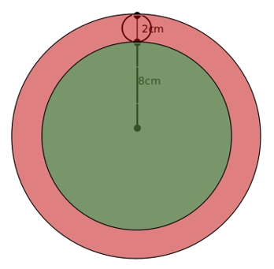

可看出，小圆滚动的面积即是红色部分的面积。红色部分面积=(8+1×2)^2π-8^2π=36π平方厘米。

故正确答案为A。

**考点**：几何公式类-平面图形

**来源**：2010年江苏省公务员录用考试《行测》题（B类）第88题

### 第 89 题

三个学生共解出30道数学题，每人都解出了其中的12道，且每道题都有人解出。只有一人解出的题叫做难题，只有两个人解出的题叫做中等题，三人都解出的题叫做容易题。在这30道题中，难题、中等题、容易题均有，且题数各不相等，则难题的题数是：

A. 14

B. 15

C. 22

D. 25

第 89 题 · 答案与解析

**参考答案（粉笔题库参考内容）**

D

**解析**

设难题有a道，中等题有b道，容易题有c道。一共是30道题，则有a+b+c=30······①；每人解出12道，则有a+2b+3c=12×3=36······②。①×2-②，可得a-c=24，由于“难题、中等题、容易题均有”，则c为正整数，故a=c+24>24，只有D项符合。

故正确答案为D。

**考点**：三集合

**来源**：2010年江苏省公务员录用考试《行测》题（B类）第89题

### 第 90 题

从1开始的自然数中，第100个不能被3整除的数是：

A. 134

B. 142

C. 149

D. 152

第 90 题 · 答案与解析

**参考答案（粉笔题库参考内容）**

C

**解析**

从1开始的自然数里，每3个数即有一个数可以被3整除。将每3个数划为一组，每组中前两个数不能被3整除。100/2 = 50，可知第100个不可以被3整除的数，是第50组中的第二个数。50组数共50×3=150个，第50组的第三个数是150，第二个数为149，即第100个不能被3整除的数是149。

故正确答案为C。

**考点**：周期问题-其他

**来源**：2010年江苏省公务员录用考试《行测》题（B类）第90题

### 第 91 题

甲、乙两人加工一批零件，由甲单独做需36小时，由乙单独做需27小时。现由乙先开始做6小时，然后甲、乙两人同时做，完成任务时，甲加工的零件个数是600，由乙加工的零件个数是：

A. 1200

B. 1800

C. 2000

D. 2100

第 91 题 · 答案与解析

**参考答案（粉笔题库参考内容）**

A

**解析**

方法一：根据工程问题中，工程总量一定，效率与时间成反比，可知甲、乙效率比=27:36=3:4。设甲的效率为3a，则乙的效率为4a，当甲加工600个零件时，乙加工了800个零件。设甲、乙共同工作的时间为x小时，根据题意可列方程：6 × 4a + x × (3a + 4a)=36×3a，解得x=12，则甲12小时完成600个零件，乙12小时完成800个零件，那么乙6小时完成400个零件，乙一共工作6+12=18小时，则乙总共加工零件的个数是800+400=1200。

方法二：根据工程问题中，工程总量一定，效率与时间成反比，可知甲、乙效率比=27:36=3:4。当甲加工了600个零件时，乙加工了800个零件。已知这批零件乙单独做需要27小时，那么甲乙共同完成的零件相当于乙单独做27-6=21小时完成的。设乙单独工作的效率为P_乙，则21p乙=600+800=1400，可知6p_乙 = 1400/21 × 6 = 400，因此，乙总共加工零件的个数是400+800=1200。

故正确答案为A。

**考点**：给具体单位型

**来源**：2010年江苏省公务员录用考试《行测》题（B类）第91题

### 第 92 题

一瓶浓度为80%的酒精溶液倒出1/4后用水加满，再倒出1/3后仍用水加满，再倒出1/5后还用水加满，这时瓶中酒精溶液浓度为：

A. 30%

B. 35%

C. 32%

D. 50%

第 92 题 · 答案与解析

**参考答案（粉笔题库参考内容）**

C

**解析**

假设原溶液是100，则溶质是80，每次倒出后都会加满，则溶液不变。最后溶质= 80 × (1 − 1/3) × (1 − 1/4)× (1 − 1/5) = 32，故浓度=32/100=32%。

故正确答案为C。

**来源**：2010年江苏省公务员录用考试《行测》题（B类）第92题

### 第 93 题

甲、乙两人同时从A、B两地出发，相向前行，甲到达B地后，立即往回走，回到A地后，又立即向B地走去；乙到达A地后，立即往回走，回到B地后，又立即向A地走去。两人如此往复，行走速度不变。若两人第二次迎面相遇的地点距A地450米，第四次迎面相遇的地点距B地650米，则A、B两地相距：

A. 1020米

B. 950米

C. 1150米

D. 1260米

第 93 题 · 答案与解析

**参考答案（粉笔题库参考内容）**

A

**解析**

根据多次相遇S总 = (2n−1)S，可知甲、乙两人两次相遇的路程和之比为S_2:S_4=(2×2-1)S:(2×4-1)S=3:7，因为甲、乙速度和不变，可知两次相遇时间之比为3：7，又知甲的速度不变，所以S甲2 : S甲4 = 3 : 7。如图：设两地之间距离为S，第二次相遇在C点，第四次相遇在D点，可知第二次相遇时，S_甲2=2S-450，第四次相遇时，S甲4 = 3S + 650。则S甲2 : S甲4 = 3 : 7= (2S - 450) : (3S + 650)，解得S=1020米。

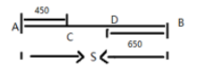

故正确答案为A。

**考点**：相遇追及

**来源**：2010年江苏省公务员录用考试《行测》题（B类）第93题

### 第 94 题

若一直角三角形的周长与面积的数值相等，且两直角边长之和为14，则该三角形的面积是：

A. 20

B. 24

C. 12

D. 6.2

第 94 题 · 答案与解析

**参考答案（粉笔题库参考内容）**

B

**解析**

设两个直角边长分别为a、b，，则斜边= √(a^2+b^2)。由题意可得：a+b=14······①。周长与面积相等，即是a + b + √(a^2 + b^2) = (1/2)ab······②。②式可变形为a+b+√((a+b)^2-2ab)=1/2ab将①式代入，可得14 + √(14² − 2ab) = 1/2 ab。

代入A选项，当面积为20时，ab=40，14 + √(14²-80) ≠ 20；

代入B选项，当面积为24时，ab=48，14+√(14^2-96)= 14 + 10 = 24，等式成立。

代入C选项，当面积为12时，ab=24，14 + √(14^2 - 48) ≠ 12；

代入D选项，当面积为6.2时，ab=12.4，14 + √(14^2 − 24.8) ≠ 6.2。

故正确答案为B。

备注：考场上验证到B选项成立时，即可选出正确答案，不用再验证其他选项。

**考点**：几何公式类-平面图形、几何结论类-三角形相关

**来源**：2010年江苏省公务员录用考试《行测》题（B类）第94题

### 第 95 题

小张去机票代理处为单位团购机票10张。商务舱定价每张1200元，经济舱定价每张700元，由于买的数量较多，代理商就给予了优惠，商务舱按定价的9折付钱，经济舱按定价的6折付钱，如果他付的钱比按定价少31%，那么小张一共买了经济舱票的票数是：

A. 9张

B. 6张

C. 7张

D. 8张

第 95 题 · 答案与解析

**参考答案（粉笔题库参考内容）**

D

**解析**

方法一：设小张买经济舱票的票数是x张。则商务舱是(10-x)张。则10张机票定价是1200(10-x)+700x=(12000-500x)元；给予优惠后小张一共付款1200×0.9×(10 − x) + 0.6 × 700x= (10800 − 660x)元。小张付的钱比定价少31%，则可得方程10800−660x= (12000 - 500x) × (1 - 31%)，解得x=8。即经济舱票的票数是8张。

方法二：可用十字线段法。

设小张买经济舱票的票数是x张，代理商优惠后小张付的钱是原价的1-31%=0.69。则根据口诀：量和距离成反比，可得(0.9-0.69)：(0.69-0.6)=700x：1200(10-x)，解得x=8。即经济舱票的票数是8张。

故正确答案为D。

**考点**：经济利润问题

**来源**：2010年江苏省公务员录用考试《行测》题（B类）第95题

### 第 96 题

冷漠：关心（    ）。

A. 苍白：平均

B. 草率：无知

C. 无礼：尊敬

D. 鲁莽：急躁

第 96 题 · 答案与解析

**参考答案（粉笔题库参考内容）**

C

**解析**

第一步：判断题干词语间逻辑关系。

题干两词是对应关系，且是反义词。

第二步：逐一分析选项。

A项，“苍白”指皮肤颜色异常发白，“平均”指均匀、一致，两者没有必然逻辑关系。

B项，“草率”形容粗糙简略，“无知”指缺乏常识、不明事理，两者没有必然逻辑关系。

C项，“无礼”和“尊敬”是反义词，两者构成对应关系，与题干逻辑关系一致。

D项，“鲁莽”指说话做事不经过考虑、轻率；“急躁”指易于激动、没耐心，两者意思有相近之处，但与题干反义的关系不一致。

故正确答案为C。

**考点**：语义关系-反义关系

**来源**：2010年江苏省公务员录用考试《行测》题（B类）第96题

### 第 97 题

灯丝：电灯

A. 桌子：台布

B. 讲台：教室

C. 玉米：花生

D. 麦子：粮食

第 97 题 · 答案与解析

**参考答案（粉笔题库参考内容）**

B

**解析**

第一步：判断题干词语间逻辑关系。

题干两词是包容关系，且是包容关系中的组成关系，灯丝是电灯的一个组成部分。

第二步：判断选项词语间逻辑关系。

与题干相同的逻辑关系即为B项，讲台是教室的一个组成部分。

A项中的桌子和台布是组成关系，但前后词反了，与题干不对应；C项中的玉米和花生是并列关系；D项是包容关系中的种属关系。

故正确答案为B。

**考点**：逻辑关系-包容关系

**来源**：2010年江苏省公务员录用考试《行测》题（B类）第97题

### 第 98 题

安居乐业：丰衣足食

A. 意味深长：语重心长

B. 时不我待：时不再来

C. 井然有序：谦谦君子

D. 江河日下：太平盛世

第 98 题 · 答案与解析

**参考答案（粉笔题库参考内容）**

B

**解析**

第一步：判断题干词语间逻辑关系。

安居乐业和丰衣足食都是用来形容人民生活美好，二者为近义关系。

第二步：判断选项词语间逻辑关系。

A项：意味深长是指含蓄深远，耐人寻味；语重心长是形容言辞恳切，二者不是近义关系，与题干逻辑关系不一致，排除；

B项：时不我待和时不再来都是形容要抓紧时间，二者为近义关系，与题干逻辑关系一致，当选；

C项：井然有序是指整整齐齐的样子；谦谦君子指谦虚谨慎、能严格要求自己、品格高尚的人，二者不是近义关系，与题干逻辑关系不一致，排除；

D项：江河日下比喻情况一天天地坏下去；太平盛世是指安定、兴盛的时代，二者是反义关系，与题干逻辑关系不一致，排除。

故正确答案为B。

**考点**：语义关系-近义关系

**来源**：2010年江苏省公务员录用考试《行测》题（B类）第98题

### 第 99 题

灯泡：灯座

A. 鼠标：电视

B. 信息：信仰

C. 稿费：编辑

D. 衣服：衣架

第 99 题 · 答案与解析

**参考答案（粉笔题库参考内容）**

D

**解析**

第一步：判断题干词语间逻辑关系。

题干两词是对应关系，且是物体和其安放位置的一一对应关系，灯泡安放在灯座上。

第二步：判断选项词语间逻辑关系。

与题干相同的逻辑关系即为D项，衣服挂在衣架上。

A项中的鼠标和电视无明显逻辑关系，B项无明显逻辑关系，C项为对应关系，但不是物体和其安放位置的一一对应关系。

故正确答案为D。

**考点**：逻辑关系-对应关系

**来源**：2010年江苏省公务员录用考试《行测》题（B类）第99题

### 第 100 题

遗产：保护

A. 立身：严谨

B. 重视：问题

C. 环境：珍爱

D. 收藏：字画

第 100 题 · 答案与解析

**参考答案（粉笔题库参考内容）**

C

**解析**

第一步：判断题干词语间逻辑关系。

题干两词是语法关系，且构成动宾结构，即保护遗产。

第二步：判断选项词语间逻辑关系。

与题干相同的逻辑关系即为C项。

A项构成“立身严谨”，不是动宾结构。B项可构成“重视问题”，D项可构成“收藏字画”，都是动宾结构，但动宾顺序与题干相反，排除。

故正确答案为C。

**考点**：语法关系

**来源**：2010年江苏省公务员录用考试《行测》题（B类）第100题

### 第 101 题

有关：无关

A. 正常：不正确

B. 儿子：不孝子

C. 老师：学生

D. 停顿：无休止

第 101 题 · 答案与解析

**参考答案（粉笔题库参考内容）**

D

**解析**

第一步：判断题干词语间逻辑关系。

有关和无关是并列关系，而且是矛盾关系，对于关系来说，要么是有关的，要么是无关的，没有第三种情况。

第二步：判断选项词语间逻辑关系。

A项：正常和不正确之间没有明显的逻辑关系，正常的矛盾关系应该是不正常，而不是不正确，与题干逻辑关系不一致，排除；

B项：儿子和不孝子是交叉关系，有的儿子是不孝子，有的儿子不是不孝子，并不是矛盾关系，与题干逻辑关系不一致，排除；

C项：老师和学生是对应关系，老师教授学生知识，二者不是矛盾关系，与题干逻辑关系不一致，排除；

D项：停顿和无休止是矛盾关系，无休止就是连续，连续和停顿构成了矛盾关系，要么连续、要么停顿，没有第三种情况，与题干逻辑关系一致，当选。

故正确答案为D。

**考点**：逻辑关系-并列关系

**来源**：2010年江苏省公务员录用考试《行测》题（B类）第101题

### 第 102 题

天鹅：塑料

A. 迪拜：东京

B. 珊瑚：海藻

C. 山猫：狐狸

D. 莼菜：玻璃

第 102 题 · 答案与解析

**参考答案（粉笔题库参考内容）**

D

**解析**

第一步：判断题干词语间逻辑关系。

题干中的两词无明显逻辑关系，天鹅是一种生物，塑料是化工材料。

第二步：判断选项词语间逻辑关系。

与题干形成对应关系的为D项，莼菜是一种生物，玻璃是一种化工材料。

A项中的迪拜和东京都是著名的旅游城市，为并列关系，B、C项也为并列关系。

故正确答案为D。

**考点**：逻辑关系-对应关系

**来源**：2010年江苏省公务员录用考试《行测》题（B类）第102题

### 第 103 题

徘徊：荡漾

A. 八哥：混淆

B. 苍茫：蓓蕾

C. 循环：乾坤

D. 崆峒：浪漫

第 103 题 · 答案与解析

**参考答案（粉笔题库参考内容）**

B

**解析**

第一步：判断题干词语间逻辑关系。

本题可从词语的拼音上找规律。“徘徊”两个字的拼音中都含有韵母“ai”；“荡漾”两个字的拼音中都含有韵母“ang”，也就是说第一个词和第二个词中两个字的韵母相同。

第二步：判断选项词语间逻辑关系。

A项：“八哥”两个字的拼音中韵母不相同，与题干逻辑关系不一致，排除；

B项：“苍茫”两个字的拼音中都含有韵母“ang”；“蓓蕾”两个字的拼音中都含有韵母“ei”，与题干逻辑关系一致，当选；

C项：“循环”两个字的拼音中韵母不相同，与题干逻辑关系不一致，排除；

D项：“崆峒”两个字的拼音中都含有韵母“ong”；但“浪漫”两个字的拼音中韵母不相同，与题干逻辑关系不一致，排除。

故正确答案为B。

注：此种考法相对较少，但2010年江苏ABC类均有一道题涉及，大家了解即可。

**考点**：逻辑关系-对应关系

**来源**：2010年江苏省公务员录用考试《行测》题（B类）第103题

### 第 104 题

泥：璟

A. 嫁：休

B. 众：沸

C. 弦：讼

D. 武：踪

第 104 题 · 答案与解析

**参考答案（粉笔题库参考内容）**

C

**解析**

第一步：判断题干两字的构成方式。

题干两字都是形声字。

第二步：逐一判断选项。

与题干相同的构成方式为C，C都是形声字。

A中的“休”、B中的“众”和D中的“武”不是形声字。

故正确答案为C。

**考点**：逻辑关系-对应关系

**来源**：2010年江苏省公务员录用考试《行测》题（B类）第104题

### 第 105 题

布告：棉布

A. 花费：兰花

B. 波澜：水波

C. 浅薄：深浅

D. 电话：停电

第 105 题 · 答案与解析

**参考答案（粉笔题库参考内容）**

A

**解析**

第一步：判断题干词语间逻辑关系。

布告中的布是动词，棉布中的布是名词，且含义不同。

第二步：判断选项词语间逻辑关系。

与题干相同的逻辑关系即为A，花费中的花是动词，兰花中的花是名词。

其余选项不符合该逻辑。

故正确答案为A。

**考点**：拆分思维、逻辑关系-对应关系

**来源**：2010年江苏省公务员录用考试《行测》题（B类）第105题

### 第 106 题

从所给四个选项中，选择最合适的一个填入问号处，使之呈现一定的规律性：

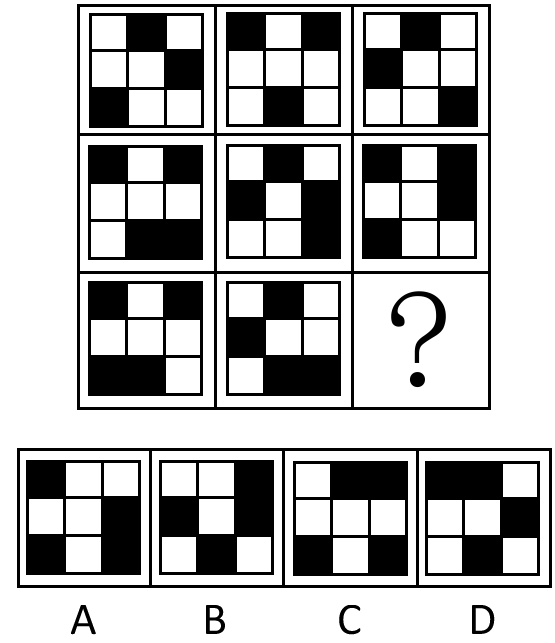

A. A

B. B

C. C

D. D

第 106 题 · 答案与解析

**参考答案（粉笔题库参考内容）**

A

**解析**

元素组成相同，考虑位置关系。以行为单位，每个黑块逆时针位置平移。每行图形中的黑方块依次沿着最外圈逆时针平移一格得到下一个图形。注意第二三行的两个相邻的黑块是一起平移的。

故正确答案为A。

**考点**：位置规律-平移

**来源**：2010年江苏省公务员录用考试《行测》题（B类）第106题

### 第 107 题

从所给四个选项中，选择最合适的一个填入问号处，使之呈现一定的规律性：

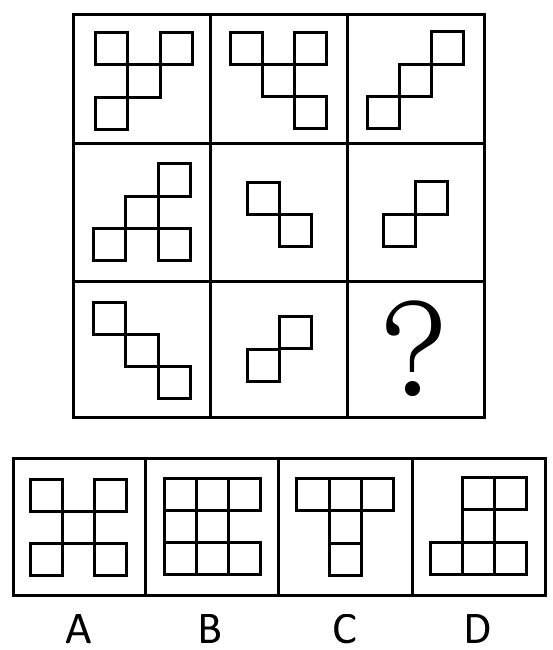

A. A

B. B

C. C

D. D

第 107 题 · 答案与解析

**参考答案（粉笔题库参考内容）**

A

**解析**

特殊考点，元素的内部特征。已有的八个图形中，小方格与另一个小方格的联系是通过顶点相连，而不是边相连。B、C、D三个选项均是边相连，而不仅是顶点相连；A选项仅是通过顶点连接。

故正确答案为A。

**考点**：特殊规律-图形间关系

**来源**：2010年江苏省公务员录用考试《行测》题（B类）第107题

### 第 108 题

从所给四个选项中，选择最合适的一个填入问号处，使之呈现一定的规律性：

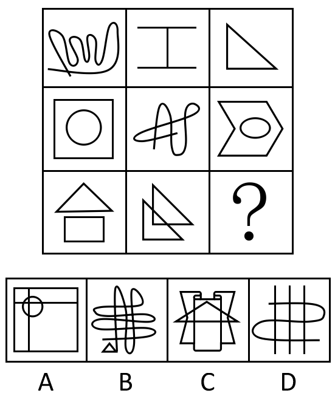

A. A

B. B

C. C

D. D

第 108 题 · 答案与解析

**参考答案（粉笔题库参考内容）**

D

**解析**

元素组成凌乱，考数数。题目考查图形中的交点数目。从第一行开始交点数分别为1、2、3、4、5、6、7、8，则空缺处的图形交点数目应该有9个。

故正确答案为D。

**考点**：数量规律-点

**来源**：2010年江苏省公务员录用考试《行测》题（B类）第108题

### 第 109 题

从所给四个选项中，选择最合适的一个填入问号处，使之呈现一定的规律性：

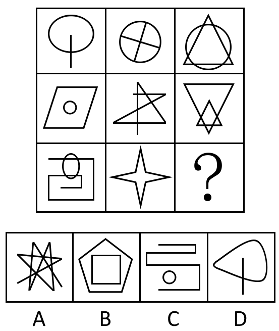

A. A

B. B

C. C

D. D

第 109 题 · 答案与解析

**参考答案（粉笔题库参考内容）**

B

**解析**

元素组成不同，且无明显属性规律，考虑数量规律。九宫格优先看横行，观察发现，第一行图形直线数依次为1、2、3，第二行图形直线数依次为4、5、6，第三行前两幅图的直线数分别为7、8，故问号处应选择直线数为9的图形，只有B项符合。

故正确答案为B。

**考点**：数量规律-线

**来源**：2010年江苏省公务员录用考试《行测》题（B类）第109题

### 第 110 题

从所给四个选项中，选择最合适的一个填入问号处，使之呈现一定的规律性：

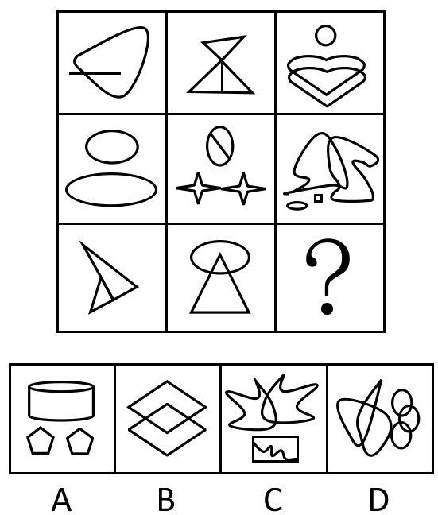

A. A

B. B

C. C

D. D

第 110 题 · 答案与解析

**参考答案（粉笔题库参考内容）**

C

**解析**

元素组成不同，属性无明显规律，考虑数量规律。题干第二行图1明显出现了单一曲线，优先考虑曲线数。九宫格优先横着看，第一行曲线数分别为1、0、5；第二行曲线数分别为2、1、3；第三行曲线数分别为0、1、？，单独看数字并不成规律，但是将每行曲线数相加发现，均为6条曲线，故？处应该选5条曲线。A项2条、B项0条、C项5条、D项4条。

故正确答案为C。

**考点**：数量规律-线

**来源**：2010年江苏省公务员录用考试《行测》题（B类）第110题

### 第 111 题

右边的四个图形中，只有一个是由左边的四个图形拼合而成的，请选出来：

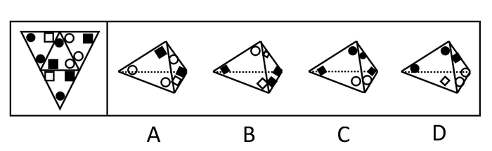

A. A

B. B

C. C

D. D

第 111 题 · 答案与解析

**参考答案（粉笔题库参考内容）**

D

**解析**

四面体，相邻关系考查。

A项，带有两个空白圆和带有一黑一白两个的面折叠后，两个面共有的棱的两边应该是两个黑色方块、一个空白圆和一个黑色圆，排除A项；

B项，展开图中没有存在两个黑色方块的面，B项中其中一面出现了两个黑色方块，排除B项；

C项，原图中只有一个面是由一个黑色圆、一个黑色方块和一个空白圆组成的面，C项中出现了两个，可知C项肯定不能由原图折叠而成。

故正确答案为D。

**来源**：2010年江苏省公务员录用考试《行测》题（B类）第111题

### 第 112 题

右边的四个图形中，只有一个是由左边的四个图形拼合而成的，请选出来：

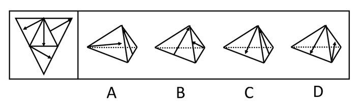

A. A

B. B

C. C

D. D

第 112 题 · 答案与解析

**参考答案（粉笔题库参考内容）**

B

**解析**

四面体，相邻关系考查。

A项，以右侧面为坐标，与展开图对应，左侧面的箭头方向错误；

C项，图形错误，所有箭头呈交叉，不能出现首尾相接的情况；

D项，错误，立体图形展开，两箭头平行，由C项分析可知，交叉情况不会出现平行。

只有B可以由左侧平面图形得到。

故正确答案为B。

注：B项图形箭头都看成实线。

**来源**：2010年江苏省公务员录用考试《行测》题（B类）第112题

### 第 113 题

右边的四个图形中，只有一个是由左边的六个图形拼合而成的，请选出来：

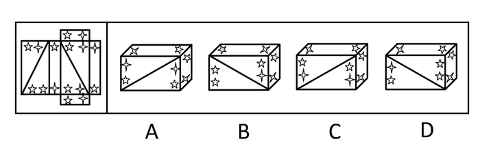

A. A

B. B

C. C

D. D

第 113 题 · 答案与解析

**参考答案（粉笔题库参考内容）**

C

**解析**

本题考查六面体的空间重构，如下图所示。

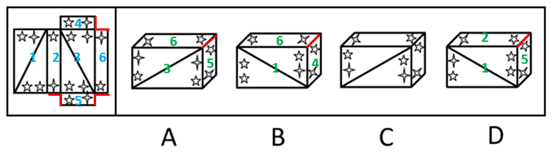

A项：由面3、5、6组成，题干展开图面5和面6的公共边和一个五角星、一个四角星相邻，而选项中面5和面6的公共边和两个五角星相邻，立体图和展开图不对应，排除；

B项：由面1、4、6组成，题干展开图面4和面6的公共边和两个四角星相邻，而选项中面4和面6的公共边和一个五角星、一个四角星相邻，立体图和展开图不对应，排除；

C项：与题干展开图一致，当选；

D项：由面1、2、5组成，题干展开图面2和面5的公共边和一个五角星、一个四角星相邻，而选项中面2和面5的公共边和两个五角星相邻，立体图和展开图不对应，排除。

故正确答案为C。

**考点**：空间类-空间重构-六面体

**来源**：2010年江苏省公务员录用考试《行测》题（B类）第113题

### 第 114 题

右边的四个图形中，只有一个是由左边的八个图形拼合而成的，请选出来：

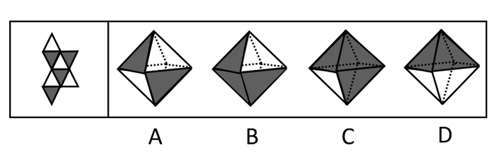

A. A

B. B

C. C

D. D

第 114 题 · 答案与解析

**参考答案（粉笔题库参考内容）**

A

**解析**

八面体，相邻关系考查。左边的图中，有阴影的面只能共点，不能共线，B、C、D中都存在阴影的面共线的情况，只有A符合带阴影的面只共点，不共线。

故正确答案为A。

**来源**：2010年江苏省公务员录用考试《行测》题（B类）第114题

### 第 115 题

右边的四个图形中，只有一个是由左边的八个图形拼合而成的，请选出来：

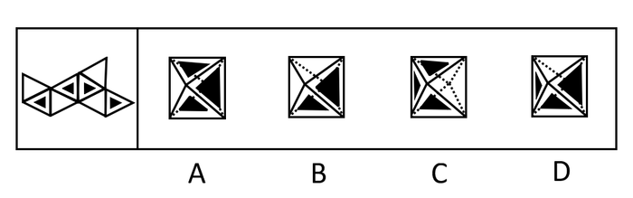

A. A

B. B

C. C

D. D

第 115 题 · 答案与解析

**参考答案（粉笔题库参考内容）**

B

**解析**

八面体，相邻关系考查。左边的图形中最多只有两个带阴影的面相邻，而A、C、D中都有三个阴影的面相邻，故排除。

只有B中只有两个阴影的面相邻。

故正确答案为B。

**来源**：2010年江苏省公务员录用考试《行测》题（B类）第115题

### 第 116 题

江海县为创建文明的卫生县，组织大家参加爱国卫生劳动。已知，所有沿街商铺的经营户都参加了卫生劳动，县城第一中学的全体师生也参加了卫生劳动，有些县政府工作人员参加了卫生劳动，本县乡村中学的师生有的没有参加卫生劳动。

据此，可以推出：

A. 有些县政府工作人员没有参加卫生劳动

B. 县城各中学的师生都参加了卫生劳动

C. 本县所有乡村中学的师生都没有参加卫生劳动

D. 有些参加卫生劳动的是县城中学的学生

第 116 题 · 答案与解析

**参考答案（粉笔题库参考内容）**

D

**解析**

第一步：翻译题干，利用充分必要条件。

题干可翻译为：商铺的经营户⇒参加了卫生劳动，第一中学的全体师生⇒参加了卫生劳动，有些县政府工作人员⇒参加了卫生劳动，有的乡村中学的师生⇒没有参加卫生劳动。

第二步：逐一翻译选项并判断正确选项。

A项有些县政府工作人员⇒没有参加卫生劳动，从题干无法推出，由题干只能推出有些县政府工作人员⇒参加了卫生劳动，A错；

B、C项题干只提到第一中学的全体师生都参加了卫生劳动，而乡村中学的师生有的没有参加，故B项、C项错误；

D项有些参加卫生劳动⇒县城中学的学生，“参加卫生劳动”是肯后件，可以推出可能性的结论。

故正确答案为D。

**考点**：集合推理

**来源**：2010年江苏省公务员录用考试《行测》题（B类）第116题

### 第 117 题

古希腊哲学家同时也是自然科学家。例如：泰勒斯是天文学家，他确定了1年有365天，曾预言不定期一次日蚀；阿那克西曼德制造过日晷等仪器，还制作过海陆地图。

据此，可以推出：

A. 有些自然科学家是古希腊哲学家

B. 有些自然科学家不是古希腊哲学家

C. 古希腊自然科学家都是哲学家

D. 古希腊哲学家都是天文学家

第 117 题 · 答案与解析

**参考答案（粉笔题库参考内容）**

A

**解析**

第一步：抓住题干的中心思想。

第一句：古希腊哲学家⇒自然科学家；

第二句：泰勒斯是天文学家，阿那克西曼德制造过日晷等仪器。

第二步：根据题干判断正确选项。

A项有些自然科学家⇒古希腊哲学家，“自然科学家”属肯后件，可以推出可能性的结论，不能推出绝对化的结论，故A正确、C错误。

B项不能从题干推出，D项错误，题干只说泰勒斯是天文学家，但并不是哲学家都是天文学家。

故正确答案为A。

**考点**：日常结论

**来源**：2010年江苏省公务员录用考试《行测》题（B类）第117题

### 第 118 题

明代学者王阳明训示儿子说：现在人的病痛，大多是因为傲；千罪百恶，都是从傲上来的，事实也说明，所有的人都不会相信自傲的人，也没有一个愿意与他不相信的人合作。

据此，可以推出：

A. 谦虚的人总能避免人生的病痛

B. 谁都不愿意与自傲的人合作

C. 谁都愿意与谦虚的人合作

D. 谦虚的人会获得所有人的信任

第 118 题 · 答案与解析

**参考答案（粉笔题库参考内容）**

B

**解析**

第一步：翻译题干。利用充分必要条件。

根据直言命题的推理规则，从“所有的人都不会相信自傲的人，也没有一个愿意与他不相信的人合作”可知，“所有自傲的人都不被相信，不被相信的人没有人愿意与他们合作” 翻译为“①自傲的人⇒不被相信，②不被相信⇒没有人愿意与他们合作”。

以上两个推导关系连接起来，可得到“③自傲的人⇒不被相信⇒没有人愿意与他们合作”。

第二步： 逐一翻译选项。利用逆否规则。

A项，－自傲的人⇒避免人生的病痛，题干中没有谈到人生病痛的问题，A项无法推出；

B项，自傲的人⇒没有人愿意与他们合作，与题干推导关系一致，可从题干推出；

C项可翻译为，－自傲的人⇒－没有人愿意与他们合作， D项可翻译为，－自傲的人⇒－不被相信，C、D两项的推导关系中，“－自傲的人”是否定题干推导关系③的前件，否前件无法推出否后件，C、D项无法推出。

故正确答案为B。

**考点**：常规翻译

**来源**：2010年江苏省公务员录用考试《行测》题（B类）第118题

### 第 119 题

工业和信息化部在其官方网站推出“轻型汽车燃料消耗量通告”专栏，要求汽车厂商在新车挡风玻璃上贴上燃料消耗量标识。该消息一出，引发了热议。某记者试图再次登录工业和信息化部网站时，发现原来可以查询油耗的网页已经瘫痪。他断言，有车族都对汽车油耗问题高度关注。他同时也发现，也有很多个体商户根本不关心汽车油耗问题。假定该记者的断言和发现都是正确的。

据此，可以推出：

A. 有些个体商户高度关注汽车油耗问题

B. 有些有车族并不关注汽车油耗问题

C. 有些个体商户并不是有车族

D. 有些个体商户是有车族

第 119 题 · 答案与解析

**参考答案（粉笔题库参考内容）**

C

**解析**

第一步：抓住题干的中心思想。

题干中记者的话正确，他认为：有车族都对汽车油耗问题高度关注，他同时发现，也有很多个体商户根本不关心汽车油耗问题。

第二步：逐一判断选项的作用。

A项说有些个体商户高度关注汽车油耗问题，由题干只知道“有很多个体商户根本不关心汽车油耗问题”，故A项错误；

B项与题干的“有车族都对汽车油耗问题高度关注”相矛盾，故B项错误；

C项可从题干推出，因为有车族都对油耗问题高度关注，而很多个体商户根本不关心汽车油耗问题，说明有些个体户并不是有车族，C项正确；

D项从题干无法推出。

故正确答案为C。

**考点**：日常结论

**来源**：2010年江苏省公务员录用考试《行测》题（B类）第119题

### 第 120 题

今年中国南方地区出现“民工荒”。究其原因，或者是由于民工在家乡已找到工作；或者是由于南方地区民工工资太低，不再具有吸引力；或者是由于新农村建设进展加快，农民在农村既能增收，又能过上稳定的家庭生活。今年中国新农村建设确实进展加快，农民在农村既能增收又能过上稳定的家庭生活。

据此，可以推出今年南方地区出现“民工荒”的原因：

A. 是由于民工在家乡已找到工作

B. 可能是由于民工在家乡已找到工作

C. 不是由于民工在家乡已找到工作

D. 是由于南方地区民工工资太低，不再具有吸引力

第 120 题 · 答案与解析

**参考答案（粉笔题库参考内容）**

B

**解析**

第一步：翻译题干，利用充分必要条件。

第一句、第二句：民工荒⇒在家乡已找到工作∨民工工资太低∨新农村建设进展加快。

第三句：新农村建设确实进展加快。

第二步：逐一翻译选项并判断正确选项。

出现民工荒的原因有三个，题干为相容选言。

而A、C、D说的是必然性，但因为原因有三个，任何一个原因都可能导致民工荒。

故正确答案为B。

**考点**：常规翻译

**来源**：2010年江苏省公务员录用考试《行测》题（B类）第120题

### 第 121 题

物质经济是以物质资源为主要劳动资源的经济。原始经济是原始的物质经济，农业经济是以生物物质资源为基础的经济，工业经济是物质经济发展的高级阶段。知识经济是相对于物质经济而言的新的经济形态，是以知识资源为基础的经济。建立知识经济的先决条件是工业经济的高度发展，而工业经济是建立在科学技术基础之上的。因此，没有科学技术的高度发展和广泛应用，物质经济就不能转化为知识经济。

据此，可以推出：

A. 如果科学技术高度发展和广泛应用，物质经济就能转化为知识经济

B. 如果物质经济不能转化为知识经济，就没有科学技术的高度发展和广泛应用

C. 只有科学技术高度发展和广泛应用，物质经济才能转化为知识经济

D. 只有物质经济转化为知识经济，科学技术才能高度发展和广泛应用

第 121 题 · 答案与解析

**参考答案（粉笔题库参考内容）**

C

**解析**

第一步：翻译题干，利用充分必要条件。

分析题干可知，题干的结论是最后一句话，即：﹣科学技术高度发展和广泛应用⇒﹣物质经济转化为知识经济。

第二步：逐一翻译选项并判断正确选项，利用逆否规则。

A项，科学技术高度发展和广泛应用⇒物质经济转化为知识经济，“科学技术高度发展和广泛应用”属于否前件，推不出任何绝对化的结论，故A错；

B项，﹣物质经济转化为知识经济⇒﹣科学技术高度发展和广泛应用，“﹣物质经济转化为知识经济”属于肯后件，推不出任何绝对化的结论，故B错；

C项，物质经济转化为知识经济⇒科学技术高度发展和广泛应用，是题干推导关系的逆否规则，故C正确；

D项，科学技术高度发展和广泛应用⇒物质经济转化为知识经济，属于肯前件，推不出任何绝对化的结论，故D错。

故正确答案为C。

**考点**：常规翻译

**来源**：2010年江苏省公务员录用考试《行测》题（B类）第121题

### 第 122 题

曙光研究所为了加强与合作单位的科研合作，需要派出若干名科技人员前往合作单位开展工作。根据工作要求，研究所领导决定：

（1）在甲和乙两人中至少要派出一人；

（2）在乙与丙两人中至多能派出一人；

（3）如果派出丁，则丙和戊两人都要派出；

（4）在甲、乙、丙、丁、戊等5人中至少应派出3人。

据此，可以推出必定会派出：

A. 乙

B. 丙

C. 丁

D. 戊

第 122 题 · 答案与解析

**参考答案（粉笔题库参考内容）**

D

**解析**

本题问的是“必定被派出”，可采用选项反向代入法，即当选项此人不被派出时，与题干矛盾，则此人是必须被派出的。

A项：假设乙不派出，由(1)知派出甲，由(3)(4)得派出丙、戊，无法推出丁是否派出，故乙不必然派出，排除；

B项：假设丙不派出，由(3)知不派出丁，可以派出甲乙戊，不矛盾，排除；

C项：假设丁不派出，派出甲戊，再从乙丙中挑一个，不矛盾，排除；

D项：假设戊不派出，由(3)知不派出丁，由(2)知乙丙至少有一个不派出，只能派出两人，此时与(4)矛盾，所以戊必须被派出，当选。

故正确答案为D。

**考点**：常规翻译

**来源**：2010年江苏省公务员录用考试《行测》题（B类）第122题

### 第 123 题

华光高科技公司在进行人才招聘时，有小张、小李、小王、小赵、小钱等5人入围。从学历看，这5人中2人为硕士，3人为博士；从年龄看，这5人中有3人小于30岁，2人大于30岁。已知，小张、小王属于相同的年龄段，而小赵、小钱属于不同的年龄段；小李与小钱的学位相同，小王和小赵的学位不同。最后，只有一位年龄大于30岁的硕士应聘成功。

据此，可以推出应聘成功者是：

A. 小张

B. 小王

C. 小赵

D. 小钱

第 123 题 · 答案与解析

**参考答案（粉笔题库参考内容）**

C

**解析**

第一步：总结题干。

由题干可知：有2个硕士，3个博士，3人＜30岁，2人＞30岁。

第二步：找突破口并推断出正确选项。

由题干“小张、小王属于相同的年龄段，而小赵、小钱属于不同的年龄段”和“3人＜30岁，2人＞30岁”，可推知小张和小王的年龄小于30岁，所以张和王不能应聘成功。

由题干“小李与小钱的学位相同，小王和小赵的学位不同”和“有2个硕士，3个博士”可知，小李和小钱是博士，所以小李和小钱也不能应聘成功。

此时只剩有小赵能应聘成功。

故正确答案为C。

**考点**：框架题

**来源**：2010年江苏省公务员录用考试《行测》题（B类）第123题

### 第 124 题

因某种原因，甲、乙两人面临A、B两种方案的选择。如果两人都选A方案，则各得3个单位利益；如果一人选择A方案，另一人选择B方案，则选择A方案者得3个单位利益，选择B方案者得5个单位利益，如果两人均选择B方案，则各得2个单位利益。假定甲、乙两人都按照自己利益最大化标准来进行算计和行动，都明白上述的利益得失情况，两人的选择有先后之分。

据此，可以推出：

A. 当甲选择A方案时，乙会选择A方案

B. 当甲选择A方案时，乙会选择B方案

C. 当乙选择B方案时，甲会选择B方案

D. 当乙选择A方案时，甲会选择A方案

第 124 题 · 答案与解析

**参考答案（粉笔题库参考内容）**

B

**解析**

第一步：翻译题干。

题干可翻译为以下表格，左边的数字代表选A时的利益，右边的数字代表选B时的利益。

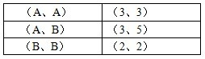

| （A、A） | （3、3） |
| --- | --- |
| （A、B） | （3、5） |
| （B、B） | （2、2） |

第二步：分析判断得出正确答案。

当甲选择A方案时，乙为使自己利益最大化，必定选择B方案，可知A错误，B正确；

当乙选择B方案时，甲为使自己利益最大化必定选择A方案，C项错误；

当乙选择A方案时，甲为使自己利益最大化必定选择B方案，D项错误。

故正确答案为B。

**考点**：真假推理-其他

**来源**：2010年江苏省公务员录用考试《行测》题（B类）第124题

### 第 125 题

一场超级篮球赛即将进入比赛最后阶段，4支球队将为最后名次展开激烈拼杀。行家们根据各球队以往战绩及现场表现，对比赛结果做出了3项预测：

（1）天空队、大地队都不能进入前两名；

（2）如果江河队获得第一，那么海洋队将获得第二；

（3）如果天空队获得第三，那么大地队将进入前两名。

比赛结束后，发现行家们预测只有一项是正确的。

据此，可以推出：

A. 江河队获得第一

B. 海洋队获得第二

C. 天空队获得第三

D. 大地队获得第四

第 125 题 · 答案与解析

**参考答案（粉笔题库参考内容）**

A

**解析**

第一步：分析题干条件。

（1）天空队在第3名或第4名、大地队在第3名或第4名

（2）江河队在第1名→海洋队在第2名

（3）天空队在第3名→大地队在第1名或第2名

第二步：根据题干条件进行推理。

由题干可知，三个预测中只有一项正确，且条件中没有明显的矛盾关系，考虑假设法，条件（1）（3）中涉及到大地队的完整排名，可以假设“大地队”的情况。

①假设“大地队在第1名或第2名”，此时条件（1）为假，条件（3）为真，那么条件（2）必定为假，可知江河队在第1名且海洋队不在第2名，4支球队的排名如下，满足题干，该假设成立。

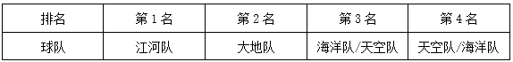

| 排名 | 第1名 | 第2名 | 第3名 | 第4名 |
| --- | --- | --- | --- | --- |
| 球队 | 江河队 | 大地队 | 海洋队/天空队 | 天空队/海洋队 |

②假设“大地队在第3名或第4名”，如果天空队也在第3名或第4名，此时条件（1）为真，那么条件（2）和条件（3）必定为假，可知江河队在第1名且海洋队不在第2名，天空队在第3名，继续推理可知，大地队和海洋队都在第4名，出现矛盾；如果天空队在第1名或第2名，此时条件（1）为假，条件（3）为真，那么条件（2）必定为假，可知江河队在第1名且海洋队不在第2名，4支球队的排名如下，满足题干，该假设成立。

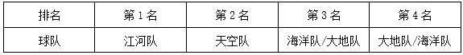

| 排名 | 第1名 | 第2名 | 第3名 | 第4名 |
| --- | --- | --- | --- | --- |
| 球队 | 江河队 | 天空队 | 海洋队/大地队 | 大地队/海洋队 |

综上可知，江河队获得第一，对应A项。

故正确答案A。

**考点**：真假推理-其他

**来源**：2010年江苏省公务员录用考试《行测》题（B类）第125题

### 第 126 题

投射指把自己思想、态度、愿望、情绪或特征等，不自觉地反应于外界的事物或他人的一种心理作用。

下列不属于投射的是：

A. 小方把一堵墙上溅上的污泥看成是一只蝴蝶

B. 小李曾与小朱共事过一段时间，他认为小朱是一个很勤快的人

C. 己所不欲，勿施于人

D. 有人认为，周瑜不会因妒忌诸葛亮被气死，因为周瑜当时正春风得意，只会让人羡慕

第 126 题 · 答案与解析

**参考答案（粉笔题库参考内容）**

B

**解析**

第一步：找出定义关键词。

“把自己思想、态度、愿望、情绪或特征等”、“不自觉地反应于外界的事物或他人”。

第二步：逐一分析选项。

A项：把污泥看成蝴蝶，是把自己主观感受“蝴蝶”，反应给了外界的事物“污泥”，符合定义，排除；

B项：小李通过与小朱共事，认为他勤快，这是他们在相互熟悉之后，小李得出的判断，而非小李把自己的思想、态度等反应于外界，不符合定义，当选；

C项：如果自己都不希望被人此般对待，推己及人，自己也不要那般待人，把自己的思想、态度等反应于外界，符合定义，排除；

D项：认为周瑜不会被气死只是某些人自己的主观认识，反应给了他人“周瑜”，符合定义，排除。

本题为选非题，故正确答案是B。

**考点**：单定义-其他句式

**来源**：2010年江苏省公务员录用考试《行测》题（B类）第126题

### 第 127 题

夹心层指游离在政府保障与市场之外的无能力购房的群体，表现为有的不符合廉租房条件但又没有钱买经适房，有的没资格买经适房但又买不起商品房。

下列最可能为夹心层的是：

A. 小胡的老妈要买一处跃层房，而老婆却要买一处景观房，小胡夹在中间受气

B. 张教授没买过房，他认为买房不如租房，租房不如借房

C. 老刘用一生积蓄买了一套三室一厅的二手房

D. 公司刚招进的小李、小王和小刘合住在公司的一间临时仓库里

第 127 题 · 答案与解析

**参考答案（粉笔题库参考内容）**

D

**解析**

第一步：抓住定义中的关键词。

关键词强调“无能力购房的群体”。

第二步：逐一判断选项。

A项中小胡一家是有能力购房的群体，只是在犹豫要买什么房子，不属于夹心层；

B项的张教授只是给出了对买房和租房的看法，并没提到他没有能力购房，故不属于夹心层；

C项的老刘也不属于“无能力购房的群体”，故不属于夹心层；

D项的小李、小王和小刘刚工作，属于“无能力购房的群体”。

故正确答案为D。

**考点**：单定义-其他句式

**来源**：2010年江苏省公务员录用考试《行测》题（B类）第127题

### 第 128 题

时间综合症指由于对时间的紧迫感而造成心理上的烦恼、紧张，以及生理上的活动改变等导致的病症。

下列属于时间综合症的是：

A. 张先生与李小姐约定下午3点在某公园首次见面，结果李小姐没来，张先生回去后给李小姐发了条短信：第一次约会就不守时，这样的人不值得交往

B. 韩女士经常出差，由于在赶往机场、车站的途中经常发生交通拥堵，所以她后来每次出发都要留出机动时间，并以此告诫家人做任何事情都要赶早

C. 小明上小学五年级，酷爱玩滑板，但他不耽误作业，每天下午放学回家，总是争分夺秒，飞快地把作业做完，然后约同伴一起去玩滑板

D. 雷先生办事总是匆匆的，常唠叨时间紧，偶尔带孩子出去游玩，也是不停地看表，孩子要多玩一会，他就很不耐烦，甚至对孩子大发脾气

第 128 题 · 答案与解析

**参考答案（粉笔题库参考内容）**

D

**解析**

第一步：抓住定义中的关键词。

关键词强调“心理上的烦恼、紧张”、“生理上”。

第二步：逐一判断选项。

A项中的张先生的行为并没有涉及到“心理上的烦恼、紧张”，并没有因为李小姐没有赴约而使自己不适，故不属于时间综合症；

B项的韩女士对时间有合理的安排，每次出发都要留出机动时间，不属于时间综合症；

C项小明是对时间的合理利用，也不属于时间综合症；

D项的雷先生外出游玩时不停地看表，且他会因孩子多玩一会儿大发脾气，说明时间对他造成了一种压力，属于时间综合症。

故正确答案为D。

**考点**：原因结果

**来源**：2010年江苏省公务员录用考试《行测》题（B类）第128题

### 第 129 题

区位优势指某一地区在发展经济、科研等方面客观存在的有利条件或优越地位，主要由自然资源、劳力、工业聚集、地理位置、交通等决定，是一个综合性概念。

下列不属于区位优势的是：

A. 知识经济时代，人的因素占主导地位，人的流动性，尤其是掌握知识、技能的人才的流动性是很大的，培育并吸引高科技人员就成为地区发展经济的关键

B. 云南向东可与珠三角、长三角经济圈相连；向南延伸，可通过建设中的泛亚铁路直达河内、曼谷、新加坡和仰光；向北可通四川和中国内陆腹地等

C. 西昌卫星发射中心纬度低，海拔高，发射倾角好；地质结构坚实，有利于发射场的总体布局；多晴好天气，“发射窗口”好

D. 广西地处我国大陆东、中、西交汇点，是华南经济圈、西南经济圈与东盟经济圈的结合部，是西南乃至西北地区最便捷的出海通道，也是连接粤港澳与西部地区的重要通道

第 129 题 · 答案与解析

**参考答案（粉笔题库参考内容）**

A

**解析**

第一步：抓住定义中的关键词。

关键词强调“客观存在的有利条件或优越地位”。

第二步：逐一判断选项。

A项是通过主观方面的努力而达到优势，不符合“客观存在的有利条件或优越地位”，故不属于区位优势；

B项云南具有优越的地理位置和便利的交通等有利条件，属于区位优势；

C项西昌卫星发射中心具有优越的地理位置，符合“客观存在的有利条件或优越地位”，属于区位优势；

D项的广西具有便捷的交通，也属于区域优势。

本题为选非题，故正确答案为A。

**考点**：单定义-其他句式

**来源**：2010年江苏省公务员录用考试《行测》题（B类）第129题

### 第 130 题

反向求索法指在思维过程中，从相反的思维方向去分析、探索，反其道而行之，从事物相反或相对的功能去发明创造。

下列属于反向求索法的是：

A. 将一件事情分工给几个人同时干，这就是并行计算机的设计思想，这样设计的并行计算机计算速度成倍提高

B. 将一件事情让几个人联合干，如保险柜管理就是让两个人同时控制，从而“保险性”大大加强

C. 在白色电冰箱充斥市场时，某著名企业推出彩色电冰箱，结果以色彩新异而受市场欢迎，很快打入国际市场

D. 报警的关键是说清楚事发位置，有时延误出警是因突发事件位置不明，深圳在全市10万个路灯电线杆上喷涂报警编码，确保了110出警能精确定位

第 130 题 · 答案与解析

**参考答案（粉笔题库参考内容）**

C

**解析**

第一步：抓住定义中的关键词。

关键词强调“相反的思维方向”、“相反或相对的功能”。

第二步：逐一判断选项。

A项是属于并行完成，不属于反向求索法；

B项是多人共同完成，不属于反向求索法；

C项在白色电冰箱充斥市场时推出彩色电冰箱，符合“相反的思维方向”和“相反或相对的功能”，属于反向求索法；

D项是正面解决的方法。

故正确答案为C。

**考点**：方式目的

**来源**：2010年江苏省公务员录用考试《行测》题（B类）第130题

### 第 131 题

定义：

①友情：指朋友间的感情、友谊。

②亲情：指亲人之间的情义。

③爱情：指男女之间相恋、相爱的感情。

典型例证：

（1）丈夫有泪不轻弹，只因未到伤心处。

（2）人面不知何处去，桃花依旧笑春风。

（3）今人不见古明月，今月曾经照古人。

对上述典型例证与定义的关系判断正确的是：

A. 例证（1）（2）分别与定义①②相符

B. 例证（1）（2）分别与定义②①不相符

C. 例证（1）（3）分别与定义③①相符

D. 例证（2）（3）分别与定义②③相符

第 131 题 · 答案与解析

**参考答案（粉笔题库参考内容）**

B

**解析**

第一步：抓住每个定义中的关键词。

友情：关键词是“朋友间”。

亲情：关键词是“亲人之间”。

爱情：关键词是“男女之间”、“相恋、相爱”。

第二步：逐一判断例证与定义之间的关系。

例证（1）主要说的是丈夫（男子汉）的坚强品质，不涉及“朋友间”、“亲人之间”和“男女之间”，因此不符合任何一个定义；

例证（2）是说明男女间的感情的诗句，符合爱情的定义；

例证（3）感叹时间的短暂，不符合任何定义。

故正确答案为B。

**考点**：特殊问法

**来源**：2010年江苏省公务员录用考试《行测》题（B类）第131题

### 第 132 题

定义：

①人才的多产性：指杰出人才在短时间内高效的创造能力或一生持续不断的创造现象。

②人才的多才性：指杰出人才所具有的多种才干的特征。

③人才的记忆术：指人才在学习、工作中所运用的记忆方法。

典型例证：

（1）在创作《台湾首任巡抚刘铭传》剧本之前，张笑天并不了解刘铭传，清史专家向他介绍了刘铭传的各种事迹，3个月后，剧本完稿。

（2）罗京不但新闻播得好，同样歌也唱得好，足球也踢得好，在青岛、南京、云南都有他踢球留下的美好印象。

（3）1968年，苏联著名的心理学家卢里写成《记忆能手的头脑》一书，书中描述了一位联觉能力极强、记忆力惊人的男子。

对上述典型例证与定义的关系判断正确的是：

A. 例证（1）（3）分别与定义③①相符

B. 例证（1）（2）分别与定义②①相符

C. 例证（2）（3）分别与定义③①不相符

D. 例证（2）（1）分别与定义③②相符

第 132 题 · 答案与解析

**参考答案（粉笔题库参考内容）**

C

**解析**

第一步：抓住每个定义中的关键词。

人才的多产性：关键词是“短时间内”、“高效”、“创造能力”；

人才的多才性：关键词是“多种才干”；

人才的记忆术：关键词是“记忆方法”。

第二步：逐一判断例证与定义之间的关系。

例证（1）中的张笑天在3个月内完成剧本，体现了短时间内高效的创造能力，符合定义①；

例证（2）说明罗京多才多艺，即具有多种才干，符合定义②；

例证（3）说明心理学家卢里写了一本描述一位联觉能力极强、记忆力惊人的男子的书，涉及“记忆方法”，符合定义③。

因此例证（1）、（2）、（3）分别对应定义①、②、③。

故正确答案为C。

**考点**：特殊问法

**来源**：2010年江苏省公务员录用考试《行测》题（B类）第132题

### 第 133 题

定义：

①违约责任：指违反合同约定的义务或者违反合同法规定的义务而产生的责任。

②侵权责任：指侵害他人的财产权利和人身权利而产生的责任。

③刑事责任：指因实施犯罪而由司法机关强制犯罪者承受的刑事惩罚或某种法律评价负担。

典型例证：

（1）公务员刘某平时自我要求放松，连续两年考评结果为不合格，不久前被单位辞退。

（2）贾某在网上披露陈某隐私，后对簿公堂，法院判决贾某向陈某道歉并赔偿相应精神损失。

（3）大三学生李某，因在校期间不好好学习，并屡次违反校规校纪，学校勒令其退学。

对上述典型例证与定义的关系判断正确的是：

A. 例证（2）与定义②相符

B. 例证（2）（3）分别与定义③②相符

C. 例证（1）（3）分别与定义①③相符

D. 例证（3）（1）分别与定义①②相符

第 133 题 · 答案与解析

**参考答案（粉笔题库参考内容）**

A

**解析**

第一步：抓住每个定义中的关键词。

违约责任：关键词是“违反”、“合同约定”、“合同法规定”。

侵权责任：关键词是“侵害”、“财产权”、“人身权利”。

刑事责任：关键词是“实施犯罪”、“刑事惩罚”。

第二步：逐一判断例证与定义之间的关系。

例证（1）中的公务员属于不称职，与三个定义都不符合；

例证（2）中的贾某侵犯了陈某的隐私权，符合定义②；

例证（3）中的李某属于违反校规。故只有例证（2）与定义②对应。

故正确答案为A。

**考点**：特殊问法

**来源**：2010年江苏省公务员录用考试《行测》题（B类）第133题

### 第 134 题

定义：

①海外基金：指由国外投资信托公司发行的基金，通过海外基金的方式进行投资，不但可分享全球投资机会和利得，亦可达到分散风险、专业管理、节税和资产转移的目的。

②对冲基金：指由金融期货和金融期权等金融衍生工具与金融组织结合后，以高风险投资为手段并以盈利为目的的金融基金。

③养老基金：指一种用于支付退休收入的基金，是社会保障基金的一部分，养老基金通过发行基金股份或受益凭证，募集社会上的养老保险资金。

典型例证：

（1）美国是投资基金发展最发达、规模最大的国家，种类繁多，基金收效率高，同时为投资者提供多样化金融服务，还具有比较完善的法律监管制度，基金运作比较规范。

（2）在一些国家，基金投资者以资金入伙，提供大部分资金但不参与投资活动；基金管理者以资金和技能入伙，负责基金的投资决策。

（3）王师傅去年办理退休审批手续后，享受养老金待遇，王师傅的退休金由国家、企业和个人共同负担，由社会保险事业中心筹集并管理。

对上述典型例证与定义的关系判断正确的是：

A. 例证（1）（2）（3）分别与定义①②③相符

B. 例证（2）（1）分别与定义②③相符

C. 例证（2）（3）分别与定义②③相符

D. 例证（1）与定义①不相符，例证（3）与定义③相符

第 134 题 · 答案与解析

**参考答案（粉笔题库参考内容）**

D

**解析**

第一步：抓住每个定义中的关键词。

海外基金：关键词是“国外投资信托公司”、“全球投资机会和利得”；

对冲基金：关键词是“金融衍生工具”、“高风险投资”、“盈利为目的”；

养老基金：关键词是“支付退休收入”、“发行基金股份或受益凭证”。

第二步：逐一判断例证与定义之间的关系。

例证（1）说明美国是一个良好的投资基金场所，与任何定义都不符合；

例证（2）说的是一种基金投资方式；

例证（3）中的王师傅享受的养老金符合养老基金的定义。

故只有例证（3）与定义③对应。

故正确答案为D。

**考点**：特殊问法

**来源**：2010年江苏省公务员录用考试《行测》题（B类）第134题

### 第 135 题

定义：

①创造酝酿：指创造过程的开始阶段，主要内容是确定具体课题、调查既有材料，制订研究方案和进行可行性分析。

②创造顿悟：指创造过程的实施阶段，在定向积累到足以完成创造活动的前提下，突然悟到了成功的诀窍。

③创造验证：指创造过程的总结阶段，创造成果与原定假设以及小规模实验成果与大面积推广应用的比较印证，从而检验创造成果的实际价值。

典型例证：

（1）汉字起源已有五千年的历史，汉字丰富的特点使人通过汉字本身就能直接了解书籍本身的象征意义，保留传统文化的意义并非只是守成不变。

（2）老强想解开古代木马车之谜，但百思不得其解，有一天他突然悟出了木马车设计要领，终于仿制出了一辆木马车，真是“踏破铁鞋无觅处，得来全不费功夫”。

（3）中国的生死健康产品——防病毒生化安全套，利用纳米技术，弥补了天然乳胶的漏洞，提升了致密度，既能阻隔艾滋病病毒，也能对比之更小的病毒进行物理隔离。

对上述典型例证与定义的关系判断不正确的是：

A. 例证（1）与定义①相符

B. 例证（2）与定义②相符

C. 例证（3）与定义③不相符

D. 例证（2）（3）分别与定义③①不相符

第 135 题 · 答案与解析

**参考答案（粉笔题库参考内容）**

A

**解析**

第一步：找出定义关键词。

①创造酝酿：“创造过程的开始阶段”、“确定具体课题、调查既有材料，制订研究方案和进行可行性分析”；

②创造顿悟：“创造过程的总结阶段”、“定向积累到足以完成创造活动的前提下，突然悟到了成功的诀窍”；

③创造验证：“创造过程的总结阶段”、“检验创造成果的实际价值”。

第二步：逐一分析例证。

例证（1）：说汉字的起源、汉字丰富的特点、保留传统文化的意义等，不符合关键词“确定具体课题、调查既有材料，制订研究方案和进行可行性分析”，不符合定义①创造酝酿；

例证（2）：老强突然悟出了木马车设计要领，符合“实施阶段”和“突然悟到”，符合定义②创造顿悟；

例证（3）：仅说明了防病毒生化安全套的优点，并未涉及“比较印证”、“检验”，不符合定义③创造验证。

故正确答案为A。

**考点**：特殊问法

**来源**：2010年江苏省公务员录用考试《行测》题（B类）第135题

## 材料 3

**根据以下资料，完成各题。**

1949－2008年江苏省城镇人口变化经历了以下五个阶段。

第一阶段：1949－1957年。全省城镇人口由437万人增加到782万人，年均增长7.5%，是总人口年均增长速度（2.2%）的3.43倍；城镇人口占总人口的比重也由1949年的12.4%迅速上升到1957年的18.7%。

第二阶段：1958－1978年。1958年城镇人口占总人口的比重为19.5%，1960年城镇人口占总人口比重最高，达到20.62%。1961年起城镇人口总数开始减少，1970年降至最低，城镇人口比重仅相当于1949年的水平，为12.5%。此后开始缓慢回升，1978年城镇人口比重达到13.7%，乡村人口总数为5033.55万人，占总人口的86.3%。20年间，全省城镇人口减少了28万人，城镇人口比重下降5.8个百分点。

第三阶段：1979－1989年。这期间，建制镇由1979年的115个增加到1989年的392个；城镇人口由874万人增加到1366万人，增长了56.1%，年均增长4.55%，城镇人口比重上升6.1个百分点，平均每年上升0.61个百分点。

第四阶段：1990－1997年。这期间，全省省辖市（地级市）由11个增加到13个，县级市由14个增加到31个，建制镇由522个增加到1018个；城镇人口增长46.2%，年均增长5.58%，城镇人口比重由21.56%提高到29.85%，上升8.29个百分点，平均每年上升1.18个百分点。1997年全省城镇人口达到2133.65万人。

第五阶段：1998－2008年。这一阶段，城镇人口由2262.47万人增加到4168.48万人，年均增加190.60万人，增长84.24%；年均增长6.30%，2008年，城镇人口比重比1998年的31.5%多22.8个百分点，平均每年上升2.28个百分点。

### 第 136 题

2008年江苏省乡村人口总数是：

A. 3106万人

B. 3508万人

C. 4019万人

D. 4251万人

第 136 题 · 答案与解析

**参考答案（粉笔题库参考内容）**

B

**解析**

根据题干“2008年······乡村人口总数是”，结合材料可以求出总人口数及乡村人口的占比，可判定本题为现期比重问题。定位文字材料第六段可得：2008年城镇人口增加到4168.48万人，城镇人口比重比1998年的31.5%多22.8个百分点。因此2008年城镇人口占总人口的比重为31.5%+22.8%=54.3%，乡村人口占总人口的比重为1-54.3%=45.7%。根据公式：比重= 部分量/总体量，2008年江苏省乡村人口总数为4168.48/54.3% × 45.7%≈4200/54%×46%≈3580万人，与B项最接近。

故正确答案为B。

**来源**：2010年江苏省公务员录用考试《行测》题（B类）第136题

### 第 137 题

江苏省城镇人口首次超过乡村的年份最可能的是：

A. 2005年

B. 2006年

C. 2007年

D. 2008年

第 137 题 · 答案与解析

**参考答案（粉笔题库参考内容）**

C

**解析**

根据题干“······首次超过······的年份最可能的是”，结合材料给出现期比重及平均每年比重上升的百分点，可判定本题为基期比较问题。定位文字材料第六段可得：2008年，城镇人口比重比1998年的31.5%多22.8个百分点，平均每年上升2.28个百分点。城镇人口超过乡村人口，即城镇人口的比重大于50%。2008年江苏省城镇人口的比重为31.5%+22.8%=54.3%，则2007年江苏省城镇人口的比重为54.3%-2.28%=52.02%＞50%，2006年江苏省城镇人口的比重为52.02%-2.28%=49.74%＜50%。故江苏省城镇人口首次超过乡村的年份最可能的是2007年。

故正确答案为C。

**来源**：2010年江苏省公务员录用考试《行测》题（B类）第137题

### 第 138 题

1949-2008年江苏省城镇人口规模、城镇人口占总人口比重的变化趋势是：

A. 前者一直上升，后者先上升后下降再上升

B. 前者先上升后下降再上升，后者一直上升

C. 二者都是一直上升

D. 二者都先上升后下降再上升

第 138 题 · 答案与解析

**参考答案（粉笔题库参考内容）**

D

**解析**

定位文字材料第三段可得：1958-1978年，全省城镇人口减少了28万人，城镇人口比重下降5.8个百分点；定位文字材料第二段、第四段、第五段、第六段可得：其余四个阶段江苏省城镇人口规模、城镇人口占总人口的比重均上升。因此江苏省城镇人口规模、城镇人口占总人口比重的变化趋势均为先上升后下降再上升。

故正确答案为D。

**来源**：2010年江苏省公务员录用考试《行测》题（B类）第138题

### 第 139 题

1997年江苏省建制镇数量比1979年多：

A. 3.18倍

B. 5.42倍

C. 7.85倍

D. 8.85倍

第 139 题 · 答案与解析

**参考答案（粉笔题库参考内容）**

C

**解析**

根据题干“1997年······比1979年多”，结合选项为倍数，可判定本题为现期倍数问题。定位文字材料第四段可得：1979年有建制镇115个；定位文字材料第五段可得：1997年有建制镇1018个。故1997年江苏省建制镇数量比1979年多1018/115 − 1 ≈ 7.85倍。

故正确答案为C。

**来源**：2010年江苏省公务员录用考试《行测》题（B类）第139题

### 第 140 题

下列分析正确的有：

（1）1949－2008年江苏省城镇人口占总人口比重最小的一年是1970年。

（2）第三阶段江苏省城镇人口平均每年增加约49.2万人。

（3）1958－1978年的20年间江苏省乡村人口增加了20万人。

（4）江苏省城镇人口增长速度最快的阶段是第五阶段。

A. 1个

B. 2个

C. 3个

D. 4个

第 140 题 · 答案与解析

**参考答案（粉笔题库参考内容）**

A

**解析**

（1）定位文字材料第二段可得：1949年城镇人口占总人口的比重为12.4%；定位文字材料第三段可得：1970年城镇人口比重仅相当于1949年的水平，为12.5%。则1949年(12.4%)＜1970年(12.5%)，错误；

（2）定位文字材料第四段可得：第三阶段（1979－1989年）期间，城镇人口由874万人增加到1366万人。因此第三阶段江苏省城镇人口平均每年增加约(1366−874)/10 = 492/10 = 49.2万人，正确；

（3）定位文字材料第三段可得：1958年城镇人口占总人口的比重为19.5%，1978年城镇人口比重达到13.7%，乡村人口总数为5033.55万人，占总人口的86.3%。20年间，全省城镇人口减少了28万人。则1978年总人口数为5033.55/86.3%万人，城镇人口数为5033.55/86.3%×13.7%万人；1958年城镇人口数为5033.55/86.3% × 13.7% + 28万人，总人口数为(5033.55/86.3% × 13.7% + 28)/19.5%万人，乡村人口数为(5033.55/86.3%×13.7%+28)/19.5%×(1-19.5%)万人。故1958－1978年的20年间江苏省乡村人口增加了5033.55 − (5033.55/86.3% × 13.7% + 28) × (1 − 19.5%)/19.5%≈ 5000 − (5000 × 1/6 + 28) × 4 ≈ 1555万人，错误；

（4）定位文字材料第二段可得：第一阶段（1949－1957年），全省城镇人口年均增长7.5%；定位文字材料第六段可得：第五阶段（1998－2008年），城镇人口年均增长6.30%。第一阶段(7.5%)＞第五阶段(6.30%)，错误。

故正确答案为A。

备注：本题为江苏省考题，（2）项中的基期本应前推一年，为1978年，年份差为11年，但在（3）项中，题干中特指1958-1978是20年，因此为保证本题整体的统一性，判断（2）项时以基期为1979年，年份差为10年计算。

**来源**：2010年江苏省公务员录用考试《行测》题（B类）第140题

## 材料 4

根据以下资料，完成各题。

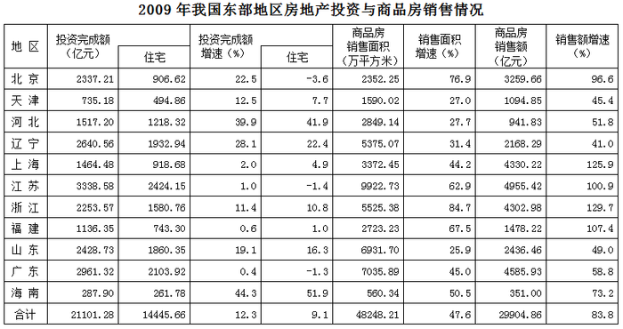

| 地区 | 投资完成额（亿元） | 投资完成额（亿元） 住宅 | 投资完成额增速（%） | 投资完成额增速（%） 住宅 | 商品房销售面积（万平方米） | 销售面积增速（%） | 商品房销售额（亿元） | 销售额增速（%） |
| --- | ---: | ---: | ---: | ---: | ---: | ---: | ---: | ---: |
| 北京 | 2337.21 | 906.62 | 22.5 | −3.6 | 2352.25 | 76.9 | 3259.66 | 96.6 |
| 天津 | 735.18 | 494.86 | 12.5 | 7.7 | 1590.02 | 27.0 | 1094.85 | 45.4 |
| 河北 | 1517.20 | 1218.32 | 39.9 | 41.9 | 2849.14 | 27.7 | 941.83 | 51.8 |
| 辽宁 | 2640.56 | 1932.94 | 28.1 | 22.4 | 5375.07 | 31.4 | 2168.29 | 41.0 |
| 上海 | 1464.48 | 918.68 | 2.0 | 4.9 | 3372.45 | 44.2 | 4330.22 | 125.9 |
| 江苏 | 3338.58 | 2424.15 | 1.0 | −1.4 | 9922.73 | 62.9 | 4955.42 | 100.9 |
| 浙江 | 2253.57 | 1580.76 | 11.4 | 10.8 | 5525.38 | 84.7 | 4302.98 | 129.7 |
| 福建 | 1136.35 | 743.30 | 0.6 | 1.0 | 2723.23 | 67.5 | 1478.22 | 107.4 |
| 山东 | 2428.73 | 1860.35 | 19.1 | 16.3 | 6931.70 | 25.9 | 2436.46 | 49.0 |
| 广东 | 2961.32 | 2103.92 | 0.4 | −1.3 | 7035.89 | 45.0 | 4585.93 | 58.8 |
| 海南 | 287.90 | 261.78 | 44.3 | 51.9 | 560.34 | 50.5 | 351.00 | 73.2 |
| 合计 | 21101.28 | 14445.66 | 12.3 | 9.1 | 48248.21 | 47.6 | 29904.86 | 83.8 |

### 第 141 题

我国东部地区各省（市）中，2009年商品房单位面积销售价格上涨比率最大的省（市）是：

A. 上海

B. 北京

C. 海南

D. 浙江

第 141 题 · 答案与解析

**参考答案（粉笔题库参考内容）**

A

**解析**

根据题干“······单位面积销售价格上涨比率最大······”，可判定本题为平均数的增长率问题。定位表格材料可得：2009年上海、北京、海南、浙江商品房销售额增速(a)分别为125.9%、96.6%、73.2%、129.7%，商品房销售面积增速(b)分别为44.2%、76.9%、50.5%、84.7%。根据公式：平均数增长率=(a-b)/(1+b)，可知上海上涨比率= (125.9% − 44.2%)/(1 + 44.2%) ≈ 0.8/1.4 ≈ 57%，北京上涨比率=(96.6%-76.9%)/(1+76.9%)≈0.2/1.8≈11%，海南上涨比率= (73.2% − 50.5%)/(1+50.5%) ≈ 0.2/1.5 ≈ 13%，浙江上涨比率=(129.7%−84.7%)/(1+84.7%)≈0.5/1.8≈28%。故2009年商品房单位面积销售价格上涨比率最大的是上海。

故正确答案为A。

**来源**：2010年江苏省公务员录用考试《行测》题（B类）第141题

### 第 142 题

我国东部地区各省（市）中，2009年住宅投资完成额占房地产投资完成额比重最高的省（市）以及单位面积商品房售价最低的省（市）分别是：

A. 广东、辽宁

B. 海南、河北

C. 河北、福建

D. 海南、山东

第 142 题 · 答案与解析

**参考答案（粉笔题库参考内容）**

B

**解析**

根据题干“······比重最高的······”，可判定本题为现期比重问题。定位表格材料可得：广东、海南、河北的住宅投资完成额分别为2103.92亿元、261.78亿元、1218.32亿元，房地产投资完成额分别为2961.32亿元、287.90亿元、1517.20亿元。根据公式：比重=部分/整体，可知住宅投资完成额占房地产投资完成额的比重分别为广东：2103.92/2961.32 ≈ 2100/3000 = 70%，海南：261.78/287.90 ≈ 260/290 ≈ 90%，河北：1218.32/1517.20 ≈ 1200/1500 = 80%。

故海南所占比重最高，排除A、C两项。定位表格材料可得：河北、山东的商品房销售面积分别为2849.14万平方米、6931.70万平方米，商品房销售额分别为941.83亿元、2436.46亿元。则2009年河北单位面积商品房售价为941.83/2849.14 ≈ 942/2850 ≈ 0.33亿元/万平方米，山东单位面积商品房售价为2436.46/6931.70 ≈ 2440/6930 ≈ 0.35亿元/万平方米，河北更低。

故正确答案为B。

**来源**：2010年江苏省公务员录用考试《行测》题（B类）第142题

### 第 143 题

2009年江苏省商品房销售面积占我国东部地区商品房销售面积的比重与2008年相比：

A. 下降了1.2个百分点

B. 下降了0.6个百分点

C. 上升了3.8个百分点

D. 上升了1.9个百分点

第 143 题 · 答案与解析

**参考答案（粉笔题库参考内容）**

D

**解析**

根据题干“2009年······比重与2008年相比”，结合选项为“上升/下降了······个百分点”，可判定本题为两期比重计算问题。定位表格材料可得：2009年江苏省商品房销售面积为9922.73万平方米(A)，增速为62.9%(a)；东部地区商品房销售面积为48248.21万平方米(B)，增速为47.6%(b)。可知2009年江苏省商品房销售面积占我国东部地区商品房销售面积的比重与2008年相比上升了A/B×(a−b)/(1+a)= 9922.73/48248.21 × (62.9%-47.6%)/(1+62.9%)≈9900/48000×0.15/1.6≈1.9%，即上升了1.9个百分点。

故正确答案为D。

**来源**：2010年江苏省公务员录用考试《行测》题（B类）第143题

### 第 144 题

我国东部地区各省（市）中，2009年住宅投资完成额占房地产投资完成额比重比2008年有所下降的有：

A. 5个

B. 6个

C. 7个

D. 8个

第 144 题 · 答案与解析

**参考答案（粉笔题库参考内容）**

C

**解析**

根据题干“······2009年······比重比2008年有所下降的有”，可判定本题为两期比重比较问题。根据两期比重比较结论：当部分增长率（a）＜整体增长率（b）时，比重下降。定位表格材料可得：2009年住宅投资完成额增速（a）＜房地产投资完成额增速（b）的有北京(-3.6%＜22.5%)、天津(7.7%＜12.5%)、辽宁(22.4%＜28.1%)、江苏(-1.4%＜1.0%)、浙江(10.8%＜11.4%)、山东(16.3%＜19.1%)、广东(-1.3%＜0.4%)。故2009年住宅投资完成额占房地产投资完成额比重比2008年有所下降的有7个。

故正确答案为C。

**来源**：2010年江苏省公务员录用考试《行测》题（B类）第144题

### 第 145 题

下列分析正确的有：

（1）2009年与2008年相比，我国东部地区各省（市）房地产投资完成额均有所增加。

（2）2009年与2008年相比，我国东部地区各省（市）商品房单位面积售价均有所上涨。

（3）2009年我国东部地区各省（市）住宅投资完成额均占房地产投资完成额的一半以上。

（4）2008年、2009年江苏省住宅投资完成额在我国东部地区各省（市）中均最多。

A. 1个

B. 2个

C. 3个

D. 4个

第 145 题 · 答案与解析

**参考答案（粉笔题库参考内容）**

C

**解析**

（1）定位表格材料可知，2009年我国东部地区各省（市）房地产投资完成额增速均大于0。故2009年与2008年相比，房地产投资完成额均有所增加，正确；

（2）定位表格材料可知，2009年我国东部地区各省（市）商品房销售额增速均大于商品房销售面积增速。根据两期平均数结论：分子（商品房销售额）的增长率a＞分母（商品房销售面积）的增长率b，平均数上升，则商品房单位面积售价上升，正确；

（3）定位表格材料可得：2009年北京市住宅投资完成额为906.62亿元，房地产投资完成额为2337.21亿元。因此2009年北京住宅投资完成额占房地产投资完成额比重= 部分/整体 = 906.62/2337.21 ＜ 50%，错误；

（4）定位表格材料可得：2009年江苏省住宅投资完成额为2424.15亿元，比2018年增长-1.4%。故2008年江苏省住宅投资完成额= 现期/(1+增长率) = 2424.15/(1−1.4%) ≈ 2459亿元。2008年、2009年江苏省住宅投资完成额均大于我国东部地区其它各省（市），正确。

故正确答案为C。

**来源**：2010年江苏省公务员录用考试《行测》题（B类）第145题

## 材料 5

**根据以下资料，完成各题。**

        2009年全国研究生教育招生51.1万人，毕业37.1万人，年末在校生人数为140.5万。普通高等教育本专科招生639.5万人，毕业531.1万人，年末在校生人数2144.7万。各类中等职业教育招生873.6万人，毕业619.2万人，年末在校生人数2178.7万。全国普通高中招生830.3万人，毕业823.7万人，年末在校生人数为2434.3万。全国初中招生1788.5万人，毕业1797.7万人，年末在校生人数为5440.9万。普通小学招生1637.8万人，毕业1805.2万人，年末在校生人数为10071.5万。特殊教育招生6.4万人，年末在校生人数42.8万。

2005-2009年全国普通高等教育本专科招生数以及中等职业教育、普通高中招生数见下图：

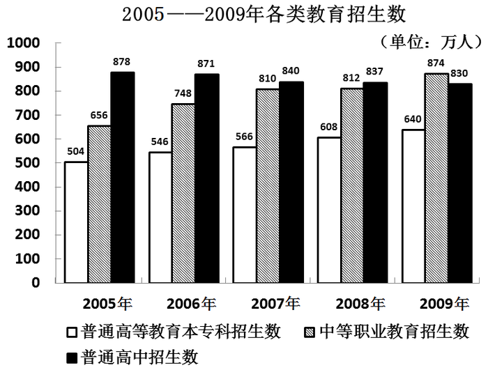

### 第 146 题

按2006-2009年全国普通高等教育本专科招生数年平均增量估算，2011年全国普通高等教育本专科招生数可望达到：

A. 708万人

B. 703万人

C. 694万人

D. 687万人

第 146 题 · 答案与解析

**参考答案（粉笔题库参考内容）**

A

**解析**

根据题干“按2006-2009年······年平均增量估算，2011年······可望达到”，可判定本题为现期追赶问题。定位图形材料可得：2005年和2009年全国普通高等教育本专科招生数分别为504万人和640万人。因此2006-2009年全国普通高等教育本专科招生数平均每年增长(640-504)/4=34万人。根据公式：现期量= 基期量+n×增长量，则2011年全国普通高等教育本专科招生数可望达到= 640 + 34×2 = 708万人。

故正确答案为A。

**来源**：2010年江苏省公务员录用考试《行测》题（B类）第146题

### 第 147 题

2009年全国普通小学毕业生数比招生数多：

A. 177.4万人

B. 9.2万人

C. 10.22%

D. 9.27%

第 147 题 · 答案与解析

**参考答案（粉笔题库参考内容）**

C

**解析**

根据题干“2009年······比······多”，结合选项中有百分数，可判定本题为一般增长率问题。定位文字材料可得：(2009年)普通小学招生1637.8万人，毕业1805.2万人。故2009年全国普通小学毕业生数比招生数多1805.2-1637.8=167.4万人，排除A项和B项；则2009年全国普通小学毕业生数比招生数多(1805.2-1637.8)/1637.8=167.4/1637.8＞10%，只有C项符合。

故正确答案为C。

**来源**：2010年江苏省公务员录用考试《行测》题（B类）第147题

### 第 148 题

2009年资料中全国各类教育招生数之和为：

A. 6036.9万人

B. 5827.2万人

C. 4389.5万人

D. 3663.8万人

第 148 题 · 答案与解析

**参考答案（粉笔题库参考内容）**

B

**解析**

定位文字材料可得：2009年全国研究生教育招生51.1万人，普通高等教育本专科招生639.5万人，各类中等职业教育招生873.6万人，全国普通高中招生830.3万人，全国初中招生1788.5万人，普通小学招生1637.8万人，特殊教育招生6.4万人。故2009年全国各类教育招生数之和为51.1+639.5+873.6+830.3+1788.5+1637.8+6.4，根据尾数法，0.1+0.5+0.6+0.3+0.5+0.8+0.4=3.2，尾数为2，只有B项符合。

故正确答案为B。

**来源**：2010年江苏省公务员录用考试《行测》题（B类）第148题

### 第 149 题

2008年末全国普通高中在校生人数为：

A. 5440.9万人

B. 4786.3万人

C. 2434.3万人

D. 2427.7万人

第 149 题 · 答案与解析

**参考答案（粉笔题库参考内容）**

D

**解析**

定位文字材料可得：(2009年) 全国普通高中招生830.3万人，毕业823.7万人，年末在校生人数为2434.3万。故2008年末全国普通高中在校生人数为2434.3-830.3+823.7，根据尾数法，0.3-0.3+0.7=0.7，尾数为7，只有D项符合。

故正确答案为D。

**来源**：2010年江苏省公务员录用考试《行测》题（B类）第149题

### 第 150 题

下列分析正确的有：

（1）2006-2009年图中各类教育招生数逐渐增加。

（2）2005-2009年普通高中招生数与全国普通高等教育本专科招生数之差平均每年减少46万人。

（3）2006-2009年中等职业教育招生数年平均增长速度高于普通高等教育本专科招生数年平均增长速度。

A. 0个

B. 1个

C. 2个

D. 3个

第 150 题 · 答案与解析

**参考答案（粉笔题库参考内容）**

B

**解析**

（1）定位统计图可得：2007年全国普通高中招生数为840万人，2008年为837万人。并非逐渐增加，错误；

（2）定位统计图可得：2009年普通高中招生数为830万人，普通高等教育本专科招生数为640万人。无2004年普通高中招生数与全国普通高等教育本专科招生数的数据，无法推出所求年均增长量，错误；

（3）定位统计图可得：2005年和2009年中等职业教育招生数分别为656万人和874万人；普通高等教育本专科招生数分别为504万人和640万人。根据年均增长率公式：(1+r)^n = 现期量/基期量，年份差(n)相同时，比较年均增长率(r)的大小，只需要比较现期量/基期量的大小。中等职业教育的现期量/基期量 = 874/656 = 1.3^+，普通高等教育本专科的现期量/基期量 = 640/504 = 1.2^+，故中等职业教育招生数年均增速高于普通高等教育本专科招生数年均增速，正确。

故正确答案为B。

**来源**：2010年江苏省公务员录用考试《行测》题（B类）第150题

## 材料 6

**根据以下资料，完成各题。**

        2009年中国合同能源管理（EPC）项目投资从2008年的116.70亿元增长到195.32亿元，增长67.37%。2009年中国节能服务产业总产值从2008年的417.30亿元增长到587.68亿元，增长40.83%。综合节能投资从2008年的253.20亿元增长到360.37亿元，增长42.33%。按综合节能投资计算，形成年节能能力1757.90万吨标准煤，减排二氧化碳1133.85万吨碳。一系列数据显示，2009年中国在节能减排领域取得了巨大成就。

2003-2009年按综合节能投资计算的节能减排量以及EPC项目投资变化情况见下图：

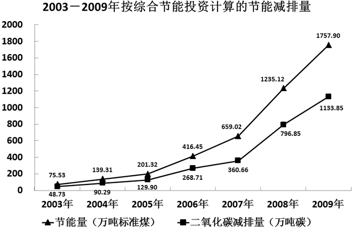

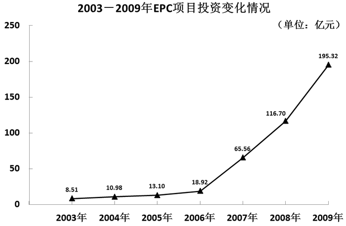

### 第 151 题

下列分析不正确的是：

A. 2003-2009年我国按综合节能投资计算的节能量与二氧化碳减排量走势基本一致

B. 2009年我国EPC项目投资是2004年的近18倍

C. 2009年我国节能服务产业总产值比2008年增加了近170亿元

D. 按综合节能投资计算，2009年我国节能量增长幅度小于2008年

第 151 题 · 答案与解析

**参考答案（粉笔题库参考内容）**

C

**解析**

A项：定位统计图1可知，2003-2009年我国按综合节能投资计算的节能量与二氧化碳减排量都逐年增高，两者走势基本一致，正确；

B项：定位统计图2可得，2004年和2009年我国EPC项目投资分别为10.98亿元和195.32亿元。故 2009年我国EPC项目投资是2004年的195.32/10.98 ≈ 195.32/11 ≈ 17.8倍，17.8略小于18，符合近18倍，正确；

C项：定位文字材料可得，2009年中国节能服务产业总产值从2008年的417.30亿元增长到587.68亿元。故2009年我国节能服务产业总产值比2008年增加了587.68-417.30=170.38亿元＞170亿元，错误；

D项：定位统计图1可得，2007年-2009年我国按综合节能投资计算的节能量分别为659.02万吨标准煤、1235.12万吨标准煤、1757.90万吨标准煤。故2009年我国节能量增长幅度= (1757.90 - 1235.12)/1235.12 ≈ 523/1240 ≈ 42%，2008年我国节能量增长幅度= (1235.12 − 659.02)/659.02 ≈ 576/660 ≈ 87%。42%＜87%，因此按综合节能投资计算，2009年我国节能量增长幅度小于2008年，正确。

本题为选非题，故正确答案为C。

**来源**：2010年江苏省公务员录用考试《行测》题（B类）第151题

### 第 152 题

2009年我国EPC项目投资占2008-2009年EPC项目投资之和的百分比是：

A. 45.5%

B. 58.9%

C. 62.6%

D. 73.8%

第 152 题 · 答案与解析

**参考答案（粉笔题库参考内容）**

C

**解析**

根据题干“······占······百分比是”，结合材料中给了2008年和2009年相关数据，可判定本题为现期比重问题。定位统计图2可得：2008年和2009年我国EPC项目投资分别为116.70亿元和195.32亿元。故2009年我国EPC项目投资占2008-2009年EPC项目投资之和的百分比≈195.32/310≈63%，与C项最接近。

故正确答案为C。

**来源**：2010年江苏省公务员录用考试《行测》题（B类）第152题

### 第 153 题

按综合节能投资计算，2009年我国二氧化碳减排量比2003年多：

A. 1682.37万吨碳

B. 1333.85万吨碳

C. 1085.12万吨碳

D. 667.84万吨碳

第 153 题 · 答案与解析

**参考答案（粉笔题库参考内容）**

C

**解析**

根据题干“······2009年······比2003年多”，且选项带单位，可判定本题为增长量计算问题。定位统计图1可得：2003年和2009年我国二氧化碳减排量分别为48.73万吨碳和1133.85万吨碳。故2009年我国二氧化碳减排量比2003年多1133.85-48.73=1085.12万吨碳。

故正确答案为C。

**来源**：2010年江苏省公务员录用考试《行测》题（B类）第153题

### 第 154 题

2004~2009年我国EPC项目投资增长率超过50%的共有：

A. 2年

B. 3年

C. 4年

D. 5年

第 154 题 · 答案与解析

**参考答案（粉笔题库参考内容）**

B

**解析**

根据题干“2004～2009年······增长率超过50%的共有”，可判定本题为一般增长率问题。定位统计图2可得：2003～2009年我国EPC项目投资分别为8.51亿元、10.98亿元、13.10亿元、18.92亿元、65.56亿元、116.70亿元、195.32亿元。根据公式：增长率= (现期量−基期量)/基期量，可知2004～2009年我国EPC项目投资增长率如下：2004年增长率= (10.98 − 8.51)/8.51 = 2.47/8.51 ＜50%，2005年增长率=(13.10−10.98)/10.98=2.12/10.98＜50%，2006年增长率= (18.92 − 13.10)/13.10 = 5.82/13.10 ＜ 50%，2007年增长率=(65.56−18.92)/18.92=46.64/18.92＞50%，2008年增长率= (116.70-65.56)/65.56 = 51.14/65.56 ＞ 50%，2009年增长率=(195.32−116.70)/116.70=78.62/116.70＞50%。故我国EPC项目投资增长率超过50%的有2007年、2008年、2009年，共有3年。

故正确答案为B。

**来源**：2010年江苏省公务员录用考试《行测》题（B类）第154题

### 第 155 题

对下列分析的正误判断正确的是：

（1）2004-2009年我国EPC项目投资增长率逐年增大。

（2）2004-2009年我国按综合投资计算的二氧化碳减排量增长率逐年增大。

A. （1）（2）都正确

B. （1）正确，（2）错误

C. （1）错误，（2）正确

D. （1）（2）都错误

第 155 题 · 答案与解析

**参考答案（粉笔题库参考内容）**

D

**解析**

（1）定位统计图2可得：2006年、2007年、2008年我国EPC项目投资分别为18.92亿元、65.56亿元、116.70亿元。根据公式：增长率= (现期量−基期量)/基期量，则2007年我国EPC项目投资增长率=(65.56-18.92)/18.92=46.64/18.92＞100%，2008年我国EPC项目投资增长率=(116.70−65.56)/65.56= 51.14/65.56 ＜ 100%，并非逐年增大，错误；

（2）定位统计图1可得：2007年、2008年、2009年我国按综合投资计算的二氧化碳减排量分别为360.66万吨碳、796.85万吨碳、1133.85万吨碳。根据公式：增长率= (现期量−基期量)/基期量，则2008年我国二氧化碳减排量增长率=(796.85-360.66)/360.66= 436.19/360.66 ＞ 100%，2009年我国二氧化碳减排量增长率= (1133.85 − 796.85)/796.85= 337/796.85 ＜ 100%，并非逐年增大，错误。

综上，（1）（2）都错误。

故正确答案为D。

**来源**：2010年江苏省公务员录用考试《行测》题（B类）第155题

