# 2010年江苏省公务员录用考试《行测》题（C类）

<!-- gwy:overview:start -->
> **江苏 · 2010 · 行测 · C类** ｜ 100 题 · 图片 155 处 · 答案随题折叠

| 题型模块 | 题量 | 题号 |
| --- | ---: | ---: |
| 言语理解与表达 | 15 | 1–15 |
| 数量关系 | 20 | 16–35 |
| 判断推理 | 40 | 36–75 |
| 资料分析 | 25 | 76–100 |
| **合计** | **100** | |

导航：[题型与作答说明](#题型与作答说明) · [题目](#题目) · [材料 1](#材料-1)
<!-- gwy:overview:end -->

> 候选采集稿。参考答案及解析来自粉笔页面，不代表官方答案或真实高分答卷；来源使用许可与原卷对应关系仍需人工核实。

## 题型与作答说明

言语理解与表达

（15题）

本部分包括表达与理解两方面的内容。请根据题目要求，在四个选项中选出一个最恰当的答案。

数量关系

（20题）

在这部分试题中，每道题呈现一段表述数字关系的文字，要求你迅速、准确地计算出答案。

判断推理

（40题）

本部分包括图形推理、定义判断、类比推理与逻辑判断四种类型的试题。

资料分析

（25题）

所给出的图、表、文字或综合性资料均有若干个问题要你回答。你应根据资料提供的信息进行分析、比较、计算和判断处理。

## 题目

### 第 1 题

牛年末虎年初，世人已经开始思考：国际旅游岛的规划，对于海南楼市究竟会有多大的利好带动？这一轮房价暴涨，海南岛是否会有＿＿＿＿1993年房产泡沫覆辙的危险？

填入画横线部分最恰当的一项是：

A. 延续

B. 开启

C. 重蹈

D. 出现

第 1 题 · 答案与解析

**参考答案（粉笔题库参考内容）**

C

**解析**

重蹈覆辙：是指重新走上翻过车的老路。比喻不吸取教训，再走失败的老路。文中指出这一轮房价的暴涨，海南是否会有重蹈1993年房产泡沫覆辙的危险。

故正确答案为C。

**考点**：实词填空、词的辨析-搭配对象

**来源**：2010年江苏省公务员录用考试《行测》题（C类）第1题

### 第 2 题

在太阳系中，土星是仅次于木星的第二大行星，＿＿＿＿是地球的100多倍，其巨大的＿＿＿＿可达1300万公里。

依次填入画横线部分最恰当的一项是：

A. 体积 引力场

B. 规模 磁力场

C. 质量 质量场

D. 面积 吸引力

第 2 题 · 答案与解析

**参考答案（粉笔题库参考内容）**

A

**解析**

第一空，形容天体的特征一般不用“面积”这一衡量标准，排除D项；B项“规模”一般用于抽象事物，同样不用作衡量天体的指标，排除。

第二空，后面给出的量化指标为“1300万公里”，为一个距离值，由此可以判断，第二空应为“引力场”。因为超过这一距离可能就没有引力了，而不能说超过这一距离就没有质量了，排除C项。

故正确答案为A。

【文段出处】《土星的卫星——神秘的地球》

**考点**：实词填空、对应关系-前后呼应、词的辨析-搭配对象

**来源**：2010年江苏省公务员录用考试《行测》题（C类）第2题

### 第 3 题

作为互联网革命的产物，网络文化已经成为＿＿＿＿80后一代青年人的主流文化。我们这些印刷文化的过来人，对这一新崛起的网络文化，不管喜欢还是不喜欢，都＿＿＿＿认真对待。

依次填入画横线部分最恰当的一项是：

A. 影响 不得不

B. 支撑 不能不

C. 控制 应该

D. 支持 必须

第 3 题 · 答案与解析

**参考答案（粉笔题库参考内容）**

A

**解析**

第一空，搭配“网络文化”，B项“支撑”和C项“控制”语气程度过重，文中只是说明网络文化对80后产生了影响，故第一个空填入“影响”较为合适，排除B、C两项；D项“支持”与“网络文化”搭配不当，排除。

第二空，代入验证，“不得不”恰好体现了网络文化的影响让传统文化人没法忽视的一种状态，符合语境，当选。

故正确答案为A。

**考点**：实词填空、词的辨析-搭配对象、词的辨析-程度轻重

**来源**：2010年江苏省公务员录用考试《行测》题（C类）第3题

### 第 4 题

统筹城乡管理就是要＿＿＿＿城乡二元经济社会结构，＿＿＿＿体制上和政策上的城市偏向，＿＿＿＿计划经济体制的残留影响，保护农民利益，建立城乡一体的劳动力就业制度、户籍管理制度、教育制度、土地征用制度、社会保障制度等，给农村居民平等的发展机会、完整的财产权利和自由的发展空间，促进城乡要素自由流动和资源优化配置。

依次填入画横线部分最恰当的一项是：

A. 突破 调整 去除

B. 纠正 调整 削除

C. 打破 纠正 去除

D. 突破 纠正 铲除

第 4 题 · 答案与解析

**参考答案（粉笔题库参考内容）**

C

**解析**

第一空，A、D两项“突破”重在强调取得进展；B项“纠正”的前提是方向发生了错误或偏差；C项“打破”重在强调破除原有的限制、拘束等。文中所提到的城乡二元经济是我国经济发展过程中已经形成并长期存在的经济结构，故第一个空用“打破”较为合适。

第二空，代入验证，搭配的是“偏向”，“纠正”搭配恰当，排除A、B、D三项。

第三空，代入验证，文段表达的是把计划经济体制的残留影响去掉，“去除”影响，表意恰当。

故正确答案为C。

**考点**：实词填空、词的辨析-搭配对象

**来源**：2010年江苏省公务员录用考试《行测》题（C类）第4题

### 第 5 题

（1）他其实跟大家一样，也会有自己的局限的，你＿＿＿＿把他说得太好了。

（2）她刚刚正式接手公司主办会计，有时＿＿＿＿忙乱一些。

（3）由于经验不足，我们在工作中走一些弯路是＿＿＿＿的。

依次填入画横线部分最恰当的一项是：

A. 不免 难免 未免

B. 不免 未免 允许

C. 未免 不免 难免

D. 难免 不免 可能

第 5 题 · 答案与解析

**参考答案（粉笔题库参考内容）**

C

**解析**

未免：实在不能不说是······（表示不以为然）；难免：形容事物的不可避免；不免：免不了，难免。根据文中第三句：由于经验不足，我们在工作中走一些弯路是“难免”的，也是习惯用法。

故正确答案为C。

**考点**：对应关系-前后呼应、词的辨析-搭配对象

**来源**：2010年江苏省公务员录用考试《行测》题（C类）第5题

### 第 6 题

《水知道答案》在中国和日本被当做是一本与《时间简史》同样神奇的科普读物。本书用122张前所未见的水晶照片，向世人展示了一项独一无二的科学观察：水能听；水能看；水知道生命的答案。而西方的主流则认为该书只是一本照片小品。

符合文意的一项说法是：

A. 《水知道答案》是一本科普习题集

B. 《水知道答案》是一本科幻著作

C. 《水知道答案》是一本科研著作

D. 《水知道答案》是一本科普照片集

第 6 题 · 答案与解析

**参考答案（粉笔题库参考内容）**

D

**解析**

《水知道答案》在中国和日本被当做科普读物，而西方的主流则认为该书只是一本照片小品。两者综合起来就是一本科普照片集。

故正确答案为D。

**考点**：关联词-并列

**来源**：2010年江苏省公务员录用考试《行测》题（C类）第6题

### 第 7 题

人际关系中，信息传递未必要表现得很得体。你不发脾气，别人未必能感受到你的好意。有时候，一个脾气发得快也去得快的人，反而比一个处处压抑的人容易赢得友谊，因为大家可以预期他的反应模式，可以体会他“有话直说”的急性子，可以知道他在想什么。有话不说、有气就压的人以为自己忍辱负重，却很不讨好。

对文章理解错误的一项是：

A. 发脾气的方式也可传递信息

B. 急性子有让人容易了解的好处

C. 沟通顺畅才有可能赢得友谊

D. 忍辱负重反而会伤害人际关系

第 7 题 · 答案与解析

**参考答案（粉笔题库参考内容）**

D

**解析**

根据文中最后一句“有话不说、有气就压的人以为自己忍辱负重，却很不讨好”中的“以为”可知，“有话不说、有气就压”并非真正地忍辱负重。此外，“伤害人际关系”程度过重，文段只是说“不讨好”，D项错误，当选。A、B两项通过文段“大家可以预期他的反应模式，可以体会他‘有话直说’的急性子，可以知道他在想什么”可知，表述正确，排除；C项对应文段“一个脾气发得快也去得快的人，反而比一个处处压抑的人容易赢得友谊”“可以知道他在想什么”，表述正确，排除。

本题为选非题，故正确答案为D。

**考点**：细节判断题

**来源**：2010年江苏省公务员录用考试《行测》题（C类）第7题

### 第 8 题

短短30年间，中国人寿的市值已经位居全球寿险行业之首，中国平安也跻身2008年全球企业500强之列。究竟是高值泡沫，还是真实增长？究竟是统计数字的幻觉，还是制度进化的蝶变？究竟是竭泽而渔对于保险资源的掠夺式开掘，还是已经建立了可持续发展的向上力量？到底该如何解释中国商业保险的猛然崛起？

这段文字中的“蝶变”是指：

A. 中国保险业猛然崛起的力量

B. 中国保险业质的蜕变与升华

C. 中国商业保险业的飞速发展

D. 中国商业保险业的市值泡沫

第 8 题 · 答案与解析

**参考答案（粉笔题库参考内容）**

B

**解析**

首先定位原文，“蝶变”出现在文段的中间，强调发生一种重大的“变化”。分析文意，由“是统计数字的幻觉，还是制度进化的蝶变”可知，“蝶变”与前文的“幻觉”构成相反语义的对应，强调一种积极的变化，置于此处是指中国保险业质的蜕变与升华，对应B项。

A项“崛起的力量”、C项“飞速发展”、D项“市值泡沫”均与“变化”的语义无关，排除。

故正确答案为B。

**考点**：实词

**来源**：2010年江苏省公务员录用考试《行测》题（C类）第8题

### 第 9 题

干部人事制度改革正渐入佳境。靠自然人来选拔和管理干部，总会潜伏着各种隐患。明智如诸葛亮，也难免会一时走眼而误用马谡之流。近年来出台的一系列规章和条例，醒目的一点就是提拔和任用领导干部，减少人为因素，逐步靠规章以及完善的法制和制度系统来选拔和考察领导干部，扩大和夯实有权决定干部任免的民意基础。

这段文字意在强调干部人事制度改革的要点是：

A. 完善的规章制度

B. 减少人为因素

C. 规范的组织程度

D. 扩大民意基础

第 9 题 · 答案与解析

**参考答案（粉笔题库参考内容）**

B

**解析**

文中前两句指出“靠自然人来选拔和管理干部，总会潜伏着各种隐患”，强调的是人为因素，后半段进一步指出近年来提拔和任用领导干部要减少人为因素，后面“逐步靠规章以及完善的法制和制度系统来选拔和考察领导干部，扩大和夯实有权决定干部任免的民意基础”均为“减少人为因素”的几个具体做法，故文段重点是强调减少人为因素是人事改革的要点。

故正确答案为B。

**考点**：关联词-对策

**来源**：2010年江苏省公务员录用考试《行测》题（C类）第9题

### 第 10 题

速冻食品技术快速地把食物温度降低到远远低于水的凝固点，相当于把食物固定在了冻前的状态。因此，如果不是保存时间很短的真正的“新鲜食品”，那么“速冻食品”更能保存食物的营养并保证它的安全性。

下列说法与文章不符的一项是：

A. 速冻食品技术关键在于速冻

B. 速冻食品可保有食品营养

C. 速冻食品实际优于新鲜食品

D. 速冻食品是具有安全性的

第 10 题 · 答案与解析

**参考答案（粉笔题库参考内容）**

C

**解析**

文中指出速冻食品技术能把食物固定在冻前的状态，能保存食物的营养并保证它的安全性，并不是说速冻食品实际优于新鲜食品。很明显C项错误。

本题为选非题，故正确答案为C。

**考点**：细节判断题

**来源**：2010年江苏省公务员录用考试《行测》题（C类）第10题

## 材料 1

阅读下面文章，回答问题。本题共有五道小题，每道小题提供四个选项。要求你从中选出最恰当的一项，你的选择必须与题干要求符合。

请开始答题：

        以现代医学的观点说，潜水病就是“氮过量病”。在常规气压环境下，人体内部组织液中溶解着饱和量的氮。这些气体的溶解量将随着外界的压力变化而出现波动。压力大，体液能溶解的氮就多，反之则少。当外界压力降低，溶解进体液的氮气就会被释放出来。一般来说，我们能通过呼吸，从肺部将这些多余的氮气吐出去。但是一旦外界压力降低的速度过快，一定时间内体液中的氮来不及通过肺离开身体，他们就会从体液中分离，形成气泡。这些极微小的气泡首先会出现在肌肉关节等部位，影响局部的组织健康，产生类似关节炎或者是肌肉发炎的一系列病痛。当气泡越来越多，血液系统中就会出现大量小气泡融合成的大气泡，形成气体堵塞血管。一旦脑血管被堵塞，患者就有瘫痪甚至死亡的危险。

        过去在桥梁建造中“沉箱法”被用于满足特殊要求的水下作业。在沉箱中工作的人，就像那些深潜的渔民，所处的是一个高压环境。随着呼吸，大量的氮气就会溶进体液，而当他们通过隔离舱离开沉箱的时候，减压过程稍有过快，他们就会像快速上浮的潜水者一样，在体内形成大量的气体。少数重症患者将直接死于由此引起的急性心脑血管疾病，大部分患者的状况是：体内气泡集中在关节，随着症状的加剧，不得不靠弯腰来缓解腰背部异常的酸痛。这时他们的体态特别像当时一些女演员喜欢摆出的“翘屁股病”。

        其实，只要注意减压速度就能有效预防这种情况。不过在当时，连医生也没有意识到“翘屁股病”就是潜水病，威胁工人健康安全的就是氮气，为他们治病的医生还煞有介事地将这种疾病命名为“沉箱病”。

        时至今日，＿＿＿＿＿＿的“沉箱病”以及＿＿＿＿＿＿的“翘屁股病”有了一个统一的名字：“减压病”，及时吸氧和高压舱治疗已经能有效控制这种疾病。

### 第 11 题

潜水病出现过多个不同病名，原因是：

A. 出现时间不同

B. 症状表现不同

C. 命名医生不同

D. 病因认识不同

第 11 题 · 答案与解析

**参考答案（粉笔题库参考内容）**

D

**解析**

第一段中：“以现代医学的观点说，潜水病就是‘氮过量病’”。

第二段中：“体内气泡集中在关节，随着症状的加剧，不得不靠弯腰来缓解腰背部异常的酸痛。这时他们的体态特别像当时一些女演员喜欢摆出‘翘屁股病’”。

最后一段中：“有了一个统一的名字‘减压病’，及时吸氧和高压舱治疗已经能有效控制这种疾病”。可见，由于对病因的认识不同有多个不同的病名。

故正确答案为D。

**来源**：2010年江苏省公务员录用考试《行测》题（C类）第11题

### 第 12 题

形成潜水病的真正原因是：

A. 潜入深水打鱼

B. 水下沉箱作业

C. 体内氮气过多

D. 外界压力降低

第 12 题 · 答案与解析

**参考答案（粉笔题库参考内容）**

C

**解析**

由文段首句“以现代医学的观点说，潜水病就是‘氮过量病’”，以及整个文段的阐述可知，潜水病的真正原因就是体内氮气过量。

故正确答案为C。

**来源**：2010年江苏省公务员录用考试《行测》题（C类）第12题

### 第 13 题

下列不属于潜水病症状的是：

A. 形成气泡

B. 关节疼痛

C. 血管堵塞

D. 腰背酸痛

第 13 题 · 答案与解析

**参考答案（粉笔题库参考内容）**

A

**解析**

文章第一段中讲到：“但是一旦外界压力降低的速度过快，一定时间内体液中的氮来不及通过肺离开身体，他们就会从体液中分离，形成气泡。这些极微小的气泡首先会出现在肌肉关节等部位，影响局部的组织健康，产生类似关节炎或者是肌肉发炎的一系列病痛。”可见气泡是病因，不是病症。

故正确答案为A。

**来源**：2010年江苏省公务员录用考试《行测》题（C类）第13题

### 第 14 题

依次填入文中划横线部分最恰当的一项是：

A. 不伦不类 庸俗不堪

B. 稀奇古怪 不甚文雅

C. 不明不白 低级粗俗

D. 荒诞可笑 不堪入目

第 14 题 · 答案与解析

**参考答案（粉笔题库参考内容）**

B

**解析**

第一空，修饰“沉箱病”，A项“不伦不类”形容不成样子或者说话没有道理，不能直接用来形容“沉箱病”，可以说这种现象叫做“沉箱病”是不伦不类的，排除；C项“不明不白”指说话含含糊糊不清楚，或指行为暧昧，同样不能修饰“沉箱病”，排除。

第二空，修饰“翘屁股病”，D项“不堪入目”搭配不当，不能说“病”不堪入目，可以说“翘屁股病”不堪入目，排除。

验证B项，第一空，“稀奇古怪的沉箱病”和第二空“不甚文雅的翘屁股病”均搭配恰当，符合文意，当选。

故正确答案为B。

**来源**：2010年江苏省公务员录用考试《行测》题（C类）第14题

### 第 15 题

文章中没有涉及的内容是：

A. 减压病可以预防治疗

B. 减压病名的由来

C. 减压病的主要症状

D. 根治减压病的办法

第 15 题 · 答案与解析

**参考答案（粉笔题库参考内容）**

D

**解析**

由文章最后一句“有了一个统一的名字‘减压病’，及时吸氧和高压舱治疗已经能有效控制这种疾病”可知，“有效控制”并不是指“根治减压病”。

本题为选非题，故正确答案为D。

**来源**：2010年江苏省公务员录用考试《行测》题（C类）第15题

### 第 16 题

16，26，38，52，68，（    ）

A. 79

B. 84

C. 86

D. 88

第 16 题 · 答案与解析

**参考答案（粉笔题库参考内容）**

C

**解析**

数列无明显特征，优先考虑作差。后项减前项，得到新数列10，12，14，16，是公差为2的等差数列，则新数列下一项是18，故所求项=16+2+68=86。

故正确答案为C。

**来源**：2010年江苏省公务员录用考试《行测》题（C类）第16题

### 第 17 题

3，5，9，16，28，（  ）

A. 38

B. 48

C. 59

D. 71

第 17 题 · 答案与解析

**参考答案（粉笔题库参考内容）**

B

**解析**

方法一：数列无明显特征，考虑作差。后项减前项得到新数列：2、4、7、12，观察发现：2+4+1=7，4+7+1=12，即每相邻三项中，第一项+第二项+1=第三项，则新数列的下一项为7+12+1=20。故所求项为20+28=48。

方法二：圈三数，找规律。观察发现：3+5+1=9，5+9+2=16，9+16+3=28，即第一项+第二项+修正项=第三项，修正项为1、2、3，是公差为1的等差数列，则下一个修正项为3+1=4。故所求项为16+28+4=48。

故正确答案为B。

**来源**：2010年江苏省公务员录用考试《行测》题（C类）第17题

### 第 18 题

1，25/24，17/18，43/54，（   ），122/243

A. 53/81

B. 52/81

C. 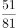

D. 51/80

第 18 题 · 答案与解析

**参考答案（粉笔题库参考内容）**

B

**解析**

数列中大部分是分数，判定为分数数列。分子分母无明显规律，考虑反约分。原数列化为：16/16，25/24，34/36，43/54，（    ），61/121.5，分子部分为16，25，34，43，（    ），61，是公差为9的等差数列，则所求项的分子为43+9=52。分母部分为16，24，36，54，（    ），121.5，是公比为1.5的等比数列。则所求项的分母为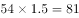。故所求项=52/81。

故正确答案为B。

**来源**：2010年江苏省公务员录用考试《行测》题（C类）第18题

### 第 19 题

5，7，11，15，23，（  ）

A. 25

B. 27

C. 28

D. 31

第 19 题 · 答案与解析

**参考答案（粉笔题库参考内容）**

B

**解析**

数列起伏不大，无明显特征，作差作和无规律，考虑因式分解。观察发现：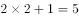，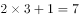，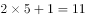，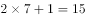，，即规律为：每一项=2×质数+1，故所求项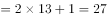。

故正确答案为B。

**来源**：2010年江苏省公务员录用考试《行测》题（C类）第19题

### 第 20 题

2，1，5，7，17，31，（  ）

A. 59

B. 61

C. 65

D. 69

第 20 题 · 答案与解析

**参考答案（粉笔题库参考内容）**

C

**解析**

方法一：数列无明显特征，作差无规律，考虑递推。观察发现：，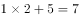，，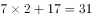，即第一项×2+第二项=第三项。则所求项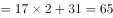。

方法二：数列无明显特征，作差无规律，考虑作和。前一项+后一项得到新数列：3，6，12，24，48，是公比为2的等比数列，则新数列下一项是96，故所求项=96-31=65。

故正确答案为C。

**来源**：2010年江苏省公务员录用考试《行测》题（C类）第20题

### 第 21 题

3，5，16，82，1315，（  ）

A. 107834

B. 12849

C. 12847

D. 108847

第 21 题 · 答案与解析

**参考答案（粉笔题库参考内容）**

A

**解析**

数列变化幅度较大且呈递增趋势，考虑递推数列。圈三数，找规律。观察发现：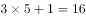，，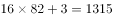，即第一项×第二项+修正项=第三项，修正项为1、2、3，是公差为1的等差数列，则所求修正项为3+1=4。故所求项=82×1315+4，根据尾数法，2×5+4=14，尾数为4，只有A项符合。

故正确答案为A。

**来源**：2010年江苏省公务员录用考试《行测》题（C类）第21题

### 第 22 题

√2，1/2，4，（    ），256

A. 8

B. 1/16

C. 1/32

D. 1/64

第 22 题 · 答案与解析

**参考答案（粉笔题库参考内容）**

B

**解析**

数列均为幂次数，考虑幂次数列。原数列可化为：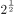，2^-1，2^2，（    ），2^8，底数均为2，指数是公比为-2的等比数列，则下一项指数为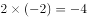。故所求项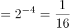。

故正确答案为B。

**来源**：2010年江苏省公务员录用考试《行测》题（C类）第22题

### 第 23 题

3，0，15，8，（  ），24

A. 20

B. 30

C. 35

D. 40

第 23 题 · 答案与解析

**参考答案（粉笔题库参考内容）**

C

**解析**

数列项数较多，考虑多重数列。先交叉，奇数项：3=1×3，，规律为递增奇数相乘；偶数项：0=0×2，8=2×4，，规律为递增偶数相乘。所求项为奇数项，故所求项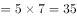。

故正确答案为C。

**来源**：2010年江苏省公务员录用考试《行测》题（C类）第23题

### 第 24 题

158，181，216，265，330，（  ）

A. 397

B. 413

C. 424

D. 431

第 24 题 · 答案与解析

**参考答案（粉笔题库参考内容）**

B

**解析**

数列无明显特征，优先考虑作差。后项减前项得到数列：23，35，49，65，观察无规律，继续作差，后项减前项得到新数列：12，14，16，是公差为2的等差数列，则新数列下一项=16+2=18，故所求项=18+65+330=413。

故正确答案为B。

**来源**：2010年江苏省公务员录用考试《行测》题（C类）第24题

### 第 25 题

0，1，5，23，119，（  ）

A. 315

B. 519

C. 719

D. 819

第 25 题 · 答案与解析

**参考答案（粉笔题库参考内容）**

C

**解析**

数字起伏较大，无明显特征，且作差无规律，考虑递推。观察发现：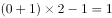，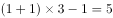，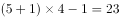，，即，倍数是常数数列，下一项的倍数是6。则所求项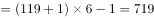。

故正确答案为C。

**来源**：2010年江苏省公务员录用考试《行测》题（C类）第25题

### 第 26 题

大学生进行9天野营拉练，晴天每天走32千米，雨天每天走25千米，一共走了274千米，则拉练期间雨天的天数是:

A. 1

B. 4

C. 5

D. 2

第 26 题 · 答案与解析

**参考答案（粉笔题库参考内容）**

D

**解析**

设拉练期间雨天为x天，晴天为(9-x)天，根据题意可列方程25x+32(9-x)=274，解得x=2。

故正确答案为D。

**考点**：普通行程

**来源**：2010年江苏省公务员录用考试《行测》题（C类）第26题

### 第 27 题

小李所在的科室共有5人，在年终测评中，小李的四位同事得分分别为68、92、81和79，小李的得分比5个人的平均分高10分，则小李的得分是：

A. 81分

B. 88分

C. 92.5分

D. 90分

第 27 题 · 答案与解析

**参考答案（粉笔题库参考内容）**

C

**解析**

设小李的得分为x分，则5人平均分为(x-10)分，根据题意可列方程5(x-10)=68+92+81+79+x，解得x=92.5。

故正确答案为C。

**来源**：2010年江苏省公务员录用考试《行测》题（C类）第27题

### 第 28 题

在连续奇数1，3，······，205，207中选取N个不同数，使得它们的和为2359，那么N的最大值是：

A. 47

B. 48

C. 50

D. 51

第 28 题 · 答案与解析

**参考答案（粉笔题库参考内容）**

A

**解析**

N个奇数的和是2359，则N一定是一个奇数，排除B、C两项。要使N的取值最大，则所选择的这N个数要尽量小，那么就从最小的1开始取。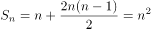。要使N最大，则首先代入D项，当N=51时，，排除D项。

故正确答案为A。

**考点**：数列问题、非典型最值问题

**来源**：2010年江苏省公务员录用考试《行测》题（C类）第28题

### 第 29 题

某部门共有82人，其中男性62人，本省籍42人，不是本省籍的女性11人，则本省籍的男性人数有：

A. 33

B. 21

C. 22

D. 23

第 29 题 · 答案与解析

**参考答案（粉笔题库参考内容）**

A

**解析**

由题意可得，女性职工有82-62=20人。非本省籍女性11人，则本省籍女性20-11=9人。本省籍一共42人，则本省籍男性是42-9=33人。

故正确答案为A。

**考点**：两集合

**来源**：2010年江苏省公务员录用考试《行测》题（C类）第29题

### 第 30 题

若mn＞0，a>0且不等式组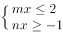中的x的最大解区为\[-2a，1/a\]，则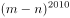的最小值是：

A. 0

B. 1

C. 2^2010

D. (2a)^2010

第 30 题 · 答案与解析

**参考答案（粉笔题库参考内容）**

A

**解析**

题干较复杂，可代入选项计算。求最小值，即从最小项开始代入：代入A选项，当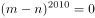，可得m=n。mn＞0，可分情况讨论：当m＞0，n＞0时，由不等式方程组可得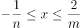，结合x的最大解区可得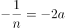；2/m=1/a，即n=1/(2a)，m=2a，由m=n可得，1/(2a) = 2a，解得a=1/2。当m＜0，n＜0时，同理可得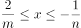，即2/m=-2a，1/n=1/a，则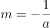，n=-a，即-1/a=-a，解得a=1，满足题干中所有条件。故最小值为0。

故正确答案为A。

**来源**：2010年江苏省公务员录用考试《行测》题（C类）第30题

### 第 31 题

将10克盐和200克浓度为5%的盐水一起加入一杯水中，可得浓度为2.5%的盐水，则原来杯中水的克数是：

A. 570

B. 580

C. 590

D. 600

第 31 题 · 答案与解析

**参考答案（粉笔题库参考内容）**

C

**解析**

200克浓度为5%的盐水含盐，则最后制成的盐水中含盐10+10=20克，最终制成的盐水为20÷2.5%=800克，即可知原来杯中水有800-10-200=590克。

故正确答案为C。

**来源**：2010年江苏省公务员录用考试《行测》题（C类）第31题

### 第 32 题

有8个盒子，分别装有17个、24个、29个、33个、35个、36个、38个和44个乒乓球，小赵先取走一盒，其余各盒被小钱、小孙和小李三人取走，已知小钱和小孙取走的乒乓球个数相同，并且是小李取走的两倍，则小赵取走的一盒乒乓球的个数是：

A. 24

B. 33

C. 35

D. 36

第 32 题 · 答案与解析

**参考答案（粉笔题库参考内容）**

D

**解析**

设小李取了x个球，小赵取了y个球，则小钱和小孙取了2x个球。由题意可得等式x+2x+2x+y=17+24+29+33+35+36+38+44=256。即5x+y=256，5x的尾数是0或5，则y的尾数必须是6或1，结合选项，只有D项符合条件。

故正确答案为D。

**来源**：2010年江苏省公务员录用考试《行测》题（C类）第32题

### 第 33 题

某城市有A、B、C、D四个区，B、C、D三区的面积之和是A区的14倍，A、C、D三区的面积之和是B区的9倍，A、B、D三区的面积之和是C区的2倍，则A、B、C三区的面积之和是D区的：

A. 1倍

B. 1.5倍

C. 2倍

D. 3倍

第 33 题 · 答案与解析

**参考答案（粉笔题库参考内容）**

A

**解析**

由题意可得：B+C+D=14A······①；A+C+D=9B······②；A+B+D=2C······③。①-②可得A=2/3B；②-③可得C = (10/3)B；将A=2/3B，C = (10/3)B代入②式可得D=5B。则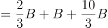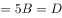。即A、B、C三区的面积之和是D区的1倍。

故正确答案为A。

**考点**：和差倍比问题

**来源**：2010年江苏省公务员录用考试《行测》题（C类）第33题

### 第 34 题

面包坊促销，面包打8折，晚上八点以后再打8折，某人晚上八点半去买面包，共付了30.72元，这些面包的原价是：

A. 85元

B. 40元

C. 48元

D. 50元

第 34 题 · 答案与解析

**参考答案（粉笔题库参考内容）**

C

**解析**

由题意可得：八点后的价格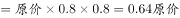，故某人买的蛋糕的原价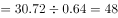元。

故正确答案为C。

**考点**：经济利润问题

**来源**：2010年江苏省公务员录用考试《行测》题（C类）第34题

### 第 35 题

已知一直角三角形的一个直角边长为12，且周长比面积的数值小18，则该三角形的面积是：

A. 20

B. 36

C. 54

D. 96

第 35 题 · 答案与解析

**参考答案（粉笔题库参考内容）**

C

**解析**

几何问题，题干较复杂，考虑代入排除法。代入A项：三角形面积为20，则周长为20-18=2＜12，不满足题意，排除；代入B项：三角形面积为36，则另一直角边为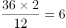，斜边为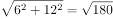，非整数，则三角形周长非整数，排除；代入C项：三角形面积为54，则另一直角边为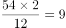，斜边为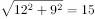，则三角形周长数值减去面积数值为12+9+15-54=-18，满足题意，当选。

故正确答案为C。

**考点**：几何公式类-平面图形、几何结论类-三角形相关

**来源**：2010年江苏省公务员录用考试《行测》题（C类）第35题

### 第 36 题

同情：怜悯

A. 当然：实际

B. 宽恕：饶恕

C. 偶然：必然

D. 所有：有些

第 36 题 · 答案与解析

**参考答案（粉笔题库参考内容）**

B

**解析**

题干中同情和怜悯是近义词，选项中只有宽恕和饶恕是近义词。

故正确答案为B。

**考点**：语义关系-近义关系

**来源**：2010年江苏省公务员录用考试《行测》题（C类）第36题

### 第 37 题

时间：秒

A. 质量：千克

B. 面积：公里

C. 容积：千万

D. 伏特：电压

第 37 题 · 答案与解析

**参考答案（粉笔题库参考内容）**

A

**解析**

时间的单位是秒，质量的单位是千克，电压的单位是伏特。再看题干，先是物理量后是单位。

故正确答案为A。

**考点**：逻辑关系-对应关系

**来源**：2010年江苏省公务员录用考试《行测》题（C类）第37题

### 第 38 题

闹钟：指针

A. 鸡蛋：蛋类

B. 鸭蛋：鸭子

C. 鸡蛋：蛋壳

D. 鸭子：家禽

第 38 题 · 答案与解析

**参考答案（粉笔题库参考内容）**

C

**解析**

第一步：判断题干词语间逻辑关系。

题干两个词属于包容关系中的组成关系，指针是闹钟的组成部分之一。

第二步：判断选项词语间逻辑关系。

A项，鸡蛋是蛋类的一种，两者是种属关系，与题干逻辑关系不一致，排除；

B项，鸭蛋是鸭子的产物，两者是对应关系，与题干逻辑关系不一致，排除；

C项，蛋壳是鸡蛋的组成部分之一，两者是组成关系，与题干逻辑关系一致，当选；

D项，鸭子是家禽的一种，两者是种属关系，与题干逻辑关系不一致，排除。

故正确答案为C。

**考点**：逻辑关系-包容关系

**来源**：2010年江苏省公务员录用考试《行测》题（C类）第38题

### 第 39 题

台灯：书桌

A. 寺庙：蜡烛

B. 石像：菩萨

C. 荷花：庙会

D. 地图：墙壁

第 39 题 · 答案与解析

**参考答案（粉笔题库参考内容）**

D

**解析**

第一步：判断题干词语间逻辑关系。

题干两个词语是对应关系，台灯放在书桌上，物品与它存放位置的对应。

第二步：判断选项词语间逻辑关系。

A项，不能说“寺庙放在蜡烛上”，两者不是对应关系，与题干逻辑关系不一致，排除；

B项，石像和菩萨是交叉关系：有些石像是菩萨，但是不能说“石像放在菩萨上”，两者不是对应关系，与题干逻辑关系不一致，排除；

C项，荷花和庙会没有明显逻辑关系，与题干逻辑关系不一致，排除；

D项，地图挂在墙壁上，物品与它存放位置的对应，与题干逻辑关系一致，当选。

故正确答案为D。

**考点**：逻辑关系-对应关系

**来源**：2010年江苏省公务员录用考试《行测》题（C类）第39题

### 第 40 题

结构：剖析

A. 分享：快乐

B. 资源：利用

C. 景色：秀美

D. 交通：航运

第 40 题 · 答案与解析

**参考答案（粉笔题库参考内容）**

B

**解析**

题干可以构成动宾关系，排除C、D两项；A、B两项都可以构成动宾关系，再看题干，名词在前动词在后，B项符合。

故正确答案为B。

**考点**：语法关系

**来源**：2010年江苏省公务员录用考试《行测》题（C类）第40题

### 第 41 题

有限：无限

A. 奇数：偶数

B. 陆地：海洋

C. 正数：负数

D. 远亲：近邻

第 41 题 · 答案与解析

**参考答案（粉笔题库参考内容）**

A

**解析**

第一步：判断题干词语间的逻辑关系。

从范围、大小的范畴上来说，有限和无限是矛盾关系。

第二步：判断选项词语间的逻辑关系。

A项：从正数的范畴上来说，奇数和偶数是矛盾关系，与题干逻辑关系一致，当选；

B项：从地球组成的范畴上来说，除了陆地和海洋，还有天空，二者是反对关系，与题干逻辑关系不一致，排除；

C项：从数字组成的范畴上来说，除了正数、负数，还有零，二者是反对关系，与题干逻辑关系不一致，排除；

D项：从人与人之间关系的范畴上来说，除了远亲、近邻，还有在身边的亲人，二者是反对关系，与题干逻辑关系不一致，排除。

故正确答案为A。

**考点**：逻辑关系-并列关系

**来源**：2010年江苏省公务员录用考试《行测》题（C类）第41题

### 第 42 题

企鹅：玛瑙

A. 电脑：手机

B. 秃鹫：石墨

C. 苹果：木瓜

D. 蝴蝶：蚱蜢

第 42 题 · 答案与解析

**参考答案（粉笔题库参考内容）**

B

**解析**

题干中企鹅是生物，玛瑙是矿物。只有B项中秃鹫是生物，石墨是矿物。

故正确答案为B。

**考点**：逻辑关系-对应关系

**来源**：2010年江苏省公务员录用考试《行测》题（C类）第42题

### 第 43 题

琵琶：浩淼

A. 荏苒：枇杷

B. 谦虚：违背

C. 拉拢：苦修

D. 卑鄙：吵闹

第 43 题 · 答案与解析

**参考答案（粉笔题库参考内容）**

D

**解析**

第一步：判断题干词语间的逻辑关系。

本题可从词语的拼音上找规律。“琵琶”两个字的拼音中都含有声母“p”；“浩淼”两个字的拼音中都含有韵母“ao”，也就是说第一个词中声母相同，第二个词中韵母相同。

第二步：判断选项词语间的逻辑关系。

A项：“荏苒”两个字的拼音中都含有声母“r”；“枇杷”两个字的拼音中韵母不同，与题干逻辑关系不一致，排除；（注：如果从偏旁部首这个角度考虑，虽然A项中“荏苒”偏旁部首相同，“枇杷”偏旁部首相同，但题干“浩淼”偏旁部首不同，所以不能看偏旁部首。）

B项：“谦虚”两个字的拼音中声母不同，与题干逻辑关系不一致，排除；

C项：“拉拢”两个字的拼音中都含有声母“l”；“苦修”两个字的拼音中韵母不同，与题干逻辑关系不一致，排除；

D项：“卑鄙”两个字的拼音中都含有声母“b”；“吵闹”两个字的拼音中都含有韵母“ao”，与题干逻辑关系一致，当选。

故正确答案为D。

注：此种考法相对较少，但2010年江苏ABC类均有一道题涉及，大家了解即可。

**考点**：逻辑关系-对应关系

**来源**：2010年江苏省公务员录用考试《行测》题（C类）第43题

### 第 44 题

锐：任

A. 润：采

B. 果：呆

C. 壤：轮

D. 聪：明

第 44 题 · 答案与解析

**参考答案（粉笔题库参考内容）**

C

**解析**

题干两字都是形声字，只有C项是形声字。

故正确答案为C。

**考点**：逻辑关系-对应关系

**来源**：2010年江苏省公务员录用考试《行测》题（C类）第44题

### 第 45 题

师傅：雄师

A. 修长：自修

B. 帝国：称帝

C. 目标：夺目

D. 点缀：标点

第 45 题 · 答案与解析

**参考答案（粉笔题库参考内容）**

A

**解析**

第一步：判断题干词语间的逻辑关系。

题干两词中都包含同一个字“师”，但在两词中的含义是不同的，师傅中的“师”是指某些传授知识技术的人；雄师的“师”是指军队、士兵。

第一步：判断选项词语间的逻辑关系。

A项：修长的“修”是长、高之意；自修的“修”是指学习。“修”在两词中的含义是不同的，与题干逻辑关系一致，保留；

B项：帝国和称帝中的“帝”都是君主、皇帝之意，与题干逻辑关系不一致，排除；

C项：目标的“目”是有看之意；夺目的“目”是指“眼睛”。“目”在两词中的含义是不同的，与题干逻辑关系一致，保留；

D项：点缀和标点的“点”都有加以衬托或装饰之意，与题干逻辑关系不一致，排除。

对比A、C两项，题干中的师傅是并列短语，雄师是偏正短语，只有A项修长是并列短语，自修是偏正短语，符合此规律。

故正确答案为A。

**考点**：拆分思维

**来源**：2010年江苏省公务员录用考试《行测》题（C类）第45题

### 第 46 题

请从所给的四个选项中，选择唯一的一个答案，使之呈现一定的规律性：

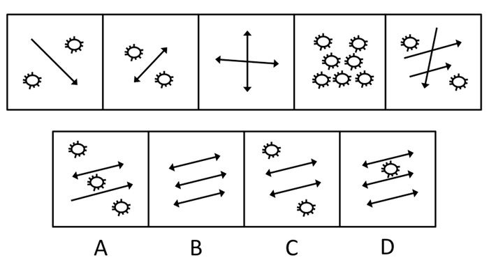

A. A

B. B

C. C

D. D

第 46 题 · 答案与解析

**参考答案（粉笔题库参考内容）**

B

**解析**

图形中出现3种元素：线段、箭头、花形，元素数量多，考虑数元素个数。各图元素个数依次为4、5、6、7、8，则下一个图形应该为9个元素。

故正确答案为B。

**考点**：数量规律-素

**来源**：2010年江苏省公务员录用考试《行测》题（C类）第46题

### 第 47 题

请从所给的四个选项中，选择唯一的一个答案，使之呈现一定的规律性：

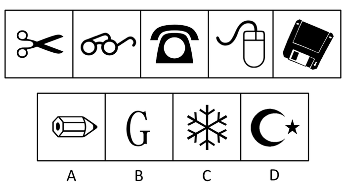

A. A

B. B

C. C

D. D

第 47 题 · 答案与解析

**参考答案（粉笔题库参考内容）**

A

**解析**

题干中给出的五个图都是人类发明的工具，只有A项是人类发明的工具。

故正确答案为A。

**来源**：2010年江苏省公务员录用考试《行测》题（C类）第47题

### 第 48 题

请从所给的四个选项中，选择唯一的一个答案，使之呈现一定的规律性：

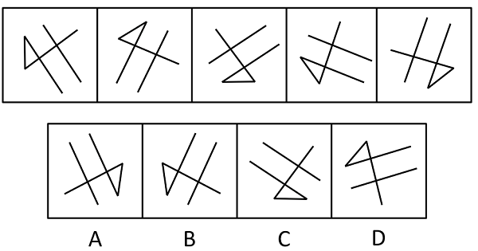

A. A

B. B

C. C

D. D

第 48 题 · 答案与解析

**参考答案（粉笔题库参考内容）**

A

**解析**

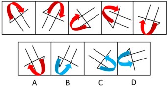

图形元素组成相同，优先考虑位置规律。观察发现，题干各图均能旋转一定的角度得到，只有A项可以通过旋转得到，而B、C、D三项都需要翻转。

故正确答案为A。

**考点**：位置规律-旋转

**来源**：2010年江苏省公务员录用考试《行测》题（C类）第48题

### 第 49 题

请从所给的四个选项中，选择唯一的一个答案，使之呈现一定的规律性：

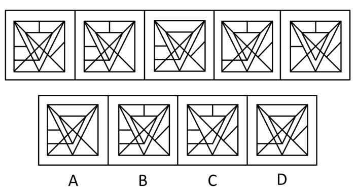

A. A

B. B

C. C

D. D

第 49 题 · 答案与解析

**参考答案（粉笔题库参考内容）**

C

**解析**

观察题干中五个图形，可发现后四个图形都是在图1的基础上减少一条线段得到的，只有C项比图1少一条线段。

故正确答案为C。

**考点**：数量规律-线

**来源**：2010年江苏省公务员录用考试《行测》题（C类）第49题

### 第 50 题

请从所给的四个选项中，选择唯一的一个答案，使之呈现一定的规律性：

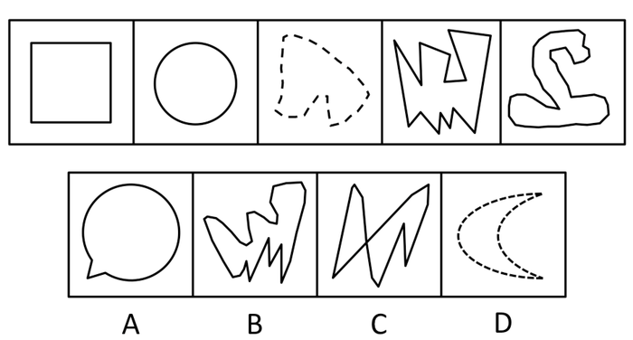

A. A

B. B

C. C

D. D

第 50 题 · 答案与解析

**参考答案（粉笔题库参考内容）**

D

**解析**

图1是由直线构成的封闭空间，图2是由曲线构成的封闭空间，图3是由虚线构成的图形，图4是由直线构成的封闭空间，图5是由曲线构成的封闭空间，由此可知每3个构成一个循环，所以下一个应为虚线构成的图形，只有D项符合。

故正确答案为D。

**考点**：属性规律-复合

**来源**：2010年江苏省公务员录用考试《行测》题（C类）第50题

### 第 51 题

请从所给的四个选项中，选择唯一的一个答案填在问号处，使之呈现一定的规律性：

A. A

B. B

C. C

D. D

第 51 题 · 答案与解析

**参考答案（粉笔题库参考内容）**

B

**解析**

元素组成不同，优先考虑属性规律。观察发现，九宫格第一行图形的对称轴数分别是1、0、4，总共为5条；第二行图形的对称轴数分别是1、4、0，总共为5条；第三行图形的对称轴数分别是4、0，则下一个图形对称轴数应为1条，只有B项是一条对称轴。

故正确答案为B。

**考点**：属性规律-对称性

**来源**：2010年江苏省公务员录用考试《行测》题（C类）第51题

### 第 52 题

请从所给的四个选项中，选择唯一的一个答案填在问号处，使之呈现一定的规律性：

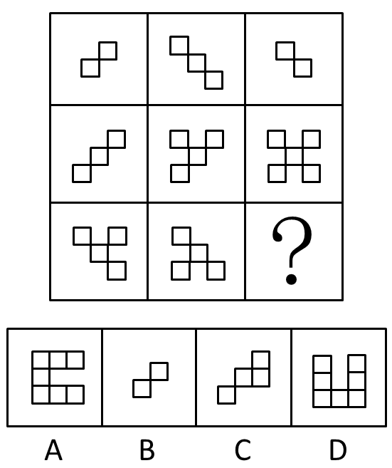

A. A

B. B

C. C

D. D

第 52 题 · 答案与解析

**参考答案（粉笔题库参考内容）**

B

**解析**

九宫格中给出的八个图中，任意相邻的两个小四边形都只有一个交点，均没有出现公共边，只有B项符合此规律，A、C、D三项中均出现了公共边。

故正确答案为B。

**考点**：特殊规律-图形间关系

**来源**：2010年江苏省公务员录用考试《行测》题（C类）第52题

### 第 53 题

请从所给的四个选项中，选择唯一的一个答案填在问号处，使之呈现一定的规律性：

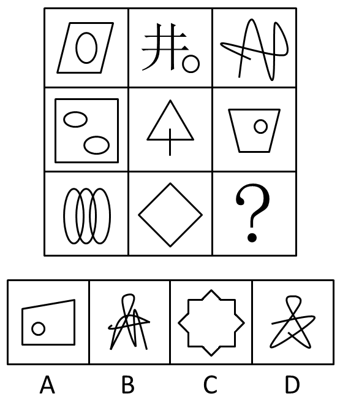

A. A

B. B

C. C

D. D

第 53 题 · 答案与解析

**参考答案（粉笔题库参考内容）**

A

**解析**

数交点个数。各图中交点个数均为4。

故正确答案为A。

**考点**：数量规律-点、文字/字母/数字类

**来源**：2010年江苏省公务员录用考试《行测》题（C类）第53题

### 第 54 题

请从所给的四个选项中，选择唯一的一个答案填在问号处，使之呈现一定的规律性：

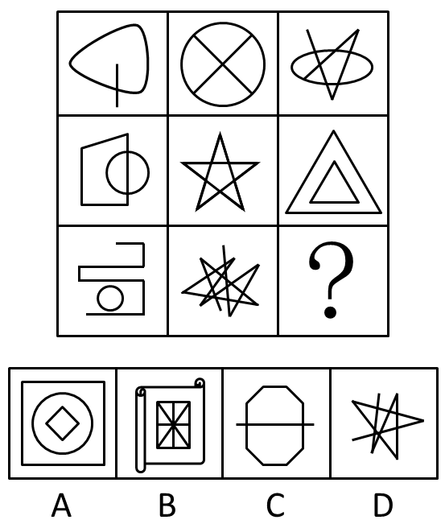

A. A

B. B

C. C

D. D

第 54 题 · 答案与解析

**参考答案（粉笔题库参考内容）**

C

**解析**

图形凌乱，但均含有直线段，考虑数该元素个数。九宫格中，直线段的条数依次为1、2、3、4、5、6、7、8，依此规律，下一个图形中直线段应为9条。

故正确答案为C。

**考点**：数量规律-线

**来源**：2010年江苏省公务员录用考试《行测》题（C类）第54题

### 第 55 题

请从所给的四个选项中，选择唯一的一个答案填在问号处，使之呈现一定的规律性：

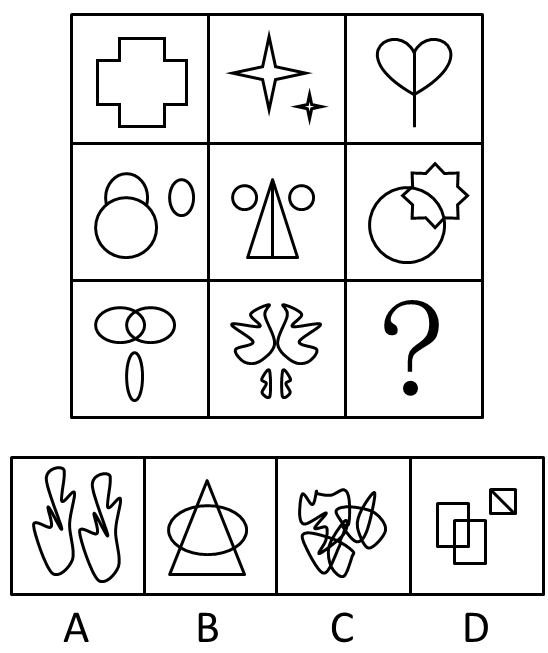

A. A

B. B

C. C

D. D

第 55 题 · 答案与解析

**参考答案（粉笔题库参考内容）**

B

**解析**

此题考查的是图形的对称性。观察题干，在这个九宫格图形中，从对角线上观察，对角线上所有图形都对称。

故正确答案为B。

**考点**：属性规律-对称性

**来源**：2010年江苏省公务员录用考试《行测》题（C类）第55题

### 第 56 题

菊花的种类繁多，形状各异，有绿牡丹、绿云、墨荷、凤凰振羽、帅旗、西湖柳月等。匙球型菊花是菊科草本植物的一种，西湖柳月属于匙球型菊花。菊科草本植物都具有很高的观赏价值，而牡丹花也有很高的观赏价值。

据此，可以推出：

A. 墨花属于匙球菊花

B. 作者最喜欢西湖柳月

C. 西湖柳月具有很高的观赏价值

D. 牡丹花属菊科草本植物

第 56 题 · 答案与解析

**参考答案（粉笔题库参考内容）**

C

**解析**

由“匙球型菊花是菊科草本植物的一种，西湖柳月属于匙球型菊花”可知西湖柳月是菊科草本植物；再由“菊科草本植物都具有很高的观赏价值”可知西湖柳月具有很高的观赏价值，即C项所述。A、B、D三项均无从推知。

故正确答案为C。

**考点**：常规翻译

**来源**：2010年江苏省公务员录用考试《行测》题（C类）第56题

### 第 57 题

近年来，有个别地方出现孩子辍学现象，这与某些家长的认识有关系。有些农村家长认为，反正孩子今后长大要外出打工，现在根本没必要上学读书。显然，这种认识是错误的。

据此，可以推出：

A. 有些长大不要外出打工的孩子现在有必要读书

B. 有些长大要外出打工的孩子现在有必要上学读书

C. 所有长大要外出打工的孩子现在都没必要上学读书

D. 有些长大要外出打工的孩子现在没有必要上学读书

第 57 题 · 答案与解析

**参考答案（粉笔题库参考内容）**

B

**解析**

“这种认识是错误的”指的是这句话前面的文字，正确的认识应该是“今后长大要外出打工的孩子，现在有必要上学读书”，即B项所述。

故正确答案为B。

**考点**：集合推理

**来源**：2010年江苏省公务员录用考试《行测》题（C类）第57题

### 第 58 题

所有人都有心脏病突然发作的可能，防范心脏病的突然发作不应是那些拥有心脏病史的人的“专利”。只有在心脏病第一次突然发作时挺过来的人，才能够“幸运”地拥有自己的心脏病史。

据此，可以推出：

A. 如果一个人能够“幸运”地拥有自己的心脏病史，那么他一定是在心脏病第一次突然发作时挺过来的人

B. 如果一个人能够“幸运”地拥有自己的心脏病史，那么他一定在自己心脏病第一次突然发作时没有挺过来

C. 没有心脏病史的人不需防范心脏病的突然发作

D. 只有时刻防范心脏病的突然发作，才能在心脏病突然发作时挺过来

第 58 题 · 答案与解析

**参考答案（粉笔题库参考内容）**

A

**解析**

“只有在心脏病第一次突然发作时挺过来的人，才能够‘幸运’地拥有自己的心脏病史”是“只有A才B”形式，A是B的必要条件，可以转换成“‘幸运’地拥有自己的心脏病史的人，一定是他在心脏病第一次突然发作时挺过来的人”，即A项所述，因此B项错误；由“所有人都有心脏病突然发作的可能”推出所有人都需要防范心脏病的突然发作，所以C项错误；D项题干中没有提到。

故正确答案为A。

**考点**：常规翻译

**来源**：2010年江苏省公务员录用考试《行测》题（C类）第58题

### 第 59 题

在我国初次分配领域，劳动者工资增长赶不上企业利润增长已是一个普遍现象，并且这种差距有逐渐拉大之势。不改变这种利润侵蚀工资的现象，就会扩大收入差距，影响社会和谐稳定，更不利于扩大消费、拉动内需。要改变这种利润侵蚀工资的现象，就必须提高劳动所得。

据此，可以推出：

A. 要想不影响社会和谐稳定，就必须提高劳动所得

B. 只有改变这种利润侵蚀工资的现象，才必须提高劳动所得

C. 如果改变这种利润侵蚀工资的现象，就会缩小收入差距，增进社会和谐稳定

D. 如果扩大收入差距，影响社会和谐稳定，就不会改变这种利润侵蚀工资的现象

第 59 题 · 答案与解析

**参考答案（粉笔题库参考内容）**

A

**解析**

由题干可知，不改变利润侵蚀工资的现象，就会扩大收入差距，社会就会不稳定，这是充分条件假言命题。根据其规律，否定后件就要否定前件，即要想社会和谐稳定，就需要改变利润侵蚀工资的现象，改变利润侵蚀工资的现象就要提高劳动所得，即A项所述。

故正确答案为A。

**考点**：常规翻译

**来源**：2010年江苏省公务员录用考试《行测》题（C类）第59题

### 第 60 题

本学期某高校行政管理专业开设了5门选修课程，要求每位学生至少选修2门，结果发现，有的学生选修了全部课程。

据此，可以推出：

A. 有的课程没有学生选修

B. 有的学生选修了3门课程

C. 所有学生都选修了某门课程

D. 所有课程都有学生选修

第 60 题 · 答案与解析

**参考答案（粉笔题库参考内容）**

D

**解析**

由“有的学生选修了全部课程”可知，全部课程都有学生选修，即D项所述。

故正确答案为D。

**考点**：集合推理

**来源**：2010年江苏省公务员录用考试《行测》题（C类）第60题

### 第 61 题

在一个特定的社会中，如果富人集团拒不进行必要的或合理的收入转移，社会最终就会陷入动乱的状态，富人致富的条件和享受财富的环境就会发生改变，这对富人来说，是“不合算”的。而穷人集团如果对社会福利要求过高，就会使生产成本过高、投资收益太低，导致没有人再投资，就业无法增长，多数穷人的状况无法实现根本的、长远的改善，最终整个社会就会陷入长期停滞的困境。

据此，可以推出：

A. 如果社会不陷入动乱或不陷入长期停滞的困境，则或者富人集团进行必要的或合理的收入转移，或者穷人集团对社会福利要求过高

B. 如果社会不陷入动乱或不陷入长期停滞的困境，则或者穷人集团不对社会福利要求过高，或者富人集团进行必要的或合理的收入转移

C. 如果社会陷入动乱并且陷入长期停滞的困境，则一定是富人集团拒不进行必要的或合理的收入转移，而穷人集团又对社会福利要求过高

D. 如果社会陷入动乱或陷入长期停滞的困境，则一定是富人集团拒不进行必要的或合理的收入转移，或者穷人集团又对社会福利要求过高

第 61 题 · 答案与解析

**参考答案（粉笔题库参考内容）**

B

**解析**

由题干条件可知（1）“富人集团拒不进行必要的或合理的收入转移”是“社会陷入动乱”的充分条件；（2）“穷人集团对社会福利要求过高”是“社会陷入长期停滞困境”的充分条件。由充分条件假言命题规律可得C、D项错误，排除；由（2）可得社会不陷入长期停滞的困境，则穷人集团对社会福利要求一定不是太高，可得A项错误。

故正确答案为B。

**考点**：常规翻译

**来源**：2010年江苏省公务员录用考试《行测》题（C类）第61题

### 第 62 题

S省“明星杯”篮球大赛开赛在即，教练要从小张、小李、小王、小赵、小田5人中挑选2名球员充实上场阵容。考虑到队员之间的最佳配合，教练做出如下五点决定：

（1）如果小张不上场，那么，或者小李上场或者小王上场；

（2）如果小李上场，则小赵上场；

（3）要么小王上场，要么小田上场；

（4）如果小赵上场，那么小田不上场；

（5）小田一定要上场。

据此，可以推出：

A. 小张上场

B. 小李上场

C. 小王上场

D. 小赵上场

第 62 题 · 答案与解析

**参考答案（粉笔题库参考内容）**

A

**解析**

由（5）可得小田要上场，即确定了一个球员；由（2）可得小李若要上场，小赵也要上场，则就是三名球员上场了，可知小李不上场，排除B项；由（3）可得小王不上场，排除C项；由（4）可得小赵不上场，排除D项；由小李、小王都不上场和条件（1）可得，小张上场。

故正确答案为A。

**考点**：常规翻译

**来源**：2010年江苏省公务员录用考试《行测》题（C类）第62题

### 第 63 题

为完成一项重要任务，某单位决定抽调精干人员组建工作小组。对于小组的人员组成，经过慎重考虑后，领导决定：

（1）甲、乙两人中至少选一人；

（2）乙、丙两人中至多选一人；

（3）如果选丁，那么丙、戊两人缺一不可；

（4）小组成员必须含有上述所提及的4人。

据此，可以推出不可能被选上的人是：

A. 甲

B. 乙

C. 丁

D. 丙

第 63 题 · 答案与解析

**参考答案（粉笔题库参考内容）**

B

**解析**

由（2）可知，不可能被选上的是乙或丙；由（4）可得，甲、丁、戊均被选上，再由（3）可得，丙也被选上，所以不可能被选上的是乙。

故正确答案为B。

**考点**：常规翻译

**来源**：2010年江苏省公务员录用考试《行测》题（C类）第63题

### 第 64 题

因某种原因，甲、乙两人现面临A、B两种方案的选择。如果两人都选择A方案，则各得3个单位利益；如果一人选择A方案，另一人选择B方案，则选择A方案者得8个单位利益，选择B方案者得1个单位利益；如果两人均选择B方案，则各得5个单位利益。假定甲、乙两人都按照自己利益最大化标准来进行算计和行动，都明白上述的利益得失情况，两人的选择不分先后，在选择中无法进行信息交流，两人的选择机会仅有一次。

据此，可以推出：

A. 甲选择A方案；乙选择B方案

B. 甲选择B方案；乙选择A方案

C. 甲选择B方案；乙选择B方案

D. 甲选择A方案；乙选择A方案

第 64 题 · 答案与解析

**参考答案（粉笔题库参考内容）**

D

**解析**

把条件转化为表格形式，表格中第一个数字为甲所得，第二数字为乙所得。

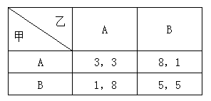

甲有两种选择，要么选A方案，要么B方案。当甲选A方案时，要么得3个单位利益，要么得8个单位利益；当甲选B方案时，要么得5个单位利益，要么得1个单位利益。乙的情况也是同理。每个人都按照自己利益最大化标准来进行算计和行动，如果甲选择A方案，而乙也选择A方案，则甲可得到3个单位利益；如果甲选择B方案，而乙选择A方案，则甲只能得到1个单位利益。虽然两人共同选择B方案，都会得到5个单位利益，但在选择B方案时，都会担心对方选择A方案，而自己只能获得1个单位利益。相比之下，按照自己利润最大化原则，甲会选择A方案，同理可得乙也会选择A方案，所以D项符合题意。

故正确答案为D。

**考点**：常规翻译

**来源**：2010年江苏省公务员录用考试《行测》题（C类）第64题

### 第 65 题

M市年终机关作风评议工作即将开始，6位专家对市政府甲、乙、丙、丁、戊等5个重要部门分别作出如下预测：

（1）如果甲不能得第一，则丙一定会得第三；

（2）如果乙能得第二，则丁一定会得第四；

（3）如果甲得第一或者乙得第二，则丙一定会得第三；

（4）如果甲得第一，则乙得第二；

（5）丙不会得第三，而甲得第一和乙得第二都是有可能的；

（6）丙不会得第三，但戊会得第五。

评议结束后发现，6位专家中只有一位专家的话不符合评议结果。

据此，可以推出：

A. 甲得第一

B. 乙没有得第二

C. 丙得第三

D. 丁得第四

第 65 题 · 答案与解析

**参考答案（粉笔题库参考内容）**

B

**解析**

第一步：分析题干条件。

（1）-甲第1→丙第3

（2）乙第2→丁第4

（3）甲第1 或 乙第2→丙第3

（4）甲第1→乙第2

（5）-丙第3

（6）-丙第3 且 戊第5

第二步：根据题干条件进行推理。

由题干可知，六个人的话中只有1句假话，条件中没有明显的矛盾关系，考虑假设法，可以从条件中提到最多的“丙第3”开始假设。

假设“丙得第3”，此时条件（5）和条件（6）均为假，与“只有1句假话”矛盾，因此丙没有得第3，排除C项。由条件（1）和（3）的逆否可知，-丙第3→甲第1、一丙第3→—甲第1 且 -乙第2，又“-丙第3”为真，如果条件（1）和条件（3）都为真，那么会得出“甲第1”和“-甲第1”两个矛盾结果，因此条件（1）和条件（3）必有一假。

故条件（2）（4）（5）（6）均为真，可知“甲第1→乙第2→丁第4、戊第5”，如果甲第1，此时丙只能第3，与前面矛盾，因此甲没有得第1，排除A项；如果乙第2，可知丁第4、戊第5，又“丙没有得第3”，所以甲第3，丙第1，此时条件（1）和条件（3）均为假，与“只有1句假话”矛盾，因此乙没有得第2，对应B项。

故正确答案为B。

**考点**：真假推理-其他

**来源**：2010年江苏省公务员录用考试《行测》题（C类）第65题

### 第 66 题

金领指掌握现代科技、能创造大量财富因而收入较高的高级科学技术人员。

下列属于金领的是：

A. 电脑营销公司老板

B. 微软公司编程师

C. 计算机专业博士生

D. 国有企业的会计

第 66 题 · 答案与解析

**参考答案（粉笔题库参考内容）**

B

**解析**

A、D项与高级科学技术人员不符，排除；C项博士生还是学生，与收入较高不符，排除。

故正确答案为B。

**考点**：原因结果

**来源**：2010年江苏省公务员录用考试《行测》题（C类）第66题

### 第 67 题

“倒脱靴”是围棋死活问题中的一种独特的棋形，指在对方提掉自己的数子后，自己再反过来叫吃，擒住对方数子。

下列关于“倒脱靴”的贴切描述是：

A. 置之死地而后生

B. 一箭双雕

C. 虎口脱险

D. 赴汤蹈火

第 67 题 · 答案与解析

**参考答案（粉笔题库参考内容）**

A

**解析**

很容易排除B、D项，“倒脱靴”可以理解为先失利后得利，A项中含有这层意思，但C项中只有失利情形，没有体现得利。

故正确答案为A。

**考点**：单定义-其他句式

**来源**：2010年江苏省公务员录用考试《行测》题（C类）第67题

### 第 68 题

心智指人们对已知事物的沉淀和储存，通过生物反应（大脑信息处理）而实现某种欲望需要的一种能力总和。

下列属于心智的是：

A. 婴儿出生后的第一声啼哭

B. 小徐家的宠物狗灵灵一见到家中来了生人就叫个不停

C. 小敏刚刚学会走路，她一见到猫就吓得直哭，不住地喊妈妈

D. 熊猫驯养员小许所驯养的三只幼仔每次听到铃声，就流口水

第 68 题 · 答案与解析

**参考答案（粉笔题库参考内容）**

C

**解析**

心智的特点是：（1）人们；（2）对已知事物的沉淀和储存；（3）实现某种欲望需要的一种能力。B、D项中的宠物狗、熊猫不符合特点（1），排除；A项中婴儿第一声啼哭，不符合特点（2），排除。

故正确答案为C。

**考点**：主客体

**来源**：2010年江苏省公务员录用考试《行测》题（C类）第68题

### 第 69 题

网络犯罪指行为人运用计算机技术，借助网络对系统或信息进行攻击破坏，故意实施触犯有关法律规范的行为。

下列不属于网络犯罪的是：

A. 赵某运用编程、加密、解码技术或工具等手段掌握了不少与自己交易过的客户的密码，他常对一些跟自己有竞争的商家进行监控

B. 高某利用软件指令、产品加密等技术对正在进行虚拟交易的双方实施控制，从中牟利

C. 向某是一个网站的管理者，他常利用自己居于网络服务提供者的特定地位或其他方法打开网友的个人邮箱，看他们的个人邮件

D. 小李两个月前开了博客，三天前小李把自己的博客密码告诉了小张，要求小张近期帮他管理日志，小张顺便把小李博客中的错别字都改了过来

第 69 题 · 答案与解析

**参考答案（粉笔题库参考内容）**

D

**解析**

网络犯罪的特点是：（1）运用计算机技术，借助网络；（2）对系统或信息进行攻击破坏；（3）故意实施触犯有关法律规范的行为。A、B、C项均符合网络犯罪的特点，D项不符合特点（2）（3）。

本题为选非题，故正确答案为D。

**考点**：拆词

**来源**：2010年江苏省公务员录用考试《行测》题（C类）第69题

### 第 70 题

前置审批指某些企业在进行工商登记之前，需要首先获得相关主管部门的审定许可，核准通过后才能在工商部门办理营业执照的一种工商登记管理程序。

下列不属于前置审批的是：

A. 小成想开办音乐茶座，需经文化局审定核准

B. 小瞿想开名烟专卖店，需经烟草专卖局审定核准

C. 小贲想开办书报亭，需经城市管理行政执法局审定核准

D. 小俞餐饮店食品卫生的确认，需经卫生局审定核准

第 70 题 · 答案与解析

**参考答案（粉笔题库参考内容）**

D

**解析**

第一步：找出定义关键词。

“某些企业”、“在进行工商登记之前”、“需要首先获得相关主管部门的审定许可”。

第二步：逐一分析选项。

A项：想开办音乐茶座，需经文化局审定核准，符合关键词“在进行工商登记之前，需要首先获得相关主管部门的审定许可”，符合定义，排除；

B项：想开名烟专卖店，需经烟草专卖局审定核准，符合关键词“在进行工商登记之前，需要首先获得相关主管部门的审定许可”，符合定义，排除；

C项：想开办书报亭，需经城市管理行政执法局审定核准，符合关键词“在进行工商登记之前，需要首先获得相关主管部门的审定许可”，符合定义，排除；

D项：小俞餐饮店要食品卫生确认，说明餐饮店已经登记营业，不符合关键词“在进行工商登记之前”，不符合定义，当选。

本题为选非题，故正确答案为D。

**考点**：大前提

**来源**：2010年江苏省公务员录用考试《行测》题（C类）第70题

### 第 71 题

冒险转移指在组织行为学和组织管理学中的集体冒险现象。

下列不属于冒险转移的是：

A. 某小区一住户煤气罐发生火情，一对年过七旬的老夫妇竟冒着危险，将喷火的煤气罐从屋里拖到大院空旷地带，虽然双双被烫伤，但避免了殃及邻居

B. 每年秋天，菲律宾西海岸都出现海面上黑压压地飞来一片南迁燕子的场面，但人们惊奇地发现，一旦到了海岸和海滩，许多燕子都会相继死去

C. 汶川大地震发生后，有几个老板自发组织了一个60辆小车的救援队，从成都给重灾区运送物资，帮忙转移在危险地带的大学生

D. 某公司领导在一些重大决策时往往采取集体决策方式，其实并不是想让大家讨论和决策，而是想让自己的想法得到大家的支持和拥护而已

第 71 题 · 答案与解析

**参考答案（粉笔题库参考内容）**

A

**解析**

第一步：找出定义关键词。

“集体冒险”。

第二步：逐一分析选项。

A项：老夫妇转移喷火煤气罐，只有老夫妇两个人，不是集体冒险行为，不符合定义，当选；

B项：到了海岸和海滩，许多燕子都会相继死去，符合关键词“集体冒险”，符合定义，排除；

C项：几个老板自发组织了一个60辆小车的救援队给重灾区运送物资，符合关键词“集体冒险”，符合定义，排除；

D项：尽管领导的目的是想得到大家的支持和拥护，但形式还是集体决策，符合关键词“集体冒险”，符合定义，排除。

本题为选非题，故正确答案为A。

**考点**：主客体

**来源**：2010年江苏省公务员录用考试《行测》题（C类）第71题

### 第 72 题

技术性差错是指在遵守制度的前提下，由于业务繁忙、工作强度大，工作人员在操作过程中因口误、眼误、手误等技术性原因造成的差错。

根据上述定义，下列属于技术性差错的是：

A. 某企业主管暗示会计在做本企业账本时对存货成本采用高留低转的记账方式，会计心领神会，不久就完成了此项工作

B. 某杂志社规定：一篇稿件在写作结束和编辑完成之后，必须再通读、审查一至三遍，但还是由于有的作者或编者政治素养不高、学识水平有限而影响了整体质量

C. 国际羽联通过网络对某国羽毛球公开赛进行了抽签，但几天后国际羽联突然告知该国羽协，称原抽签结果有问题，把种子选手排位搞错了

D. 2008年后，部分跨国企业由于裁减中国关务人员，在管理上出现真空；今年面对海关可能的核查，部分企业甚至放弃自查和应对准备，以破罐破摔的态度放弃改善的机会

第 72 题 · 答案与解析

**参考答案（粉笔题库参考内容）**

C

**解析**

第一步：找出定义关键词。

关键词为“遵守制度的前提下”、“由于业务繁忙、工作强度大”、“技术性原因”、“造成的差错”。

第二步：逐一分析选项。

A项：是企业主管暗示会计这么做的，不是由“技术性原因”造成的，不符合定义，排除；

B项：稿件质量问题是由于工作人员素养问题造成的差错，不是“由于业务繁忙、工作强度大”等原因造成的差错，不符合定义，排除；

C项：抽签遵循了抽签的制度，抽签的方式是通过网络技术，最后出现了问题，符合题干中定义要求，当选；

D项：是由于管理失误造成的，不是“技术性原因”造成的，不符合定义，排除。

故正确答案为C。

**考点**：原因结果

**来源**：2010年江苏省公务员录用考试《行测》题（C类）第72题

### 第 73 题

副文化指某一文化体系中相对于主文化的非从众的文化价值亚体系，由社会少数成员发明或引进，对社会秩序和发展起促进或阻碍作用。

下列不属于副文化的是：

A. 西方的爵士乐与摇滚乐，中国的京剧与昆剧

B. 西方社会一度因为艾滋病而对同性恋者产生恐慌，但后来人们慢慢接受了这些人，使他们有了更多的空间，也衍生出了自己的文化

C. “垮掉的一代”是第二次世界大战之后出现于美国的一群松散结合在一起的年轻诗人和作家的集合体

D. 某企业为了丰富员工的业余生活，组织了俱乐部文化、派别文化、“沙龙”文化、“哥儿们”文化等活动

第 73 题 · 答案与解析

**参考答案（粉笔题库参考内容）**

D

**解析**

第一步：找出定义关键词。

“某一文化体系中相对于主文化的非从众的文化价值亚体系”、“社会少数成员发明或引进”。

第二步：逐一分析选项。

A项：西方的爵士乐与摇滚乐，中国的京剧与昆剧，符合关键词“某一文化体系中相对于主文化的非从众的文化价值亚体系”，符合定义，排除；

B项：同性恋者衍生出了自己的文化，符合关键词“某一文化体系中相对于主文化的非从众的文化价值亚体系”，符合定义，排除；

C项：“垮掉的一代”是年轻诗人和作家的集合体，符合关键词“某一文化体系中相对于主文化的非从众的文化价值亚体系”，符合定义，排除；

D项：企业的文化活动只是为了丰富员工文化业余生活组织的，不构成体系，不符合定义，当选。

本题为选非题，故正确答案为D。

**考点**：单定义-其他句式

**来源**：2010年江苏省公务员录用考试《行测》题（C类）第73题

### 第 74 题

独家代理指委托人在指定地区和一定期限内只委派一个代理人代理，代理商只取佣金，不负盈亏，无权决定商品价格，不得另外接受委托经营同样或类似商品。

下列可能为独家代理的是：

A. 小强是某品牌酒厂在某市最大的业务代理，他服务热情，经常为客户送货上门，客户批量大时他会主动再让一些利给客户

B. 小张三年前就开始为某著名皮鞋做经销商，每年拿到七八万的佣金，随着生意越来越红火，他已做起了三四家皮鞋厂的经销业务

C. 南京的小范与武汉的小邱都接受了某著名鞋企的代理业务，他们的经营情况良好，每年都拿到十来万佣金

D. 小蔡创办了工艺瓷器厂，不仅自己设计产品的样式，而且烧制的全过程都由自己亲自把关，成品的销售逐年攀升

第 74 题 · 答案与解析

**参考答案（粉笔题库参考内容）**

C

**解析**

独家代理的特点是：（1）委托人委派代理人；（2）代理商只取佣金，无权决定商品价格；（3）不得另外接受委托经营同样或类似商品。A项中“再让一些利给客户”与特点（2）不符；B项中“已做起三四家皮鞋厂的经销业务”与特点（3）不符；D项小蔡自己创办瓷器厂，没有体现出代理商，所以A、B、D项均不选，排除。

故正确答案为C。

**考点**：单定义-其他句式

**来源**：2010年江苏省公务员录用考试《行测》题（C类）第74题

### 第 75 题

缺点逆用法指针对某一事物中已经发现的缺点，不是采用改正缺点的做法，而是从反面考虑如何利用这些缺点从而做到“变害为利”的一种创造、管理方法。

下列不属于缺点逆用法的是：

A. 有三个和尚：大者懒，落座就不愿起身；中者好动；小者讨厌诵经却喜欢听鸟鸣。住持这样安排其工作：大者司晨钟暮鼓，天天坐堂诵经；中者下山化缘；小者寺内遍植林木

B. 尽管有时日光灯镇流器所发出的声音会破坏宁静，使人心烦意乱，但由于它给人们提供了一个明亮的工作生活环境，人们还是喜欢用日光灯

C. 晶体管会随着温度变化而变化，严重影响着测量仪器和控制系统正常工作，有人则利用晶体管这一物理特性去测定温度，结果发明出“PN结温度传感器”

D. 某医院针对“护士服务不到位，不是找不着人，就是请不动”投诉，立即调整了护士分工：需走动的工作多安排新护士，需要“坐功”的则以老护士为主

第 75 题 · 答案与解析

**参考答案（粉笔题库参考内容）**

B

**解析**

缺点逆用法的特点是利用其缺点，A、C、D项中缺点均被利用，B项中的镇流器发出的声音是日光灯的缺点，人们没有利用镇流器发出的声音这一缺点，所以B项不符合定义。

本题为选非题，故正确答案为B。

**考点**：方式目的

**来源**：2010年江苏省公务员录用考试《行测》题（C类）第75题

## 材料 2

根据以下资料，回答76~80题。

        2009年末，我国广义货币供应量余额为60.6万亿元，比上年末增长27.7%；狭义货币供应量余额为22.0万亿元，比上年末增长32.4%；流通中现金余额为3.8万亿元，比上年末增长11.8%。

        2009年末，全部金融机构本外币各项存款余额61.2万亿元，比上年末增加13.2万亿元。其中，人民币各项存款余额59.8万亿元，比上年末增加19.2万亿元。全部金融机构本外币各项贷款余额42.6万亿元，比上年末增加10.5万亿元。其中，人民币各项贷款余额40.0万亿元，比上年末增加9.6万亿元。

        2009年末，全部金融机构人民币消费贷款余额8.5万亿元，比上年末增加17978亿元。其中，个人短期消费贷款余额0.6万亿元，比上年末增加2455亿元；个人中长期消费贷款余额4.9万亿元，比上年末增加15511亿元。

        2009年，全年上市公司通过境内市场累计筹资6658亿元，比上年增加1355亿元。其中，首次公开发行A股99只，筹资2060亿元，比上年末增加995亿元；A股再融资筹资1591亿元，比上年末增加260亿元。

        2009年，全年保险公司原保险保费收入11132亿元，比上年末增长18.8%。其中，寿险业务原保险保费收入7457亿元，健康险和意外伤害险原保险保费收入804亿元，财产险业务原保险保费收入2376亿元。支付各类赔款及给付3126亿元。其中，寿险业务赔款及给付1259亿元，健康险和意外伤害险赔款及给付281亿元，财产险业务赔款及给付1576亿元。

### 第 76 题

2009年末我国全部金融机构外币各项贷款余额比2008年末增加：

A. 105000亿元

B. 96000亿元

C. 9800亿元

D. 9000亿元

第 76 题 · 答案与解析

**参考答案（粉笔题库参考内容）**

D

**解析**

定位文字材料第二段可知：全部金融机构本外币各项贷款余额比上年末增加10.5万亿元，人民币各项贷款余额比上年末增加9.6万亿元，可得外币各项贷款余额增加了10.5-9.6=0.9万亿元，即9000亿元。

故正确答案为D。

**来源**：2010年江苏省公务员录用考试《行测》题（C类）第76题

### 第 77 题

2009年我国保险公司支付各类赔款及给付占其原保险费收入的比重是：

A. 28%

B. 29%

C. 30%

D. 31%

第 77 题 · 答案与解析

**参考答案（粉笔题库参考内容）**

A

**解析**

根据题干“2009年······的比重是”，结合题干时间与材料时间一致，可判定本题为现期比重问题。定位文字材料第五段，2009年，全年保险公司原保险保费收入11132亿元······支付各类赔款及给付3126亿元，根据公式：比重=部分量/总体量，则2009年我国保险公司支付各类赔款及给付占其原保险费收入的比重为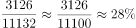。

故正确答案为A。

**来源**：2010年江苏省公务员录用考试《行测》题（C类）第77题

### 第 78 题

2008年末我国流通中的现金、狭义货币供应量和广义货币供应量余额分别是：

A. 3.8万亿元、22.0万亿元和60.6万亿元

B. 47.5万亿元、16.6万亿元和3.4万亿元

C. 60.6万亿元、22.0万亿元和3.8万亿元

D. 3.4万亿元、16.6万亿元和47.8万亿元

第 78 题 · 答案与解析

**参考答案（粉笔题库参考内容）**

D

**解析**

根据题干“2008年末······分别是”，结合材料时间为2009年末，可判定本题为基期计算问题。定位文字材料第一段，“2009年末，我国广义货币供应量余额为60.6万亿元，比上年末增长27.7%；狭义货币供应量余额为22.0万亿元，比上年末增长32.4%；流通中现金余额为3.8万亿元，比上年末增长11.8%”，根据公式：基期量=现期量/(1+r)，则2008年末我国流通中的现金余额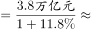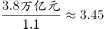万亿元，2008年末狭义货币供应量余额万亿元，2008年末广义货币供应量余额万亿元，与D项最接近。

故正确答案为D。

**来源**：2010年江苏省公务员录用考试《行测》题（C类）第78题

### 第 79 题

2008年末个人中长期消费贷款余额与个人短期消费余额之比是：

A. 1：0.0958

B. 1：0.1029

C. 1：0.1056

D. 1：0.1125

第 79 题 · 答案与解析

**参考答案（粉笔题库参考内容）**

C

**解析**

根据题干“2008年末······之比是”，可判定本题为比值计算问题。定位文字材料第三段，“2009年末······个人短期消费贷款余额0.6万亿元，比上年末增加2455亿元；个人中长期消费贷款余额4.9万亿元，比上年末增加15511亿元”，可知2008年末个人短期消费贷款余额万亿元，2008年末个人中长期消费贷款余额万亿元。而，故2008年末个人中长期消费贷款余额与个人短期消费余额之比，与C项最接近。

故正确答案为C。

**来源**：2010年江苏省公务员录用考试《行测》题（C类）第79题

### 第 80 题

下列分析正确的有：

（1）2009年末全部金融机构本外币各项存款余额增长率大于贷款余额增长率。

（2）2009年保险公司原保险保费业务中，收入最高的险种也是赔款及给付最高的险种。

（3）2009年首次公开发行A股筹资额占全年上市公司通过境内市场累计筹资的60%以上。

A. 0个

B. 1个

C. 2个

D. 3个

第 80 题 · 答案与解析

**参考答案（粉笔题库参考内容）**

A

**解析**

（1）定位文字材料第二段，“2009年末，全部金融机构本外币各项存款余额61.2万亿元，比上年末增加13.2万亿元······全部金融机构本外币各项贷款余额42.6万亿元，比上年末增加10.5万亿元”，根据公式：增长率，可知2009年末全部金融机构本外币各项存款余额增长率，2009年末全部金融机构本外币各项贷款余额增长率，故前者增长率小于后者，错误；

（2）定位文字材料第五段，可知保险公司原保险保费业务中，收入最高的险种是寿险业务原保险（7457亿元），而赔款及给付最高的险种是财产险业务（1576亿元），故2009年保险公司原保险保费业务收入最高的险种与赔款及给付最高的险种并不相同，错误；

（3）定位文字材料第四段，“2009年，全年上市公司通过境内市场累计筹资6658亿元······其中，首次公开发行A股99只，筹资2060亿元”，根据公式：比重=部分量/总体量，故2009年首次公开发行A股筹资额占全年上市公司通过境内市场累计筹资的比重，错误。

以上均表述错误。

故正确答案为A。

**来源**：2010年江苏省公务员录用考试《行测》题（C类）第80题

## 材料 3

根据以下资料，回答81~85题。

粉笔注：原材料数据本身相互矛盾，为避免争议，小粉笔特根据江苏省统计局网站公布的官方数据对材料进行了修订。

http://www.jssb.gov.cn/jstj/djgb/qsndtjgb/200907/t20090706\_109629.htm

http://www.jssb.gov.cn/jstj/djgb/qsndtjgb/200807/t20080717\_105496.htm

### 第 81 题

年单位GDP能耗最大的两市是：

A. 南通市、扬州市

B. 徐州市、南京市

C. 盐城市、南通市

D. 宿迁市、扬州市

第 81 题 · 答案与解析

**参考答案（粉笔题库参考内容）**

B

**解析**

定位统计表可得：2007年单位GDP能耗最大的两市是徐州市（1.304）和南京市（1.253），2008年单位GDP能耗最大的两市是徐州市（1.227）和南京市（1.178）。

故正确答案为B。

**来源**：2010年江苏省公务员录用考试《行测》题（C类）第81题

### 第 82 题

按从小到大排序，2008年单位GDP电耗下降最快的省辖市，其2007年单位GDP电耗在江苏13个省辖市中排：

A. 第十一位

B. 第九位

C. 第七位

D. 第五位

第 82 题 · 答案与解析

**参考答案（粉笔题库参考内容）**

D

**解析**

定位统计表可得：2008年单位GDP电耗下降最快的省辖市为南京市（-8.61%），而南京市在2007年单位GDP电耗江苏13个省辖市从小到大排序中排第五位。

故正确答案为D。

**来源**：2010年江苏省公务员录用考试《行测》题（C类）第82题

### 第 83 题

2008年南京市单位GDP能耗比2006年下降：

A. 10.51%

B. 10.15%

C. 5.25%

D. 5.07%

第 83 题 · 答案与解析

**参考答案（粉笔题库参考内容）**

B

**解析**

根据题干“2008年······比2006年下降”，结合选项为百分数，可判定本题为间隔增长率问题。定位统计表可得：2008年南京市单位GDP能耗下降5.99%，2007年南京市单位GDP能耗下降4.42%，根据公式：间隔增长率，可推出2008年南京市单位GDP能耗的间隔增长率，即比2006年下降10.17%，与B项最为接近。

故正确答案为B。

**来源**：2010年江苏省公务员录用考试《行测》题（C类）第83题

### 第 84 题

2008年单位GDP能耗下降速度快于全省平均水平的省辖市有：

A. 5个

B. 6个

C. 7个

D. 8个

第 84 题 · 答案与解析

**参考答案（粉笔题库参考内容）**

A

**解析**

定位统计表可得：2008年江苏省单位GDP能耗下降-5.86%，下降速度快于全省平均水平的省辖市有：南京市（-5.99%）、徐州市（-5.90%）、苏州市（-5.92%）、扬州市（-6.93%）和泰州市（-9.14%），共有5个。

故正确答案为A。

**来源**：2010年江苏省公务员录用考试《行测》题（C类）第84题

### 第 85 题

下列关于2007~2008年江苏省各省辖市单位GDP能耗、电耗的分析，正确的是：

A. 单位GDP能耗下降最多的省辖市其单位GDP电耗下降也最多

B. 单位GDP电耗均有不同程度的下降

C. 单位GDP能耗均有不同程度的下降

D. 单位GDP能耗与电耗同方向变化

第 85 题 · 答案与解析

**参考答案（粉笔题库参考内容）**

C

**解析**

A项：定位统计表可得，2007年单位GDP能耗下降最多的省辖市为泰州，其增长量≈-0.068，而同年其单位GDP电耗并未下降，故不是下降最多的，错误；

B项：定位统计表可得，多个省辖市单位GDP电耗有所上升，错误；

C项：定位统计表可得，所有省辖市单位GDP能耗均有不同程度的下降，正确；

D项：根据B、C两项可知，所有省辖市单位GDP能耗均有下降，但部分省辖市单位GDP电耗有所上升，则存在不同方向变化，错误。

故正确答案为C。

**来源**：2010年江苏省公务员录用考试《行测》题（C类）第85题

## 材料 4

根据以下资料，回答86~90题。

### 第 86 题

表中2008年进出口总额增长率最高的经济类型是：

A. 国有企业

B. 集体企业

C. 中外合资企业

D. 外商独资企业

第 86 题 · 答案与解析

**参考答案（粉笔题库参考内容）**

B

**解析**

根据题干“2008年······增长率最高”，可判定本题为一般增长率问题。定位材料表格可得：2008年国有企业出口额为2079459万美元，进口额为832382万美元，2007年国有企业出口额为1774933万美元，进口额为725334万美元，故2008年国有企业进出口总额增长率；

2008年集体企业出口额为710286万美元，进口额为429304万美元，2007年集体企业出口额为488119万美元，进口额为312123万美元，故2008年集体企业进出口总额增长率；

2008年中外合资企业出口额为3405400万美元，进口额为3112895万美元，2007年中外合资企业出口额为2846005万美元，进口额为2780454万美元，故2008年中外合资企业进出口总额增长率；

2008年外商独资企业出口额为13948670万美元，进口额为9604995万美元，2007年外商独资企业出口额为12563577万美元，进口额为9534416万美元，故2008年外商独资企业进出口总额增长率。

由此可知进出口总额增长率最高的经济类型是集体企业。

故正确答案为B。

**来源**：2010年江苏省公务员录用考试《行测》题（C类）第86题

### 第 87 题

2004~2008年江苏省国有企业、集体企业和中外合作企业进口额年平均增加额（分别用M_1、M_2和表示）之间的关系是：

A. 

B. 

C. 

D. 

第 87 题 · 答案与解析

**参考答案（粉笔题库参考内容）**

C

**解析**

根据题干“2004~2008年······平均增加额之间的关系是”，可判定本题为年均增长量问题。定位材料表格可得：2008年国有企业进口额为832382万美元，2004年国有企业进口额为747453万美元；2008年集体企业进口额为429304万美元，2004年集体企业进口额为217800万美元；2008年中外合作企业进口额为142576万美元，2004年中外合作企业进口额为33172万美元。由于本题只是年均增长量的比较类题型，因年份差相同，故只需比较总量增加额即可。

国有企业（M_1）增加额亿美元；

集体企业（M_2）增加额亿美元；

中外合作企业（）增加额亿美元。

三者关系为。

故正确答案为C。

备注：江苏省份的年均增长量问题中，问题年份为2004~2008，基期量应为2003年的进口额，由于本题只给出2004年的数据，故基期量只能用2004年数据。

**来源**：2010年江苏省公务员录用考试《行测》题（C类）第87题

### 第 88 题

表中2008年贸易顺差最大的经济类型是：

A. 国有企业

B. 集体企业

C. 中外合资企业

D. 外商独资企业

第 88 题 · 答案与解析

**参考答案（粉笔题库参考内容）**

D

**解析**

定位表格材料，根据顺差值=出口额-进口额，可得：

国有企业顺差值亿美元；

集体企业顺差值亿美元；

中外合资企业顺差值亿美元；

外商独资企业顺差值亿美元，

故2008年贸易顺差最大的经济类型是外商独资企业。

故正确答案为D。

**来源**：2010年江苏省公务员录用考试《行测》题（C类）第88题

### 第 89 题

2008年与2004年相比，表中企业出口额实现翻一番的经济类型有：

A. 1个

B. 2个

C. 3个

D. 4个

第 89 题 · 答案与解析

**参考答案（粉笔题库参考内容）**

C

**解析**

根据题干“2008年与2004年相比······实现翻一番的经济类型有”，可判定本题为现期倍数问题。2008年与2004年相比出口额翻一番的经济类型，即2008年出口额是2004年的2倍以上，定位材料表格可知，满足条件的有：中外合作企业（）、中外合资企业（）和外商独资企业（），所以2008年与2004年相比出口额实现翻一番的经济类型共有3个。

故正确答案为C。

**来源**：2010年江苏省公务员录用考试《行测》题（C类）第89题

### 第 90 题

下列分析正确的有：

（1）2005~2008年外商独资企业出口额增长率呈下降趋势。

（2）2008年表中各经济类型企业的进出口贸易均为顺差。

（3）2004~2008年江苏省国有企业进口额呈下降趋势。

A. 0个

B. 1个

C. 2个

D. 3个

第 90 题 · 答案与解析

**参考答案（粉笔题库参考内容）**

B

**解析**

（1）定位统计表可知：2005年外商独资企业出口额增长率，2006年增长率，2007年增长率=，2008年增长率，由此可知2005~2008年外商独资企业出口额增长率呈下降趋势，正确；

（2）定位统计表可知：2008年中外合作企业为贸易逆差（出口额141916万美元&lt;进口额142576万美元），错误；

（3）定位统计表可知：2007、2008年国有企业进口额同比上升，故并非呈下降趋势，错误。

以上表述只有（1）正确。

故正确答案为B。

**来源**：2010年江苏省公务员录用考试《行测》题（C类）第90题

## 材料 5

根据以下资料，回答91~95题。

### 第 91 题

在江苏省13个省辖市中，2009年工业增加值月平均增量最多的是：

A. 无锡市

B. 苏州市

C. 扬州市

D. 泰州市

第 91 题 · 答案与解析

**参考答案（粉笔题库参考内容）**

B

**解析**

根据题干“2009年······月平均增量最多的是”，由于本题时间均为12个月，故只需比较全年增量即可，判定本题为增长量比较问题。定位统计图可得：

2009年无锡市全年增量亿元；

2009年苏州市全年增量亿元；

2009年扬州市全年增量亿元；

2009年泰州市全年增量亿元。

全年增量最多的是苏州市，可知2009年工业增加值月平均增量最多的是苏州市。

故正确答案为B。

**来源**：2010年江苏省公务员录用考试《行测》题（C类）第91题

### 第 92 题

在江苏省13个省辖市中，2009年工业增加值月平均增速最快的是：

A. 南京市

B. 苏州市

C. 宿迁市

D. 泰州市

第 92 题 · 答案与解析

**参考答案（粉笔题库参考内容）**

D

**解析**

根据题干“2009年······月平均增速最快的是”，可判定本题为年均增长率问题。当月份差相同时，比较月均增长率，只需比较现期量/基期量即。定位统计图可得，南京市：；苏州市：；宿迁市：；泰州市：，2009年工业增加值月平均增速最快的是泰州市。

故正确答案为D。

**来源**：2010年江苏省公务员录用考试《行测》题（C类）第92题

### 第 93 题

2009年12月，苏州市、无锡市和常州市工业增加值之和占江苏省工业增加值的比重是：

A. 40.55%

B. 49.91%

C. 58.67%

D. 62.87%

第 93 题 · 答案与解析

**参考答案（粉笔题库参考内容）**

B

**解析**

根据题干“2009年12月······占······比重是”，可判定本题为现期比重问题。定位统计图可得，2009年12月苏州市、无锡市和常州市工业增加值之和为：424.3+223.8+139.2=787.3亿元，江苏省工业增加值为：

137.0+223.8+84.2+139.2+424.3+149.2+35.9+40.8+59.0+94.8+70.6+98.8+19.8=1577.4亿元，根据公式：比重=部分量/总体量，可得2009年12月，苏州市、无锡市和常州市工业增加值之和占江苏省工业增加值的比重，与B项最接近。

故正确答案为B。

**来源**：2010年江苏省公务员录用考试《行测》题（C类）第93题

### 第 94 题

按2009年的月平均增长速度估算，2010年12月南京市可望实现工业增加值：

A. 178.6亿元

B. 168.9亿元

C. 159.4亿元

D. 157.7亿元

第 94 题 · 答案与解析

**参考答案（粉笔题库参考内容）**

A

**解析**

根据题干“2009年的月平均增长速度估算，2010年12月······可望实现工业增加值”，可判定本题为现期计算问题。定位统计图可得：2009年12月南京市工业增加值为137.0亿元，2008年12月南京市工业增加值为105.1亿元，根据年均增长率公式：，可知，已知2009年的月平均增长速度与2010年相同，故2010年12月可实现增加值=2009年12月亿元，与A项最接近。

故正确答案为A。

**来源**：2010年江苏省公务员录用考试《行测》题（C类）第94题

### 第 95 题

下列分析不正确的有：

（1）2009年12月扬州市工业增加值同比增长了32.77个百分点。

（2）按2009年的月平均增量估算，2010年4月南通市工业增加值可望达到158.7亿元。

（3）2009年12月江苏省各省辖市工业增加值均比2008年12月至少增加8亿元。

A. 3个

B. 2个

C. 1个

D. 0个

第 95 题 · 答案与解析

**参考答案（粉笔题库参考内容）**

C

**解析**

（1）定位统计图可得：2009年12月扬州市工业增加值同比增长率，正确；

（2）定位统计图可得：南通市2009年全年的增量=149.2-120.6=28.6亿元，则月平均增量亿元。2009年12月至2010年4月共4个月，则到2010年4月南通市工业增加值可达到：亿元，正确；

（3）定位统计图可知：2009年12月宿迁市的工业增加值同比增加了19.8-14.0=5.8亿元，不足8亿元，错误。

以上表述不正确的有1项。

故正确答案为C。

备注：（1）项题干表述并不严谨，增长率计算结果应用百分数表示。

**来源**：2010年江苏省公务员录用考试《行测》题（C类）第95题

## 材料 6

根据以下资料，回答96~100题。

        2004～2008年，我国文化产业增加值分别为3340亿元、4216亿元、5123亿元、6412亿元、7600亿元，逐年大幅度攀升，平均增长速度高达17%以上，比同期GDP增值高出10个百分点左右，不仅高于传统产业的增长速度，而且还高于同为朝阳产业的电子信息等产业的增长速度。

        2008年，我国人均GDP达到3266.8美元，城镇居民和农村居民恩格尔系数分别降至37.0%和43.7%，居民文化消费增长势头喜人。2003～2008年，我国城乡居民文化消费支出总额分别为3107.4亿元、3769.7亿元、4061.4亿元、4500.1亿元、4912.1亿元、5982.6亿元。2009年为7000亿元左右，但正常的文化消费应该在4万亿元，缺口达3万多亿元，增长空间极大，尤其是农村居民文化消费潜力巨大，农村文化市场有待深入开发。

### 第 96 题

2005~2008年我国文化产业增加值增长额、增长率最高的年份分别是：

A. 2005、2005

B. 2005、2007

C. 2007、2005

D. 2007、2008

第 96 题 · 答案与解析

**参考答案（粉笔题库参考内容）**

C

**解析**

定位统计表可得：我国文化产业增加值增长率最高的年份是2005年，排除B、D两项。而2005~2008年我国文化产业增加值增长额最大，需要计算，故判定本题为增长量比较问题。定位文字材料第一段可得：2004～2008年，我国文化产业增加值分别为3340亿元、4216亿元、5123亿元、6412亿元、7600亿元，故2005年文化产业增加值增长额=4216-3340=876亿元，2007年文化产业增加值增长额=6412-5123=1289亿元，可得2007年增长额比2005年高，只有C项符合。

故正确答案为C。

**来源**：2010年江苏省公务员录用考试《行测》题（C类）第96题

### 第 97 题

在2005~2008年的各年中，文化产业增加值增速比电子信息产业增加值增速最多高：

A. 7个百分点

B. 4个百分点

C. 2个百分点

D. 1个百分点

第 97 题 · 答案与解析

**参考答案（粉笔题库参考内容）**

A

**解析**

定位统计表可得：文化产业增加值增速比电子信息产业增加值增速高的最多的是2007年，为25.2-18.2=7个百分点。

故正确答案为A。

**来源**：2010年江苏省公务员录用考试《行测》题（C类）第97题

### 第 98 题

2003~2008年我国城乡居民家庭人均文化消费占总消费支出的比重的差距：

A. 最小为0.9%

B. 呈现出扩大趋势

C. 最大为3.5%

D. 平均为2.1%

第 98 题 · 答案与解析

**参考答案（粉笔题库参考内容）**

B

**解析**

定位折线图：

A项：城镇和农村占总消费支出的比重差距最小为2003年，6.46%-6.06%=0.4%，错误；

B项：观察可知城镇和农村占总消费支出的比重差距呈现逐年扩大趋势，正确；

C项：镇和农村占总消费支出的比重差距最大为2008年，7.52%-4.3%=3.22%，错误；

D项：城镇和农村占总消费支出的比重差距从2003年到2008年依次为：6.46%-6.06%=0.4%，6.60%-5.67%=0.93%，6.62%-5.78%=0.84%，6.80%-5.39%=1.41%，6.91%-4.74%=2.17%，7.52%-4.3%=3.22%，故平均值为：，错误。

故正确答案为B。

**来源**：2010年江苏省公务员录用考试《行测》题（C类）第98题

### 第 99 题

下列分析正确的有：

（1）2005～2008年我国城乡居民文化消费支出总额增长最快的年份是2008年。

（2）2005～2008年我国文化产业增加值增速高于同为朝阳产业的电子信息产业。

（3）2005～2008年我国电子信息产业增加值逐年下降。

（4）2004～2008年我国城镇居民家庭人均文化消费占总消费支出的比重逐年增加。

A. 1个

B. 2个

C. 3个

D. 4个

第 99 题 · 答案与解析

**参考答案（粉笔题库参考内容）**

B

**解析**

定位文字材料第二段可知：“2003～2008年，我国城乡居民文化消费支出总额分别为3107.4亿元、3769.7亿元、4061.4亿元、4500.1亿元、4912.1亿元、5982.6亿元”，则城乡居民文化消费支出总额增长速度分别为：

2008年：；

2007年：；

2006年：；

2005年：。故增长最快的是2008年，正确；

（2）定位统计表可知：2005年文化产业增加值增速低于电子信息产业增加值增速，错误；

（3）定位统计表可知：电子信息产业增加值增速均大于0，即2005~2008年每年都增长，所以电子信息产业增加值逐年上升，错误；

（4）定位折线图可知：我国城镇居民家庭人均文化消费占总消费支出的比重逐年增加，正确。

上述表述中有2个正确。

故正确答案为B。

**来源**：2010年江苏省公务员录用考试《行测》题（C类）第99题

### 第 100 题

2005~2008年我国文化产业增加值的平均增长速度比城乡居民文化消费支出总额的年平均增长速度要：

A. 慢10.58%

B. 慢5.06%

C. 快5.06%

D. 快10.58%

第 100 题 · 答案与解析

**参考答案（粉笔题库参考内容）**

D

**解析**

根据题干“2005~2008年我国······平均增长速度比年平均增长速度要”，可判定本题为年均增长率问题。定位文字材料第一段和第二段可知：2004年、2008年我国文化产业增加值分别为3340亿元、7600亿元；2004年、2008年我国城乡居民文化消费支出总额分别为3769.7亿元、5982.6亿元，根据年均增长率公式：，可知2005~2008年，，根据，，可推出略大于20%，略大于10%，故文化产业增加值的平均增长速度比城乡居民文化消费支出总额的年平均增长速度要快10%左右。

故正确答案为D。

备注：题目表述并不严谨，两个百分数相减的结果应用百分点表示，故本题选项规范描述应为快10.58个百分点。

**来源**：2010年江苏省公务员录用考试《行测》题（C类）第100题

