# 2011年江苏省公务员录用考试《行测》题（A类）

<!-- gwy:overview:start -->
> **江苏 · 2011 · 行测 · A类** ｜ 105 题 · 图片 188 处 · 答案随题折叠

| 题型模块 | 题量 | 题号 |
| --- | ---: | ---: |
| 言语理解与表达 | 15 | 1–15 |
| 数量关系 | 25 | 16–40 |
| 判断推理 | 40 | 41–80 |
| 资料分析 | 25 | 81–105 |
| **合计** | **105** | |

导航：[题型与作答说明](#题型与作答说明) · [题目](#题目) · [材料 1](#材料-1)
<!-- gwy:overview:end -->

> 候选采集稿。参考答案及解析来自粉笔页面，不代表官方答案或真实高分答卷；来源使用许可与原卷对应关系仍需人工核实。

## 题型与作答说明

言语理解与表达

（15题）

本部分包括片段阅读、文章阅读与选词填空三种类型的试题。

数量关系

（25题）

本部分包括数字推理与数学运算两种类型的试题。

判断推理

（40题）

本部分包括类比推理、图形推理、逻辑判断与定义判断四种类型的试题。

资料分析

（25题）

下列给出的文字、表格、图形资料均有5个问题要你回答，你应根据资料提供的信息进行分析、计算、处理，然后从备选答案中选择一个最恰当的答案。

## 题目

### 第 1 题

或许，作为一个翻译，一个以在两种语言之间搬运信息为职业的人，最无奈的事情，不是感到不同语言之间的鸿沟无法弥合，而是发现大多数生活在单语体系中的人，看不见那条鸿沟的存在，看不见翻译者为了沟通所做的上穷碧落下黄泉般的挣扎。或许有的人从未意识到，萌发于一片有限的特定土地上的语言，有时是无力为异域事物命名的。
作者意在通过这段文字强调：

A. 不同语言之间的鸿沟无法弥合

B. 不同语言有时无法一一对译

C. 人们往往无法认同翻译的辛苦

D. 翻译工作很难得到人们认同

第 1 题 · 答案与解析

**参考答案（粉笔题库参考内容）**

D

**解析**

本题为中心理解题。

文段首先阐述了翻译工作的无奈，接着关联词“不是······而是”强调了无奈在于大多数人看不见鸿沟的存在，看不到译者的努力和辛苦。最后一句进一步进行补充说明，在不同语言之间，翻译有时无能为力。综合这两句可以看出：生活在单语系中的人看不到语言之间的鸿沟，理解不了翻译为什么不能对其他语系的专有名词进行翻译——翻译工作得不到人们认同。

因此，结合选项应该选择D。

A项、B项的叙述为原文“不是”后面的内容，不属于要强调的，排除；C项表达错误，文段强调的是人们看不到的不仅仅是翻译的辛苦，还有有些时候“翻译”的“不可能”，C项没有涵盖后半部分的意思，不够全面，排除。

故正确答案为D。

### 第 2 题

教育进展国际评估组织曾对全球21个国家进行的调查显示，中国孩子的计算能力排名世界第一，想象力却排名倒数第一，创造力排名倒数第五。在小学生中，认为自己有好奇心和想象力的只占4.7%，希望培养想象力和创造力的只占14.9%。
这段话表达的主要意思是：

A. 中国在孩子的计算能力方面教育很成功，效果很明显

B. 中国在孩子的教育方面应该扬长避短，充分展现自己的优势

C. 中国应重视孩子在创造力、想象力方面的教育和培养

D. 中国孩子比较务实，重视智力开发，特别是计算能力的培养

第 2 题 · 答案与解析

**参考答案（粉笔题库参考内容）**

C

**解析**

本题为中心理解题。

文段引述调查数据表明中国孩子想象力排名倒数第一，创造力排名倒数第五，认为自己拥有好奇心和想象力所占的比例也很低，因此应该重视这两方面的教育和培养。

因此，结合选项应该选择C。

A项、B项，文中更多是在说不足，也没提到扬长避短，排除；D项也不是文章的主要意思，排除。

故正确答案为C。

### 第 3 题

①我们之所以要隆重纪念阿尔伯特·爱因斯坦，②不仅是因为他一生的科学贡献对现代科学的发展有着深远的影响，③而且还因为他勇于探索、勇于创新、为真理和社会而献身的精神是值得我们学习的，④是鼓舞我们为加速实现四个现代化而奋斗的力量。

对这段话的逻辑关系理解错误的是：

A. ②与③之间是递进关系

B. ①与④之间是承接关系

C. ③与④之间是并列关系

D. ①与②之间是因果关系

第 3 题 · 答案与解析

**参考答案（粉笔题库参考内容）**

B

**解析**

第一步：分析题干。

理解文段整体结构要从关联词入手，“①之所以······，②不仅是因为······，③而且还因为······是······，④是······”，由此可以判断，①是结果，②③④都是原因；第二层②和③（不仅······而且还）是递进关系；第三层③和④之间是并列关系。

第二步：逐一判断选项。

A项，根据题干，②和③（不仅······而且还）是递进关系，符合题干。

B项，根据题干，①是结果，④是原因，为因果关系，该项逻辑关系理解错误。

C项，根据题干，③和④之间是并列关系，符合题干。

D项，根据题干，①是结果，②是原因，为因果关系，符合题干。

第三步：再次标注答案

本题为选非题，故正确答案为B。

### 第 4 题

尽管大多数时候，人类学家以科学家自居，但不可否认的是，每个人类学家与他们的研究对象都是活生生的个人，各种感受的交织，情感的触动免不了影响研究的结果。不过，不要紧，承认这种“沮丧、尴尬、疲倦和窘迫”并不是一件太糟的事情，而且越来越被看作是田野叙述中，一个有益的维度。
作者对人类学家个人情感往往会渗入研究结果的看法是：

A. 不可避免

B. 情有可原

C. 有利有弊

D. 弊大于利

第 4 题 · 答案与解析

**参考答案（粉笔题库参考内容）**

B

**解析**

文段首先提出人类学家的个人情感往往会渗入研究结果，接着叙述作者对这一现象的看法。由“不过，不要紧”“并不是一件太糟的事情”“有益的维度”这几个词可知作者对这一现象持宽容、理解的态度，即认为这一事实是情有可原的。

因此，结合选项应该选择B。

A项，“不可避免”虽然也表理解，但文中这一现象发生的必然性并没有特别论述，排除；C、D两项，文中没有明确说“弊端”，也没有利弊对比，均排除。

故正确答案为B。

### 第 5 题

包明德谈到，孔子及儒学是中华文化的构成元素，但并非唯一的元素。中华文化博大精深，诸子百家源远流长，弘扬古代文化为的是同现代文明对接，并实现科学转化，中华文化中很多不同的思想同样有利于现代的法制建设和道德建设，在文化姿态上不能独尊儒术。他还提出，弘扬孔子思想也须注意避免文化思想上的悖论。比如“五四”运动中的启蒙思想成果是我国文化发展中的先进因素，对此也应予以合情合理的阐释。

作者主张“在文化姿态上不能独尊儒术”，并非因为：

A. 儒家思想与五四启蒙精神是格格不入的

B. 儒家以外的古代思想流派也有合理成分

C. 儒家思想不是尽善尽美的

D. 儒家思想应该作科学的分析鉴别

第 5 题 · 答案与解析

**参考答案（粉笔题库参考内容）**

A

**解析**

作者从“儒家思想”本身以及其他诸子百家的角度对“在文化姿态上不能独尊儒术”的原因进行了解释。他列举了“五四运动”中的启蒙思想作为文化中先进的因素应该予以合理解释，但未提及“格格不入”，故A项无中生有；根据“中华文化中很多不同的思想同样有利于现代的法制建设和道德建设”，可知B项正确；根据“弘扬孔子思想也须注意避免文化思想上的悖论”，可知C、D两项正确。

本题为选非题，故正确答案为A.。

## 材料 1

①在基因时代，生物学家们收集分子层次上的癌症成因信息，这些信息使他们开始质疑传统的癌症分类法：即根据肿瘤出现在身体中的位置来分类癌症。

②研究者们认识到传统的分类法应该被根据突变种类的分类法取代，正是这些突变使得细胞以不受控制的形式生长而形成肿瘤。

③如果两个患者的肿瘤存在于完全不同的器官组织之中，却由相同的突变引发，其间的共同点可能比那种存在于同一个器官中却由不同的分子机制引起的肿瘤更多。

④（    ），两个表面上看起来患有同种癌症的病人却可能会因为决定性突变的不同而有着非常不同的结果。

⑤一旦不再将癌症视为一种依据解剖学定义的疾病，转而集中注意这些分子异常，治疗就是完全不同的另一场竞赛了。

⑥常规的化疗和放疗对分裂中的细胞特别有杀伤力，所以能够对总在高速生长的肿瘤细胞形成显著伤害。但它们同时也要求身体的其他部分付出高昂的代价。

⑦很多肿瘤学家相信这一方法可以将癌症从一种致死性疾病转化为一种慢性病，人们可以忍受着这种慢性病生活很长时间。当然这不是轻易可以做到的。

⑧治疗可能需要采用靶向药物的鸡尾酒疗法，鸡尾酒的配方随肿瘤的突变随时调节。虽然很难，但理论上这种治疗方法应该比目前应用的方法有效得多，同时副作用也小得多。

⑨艾滋病明显就是这种情形，采用抗逆转录酶病毒药物的鸡尾酒疗法能够减慢病毒的复制，使得感染HIV的人可以忍受着这种感染活到老年。如果发现病毒对某种药物产生抗药性，就换用另一种药物。

⑩在二十世纪九十年代中期，遗传学家们发现了BRCA1和BRCA2，这两个基因与超过半数的乳腺癌遗传类型有关。

⑪这两个基因所编码的蛋白质掌管DNA修复，因此当它们有缺陷时，细胞变得更有可能累积那些将引发癌症的突变。

⑫但这种遗传型变异仅占乳腺癌变异的10%，所以在治疗乳腺癌和其它肿瘤的问题上，当前最需要也最艰巨的努力在于：识别那些在个别细胞中自然产生的致癌突变。

⑬为此，国际癌症基因组联盟将致力于完成25000例个体肿瘤的DNA测序，建立50种最常见的癌症的突变记录档案。

### 第 6 题

生物学家质疑传统的癌症分类法的原因是：

A. 如今已经进入基因时代

B. 癌症发生跟身体的器官无关

C. 解剖学无法定义癌症的分类

D. 癌症发生与分子机制突变相关

第 6 题 · 答案与解析

**参考答案（粉笔题库参考内容）**

D

**解析**

本题考查文章阅读的细节判断。

质疑传统癌症分类的原因应该定位到文章①和②。前一句指出生物学家对根据肿瘤出现的位置来给癌症分类有质疑，后一句说明肿瘤的真正原因与突变有关，传统分类方法应该被以突变为依据的新方法取代。这个原因与选项D完全符合。

故正确答案为D。

### 第 7 题

填入文中括号处最恰当的一项是：

A. 其实

B. 而且

C. 反之

D. 另外

第 7 题 · 答案与解析

**参考答案（粉笔题库参考内容）**

C

**解析**

本题考查虚词辨析和在语境中的使用。

空缺定位在文章第④部分第一句。③说的是“存在于不同器官，由相同突变引起的肿瘤”相同点比较多，④说的是“存在于相同器官，由不同突变引起的肿瘤”可能非常不同，这两句表述的情况恰好相反，但从正反两方面都说明了按照突变划分肿瘤更科学。因此，这个空用C项“反之”更为合适。

本题B项“而且”是干扰项，也是为说明同一个观点的递进，但不如“反之”的语气强烈，证明力更强。

故正确答案为C。

### 第 8 题

研究者认为，可以借用艾滋病治疗方法来治疗癌症，下列选项与此无关的是：

A. 常规的化疗放疗对人体其他部分有伤害

B. 治疗可以采用靶向药物的鸡尾酒疗法

C. 鸡尾酒的配方随肿瘤的突变随时调节

D. 病毒产生抗药性时可换用另一种药物

第 8 题 · 答案与解析

**参考答案（粉笔题库参考内容）**

A

**解析**

本题考查文章细节判断理解。

文段⑧和⑨对借用艾滋病治疗方法来治疗癌症的鸡尾酒疗法进行解释。

因此，结合选项应该选择A项，A项说的是常规的化疗放疗治疗癌症方法的弊端，由此并不能得出可以用艾滋病治疗方法治疗癌症，与题目无关。

B项、C项、D项都是鸡尾酒疗法的内容。

本题为选非题，故正确答案为A。

### 第 9 题

要使文章中这种治疗癌症的方法得以实现，关键在于：

A. 研究出靶向药物的鸡尾酒疗法配方

B. 对BRCA1和BRCA2致癌原因深入探究

C. 识别出各种会引起癌症的基因突变

D. 完成25000例个体肿瘤的DNA测序

第 9 题 · 答案与解析

**参考答案（粉笔题库参考内容）**

C

**解析**

本题考查文章细节判断理解。

文段⑫中“当前最需要也最艰巨的努力在于：识别那些在个别细胞中自然产生的致癌突变”。由“最需要”“最艰巨”可认为C项找出基因突变是治疗癌症的关键所在。

故正确答案为C。

### 第 10 题

如果把这篇文章分为三个层次，最恰当的一项是：

A. ①-③/④-⑨/⑩-⑬

B. ①-④/⑤-⑨/⑩-⑬

C. ①-②/③-⑧/⑨-⑬

D. ①-⑤/⑥-⑧/⑨-⑬

第 10 题 · 答案与解析

**参考答案（粉笔题库参考内容）**

B

**解析**

本题考查文章结构分析。

文章①~④提出了生物学家对传统癌症分类方法的质疑，并提出传统分类方法应该被依据突变种类的分类法所取代。

从⑤开始，文章主要探讨癌症的治疗，首先提出常规的化疗和放射疗法对身体的伤害，接着说借用艾滋病治疗的鸡尾酒疗法，可以看出⑤~⑨都在说癌症治疗方法的变化。

⑩~⑬简述了20世纪90年代中期遗传学家对治疗癌症做出的努力，算是对行业状况的描述。

故正确答案为B。

### 第 11 题

心就是一个人的翅膀，心有多大，世界就有多大。（    ）不能打破心的四壁，（    ）给你整个大海，你也找不到自由的感觉。
依次填入上方括号处最恰当的一项是：

A. 如若 虽然

B. 只要 就是

C. 如果 即使

D. 然而 虽然

第 11 题 · 答案与解析

**参考答案（粉笔题库参考内容）**

C

**解析**

本题考查辨析使用近义虚词的能力。

第一空，“不能打破心的四壁”与后面的句子明显是假设关系，A项、C项符合题意。首先排除B项表条件关系的“只要”和D项表转折关系的“然而”。

第二空，“给你整个大海”与“你也找不到自由”同样是假设关系，所以排除A项表转折关系的“虽然”。

故正确答案为C。

### 第 12 题

央视国际的《每周质量报告》（    ），目前我国很多突然耳聋的孩子都是由于生病时滥用抗生素造成的。据中国聋儿康复研究中心专家（    ），我国7岁以下儿童因为不合理使用抗生素造成耳聋的数量多达30万，占总体聋哑儿童的比例高达30%~40%。
依次填入上方括号处最恰当的一项是：

A. 披露 透露

B. 揭露 泄露

C. 透露 披露

D. 暴露 披露

第 12 题 · 答案与解析

**参考答案（粉笔题库参考内容）**

A

**解析**

本题考查近义实词的辨析。

“揭露”一般是指不好的东西，比如揭露罪行；“披露”通常是由旁观者通过比较正式的渠道进行公布、发表；“透露”通常是由当事者有意或无意地公开一些事情；“暴露”指显露（隐蔽的事物、缺陷、矛盾、问题等），比如暴露目标、身份；“泄露”通常是指秘密等比较机密的东西，比如泄露考题。

第一空，主体是电视节目，内容是耳聋孩子的病因。首先可以排除B项（揭露罪行）、D项（隐蔽事物显露）。

第二空，主体是专家，专家并不是正式渠道，用“透露”更为合适。

故正确答案为A。

### 第 13 题

一个没有理想的人将（    ）地度过一生，一个没有理想的国家将是一盘散沙；一个没有理想的人必定注重眼前的（    ），一个没有理想的国家就会变成少数人捞取私利的工具。多年的改革开放已经冲破了旧有意识形态的束缚，人民的认知水平有了极大的提高，现在是重树理想的时候了。
依次填入上方括号处最恰当的一项是：

A. 浑浑噩噩 功过得失

B. 糊里糊涂 小恩小惠

C. 得过且过 功名利禄

D. 碌碌无为 蝇头小利

第 13 题 · 答案与解析

**参考答案（粉笔题库参考内容）**

D

**解析**

本题考查成语辨析。

本题可从第二空入手，与“少数人捞取私利”对应的应该是对待利益的态度，A项“功过得失”说的是功过，首先排除。

第一空，所填成语要修饰“度过一生”，C项“得过且过”已经有“度过”的意思，语义重复，排除。B项“糊里糊涂”与D项“碌碌无为”相比，前者过于口语化，而后者更能说明毫无建树的状态，D项当选。

故正确答案为D。

### 第 14 题

百年来，谈论辛亥革命的论著文章汗牛充栋，但　　　不多。章士钊的当年论述和晚年静思，往往　　　，令人心折。这段箴言，值得人们反复沉思。
依次填入上方画线处最恰当的一项是：

A. 感人至深 一鸣惊人

B. 真知灼见 一针见血

C. 有感而发 醍醐灌顶

D. 有理有据 雷霆万钧

第 14 题 · 答案与解析

**参考答案（粉笔题库参考内容）**

B

**解析**

本题考查成语的辨析填空。

第一空，根据句子结构判断，需填入名词性词语，A、C、D三项都不能做主语，可直接排除。

第二空，需要理解“什么样的论述和静思令人心折”，折是折服、佩服的意思。“一鸣惊人”和“雷霆万钧”与晚年静思的语境不相符合。“醍醐灌顶”比喻听了高明的意见使人受到很大启发，但主语是论著文章而非意见。“一针见血”比喻说话直截了当，切中要害，与前述的“真知灼见”相呼应。

故正确答案为B。

### 第 15 题

这世上有一种文字可以抵抗岁月，它的存在不因现代媒介的日渐茂盛而萎缩、消亡或被替代，它　　　在人的内心，将它生命的芬芳　　　在人汩汩流淌的血液中，它总是能够调动起人所有的阅历和人生储藏，让曾经　　　的、只属于个人的美的感受一再降临。
依次填入上方画线处最恰当的一项是：

A. 隐藏 散发 灵光一现

B. 深埋 飘散 渐行渐远

C. 潜入 弥漫 若隐若现

D. 蛰伏 浸润 稍纵即逝

第 15 题 · 答案与解析

**参考答案（粉笔题库参考内容）**

D

**解析**

本题考查成语和实词的混搭填空。

从第三空入手，“一再降临”说明之前“属于个人的美”出现的次数非常少、持续的时间非常短。B项“渐行渐远”和C项“若隐若现”都不能表达次数少且拥有过又很快失去的状态，排除。

第二空，要表达“芬芳”在血液中的动作，“散发”表达散开的状态，最终是会消逝的，只有“浸润”表达了相互融合，更符合语境。

故正确答案为D。

### 第 16 题

2，4，4，8，16，（    ）

A. 48

B. 64

C. 128

D. 256

第 16 题 · 答案与解析

**参考答案（粉笔题库参考内容）**

B

**解析**

本题为递推数列。递推规律为：数列相邻两项的乘积的一半得到数列的下一项。具体规律为：，，，因此原数列的下一项为：。

故正确答案为B。

### 第 17 题

2，5，10，21，（    ），77

A. 30

B. 42

C. 56

D. 65

第 17 题 · 答案与解析

**参考答案（粉笔题库参考内容）**

B

**解析**

观察数列无任何明显特征，优先考虑多级数列作差。原数列后项减前项可得新数列1：3，5，11，（    ），（    ），仍无明显特征，继续前项减后项得新数列2：2，6，（    ），（    ），若新数列2是公差为4的等差数列，后面两项分别为6+4=10，10+4=14，则新数列1后两项分别为11+10=21，21+14=35，故所求项为21+21=42，验证原数列最后一项为42+35=77，验证成功。

故正确答案为B。

### 第 18 题

－1，2，1，8，19，（    ）

A. 62

B. 65

C. 73

D. 86

第 18 题 · 答案与解析

**参考答案（粉笔题库参考内容）**

A

**解析**

本题为递推数列。递推规律为：第一项的3倍加上第二项的2倍得到第三项。具体规律为：(－1)×3+2×2=1，2×3+1×2=8，1×3+8×2=19，因此原数列的下一项为：8×3+19×2=62。

故正确答案为A。

### 第 19 题

9，15，（    ），25，27，33

A. 18

B. 19

C. 20

D. 21

第 19 题 · 答案与解析

**参考答案（粉笔题库参考内容）**

B

**解析**

该数列为分组数列，可以将原数列分为(9, 15)，(x,25)，(27,33)，每组的差值均为6，则未知项为19。

故正确答案为B。

### 第 20 题

1，1，2，（    ），16，625

A. 3

B. 5

C. 7

D. 9

第 20 题 · 答案与解析

**参考答案（粉笔题库参考内容）**

B

**解析**

原数列中奇数项依次为2的0、1、4次方，偶数项依次为5的0、1、4次方。所以括号中所求为5的1次方，即5。

故正确答案为B。

### 第 21 题

1127，（    ），1115，1099，1067，1003

A. 1125

B. 1124

C. 1123

D. 1122

第 21 题 · 答案与解析

**参考答案（粉笔题库参考内容）**

C

**解析**

原数列为二级等比数列。

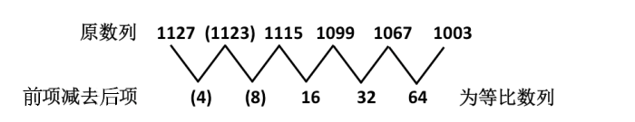

故正确答案为C。

### 第 22 题

13，33，26，28，（    ），86

A. 47

B. 57

C. 68

D. 76

第 22 题 · 答案与解析

**参考答案（粉笔题库参考内容）**

B

**解析**

将该数列每项十位与个位数相加，可得新数列：4、6、8、10、(    )、14，是差为2的等差数列，故新数列括号中的数字应该为12。只有B项的十位与个位之和为12。

故正确答案为B。

### 第 23 题

12.5，23.4，31.2，（    ），52.3，62.3

A. 41.2

B. 42.7

C. 46.4

D. 49.5

第 23 题 · 答案与解析

**参考答案（粉笔题库参考内容）**

A

**解析**

该数列的十位数数字依次是1、2、3、（4）、5、6，剩下的数字为2.5、3.4、1.2、(    ）、2.3、2.3，这是一个分组数列，依次为两两一组，每组内的两数字之和相等，且小数点前的数字的值小于小数点后的数字的值。所以括号中应填入的数字为41.2。

故正确答案为A。

### 第 24 题

，，，，，（    ）

A. 

B. 

C. 

D. 

第 24 题 · 答案与解析

**参考答案（粉笔题库参考内容）**

D

**解析**

本题为典型的分数数列。

把原数列改写为：、、、、、（    ），此时数列为递推数列，递推规律为：分子=前项分母-前项分子+1，具体规律为：3-2+1=2，6-2+1=5，12-5+1=8，60-8+1=53，因此下一项分子为：480-53+1=428；

，具体规律为：，，，，因此下一项分母为：。因此原数列的下一项为。

故正确答案为D。

### 第 25 题

3，4，9，28，113，（    ）

A. 566

B. 678

C. 789

D. 961

第 25 题 · 答案与解析

**参考答案（粉笔题库参考内容）**

A

**解析**

本题为变倍递推数列，加1修正。具体规律为：3×1+1=4，4×2+1=9，9×3+1=28，，因此原数列的下一项为：113×5+1=566。

故正确答案为A。

### 第 26 题

《参考消息》、《青年参考》全年订价分别为292元、156元。全室人员都订阅这两种报纸中的一种，用去2084元，如果他们换订另一品种，需用1948元。该室有多少人：

A. 7

B. 9

C. 11

D. 15

第 26 题 · 答案与解析

**参考答案（粉笔题库参考内容）**

B

**解析**

假设该室的人每人都订了两种报纸，则总的费用为2084+1948=4032元，该室共有人数为。

故正确答案为B。

### 第 27 题

甲、乙两件商品的成本共400元，分别以25%、40%的利润定价，然后分别以定价的9折、8.5折售出，共获得65.6元的利润。乙的售价是多少元：

A. 216.8

B. 285.6

C. 294.6

D. 272.8

第 27 题 · 答案与解析

**参考答案（粉笔题库参考内容）**

B

**解析**

设乙的成本为x元，则甲的成本为(400-x)元，可得：，解得x=240。因此乙的售价为。

故正确答案为B。

### 第 28 题

某企业实行计件工资报酬，加工一件合格的得5元；不合格的不计报酬且每件扣除15元。某员工第一个月加工800件，合格率为97%；第二个月加工1000件，合格率为98%，该员工第二个月报酬比第一个月多多少元：

A. 980

B. 1020

C. 1080

D. 1100

第 28 题 · 答案与解析

**参考答案（粉笔题库参考内容）**

C

**解析**

第一个月的报酬为；

第二个月的报酬为。

则第二个月报酬比第一个月多4600-3520=1080元。

故正确答案为C。

### 第 29 题

4辆车运送货物，每辆车可运16次；7辆车运送，每辆车只能运10次。设增加的车辆数与运送减少的次数成正比，且每车次运送货物相等，运送货物总量最多是多少车次：

A. 72

B. 74

C. 64

D. 68

第 29 题 · 答案与解析

**参考答案（粉笔题库参考内容）**

A

**解析**

由题意可知增加3辆车，减少单车运送次数6次，故二者的比例为1:2。假定在4辆车基础上增加车辆为n辆，则运送总车次数为，由二次函数取最值原理可知，当n=2时总车次数最大，此时总车次数为车次。

故正确答案为A。

### 第 30 题

某公司有三个部门，第一个部门的人数是其他两个部门人数的三分之一，第二个部门的人数是其他两个部门人数的五分之一，第三个部门有35人。则第一个部门与第二个部门人数相差多少：

A. 4

B. 5

C. 6

D. 8

第 30 题 · 答案与解析

**参考答案（粉笔题库参考内容）**

B

**解析**

分别假定三个部门人数为甲、乙、丙，则根据题意可知：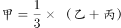，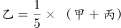，将丙=35代入，可知甲=15，乙=10。因此第一个部门与第二个部门的人数相差为5。

故正确答案为B。

### 第 31 题

在一次亚丁湾护航行动中，由“北斗”定位系统测得护航舰队与海盗船在同一经度上，其纬度分别在北纬和北纬。地球半径为R千米，护航舰队与海盗船相距多少千米：

A. 

B. 

C. 

D. 

第 31 题 · 答案与解析

**参考答案（粉笔题库参考内容）**

A

**解析**

南北纬各90度，纬度相差，也即，因此对应地面的弧长即为护航舰队与海盗船相距千米。

故正确答案为A。

### 第 32 题

募捐晚会售出300元、400元、500元的门票共2200张，门票收入84万元，其中400元和500元的门票张数相等。300元的门票售出多少张：

A. 800

B. 850

C. 950

D. 1000

第 32 题 · 答案与解析

**参考答案（粉笔题库参考内容）**

D

**解析**

假定400元门票有x张，300元门票有y张，则根据题意可得：(400+500）x+300y=840000，2x+y=2200，解得x=600，y=1000。

故正确答案为D。

### 第 33 题

生产一件A产品消耗原料甲4千克、乙2升，可获得1000元利润，生产一件B产品消耗原料甲3千克、乙5升，可获得1300元利润。现有原料甲40千克、乙38升，通过生产这两种产品，可获得的最大利润为多少元：

A. 15000

B. 14500

C. 13500

D. 12500

第 33 题 · 答案与解析

**参考答案（粉笔题库参考内容）**

D

**解析**

由题意，首先需要满足原料条件，可得：，，观察两个不等式可发现每个不等式中A、B系数之和恰好均为7，也即取甲7千克、乙7升，则可恰好生产A、B各一件。考虑到已知现有的甲、乙原料数接近，因此上述恰好配比的生产方式可以保证用掉尽可能多的原料，从而利润尽可能高。根据原料范围限制，可知A、B配对生产5组后，还剩下甲5千克、乙3升，还可以再生产一件A。因此可知最大利润为。

故正确答案为D。

### 第 34 题

赵、钱、孙3人共同完成经费为50400元的工程，赵、钱合作8天完成工程的40%，钱、孙合作2天完成工程的20%，然后3人合作3天完成剩余工程，根据完成工作量分配经费，3人的经费由高到低的排序是：

A. 孙、赵、钱

B. 钱、赵、孙

C. 赵、孙、钱

D. 孙、钱、赵

第 34 题 · 答案与解析

**参考答案（粉笔题库参考内容）**

A

**解析**

假定孙、赵、钱分别表示三人一天完成的工程费，根据题意可得：，，，解得：赵=1680，钱=840，孙=4200，因此可看成钱每天所获经费钱为1份、赵为2份、孙为5份。因此赵的经费为，钱的经费为，孙的经费为，故排序为孙、赵、钱。

故正确答案为A。

### 第 35 题

火车通过560米长的隧道用20秒，如果速度增加20%，通过1200米的隧道用30秒，火车的长度是多少米：

A. 220

B. 240

C. 250

D. 260

第 35 题 · 答案与解析

**参考答案（粉笔题库参考内容）**

B

**解析**

设火车长度为L，速度为v，根据题意可得：L+560=20v，，解得：L=240，v=40。

故正确答案为B。

### 第 36 题

某次招标规定，与每个报价数之差的平方和最小的价格为“预中标价”，接近“预中标价”报价的为预中标单位。6家单位投标，报价分别是37万元、62万元、61万元、47万元、49万元、56万元，其中“预中标价”是多少万元：

A. 51

B. 51.5

C. 52

D. 52.5

第 36 题 · 答案与解析

**参考答案（粉笔题库参考内容）**

C

**解析**

假设“预中标价”为m，各报价为、、······、，则“预中标价”与报价数之差的平方和为，由二次函数求最值原理可知，当m为各报价的平均数时，平方和最小。故“预中标价”为。

故正确答案为C。

### 第 37 题

一件产品要经过三道工序，每道工序的合格率分别为99.98%、99.95%、99.93%。该产品的合格率是多少：

A. 99.23%

B. 99.86%

C. 99.56%

D. 99.94%

第 37 题 · 答案与解析

**参考答案（粉笔题库参考内容）**

B

**解析**

产品三道工序的合格率分别为99.98%、99.95%、99.93%，则该产品的合格率为。

故正确答案为B。

### 第 38 题

公司上半年销售收入占全年销售收入的50%还多40万元，下半年销售收入占全年销售收入的25%还多120万元，公司全年销售收入是多少万元：

A. 560

B. 600

C. 640

D. 680

第 38 题 · 答案与解析

**参考答案（粉笔题库参考内容）**

C

**解析**

设公司全年销售收入为x万元，则上半年的销售收入为(50%x+40)万元，下半年的销售收入为(25%x+120)万元，则50%x+40+25%x+120=x，解得x=640。

故正确答案为C。

### 第 39 题

身高不等的5人站成一排照相，要求身高最高的人排在中间，按身高向两侧递减，共有多少种排法：

A. 4

B. 6

C. 12

D. 24

第 39 题 · 答案与解析

**参考答案（粉笔题库参考内容）**

B

**解析**

在一边选中两个人之后另一边必定是一高一矮两个人（高矮顺序仅此1种可能）。

身高最高的人只有一种站法，即排在最中间。他的一边放两个人的排法数为，排法只有一种；他的另一边剩下两人的排法也只有一种，因此总的排法数为。

故正确答案为B。

### 第 40 题

2010年末，某公司高收入员工（占20%）收入是一般员工（占80%）的6倍。未来5年实现员工总收入增加1倍，同时缩小收入差距，当一般员工收入增加1.5倍时，则高收入员工收入是一般员工收入的多少倍：

A. 5

B. 4.5

C. 4

D. 3

第 40 题 · 答案与解析

**参考答案（粉笔题库参考内容）**

C

**解析**

假设一般员工与高收入员工人数分别为8、2，再赋值一般员工的收入为1，则高收入员工的收入为6。于是员工总收入，增加1倍后为40。这40的收入中，一般员工占，因此高收入员工的收入变为。高收入员工与一般员工的收入倍数为4。

故正确答案为C。

## 材料 2

请从四个选项中选出正确的一项，其关系与题干给出的词或词组的关系最为相似。

### 第 41 题

前进：倒退

A. 鞭策：规劝

B. 海洋：陆地

C. 震动：安静

D. 延长：压缩

第 41 题 · 答案与解析

**参考答案（粉笔题库参考内容）**

D

**解析**

第一步：判断题干词语间逻辑关系。

题干两词是反义词关系。

第二步：判断选项词语间逻辑关系。

与题干具有相同逻辑关系的即为D项。A项为近义词关系，B项为并列关系，C项中“安静”的反义词应该为“吵闹”，而不是“震动”。

故正确答案为D。

### 第 42 题

文言文：古代汉语

A. 语言学：现代语言

B. 戏剧：古代戏曲

C. 白话文：现代汉语

D. 文献：古代文献

第 42 题 · 答案与解析

**参考答案（粉笔题库参考内容）**

C

**解析**

第一步：判断题干词语间逻辑关系。

题干两词是包容关系，且是后者包含前者，即“文言文”是“古代汉语”的书面语。

第二步：判断选项词语间逻辑关系。

与题干具有相同逻辑关系的即为C项，即“白话文”是“现代汉语”的书面语。A、B和D三项中都是前者包含后者。

故正确答案为C。

### 第 43 题

书：电子书：编写

A. 博客：网民：宣传

B. 会议：视频会议：召开

C. 身份：身体：科学家

D. 软件：金山词霸：方块字

第 43 题 · 答案与解析

**参考答案（粉笔题库参考内容）**

B

**解析**

第一步：判断题干词语间逻辑关系。

电子书是书，二者为种属关系，编写电子书，二者为动宾关系。

第二步：判断选项词语间逻辑关系。

A项：博客和网民为对应关系，与题干逻辑关系不一致，排除；

B项：视频会议是会议，二者为种属关系，召开视频会议，二者为动宾关系，与题干逻辑关系一致，当选；

C项：身体和身份没有明显的逻辑关系，与题干逻辑关系不一致，排除；

D项：方块字和金山词霸不能构成动宾语法关系，与题干逻辑关系不一致，排除。

故正确答案为B。

### 第 44 题

教育部：财政部：国家

A. 商务部：信息产业部：部门

B. 教务处：财务处：学校

C. 村委会：常委会：乡镇

D. 委员会：政治部：侨联

第 44 题 · 答案与解析

**参考答案（粉笔题库参考内容）**

B

**解析**

第一步：判断题干前两词间的逻辑关系，并在选项中进行选择。

题干前两词是并列关系中的反对关系，与之具有相同逻辑关系的是A项和B项。

第二步：答案不唯一时，再判断题干第一个词与第三个词间的逻辑关系，并在选项中进行选择。

“教育部”是“国家”的行政部门，具有相同特征的即为B项，即“教务处”是“学校”的部门。

故正确答案为B。

## 材料 3

请从四个选项中选出正确的一项，使得该项的两个词或词组依次代入题干的括号能够最大限度地满足题干所表达的类比关系。

### 第 45 题

分析 之于 （    ） 相当于 解答 之于 （    ）。

A. 思想——现象

B. 问题——疑难

C. 剖析——理解

D. 逻辑——思考

第 45 题 · 答案与解析

**参考答案（粉笔题库参考内容）**

B

**解析**

将选项逐一代入，判断各选项前后部分的逻辑关系。

A项，前两词无明显逻辑关系，后两词也无明显逻辑关系，排除；

B项，前两词“分析问题”为动宾结构，后两词“解答疑难”也为动宾结构，前后逻辑关系一致，当选；

C项，前两词是近义关系，后两词不是近义关系，前后逻辑关系不一致，排除；

D项，前面两词无明显逻辑关系，后两词是并列关系，前后逻辑关系不一致，排除。

故正确答案为B。

### 第 46 题

宇宙飞船 之于 （    ） 相当于 （    ） 之于 执政者。

A. 宇航员——国家

B. 太阳——理想

C. 航线——方向盘

D. 梦想——现实

第 46 题 · 答案与解析

**参考答案（粉笔题库参考内容）**

A

**解析**

第一步：将选项逐一代入，判断各选项前后部分的逻辑关系。

A项，前面部分是对应关系，后面部分是对应关系，前后逻辑关系一致，当选；

B项，前面部分无明显逻辑关系，后面部分无明显逻辑关系，前后逻辑关系不一致，排除；

C项，前面部分是属性关系，后面部分无明显逻辑关系，前后逻辑关系不一致，排除；

D项，前面部分无明显逻辑关系，后面部分无明显逻辑关系，前后逻辑关系不一致，排除。

第二步：逻辑关系相同即为答案。

根据第一步可知，逻辑关系完全相同的是A项。

故正确答案为A。

### 第 47 题

飞机 风筝 之于 （    ） 相当于 企鹅 海豚 之于 （    ）。

A. 天空——旱地

B. 风力——海洋

C. 雄鹰——冰雪

D. 人工——自然

第 47 题 · 答案与解析

**参考答案（粉笔题库参考内容）**

D

**解析**

第一步：将选项逐一代入，判断各选项前后部分的逻辑关系。

A项，前面部分是对应关系，后面部分无明显逻辑关系，前后逻辑关系不一致，排除；

B项，前面部分“飞机”和“风力”无明显逻辑关系，“风筝”和“风力”是对应关系，后面部分“企鹅”和“海洋”是对应关系，“海豚”和“海洋”是对应关系，前后逻辑关系不一致，排除；

C项，前面部分是并列关系，后面部分是对应关系，前后逻辑关系不一致，排除；

D项，前面部分是属性关系，后面部分是属性关系，前后逻辑关系一致，当选。

第二步：逻辑关系相同即为答案。

根据第一步可知，逻辑关系完全相同的是D项。

故正确答案为D。

## 材料 4

请从四个选项中选出正确的一项，其特征或规律与题干给出的一串符号的特征或规律最为相似。

### 第 48 题

Hh8jj7t

A. ss2vv33

B. dd9qq5r

C. 77x66nm

D. frd22de

第 48 题 · 答案与解析

**参考答案（粉笔题库参考内容）**

B

**解析**

第一步：分析题干结构。

题干结构为：两个字母＋一个数字＋两个字母＋一个数字＋一个字母。

第二步：与题干结构相同的选项即为答案。

通过分析可知只有B选项与题干结构相同。

故正确答案为B。

### 第 49 题

A. 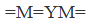

B. 

C. 

D. 

第 49 题 · 答案与解析

**参考答案（粉笔题库参考内容）**

D

**解析**

第一步：分析题干结构。

题干结构为：A＋B＋AA＋C＋A。

第二步：与题干结构相同的选项即为答案。

通过分析可知只有D选项与题干结构相同。

故正确答案为D。

### 第 50 题

A. 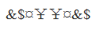

B. 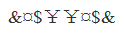

C. 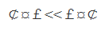

D. 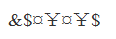

第 50 题 · 答案与解析

**参考答案（粉笔题库参考内容）**

C

**解析**

第一步：分析题干结构。

题干结构为：A＋B＋C＋DD＋C＋B＋A。

第二步：与题干结构相同的选项即为答案。

通过分析可知只有C选项与题干结构相同。

故正确答案为C。

### 第 51 题

左边给定的是纸盒的展开图，右边哪一项能由它折叠而成？

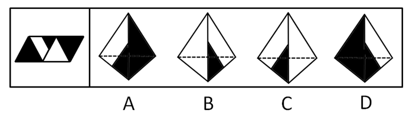

A. A

B. B

C. C

D. D

第 51 题 · 答案与解析

**参考答案（粉笔题库参考内容）**

AB

**解析**

四面体，考查相邻关系。当有小黑三角的面与全白面同时出现在立体图中时，只能是全白面在左侧，有小黑三角的面在右侧，因此可判断B项正确，C项错误；由B项中图形往左翻滚一下，使得全白面作为底面，此时便得到A项中图形，因此A项也正确；由C项中图形往右翻滚一下，使得全白面作为底面，此时便得到D项中图形，因此D项也错误。

故正确答案为A项和B项。

### 第 52 题

左边给定的是纸盒的外表面展开图，右边哪一项能由它折叠而成？

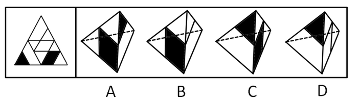

A. A

B. B

C. C

D. D

第 52 题 · 答案与解析

**参考答案（粉笔题库参考内容）**

A

**解析**

将题干展开图标上序号，如下图所示，逐一进行分析。

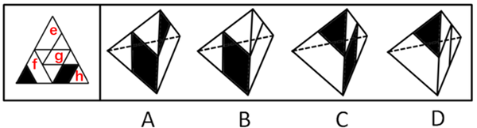

A项：选项由面f和面h构成，选项与题干展开图一致，当选；

B项：选项由面e和面f构成，题干展开图中面e和面h的公共边与面h中的黑色菱形相交于点，而选项中面e和面h的公共边与面h中的黑色菱形相交于边，选项与题干展开图不一致，排除；

C项：选项由面f和面h构成，在题干展开图和选项中分别以面f中黑色三角形的顶点为起点顺时针画边（如下图所示），题干展开图中边3与面h相邻，而选项中边1与面h相邻，选项展开图与题干不一致，排除；

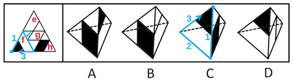

D项：选项由面f和面g构成，题干展开图中面f和面g的公共边与面f中的黑色三角形不相交，而选项中面f和面g的公共边与面f中的黑色三角形相交，选项展开图与题干不一致，排除。

故正确答案为A。

### 第 53 题

左边给定的是纸盒的外表面展开图，右边哪一项能由它折叠而成？

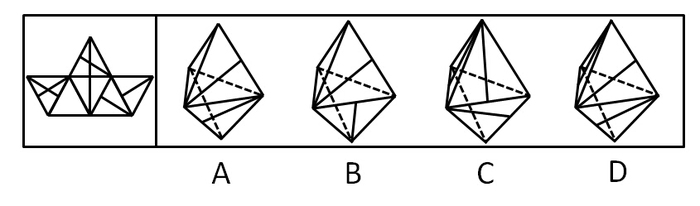

A. A

B. B

C. C

D. D

第 53 题 · 答案与解析

**参考答案（粉笔题库参考内容）**

B

**解析**

空间重构，考查相邻关系。本题可采用排除法。两条斜线所在的斜线方向应有一条垂直于其公共边，因此排除A、D两项；C项中下侧面斜线方向应该与A项中下侧面斜线方向是相同的，因此排除C项。

故正确答案为B。

### 第 54 题

左边给定的是正方体的外表面展开图，右边哪一项能由它折叠而成？

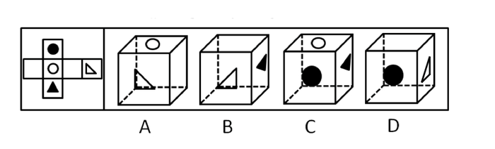

A. A

B. B

C. C

D. D

第 54 题 · 答案与解析

**参考答案（粉笔题库参考内容）**

D

**解析**

本题可采用排除法。白色圆圈所在面与白色三角所在面是平行面，不能相邻，因此排除A项；黑色三角应有一边与其所在面和白色三角所在面的公共边平行，因此排除B项；黑色圆圈所在面与黑色三角所在面是平行面，不能相邻，因此排除C项。

故正确答案为D。

### 第 55 题

左边给定的是纸盒外表面的展开图，右边哪一项能由它折叠而成？

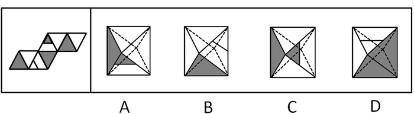

A. A

B. B

C. C

D. D

第 55 题 · 答案与解析

**参考答案（粉笔题库参考内容）**

C

**解析**

本题可采用排除法。全空白面之间不可能有公共边，因此排除A、B两项；带横线的面中的横线应与相邻的全阴影面的边是平行的，因此排除D项。

故正确答案为C。

### 第 56 题

上面三个图给出了同一个立体图形的不同侧面，下面四个选项图形中只有一个与该立体图形相同，请把它找出来。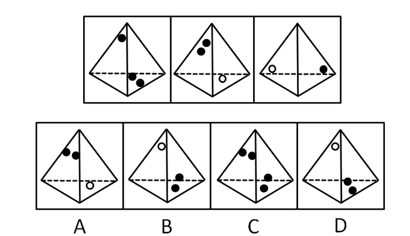

A. A

B. B

C. C

D. D

第 56 题 · 答案与解析

**参考答案（粉笔题库参考内容）**

B

**解析**

本题可采用排除法。根据题干中的第二个图形，可以判断A项错误，因此排除A项；根据题干中的第一个图形，可以判断D项错误，因此排除D项；根据题干中的第一个图形，可以判断C项右侧面中应为一个黑点，因此排除C项。

故正确答案为B。

备注：本题需注意区别题干中的第一个图形与第二个图形中有两个黑点的面中两个黑点的摆放关系。

### 第 57 题

上面三个图给出了同一个立体图形的不同侧面，下面四个选项图形中只有一个与该立体图形相同，请把它找出来。

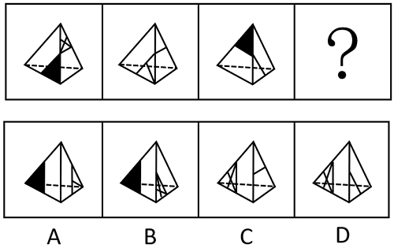

A. A

B. B

C. C

D. D

第 57 题 · 答案与解析

**参考答案（粉笔题库参考内容）**

A

**解析**

本题考查空间重构。根据题干所给出的同一个立体图形的不同侧面，画出该四面体的展开图，并在展开图标上序号，如下图所示，逐一分析选项。

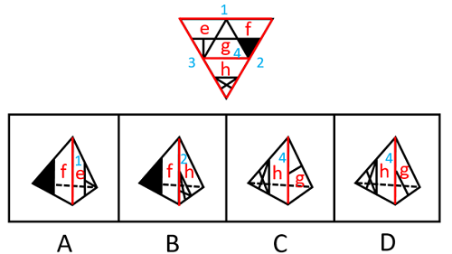

A项：选项由面e和面f构成，选项与展开图一致，当选；

B项：选项由面f和面h构成，选项中面f的黑色三角形和公共边边2不相交，而展开图中面f的黑色三角形和公共边边2相交，选项与展开图不一致，排除；

C项：选项由面g和面h构成，选项中面g的中线和公共边边4相交，而展开图中面g的中线和公共边边4不相交，选项与展开图不一致，排除；

D项：选项由面g和面h构成，选项中面g的中线和公共边边4相交，而展开图中面g的中线和公共边边4不相交，选项与展开图不一致，排除。

故正确答案为A。

### 第 58 题

从所给四个选项中，选择最合适的一个，使之呈现一定的规律性：

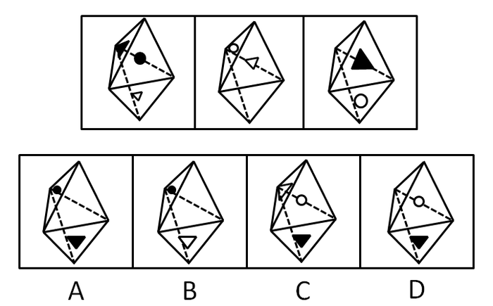

A. A

B. B

C. C

D. D

第 58 题 · 答案与解析

**参考答案（粉笔题库参考内容）**

C

**解析**

本题可采用排除法。由题干中第一个图形可知，全黑圆和全黑三角、全白三角所在面分别相邻，存在公共边，因此可以排除A和B项；根据题干中的第三个图形，可以判断D项错误，因此排除D项。

故正确答案为C。

### 第 59 题

从所给四个选项中，选择最合适的一个，使之呈现一定的规律性：

A. A

B. B

C. C

D. D

第 59 题 · 答案与解析

**参考答案（粉笔题库参考内容）**

A

**解析**

本题可采用排除法。根据题干中的第一个图形，可以判断B项上面线条方向错误，因此排除B项；根据题干中的第三个图形，简单翻转后可以判断C项斜线方向错误，因此排除C项；根据题干中的第二个图形，可以判断D项正对面图形错误，因此排除D项。

故正确答案为A。

### 第 60 题

上面三个图给出了同一个立体图形的不同侧面，下面四个选项图形中只有一个与该立体图形相同，请把它找出来。

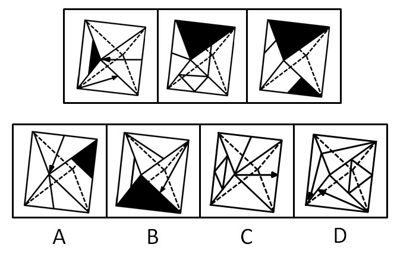

A. A

B. B

C. C

D. D

第 60 题 · 答案与解析

**参考答案（粉笔题库参考内容）**

D

**解析**

本题可采用排除法。考查描线法的应用。根据题干中的第一个图形可知，箭头指向顶角的面和有小黑三角的面不是相邻面，因此排除A项；根据题干中的第一个图形可知，含箭头的两个面中，箭头应该接近，而不是分离，因此排除B项；与每个面相邻的有三个面，根据题干中的第一个图形可以看出，与箭头指向边的面相邻的两个面在C项中均未出现，因此排除C项。

故正确答案为D。

### 第 61 题

李明的所有网友都不是软件工程师。通过李明而认识大楚公司董事的都是软件工程师。李明的一个网友通过李明认识了王刚。

根据以上陈述，可以得出：

A. 王刚不是软件工程师

B. 王刚不是大楚公司的董事

C. 王刚是软件工程师

D. 王刚是大楚公司的董事

第 61 题 · 答案与解析

**参考答案（粉笔题库参考内容）**

B

**解析**

第一步：翻译题干，利用充分必要条件。

第一句：李明的网友是软件工程师；第二句：通过李明认识 且 认识的是大楚公司董事是软件工程师；第三句：李明的一个网友，通过李明且认识了王刚。

第二步：根据第三句的事实信息开始分析推导。

由第三句和第一句可知，李明的这个网友是软件工程师。再根据第二句的逆否规则：-是软件工程师（通过李明认识 且 认识的是大楚公司董事）=-通过李明认识 或 -认识的是大楚公司董事

由第三句又知这个网友通过李明认识了王刚，根据选言命题规则，可知认识的王刚不是大楚公司的董事。

故正确答案为B。

### 第 62 题

在某次学术会议上，有人发现：凡是认识李博士的人，张教授都认识。只要是有些人不认识的人，赵研究员全都认识。新参加会议的研究生小王不认识与会的任何人。
根据以上陈述，可以得出：

A. 张教授与赵研究员相互认识

B. 张教授认识赵研究员，但赵研究员不认识张教授

C. 张教授与赵研究员相互不认识

D. 张教授不认识赵研究员，但赵研究员认识张教授

第 62 题 · 答案与解析

**参考答案（粉笔题库参考内容）**

A

**解析**

第一步：翻译题干。

①认识李博士的人张教授认识；

②有些人不认识的人赵研究员认识；

③研究生小王不认识与会的任何人。

第二步：根据题干条件进行推理。

由条件③可知小王不认识李博士和张教授，结合条件②“有些人不认识的人赵研究员认识”可得“赵研究员认识李博士和张教授”。根据条件①“凡是认识李博士的人张教授都认识”可知“张教授认识赵研究员”。综上，赵研究员认识张教授，同时张教授也认识赵研究员，因此张教授与赵研究员相互认识，只有A项符合。

故正确答案为A。

### 第 63 题

小李、小张、小马、小王在一起讨论N地区的廉租房建设情况，小李说：“N地区的廉租房建设得都不错。”小张说：“N地区没有廉租房建设得好。”小马说：“N地区有的廉租房建设得不好。”小王说：“N地区还是有廉租房建设得不错的。”假如小张和小马都说错了，那么，可以推出：

A. 小李说错了

B. 小李和小王都说错了

C. 小王说错了

D. 小王说对了

第 63 题 · 答案与解析

**参考答案（粉笔题库参考内容）**

D

**解析**

第一步：分析题干条件。

小李：N地区的廉租房建设得都不错；

小张：N地区没有廉租房建设得好，即N地区的廉租房建设得都不好；

小马：N地区有的廉租房建设得不好；

小王：N地区有的廉租房建设得不错。

其中小李和小马的说法为矛盾关系，必有一真一假；小张和小王的说法也为矛盾关系，必有一真一假。

第二步：根据题干条件进行推理。

根据题干条件可知，小张和小马都说错了，故小王和小李的说法一定正确，只有D项符合。

故正确答案为D。

### 第 64 题

张、王、李、赵、钱、孙、陈七人每个星期都只有一个休息日，而且每天只能安排一人休息，已知张的休息日比李的晚一天，赵的休息日比钱的晚两天，王的休息日比陈的早三天，孙的休息日是星期四，而且恰好处于王和李休息日的中间。
根据以上陈述，可以得出：

A. 钱的休息日是星期三

B. 赵的休息日是星期五

C. 王的休息日是星期三

D. 李的休息日是星期六

第 64 题 · 答案与解析

**参考答案（粉笔题库参考内容）**

D

**解析**

第一步：翻译题干并找突破口。

条件1：七人每人每个星期都只有一个休息日；条件2：每天只能安排一人休息；条件3：张的休息日比李的晚一天；条件4：赵的休息日比钱的晚两天；条件5：王的休息日比陈的早三天；条件6：孙的休息日是星期四，而且恰好处于王和李休息日的中间。

本题突破口为“孙的休息日是星期四，而且恰好处于王和李休息日的中间”，又知“王的休息日比陈的早三天”，所以王的休息日只能为星期二或星期三。

第二步：根据突破口作出假设继续推导。

如果王的休息日为星期三，那么陈的休息日为星期六，李的休息日为星期五，又由“张的休息日比李的晚一天”可知张的休息日为星期六，这与之前得到的“陈的休息日为星期六”矛盾，因此假设错误，所以王的休息日为星期二。

由“王的休息日为星期二”可知，陈的休息日为星期五，李的休息日为星期六，又由“张的休息日比李的晚一天”可知张的休息日为星期日，又知“赵的休息日比钱的晚两天”，此时只能是钱的休息日为星期一，赵的休息日为星期三。综上，休息关系对应如下：

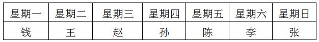

通过分析选项，只有D项符合。

故正确答案为D。

### 第 65 题

针对一块园地，园艺师们提出了如下建议：（1）牡丹、芍药至多种植一种；（2）如果种植芍药，则不能种植蝴蝶兰或者玫瑰；（3）牡丹、玫瑰至少种植一种。实际种植时，上述三条建议只有一条被采纳。
根据以上陈述，以下最可能符合实际种植情况的是：

A. 牡丹、芍药和玫瑰均种

B. 种植芍药，但不种蝴蝶兰、玫瑰

C. 芍药、蝴蝶兰和玫瑰均种

D. 种植蝴蝶兰，但不种植玫瑰、芍药

第 65 题 · 答案与解析

**参考答案（粉笔题库参考内容）**

A

**解析**

第一步：翻译题干。

（1）-牡丹 或 -芍药；

（2）芍药（蝴蝶兰 或 玫瑰）；

（3）牡丹 或 玫瑰。

第二步：根据题干条件进行推理。

本题题干信息没有明显突破口，选项信息充分，考虑代入法。

代入A项：牡丹 且 芍药 且 玫瑰，无论是否种植蝴蝶兰，均不符合（1）、（2），符合（3），满足“上述三条建议只有一条被采纳”，A项正确；

代入B项：芍药 且 -蝴蝶兰 且 -玫瑰，符合（2）。根据“上述三条建议只有一条被采纳”，可知应未采用（1）和（3）。而当（1）为假时，（1）的矛盾为真，即“牡丹 且 芍药”，此时（3）也为真；当（3）为假时，（3）的矛盾为真，即“-牡丹 且 -玫瑰”，此时（1）也为真，即B项一定采纳了两条建议，因此B项不符合实际种植情况，排除B项；

代入C项：芍药 且 蝴蝶兰 且 玫瑰，不符合（2），符合（3）。此时牡丹的种植情况不明确，若种植牡丹，则不符合（1）、（2），符合（3）；若不种植牡丹，则符合（1）、（3），不符合（2），C项无法确定是否符合实际种植情况，排除C项；

代入D项：蝴蝶兰 且 -玫瑰 且 -芍药，符合（2）。根据“上述三条建议只有一条被采纳”，可知选项应未采用（1）和（3）。而当（1）为假时，（1）的矛盾为真，即“牡丹 且 芍药”，与选项的“-芍药”矛盾；当（3）为假时，（3）的矛盾为真，即“-牡丹 且 -玫瑰”，此时（1）也为真，故D项一定不符合实际种植情况，排除D项。

故正确答案为A。

### 第 66 题

某市实行人才强省战略，2010年从国内外引进各类优秀人才1000名，其中，管理类人才361人，非管理类不具有博士学位的人才250人，国外引进的非管理类人才206人，国内引进的具有博士学位的人才252人。
根据以上陈述，可以得出：

A. 国内引进的具有博士学位的管理类人才少于70人

B. 国内引进的具有博士学位的管理类人才多于70人

C. 国外引进的具有博士学位的管理类人才少于70人

D. 国外引进的具有博士学位的管理类人才多于70人

第 66 题 · 答案与解析

**参考答案（粉笔题库参考内容）**

A

**解析**

第一步：分析题干条件。

（1）优秀人才1000名中，管理类人才361人，可得非管理类人才639人；

（2）非管理类人才639名中，非管理类不具有博士学位的人才250人，可得非管理类具有博士学位的人才389人；

（3）非管理类人才639名中，国外引进的非管理类人才206人，可得国内引进的非管理类人才433人；

（4）国内引进的具有博士学位的人才252人。

第二步：根据题干条件进行推理。

根据选项需分析“国内引进的具有博士学位的管理类人才”和“国外引进的具有博士学位的管理类人才”：

国内引进的具有博士学位的非管理类人才+国外引进的具有博士学位的非管理类人才=具有博士学位的非管理类人才=389人；而国外引进的非管理类人才为206人，则国外引进的具有博士学位的非管理类人才人，进而可知，国内引进的具有博士学位的非管理类人才人；而国内引进的具有博士学位的人才为252人，则国内引进的具有博士学位的管理类人才人，即国内引进的具有博士学位的管理类人才少于70人。而国外引进的具有博士学位的管理类人才无法分析得到。

故正确答案为A。

### 第 67 题

甲、乙、丙、丁四位球迷有一段对话。甲说：“Y球队能进入决赛。”乙说：“如果X球队能进入决赛，那么Y球队也能进入决赛。”丙说：“我看Y球队不能进入决赛，但X球队能进入决赛。”丁说：“X球队不能进入决赛。”
如果四人中只有一人是对的，那么可以推出：

A. X和Y球队都能进入决赛

B. X球队不能进入决赛，Y球队能进入决赛

C. X和Y球队都不能进入决赛

D. X球队能进入决赛，Y球队不能进入决赛

第 67 题 · 答案与解析

**参考答案（粉笔题库参考内容）**

D

**解析**

第一步：找突破口。

本题突破口为乙和丙之间的矛盾关系，两人的话必有一真和一假。

第二步：看其他的话。

本题只有一人是对的，故甲和丁的话均是错的。由甲和丁所说的话可知，X球队能进入决赛，Y球队不能进入决赛。

故正确答案为D。

### 第 68 题

小陈喜欢自驾游，下个月正好有假期，小陈家不远处有家旅游公司。小陈丈夫是旅游公司经理。据此，有四个推论：（1）有的旅游公司经理不认识某旅游公司经理的妻子；（2）某旅游公司经理的妻子从不跟她丈夫所在的旅游公司出游；（3）小陈家附近的旅游公司经理是小陈丈夫；（4）小陈家附近的旅游公司经理的妻子下个月有假期。
以上推理中，错误的有：

A. 1个

B. 2个

C. 3个

D. 4个

第 68 题 · 答案与解析

**参考答案（粉笔题库参考内容）**

D

**解析**

第一步：抓住每句话中的对象。

第一句：小陈家不远处有家旅游公司；第二句：小陈丈夫是旅游公司经理。

第二步：逐一判断推论的正确性。

（1）和（2）题干中并没有提到，无法确定，因此（1）和（2）均错；小陈家附近的旅游公司也不一定是小陈丈夫所在的公司，从而（3）和（4）也不能确定，因此（3）和（4）均错。综上，四个推理都是错误的。

故正确答案为D。

### 第 69 题

某基金经理按照以往经验买甲、乙、丙、丁、戊、己六种股票：不同时买乙和丁；如果不买丁，那么也不买丙；或者不买甲，或者买乙；如果同时买戊和己，那么也买丙。据此，可以有四个推论：（1）如果买丙，那么也买丁；（2）如果买甲，那么也买丁；（3）如果买乙，那么不同时买戊和己；（4）如果同时买戊和己，那么也买丁。
以上推理中，正确的有：

A. 1个

B. 2个

C. 3个

D. 4个

第 69 题 · 答案与解析

**参考答案（粉笔题库参考内容）**

C

**解析**

第一步：翻译题干。

（1）-乙 或 -丁；（2）-丁丙；（3）-甲 或 乙；（4）戊 且 己丙。

第二步：逐一判断推理。

由（2）命题的逆否命题可知，丙丁，因此结论（1）正确。

由（3）命题可知，甲乙；由（1）命题可知，乙丁，所以甲丁，故结论（2）错误。

由（1）（2）命题可知，乙丁丙；由（4）命题的逆否命题可知，-丙（戊 且 己），因此结论（3）正确。

由（4）命题与（2）命题的逆否命题可知，戊 且 己丙丁，因此结论（4）正确。

故正确答案为C。

### 第 70 题

一般来说，电热毯的使用寿命为6年，如果超期使用，容易出现漏电、失火事故。高压锅安全使用年限为8年，如果超出安全使用期，高压锅的抗压能力会明显下降，继续使用就容易发生爆炸事故。据此，可以有四个推论：（1）小赵5年前购买了高压锅，目前还在使用，如果不立即更换，容易发生高压锅爆炸事故；（2）小高用高压锅煮饭时，高压锅突然爆炸，这是由于高压锅超期使用造成的；（3）小孙7年前购买了电热毯，一天家里失火，这是由于电热毯超期使用造成的；（4）小李前年购买了电热毯，今年继续使用不会出现漏电事故。
以上推理中，错误的有：

A. 1个

B. 2个

C. 3个

D. 4个

第 70 题 · 答案与解析

**参考答案（粉笔题库参考内容）**

D

**解析**

第一步：翻译题干，利用充分必要条件。

第一句说明电热毯的使用寿命为6年，电热毯超期使用电热毯出现漏电事故；第二句说明高压锅安全使用年限为8年，高压锅超期使用高压锅发生爆炸。

第二步：逐一翻译推论并判断推论的正确性，利用逆否规则。

（1）翻译为：-高压锅超期使用高压锅发生爆炸，“-高压锅超期使用”属于否前件，无法推出绝对表达的结论，因此（1）错误；

（2）翻译为：高压锅发生爆炸高压锅超期使用，“高压锅突然爆炸”属于肯后件，无法推出绝对表达的结论，因此（2）错误；

（3）翻译为：电热毯出现漏电事故电热毯超期使用，“电热毯出现漏电事故”属于肯后件，无法推出绝对表达的结论，因此（3）错误；

（4）翻译为：-电热毯超期使用电热毯出现漏电事故，“-电热毯超期使用”属于否前件，无法推出绝对表达的结论，因此（4）错误。

综上，四个推论均是错误的。

故正确答案为D。

### 第 71 题

路径依赖是指人类社会中的技术演进或制度变迁有惯性，即一旦进入某一路径就可能对这种路径产生依赖，不断自我强化，轻易走不出去。

根据上述定义，下列不属于路径依赖的是：

A. 萧规曹随

B. 刻舟求剑

C. 随波逐流

D. 守株待兔

第 71 题 · 答案与解析

**参考答案（粉笔题库参考内容）**

B

**解析**

第一步：找出定义关键词。

“技术演进或制度变迁有惯性”、“产生依赖”、“轻易走不出去”。

第二步：逐一分析选项。

A项：“萧规曹随”意思为萧何创立了规章制度，萧何死后，曹参做了宰相，仍照着萧何的规章制度实行。比喻按照前任的成规办事，符合定义，排除；

B项：“刻舟求剑”比喻不懂事物已发展变化仍静止地看问题。明显不符合关键词 “技术演进或制度变迁有惯性”和“产生依赖”，不符合定义，当选；

C项：“随波逐流”意思为随着波浪起伏，跟着流水漂荡。比喻没有坚定的立场，缺乏判断是非的能力，只能随着别人走，符合定义关键词“产生依赖”、“轻易走不出去”，符合定义，排除；

D项：“守株待兔”原比喻企图不经过努力而得到成功的侥幸心理。现也比喻死守狭隘经验，不知变通，符合定义关键词“产生依赖”、“轻易走不出去”，符合定义，排除。

本题为选非题，故正确答案为B。

### 第 72 题

打折扣原则指存在其他似乎合理的原因时，产生某一结果的原因的作用会被打折扣。

下列受打折扣原则影响的是：

A. 钱某一直坚持清晨长跑，每日都至少锻炼1小时，这让知道的人都钦佩不已

B. 老蔡看到一个年轻人正扶着一位老人过马路，心想：这个人是不是老人的孙子

C. 目睹了那个年轻人与售货员的争吵始末后，小杜觉得那个年轻人过于挑剔了

D. 这几天气温会大降，且有强降雨，一家人都动员小玉不要在这几天出门远行

第 72 题 · 答案与解析

**参考答案（粉笔题库参考内容）**

B

**解析**

第一步：抓住定义中的关键词。

关键词包括“存在其他似乎合理的原因”、“某一结果的原因的作用”、“打折扣”。

第二步：逐一判断选项。

A项中钱某坚持清晨长跑，让知道的人都钦佩不已，不符合关键词“打折扣”，因此不是受打折扣原则影响的；B项中由于社会风气的影响，老蔡认为除非是亲人否则扶老人过马路的情形不容易出现，完全符合关键词，因此是受打折扣原则影响的；C项中小杜目睹年轻人与售货员的争吵始末后觉得年轻人过于挑剔，是合理的原因，不是其他似乎合理的原因，不符合关键词“存在其他似乎合理的原因”，因此不是受打折扣原则影响的；D项中气温会大降，且有强降雨是家人动员小玉不要出门远行的合理的原因，不符合关键词“存在其他似乎合理的原因”，因此不是受打折扣原则影响的。

故正确答案为B。

### 第 73 题

动机性偏差指由于某种特殊的动机或需要而在加工信息时出现的归因偏差。

下列属于动机性偏差的是：

A. 秦某答应儿子，如果儿子能独自做好一道菜就带他去野炊

B. 孙某认为当地晚上治安比较乱，要求她的女儿每晚九点前必须回家

C. 李经理认为这两年公司的蓬勃发展离不开好政策和每一位同事的辛勤努力

D. 赵某哀叹最近身体不佳让他与经理一职失之交臂，尽管他的同事并不这么认为

第 73 题 · 答案与解析

**参考答案（粉笔题库参考内容）**

D

**解析**

第一步：抓住定义中的关键词。

关键词包括“某种特殊的动机或需要”、“归因偏差”。

第二步：逐一判断选项。

A项中秦某答应儿子如果能独自做好一道菜就带他去野炊；B项中孙某因当地晚上治安比较乱要求女儿每晚九点前回家；C项中李经理认为公司的发展离不开好政策和同事的努力，均不符合关键词“归因偏差”，因此都不属于动机性偏差，排除；D项中赵某认为是身体不佳使得自己没当上经理，但真正原因并非如此，符合关键词“归因偏差”，因此属于动机性偏差，当选。

故正确答案为D。

### 第 74 题

静脉产业指运用先进的技术，将生产和消费过程中产生的废物转化为可重新利用的资源和产品，实现各类废物的再利用和资源化的产业，如同人体血液循环中的静脉一样。
下列不属于静脉产业的是：

A. 某企业用“资源—产品—废弃物”的经济模式开采原生自然资源，并注重资源利用，关注经济系统对自然生态系统的影响

B. 德国的绿点公司负责社区黄色垃圾箱和垃圾袋中垃圾的收集、分类、回收和再利用，处理费用由获得“绿点”标志认证的企业或销售商支付

C. 某企业规定，生产者对其产品的整个生命周期负责，并明确废弃物的管理原则，避免产生—循环使用—最终处置

D. 当今，世界发展遇到两个共同难题：垃圾过剩和资源短缺。变废为宝是解决的有效途径，如某企业利用花生壳生产夹板作为建材，具有较好的抗震效果

第 74 题 · 答案与解析

**参考答案（粉笔题库参考内容）**

A

**解析**

第一步：找出定义关键词。

“废物转化为可重新利用的资源和产品”、“废物的再利用和资源化”。

第二步：逐一分析选项。

A项：“开采原生自然资源”不符合关键词“废物转化”，不符合定义，当选；

B项：德国的绿点公司垃圾的收集、分类、回收和再利用，属于“废物转化为可重新利用的资源和产品”，符合定义，排除；

C项：企业规定中明确废弃物的管理原则循环使用，是废物回收利用，属于“废物转化为可重新利用的资源和产品”，符合定义，排除；

D项：变废为宝，是废物回收利用，属于“废物转化为可重新利用的资源和产品”，符合定义，排除。

本题为选非题，故正确答案为A。

### 第 75 题

资源整合指企业通过组织和协调，对不同来源、不同层次、不同结构、不同内容的资源进行识别与选择、汲取与配置、激活与有机融合。

下列不含资源整合的是：

A. 中国的户外广告公司有数万家之多，非常分散，但有的能把这些分散的公司集中到一起，形成优势后再来策划销售

B. 当年牛某从某公司黯然出局时，除了其所经营的各种关系，剩下的只有“老骥伏枥，志在千里”的悲怆与勇气

C. 在当今强调速度和规模的时代，某企业考虑最多的是潜在价值共享、共同创造超值、交换价值各得所需等

D. 某公司对员工进行专业培训，苦于找不到老师，正好老总的一个同事提供了一公司培训部经理的电话，经联系后如期完成了培训任务

第 75 题 · 答案与解析

**参考答案（粉笔题库参考内容）**

B

**解析**

第一步：抓住定义中的关键词。

关键词包括：“不同来源、不同层次、不同结构、不同内容的资源”、“识别与选择、汲取与配置、激活与有机融合”。

第二步：逐一判断选项。

A项，把分散的广告公司进行集中整合，符合对“不同来源、不同层次、不同结构、不同内容的资源”、“识别与选择、汲取与配置、激活与有机融合”。属于资源整合。

B项，主体是个人，且其出局后只剩悲怆和勇气，没有体现出调配资源，整合配置，因此不属于资源整合。

C项，潜在价值共享、共同创造超值、交换价值各得所需等完全符合“不同来源、不同层次、不同结构、不同内容的资源”、“识别与选择、汲取与配置、激活与有机融合”。属于资源整合。

D项，通过联系其他公司培训部经理的方式，完成了对本公司员工的培训，培训师的来源不同，经过有效配置，完成了本公司的任务，符合“不同来源、不同层次、不同结构、不同内容的资源”、“识别与选择、汲取与配置、激活与有机融合”。属于资源整合。

综上所述， A、C、D三项均属于资源整合。

本题为选非题，故正确答案为B。

### 第 76 题

定义：
①自我知觉指个体对自己的认识，即一个人通过自己的行为和行为发生的情境了解自己的态度、情感和内部状态。
②人际知觉指对人与人之间关系的知觉，包括对人的外部特征、个性特点的了解，对人行为的判断和理解。
③知觉定势指主体对一定活动的特殊准备状态，即人们当前的活动常倾向于带有前面活动的特点，一般由早先的经验造成。
典型例证：
（1）三人行必有我师。
（2）习惯成自然。
（3）吾日三省吾身。
对上述典型例证与定义的关系判断正确的是：

A. 例证（1）（2）分别与定义①②相符

B. 例证（3）（2）分别与定义①③相符

C. 例证（2）（1）分别与定义①②相符

D. 例证（2）（3）分别与定义③②相符

第 76 题 · 答案与解析

**参考答案（粉笔题库参考内容）**

B

**解析**

第一步：抓住每个定义中的关键词。

“自我知觉”中的关键词包括“个体对自己的认识”。“人际知觉”中的关键词包括“人与人之间关系的知觉”。“知觉定势”中的关键词包括“主体对一定活动的特殊准备状态”。

第二步：逐一判断例证。

“三人行必有我师”意思为几个人同行，其他人各具优点和缺点，他们的优点我要学习，他们的缺点我要注意加以防范，避免重蹈他们的覆辙，所以他们都可以是我的老师。完全符合关键词“人与人之间关系的知觉”，因此（1）属于人际知觉，即例证（1）与定义②相符。

“习惯成自然”意思为事物发展的规律性，做事的方法习惯了，就很难改变，也就成为很自然的事了。完全符合关键词“主体对一定活动的特殊准备状态”，因此（2）属于知觉定势，即例证（2）与定义③相符。

“吾日三省吾身”意思为原指每日从三个方面检查自己，后指多次自觉地检查自己。完全符合关键词“个体对自己的认识”，因此（3）属于自我知觉，即例证（3）与定义①相符。综上，例证（1）与定义②相符，例证（2）与定义③相符，例证（3）与定义①相符，通过分析选项，只有B项符合。

故正确答案为B。

### 第 77 题

定义：
①行政赔偿指行政机关及其工作人员违法行使行政职权，侵犯公民、法人和其他组织的合法权益造成损害的，由国家承担赔偿责任的赔偿。
②刑事赔偿指司法机关错拘、错捕、错判而引起的国家赔偿。
③国家补偿指国家对国家机关及其工作人员的合法行使职权行为对公民造成的损失给予的补偿。
典型例证：
（1）王某在一次酒席上致高某饮酒过量不治而亡，高某家属要求王某赔偿二十万元。
（2）治安联防队员马某抓获有盗窃嫌疑的陈某，但陈某拒不承认有盗窃行为，马某将陈某殴打致伤，陈某向公安分局请求赔偿。
（3）孙某所乘长途汽车途中遭遇劫匪，在劫匪挟持汽车驾驶员的过程中，孙某从车窗跳下，致全身多处骨折，后孙某向该汽车所属的交通运输公司请求赔偿。
对上述典型例证与定义的关系判断正确的是：

A. 例证（1）与定义①相符，例证（2）与定义②不相符

B. 例证（2）与定义③相符，例证（3）与定义②不相符

C. 例证（1）与定义②相符，例证（1）与定义③不相符

D. 例证（1）（2）（3）分别与定义①②③不相符

第 77 题 · 答案与解析

**参考答案（粉笔题库参考内容）**

D

**解析**

第一步：抓住每个定义中的关键词。

“行政赔偿”中的关键词包括“行政机关及其工作人员违法行使行政职权”。“刑事赔偿”中的关键词包括“司法机关错拘、错捕、错判”。“国家补偿”中的关键词包括“国家机关及其工作人员的合法行使职权行为”。

第二步：逐一判断例证。

（1）中高某家属要求王某赔偿，均不符合三个定义的关键词，因此与定义①、②和③都不相符；（2）中治安联防队员马某将陈某殴打致伤，陈某向公安分局请求赔偿，符合关键词“行政机关及其工作人员违法行使行政职权”，因此属于行政赔偿，即例证（2）与定义①相符；（3）中孙某向该汽车所属的交通运输公司请求赔偿，均不符合三个定义的关键词，因此与定义①、②和③都不相符。综上，例证（1）和（3）与定义①、②和③都不相符，例证（2）与定义①相符，通过分析选项，只有D项符合。

故正确答案为D。

### 第 78 题

定义：
①语言简明指以尽可能少的语言符号表达必要的信息，表达简洁、明白，消除歧义，并取得最佳效果。
②语言连贯指语言表达注意句与句的排列组合，注意上下句的联系、衔接与呼应，做到话题统一，句序合理，呼应自然。
③语言得体指掌握语言使用的分寸，语言运用能切合各种语境，符合说话的目的、场合，表达方式自然得当。
典型例证：
（1）小倩告诉我说，等她把那张参加比赛的水粉画“磨蹭”完了，我们就可以一起去青岛旅游了。
（2）“世界屋脊”上晶莹的湖泊，冰峰，大漠，雪岭，数不清的珍奇异兽，以其特殊的魅力，吸引着越来越多的游客。千里风雪的青藏公路，正成为令人神往的旅游热线。
（3）深夜，听到您抑制自己的咳嗽声，我能感到，您是多么地爱我们。您戒掉烟，有一个健康的晚年，就是对我们最大的爱。爸爸，我也爱您，我不希望过早地失去您。
对上述典型例证与定义的关系判断不正确的是：

A. 例证（1）与定义①不相符

B. 例证（2）与定义②不相符

C. 例证（3）与定义③相符

D. 例证（2）（3）分别与定义①②不相符

第 78 题 · 答案与解析

**参考答案（粉笔题库参考内容）**

B

**解析**

第一步：抓住每个定义中的关键词。

“语言简明”中的关键词包括“尽可能少”、“必要的信息”。“语言连贯”中的关键词包括“句与句的排列组合”、“上下句的联系”。“语言得体”中的关键词包括“使用的分寸”、“切合各种语境”。

第二步：逐一判断例证。

A项中例证（1）“小倩告诉我说”中的“告诉”和“说”是一个意思，因此不符合关键词“尽可能少”，因此例证（1）与定义①不相符，因此A项正确；

B项中例证（2）明显符合关键词“句与句的排列组合”和“上下句的联系”，因此例证（2）与定义②相符，因此B项错误；

C项中例证（3）明显符合关键词“使用的分寸”和“切合各种语境”，因此例证（3）与定义③相符，因此C项正确；

D项中从上面的分析可知例证（2）与定义②相符，例证（3）与定义③相符，因此D项正确。

本题为选非题，故正确答案为B。

### 第 79 题

定义：
①总部经济指某区域由于特有的优势资源吸引企业总部集群布局，形成总部集聚效应，并通过“总部—制造基地”功能链条辐射带动生产制造基地所在区域发展。
②体育经济指从生产和经营的角度出发，把大众的体育生活和与此相关的经济行为有机地融合在一起作为一项特殊的产业来发展。
③社区经济指将社区内互不相连的各种经济成分变为利益共同体，建立一种新的经济生产方式，从而带动社区乃至更广区域的经济发展。
典型例证：
（1）到2010年底，我国城市老百姓身边的体育设施严重缺乏现象没有得到有效缓解，不少地方政府为提升城市形象，在投入和产出比极不相称的大型体育设施建设上不惜代价。
（2）某市为提高知名度、信誉度，完善城市基础设施和人居环境，推进多元文化融合与互动，加快城市国际化发展，引进了数家世界500强企业。
（3）据统计，每投资100万元可提供的就业岗位，重工业是400个，轻工业是700个，而第三产业是1000个，其就业空间是巨大的。
对上述典型例证与定义的关系判断正确的是：

A. 例证（1）（2）分别与定义③①相符

B. 例证（2）（3）分别与定义③②相符

C. 例证（1）与定义②相符，例证（3）与定义①相符

D. 例证（1）与定义①不相符，例证（2）与定义②不相符

第 79 题 · 答案与解析

**参考答案（粉笔题库参考内容）**

D

**解析**

第一步：抓住每个定义中的关键词。

“总部经济”中的关键词包括“特有的优势资源”、“总部集聚效应”。“体育经济”中的关键词包括“大众的体育生活和与此相关的经济行为”、“融合在一起”。“社区经济”中的关键词包括“利益共同体”、“经济生产方式”。

第二步：逐一判断例证。

例证（1）中地方政府的行为符合关键词“大众的体育生活和与此相关的经济行为”、“融合在一起”，因此属于体育经济，即例证（1）与定义②相符；例证（2）中某市引进数家世界500强企业和例证（3）中每投资100万元各产业可提供的就业岗位都不符合三个定义中的关键词，因此与定义①、②和③都不相符。综上，例证（1）与定义②相符，例证（2）和（3）与定义①、②和③都不相符，通过分析选项，只有D项符合。

故正确答案为D。

### 第 80 题

定义：
①奉献管理指企业员工都自觉地在企业文化的支配下，对变幻莫测的市场，很快地联合行动，采取对策。
②合作管理指合作双方在优势互补的基础上，按行规运作，并规范自身行为，通过真诚合作，有效沟通，实现合作利益最大化，让双方都成为赢家的管理。
③权力管理指运用科学方法和手段，对权力的运作进行监督和控制，对行使职权进行检查、考核、评价和管理。
典型例证：
（1）某公司主动按照国际油运公司的通行做法，对不适应中外合作要求的组织机构和用工、分配制度进行了超前改革，解决了与国际油运公司在体制、机制和运作方式上的衔接问题。
（2）作为项目总设计，张某从初步方案开始就紧抓优化设计，如在进口设备造价较高的情况下，想尽办法大幅提高设备国产化率，大胆采用了国产设备，降低工程投资约1000万元。
（3）当市场的参与者分散成独立于政府的法人后，组织权力作为调配资源的主要手段之一，不作管理，甚至只要不作严格的管理，就会损害到市场经济的公正公平原则。
对上述典型例证与定义的关系判断正确的是：

A. 例证（1）与定义②相符

B. 例证（2）与定义③相符

C. 例证（3）与定义①相符

D. 例证（2）（3）与定义①②相符

第 80 题 · 答案与解析

**参考答案（粉笔题库参考内容）**

B

**解析**

第一步：抓住每个定义中的关键词。

“奉献管理”中的关键词包括“自觉”“企业文化的支配”。“合作管理”中的关键词包括“优势互补”“双方都成为赢家”。“权力管理”中的关键词包括“科学方法和手段”“权力的运作”。

第二步：逐一判断例证。

A项中例证（1）公司的行为不符合关键词“优势互补”，因此不属于合作管理，即例证（1）与定义②不相符，因此A项错误；

B项中例证（2）项目总设计张某的做法完全符合关键词“科学方法和手段”和“权力的运作”，因此属于权力管理，即例证（2）与定义③相符，因此B项正确；

C项中例证（3）中完全不符合关键词“自觉”和“企业文化的支配”，因此不属于奉献管理，即例证（3）与定义①不相符，因此C项错误；

D项中从上面的分析可知只有例证（2）与定义③相符，因此D项错误。

故正确答案为B。

## 材料 5

根据以下资料，完成各题。

        2010年中国各部门、各地区加大了节能减排工作力度，高耗能行业产能过快增长的势头得到遏制，六大高耗能行业增加值增长13.5%，比上半年和前三季度分别回落3.7和1.3个百分点，9～12月份当月同比增速均低于10.0%。其中，黑色金属冶炼及压延加工业、有色金属冶炼及压延加工业、电力热力的生产和供应业、化学原料及化学制品制造业、石油加工炼焦及核燃料加工业增加值分别增长11.6%、13.2%、11.0%、15.5%和9.6%，比前三季度分别回落2.1、2.2、1.8、1.0和4.0个百分点；非金属矿物制品业增加值增长20.3%，与前三季度持平。12月份六大高耗能行业增加值同比增长9.8%。

        2010年高耗能行业投资增速明显回落。全年六大高耗能行业完成投资34754亿元，增长14.8%（12月份增长15%），增速同比回落7个百分点。其中，非金属矿物制品业、化学原料及化学制品制造业、电力热力的生产与供应业投资分别增长28.0%、14.8%和6.6%，增速同比分别回落15.5、12.1和16.2个百分点；石油加工炼焦及核燃料加工业、有色金属冶炼及压延加工业投资分别增长12.9%和35.8%，分别提高了12.5和19.0个百分点；黑色金属冶炼及压延加工业投资由上年下降1.3%转为增长6.1%。

        2010年能源原材料价格涨幅快于工业品出厂价格涨幅。工业品出厂价上涨5.5%，其中12月份同比上涨5.9%，比上月回落0.2个百分点，环比上涨0.7%。原材料、燃料、动力购进价格上涨9.6%，其中12月份同比上涨9.5%。

### 第 81 题

下列判断正确的有：
（1）2009年中国六大高耗能行业完成投资30273.5亿元
（2）2010年12月中国工业品出厂价格环比上涨速度超过了11月
（3）2010年中国六大高耗能行业增加值增速比前三季度均有所回落

A. 0个

B. 1个

C. 2个

D. 3个

第 81 题 · 答案与解析

**参考答案（粉笔题库参考内容）**

B

**解析**

（1）正确，2009年中国六大高耗能行业完成投资额为；

（2）错误，根据材料可知12月的环比上涨速度为0.7%，无法得出11月的环比上涨速度，故无法比较二者；

（3）错误，2010年六大高耗能行业增加值中非金属矿物制品业增加值增速与前三季度持平，所以“均有所回落”表述不正确。

故正确答案为B。

### 第 82 题

2010年前三季度中国电力热力的生产和供应业增加值同比增速比同期黑色金属冶炼及压延加工业增加值同比增速：

A. 快0.3个百分点

B. 快0.6个百分点

C. 慢0.9个百分点

D. 慢1.2个百分点

第 82 题 · 答案与解析

**参考答案（粉笔题库参考内容）**

C

**解析**

2010年前三季度，中国电力热力的生产和供应业增加值同比增速为11.0%+1.8%=12.8%，黑色金属冶炼及压延加工业增加值同比增速为11.6%+2.1%=13.7%，前者比后者慢0.9个百分点。

故正确答案为C。

### 第 83 题

2009年中国六大高耗能行业中投资增速最快与最慢的行业，其投资增速相差：

A. 44.8%

B. 43.5%

C. 38.2%

D. 45.7%

第 83 题 · 答案与解析

**参考答案（粉笔题库参考内容）**

A

**解析**

2009年，六大高耗能行业各行业的投资增速分别为：

非金属矿物制品业28.0%+15.5%=43.5%；

化学原料及化学制品制造业14.8%+12.1%=26.9%；

电力热力的生产与供应业6.6%+16.2%=22.8%；

石油加工炼焦及核燃料加工业12.9%-12.5%=0.4%；

有色金属冶炼及压延加工业35.8%-19%=16.8%；

黑色金属冶炼及压延加工业-1.3%。

因此，投资增速最快与最慢的行业，其投资增速相差43.5%-(-1.3%)=44.8%。

故正确答案为A。

### 第 84 题

若2009年和2010年中国石油加工炼焦及核燃料加工业（d）、非金属矿物制品业（r）增加值占六大高耗能行业增加值的比重，分别用d2009、d2010、r2009、r2010表示，则下列选项正确的是：

A. d2009＜d2010，r2009＜r2010

B. d2009＞d2010，r2009＜r2010

C. d2009＜d2010，r2009＞r2010

D. d2009＞d2010，r2009＞r2010

第 84 题 · 答案与解析

**参考答案（粉笔题库参考内容）**

B

**解析**

根据题干“若2009年和2010年中国石油加工炼焦及核燃料加工业（d）、非金属矿物制品业（r）增加值占六大高耗能行业增加值的比重，分别用d2009、d2010、r2009、r2010表示”，结合选项比大小，可判定本题为两期比重比较问题。由文字材料第一段可知： 2010年六大高耗能行业增加值增长13.5%，石油加工炼焦及核燃料加工业增加值增长9.6%，非金属矿物制品业增加值增长20.3%。根据两期比重结论：部分增长率>整体增长率，比重上升；部分增长率&lt;整体增长率，比重下降。则9.6%（部分增长率）&lt;13.5%（整体增长率），可得比重下降d2010&lt;d2009；20.3%（部分增长率）>13.5%（整体增长率），可得比重上升r2010>r2009。

故正确答案为B。

### 第 85 题

下列判断正确的是：

A. 2010年中国六大高耗能行业的投资增速均明显回落

B. 2010年中国六大高耗能行业增加值增速快于非金属矿物制品业增加值增速

C. 2010年工业品出厂价格涨幅高出原材料、燃料、动力购进价格涨幅4.1个百分点

D. 2010年中国六大高耗能行业增加值增速上半年比前三季度快2.4个百分点

第 85 题 · 答案与解析

**参考答案（粉笔题库参考内容）**

D

**解析**

A项错误，石油加工炼焦及核燃料加工业、有色金属冶炼及压延加工投资分别增长12.9%和35.8%，分别提高了12.5%和19.0%；

B项错误，2010年六大高耗能行业增加值增速为13.5%，非金属矿物制品增加值增速为20.3%，显然前者小于后者；

C项错误，工业品出厂价格上涨5.5%，原材料、燃料、动力购进价格上涨9.6%，前者比后者低4.1个百分点；

D项正确，由“六大高耗能行业增加值增长13.5%，比上半年和前三季度分别回落3.7和1.3个百分点”可以推知，上半年比前三季度的增加值增速高2.4个百分点。

故正确答案为D。

## 材料 6

**根据以下资料，完成各题。**
        2010年全国完成城镇固定资产投资241415亿元，同比增长24.5%，其中，第一、二、三产业分别完成3966亿元、101048亿元和136401亿元，分别增长18.2%、23.2%和25.6%；而同期江苏完成城镇固定资产投资17419亿元，增长22.1%，其中，第一、二、三产业分别完成55.2亿元、8250.8亿元和9113.0亿元，分别增长22.5%、21.7%和22.4%。“十一五”时期江苏和全国全社会固定资产投资完成与增长情况见表1。

表1 “十一五”时期江苏和全国全社会固定资产投资统计

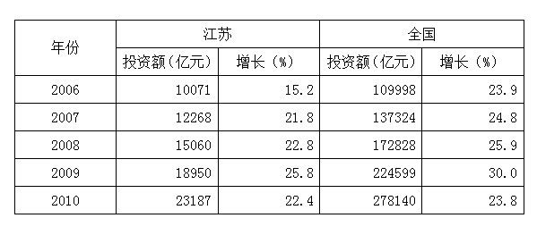

### 第 86 题

下列判断正确的有：
（1）“十一五”时期江苏全社会固定资产投资增速最快的年份，也是其投资增长最多的年份
（2）“十一五”时期全国全社会固定资产投资的平均增速是25.68%

（3）2010年江苏城镇固定资产投资用于第一产业投资的份额比2009年有所提高

A. 0个

B. 1个

C. 2个

D. 3个

第 86 题 · 答案与解析

**参考答案（粉笔题库参考内容）**

C

**解析**

（1）错误，由材料图表可知投资增速最快的和投资增长最多的属于不同的年份，分别是2009年和2010年。

（2）正确，由年均增长率的公式为可得知，需要开方才能计算出r的精确数值，但题目已告知每一年同比增长率数值，且变化幅度较小，可近似用每一年增长率的平均数值代替年均增长速度，即，较为接近。

（3）正确，若某一部分的增长率大于其所在的整体的增长率，那么该部分占整体的比重也变大，反之亦然。代入数据：22.5%>22.1%。因此2010年江苏城镇固定资产投资用于第一产业投资的份额比2009年有所提高。

故正确答案为C。

### 第 87 题

与2009年相比，2010年江苏城镇固定资产投资于第一、二、三产业的投资分别占全国同类投资的比重表现为：

A. 第一产业比重增大，第二产业比重减小，第三产业比重减小

B. 第一产业比重减小，第二产业比重增大，第三产业比重减小

C. 第一产业比重增大，第二产业比重增大，第三产业比重增大

D. 第一产业比重增大，第二产业比重减小，第三产业比重增大

第 87 题 · 答案与解析

**参考答案（粉笔题库参考内容）**

A

**解析**

如果某一部分的增长率大于其所在的整体的增长率，那么该部分所占比重增长；如果某一部分的增长率小于其所在的整体的增长率，那么该部分所占比重减少。

第一产业：江苏22.5%>全国18.2%，比重增加；

第二产业：江苏21.7%&lt;全国23.2%，比重减少；

第三产业：江苏22.4%&lt;全国25.6%，比重减少。

故正确答案为A。

### 第 88 题

按“十一五”时期江苏全社会固定资产投资年平均增长速度测算，“十二五”末江苏全社会固定资产投资规模可望达到：

A. 36303亿元

B. 37632亿元

C. 53385亿元

D. 61499亿元

第 88 题 · 答案与解析

**参考答案（粉笔题库参考内容）**

D

**解析**

由年均增长率的公式为，且求“十一五”时期的年均增长率，其基期应为2005年江苏全社会固定资产投资额亿元，代入数据得到。同理可得“十二五”末江苏全社会固定资产投资额，已知，则亿元，只有D项符合取值范围。

故正确答案为D。

### 第 89 题

2010年江苏城镇固定资产投资占全国固定资产投资的比重比2009年：

A. 提高了5.5个百分点

B. 降低了0.14个百分点

C. 降低了5.25个百分点

D. 提高了0.14个百分点

第 89 题 · 答案与解析

**参考答案（粉笔题库参考内容）**

B

**解析**

根据两期比重差公式，代入数据可得，其值小于0，排除A项和D项，22.1%-24.5%=-2.4%，，两期比重差值的绝对值小于2.4%，B项满足。

故正确答案为B。

### 第 90 题

下列判断不正确的是：

A. “十一五”时期江苏全社会固定资产投资年增长速度均低于全国

B. “十一五”时期江苏全社会固定资产投资占全国的比重逐年减小

C. “十一五”时期江苏全社会固定资产投资平均增长量为33628亿元

D. 2010年全国城镇固定资产投资中用于第三产业的投资占全国全社会固定资产投资的比重比2009年有所提高

第 90 题 · 答案与解析

**参考答案（粉笔题库参考内容）**

C

**解析**

A项：对比表格资料可知“十一五”时期每一年江苏全社会固定资产投资增速均小于全国，故年增长速度也低于全国，正确；

B项：根据两期比重差公式：分子增速a为江苏全社会固定资产投资增速，分母增速b为全国增速，a&lt;b，故比重逐渐下降，正确；

C项：2010年江苏全社会固定资产投资期投资额小于33628亿元，且由表格可知2005年全社会固定资产期投资额大于0，则其平均增长量必定小于33628亿元，错误；

D项：根据两期比重差公式：分子增速（a=25.6%）大于分母增速（b=24.5%），比重提高，正确。

本题为选非题，故正确答案为C。

## 材料 7

**根据以下资料，完成各题。**

注：粮食作物指稻谷、小麦、玉米、豆类和薯类；谷物指稻谷、小麦和玉米。

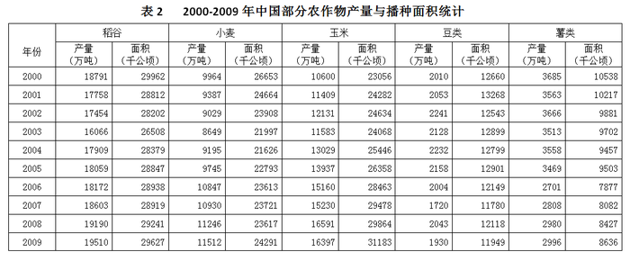

### 第 91 题

下列判断正确的有：
（1）2001—2009年中国稻谷播种面积呈“减少—增加—减少—增加”的变动态势
（2）2001—2009年中国小麦播种面积呈“减少—增加—减少—增加”的变动态势
（3）2001—2009年中国薯类播种面积呈“减少—增加—减少—增加”的变动态势

A. 0个

B. 1个

C. 2个

D. 3个

第 91 题 · 答案与解析

**参考答案（粉笔题库参考内容）**

D

**解析**

观察表格第3列、第5列和第11列数据可知，2001─2009年中国稻谷、小麦、薯类播种面积都呈现出“减少—增加—减少—增加”的变动态势，因此（1）、（2）、（3）都正确。

故正确答案为D。

### 第 92 题

若2001—2009年中国稻谷、小麦和玉米产量年平均增速分别用Vr、Vw、Vc表示，则下列选项正确的是：

A. Vr＜Vw＜Vc

B. Vw＜Vc＜Vr

C. Vc＜Vr＜Vw

D. Vr＜Vc＜Vw

第 92 题 · 答案与解析

**参考答案（粉笔题库参考内容）**

A

**解析**

要比较年平均增速，只需比较2009年相对于2000年中国稻谷、小麦和玉米产量的发展速度即可，依次如下：稻谷：，小麦：，玉米：，观察三个数据，明显玉米最大，即Vc最大。

故正确答案为A。

### 第 93 题

2001—2009年中国粮食作物中，至少有五年产量高于前一年的是：

A. 薯类、稻谷、玉米和豆类

B. 稻谷、小麦、玉米和薯类

C. 稻谷、玉米、豆类和小麦

D. 玉米、小麦、豆类和薯类

第 93 题 · 答案与解析

**参考答案（粉笔题库参考内容）**

B

**解析**

A、C、D三项均错误，根据表格可知，豆类有4年产量高于前一年，不符合题意；

B项正确，根据表格可知，稻谷有6年产量高于前一年，小麦有5年产量高于前一年，玉米有7年产量高于前一年，薯类有5年产量高于前一年，符合题意。

故正确答案为B。

### 第 94 题

2001—2009年中国粮食作物中，其产量与播种面积至少2年呈反向变动的有：

A. 1种

B. 2种

C. 3种

D. 4种

第 94 题 · 答案与解析

**参考答案（粉笔题库参考内容）**

C

**解析**

稻谷只有2007年产量与播种面积呈反向变动，小麦有2004和2008两年呈反向变动，玉米只有2009年呈反向变动，豆类有2002、2003、2004和2005四年呈反向变动，薯类有2002、2004和2005三年呈反向变动。因此，共有3种作物产量与播种面积至少有两年呈反向变动。

故正确答案为C。

### 第 95 题

2009年中国谷物单位面积产量与2008年相比减少最多的是：

A. 稻谷

B. 小麦

C. 玉米

D. 豆类

第 95 题 · 答案与解析

**参考答案（粉笔题库参考内容）**

C

**解析**

豆类并非谷物，首先排除D项；

稻谷2009年单位面积产量为，2008年为，横向比较分子和分母的变化速度可以发现，分子增长速度为，而分母增长速度为，分子增长快于分母，所以只看分子即可，即2009年高于2008年，产量没有减少，排除A项；

小麦2009年单位面积产量增加值为，玉米为，显然玉米减少更多。

故正确答案为C。

## 材料 8

**根据以下资料，完成各题。**

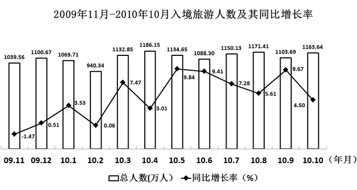

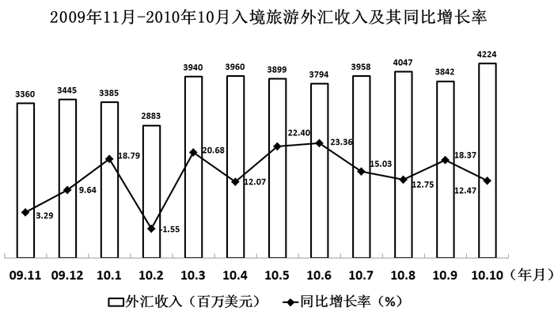

### 第 96 题

2010年10月入境旅游总人数比2009年10月多：

A. 61.29万人

B. 52.36万人

C. 50.11万人

D. 42.77万人

第 96 题 · 答案与解析

**参考答案（粉笔题库参考内容）**

C

**解析**

根据题干“2010年10月······比2009年10月多”，结合选项带单位，可判定本题为增长量计算问题。定位图1可知，2010年10月入境旅游人数为1163.64万人，同比增长4.5%。根据公式：增长率，则题干所求为万人，与C项最接近。

故正确答案为C。

### 第 97 题

2009年11月—2010年10月入境旅游人均消费支出最高的月份是：

A. 2009年12月

B. 2010年6月

C. 2010年9月

D. 2010年10月

第 97 题 · 答案与解析

**参考答案（粉笔题库参考内容）**

D

**解析**

根据题干“2009年12月-2010年10月······人均消费支出······”，结合材料时间为2009年11月-2010年10月，可判定本题为现期平均数问题。定位图1、图2可知2009年11月-2010年10月入境旅游人数及外汇收入。根据公式：入境旅游人均消费支出，则选项各时间入境旅游人均消费支出分别为：

2009年12月：美元；

2010年6月：美元；

2010年9月：美元；

2010年10月：美元。

综上，2009年11月-2010年10月入境旅游人均消费支出最高的月份是2010年10月。

故正确答案为D。

### 第 98 题

2009年12月-2010年10月入境旅游外汇收入月增长额最多的是：

A. 20.68亿美元

B. 10.57亿美元

C. 8.12亿美元

D. 5.13亿美元

第 98 题 · 答案与解析

**参考答案（粉笔题库参考内容）**

B

**解析**

根据题干“2009年12月-2010年10月······月增长额最多的是”，可判定本题为增长量计算问题。定位图2可知2009年11月-2010年10月入境旅游外汇收入。观察柱状图可知，与上月相比，柱状高度相差最多的月份为2010年3月份（3940亿美元），即2010年3月份外汇收入月增长额最多。根据公式：增长量=现期量-基期量，则题干所求为3940-2883=1057百万美元=10.57亿美元。

故正确答案为B。

### 第 99 题

2010年10月入境旅游人均消费支出同比增长：

A. 7.63%

B. 9.12%

C. 10.87%

D. 12.47%

第 99 题 · 答案与解析

**参考答案（粉笔题库参考内容）**

A

**解析**

根据题干“2010年10月······人均消费支出同比增长”，结合选项为百分数，可判定本题为平均数的增长率问题。定位图1可知，2010年10月入境旅游人数同比增长4.50%（b）；定位图2可知，2010年10月入境旅游外汇收入同比增长12.47%（a）。根据公式：平均数的增长率，则题干所求为，仅A项符合。

故正确答案为A。

### 第 100 题

下列说法正确的有：
（1）2月份是2009年11月—2010年10月入境旅游最淡的月份
（2）2010年前三季度入境旅游外汇收入同比增长率高于12%

（3）2009年11月—2010年10月，只有一个月的入境旅游人均消费支出同比增长率为负数

A. 0个

B. 1个

C. 2个

D. 3个

第 100 题 · 答案与解析

**参考答案（粉笔题库参考内容）**

D

**解析**

（1）定位图1、图2可知2009年11月-2010年10月入境旅游人数及外汇收入。观察可知，2月份的入境旅游人数（940.34万人）及入境旅游外汇收入（2883百万美元）都是最低的，因此2月份是入境旅游最淡的月份，正确；

（2）定位图2可知2010年1月-2010年9月入境旅游外汇收入及同比增长率。根据混合增长率口诀“居中不正中”，可知3、5、6月入境旅游外汇收入之和的增长率在20.68%-23.36之间，即。由于3、5、6月入境旅游外汇收入之和为3940+3899+3794=11633百万美元，根据线段法“距离与量成反比”，设2、3、5、6月入境旅游外汇收入之和的增长率为x，可列式：，解得，且其余月份入境旅游外汇收入同比增长率均高于12%。则前三季度入境旅游外汇收入的同比增长率大于12%，正确；

（3）定位图1、图2可知2009年11月-2010年10月入境旅游人数同比增长率（b）及外汇收入同比增长率（a）。由于入境旅游人均消费支出，根据两期平均数比较结论：分子增长率（a）&lt;分母增长率（b），则平均数下降，即平均数同比增长率为负。观察可知，2009年11月—2010年10月，只有2010年2月份的入境旅游外汇收入同比增长率（a=-1.55%）&lt;入境旅游人数同比增长率（b=0.06%），则只有2010年2月份的入境旅游人均消费支出同比增长率为负数，正确。

综上，（1）（2）（3）均正确，有3项。

故正确答案为D。

## 材料 9

**根据以下资料，完成各题。**

**其中白色代表城镇居民，黑色代表农村居民。**

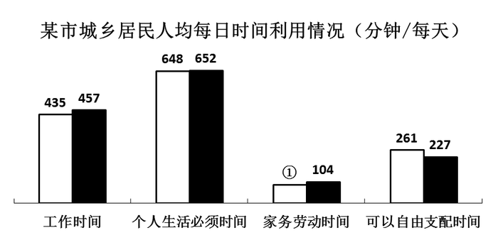

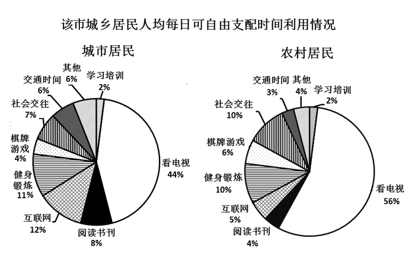

### 第 101 题

图中①处所缺数据是：

A. 104

B. 100

C. 96

D. 92

第 101 题 · 答案与解析

**参考答案（粉笔题库参考内容）**

C

**解析**

一天共有1440分钟，因此①处的数据应为1440-435-648-261=96分钟。

故正确答案为C。

### 第 102 题

该市城镇居民的人均工作时间比农村居民少：

A. 5.7%

B. 5.4%

C. 5.1%

D. 4.8%

第 102 题 · 答案与解析

**参考答案（粉笔题库参考内容）**

D

**解析**

城镇居民人均工作时间435分钟/天，农村居民人均工作时间为457分钟/天，城镇居民的人均工作时间比农村居民少。

故正确答案为D。

### 第 103 题

该市农村居民人均每天用于健身锻炼的时间有：

A. 28.7分钟

B. 26.1分钟

C. 25.0分钟

D. 22.7分钟

第 103 题 · 答案与解析

**参考答案（粉笔题库参考内容）**

D

**解析**

农村居民一天可自由支配的时间为227分钟，健身锻炼的时间所占比例为10%，则农村居民人均每天用于健身锻炼的时间为。

故正确答案为D。

### 第 104 题

该市城镇居民人均每年用于阅读书刊的时间是农村居民的：

A. 2.3倍

B. 2.0倍

C. 1.6倍

D. 1.2倍

第 104 题 · 答案与解析

**参考答案（粉笔题库参考内容）**

A

**解析**

城镇居民可自由支配时间中8%用于阅读，农村居民可自由支配时间中4%用于阅读，因此城镇居民人均每年用于阅读书刊的时间是农村居民的。

故正确答案为A。

### 第 105 题

下列关于该市城乡居民人均每日时间利用情况的说法正确的是：
（1）城镇居民与农村居民用于学习培训的时间一样多
（2）城镇居民用于看电视的时间比农村居民少12%

（3）城镇居民用于社会交往的时间比农村居民少

A. 0个

B. 1个

C. 2个

D. 3个

第 105 题 · 答案与解析

**参考答案（粉笔题库参考内容）**

B

**解析**

（1）错误，（3）正确，城镇居民人均每日用于学习培训、看电视、社会交往的时间分别为，，；农村居民人均每日用于学习培训、看电视、社会交往的时间分别为，，；

（2）错误，。

故正确答案为B。

