# 2011年江苏省公务员录用考试《行测》题（B类）

<!-- gwy:overview:start -->
> **江苏 · 2011 · 行测 · B类** ｜ 155 题 · 图片 262 处 · 答案随题折叠

| 题型模块 | 题量 | 题号 |
| --- | ---: | ---: |
| 知觉速度与准确性 | 60 | 1–60 |
| 言语理解与表达 | 15 | 61–75 |
| 数量关系 | 20 | 76–95 |
| 判断推理 | 40 | 96–135 |
| 资料分析 | 20 | 136–155 |
| **合计** | **155** | |

导航：[题型与作答说明](#题型与作答说明) · [题目](#题目) · [材料 1](#材料-1)
<!-- gwy:overview:end -->

> 候选采集稿。参考答案及解析来自粉笔页面，不代表官方答案或真实高分答卷；来源使用许可与原卷对应关系仍需人工核实。

## 题型与作答说明

知觉速度与准确性

（60题）

本部分包括三种类型的试题，1~35题为同符查找，36~50题为数字区间定位，51~60为字符替换。

言语理解与表达

（15题）

根据题目要求，在四个选项中选出一个正确答案。

数量关系

（20题）

本部分包括数字推理与数学运算两种类型的试题。

判断推理

（40题）

本部分包括类比推理、图形推理、逻辑判断与定义判断四种类型的试题。

资料分析

（20题）

下列给出了文字、表格、图形资料均有五个问题要你回答，你应根据资料提供的信息进行分析、计算、处理，然后从备选答案中选择一个最恰当的答案。

## 题目

### 第 1 题

73062     67925

A. 1

B. 2

C. 3

D. 4

第 1 题 · 答案与解析

**参考答案（粉笔题库参考内容）**

C

**解析**

题干给出的两个字符组中重复的字符为7、6、2，共3个。

故正确答案为C。

**来源**：2011年江苏省公务员录用考试《行测》题（B类）第1题

### 第 2 题

N3A6HQ5   Q89M5NY

A. 0

B. 1

C. 2

D. 3

第 2 题 · 答案与解析

**参考答案（粉笔题库参考内容）**

D

**解析**

题干给出的两个字符组中重复的字符为5、Q、N，共3个。

故正确答案为D。

**来源**：2011年江苏省公务员录用考试《行测》题（B类）第2题

### 第 3 题

A. 1

B. 2

C. 3

D. 4

第 3 题 · 答案与解析

**参考答案（粉笔题库参考内容）**

B

**解析**

题干给出的两个字符组中重复的字符为G、2，共2个。

故正确答案为B。

**来源**：2011年江苏省公务员录用考试《行测》题（B类）第3题

### 第 4 题

173AB89   GB437CD

A. 1

B. 2

C. 3

D. 4

第 4 题 · 答案与解析

**参考答案（粉笔题库参考内容）**

C

**解析**

题干给出的两个字符组中重复的字符为7、3、B，共3个。

故正确答案为C。

**来源**：2011年江苏省公务员录用考试《行测》题（B类）第4题

### 第 5 题

CS1342T8   V62CT98

A. 1

B. 2

C. 3

D. 4

第 5 题 · 答案与解析

**参考答案（粉笔题库参考内容）**

D

**解析**

题干给出的两个字符组中重复的字符为C、T、2、8，共4个。

故正确答案为D。

**来源**：2011年江苏省公务员录用考试《行测》题（B类）第5题

### 第 6 题

A. 1

B. 2

C. 3

D. 4

第 6 题 · 答案与解析

**参考答案（粉笔题库参考内容）**

C

**解析**

题干给出的两个字符组中重复的字符为，共3个。

故正确答案为C。

**来源**：2011年江苏省公务员录用考试《行测》题（B类）第6题

### 第 7 题

HC2BKD   Y6CTP4

A. 1

B. 2

C. 3

D. 4

第 7 题 · 答案与解析

**参考答案（粉笔题库参考内容）**

A

**解析**

题干给出的两个字符组中重复的字符为C，共1个。

故正确答案为A。

**来源**：2011年江苏省公务员录用考试《行测》题（B类）第7题

### 第 8 题

士9天MR3G    PW8大6土QR

A. 0

B. 1

C. 2

D. 3

第 8 题 · 答案与解析

**参考答案（粉笔题库参考内容）**

B

**解析**

题干给出的两个字符组中重复的字符为R，共1个。

故正确答案为B。

**来源**：2011年江苏省公务员录用考试《行测》题（B类）第8题

### 第 9 题

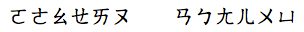

A. 0

B. 1

C. 2

D. 3

第 9 题 · 答案与解析

**参考答案（粉笔题库参考内容）**

A

**解析**

题干给出的两个字符组中没有重复的字符。

故正确答案为A。

**来源**：2011年江苏省公务员录用考试《行测》题（B类）第9题

### 第 10 题

48HI9J13  K12I6F9T

A. 1

B. 2

C. 3

D. 4

第 10 题 · 答案与解析

**参考答案（粉笔题库参考内容）**

C

**解析**

题干给出的两个字符组中重复的字符为1、9、I，共3个。

故正确答案为C。

**来源**：2011年江苏省公务员录用考试《行测》题（B类）第10题

### 第 11 题

A. 1

B. 2

C. 3

D. 4

第 11 题 · 答案与解析

**参考答案（粉笔题库参考内容）**

A

**解析**

题干给出的两个字符组中重复的字符为，共1个。

故正确答案为A。

**来源**：2011年江苏省公务员录用考试《行测》题（B类）第11题

### 第 12 题

A. 1

B. 2

C. 3

D. 4

第 12 题 · 答案与解析

**参考答案（粉笔题库参考内容）**

B

**解析**

题干给出的两个字符组中重复的字符为、，共2个。

故正确答案为B。

**来源**：2011年江苏省公务员录用考试《行测》题（B类）第12题

### 第 13 题

据年的说价只今上来   打传说为今只来雨天不

A. 1

B. 2

C. 3

D. 4

第 13 题 · 答案与解析

**参考答案（粉笔题库参考内容）**

D

**解析**

题干给出的两个字符组中重复的字符为只、说、今、来，共4个。

故正确答案为D。

**来源**：2011年江苏省公务员录用考试《行测》题（B类）第13题

### 第 14 题

AZV8S2F     7A2EVHP      H2Z7E8P

A. 1

B. 2

C. 3

D. 4

第 14 题 · 答案与解析

**参考答案（粉笔题库参考内容）**

A

**解析**

题干给出的三个字符组中重复的字符为2，共1个。

故正确答案为A。

**来源**：2011年江苏省公务员录用考试《行测》题（B类）第14题

### 第 15 题

国M固N骨6      M骨国6固N    K9固谷N古

A. 0

B. 1

C. 2

D. 3

第 15 题 · 答案与解析

**参考答案（粉笔题库参考内容）**

C

**解析**

题干给出的三个字符组中重复的字符为固、N，共2个。

故正确答案为C。

**来源**：2011年江苏省公务员录用考试《行测》题（B类）第15题

### 第 16 题

A. 1

B. 2

C. 3

D. 4

第 16 题 · 答案与解析

**参考答案（粉笔题库参考内容）**

A

**解析**

题干给出的三个字符组中重复的字符为A，共1个。

故正确答案为A。

**来源**：2011年江苏省公务员录用考试《行测》题（B类）第16题

### 第 17 题

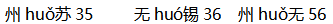

A. 1

B. 2

C. 3

D. 4

第 17 题 · 答案与解析

**参考答案（粉笔题库参考内容）**

B

**解析**

题干给出的三个字符组中重复的字符为h、u，共2个。

故正确答案为B。

**来源**：2011年江苏省公务员录用考试《行测》题（B类）第17题

### 第 18 题

充耳不闻    隔窗有耳  耳聪目明

A. 1

B. 2

C. 3

D. 4

第 18 题 · 答案与解析

**参考答案（粉笔题库参考内容）**

A

**解析**

题干给出的三个字符组中重复的字符为耳，共1个。

故正确答案为A。

**来源**：2011年江苏省公务员录用考试《行测》题（B类）第18题

### 第 19 题

恫10洞6铜      7酮B610惆      恫S6310侗鸟

A. 1

B. 2

C. 3

D. 4

第 19 题 · 答案与解析

**参考答案（粉笔题库参考内容）**

C

**解析**

题干给出的三个字符组中重复的字符为6、1、0，共3个。

故正确答案为C。

**来源**：2011年江苏省公务员录用考试《行测》题（B类）第19题

### 第 20 题

A. 0

B. 1

C. 2

D. 3

第 20 题 · 答案与解析

**参考答案（粉笔题库参考内容）**

D

**解析**

题干给出的三个字符组中重复的字符为，共3个。

故正确答案为D。

**来源**：2011年江苏省公务员录用考试《行测》题（B类）第20题

### 第 21 题

A. 0

B. 1

C. 2

D. 3

第 21 题 · 答案与解析

**参考答案（粉笔题库参考内容）**

A

**解析**

题干给出的三个字符组中没有重复的字符。

故正确答案为A。

**来源**：2011年江苏省公务员录用考试《行测》题（B类）第21题

### 第 22 题

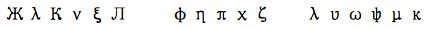

A. 0

B. 1

C. 2

D. 3

第 22 题 · 答案与解析

**参考答案（粉笔题库参考内容）**

A

**解析**

题干给出的三个字符组中没有重复的字符。

故正确答案为A。

**来源**：2011年江苏省公务员录用考试《行测》题（B类）第22题

### 第 23 题

已己杞岂巳    木己山汜巳     已己祀桤杞

A. 0

B. 1

C. 2

D. 3

第 23 题 · 答案与解析

**参考答案（粉笔题库参考内容）**

B

**解析**

题干给出的三个字符组中重复的字符为己，共1个。

故正确答案为B。

**来源**：2011年江苏省公务员录用考试《行测》题（B类）第23题

### 第 24 题

34≤58￥X      3W∑5X89      5X≤3W9

A. 1

B. 2

C. 3

D. 4

第 24 题 · 答案与解析

**参考答案（粉笔题库参考内容）**

C

**解析**

题干给出的三个字符组中重复的字符为3、5、X，共3个。

故正确答案为C。

**来源**：2011年江苏省公务员录用考试《行测》题（B类）第24题

### 第 25 题

⊙％△＠H           ＄＠LT％＆           ⊙％＄＠H

A. 1

B. 2

C. 3

D. 4

第 25 题 · 答案与解析

**参考答案（粉笔题库参考内容）**

B

**解析**

题干给出的三个字符组中重复的字符为＠、％，共2个。

故正确答案为B。

**来源**：2011年江苏省公务员录用考试《行测》题（B类）第25题

### 第 26 题

由5电＆B7C      G8申＆5油R       由P电5C＆7

A. 1

B. 2

C. 3

D. 4

第 26 题 · 答案与解析

**参考答案（粉笔题库参考内容）**

B

**解析**

题干给出的三个字符组中重复的字符为5、＆，共2个。

故正确答案为B。

**来源**：2011年江苏省公务员录用考试《行测》题（B类）第26题

### 第 27 题

E45Q62WG    WI52BHN     4TRYQW

A. 1

B. 2

C. 3

D. 4

第 27 题 · 答案与解析

**参考答案（粉笔题库参考内容）**

A

**解析**

题干给出的三个字符组中重复的字符为W，共1个。

故正确答案为A。

**来源**：2011年江苏省公务员录用考试《行测》题（B类）第27题

### 第 28 题

0N大天下     性V任N大    N大性人O

A. 1

B. 2

C. 3

D. 4

第 28 题 · 答案与解析

**参考答案（粉笔题库参考内容）**

B

**解析**

题干给出的三个字符组中重复的字符为大、N，共2个。

故正确答案为B。

**来源**：2011年江苏省公务员录用考试《行测》题（B类）第28题

### 第 29 题

晴霹N雳天      开劈N天晴    霹天大请M雳

A. 1

B. 2

C. 3

D. 4

第 29 题 · 答案与解析

**参考答案（粉笔题库参考内容）**

A

**解析**

题干给出的三个字符组中重复的字符为天，共1个。

故正确答案为A。

**来源**：2011年江苏省公务员录用考试《行测》题（B类）第29题

### 第 30 题

生末日丹旦     丹玍日曰末     生日末且玍

A. 0

B. 1

C. 2

D. 3

第 30 题 · 答案与解析

**参考答案（粉笔题库参考内容）**

C

**解析**

题干给出的三个字符组中重复的字符为末、日，共2个。

故正确答案为C。

**来源**：2011年江苏省公务员录用考试《行测》题（B类）第30题

### 第 31 题

波R垫导话      话Q指披导    波舌导R垫

A. 0

B. 1

C. 2

D. 3

第 31 题 · 答案与解析

**参考答案（粉笔题库参考内容）**

B

**解析**

题干给出的三个字符组中重复的字符为导，共1个。

故正确答案为B。

**来源**：2011年江苏省公务员录用考试《行测》题（B类）第31题

### 第 32 题

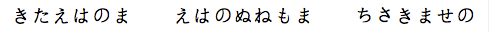

A. 0

B. 1

C. 2

D. 3

第 32 题 · 答案与解析

**参考答案（粉笔题库参考内容）**

C

**解析**

题干给出的三个字符组中重复的字符为和，共2个。

故正确答案为C。

**来源**：2011年江苏省公务员录用考试《行测》题（B类）第32题

### 第 33 题

A. 2

B. 4

C. 3

D. 5

第 33 题 · 答案与解析

**参考答案（粉笔题库参考内容）**

B

**解析**

题干给出的三个字符组中重复的字符为，共4个。

故正确答案为B。

**来源**：2011年江苏省公务员录用考试《行测》题（B类）第33题

### 第 34 题

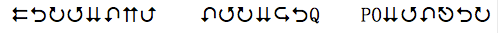

A. 0

B. 1

C. 2

D. 5

第 34 题 · 答案与解析

**参考答案（粉笔题库参考内容）**

D

**解析**

题干给出的三个字符组中重复的字符为，共5个。

故正确答案为D。

**来源**：2011年江苏省公务员录用考试《行测》题（B类）第34题

### 第 35 题

A. 0

B. 4

C. 3

D. 5

第 35 题 · 答案与解析

**参考答案（粉笔题库参考内容）**

B

**解析**

题干中给出的三个字符组中重复的字符为，共4个。

故正确答案为B。

**来源**：2011年江苏省公务员录用考试《行测》题（B类）第35题

## 材料 1

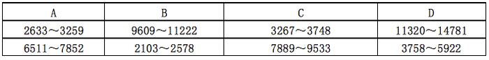

### 第 36 题

12456

A. A

B. B

C. C

D. D

第 36 题 · 答案与解析

**参考答案（粉笔题库参考内容）**

D

**解析**

数字12456位于区间11320~14781。

故正确答案为D。

**来源**：2011年江苏省公务员录用考试《行测》题（B类）第36题

### 第 37 题

3434

A. A

B. B

C. C

D. D

第 37 题 · 答案与解析

**参考答案（粉笔题库参考内容）**

C

**解析**

数字3434位于区间3267～3748。

故正确答案为C。

**来源**：2011年江苏省公务员录用考试《行测》题（B类）第37题

### 第 38 题

7806

A. A

B. B

C. C

D. D

第 38 题 · 答案与解析

**参考答案（粉笔题库参考内容）**

A

**解析**

数字7806位于区间6511~7852。

故正确答案为A。

**来源**：2011年江苏省公务员录用考试《行测》题（B类）第38题

### 第 39 题

9873

A. A

B. B

C. C

D. D

第 39 题 · 答案与解析

**参考答案（粉笔题库参考内容）**

B

**解析**

数字9873位于区间9609～11222。

故正确答案为B。

**来源**：2011年江苏省公务员录用考试《行测》题（B类）第39题

### 第 40 题

8888

A. A

B. B

C. C

D. D

第 40 题 · 答案与解析

**参考答案（粉笔题库参考内容）**

C

**解析**

数字8888位于区间7889～9533。

故正确答案为C。

**来源**：2011年江苏省公务员录用考试《行测》题（B类）第40题

### 第 41 题

3276

A. A

B. B

C. C

D. D

第 41 题 · 答案与解析

**参考答案（粉笔题库参考内容）**

C

**解析**

数字3276位于区间3267～3748。

故正确答案为C。

**来源**：2011年江苏省公务员录用考试《行测》题（B类）第41题

### 第 42 题

3160

A. A

B. B

C. C

D. D

第 42 题 · 答案与解析

**参考答案（粉笔题库参考内容）**

A

**解析**

数字3160位于区间2633～3259。

故正确答案为A。

**来源**：2011年江苏省公务员录用考试《行测》题（B类）第42题

### 第 43 题

2577

A. A

B. B

C. C

D. D

第 43 题 · 答案与解析

**参考答案（粉笔题库参考内容）**

B

**解析**

数字2577位于区间2103～2578。

故正确答案为B。

**来源**：2011年江苏省公务员录用考试《行测》题（B类）第43题

### 第 44 题

6910

A. A

B. B

C. C

D. D

第 44 题 · 答案与解析

**参考答案（粉笔题库参考内容）**

A

**解析**

数字6910位于区间6511～7852。

故正确答案为A。

**来源**：2011年江苏省公务员录用考试《行测》题（B类）第44题

### 第 45 题

9123

A. A

B. B

C. C

D. D

第 45 题 · 答案与解析

**参考答案（粉笔题库参考内容）**

C

**解析**

数字9123位于区间7889~9533。

故正确答案为C。

**来源**：2011年江苏省公务员录用考试《行测》题（B类）第45题

### 第 46 题

5033

A. A

B. B

C. C

D. D

第 46 题 · 答案与解析

**参考答案（粉笔题库参考内容）**

D

**解析**

数字5033位于区间3758～5922。

故正确答案为D。

**来源**：2011年江苏省公务员录用考试《行测》题（B类）第46题

### 第 47 题

4278

A. A

B. B

C. C

D. D

第 47 题 · 答案与解析

**参考答案（粉笔题库参考内容）**

D

**解析**

数字4278位于区间3758～5922。

故正确答案为D。

**来源**：2011年江苏省公务员录用考试《行测》题（B类）第47题

### 第 48 题

10666

A. A

B. B

C. C

D. D

第 48 题 · 答案与解析

**参考答案（粉笔题库参考内容）**

B

**解析**

数字10666位于区间9609～11222。

故正确答案为B。

**来源**：2011年江苏省公务员录用考试《行测》题（B类）第48题

### 第 49 题

2644

A. A

B. B

C. C

D. D

第 49 题 · 答案与解析

**参考答案（粉笔题库参考内容）**

A

**解析**

数字2644位于区间2633～3259。

故正确答案为A。

**来源**：2011年江苏省公务员录用考试《行测》题（B类）第49题

### 第 50 题

12993

A. A

B. B

C. C

D. D

第 50 题 · 答案与解析

**参考答案（粉笔题库参考内容）**

D

**解析**

数字12993位于区间11320～14781。

故正确答案为D。

**来源**：2011年江苏省公务员录用考试《行测》题（B类）第50题

## 材料 2

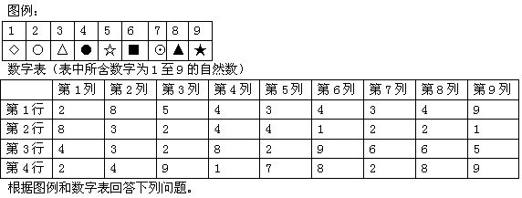

### 第 51 题

数字表第3行中最小的数字对应的符号是：

A. 

B. 

C. 

D. 

第 51 题 · 答案与解析

**参考答案（粉笔题库参考内容）**

B

**解析**

数字表中第3行最小的数字为2，由对应表可知对应的符号为。

故正确答案为B。

**来源**：2011年江苏省公务员录用考试《行测》题（B类）第51题

### 第 52 题

数字表中哪行数字对应的是：

A. 第1行

B. 第2行

C. 第3行

D. 第4行

第 52 题 · 答案与解析

**参考答案（粉笔题库参考内容）**

D

**解析**

由对应表可知对应的数字为7，在数字表中7出现在第4行第5列。

故正确答案为D。

**来源**：2011年江苏省公务员录用考试《行测》题（B类）第52题

### 第 53 题

数字表第2列中数字对应的符号分别是：

A. 

B. 

C. 

D. 

第 53 题 · 答案与解析

**参考答案（粉笔题库参考内容）**

C

**解析**

数字表中第2列的数字分别为8、3、3、4，由对应表可知对应的符号分别为。

故正确答案为C。

**来源**：2011年江苏省公务员录用考试《行测》题（B类）第53题

### 第 54 题

数字表第3列中重复数字对应的符号是：

A. 

B. 

C. 

D. 

第 54 题 · 答案与解析

**参考答案（粉笔题库参考内容）**

B

**解析**

数字表中第3列重复的数字为2，由对应表可知对应的符号为。

故正确答案为B。

**来源**：2011年江苏省公务员录用考试《行测》题（B类）第54题

### 第 55 题

数字表第9列中的两个最小值之和所对应的符号是：

A. 

B. 

C. 

D. 

第 55 题 · 答案与解析

**参考答案（粉笔题库参考内容）**

D

**解析**

数字表第9列中的两个最小值为1、5，和为1+5=6，由对应表可知对应的符号为。

故正确答案为D。

**来源**：2011年江苏省公务员录用考试《行测》题（B类）第55题

### 第 56 题

数字表第8列数字之和与第1列数字之和的差数所对应的符号是：

A. 

B. 

C. 

D. 

第 56 题 · 答案与解析

**参考答案（粉笔题库参考内容）**

B

**解析**

数字表第8列数字之和为4+2+6+8=20，数字表第1列数字之和为2+8+4+2=16，两数之差为20-16=4，由对应表可知对应的符号为。

故正确答案为B。

**来源**：2011年江苏省公务员录用考试《行测》题（B类）第56题

### 第 57 题

数字表中对应符号的数字共有几个：

A. 1

B. 2

C. 3

D. 4

第 57 题 · 答案与解析

**参考答案（粉笔题库参考内容）**

B

**解析**

由对应表可知对应的数字为5，在数字表中5共出现2次。

故正确答案为B。

**来源**：2011年江苏省公务员录用考试《行测》题（B类）第57题

### 第 58 题

数字表中第5列第1行的数字对应的符号是：

A. 

B. 

C. 

D. 

第 58 题 · 答案与解析

**参考答案（粉笔题库参考内容）**

C

**解析**

数字表中第5列第1行的数字为3，由对应表可知对应的符号为。

故正确答案为C。

**来源**：2011年江苏省公务员录用考试《行测》题（B类）第58题

### 第 59 题

数字表中代表的数字出现在哪几行？

A. 1、2、3

B. 2、3、4

C. 1、3、4

D. 1、2、4

第 59 题 · 答案与解析

**参考答案（粉笔题库参考内容）**

C

**解析**

由对应表可知代表的数字为9，在数字表中9出现在第1行第9列、第3行第6列、第4行第3列和第9列。

故正确答案为C。

**来源**：2011年江苏省公务员录用考试《行测》题（B类）第59题

### 第 60 题

数字表第1列最大数减去第1行最小数所得值对应的符号是：

A. 

B. 

C. 

D. 

第 60 题 · 答案与解析

**参考答案（粉笔题库参考内容）**

D

**解析**

数字表中第1列最大数为8，第1行最小数为2，两数相减8-2=6，由对应表可知对应的符号为。

故正确答案为D。

**来源**：2011年江苏省公务员录用考试《行测》题（B类）第60题

### 第 61 题

“和谐”是什么？人人都有饭吃，人人都可以说话，就是一种最为朴素的“和谐”，这也是构建和谐社会的题中应有之义。

这段话是说：

A. 人人有饭吃、可以表达个人看法，是和谐社会的主要特征

B. 人人有饭吃、可以表达个人看法，是和谐社会的必要条件

C. 人人有饭吃、可以表达个人看法，是和谐社会的最高标准

D. 人人有饭吃、可以表达个人看法，是和谐社会的最终目标

第 61 题 · 答案与解析

**参考答案（粉笔题库参考内容）**

B

**解析**

本题为中心理解题。

“题中应有之义”指主题中应包含的义理。材料理解为“人人有饭吃、可以表达个人看法”是构建和谐社会应包含的义理，即“人人有饭吃、可以表达个人看法”是构建和谐社会的“必要条件”。

因此，结合选项应该选择B。

A项的“主要特征”，C项的“最高标准”，D项的“最终目标”都不是“题中应有之义”的同义替代。

故正确答案为B。

**考点**：关联词-因果

**来源**：2011年江苏省公务员录用考试《行测》题（B类）第61题

### 第 62 题

城市化是继工业化以后推动经济社会发展的一个新的重大力量。地方政府在城市化方面有着很强的冲动，但这个冲动更多表现在土地的城市化方面。因为土地的升值幅度很大，潜力很大，对地方的经济增长和财政收入也有很大的促进作用。所以，在城市化进程中，土地的城市化成为地方发展的一个重要手段。但这并非真正的城市化，因为城市化程度是以人的城市化为标准的。

这段文字的中心意思是：

A. 发展要避免土地的城市化

B. 发展要以人的城市化为标准

C. 人是城市化发展的主要推动者

D. 城市化是地方发展的正确选择

第 62 题 · 答案与解析

**参考答案（粉笔题库参考内容）**

B

**解析**

根据提问方式“中心意思”一词可知本题为中心理解题。材料第一句讲城市化的重要性，二、三、四句讲城市化多表现在土地的城市化及这一现象的原因，最后一句通过转折词“但”否定土地城市化是真正的城市化，并提出观点“城市化程度是以人的城市化为标准的”。转折词“但”后是材料的表面主旨，即“发展要以人的城市化为标准”。

因此，结合选项应该选择B。

材料虽说土地城市化“并非真正的城市化”，但也肯定了土地城市化的作用，即“土地的城市化成为地方发展的一个重要手段”，故选项A说法错误；选项C在材料中未提及；选项D说法虽然没错，但偏离了“以人的城市化为城市化标准”这一主旨。

故正确答案为B。

**考点**：关联词-转折

**来源**：2011年江苏省公务员录用考试《行测》题（B类）第62题

### 第 63 题

一个人买了一个鸟笼放在自家客厅里，过一段时间，他一般会丢掉鸟笼或者买只鸟养。因为，即使他本人长期面对空鸟笼不感到别扭，可是来访者却不然，几乎所有客人面对空笼子都会产生好奇和疑惑，主人会为必须反复解释而不胜其烦，最后只好丢掉鸟笼或者真的买只鸟回来。这就是著名的“鸟笼效应”。

对这段话理解错误的是：

A. 马克思主义唯物辩证法告诉我们，事物是普遍联系的，所以“鸟笼效应”是必然存在的

B. 挂鸟笼本身不说明什么，但是有了一个鸟笼，主人就有可能买一只鸟与之相配

C. “鸟笼效应”是指，大多数时候人们都受制于强大的惯性思维，而缺乏逻辑思维

D. 鸟笼里应该有鸟是人们的思维定式，人们见到鸟笼就一定会联想到里面应该有鸟

第 63 题 · 答案与解析

**参考答案（粉笔题库参考内容）**

A

**解析**

A项，文段并未说明“鸟笼效应”与“马克思主义唯物辩证法”存在关联，强加因果，且根据文段表述并不能推出“‘鸟笼效应’是必然存在的”，无中生有，当选；

B项，根据“一个人买了一个鸟笼放在自家客厅里，过一段时间，他一般会丢掉鸟笼或者买只鸟养”可知，表述正确，排除；

C、D两项，根据“几乎所有客人面对空笼子都会产生好奇和疑惑”可知，在人们的意识里“鸟笼只有养鸟之用，有鸟笼就必须有鸟”。也就是说人们见到某种情景后，会自然而然地形成与该情景有关的主观判断，即“思维定式”或“惯性思维”，故C、D两项表述正确，排除。

本题为选非题，故正确答案为A。

**考点**：细节判断题

**来源**：2011年江苏省公务员录用考试《行测》题（B类）第63题

### 第 64 题

在我看来，与其说是赵本山的小品受欢迎，还不如说是赵本山的这个人本身更受关注。自从赵本山登上央视春晚这个大舞台，在陈佩斯等笑星长期缺席的情况下，赵本山和他的“赵家班”几乎成了央视的“金字招牌”，甚至一度成为春晚的收视保证。但事实却无情地证明：赵本山已经被央视“过度消费”了。

“过度消费”，即：

A. 演员的个性经常被抹杀

B. 演员的才华总是被忽视

C. 演员的才华已经被透支

D. 演员的个性容易被扭曲

第 64 题 · 答案与解析

**参考答案（粉笔题库参考内容）**

C

**解析**

本题考查词语理解。

“过度消费”与选项中的“透支”是近义词，由材料可知，由于其他笑星的长期缺席，央视只能靠赵本山年年上春晚，“透支”了赵本山的“才华”。

因此，结合选项应该选择C。

材料中没有提到演员的个性，故A、D项不选；材料中说赵本山“几乎成了央视的‘金字招牌’，甚至一度成为春晚的收视保证”，可见赵本山的小品被重视的程度，与“忽视”不符，故B项也不正确。

故正确答案为C。

**考点**：实词

**来源**：2011年江苏省公务员录用考试《行测》题（B类）第64题

### 第 65 题

转型期的社会，价值观出现多元化，从神圣转向世俗，从理性转向感性，“拒绝崇高、淡化价值”，有时候很有一些市场。这是低俗现象产生的根本原因。当下低俗之风的产生不是偶然的，在世俗的社会环境和感性的文化土壤里，不产生“三俗”倒是不可理解的。

作者说“不产生‘三俗’倒是不可理解的”，意味着“三俗”：

A. 不可避免

B. 难以拒绝

C. 可以接受

D. 应该默许

第 65 题 · 答案与解析

**参考答案（粉笔题库参考内容）**

A

**解析**

材料提到低俗之风的产生“不是偶然”的，可知低俗之风的产生是“必然”的，即是“不可避免”的，材料第一句话正是低俗之风必然产生的原因。

因此，结合选项应该选择A。

材料中未提到“三俗”对人的影响，故B项不选；材料中并未提到作者对“三俗”现象本身的态度，故C、D两项错误。

故正确答案为A。

**考点**：句子

**来源**：2011年江苏省公务员录用考试《行测》题（B类）第65题

## 材料 3

男人和女人之间的想法常常相左，这简直就是个常识了，人们一直将这些男女之间的差异解释为性激素的作用，或者是产生男女特定行为方式的社会压力所导致，这种情况直到最近才有所改观。不管怎么说，大部分人还是认为两性的大脑在基本结构和功能上是没有什么差别的。然而这种观念开始日益受到＿＿＿＿＿＿。

        研究发现，男性和女性的脑在解剖结构上有很大不同。不但如此，其神经环路和神经元间传递信号的化学物质也有所不同。这些都是在基因水平就决定了的。所有这些研究都会让人得出一个结论，那就是人脑不止是一种，而是男女两种。

        这个结论让神经科学家们有点头疼，因为我们关于大脑的大部分认识是来自于对雄性动物，包括男人的研究。如果说从这些研究得出的推论哪怕只有小部分不适用于雌性动物，那也意味着大量的研究工作本身的基础就不牢靠。弄清楚女人的脑到底跟男人的怎样不同，也许可以解释一些长期困扰人们的谜团，例如为什么男人和女人倾向于犯不同的精神健康问题，为什么有的药物对一种性别有效而对另一种性别就没作用。

        人们早就知道雄性和雌性的大脑有点差别，但大家都认为这种差别只是局限在下丘脑部位——一个参与调节进食活动和控制性冲动的脑区。因为雌性动物的雌激素和孕酮水平在月经周期上下波动，这会使实验结果的分析更加复杂，所以研究者们除了在研究下丘脑的时候会区分性别，否则都会尽量避免在实验中使用雌性动物，因为雌性在经期的雌激素和黄体激素水平变化会让实验结果更加难以分析。因此神经科学家们一直以为除了下丘脑外，男性和女性的脑没有什么不同。

        但很显然，两性的脑存在许多差异，下丘脑只是冰山的一角而已。女性脑内的许多结构的相对尺寸与男性的有所不同。在2001年的一项研究里，哈佛医学院的Jill Goldstein及其同事测量并且比较了健康男性和女性的45个脑区。他们发现女性脑的额叶里控制决策和解决问题的那部分脑区要比男性的大。女性的边缘皮层也比男性的大，这个区域是负责调节情绪的。其他人的研究发现，女性的海马（海马是一个参与短期记忆和空间导向的脑区）相对男性的要大——女人们背了个不识地图的坏名声看来有些冤枉。男性相对于女性较大的脑区包括顶侧皮层和杏仁核。顶侧皮层负责处理感觉器官传来的信号，也参与空间感知的过程。杏仁核则控制情绪和人的社会行为以及性行为。加州大学的神经生物学家Larry Cahill说：“（男性和女性脑的）同一个结构大小有差异很可能意味着它在功能的组织上也会有不同。

        Cahill发现性别的差异会影响到一些脑区的使用。在利用脑成像技术完成的实验里，他要求男受试者或女受试者回忆前面看过的令他们激动的画面。在完成这个任务的时候，所有受试者都动用了杏仁核这个脑区。杏仁核是一对杏仁大小的神经元团，它们也是边缘系统的组成部分。但不同的是男性受试者在实验过程中用的是右侧杏仁核，而女性用的是左侧杏仁核。而且男女受试者在回忆画面时的侧重也有所不同，男性侧重于回顾要点而女性则更注重细节的表达。Cahill说，这就提示我们男性和女性的脑在处理带有情绪因素的信息时所采用的机制是不一样的。

### 第 66 题

填入文中画横线处最恰当的一项是：

A. 批评

B. 嘲弄

C. 挑战

D. 批判

第 66 题 · 答案与解析

**参考答案（粉笔题库参考内容）**

C

**解析**

本题考查实词的辨析与填空。

由材料可知，“这种观念”是以往大部分人对两性大脑的一种普遍认识，因研究的不断深入，人们认识的提高，这种原有的普遍性认识逐渐受到质疑，而“挑战”恰当地体现出了常识性观念受到新研究冲击的状态。

因此，结合选项应该选择C。

“批评”、“嘲弄”、“批判”三个词都含有较强烈的否定意味，与材料语意不符，均不选。

故正确答案为C。

**来源**：2011年江苏省公务员录用考试《行测》题（B类）第66题

### 第 67 题

文中“这个结论让神经科学家们有点头疼”，“头疼”的主要原因在于：

A. 男女脑的结构在解剖上有很大不同

B. 不同性别头脑的化学物质也有所不同

C. 过去研究的结论并不适用于雌性动物

D. 过去对大脑的认识主要基于雄性动物

第 67 题 · 答案与解析

**参考答案（粉笔题库参考内容）**

D

**解析**

本题考查原因的细节判断。

定位原文第3自然段，从“因为我们关于大脑的大部分认识是来自于对雄性动物的研究”易知，神经科学家们“头疼”的原因在于“过去对大脑的认识主要基于雄性动物”。

故正确答案为D。

**来源**：2011年江苏省公务员录用考试《行测》题（B类）第67题

### 第 68 题

以往的研究中研究者很少研究雌性动物大脑是因为：

A. 雌性雌激素和孕酮水平变化使分析变困难

B. 认为两性的大脑在基本结构和功能上差别不大

C. 认为两性的大脑差别主要只局限在下丘脑部位

D. 人们早就知道雄性和雌性的大脑有着一些差别

第 68 题 · 答案与解析

**参考答案（粉笔题库参考内容）**

A

**解析**

本题考查原因的细节判断。

定位原文第4自然段，据“都会尽量避免在实验中使用雌性动物，因为雌性在经期的雌激素和黄体激素水平变化会让实验结果更加难以分析”可以判断，以往的研究中研究者很少研究雌性动物大脑是因为“雌性雌激素和孕酮水平变化使分析变困难”。

故正确答案为A。

**来源**：2011年江苏省公务员录用考试《行测》题（B类）第68题

### 第 69 题

有关女性大脑与男性的差别，以下说法中与文章不符的是：

A. 女性处理带有情绪的信息时采用左侧杏仁核

B. 女性处理短期记忆和空间导向的能力比男性强

C. 女性额叶里控制决策解决问题的脑区比男性大

D. 女性大脑中负责调节情绪的区域边缘皮层较大

第 69 题 · 答案与解析

**参考答案（粉笔题库参考内容）**

B

**解析**

本题考查细节判断。

材料第5自然段提到“女性的海马（海马是一个参与短期记忆和空间导向的脑区）相对男性的要大”，但女性的海马大并不意味着处理短期记忆和空间导向的能力比男性强。选项B与文章不符。

因此，结合选项应该选择B。

由材料第6自然段的“男性受试者在实验过程中用的是右侧杏仁核，而女性用的是左侧杏仁核”和“这就提示我们男性和女性的脑在处理带有情绪因素的信息时所采用的机制是不一样的”，可以判断选项A正确；由材料第5自然段的“女性脑的额叶里控制决策和解决问题的那部分脑区要比男性的大”，可以判断选项C正确；由材料第5自然段的“女性的边缘皮层也比男性的大，这个区域是负责调节情绪的”，可以判断选项D正确。

本题为选非题，故正确答案为B。

**来源**：2011年江苏省公务员录用考试《行测》题（B类）第69题

### 第 70 题

最适合做文章标题的是：

A. 性别影响大脑

B. 人脑的差别

C. 大脑决定性别

D. 人脑的性别

第 70 题 · 答案与解析

**参考答案（粉笔题库参考内容）**

D

**解析**

本题考查标题选择。

标题应是文章的主旨内容。文章主要阐述了男性和女性大脑的区别，故“人脑的性别”最适合做文章的标题。

因此，结合选项应该选择D。

性别不是大脑决定的，性别对大脑也没有影响，A、C项说法错误，不适合做文章的标题；B项“人脑的差别”未体现“性别”这一关键信息，也不选。

故正确答案为D。

**来源**：2011年江苏省公务员录用考试《行测》题（B类）第70题

### 第 71 题

水污染的形势是严峻的，而尤其使我们＿＿＿＿＿＿的是，当前工业发展的步伐是不可能停下来的。

填入画横线处最恰当的一项是：

A. 畏首畏尾

B. 骑虎难下

C. 进退维谷

D. 瞻前顾后

第 71 题 · 答案与解析

**参考答案（粉笔题库参考内容）**

C

**解析**

本题考查成语辨析和运用。

材料原意指水污染形势严峻和工业发展步伐停不下来使我们进退两难，材料是对客观事实的陈述，没有明显感情色彩。“进退维谷”形容进退两难，属于中性词，符合材料语意。

因此，结合选项应该选择C。

“畏首畏尾”形容胆子小，疑虑重重。“瞻前顾后”形容顾虑过多，犹豫不决。两词均与原句意思不符。“骑虎难下”比喻事情进行到中途，迫于形势不能停止，只好硬着头皮干下去。“骑虎难下”是干扰词，但带有贬义色彩，故不选。

故正确答案为C。

**考点**：对应关系-解释说明、成语填空、词的辨析-感情色彩

**来源**：2011年江苏省公务员录用考试《行测》题（B类）第71题

### 第 72 题

此类文字所写的虽然同是“路上的风景”，但实际上，却是＿＿＿＿昭示一种与众不同的生活方式和人生理念，其间率真的冲动和激情的渲染，可以＿＿＿＿阅读者的心灵。

依次填入横线处最恰当的一项是：

A. 用来 抚慰

B. 清楚 慰藉

C. 借以 直抵

D. 有助 吸引

第 72 题 · 答案与解析

**参考答案（粉笔题库参考内容）**

C

**解析**

本题考查实词的语境搭配的辨析与填空。

第一空，由“虽然······却”、“实际上”可知，文字中所写的“路上的风景”只是一种手段，其实质是“昭示······”，“清楚”体现不出二者之间的这种关系，故可排除B项。

第二空，“吸引”与“心灵”搭配不当，先排除D项。“直抵心灵”所含的直接意味与“率真的冲动和激情的渲染”相对应，更加贴近语境，该空应选“直抵”。

故正确答案为C。

**考点**：实词填空、对应关系-前后呼应、词的辨析-搭配对象

**来源**：2011年江苏省公务员录用考试《行测》题（B类）第72题

### 第 73 题

改革开放以来，随着社会的巨变，各种各样的思潮也＿＿＿＿＿＿。这些社会思潮与社会的变迁有怎样的纠结，其间是否有＿＿＿＿可寻，各种思潮是否有共识可以分享？

依次填入划横线处最恰当的一项是：

A. 层出不穷 踪影

B. 各有所长 来源

C. 来势汹汹 答案

D. 此消彼长 脉络

第 73 题 · 答案与解析

**参考答案（粉笔题库参考内容）**

D

**解析**

本题考查成语与实词的混搭填空。

第一空，“层出不穷”指接连不断地出现，没有穷尽。“各有所长”指各有各的长处、优点。“来势汹汹”形容动作或事物到来的气势很猛烈。“此消彼长”是这个上升，那个下降的意思。材料提到社会巨变滋生各种思潮，第一空应填入表示思潮多的词语，故排除B、C。

第二空应与“纠结”搭配。“纠结”表示混乱的状态，“脉络”比喻条理或头绪，“脉络”与“纠结”搭配更恰当，该空应选“脉络”。

故正确答案为D。

**考点**：对应关系-前后呼应、混搭填空、词的辨析-搭配对象

**来源**：2011年江苏省公务员录用考试《行测》题（B类）第73题

### 第 74 题

知识和书写不再是一副严肃模样，不再被固定于纸媒，时尚、娱乐、即时、分享、互动、便捷、环保等新鲜感受＿＿＿＿＿＿。未来，“书”不仅仅是文字与图片的内容，而是嵌入触摸手控、视频、音频、动效、360度视图、跨文本、超链接、在线升级等多媒体技术的混搭型内容，阅读概念在无限＿＿＿＿。

依次填入画横线处最恰当的一项是：

A. 接踵而至 展开

B. 纷至沓来 拓展

C. 眼花缭乱 延伸

D. 目不暇接 壮大

第 74 题 · 答案与解析

**参考答案（粉笔题库参考内容）**

B

**解析**

第一空，“眼花缭乱”形容眼睛看见复杂纷繁的东西而感到迷乱。“目不暇接”形容东西太多，眼睛看不过来。“眼花缭乱”与“目不暇接”使用的对象是人，不能与“新鲜感受”搭配，故排除C、D项。“接踵而至”形容人或事物一个又一个接连不断。“纷至沓来”形容纷纷到来，连续不断地到来。

第二空，由材料“嵌入触摸手控······在线升级等多媒体技术的混搭型内容”可知，阅读概念的辐射面在扩大，B项中的“拓展”强调开拓，体现出阅读概念逐渐丰富的特点，使用恰当；A项中的“展开”往往是指事物的进行或物体的伸展，与“概念”一词搭配不当，排除A项。

故正确答案为B。

**考点**：对应关系-前后呼应、混搭填空、词的辨析-搭配对象

**来源**：2011年江苏省公务员录用考试《行测》题（B类）第74题

### 第 75 题

＿＿＿＿＿龙是象征封建统治者的威严，＿＿＿＿狮子便是象征人民的力量，＿＿＿＿，龙是缥缈的，狮子却是实在的。

依次填入画横线处最恰当的一项是：

A. 假如说 那么 然而

B. 虽然说 相反 可是

C. 比如说 自然 不过

D. 有人说 反而 但是

第 75 题 · 答案与解析

**参考答案（粉笔题库参考内容）**

A

**解析**

本题考查选择关联词填空的能力。

由“······是······，······便是······”句式可知，第一分句与第二分句构成假设关系。故第一、二空应选“假如说”、“那么”。第一分句说龙象征“封建统治者的威严”，第四分句说龙是“缥缈的”，两个分句是对龙的不同定位，第三空前半句与后半句构成转折关系。选项给出的四个词均表示转折，但只有“然而”一词后可接逗号，单独成一分句。

故正确答案为A。

**来源**：2011年江苏省公务员录用考试《行测》题（B类）第75题

### 第 76 题

2，3，0，－7，－18，（  ）

A. 10

B. 20

C. －33

D. －45

第 76 题 · 答案与解析

**参考答案（粉笔题库参考内容）**

C

**解析**

把本题作为因数分解数列处理。

，，，，，左因数数列和右因数数列分别为等差数列，因此原数列的下一项为：。

故正确答案为C。

**来源**：2011年江苏省公务员录用考试《行测》题（B类）第76题

### 第 77 题

2，4，4，8，16，（    ）

A. 48

B. 64

C. 128

D. 256

第 77 题 · 答案与解析

**参考答案（粉笔题库参考内容）**

B

**解析**

本题为递推数列。递推规律为：数列相邻两项的乘积的一半得到数列的下一项。具体规律为：，，，因此原数列的下一项为：。

故正确答案为B。

**来源**：2011年江苏省公务员录用考试《行测》题（C类）第17题

### 第 78 题

23，26，32，53，（  ），296

A. 66

B. 87

C. 113

D. 216

第 78 题 · 答案与解析

**参考答案（粉笔题库参考内容）**

C

**解析**

解析1：本题数列各项除以3的余数都为2，仅C满足。

故正确答案为C。

解析2：把本题作为三级等比数列处理。

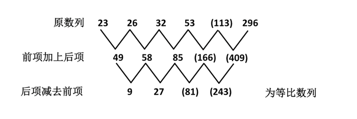

因此原数列的未知项为113。

故正确答案为C。

**来源**：2011年江苏省公务员录用考试《行测》题（B类）第78题

### 第 79 题

1，2，6，4，8，（  ）

A. 8

B. 126

C. 16

D. 32

第 79 题 · 答案与解析

**参考答案（粉笔题库参考内容）**

C

**解析**

本题为递推数列。递推规律为：数列第一项与第二项的乘积加上第三项后的和再除以2得到数列的第四项，按此规律递推下去，得到整个数列。具体规律为：，，因此原数列的下一项为：。

故正确答案为C。

**来源**：2011年江苏省公务员录用考试《行测》题（B类）第79题

### 第 80 题

35.6，57.12，（  ），1113.24，1317.30，1719.36

A. 711.18

B. 835.43

C. 95.24

D. 1019.29

第 80 题 · 答案与解析

**参考答案（粉笔题库参考内容）**

A

**解析**

机械划分：3|5|.6、5|7|.12、、11|13|.24、13|17|.30、17|19|.36，看作交叉数列：

左侧部分：3、5、(7)、11、13、17为质数数列；

中间部分：5、7、(11)、13、17、19为质数数列；

右侧部分：6、12、(18)、24、30、36为等差数列；

因此原数列未知项为711.18。

故正确答案为A。

备注：机械划分后看作交叉数列，指将处于同一位置上的数字看作一个子列，判断该子列的规律，逐个推出未知项在相应位置上的数字。

**来源**：2011年江苏省公务员录用考试《行测》题（B类）第80题

### 第 81 题

，，，，，（    ）

A. 

B. 

C. 

D. 

第 81 题 · 答案与解析

**参考答案（粉笔题库参考内容）**

D

**解析**

本题为典型的分数数列。

把原数列改写为：、、、、、（    ），此时数列为递推数列，递推规律为：分子=前项分母-前项分子+1，具体规律为：3-2+1=2，6-2+1=5，12-5+1=8，60-8+1=53，因此下一项分子为：480-53+1=428；

，具体规律为：，，，，因此下一项分母为：。因此原数列的下一项为。

故正确答案为D。

**来源**：2011年江苏省公务员录用考试《行测》题（C类）第25题

### 第 82 题

102，213，316，4310，518，（  ）

A. 6414

B. 6314

C. 714

D. 1019.29

第 82 题 · 答案与解析

**参考答案（粉笔题库参考内容）**

A

**解析**

数列各项均为多位数，考虑机械划分。将原数列中的数字拆成两部分：10|2、21|3、31|6、43|10、51|8，（    ），前半部分为：10，21，31，43，51，（    ），后项-前项得到新数列：11，10，12，8，（    ），交叉看奇数项数列为11，12，（    ），是连续的自然数列，下一项为13，则所求项的前半部分为51+13=64；后半部分为：2，3，6，10，8，（    ），观察发现，1+0+2=3，2+1+3=6，3+1+6=10，4+3+1+0=8，即每项为原数列前一项各位数字之和，则所求项的后半部分为5+1+8=14。故所求项为6414。

故正确答案为A。

**来源**：2011年江苏省公务员录用考试《行测》题（B类）第82题

### 第 83 题

－30，－4，（  ），24，122，340

A. －1

B. －2

C. 6

D. 13

第 83 题 · 答案与解析

**参考答案（粉笔题库参考内容）**

B

**解析**

本题为立方修正数列。

原数列：；

立方数列：底数为等差数列；

修正项：。

因此原数列的空缺项为。

故正确答案为B。

**来源**：2011年江苏省公务员录用考试《行测》题（B类）第83题

### 第 84 题

23，57，1113，1317，（  ），2331

A. 1921

B. 1715

C. 1723

D. 2129

第 84 题 · 答案与解析

**参考答案（粉笔题库参考内容）**

C

**解析**

机械划分：2|3、5|7、11|13、13|17、、23|31，分组后的各项均为质数，四个选项中仅C符合。

故正确答案为C。

**来源**：2011年江苏省公务员录用考试《行测》题（B类）第84题

### 第 85 题

7，13，19，29，（ ），53

A. 30

B. 39

C. 44

D. 49

第 85 题 · 答案与解析

**参考答案（粉笔题库参考内容）**

B

**解析**

本题为平方修正数列。

原数列：；

平方数列：底数为等差数列；

修正项：为周期数列。

因此原数列的下一项为：。

故正确答案为B。

**来源**：2011年江苏省公务员录用考试《行测》题（B类）第85题

### 第 86 题

两种报纸全年订价分别为292元、156元，全室人员都订阅这两种报纸中的一种，用去2084元；如果他们都换订另一种，需要用1948元。问该室有多少人：

A. 7

B. 9

C. 11

D. 12

第 86 题 · 答案与解析

**参考答案（粉笔题库参考内容）**

B

**解析**

解析1：

将两次订阅情况合并为一个整体，则总花费为：2084+1948，订阅两份报纸价钱为：292+156，则该室人数为：。

解析2：

设订第一种报纸的有x人，订第二种报纸的有y人，根据题意可得，292x+156y=2084，156x+292y=1948，两式相加可得：(292+156)(x+y)=2084+1948，解得x+y=9。

故正确答案为B。

**考点**：和差倍比问题

**来源**：2011年江苏省公务员录用考试《行测》题（B类）第86题

### 第 87 题

公司实行计件工资报酬，加工一件合格产品得4元，不合格的不但不计报酬，而且每件扣除12元，某员工一个月加工1000件，得3600元报酬，该员工这个月加工产品合格率是多少：

A. 96%

B. 96.5%

C. 97.5%

D. 98%

第 87 题 · 答案与解析

**参考答案（粉笔题库参考内容）**

C

**解析**

解析1：

考虑先将全部工件都看作合格，然后分析差异，可得不合格的产品有，故合格产品有975件，合格率为97.5%。

解析2：

假设合格产品有x件，则不合格产品有(1000-x)件，根据题意可得：4x-12(1000-x)=3600，解得x=975，因此合格率为：。

故正确答案为C。

**考点**：和差倍比问题

**来源**：2011年江苏省公务员录用考试《行测》题（B类）第87题

### 第 88 题

修一条公路，假设每人每天的工作效率相同，计划180名工人1年完成，工作4个月后，因特殊情况，要求提前2个月完成任务，则需要增加工人多少名：

A. 50

B. 65

C. 70

D. 60

第 88 题 · 答案与解析

**参考答案（粉笔题库参考内容）**

D

**解析**

解析1：

已完成4个月，还剩8个月的工程。若提前2个月完成，则用时前后比为4:3，从而效率之比为3:4，可以理解为原先效率为3份，要提前完工，效率需增加到4份，而效率是由工人数目来决定的，故可知新增工人数为原工人数的，即60人。

解析2：

设每名工人一个月的工作量为1，则全部工作量为：，工作4个月后还剩下工作量：，要想提前2个月，则剩下的工作量需月份数：12-4-2=6 ，每个月要完成的工作量为：，即需要240名工人，因此要增加的工人数为：240-180=60。

故正确答案为D。

**考点**：给效率比例型

**来源**：2011年江苏省公务员录用考试《行测》题（B类）第88题

### 第 89 题

某次招标规定，与每个报价数之差的平方和最小的价格为“预中报价”，接近“预中报价”的报价为预中标单位，6家单位投标，报价分别是37万元、62万元、61万元、47万元、49万元、56万元，其中“预中报价”是多少万元：

A. 51

B. 51.5

C. 52

D. 52.5

第 89 题 · 答案与解析

**参考答案（粉笔题库参考内容）**

C

**解析**

设“预中报价”为x万元，“预中报价”与每个报价数之差的平方和为y，根据题意可得：，根据二次函数的性质，当时，y取得最小值，因此。

故正确答案为C。

**考点**：非典型最值问题

**来源**：2011年江苏省公务员录用考试《行测》题（B类）第89题

### 第 90 题

甲、乙两人从运动场同一起点同向出发，甲跑步速度为200米/分钟，乙步行，当甲第5次超越乙时，乙正好走完第三圈，再过1分钟时，甲在乙前方多少米：

A. 105

B. 115

C. 120

D. 125

第 90 题 · 答案与解析

**参考答案（粉笔题库参考内容）**

D

**解析**

甲第5次超过乙时，甲比乙多走了5圈，而乙此时恰好走完3圈，则说明甲恰好走完8圈，甲乙路程比为8:3，因此甲乙速度比为8:3，因此再过1分钟，甲在乙前面的距离为：米。

故正确答案为D。

**考点**：相遇追及

**来源**：2011年江苏省公务员录用考试《行测》题（B类）第90题

### 第 91 题

过长方体一侧面的两条对角线交点，与下底面四个顶点连得一四棱锥，则四棱锥与长方体的体积比为多少：

A. 1∶8

B. 1∶6

C. 1∶4

D. 1∶3

第 91 题 · 答案与解析

**参考答案（粉笔题库参考内容）**

B

**解析**

等底等高时，锥体体积是柱体的。而这里锥体的高是柱体高的一半，因此该四棱锥与长方体的体积之比为1:6。

故正确答案为B。

**考点**：几何公式类-立体图形

**来源**：2011年江苏省公务员录用考试《行测》题（B类）第91题

### 第 92 题

身高不等的7人站成一排照相，要求身高最高的人排在中间，按身高向两侧递减。共有多少种排法：

A. 20

B. 24

C. 36

D. 48

第 92 题 · 答案与解析

**参考答案（粉笔题库参考内容）**

A

**解析**

显然最高的站在中间，而每一侧的3个人一旦选定则其排列顺序是固定的（由高到低），因此方法数即为从6人中选出3人的方法数，即：。

故正确答案为A。

**考点**：基础排列组合

**来源**：2011年江苏省公务员录用考试《行测》题（B类）第92题

### 第 93 题

2010年末，某公司高收入员工（占20%）收入是一般员工（占80%）的6倍，未来实现员工总收入增加1倍，同时缩小收入差距，当一般员工收入增加1.5倍时，则高收入员工收入是一般员工的多少倍：

A. 3

B. 4

C. 4.5

D. 120

第 93 题 · 答案与解析

**参考答案（粉笔题库参考内容）**

B

**解析**

设一般员工与高收入员工人数分别为8、2，再赋值一般员工的收入为1，则高收入员工的收入为6。于是员工总收入为：，增加1倍后为：，这40的收入中，一般员工占：，因此高收入员工的收入变为：，高收入员工与一般员工的收入倍数为：。

故正确答案为B。

**考点**：和差倍比问题

**来源**：2011年江苏省公务员录用考试《行测》题（B类）第93题

### 第 94 题

某商品定价为进价的1.5倍，售价为定价的8折，每件仍可以获利24元，该商品定价为多少：

A. 180

B. 160

C. 144

D. 120

第 94 题 · 答案与解析

**参考答案（粉笔题库参考内容）**

A

**解析**

设商品进价为y元，则商品定价为1.5y元，根据题意可得：，解得y=120，因此商品定价为：。

故正确答案为A。

**考点**：经济利润问题

**来源**：2011年江苏省公务员录用考试《行测》题（B类）第94题

### 第 95 题

某公司有三个部门，第一个部门的人数是其他两个部门人数的三分之一，第二个部门的人数是其他两个部门人数的五分之一，第三个部门有28人，则第一个部门与第二个部门的人数相差多少：

A. 4人

B. 6人

C. 8人

D. 5人

第 95 题 · 答案与解析

**参考答案（粉笔题库参考内容）**

A

**解析**

解析1：

分别假定三个部门人数为甲、乙、丙，根据题意可得：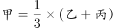，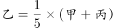，将丙=28代入，可知甲=12，乙=8。因此第一个部门与第二个部门的人数相差为：12-8=4。

解析2：

根据题意可得，第一个部门、第二个部门的人数分别是总人数的、，则第三个部门人数为总人数的：，所以总人数为：，因此第一个部门与第二个部门相差：人。

故正确答案为A。

**考点**：和差倍比问题

**来源**：2011年江苏省公务员录用考试《行测》题（B类）第95题

### 第 96 题

三角形：面积

A. 梯形：四面体

B. 线段：圆形

C. 正方体：体积

D. 面积：体积

第 96 题 · 答案与解析

**参考答案（粉笔题库参考内容）**

C

**解析**

第一步：判断题干词语间的逻辑关系。

题干两词为属性关系，后者是前者的一个特征描述。

第二步：判断选项词语间的逻辑关系。

A、B、D三项中的两词均为并列关系；C项中的两词为属性关系，且后者是前者的一个特征描述。

故正确答案为C。

**考点**：逻辑关系-对应关系

**来源**：2011年江苏省公务员录用考试《行测》题（B类）第96题

### 第 97 题

上升：下降

A. 痛苦：快乐

B. 正义：非正义

C. 常规：异常

D. 法律：违法

第 97 题 · 答案与解析

**参考答案（粉笔题库参考内容）**

A

**解析**

第一步：判断题干词语间的逻辑关系。

题干两词为语义关系中的反义词关系。

第二步：判断选项词语间的逻辑关系。

A项两词为语义关系中的反义词关系；B项为并列关系中的矛盾关系，正义和非正义之外不可能有第三种情况；C项常规和异常是矛盾关系，D选项违法和法律是对应关系。

故正确答案为A。

**考点**：语义关系-反义关系

**来源**：2011年江苏省公务员录用考试《行测》题（B类）第97题

### 第 98 题

线条：几何：欧几里得

A. 铅笔：美术：齐白石

B. 天空：哲学：哲学家

C. 结论：三段论：亚里士多德

D. 虚数：基数：陈景润

第 98 题 · 答案与解析

**参考答案（粉笔题库参考内容）**

C

**解析**

第一步：判断题干前两词间的逻辑关系，并在选项中进行选择。

题干中前两词构成包容关系中的组成关系。A项前两词为对应关系，B、D项前两词没有逻辑关系，C项前两词为组成关系。

第二步：判断题干后两词间的逻辑关系，并在选项中进行选择。

题干中后两词为对应关系，是理论与提出者的对应。C项中后两词为理论与提出者的对应，符合题干。因此正确答案为C。

**考点**：逻辑关系-包容关系、逻辑关系-对应关系

**来源**：2011年江苏省公务员录用考试《行测》题（B类）第98题

### 第 99 题

讲师：副教授：教授

A. 硕士：博士：助教

B. 本科生：硕士生：博士生

C. 教授：研究院：院士

D. 管理员：馆员：研究馆员

第 99 题 · 答案与解析

**参考答案（粉笔题库参考内容）**

B

**解析**

第一步：判断题干前两词间的逻辑关系，并在选项中进行选择。

题干前两词为并列关系。A、B项中前两词为并列关系，C项前两词没有逻辑关系，D项前两词为交叉关系。

第二步：判断题干后两词间的逻辑关系，并在选项中进行选择。

题干中后两词为并列关系。A项中后两词为交叉关系——有的博士是助教，有的助教是博士；B项中后两词为并列关系。

故正确答案为B。

**考点**：逻辑关系-并列关系

**来源**：2011年江苏省公务员录用考试《行测》题（B类）第99题

### 第 100 题

自由  之于  （  ）  相当于  法制  之于  （  ）

A. 精神 规律

B. 责任 完善

C. 思想 国家

D. 想象 执行

第 100 题 · 答案与解析

**参考答案（粉笔题库参考内容）**

C

**解析**

第一步：将选项逐一代入，判断前后两部分的逻辑关系。

A项中前两词为属性关系，后两词不构成逻辑关系；B项中前两词为反义词关系，后两词为动宾对应关系；C项中两组词均为属性关系，自由修饰思想，法制修饰国家；D项中前两词为属性关系，后两词为动宾关系。

第二步：逻辑关系相同即为答案。

故正确答案为C。

**考点**：逻辑关系-对应关系

**来源**：2011年江苏省公务员录用考试《行测》题（B类）第100题

### 第 101 题

键盘  之于  （  ）  相当于  （  ）  之于  身体

A. 工具 劳动

B. 鼠标 身高

C. 操作 写作

D. 电脑 手指

第 101 题 · 答案与解析

**参考答案（粉笔题库参考内容）**

D

**解析**

逐一代入选项。A项：键盘是工具的一种，两者为种属关系，身体劳动为主谓对应关系，前后逻辑关系不一致，排除；

B项：前两词为并列关系，后两词为属性关系，前后逻辑关系不一致，排除；

C项：前两词为动宾对应关系，后两词为主谓对应关系，前后逻辑关系不一致，排除；

D项：两组词均为包容关系中的组成关系，前后逻辑关系一致，当选。

故正确答案为D。

**考点**：逻辑关系-包容关系

**来源**：2011年江苏省公务员录用考试《行测》题（B类）第101题

### 第 102 题

申请  （    ）之于  批准  相当于  准备  起跑  之于  （    ）

A. 同意 领奖

B. 审核 冲刺

C. 产权 资金

D. 学校 球鞋

第 102 题 · 答案与解析

**参考答案（粉笔题库参考内容）**

B

**解析**

逐一代入选项。

A项：同意与批准是近义词，领奖与准备、起跑没有逻辑关系，前后逻辑关系不一致，排除；

B项：先申请，再审核，最后批准，三者为时间先后顺序的对应关系；先准备，再起跑，最后冲刺，三者为时间先后顺序的对应关系，前后逻辑关系一致，当选；

C项：申请产权之后获得批准；资金与准备、起跑没有逻辑关系，前后逻辑关系不一致，排除；

D项：申请学校之后获得批准；跑步时可能穿球鞋，前后逻辑关系不一致，排除。

故正确答案为B。

**考点**：逻辑关系-对应关系

**来源**：2011年江苏省公务员录用考试《行测》题（B类）第102题

### 第 103 题

5b66c

A. d77r8

B. 8p99t

C. 6ebbf

D. s74qq

第 103 题 · 答案与解析

**参考答案（粉笔题库参考内容）**

B

**解析**

第一步：判断题干字符间的逻辑关系。

题干中第二个字符与第五个字符均为字母，第三、四个字符相同，且第一个字符与第三、四个字符为相邻的两个数字。

第二步：与题干字符顺序和关系相同的即为答案。

由以上分析可知，正确答案为B。

**来源**：2011年江苏省公务员录用考试《行测》题（B类）第103题

### 第 104 题

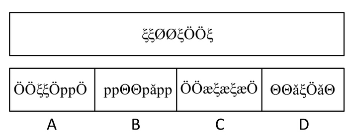

A. A

B. B

C. C

D. D

第 104 题 · 答案与解析

**参考答案（粉笔题库参考内容）**

A

**解析**

第一步：判断题干字符间的逻辑关系。

题干中共有三种不同的字符，第一、二、五、八个字符相同，第三、四个字符相同，第六、七个字符相同。

第二步：与题干字符顺序和关系相同的即为答案。

故正确答案为A。

**来源**：2011年江苏省公务员录用考试《行测》题（B类）第104题

### 第 105 题

下面所给出的四个选项中，只有一个与题干所给出的题目相对应，请找出。

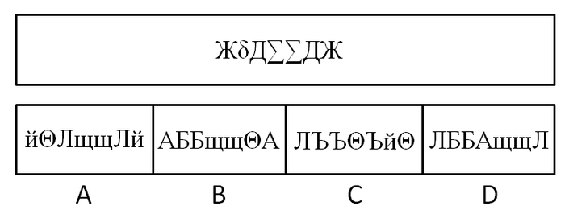

A. A

B. B

C. C

D. D

第 105 题 · 答案与解析

**参考答案（粉笔题库参考内容）**

A

**解析**

第一步：判断题干字符间的逻辑关系。

题干中共有四种不同的字符，且第一、七个字符相同，第三、六个字符相同，第四、五个字符相同。

第二步：与题干字符顺序和关系相同的即为答案。

故正确答案为A。

**来源**：2011年江苏省公务员录用考试《行测》题（B类）第105题

### 第 106 题

下面的四个选项的平面图形中，只有一个是由题干所给出的四个图形拼合而成的，请选出。

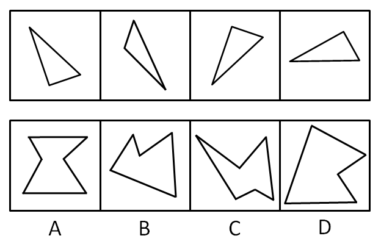

A. A

B. B

C. C

D. D

第 106 题 · 答案与解析

**参考答案（粉笔题库参考内容）**

D

**解析**

由于D项中的图形可划分为如下部分。

因此正确答案为D。

**来源**：2011年江苏省公务员录用考试《行测》题（B类）第106题

### 第 107 题

下面的四个选项的平面图形中，只有一个是由题干所给出的四个图形拼合而成的，请选出。

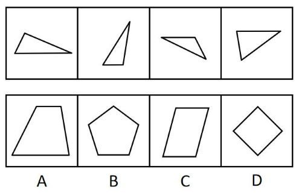

A. A

B. B

C. C

D. D

第 107 题 · 答案与解析

**参考答案（粉笔题库参考内容）**

A

**解析**

题干中图②、图③与图④经过适当旋转，可与图①拼合成A项，如下所示。

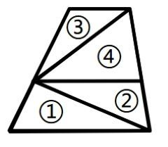

故正确答案为A。

**来源**：2011年江苏省公务员录用考试《行测》题（B类）第107题

### 第 108 题

下面的四个选项的平面图形中，只有一个是由题干所给出的四个图形拼合而成的，请选出。

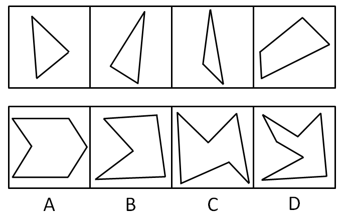

A. A

B. B

C. C

D. D

第 108 题 · 答案与解析

**参考答案（粉笔题库参考内容）**

C

**解析**

由于C项中的图形可划分为如下部分。

因此正确答案为C。

**来源**：2011年江苏省公务员录用考试《行测》题（B类）第108题

### 第 109 题

下列所给出的一组图形中，均按一定的规律组合而成，请从所给出的四个选项中选择一个符合此种规律的选项。

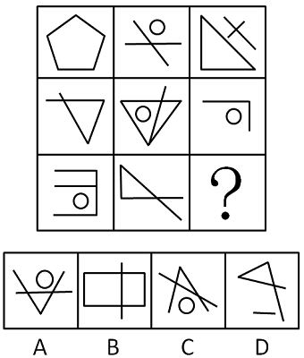

A. A

B. B

C. C

D. D

第 109 题 · 答案与解析

**参考答案（粉笔题库参考内容）**

B

**解析**

元素组成不同，且无明显属性规律，考虑数量规律。观察发现，图形线条特征明显，优先考虑数线。九宫格图形横行和竖行看，均无明显规律，从左上到右下“S”型观察发现，第一个图形到第八个图形的线条数量依次为5、3、5、3、5、3、5、3，构成周期数列，故第九个图形的线条数应为5，只有B项符合。

故正确答案为B。

**考点**：数量规律-线

**来源**：2011年江苏省公务员录用考试《行测》题（B类）第109题

### 第 110 题

下列所给出的一组图形中，均按一定的规律组合而成，请从所给出的四个选项中选择一个符合此种规律的选项。

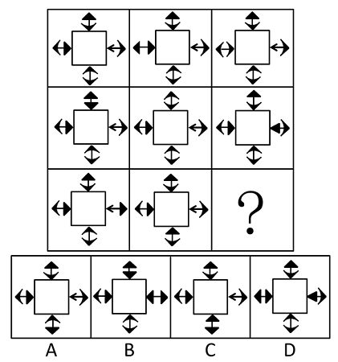

A. A

B. B

C. C

D. D

第 110 题 · 答案与解析

**参考答案（粉笔题库参考内容）**

A

**解析**

观察发现，每一幅图都与第一个图形比较，均有一个箭头与第一个图形不同，且变动的位置各不相同，结合选项，如下图所示，B项有3处不同，C、D两项各有2处不同，排除，只有A项满足只有1处不同。

故正确答案为A。

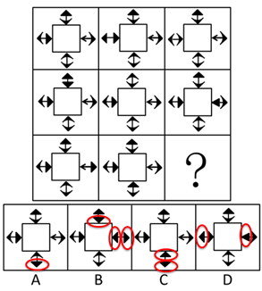

**考点**：样式规律-遍历

**来源**：2011年江苏省公务员录用考试《行测》题（B类）第110题

### 第 111 题

请从所给的四个选项中，选择最合适的一项填在问号处，使之呈现一定的规律性。

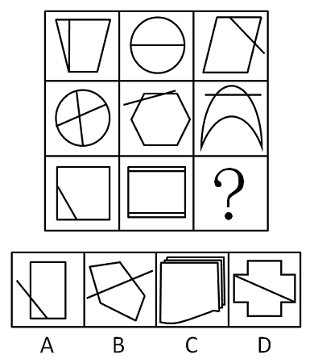

A. A

B. B

C. C

D. D

第 111 题 · 答案与解析

**参考答案（粉笔题库参考内容）**

A

**解析**

方法一：元素组成不同，且无明显属性规律，考虑数量规律。观察发现，图形中线条交叉比较明显，优先考虑数交点。整体数没有规律。继续观察发现，题干中交点有直线与直线的交点，直线与曲线的交点，考虑分开数。第一列直线交点（直线与直线的交点）数分别是5、1、6，第二列直线交点数分别是0、8、8，前两个相加等于第三个（5+1=6，0+8=8），第三列直线交点数分别是6、0、？，因此？处应该为直线交点数为6的图形，只有A项符合。

故正确答案为A。

方法二：元素组成不同，且无明显属性规律，考虑数量规律。题干图形出现了“日”字变形图和“田”字变形图，考虑数笔画。九宫格优先看横行，观察发现第一行图形的笔画数分别是1、1、1，第二行图形的笔画是2、1、1，按行看无规律。但是按列看发现，第一列图形从上到下的笔画数分别是1、2、1，第一列笔画数之和为4；第二列图形从上到下的笔画数分别是1、1、2，第二列笔画数之和为4。故第三列图形的笔画数之和也应为4，第三列从上到下的笔画数是1、1、？，问号处应选择一个笔画数为2的图形，只有C项符合。

故正确答案为C。

经过粉笔教研，本题更像是数交点的特征，并且题目时间较早，考查交点的概率更高，因此粉笔更倾向于将正确答案给到A。

**考点**：数量规律-点

**来源**：2011年江苏省公务员录用考试《行测》题（B类）第111题

### 第 112 题

下列所给出的一组图形中，均按一定的规律组合而成，请从所给出的四个选项中选择一个符合此种规律的选项。

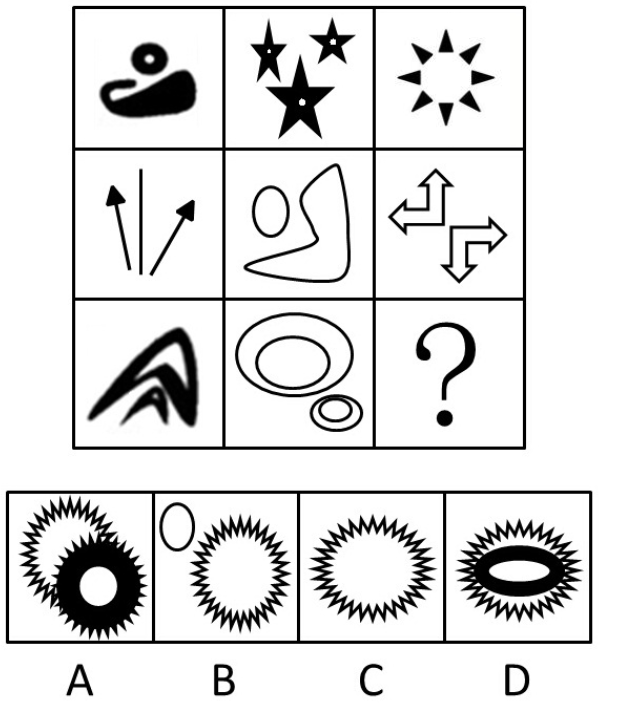

A. A

B. B

C. C

D. D

第 112 题 · 答案与解析

**参考答案（粉笔题库参考内容）**

B

**解析**

元素组成凌乱，数部分。九宫格中都不是一个连通图形，多个部分组成，即题干中所有图形均是由不相交的小图形构成。A、C、D都是连通图形。

故正确答案为B。

**考点**：数量规律-素

**来源**：2011年江苏省公务员录用考试《行测》题（B类）第112题

### 第 113 题

右边所给出的四个选项中，只有一个与题干所给出的题目相对应，请找出。

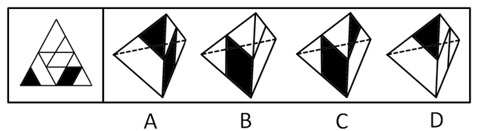

A. A

B. B

C. C

D. D

第 113 题 · 答案与解析

**参考答案（粉笔题库参考内容）**

C

**解析**

四面体，考查相邻关系。以左图中中间位置的三角形为底面时，A项中的左、右两侧面位置相反，因此错误；B项中左侧面上的黑色平行四边形的一个角应与这一面的另一个底角共顶点，因此B错误；D项中的右侧面应该为底面，因此D错误。

故正确答案为C。

**来源**：2011年江苏省公务员录用考试《行测》题（B类）第113题

### 第 114 题

如下面题干所示三个图形给出了同一个立体图形的不同侧面，所给出的四个选项图形中只有一个与该立体图形相同，请把它找出来。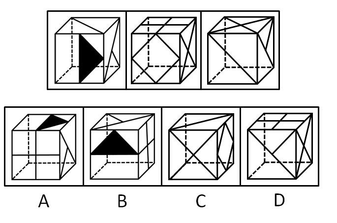

A. A

B. B

C. C

D. D

第 114 题 · 答案与解析

**参考答案（粉笔题库参考内容）**

A

**解析**

由题干中第一个图形向左翻转一格可知，B项顶面图形方向错误；由题干第三个图形可知，C项顶面直线方向错误；由题干第二个图形可知，D项正面应该为菱形面，错误。

故正确答案为A。

**考点**：空间类-空间重构-六面体

**来源**：2011年江苏省公务员录用考试《行测》题（B类）第114题

### 第 115 题

如下面题干所示三个图形给出了同一个立体图形的不同侧面，所给出的四个选项图形中只有一个与该立体图形相同，请把它找出来。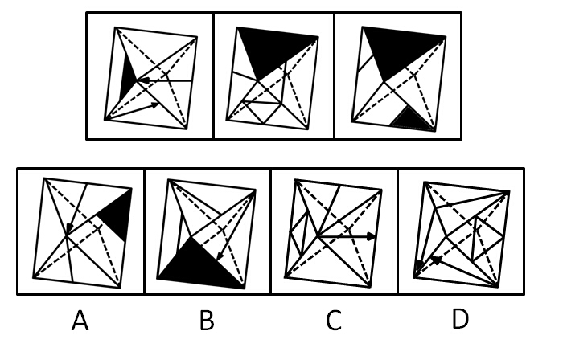

A. A

B. B

C. C

D. D

第 115 题 · 答案与解析

**参考答案（粉笔题库参考内容）**

D

**解析**

八面体，根据第一组相邻线判断相对关系。由题干第一个图形可知，箭头指向顶点的面与含阴影小三角形的面不相邻，因此A项错误；箭头指向底边的面，与这条底边相邻的面并非阴影，因此B项错误；由题干第二个图形可知，有竖直线的面的顶点不属于箭头指向底边的面，因此C项错误。

故正确答案为D。

**来源**：2011年江苏省公务员录用考试《行测》题（B类）第115题

### 第 116 题

李明的所有网友都不是软件工程师；通过李明而认识大楚公司董事的都是软件工程师；李明的一个网友通过李明认识了王刚。

根据以上陈述，可以得出：

A. 王刚是大楚公司董事

B. 王刚不是大楚公司的董事

C. 王刚是软件工程师

D. 王刚不是软件工程师

第 116 题 · 答案与解析

**参考答案（粉笔题库参考内容）**

B

**解析**

第一步：翻译题干。

李明的网友软件工程师；通过李明认识董事的人软件工程师；李明的网友通过李明认识王刚。

第二步：逐一判断选项。

由第二个结论的逆否命题可知，-软件工程师通过李明认识董事的人。因此由结论一可知，李明的网友通过李明认识董事的人。因此王刚不是董事。

故正确答案为B。

**考点**：常规翻译

**来源**：2011年江苏省公务员录用考试《行测》题（B类）第116题

### 第 117 题

E股票和F股票不同时涨；如果F股票不涨，那么E股票涨；如果E股票不涨，那么F股票也不涨。

据此，可以推出：

A. E股票涨，F股票涨

B. E股票不涨，F股票涨

C. E股票涨，F股票不涨

D. E股票不涨，F股票不涨

第 117 题 · 答案与解析

**参考答案（粉笔题库参考内容）**

C

**解析**

第一步：翻译题干。

（1）-E 或 -F；（2）-FE；（3）-EF。

第二步：分析题干，结合选项得出答案。

根据逆否规则，由（3）可推出“FE”，又知（2）“-FE”，因此E肯定涨。因为“-E 或 -F”，E肯定涨，所以F不涨。

故正确答案为C。

**考点**：常规翻译

**来源**：2011年江苏省公务员录用考试《行测》题（B类）第117题

### 第 118 题

如果程序设计没有问题，那么或者是硬件故障或者是输入有误；但是，实际上输入正确。

根据以上陈述，可以得出：

A. 程序设计有问题

B. 如果硬件没有故障，那么程序设计有问题

C. 程序设计没有问题

D. 如果硬件有故障，那么程序设计没有问题

第 118 题 · 答案与解析

**参考答案（粉笔题库参考内容）**

B

**解析**

第一步：翻译题干，利用充分必要条件。

程序设计没问题硬件故障 或 输入有误；事实信息：-输入有误。

第二步：从事实信息开始推导，得出结论。

根据逆否规则，从题干推导关系可知“-（硬件故障 或 输入有误）程序设计没问题”，根据摩根规则，命题可转换为“（-硬件故障 且 -输入有误）程序设计没问题”。已知“-输入有误”，如果再满足“-硬件故障”这一条件，则可推出“-程序设计没问题”，即如果硬件没故障，则程序有问题。B项正确，D项错误。A、C只是简单地断定程序是否有问题，没有考虑硬件故障这一条件，无法推出。

故正确答案为B。

**考点**：常规翻译

**来源**：2011年江苏省公务员录用考试《行测》题（B类）第118题

### 第 119 题

某公司举行游泳、保龄球、台球和乒乓球四个项目的比赛。小李、小张、小王和小戴均参加了其中一个项目的比赛，且四人参加的项目均不相同。已知：（1）小李、小张有一个参加了保龄球的比赛；（2）如果小王参加台球比赛，则小张参加保龄球比赛；（3）只有小李参加保龄球比赛，小王才参加台球比赛；（4）如果小王参加游泳或乒乓球比赛，则小戴不参加游泳或者乒乓球比赛。

根据以上陈述，可以得出：

A. 小王参加乒乓球比赛

B. 小王不参加乒乓球比赛

C. 小戴参加台球比赛

D. 小戴不参加台球比赛

第 119 题 · 答案与解析

**参考答案（粉笔题库参考内容）**

C

**解析**

第一步：翻译题干。

（1）小李、小张有一个参加了保龄球的比赛；

（2）小王台球小张保龄球；

（3）小王台球小李保龄球；

（4）小王游泳 或 小王乒乓球（小戴游泳 或 小戴乒乓球）。

第二步：根据题干条件进行推理。

由条件（2）和条件（3）可知，小王台球小张保龄球 且 小李保龄球。由条件（1）可知，小张参加保龄球与小李参加保龄球不能同真，即“小张保龄球 且 小李保龄球”为假。根据逆否等价，可以得到“-小王台球”。结合条件（1）可知，“-小王保龄球”，因此可以得到“小王游泳 或 小王乒乓球”。根据条件（4），可以得到“-（小戴游泳 或 小戴乒乓球）”，即小戴不参加游泳比赛，且小戴不参加乒乓球比赛，结合条件（1）可知，小戴不参加保龄球比赛，故可以得到“小戴参加台球比赛”。

故正确答案为C。

**考点**：常规翻译

**来源**：2011年江苏省公务员录用考试《行测》题（B类）第119题

### 第 120 题

在一次只有五座的圆桌会议上，已知出席会议的五人的座位情况是：（1）王局长与赵科长、李秘书不相邻；（2）如果李秘书与张副局长相邻，则赵科长与郭书记不相邻。

根据以上陈述，可以得出：

A. 郭书记与王局长、李秘书均相邻

B. 张副局长与王局长相邻，与赵科长不相邻

C. 郭书记与王局长相邻，与李秘书不相邻

D. 张副局长与王局长不相邻，与赵科长相邻

第 120 题 · 答案与解析

**参考答案（粉笔题库参考内容）**

A

**解析**

第一步：找突破口。

由条件（1）可知，王不与赵、李相邻，则王的左右必为张、郭。如下图所示。

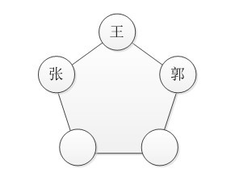

第二步：根据其余信息得出结论。

由上图可知，李与张相邻，赵必与郭相邻，因此与条件（2）矛盾。因此最终的位置顺序如下图所示。

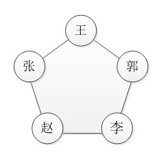

因此正确答案为A。

**考点**：从确定信息开始推

**来源**：2011年江苏省公务员录用考试《行测》题（B类）第120题

### 第 121 题

如果蓝队没有获得冠军，那么红队将获得冠军；如果蓝队获得冠军，那么绿队将获得季军；如果红队获得亚军，那么黄队将获得冠军；除非黄队获得冠军，否则绿队不会获得季军。

假如前述预测都是正确的，那么可以推出：

A. 蓝队获得冠军

B. 红队获得冠军

C. 绿队获得冠军

D. 黄队获得冠军

第 121 题 · 答案与解析

**参考答案（粉笔题库参考内容）**

B

**解析**

第一步：翻译题干。

蓝队不是冠军红队冠军；蓝队冠军绿队季军；红队亚军黄队冠军；绿队季军黄队冠军。

第二步：找突破口。

由第一个预测的逆否命题可知，红队不是冠军蓝队冠军；与第三个预测矛盾，因此冠军为红队。

故正确答案为B。

**考点**：常规翻译

**来源**：2011年江苏省公务员录用考试《行测》题（B类）第121题

### 第 122 题

甲、乙、丙三个球，一个是红色，一个是蓝色，一个是黄色。丙比黄色球大，甲和蓝色球不一样大，蓝色球比丙小。

据此，可以推出：

A. 甲是红色，乙是蓝色，丙是黄色

B. 甲是蓝色，乙是黄色，丙是红色

C. 甲是黄色，乙是红色，丙是蓝色

D. 甲是黄色，乙是蓝色，丙是红色

第 122 题 · 答案与解析

**参考答案（粉笔题库参考内容）**

D

**解析**

第一步：找突破口。

本题突破口是信息量最大对象，即蓝色球。由“甲和蓝色球不一样大”可知，甲不是蓝色球；由“蓝色球比丙小”可知，丙不是蓝色球。因此蓝色球是乙。

第二步：抄信息于表中，即将题干和第一步的所有信息放在一个表中。

乙 、？ ＜  丙

蓝 、黄 ＜  ？

第三步：填空，即填上每一个集合的空格。

乙  、（甲） ＜  丙

蓝  、  黄   ＜ （红）

因此正确答案为D。

**考点**：从最大信息开始推

**来源**：2011年江苏省公务员录用考试《行测》题（B类）第122题

### 第 123 题

贷款人发放贷款时，借款人必须提供担保。借款人到期不能偿还贷款本息的，贷款人有权依法处理其抵押物或质物，或由保证人承担偿还本息的连带责任。小黄用自己的一套房产作抵押，向银行贷了40万元，小王为保证人。

据此，可以推出：

A. 如果没有小王作为保证人，小黄向银行贷款不能超过40万元

B. 如果银行没有要求小王偿还本息，小黄一定到期偿还了贷款本息

C. 如果到期小黄不能偿还贷款本息，那么银行就会拍卖小黄的抵押房产

D. 如果到期小黄不能偿还贷款本息，那么银行可能要求小王偿还本息

第 123 题 · 答案与解析

**参考答案（粉笔题库参考内容）**

D

**解析**

第一步：翻译题干。

借款人不能偿还贷款人处理抵押物 或 保证人偿还本息。

第二步：由题干事实信息得出结论。

由题干，借款人＝小黄，贷款人＝银行，保证人＝小王，抵押物＝房产。因此推出，小黄不能偿还银行处理房产 或 小王偿还本息。

第三步：逐一判断选项。

A项从题干无法得出；B项中否定了选言命题的一个选言支，无法否定结论的后件，因此由逆否规则可知无法得出否定前件；由题干结论可知，未偿还本息后有两种情况，因此C无法得出。由第二步中的结论可知，D项正确。

故正确答案为D。

**考点**：常规翻译

**来源**：2011年江苏省公务员录用考试《行测》题（B类）第123题

### 第 124 题

科研管理要注重目标管理，要注重科研成果的产出。现在有些高校只注重过程管理，经费报销限制太死，程序太烦琐，这是不好的。据此，有四个推论：（1）目标管理和过程管理是矛盾的；（2）并非所有高校都不注重过程管理；（3）是否出科研成果是科研管理的目标之一；（4）现在有些高校不重视目标管理。

以上推理中，正确的有：

A. 1个

B. 2个

C. 3个

D. 4个

第 124 题 · 答案与解析

**参考答案（粉笔题库参考内容）**

C

**解析**

由题干可知，目标管理和过程管理缺一不可；因此二者可以并存，不是矛盾关系，（1）错误；由“有些高校只注重过程管理”可知，并非所有高校都不重视过程管理，因此（2）正确；由题干第一句可知，（3）正确；由“有些高校只注重过程管理”可知，这些学校不重视目标管理，因此（4）正确。

故正确答案为C。

**考点**：日常结论

**来源**：2011年江苏省公务员录用考试《行测》题（B类）第124题

### 第 125 题

秘书对张强说：“你的方案很好，我认为董事们都会赞同。”过一会儿，她又说：“没有哪一个董事不会不赞同的。”

可以看出：

A. 秘书赞同张强的方案

B. 董事们赞同张强的方案

C. 董事们反对张强的方案

D. 秘书的话前后矛盾

第 125 题 · 答案与解析

**参考答案（粉笔题库参考内容）**

D

**解析**

第一步：翻译题干，利用充分必要条件。

第一句：董事们都会赞同。

第二句：-（董事不会不赞同），则利用推导关系的矛盾命题继续推导即为，所有董事不赞同，则秘书的话前后矛盾。

故正确答案为D。

**考点**：集合推理

**来源**：2011年江苏省公务员录用考试《行测》题（B类）第125题

### 第 126 题

寻求优越，指一个人为摆脱自卑感而作出的努力。

下列不属于寻求优越的是：

A. 小钱年少体弱，后通过坚持运动成长为一名健美先生

B. 颜某为准备明天的演讲，已在镜子面前自练了一下午

C. 小丽说自己参与相亲会穿高跟鞋是让自己看起来高些

D. 小宁在买东西时总是掂来量去看是否具有实用价值

第 126 题 · 答案与解析

**参考答案（粉笔题库参考内容）**

D

**解析**

第一步：抓住定义中的关键词。

定义中强调“为摆脱自卑感”等。

第二步：逐一判断选项。

A项中的坚持运动为改善体弱的身体缺陷；B项中的练习是为防止在演讲中出现失误；C项中的穿高跟鞋是为了避免自身身材矮小的缺陷，均属于为了摆脱自卑感，符合定义。D项中的掂来量去是为了买东西实惠，与自卑感无关，不符合定义。

本题为选非题，故正确答案为D。

**考点**：方式目的

**来源**：2011年江苏省公务员录用考试《行测》题（B类）第126题

### 第 127 题

例外原则，指企业高级管理人员把一般日常事务授权给下属管理人员负责处理，而自己保留对例外事项，一般也是重要事项的决策和控制权。

下列属于例外原则的是：

A. 某公司的董事长主要负责公司内的一切事务，而总经理则负责维护跟合作单位的关系

B. 某公司报账制度规定， 5000元以下的由部门经理审批， 5000元及以上的需要总经理审批

C. 某管理中心兼职人员的确定，总经理有决定权；专职人员的确定，由董事会决定

D. 在每周的例会上，各中层管理人员都要将本周工作总结和下周工作计划向总经理汇报

第 127 题 · 答案与解析

**参考答案（粉笔题库参考内容）**

B

**解析**

第一步：抓住定义中的关键词。

定义中强调“高级管理人员”、“日常事务授权给下属”、“自己保留重要事项的决策和控制权”等。

第二步：逐一判断选项。

A项中的高级管理人员董事长负责公司内一切事务，与“日常事务授权给下属”不符；C项中对兼职人员的确定不属于重要事项，而总经理对专职人员的确定没有决定权，与“保留重要事项的决策和控制权”不符；D项中没有涉及决策和控制权，不符合定义。 B项中5000元以下的为日常事务，5000元以上的为重要事项，部门经理为总经理的下属管理人员，均符合定义。

故正确答案为B。

**考点**：单定义-其他句式

**来源**：2011年江苏省公务员录用考试《行测》题（B类）第127题

### 第 128 题

过分合理化，指外在动机损害了内在动机。

下列属于过分合理化的是：

A. 有些孩子学画画或练钢琴不是他们喜欢，而是家长认为将来择校时可以加分

B. 异常激烈的比赛虽然结束，小刘却意犹未尽地与朋友一起踢球

C. 中国企业里的职员有时间喜欢聊天，而日本企业里的职员很流行加班

D. 三八妇女节前后各大商场的促销气氛都很浓，吸引了许多女性去购物

第 128 题 · 答案与解析

**参考答案（粉笔题库参考内容）**

A

**解析**

第一步：抓住定义中的关键词。

定义中强调“外在动机损害内在动机”。

第二步：逐一判断选项。

A项中孩子喜欢与否是内在动机，家长要求孩子学习是外在动机，而家长违背孩子意愿让孩子学习，符合外在动机损害内在动机的关键词。B项中外在动机为激烈的比赛是否进行，内在动机为小刘是否愿意踢球，但外在动机服从了内在动机；C项中不涉及内、外在动机；D项中内在动机为女性想购物，外在动机为商场促销，外在动机符合内在动机，因此均与定义不符。

故正确答案为A。

**考点**：单定义-其他句式

**来源**：2011年江苏省公务员录用考试《行测》题（B类）第128题

### 第 129 题

虚拟表达，指一种对假想的而并非真实发生的情况的表达方法。

下列不属于虚拟表达的是：

A. 如果把人马座中较亮的几颗星连接起来，很像一把小勺

B. 昨天经理在现场的话，问题就好解决了

C. 小赵多次梦见自己乘飞船登上了月球

D. 就是把这台机器修好了，也发挥不了大作用

第 129 题 · 答案与解析

**参考答案（粉笔题库参考内容）**

C

**解析**

第一步：抓住定义中的关键词。

定义中强调“并非真实发生的情况”。

第二步：逐一判断选项。

A项中较亮的几颗星并未真实连接起来；B项中的经理并未在现场；D项中的机器并没有修好，因此A、B、D三项中的描述均基于“并非真实发生的情况”，符合定义。C项中小赵做梦为真实发生的事件，不符合定义。

本题为选非题，故正确答案为C。

**考点**：拆词

**来源**：2011年江苏省公务员录用考试《行测》题（B类）第129题

### 第 130 题

巴纳姆效应，指人们常常认为一种笼统的、一般性的人格描述十分准确地揭示了自己的特点。

下列属于巴纳姆效应的是：

A. 公共汽车上常发现一个人张大嘴打了个哈欠，周围会有几个人也忍不住打起了哈欠

B. 当人的情绪处于低落、失意的时候，对生活会失去控制感，安全感也就受到影响

C. 虽然算命先生说了许多无关痛痒的话，但很多人都认为算命先生说得“很准”

D. 有人常会怀疑自己所做的决定或所做的事的正确性，喜欢生活有些变化，厌恶被人限制

第 130 题 · 答案与解析

**参考答案（粉笔题库参考内容）**

C

**解析**

第一步：抓住定义中的关键词。

定义中强调“笼统的、一般性的人格描述”、“准确地揭示”等。

第二步：逐一判断选项。

A项中没有涉及人格描述；B、D项中只有人格描述，没有体现“准确地揭示”自身特点，因此均不符合定义。C项中无关痛痒的话为“笼统的、一般性的人格描述”，说得很准体现“准确地揭示”，符合定义。

故正确答案为C。

**考点**：故事类

**来源**：2011年江苏省公务员录用考试《行测》题（B类）第130题

### 第 131 题

定义：

①经适房：指由城市政府组织房地产开发企业或者集资建房单位建造，以微利价向城镇中低收入家庭出售的住房。

②廉租房：指政府以租金补贴或实物配租的方式，向符合城镇居民最低生活保障标准且住房困难的家庭提供社会保障性质的住房。

③限价房：指由政府委托建设的限价格、限套型（面积）的商品房，主要解决中低收入家庭的住房困难。

典型例证：

（1）王某是进城打工的农民工，他在郊区租了一间老乡的简易房。

（2）孙某是下岗职工，目前从事个体经营，购买了一套二手房。

（3）张某结婚后将父亲名下的商品房过户到自己名下。

对上述典型例证与定义的关系判断不正确的是：

A. 例证（1）（2）分别与定义②①相符

B. 例证（2）（3）分别与定义③②不相符

C. 例证（1）（3）分别与定义①②不相符

D. 例证（1）（2）（3）分别与定义①②③不相符

第 131 题 · 答案与解析

**参考答案（粉笔题库参考内容）**

A

**解析**

第一步：抓住定义中的关键词。

三个定义中均强调“政府建设”、“政府补贴”、“政府委托建设”等。

第二步：逐一判断例证。（1）中老乡的简易房；（2）中的二手房；（3）中的商品房均未体现是由政府建设、补贴或委托建设的，因此均不符合定义。

本题为选非题，故正确答案为A。

**考点**：特殊问法

**来源**：2011年江苏省公务员录用考试《行测》题（B类）第131题

### 第 132 题

定义：

①无公害农产品：指产地环境、生产过程和产品质量符合国家或行业相关的标准和规范要求，获得认证书的安全、优质、面向大众消费的食用农产品。

②绿色食品：指在无污染的生态环境中种植及全过程标准化生产或加工的农产品，符合国家健康安全食品标准，并经专门机构认定，使用绿色食品标志。

③有机食品：指在生产加工过程中既不用化学合成物，又不采用转基因技术和其他不符合有机农业原则的技术与材料，并通过有机食品认证的农产品及其加工品。

典型例证：

（1）每过一段时间，农民王大爷便会将自家养的几只草鸡下的蛋拿到集市上卖。

（2）小张在自家别墅院子里种了一些蔬菜，他认为，农药用多了会污染环境，而且农药残留还会污染食品，因此，小张种菜从来不打农药。

（3）小王喜欢喝饮料，每次去超市，他只购买带有绿色食品标志的橙汁。

对上述典型例证与定义的关系判断正确的是：

A. 例证（1）与定义①相符

B. 例证（3）与定义③相符

C. 例证（2）与定义①相符，例证（3）与定义②不相符

D. 例证（1）与定义②不相符，例证（2）与定义③不相符

第 132 题 · 答案与解析

**参考答案（粉笔题库参考内容）**

D

**解析**

第一步：抓住定义中的关键词。

①中的“获得认证书”、②中的“经专门机构认定”、③中的“通过有机食品认证”均强调需要通过认证。②中绿色食品的定义强调“使用绿色食品标志”等。

第二步：逐一判断例证。

（1）（2）中的食品均未体现通过认证，因此均不符合以上三个定义。（3）中带有绿色食品标志的橙汁符合绿色食品定义中“使用绿色食品标志”的关键词，因此符合②定义。

故正确答案为D。

**考点**：特殊问法

**来源**：2011年江苏省公务员录用考试《行测》题（B类）第132题

### 第 133 题

定义：

①科学性：指概念、原理、定义和论证等内容的叙述清楚、确切，历史事实、任务以及符号、专业术语和参考文献准确。

②艺术性：指人们反映社会生活和表达思想感情所达到的鲜明、生动的美好程度。

③实用性：指某项发明、某项技术等具有简便可行的可操作性，或者有着普遍推广意义，并且能够产生积极效果。

典型例证：

（1）水蛭会吸血，中医认为把它晒干了入药能够活血化瘀；蚯蚓（地龙）在土壤里钻来钻去，中医认为把它晒干了入药能够通络利尿。

（2）成功的备课是一项复杂而细致的工作，是整个教学过程中一个重要环节，备课也是教师对教材进行再加工再创造的过程。

（3）民族风情山歌戏《七彩畲乡》展示了社会主义新农村建设取得的辉煌成就，热情歌颂了新一代大学生村官热爱山乡、开拓进取的精神品格。

对上述典型例证与定义的关系判断正确的是：

A. 例证（1）与定义①相符，例证（2）与定义②相符

B. 例证（3）与定义③相符，例证（2）与定义②不相符

C. 例证（1）（3）分别与定义②①不相符

D. 例证（1）（2）分别与定义②③相符

第 133 题 · 答案与解析

**参考答案（粉笔题库参考内容）**

C

**解析**

第一步：抓住定义中的关键词。

①定义强调“概念、原理、定义和论证”、“清楚、确切”等；②定义强调“反映社会生活和表达思想感情”等；③定义强调“某项发明、某项技术”等。

第二步：逐一判断例证。

（1）属于对原理的叙述，且清楚、确切，符合定义①；（2）中的备课不是某项发明或技术，不符合定义③，也不符合①③中的关键词；（3）中的《七彩畲乡》反映社会生活和表达思想感情，符合定义②。

故正确答案为C。

**考点**：特殊问法

**来源**：2011年江苏省公务员录用考试《行测》题（B类）第133题

### 第 134 题

定义：

①精英文化：指以受教育程度或文化素质较高的少数知识分子或文化人为受众，旨在表达他们的审美趣味、价值判断和社会责任的文化。

②大众文化：指的是一地区、一社团中新涌现的，被大众所信奉、所接受的文化，是采取时尚化运作方式的当代文化形态。

③民间文化：指由社会底层的劳动人民创造的、古往今来就存在于民间传统中的自发民众通俗文化。

典型例证：

（1）网络改变了人们的许多习惯与观念，曾被视为“沉默的多数”的大众，尤其是低龄大众，正在网络上发出声音、掀起波澜，影响着舆论与社情民意的表达。

（2）孔、孟、老、庄、屈原、司马迁、李、杜、曹雪芹等的智慧奇葩与天才成果，已成为我们民族的经典与骄傲。

（3）传说、谚语、评书等艺术形式散播于村坊市井、街头巷尾，也出现在庭院房中，流传在欣赏者自己的口里、手上。

对上述典型例证与定义的关系判断不正确的是：

A. 例证（1）（2）分别与定义①②不相符

B. 例证（1）（3）分别与定义②③不相符

C. 例证（2）（3）分别与定义①③相符

D. 例证（1）（2）分别与定义②①相符

第 134 题 · 答案与解析

**参考答案（粉笔题库参考内容）**

B

**解析**

第一步：抓住定义中的关键词。

①定义中强调“少数知识分子或文化人为受众”；②定义中强调“被大众所信奉、所接受的文化”；③定义中强调“古往今来就存在于民间传统中”。

第二步：逐一判断例证。

（1）中的“大众，尤其是低龄大众”符合定义②中的关键词，因此符合定义②；（2）中的“智慧奇葩与天才成果”体现①定义中的“少数知识分子或文化人为受众”，因此符合定义①；（3）中的“散播于村坊市井、街头巷尾”符合定义③中的关键词。

本题为选非题，故正确答案为B。

**考点**：特殊问法

**来源**：2011年江苏省公务员录用考试《行测》题（B类）第134题

### 第 135 题

定义：

①实质正义：指正义的终极状态必须实现，也就是善人、善行应该得到善报，恶人或恶行必须得到恶报。

②形式正义：指严格按照法律规定办事，注重形式和手段的正义性，具体案件的当事人之间是否实现了正义，则非所问。

③校正正义：指涉及对被侵害的财富、荣誉和权利的恢复和补偿，不管谁是伤害者，也不管谁是受害者，伤害者补偿受害者，受害者从伤害者处得到补偿。

典型例证：

（1）很多关于打黑除恶取得重大成果的报道文章在结尾通常会有“大快人心”之类的字眼。

（2）长期以来，对人身损害赔偿的范围和计算标准，都没有统一的规范可供遵循，已有的几类人身赔偿范围和标准也因法出多门，相互间差异悬殊。

（3）邓某等人大肆侵吞信用社资金，挥金如土，造成严重的社会危害，后被控职务侵占罪，按最高法定刑期判15年有期徒刑。

对上述典型例证与定义的关系判断不正确的是：

A. 例证（1）（3）分别与定义①②不相符

B. 例证（1）（2）分别与定义②①不相符

C. 例证（2）（3）分别与定义③①不相符

D. 例证（1）（2）（3）分别与定义③②①不相符

第 135 题 · 答案与解析

**参考答案（粉笔题库参考内容）**

A

**解析**

第一步：抓住定义中的关键词。

①定义中强调“正义的终极状态必须实现”；②定义中强调“形式和手段的正义性”；③定义中强调“伤害者补偿受害者”。

第二步：逐一判断例证。

（1）中的“大快人心”体现正义必须实现，符合①定义中的关键词；（2）中赔偿的标准不一，未体现上述任何定义的关键词；（3）中邓某由于形式和手段不正义而被处罚，符合②定义中的关键词。

本题为选非题，故正确答案为A。

**考点**：特殊问法

**来源**：2011年江苏省公务员录用考试《行测》题（B类）第135题

## 材料 4

一、根据以下资料，完成各题。

        2010年江苏经济运行高开稳走、持续向好，综合实力明显增强，经初步核算，全省实现地区生产总值40903.3亿元，增长12.6%。其中，第一、二、三产业增加值分别达到2539.6亿元、21753.9亿元和16609.8亿元，分别增长4.3%、13.0%和13.1%；三次产业增加值比例为6.3：53.1：40.6。先进制造业和现代服务业发展水平提升，全年实现高新技术产业产值30355亿元，增长38.0%，占规模以上工业总产值比重达33.0%，比上年提高3个百分点；实现现代服务业增加值16731亿元，增长13.0%，占GDP的比重为40.9%，比上年提高1个百分点。战略性新兴产业快速增长，六大新兴产业全年销售收入达20647亿元，增长38.0%。非公有制经济进一步发展，实现增加值在地区生产总值中的份额达65.2%，其中私营个体经济比重为40.2%，分别比上年提高1.1个和0.8个百分点。城乡区域协调发展水平提高，城乡居民收入比为2.52：1，城乡收入差距是全国较小的省份之一。三大区域均呈较快发展态势，苏中、苏北大部分经济指标增幅继续超过全省平均水平，对全省经济增长的贡献率达39%。

        2010年江苏农业生产形势较好，粮食连续7年丰收，全年总产量达3235.1万吨，其中夏粮1105.3万吨，增长0.2%；秋粮2129.8万吨，增长0.1%。农作物种植结构有所调整，全年粮食播种面积为528.2万公顷，比上年增加1.0万公顷；棉花面积为23.6万公顷，比上年减少1.7万公顷；油料面积57.4万公顷，比上年减少1.9万公顷；蔬菜面积为121.3万公顷，比上年增加6.5万公顷。

### 第 136 题

下列判断正确的是：

A. 2010年江苏现代服务业增加值发展速度与全省地区生产总值发展速度持平

B. 2010年江苏私营经济实现增加值占地区生产总值的比重高于个体经济占比

C. 2010年江苏是全国城乡居民收入差距最小的省份

D. 2009年苏中、苏北大部分经济指标增幅超过全省平均水平

第 136 题 · 答案与解析

**参考答案（粉笔题库参考内容）**

D

**解析**

A项错误，由第一段第一句和第三句可知，江苏地区生产总值增长12.6%，现代服务业增加值增长13.0%，二者相差：13.0%－12.6%＝0.4%;

B项错误，由第一段第五句可知2010年江苏私营个体经济比重，但无法求出私营经济和个体经济各自所占的比重，从而无法进行比较；

C项错误，由第一段第六句可知江苏是全国城乡收入差距较小的省份之一，无从得知是否是差距最小的省份；

D项正确，2010年，苏中、苏北大部分经济指标增幅继续超过全省平均水平。根据“继续”可知，上一年也符合该趋势。

故正确答案为D。

**来源**：2011年江苏省公务员录用考试《行测》题（B类）第136题

### 第 137 题

2010年江苏棉花、油料和蔬菜播种面积比2009年增长了：

A. 1.41%

B. 1.43%

C. 1.45%

D. 1.47%

第 137 题 · 答案与解析

**参考答案（粉笔题库参考内容）**

C

**解析**

由第二段可知，2010年棉花、油料和蔬菜播种面积相对于2009年的增量为(-1.7-1.9+6.5)万公顷，2009年棉花、油料和蔬菜播种面积(23.6+1.7)+(57.4+1.9)+万公顷，则2010年增长率为。

故正确答案为C。

**来源**：2011年江苏省公务员录用考试《行测》题（B类）第137题

### 第 138 题

2009年江苏规模以上工业总产值是：

A. 66656亿元

B. 73321亿元

C. 91985亿元

D. 101183亿元

第 138 题 · 答案与解析

**参考答案（粉笔题库参考内容）**

B

**解析**

由“2010年江苏······全年实现高新技术产业产值30355亿元，增长38.0%，占规模以上工业总产值比重达33.0%，比上年提高3个百分点”可知，2009年江苏规模以上工业总产值为，通过观察可知四个选项的首数不同，此处可以采用直除法处理，直除首数为7，只有B项符合。

故正确答案为B。

**来源**：2011年江苏省公务员录用考试《行测》题（B类）第138题

### 第 139 题

与2009年相比，2010年江苏第一产业增加值占地区生产总值的比重：

A. 降低了0.49个百分点

B. 降低了0.39个百分点

C. 降低了1.25个百分点

D. 降低了0.21个百分点

第 139 题 · 答案与解析

**参考答案（粉笔题库参考内容）**

A

**解析**

由“2010······三次产业增加值比例调整为6.3:53.1:40.6”可知，2010年第一产业增加值占地区生产总值的比重为6.3%。2010年全省实现生产总值比上年增长12.6%，第一产业增加值增长4.3%，2009年第一产业增加值占地区生产总值的比重为，因此2010年江苏第一产业增加值占地区生产总值的比重降低了，最接近A项。

故正确答案为A。

**来源**：2011年江苏省公务员录用考试《行测》题（B类）第139题

### 第 140 题

下列判断正确的有：

（1）2010年江苏夏粮产量的增量高于秋粮产量的增量

（2）2010年江苏粮食单位面积产量有所下降

（3）2010年江苏公有制经济实现增加值在地区生产总值中的份额不足三分之一

A. 0个

B. 1个

C. 2个

D. 3个

第 140 题 · 答案与解析

**参考答案（粉笔题库参考内容）**

C

**解析**

（1）正确，由第二段可知，2010年江苏夏粮、秋粮产量增量分别为、，运用增量分析法，这两个分数的分母变化幅度影响较小，直接看分子部分，显然夏粮的产量增量大于秋粮；

（2）正确，由第二段可知，2010年江苏粮食播种面积增长率为，粮食产量等于夏粮、秋粮产量之和，由于2010年夏粮、秋粮产量增长率都很小，产量之比为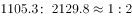，可以推知2009年产量之比约为1:2，因而2010年粮食产量增长率为，比较可知，产量增长率小于播种面积增长率，故单位面积产量同比下降；

（3）错误，由第一段第四句可知，2010年江苏非公有制经济实现增加值占，则公有制经济实现增加值占比大于。

综上可知（1）（2）正确。

故正确答案为C。

**来源**：2011年江苏省公务员录用考试《行测》题（B类）第140题

## 材料 5

二、根据以下资料，完成各题。

东部地区2010年商品房销售面积和销售额增长情况

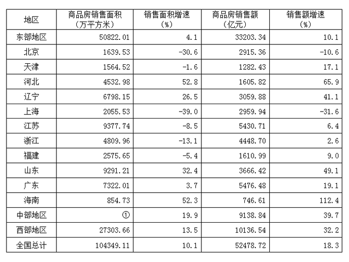

### 第 141 题

东部地区各省市中2009年商品房销售额最高的是：

A. 北京

B. 广东

C. 山东

D. 江苏

第 141 题 · 答案与解析

**参考答案（粉笔题库参考内容）**

D

**解析**

由表格知2010年北京、广东、山东和江苏商品房销售额分别为2915.36亿元、5476.48亿元、3666.42亿元和5430.71亿元，增长率分别为-10.6%、19.1%、49.1%和6.4%，则2009年商品房销售额为：

北京：；

广东：；

山东：；

江苏为：。

因此2009年商品房销售额最高的是江苏。

故正确答案为D。

**来源**：2011年江苏省公务员录用考试《行测》题（B类）第141题

### 第 142 题

东部地区各省市中2010年商品房单位面积平均售价超过8000元的有：

A. 3个

B. 4个

C. 5个

D. 6个

第 142 题 · 答案与解析

**参考答案（粉笔题库参考内容）**

C

**解析**

由表格可知，2010年北京商品房单位面积平均售价为：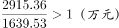，结合题意，满足商品房销售额数据和商品房销售面积数据的比值大于0.8（万元）的就是符合要求的，根据表格数据估算，北京、上海的比值都大于1，浙江的比值大于0.9，海南的比值大于0.8，河北、辽宁、江苏、福建、山东、广东的比值都明显小于0.8，天津的比值为：，因此满足要求的有北京、上海、海南、浙江、天津，共5个。

故正确答案为C。

**来源**：2011年江苏省公务员录用考试《行测》题（B类）第142题

### 第 143 题

东部地区2010年商品房单位面积平均售价增速为：

A. 5.76%

B. 6.00%

C. 6.25%

D. 10.33%

第 143 题 · 答案与解析

**参考答案（粉笔题库参考内容）**

A

**解析**

由表中数据可求，东部地区商品房单位面积平均售价为：

2010年：；2009年为，则2010年东部地区商品房单位面积平均售价增速为，只有A项符合。

故正确答案为A。

**来源**：2011年江苏省公务员录用考试《行测》题（B类）第143题

### 第 144 题

表中的①处所缺数据是：

A. 26115.34

B. 26223.44

C. 25987.24

D. 25896.46

第 144 题 · 答案与解析

**参考答案（粉笔题库参考内容）**

B

**解析**

中部地区的商品房销售面积为全国商品房销售面积减去东部地区和西部地区商品房销售面积，因此①=104349.11-27303.66-50822.01，利用尾数法计算，小数点后的数字为44。

故正确答案为B。

**来源**：2011年江苏省公务员录用考试《行测》题（B类）第144题

### 第 145 题

下列说法不正确的是：

A. 东部地区各省市2010年的商品房单位面积平均售价都比上年有所上涨

B. 东部地区2010年商品房单位面积平均售价上涨幅度低于中西部地区

C. 东部地区2009年商品房销售面积占全国的比重略低于50%

D. 东部地区各省市中2010年商品房单位面积平均售价增速最快的是海南

第 145 题 · 答案与解析

**参考答案（粉笔题库参考内容）**

C

**解析**

A项正确，由表格数据很容易看出，东部地区各省市2010年商品房销售面积增速均低于销售额的增速，因此东部地区各省市2010年的商品房单位面积平均售价比上年有所上涨；

B项正确，由表格可求出全国地区2010年商品房单位面积平均售价增速为：，由前面计算可知，东部地区2010年商品房单位面积平均售价增速为5.76%，全国可以分为东部地区和中西部地区，已知东部5.76%&lt;全国7.45%，由混合增长率居中不正中，可以判断中西部平均售价增速>全国7.45%，因此平均售价增速应为东部&lt;中西部；

C项错误，由表格数据可求，2009年东部地区商品房销售面积占全国商品房销售面积的比重为：，不易计算，可以跳过；

D项正确，由表格可求出2010年海南商品房单位面积平均售价比上年上涨了：，其他省市2010年商品房单位面积平均售价比上年的涨幅明显低于40%。

综上，符合题意的只有C项。

本题为选非题，故正确答案为C。

备注：本题C项中计算难度较大，可以跳过，通过验证A、B、D选项的正确，来确定C选项是错误的，这也是考试中应该要学会的一种方法。

**来源**：2011年江苏省公务员录用考试《行测》题（B类）第145题

## 材料 6

三、根据以下资料，完成各题。

2010年各种运输方式完成运输量（江苏与全国对照）

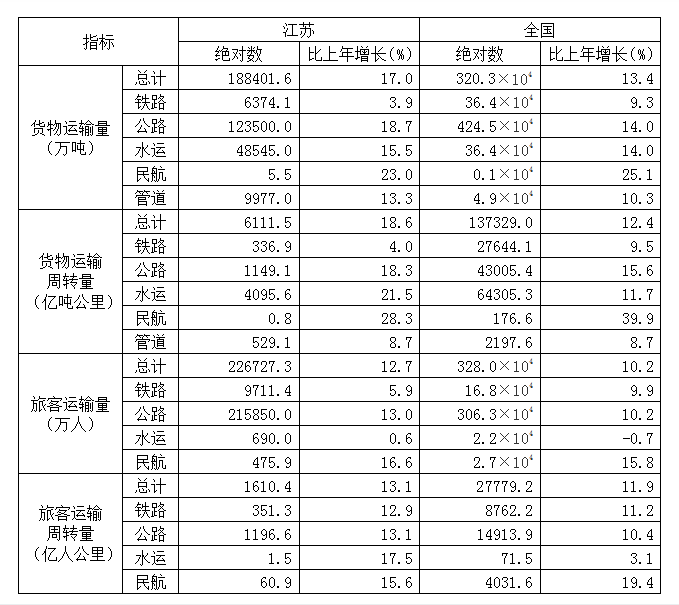

### 第 146 题

2009年江苏民航旅客运输量比铁路少：

A. 9644.8万人

B. 9235.5万人

C. 8762.2万人

D. 8205.3万人

第 146 题 · 答案与解析

**参考答案（粉笔题库参考内容）**

C

**解析**

由表格数据可知，2010年江苏铁路旅客运输量为9711.4万人，比上年增长5.9%，民航旅客运输量为475.9万人，比上年增长16.6%。因此2009年江苏民航旅客运输量比铁路少：万人，最接近C项。

故正确答案为C。

**来源**：2011年江苏省公务员录用考试《行测》题（B类）第146题

### 第 147 题

下列说法不正确的是：

A. 2010年江苏货物运输量、货物运输周转量、旅客运输量、旅客运输周转量占全国的比重都比上年有所增加

B. 2010年江苏水运货物运输周转量比重比全国大20%

C. 2010年江苏铁路、民航货物运输量占全国的比重都比上年有所下降

D. 2010年江苏及全国货物运输的最主要方式是公路运输

第 147 题 · 答案与解析

**参考答案（粉笔题库参考内容）**

D

**解析**

A项正确，2010年江苏货物运输量同比增长速度大于全国的同比增速，故2010年江苏货物运输量占全国比重比上年有所增加。同理可得2010年货物运输周转量、旅客运输量、旅客运输周转量占全国的比重都比上年有所增加；

B项正确，2010年江苏水运货物运输周转量比重为，2010年全国水运货物运输周转量比重为，则所求为：，略大于实际数值；

C项正确，2010年江苏铁路货物运输量的同比增长速度小于全国的同比增速，故2010年江苏铁路货物运输量占全国比重比上年有所下降。同理可得2010年江苏民航货物运输量占全国比重比上年有所下降；

D项错误，确定货物运输的最主要方式不仅要考虑货物运输量，还要考虑货物运输周转量。尽管2010年江苏及全国的公路货物运输量最大，但公路货物运输周转量明显小于水运货物运输周转量，故2010年江苏及全国货物运输的最主要方式是公路运输的说法错误。

本题为选非题，故正确答案为D。

**来源**：2011年江苏省公务员录用考试《行测》题（B类）第147题

### 第 148 题

2010年江苏货物运输周转量、旅客运输周转量占全国的比重分别是：

A. 4.45%,5.80%

B. 4.45%,6.91%

C. 5.88%,6.91%

D. 5.88%,5.80%

第 148 题 · 答案与解析

**参考答案（粉笔题库参考内容）**

A

**解析**

2010年江苏货物运输周转量占全国的比重为：，直除首数为4；2010年江苏旅客运输周转量占全国的比重为：，直除首数为5，只有A项符合。

故正确答案为A。

**来源**：2011年江苏省公务员录用考试《行测》题（B类）第148题

### 第 149 题

2010年江苏旅客运输平均公里数比上年变化比率最小的运输方式是：

A. 铁路

B. 公路

C. 水运

D. 民航

第 149 题 · 答案与解析

**参考答案（粉笔题库参考内容）**

B

**解析**

2010年江苏旅客运输平均公里数比上年变化比率最小的运输方式就是2010年旅客运输量的同比增长率和旅客运输周转量的同比增长率最接近的运输方式，比较表格数据可知公路旅客运输量的同比增长率与公路旅客运输周转量的同比增长率最接近。

故正确答案为B。

**来源**：2011年江苏省公务员录用考试《行测》题（B类）第149题

### 第 150 题

2010年江苏货物运输周转量占全国的比重比上年有所下降的运输方式有：

A. 1个

B. 2个

C. 3个

D. 4个

第 150 题 · 答案与解析

**参考答案（粉笔题库参考内容）**

B

**解析**

若2010年江苏各种运输方式的货物运输周转量的同比增速低于全国该种运输方式的货物运输周转量的同比增速，就说明2010年江苏该种运输方式的货物运输周转量占全国的比重比上年有所下降。比较表格数据可知，2010年江苏铁路和民航货物运输周转量占全国的比重比上年有所下降，即为2个。

故正确答案为B。

**来源**：2011年江苏省公务员录用考试《行测》题（B类）第150题

## 材料 7

四、根据以下资料，完成各题。

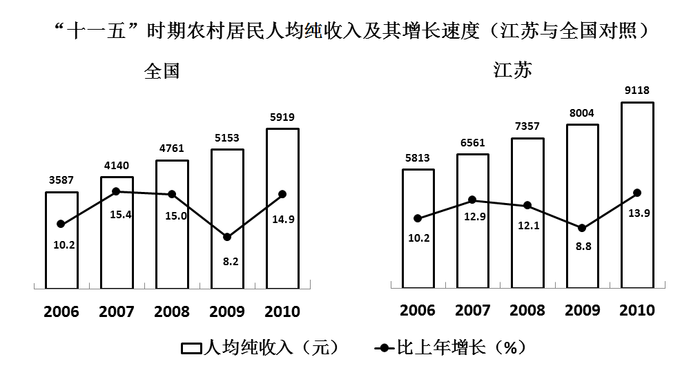

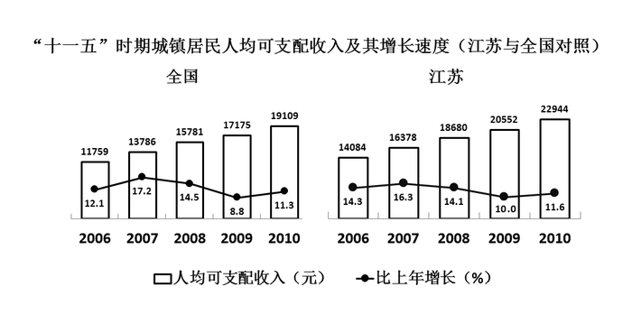

### 第 151 题

下列关于“十一五”期间江苏农村居民人均纯收入、江苏城镇居民人均可支配收入、全国农村居民人均纯收入、全国城镇居民人均可支配收入的说法正确的有：

（1）增长速度最高、最低的年份分别是2007、2009年

（2）都逐年增长，且年平均增长速度都在10%以上

（3）有一致的增长趋势

A. 0个

B. 1个

C. 2个

D. 3个

第 151 题 · 答案与解析

**参考答案（粉笔题库参考内容）**

C

**解析**

（1）错误，江苏农村居民人均纯收入2010年的增长速度为13.9%，高于2007年的12.9%；

（2）正确，根据年均增长率公式，，十一五规划期间，如果年平均增长速度都在10%以上，意味着四项指标中，2010年的收入是2005年收入的倍以上。2005年四项指标江苏农村居民人均纯收入、江苏城镇居民人均可支配收入、全国农村居民人均纯收入、全国城镇居民人均可支配收入分别是元，元，元，元。则2010年四项指标收入是2005年的倍数分别为，，，，都符合条件；

（3）正确，从图中可以看出“十一五”期间四项指标的增长趋势都一致。

综上可知（2）（3）正确。

故正确答案为C。

**来源**：2011年江苏省公务员录用考试《行测》题（B类）第151题

### 第 152 题

2010年江苏农村居民人均纯收入、城镇居民人均可支配收入分别比全国平均水平高：

A. 3269元，3835元

B. 3199元，3965元

C. 3199元，3835元

D. 3835元，3199元

第 152 题 · 答案与解析

**参考答案（粉笔题库参考内容）**

C

**解析**

2010年江苏农村居民人均纯收入比全国平均水平高：9118-5919=3199元，2010年江苏城镇居民人均可支配收入比全国平均水平高：22944-19109=3835元，因此只有C项符合。

故正确答案为C。

**来源**：2011年江苏省公务员录用考试《行测》题（B类）第152题

### 第 153 题

下列四项指标中，在“十一五”期间增长最快的是：

A. 江苏农村居民人均纯收入

B. 江苏城镇居民人均可支配收入

C. 全国农村居民人均纯收入

D. 全国城镇居民人均可支配收入

第 153 题 · 答案与解析

**参考答案（粉笔题库参考内容）**

B

**解析**

由“‘十一五’期间增长最快”可知，本题为增长率问题。定位材料图可知，“十一五”期间：江苏农村居民人均纯收入的增速为：；江苏城镇居民人均可支配收入的增速为：；全国农村居民人均纯收入的增速为：；全国城镇居民人均可支配收入的增速为：。因各数据都有－1的公共项，故只需比较减号前面：、、、四个分数大小即可，、、、，因此江苏城镇居民人均可支配收入的增速最快。

故正确答案为B。

**来源**：2011年江苏省公务员录用考试《行测》题（B类）第153题

### 第 154 题

“十一五”期间江苏城镇居民人均可支配收入比上年增加数额最小的年份是：

A. 2006年

B. 2007年

C. 2008年

D. 2009年

第 154 题 · 答案与解析

**参考答案（粉笔题库参考内容）**

A

**解析**

由第四个图可以看出，2007年和2008年的增加数额超过2000元，2009年少于2000元，因此排除B、C两项。2009年的增长数额为20552-18680=1872元，2006年的增长数额为，小于2009年的增长数额，因此2006年的增长数额最小。

故正确答案为A。

**来源**：2011年江苏省公务员录用考试《行测》题（B类）第154题

### 第 155 题

2010年江苏农村居民人均纯收入比2005年约增长：

A. 58%

B. 62%

C. 66%

D. 73%

第 155 题 · 答案与解析

**参考答案（粉笔题库参考内容）**

D

**解析**

根据第三个小题的计算结果可知，2010年江苏农村居民人均纯收入比2005年约增长了73%。

故正确答案为D。

**来源**：2011年江苏省公务员录用考试《行测》题（B类）第155题

