# 2011年江苏省公务员录用考试《行测》题（C类）

<!-- gwy:overview:start -->
> **江苏 · 2011 · 行测 · C类** ｜ 100 题 · 图片 110 处 · 答案随题折叠

| 题型模块 | 题量 | 题号 |
| --- | ---: | ---: |
| 言语理解与表达 | 15 | 1–15 |
| 数量关系 | 20 | 16–35 |
| 判断推理 | 40 | 36–75 |
| 资料分析 | 25 | 76–100 |
| **合计** | **100** | |

导航：[题型与作答说明](#题型与作答说明) · [题目](#题目) · [材料 1](#材料-1)
<!-- gwy:overview:end -->

> 候选采集稿。参考答案及解析来自粉笔页面，不代表官方答案或真实高分答卷；来源使用许可与原卷对应关系仍需人工核实。

## 题型与作答说明

言语理解与表达

（15题）

根据题目要求，在四个选项中选出一个正确答案。

数量关系

（20题）

本部分包括数字推理与数学运算两种类型的试题。

判断推理

（40题）

本部分包括类比推理、图形推理、逻辑判断与定义判断四种类型的试题。

资料分析

（25题）

下列给出的文字、表格、图形资料均有5个问题要你回答，你应根据资料提供的信息进行分析、计算、处理，然后从备选答案中选择一个最恰当的答案。

## 题目

### 第 1 题

现在的社会是讲竞争实力的社会，要的是真才实学，城市只是一个载体，学生能否学到知识，增强实力，今后能否有大的发展，更重要的是你能否考上一所好的大学，而不是你是否到了一个大城市。

这段文字意在说明：

A. 大学生增强实力才能参与竞争

B. 现代社会最重要的是竞争实力

C. 学生考上好大学一定有好的发展

D. 到大城市并非等于一定要有好的发展

第 1 题 · 答案与解析

**参考答案（粉笔题库参考内容）**

A

**解析**

据提问“意在”一词知此题为中心理解题。

题干主要是鼓励大学生追求真才实学，这样才有助于今后的社会竞争，而不要一味地追求生活在大城市。

因此，结合选项应该选择A，因为A项是对主旨的正确概括。

文段阐述的主体是学生，由此可排除B、D两项；C项的表述过于绝对，且与文段的主旨不符。

故正确答案为A。

**考点**：主题词

**来源**：2011年江苏省公务员录用考试《行测》题（C类）第1题

### 第 2 题

知识产权是所有创意产业的生命线，知识产权的保护水平决定着创新能力的持续性。著作权是知识产权的重要组成部分，著作权保护水平关系着文化创意产业的发展，一个缺乏文化原创能力和活力的民族，无论在经济上取得怎样辉煌的成果，都只能是一个“跛足巨人”，遑论向海外推广本土文化。

根据文意，避免成为“跛足巨人”的重点在于：

A. 向海外积极推广本土文化

B. 应大力发展文化创意产业

C. 用法律严格保护知识产权

D. 用法律有力保障经济增长

第 2 题 · 答案与解析

**参考答案（粉笔题库参考内容）**

C

**解析**

本题为中心理解题。

由原文“一个缺乏文化原创能力和活力的民族······都只能是一个‘跛足巨人’”可知，造成“跛足巨人”的原因是缺乏文化原创能力和活力。而“知识产权是所有创意产业的生命线”，所以避免成为“跛足巨人”的关键是加强对知识产权的保护。

因此，结合选项应该选择C。

A项是在提高了“文化原创能力和活力”，不再是“跛足巨人”之后更高的追求；B项没有错，但是先决条件是要保护知识产权，有了它才能发展文化创意产业；D项错在曲解文意，即便经济再发展，文化原创能力和活力不足，仍旧是“跛足巨人”。

故正确答案为C。

**考点**：细节判断题

**来源**：2011年江苏省公务员录用考试《行测》题（C类）第2题

### 第 3 题

①我们之所以要隆重纪念阿尔伯特•爱因斯坦，②不仅是因为他一生的科学贡献对现代科学的发展有着深远的影响，③而且还因为他勇于探索、勇于创新、为真理和社会而献身的精神是值得我们学习的，④是鼓舞我们为加速实现四个现代化而奋斗的力量。

下列逻辑关系理解错误的是：

A. ②与③之间是递进关系。

B. ①与④之间是承接关系。

C. ③与④之间是并列关系。

D. ①与②之间是因果关系。

第 3 题 · 答案与解析

**参考答案（粉笔题库参考内容）**

B

**解析**

据提问知此题为句式结构辨析题。

文段整体的结构是“①之所以······，②不仅是因为······，③而且还因为······是······，④是······”，所以①和②、③、④之间的逻辑关系是因果关系；②和③之间为递进关系；③和④之间为并列关系。

①和④之间没有直接的结构关系。

故正确答案为B。

**来源**：2011年江苏省公务员录用考试《行测》题（C类）第3题

### 第 4 题

一篇文章的体例（以及界定文章体例的职业系统规则）就是一个具体的背景，有它的潜规则，要求你（这种语言）只能以这种面目示人。语言的丰富复调依然还存在，只是在这个语境下被掩藏了。只要操持语言的人保有足够的能力，它就会自然重现在另一个语境中。

文段中“潜规则”是指：

A. 文章体例所需的语言风格

B. 文章体例所需的系统规则

C. 文章背景包含的深层语境

D. 文章背景相关的语言能力

第 4 题 · 答案与解析

**参考答案（粉笔题库参考内容）**

A

**解析**

首先定位原文，出现在文段的开头，分析文意，由“潜规则，要求你（这种语言）只能以这种面目示人”可知，“面目”是表象的东西，与之对应的是语言风格，对应A项。

B项“系统规则”是一种语言中深层次的东西，而非表象，与文意不符，排除；

C、D两项均对应“文章背景”，而由文意可知，“潜规则”是针对体例而言的，故偏离文段重点，排除。

故正确答案为A。

**考点**：实词

**来源**：2011年江苏省公务员录用考试《行测》题（C类）第4题

### 第 5 题

尽管大多数时候，人类学家以科学家自居，但不可否认的是，每个人类学家与他们的研究对象都是活生生的个人，各种感受的交织，情感的触动免不了影响研究的结果。不过不要紧，承认这种“沮丧、尴尬、疲倦和窘迫”并不是一件太糟的事情，而且越来越被看作是一个有益的维度。

作者对人类学家个人情感往往会渗入研究结果的看法是：

A. 不可避免

B. 情有可原

C. 有利有弊

D. 弊大于利

第 5 题 · 答案与解析

**参考答案（粉笔题库参考内容）**

B

**解析**

据提问知此题为态度理解题。

由原文“不过不要紧”、“并不是一件太糟的事情”可知，作者对“人类学家个人情感往往会渗入研究结果”这个事实持宽容、理解的态度，即认为这一事实是情有可原的。

因此，结合选项应该选择B项。

C项容易被误选，虽然是事实，但作者更倾向于它有利的一面，此题考查作者观点，因而排除。

故正确答案为B。

**考点**：关联词-转折

**来源**：2011年江苏省公务员录用考试《行测》题（C类）第5题

## 材料 1

“今天，你节省了多少碳？”有一群“环保达人”，自觉地少开私家车，坚持走楼梯，电脑不用就关机，用清单列出自己一天的碳排放总量，并把“减碳日记”实时挂到网上······这就是眼下正时兴的“低碳生活”。进入2011年，低碳与生活的联系更加紧密。

        人们在生活和消费过程中的过量碳排放，是造成全球气候变暖的因素之一。针对这一点，低碳生活要求人们在日常生活中养成节能的好习惯，减少碳排放，建设资源节约型、环境友好型社会，促进人与自然和谐发展，提升生活质量。

        作为可持续的绿色生活方式，低碳生活将是协调经济社会发展和环境保护的重要途径。而从长远看，这更是一种着眼于未来的生活理念。低碳生活受到“低碳族”的响应，与其本身所蕴含的环保元素和道德魅力密不可分。

        低碳生活是健康绿色的生活习惯，更是时尚的消费观，是全新的生活质量观。“雁过留声，人过不留碳”。低碳生活不是口号而是理念，把握机遇，才能掌握将来发展，选择低碳生活，才能享受美好未来。

### 第 6 题

这段文字强调的是：

A. 低碳生活是可持续的绿色生活方式

B. 人们应该在日常生活中大力倡导低碳生活方式

C. 低碳生活是时尚的消费观和全新的生活质量观

D. 人们的生活与低碳的关系日益密切

第 6 题 · 答案与解析

**参考答案（粉笔题库参考内容）**

B

**解析**

此题为中心理解题。

文章主要介绍了三方面内容：“环保达人”在日常生活中用实际行动来倡导低碳生活方式、低碳生活的重要意义和人们应该响应低碳生活方式。如此这般都是为了让人们积极参与到低碳生活中来。

因此，结合选项应该选择B项，因为B项最符合文章强调的重点。

A、C、D三项都是正确的，但都不是作者想强调的重点。

故正确答案为B。

**来源**：2011年江苏省公务员录用考试《行测》题（C类）第6题

### 第 7 题

根据文章内容，以下不属于低碳生活的行为是：

A. 夏天把办公室空调温度设置为舒适的18℃

B. 在烹饪食物时尽量减少油炸、烧烤

C. 上班族尽可能使用公共交通

D. 出差时自带洗漱用品而不使用宾馆一次性用品

第 7 题 · 答案与解析

**参考答案（粉笔题库参考内容）**

A

**解析**

此题为细节判断题。

夏季室内空调温度设定在26~28℃，既舒适，又省电，办公室温度调为18℃既容易患“空调病”，又费电。

因此，结合选项应该选择A项，因为A项不是低碳生活的行为。

油炸、烧烤等烹饪过程会排放出比蒸、煮更多的二氧化碳，减少油炸、烧烤等烹饪过程意味着减少二氧化碳排放；上班族使用公共交通会减少私家车尾气排放；不用一次性用品减少浪费。因此B、C、D三项都符合低碳生活行为。

本题为选非题，故正确答案为A。

**来源**：2011年江苏省公务员录用考试《行测》题（C类）第7题

### 第 8 题

结合文章内容，以下说法不正确的是：

A. 践行低碳生活是有道德的表现

B. 低碳生活有助于改善全球气候

C. 低碳生活要从日常生活细节着手

D. 每个人都应该养成写“低碳日记”的习惯

第 8 题 · 答案与解析

**参考答案（粉笔题库参考内容）**

D

**解析**

此题为细节判断题。

A项，符合第三段最后一句“低碳生活受到······和道德魅力密不可分”，排除；

B项，通过“······过量碳排放，是造成全球气候变暖的因素之一”可知正确，排除；

C项，通过环保达人倡导低碳生活就是从日常的细节着手的，如“少开私家车、坚持走楼梯等”可知正确，排除。

本题为选非题，故正确答案为D。

**来源**：2011年江苏省公务员录用考试《行测》题（C类）第8题

### 第 9 题

关于“低碳族”的生活特点，以下概括最为准确的是：

A. 喜欢并追求健康绿色的生活方式

B. 关注的重点是节能减排并从日常生活做起

C. 作为时尚健康的环保生活方式，做起来很酷

D. 目的是减少二氧化碳等气体的排放以改善环境

第 9 题 · 答案与解析

**参考答案（粉笔题库参考内容）**

B

**解析**

此题为中心理解题。

原文中“低碳族”的低碳生活就是自觉地少开私家车、坚持走楼梯、电脑不用就关机等，注重生活细节达到低碳目的，低碳生活不是口号而是行动。

因此，结合选项应该选择B项，因为与“低碳族”的生活特点最符合的只有B项。

A项概括过于笼统，健康绿色的生活方式不一定是低碳生活；C项过度引申，原文没有提到“这一生活很酷”；D项错在“低碳族”的目的并不仅仅是为了改善环境，也有节约资源、提升生活质量等目的，因此概括不准确。

故正确答案为B。

**来源**：2011年江苏省公务员录用考试《行测》题（C类）第9题

### 第 10 题

低碳生活具有多重意义，以下表述不正确的是：

A. 提倡低碳生活是建设环境友好型社会的应有内容

B. 个人的低碳生活可以促进整个环境的改善

C. 提倡低碳生活的目标是节省个人的开销

D. 低碳生活是公民个人可以做到的环保行动

第 10 题 · 答案与解析

**参考答案（粉笔题库参考内容）**

C

**解析**

此题为细节判断题。

低碳生活主要是为了节能减排、保护环境、促进人与自然的和谐、提升生活质量等，A、B、D三项都是低碳生活的意义。

以节省个人的开销为目标不是低碳生活的主要意义。

本题为选非题，故正确答案为C。

**来源**：2011年江苏省公务员录用考试《行测》题（C类）第10题

### 第 11 题

饱经20世纪沧桑的中国知识分子，不可能争取，也不必要妄想取得与当年歌德相当的成就，但是绝不应该因为自己难以望其项背而＿＿＿＿＿＿。

填入画横线处最恰当的一项是：

A. 愧疚不已

B. 自惭形秽

C. 捶胸顿足

D. 痛悔不堪

第 11 题 · 答案与解析

**参考答案（粉笔题库参考内容）**

B

**解析**

此题考查成语填空。

本题从关键词“但是”入手，表明后面应该与“妄想、成就”的意思相反。“自惭形秽”泛指因不如别人而感到惭愧，与本题语境符合。

因此，结合选项应该选择B。

A项“愧疚不已”形容十分惭愧和内疚，句中并无内疚之意，故排除；C项“捶胸顿足”形容非常悲痛与懊悔的样子，“中国知识分子”做主语程度过重，故排除；D项“痛悔不堪”所含的“悔”也与句意不符，故排除。

故正确答案为B。

**考点**：关联关系-转折关系、成语填空

**来源**：2011年江苏省公务员录用考试《行测》题（C类）第11题

### 第 12 题

央视国际的《每周质量报告》＿＿＿＿，目前我国很多突发耳聋的孩子都是由于因病滥用抗生素造成的。据中国聋儿康复研究中心专家＿＿＿＿，我国7岁以下儿童因为不合理使用抗生素导致耳聋的数量多达30万，占总体聋哑儿童的比例高达30%~40%。

依次填入画横线处最恰当的一项是：

A. 披露 透露

B. 揭露 泄露

C. 透露 披露

D. 暴露 披露

第 12 题 · 答案与解析

**参考答案（粉笔题库参考内容）**

A

**解析**

此题考查近义实词的不同侧重点辨析和语境搭配。

“揭露”一般是指不好的东西，比如揭露罪行；“泄露”通常是指秘密等比较机密的东西，比如泄露考题；“暴露”指显露（隐蔽的事物、缺陷、矛盾、问题等），比如暴露目标，暴露身份。因此，本题首先可以排除B、D两项。

“披露”通常是由旁观者通过比较正式的渠道进行公布、发表；“透露”通常是由当事者有意或无意地公开一些事情。根据本题中两个主体《每周质量报告》和“专家”可以确定本题答案为“披露/透露”。

故正确答案为A。

**考点**：实词填空、词的辨析-搭配对象、词的辨析-词义侧重

**来源**：2011年江苏省公务员录用考试《行测》题（C类）第12题

### 第 13 题

知识和书写不再被固定于纸质媒体，即时、分享、互动、便捷、环保、时尚、娱乐等新鲜感受＿＿＿＿＿＿。未来，“书”不仅仅是文字与图片的内容，而是嵌入触摸手控、视频、音频、360度视图、跨文本、超链接、在线升级等多媒体技术的混搭型内容，阅读概念在无限＿＿＿＿。

依次填入画横线处最恰当的一项是：

A. 接踵而至 展开

B. 纷至沓来 拓展

C. 眼花缭乱 延伸

D. 目不暇接 壮大

第 13 题 · 答案与解析

**参考答案（粉笔题库参考内容）**

B

**解析**

此题为实词和成语的混搭填空题。

第一空，“接踵而至”前提是已经存在了什么，后面才会跟着来，与原文不符；“眼花缭乱”的适用对象为人，不能形容“感受”；“目不暇接”一般形容某种景象，对象也不能是“感受”；“纷至沓来”形容“接连不断地到来”，符合要求。

第二空，“概念展开”、“概念壮大”均搭配不当。“延伸”一般指纵向的，而材料是想强调阅读概念的横向发展，因而这里填“拓展”更恰当。

故正确答案为B。

**考点**：对应关系-前后呼应、混搭填空、词的辨析-搭配对象

**来源**：2011年江苏省公务员录用考试《行测》题（C类）第13题

### 第 14 题

水污染的形势是严峻的，而尤其使我们＿＿＿＿＿＿的是，当前工业发展的步伐是不可能停止或者减速的。

填入画横线处最恰当的一项是：

A. 畏首畏尾

B. 骑虎难下

C. 进退维谷

D. 瞻前顾后

第 14 题 · 答案与解析

**参考答案（粉笔题库参考内容）**

C

**解析**

此题考查成语填空。

C项“进退维谷”形容无论是进还是退，都是处在困境之中，符合题意。

A项“畏首畏尾”形容胆子小，疑虑重重；B项“骑虎难下”比喻做一件事情进行下去有困难，但情况又不允许中途停止，陷于进退两难的境地；D项“瞻前顾后”形容顾虑过多，犹豫不决。此三者都含贬义，与题干整体的感情基调不符，故排除。

故正确答案为C。

**考点**：对应关系-解释说明、成语填空、词的辨析-感情色彩

**来源**：2011年江苏省公务员录用考试《行测》题（C类）第14题

### 第 15 题

在夏日暴晒的阳光下，牵牛花＿＿＿＿＿＿，美人蕉＿＿＿＿＿＿，富贵的牡丹也会失去神采。

依次填入画横线处最恰当的一项是：

A. 筋疲力尽 慵倦无力

B. 偃旗息鼓 慵倦无力

C. 慵倦无力 无精打采

D. 偃旗息鼓 无精打采

第 15 题 · 答案与解析

**参考答案（粉笔题库参考内容）**

B

**解析**

从第二空入手，形容美人蕉在夏日暴晒下的状态，“无精打采”与后文的“失去神采”语义重复，排除C、D两项。

第一空形容夏日暴晒下的牵牛花，“筋疲力尽”侧重劳累后的无力，不符合语境，排除A项；B项“偃旗息鼓”形容烈日下的牵牛花，与其平时神态形成反差，符合语境描述。

故正确答案为B。

**考点**：对应关系-前后呼应、成语填空

**来源**：2011年江苏省公务员录用考试《行测》题（C类）第15题

### 第 16 题

46，33，22，15，10，（    ）

A. 1

B. 3

C. 5

D. 7

第 16 题 · 答案与解析

**参考答案（粉笔题库参考内容）**

D

**解析**

观察数列没有明显规律，可以考虑多级数列。因为数列呈递减趋势，为方便计算，可用前项减后项，相减后得到二级数列：13，11，7，5，二级数列为质数数列，因此下一项应该是3，所以10-（7）=3。

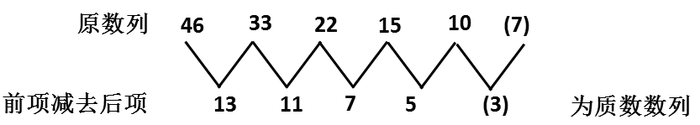

故正确答案为D。

**来源**：2011年江苏省公务员录用考试《行测》题（C类）第16题

### 第 17 题

2，4，4，8，16，（    ）

A. 48

B. 64

C. 128

D. 256

第 17 题 · 答案与解析

**参考答案（粉笔题库参考内容）**

B

**解析**

本题为递推数列。递推规律为：数列相邻两项的乘积的一半得到数列的下一项。具体规律为：，，，因此原数列的下一项为：。

故正确答案为B。

**来源**：2011年江苏省公务员录用考试《行测》题（C类）第17题

### 第 18 题

128，（    ），8，2，4，1/2

A. 64

B. 55

C. 16

D. 28

第 18 题 · 答案与解析

**参考答案（粉笔题库参考内容）**

C

**解析**

本题为乘积递推数列。将原数列倒过来看为：1/2、4、2、8、(16）、128，递推规律为：数列相邻两项的乘积为数列的下一项。具体规律为：，，2×8=(16)，8×(16)=128，因此括号内为16。

故正确答案为C。

**来源**：2011年江苏省公务员录用考试《行测》题（C类）第18题

### 第 19 题

15，26，37，（    ），68，79

A. 42

B. 44

C. 46

D. 48

第 19 题 · 答案与解析

**参考答案（粉笔题库参考内容）**

D

**解析**

解析1：

机械划分为：1|5、2|6、3|7、、6|8、7|9，看作分组数列。组内作和，和值分别为6、8、10、（12）、14、16，为公差为2的等差数列，四个选项中仅D项符合。

解析2：

将数列作为分组数列处理，两两一组分别为：[15, 26]、[37,（48）]、[68,79]，各组内后项减去前项所得差值11构成常数数列，因此未知项为48。

故正确答案为D。

**来源**：2011年江苏省公务员录用考试《行测》题（C类）第19题

### 第 20 题

－1，2，1，8，19，（    ）

A. 62

B. 65

C. 73

D. 86

第 20 题 · 答案与解析

**参考答案（粉笔题库参考内容）**

A

**解析**

本题为递推数列。递推规律为：第一项的3倍加上第二项的2倍得到第三项。具体规律为：(－1)×3+2×2=1，2×3+1×2=8，1×3+8×2=19，因此原数列的下一项为：8×3+19×2=62。

故正确答案为A。

**来源**：2011年江苏省公务员录用考试《行测》题（C类）第20题

### 第 21 题

3，4，9，28，113，（    ）

A. 566

B. 678

C. 789

D. 961

第 21 题 · 答案与解析

**参考答案（粉笔题库参考内容）**

A

**解析**

本题为变倍递推数列，加1修正。具体规律为：3×1+1=4，4×2+1=9，9×3+1=28，，因此原数列的下一项为：113×5+1=566。

故正确答案为A。

**来源**：2011年江苏省公务员录用考试《行测》题（C类）第21题

### 第 22 题

4，12，24，36，50，（    ）

A. 64

B. 72

C. 86

D. 98

第 22 题 · 答案与解析

**参考答案（粉笔题库参考内容）**

B

**解析**

原数列各项做因数分解：4=1×4，12=2×6，24=3×8，36=4×9，50=5×10。其中左子列：1、2、3、4、5为等差数列，右子列：4、6、8、9、10为合数数列。故原数列下一项为：。

故正确答案为B。

**来源**：2011年江苏省公务员录用考试《行测》题（C类）第22题

### 第 23 题

\-64，4，0，1，1/4，（    ）

A. 8

B. 64

C. 1/16

D. 1/36

第 23 题 · 答案与解析

**参考答案（粉笔题库参考内容）**

D

**解析**

原数列各项依次为(-4)^3、(-2)^2、、、、(6^2)，底数是公差为2的等差数列，指数是公差为-1的等差数列。

故正确答案为D。

**来源**：2011年江苏省公务员录用考试《行测》题（C类）第23题

### 第 24 题

12.5，23.4，31.2，（    ），52.3，62.3

A. 41.2

B. 42.7

C. 46.4

D. 49.5

第 24 题 · 答案与解析

**参考答案（粉笔题库参考内容）**

A

**解析**

该数列的十位数数字依次是1、2、3、（4）、5、6，剩下的数字为2.5、3.4、1.2、(    ）、2.3、2.3，这是一个分组数列，依次为两两一组，每组内的两数字之和相等，且小数点前的数字的值小于小数点后的数字的值。所以括号中应填入的数字为41.2。

故正确答案为A。

**来源**：2011年江苏省公务员录用考试《行测》题（C类）第24题

### 第 25 题

2/3，1/3，5/12，2/15，53/480，（    ）

A. 3/7

B. 76/2568

C. 652/27380

D. 

第 25 题 · 答案与解析

**参考答案（粉笔题库参考内容）**

D

**解析**

本题为典型的分数数列。

把原数列改写为：2/3、2/6、5/12、8/60、53/480、（    ），此时数列为递推数列，递推规律为：分子=前项分母-前项分子+1，具体规律为：3-2+1=2，6-2+1=5，12-5+1=8，60-8+1=53，因此下一项分子为：480-53+1=428；

，具体规律为：，，，，因此下一项分母为：。因此原数列的下一项为。

故正确答案为D。

**来源**：2011年江苏省公务员录用考试《行测》题（C类）第25题

### 第 26 题

自来水收费标准：每户每月用水5吨以下为2.2元/吨，超过5吨时，超出部分为3.2元/吨。某月，张、李两户共交70元水费，用水量李是张的1.5倍，问张比李少交水费多少元：

A. 16

B. 15

C. 14

D. 12

第 26 题 · 答案与解析

**参考答案（粉笔题库参考内容）**

A

**解析**

水价最贵为3.2元/吨，，则张、李合计用水超过20吨，又知李的用水量是张的1.5倍，因此每户用水量都超过5吨。设张用水为y吨，则李用水为1.5y吨，根据分段计价可得：5×2×2.2＋(y＋1.5y－5×2)×3.2＝70，解得y＝10，因此张比李少用0.5y＝5吨水，每吨水价为3.2元，故少交水费3.2×5＝16元。

故正确答案为A。

**考点**：分段计算问题

**来源**：2011年江苏省公务员录用考试《行测》题（C类）第26题

### 第 27 题

甲商品8折后的价格是乙商品原价的4倍，小王分别以8折和7折的价格买下了甲、乙两种商品，支出总额比甲商品原价少6元，问乙商品的实际销售价格是多少元：

A. 10

B. 14

C. 21

D. 28

第 27 题 · 答案与解析

**参考答案（粉笔题库参考内容）**

B

**解析**

解析1：

设甲商品原价为x元，乙商品原价为y元，根据题意可得：0.8x=4y，0.8x+0.7y+6=x，联立解得y=20，因此乙商品实际销售价格为：20×0.7=14元。

解析2：

其实当假设甲商品原价为100元，甲商品8折后价格为80元，则可知乙商品原价为20元，乙商品7折后价格为14元，此时发现80+14-100=－6，恰好符合题意，因此假设就是实际情况，显然乙商品的实际销售价格为14元。

故正确答案为B。

**考点**：和差倍比问题、经济利润问题

**来源**：2011年江苏省公务员录用考试《行测》题（C类）第27题

### 第 28 题

赵、钱、孙3人共同完成一项工程，赵、钱合作8天完成工程的40%，钱、孙合作2天完成工程的20%，然后3人合作3天完成剩余工程，3人工作效率由高到低的排序是：

A. 孙、赵、钱

B. 钱、赵、孙

C. 赵、孙、钱

D. 孙、钱、赵

第 28 题 · 答案与解析

**参考答案（粉笔题库参考内容）**

A

**解析**

假定工程总量为100，则根据题意可知效率满足以下条件：赵+钱=5，钱+孙=10，于是可知孙>赵，排除B、C两项；又由3人合作情况知：，由此可知赵一天约做3，钱一天约做2，于是赵>钱，排除D项。

故正确答案为A。

**考点**：给完工时间型

**来源**：2011年江苏省公务员录用考试《行测》题（C类）第28题

### 第 29 题

两种杂志全年定价分别为168元、216元。全室人员都订阅这两种杂志中的一种，用去2184元，如果他们换订另一杂志，需用2040元。该室有多少人：

A. 12

B. 11

C. 9

D. 8

第 29 题 · 答案与解析

**参考答案（粉笔题库参考内容）**

B

**解析**

整体考虑，将两种情况合并在一起，即相当于该室所有人都买了这两种杂志，因此可知该室的人数为：(2184+2040)÷(168+216)=11。

故正确答案为B。

**考点**：和差倍比问题

**来源**：2011年江苏省公务员录用考试《行测》题（C类）第29题

### 第 30 题

公司实行计件工资报酬，加工一件合格的得4元，不合格的不但不计入报酬，而且每件扣除12元。某员工一个月加工1000件，得3600元报酬，该员工这个月加工产品的合格率是多少：

A. 96%

B. 96.5%

C. 97.5%

D. 98%

第 30 题 · 答案与解析

**参考答案（粉笔题库参考内容）**

C

**解析**

解析1：

考虑先将全部工件都看作合格，然后分析差异，可得不合格的产品有(4×1000-3600)÷(4+12)=25件，故合格产品有975件，则合格率为97.5%。

解析2：

假设合格产品有x件，则不合格产品有(1000-x)件，根据题意可得：4x-12(1000-x)=3600，解得x=975，因此合格率为：。

故正确答案为C。

**考点**：和差倍比问题

**来源**：2011年江苏省公务员录用考试《行测》题（C类）第30题

### 第 31 题

已知数据23、25、26、22、21、27、28、24、30、33，用这10个数分别减去其平均数，所得10个数值的和为：

A. 3

B. 2

C. 0

D. －3

第 31 题 · 答案与解析

**参考答案（粉笔题库参考内容）**

C

**解析**

有几个数则平均数被减几次，于是可知减去数值的总和恰好为原所有数值之和，故差值为0。

故正确答案为C。

**来源**：2011年江苏省公务员录用考试《行测》题（C类）第31题

### 第 32 题

老张上山速度为60米/分钟，原路返回的速度为100米/分钟，问老张往返的平均速度为多少米/分钟：

A. 85

B. 80

C. 75

D. 70

第 32 题 · 答案与解析

**参考答案（粉笔题库参考内容）**

C

**解析**

解析1：

设山顶到山脚路程为600米，则上下山往返一次的总路程为1200米，而往返所需时间为：分钟，因此老张往返的平均速度为：米/分钟。

解析2：

本题为等距离平均速度问题。由等距离平均速度公式可知老张往返的平均速度为：。

故正确答案为C。

备注：等距离平均速度公式为：，、分别为往返的速度。

**考点**：平均速度

**来源**：2011年江苏省公务员录用考试《行测》题（C类）第32题

### 第 33 题

4辆车运送货物，每辆车可运送16次；7辆车运送，每辆车可运送10次，设增加的车辆数与运送减少的次数成正比且每次运送货物相等，运送货物总量最多是多少车次：

A. 74

B. 72

C. 68

D. 64

第 33 题 · 答案与解析

**参考答案（粉笔题库参考内容）**

B

**解析**

由题意可知增加3辆车，可减少单次运送次数6次，故二者的比例为1:2。假定在4辆车基础上增加车辆为n，则运送总车次为：，由二次函数取最值原理可知，当n=2时总车次数最大，此时总车次数为：。

故正确答案为B。

**考点**：函数最值问题

**来源**：2011年江苏省公务员录用考试《行测》题（C类）第33题

### 第 34 题

过正方体一侧面的两条对角线交点，与下底面四个顶点连接得一四棱锥，则四棱锥与正方体的体积比是多少：

A. 1∶8

B. 1∶6

C. 1∶4

D. 1∶3

第 34 题 · 答案与解析

**参考答案（粉笔题库参考内容）**

B

**解析**

设正方体的边长为2，则其体积为8；此四棱锥的高为1，底面积为4，由棱锥体积公式可得其体积为：，因此四棱锥与正方体的体积比为：。

故正确答案为B。

**考点**：几何公式类-立体图形

**来源**：2011年江苏省公务员录用考试《行测》题（C类）第34题

### 第 35 题

募捐晚会售出500元、400元、300元的门票共2600张，门票收入99万元整，400元与500元的门票张数相等。

400元的门票售出多少张：

A. 850

B. 800

C. 750

D. 700

第 35 题 · 答案与解析

**参考答案（粉笔题库参考内容）**

D

**解析**

解析1：

假定400元门票有x张，300元门票有y张，则根据题意可得：(400+500)x+300y=990000，2x+y=2600，联立解得x=700，y=1200。

解析2：

由“400元与500元的门票张数相等”可知，可以用与两门票总张数相等数量的450元门票代替两种门票，此时450元门票张数恰为400元门票张数的2倍，即原问题变为有450元、300元的门票共2600张，门票收入99万元整，假设2600张都是450元，收入为：450×2600=1170000元=117万元；假设2600张都是300元，则收入为：300×2600=780000元=78万元，此时可用十字交叉法，450元门票数与300元门票数之比为：(99-78):(117-99)=21:18=7:6，因此400元门票数为：张。

故正确答案为D。

**考点**：经济利润问题

**来源**：2011年江苏省公务员录用考试《行测》题（C类）第35题

### 第 36 题

英雄∶豪杰

A. 奶茶∶牛奶

B. 小灵通∶座机

C. 碧螺春∶春茶

D. 移动电话∶手机

第 36 题 · 答案与解析

**参考答案（粉笔题库参考内容）**

D

**解析**

第一步：判断题干词语间的逻辑关系。

题干两词为同义词关系。

第二步：判断选项词语间的逻辑关系。

A项两词为包容关系中的组成关系，其中牛奶是奶茶的组成部分；

B项两词为并列关系，均是通信工具的一种；

C项两词为交叉关系；

D项两词为同义词关系。

故正确答案为D。

**考点**：语义关系-近义关系

**来源**：2011年江苏省公务员录用考试《行测》题（C类）第36题

### 第 37 题

楷体∶宋体∶小四

A. 隶书∶五号∶大写

B. 黑体∶楷体∶小初

C. 字体∶字形∶字号

D. 英文∶标准∶小写

第 37 题 · 答案与解析

**参考答案（粉笔题库参考内容）**

B

**解析**

第一步：判断题干词语间逻辑关系。

楷体和宋体是两种字体，二者为并列关系；小四是宋体、楷体对应的一种字号，与楷体、宋体为对应关系。

第二步：判断选项词语间逻辑关系。

A项：五号是隶书对应的一种字号，二者为对应关系，与题干逻辑关系不一致，排除；

B项：黑体和楷体是两种字体，二者为并列关系；小初是黑体、楷体对应的一种字号，与黑体、楷体为对应关系，与题干逻辑关系一致，当选；

C项：字体、字形、字号都是文字的属性，三者为并列关系，与题干逻辑关系不一致，排除；

D项：英文与标准不是并列关系，与题干逻辑关系不一致，排除。

故正确答案为B。

**考点**：逻辑关系-对应关系、逻辑关系-并列关系

**来源**：2011年江苏省公务员录用考试《行测》题（C类）第37题

### 第 38 题

南京大学∶东南大学

A. 留学∶升学

B. 浙江∶长江

C. 通用公司：福特公司

D. 航天器∶机器

第 38 题 · 答案与解析

**参考答案（粉笔题库参考内容）**

C

**解析**

第一步：判断题干词语间的逻辑关系。

题干两词为并列关系。

第二步：判断选项词语间的逻辑关系。

A、B项两词没有逻辑关系；

C项两词为并列关系；

D项两词为包容关系中的种属关系。

故正确答案为C。

**考点**：逻辑关系-并列关系

**来源**：2011年江苏省公务员录用考试《行测》题（C类）第38题

### 第 39 题

报纸∶光明日报∶读者

A. 大楼∶模型∶工程师

B. 医院∶病人∶医生

C. 电器∶空调∶用户

D. 软件∶病毒∶黑客

第 39 题 · 答案与解析

**参考答案（粉笔题库参考内容）**

C

**解析**

第一步：判断题干前两词间的逻辑关系，并在选项中进行选择。

题干前两词为包容关系中的种属关系。

A项前两词为对应关系；

B项前两词为包容关系中的组成关系；

C项前两词为种属关系；

D项前两词为事物与其攻击目标的对应关系。

第二步：判断题干后两词间的逻辑关系，并在选项中进行选择。

题干后两词为对应关系，且为事物与其使用者的对应关系。C项中后两词也为事物与其使用者的对应关系。

故正确答案为C。

**考点**：逻辑关系-包容关系、逻辑关系-对应关系

**来源**：2011年江苏省公务员录用考试《行测》题（C类）第39题

### 第 40 题

地球 之于 太阳 相当于 （    ） 之于 （    ）

A. 电子 原子核

B. 分子 原子

C. 原子核 电子

D. 原子 分子

第 40 题 · 答案与解析

**参考答案（粉笔题库参考内容）**

A

**解析**

第一步：判断题干词语间的逻辑关系。

题干两词为对应关系，是物体与其轨道围绕的中心物体间的对应关系。

第二步：判断选项词语间的逻辑关系。

A项中电子围绕原子核旋转，是物体与其轨道围绕的中心物体间的对应关系；

B、D项两词为包容关系中的组成关系；

C项两词为对应关系，但顺序与题干相反。

故正确答案为A。

**考点**：逻辑关系-对应关系

**来源**：2011年江苏省公务员录用考试《行测》题（C类）第40题

### 第 41 题

键盘 之于 （    ） 相当于 手臂 之于 （    ）

A. 工具 劳动

B. 鼠标 手法

C. 操作 写作

D. 电脑 身体

第 41 题 · 答案与解析

**参考答案（粉笔题库参考内容）**

D

**解析**

第一步：将选项逐一代入，判断前后两部分的逻辑关系。

A项中前两词为种属关系，后两词为工具与其目的的对应关系；

B项中前两词为并列关系，后两词为对应关系；

C项中前两词没有逻辑关系，后两词为对应关系；

D项中前后两组词均为包容关系中的组成关系。

第二步：逻辑关系相同即为答案。

由以上分析可知，正确答案为D。

故正确答案为D。

**考点**：逻辑关系-包容关系

**来源**：2011年江苏省公务员录用考试《行测》题（C类）第41题

### 第 42 题

公平、民主、和平 之于 （    ） 相当于 道德、能力、习惯 之于 （    ）

A. 正义 素质

B. 自由 责任

C. 文明 价值

D. 历史 现实

第 42 题 · 答案与解析

**参考答案（粉笔题库参考内容）**

A

**解析**

第一步：将选项逐一代入，判断前后两部分间的逻辑关系。

A项中两组词中的前三词与第四个词均构成属性关系，公平、民主、和平是正义的特征描述，道德、能力、习惯是素质的特征描述；

B、D项中的前后两组词均不构成逻辑关系；

C项中前一组词为属性关系，后一组词不构成逻辑关系。

第二步：逻辑关系相同即为答案。

由以上分析可知，正确答案为A。

故正确答案为A。

**考点**：逻辑关系-对应关系

**来源**：2011年江苏省公务员录用考试《行测》题（C类）第42题

### 第 43 题

5b66c

A. d22r8

B. 6ebbf

C. s65qq

D. 7a99s

第 43 题 · 答案与解析

**参考答案（粉笔题库参考内容）**

D

**解析**

第一步：判断题干字符间的逻辑规律。

题干中第三、四个字符相同，第一、三个字符为两个数字，第二、五个字符为两个字母。

第二步：与题干字符间逻辑规律相同的即为答案。

由以上分析可知，正确答案为D。

故正确答案为D。

**来源**：2011年江苏省公务员录用考试《行测》题（C类）第43题

### 第 44 题

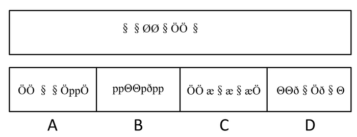

A. A

B. B

C. C

D. D

第 44 题 · 答案与解析

**参考答案（粉笔题库参考内容）**

A

**解析**

第一步：判断题干字符间的逻辑规律。

题干中共有三种不同的字符，且第一、二、五、八个字符相同，第三、四个字符相同，第六、七个字符相同。

第二步：与题干字符间逻辑规律相同的即为答案。

综上分析可知，答案为A。

故正确答案为A。

**来源**：2011年江苏省公务员录用考试《行测》题（C类）第44题

### 第 45 题

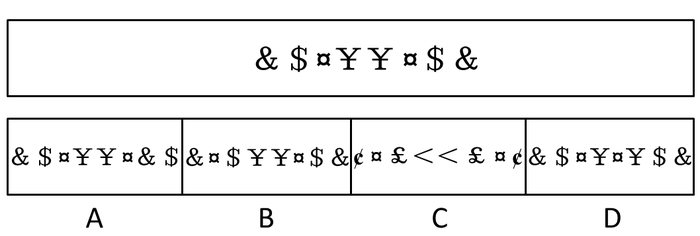

A. A

B. B

C. C

D. D

第 45 题 · 答案与解析

**参考答案（粉笔题库参考内容）**

C

**解析**

第一步：判断题干字符间的逻辑规律。

题干中共有八个字符，且前四个字符与后四个字符相同，出现顺序正好相反。

第二步：与题干字符间逻辑规律相同的即为答案。

综上分析可知，正确答案为C。

故正确答案为C。

**来源**：2011年江苏省公务员录用考试《行测》题（C类）第45题

### 第 46 题

下列四个图形中，只有一个是由所给出的四个图形拼合而成的，请把它找出来。

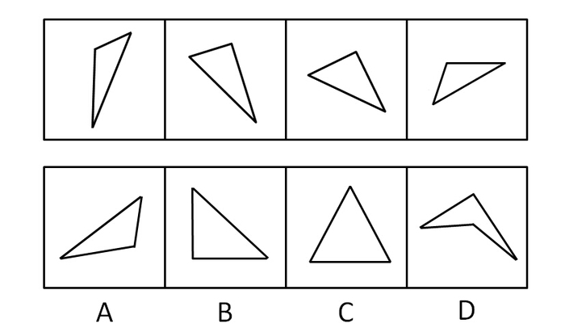

A. A

B. B

C. C

D. D

第 46 题 · 答案与解析

**参考答案（粉笔题库参考内容）**

A

**解析**

本题考查平面拼图，A项可分解为如下图形：

故正确答案为A。

**来源**：2011年江苏省公务员录用考试《行测》题（C类）第46题

### 第 47 题

下面的四个图形中，只有一个是由所给出的四个图形拼合而成的，请把它找出来。

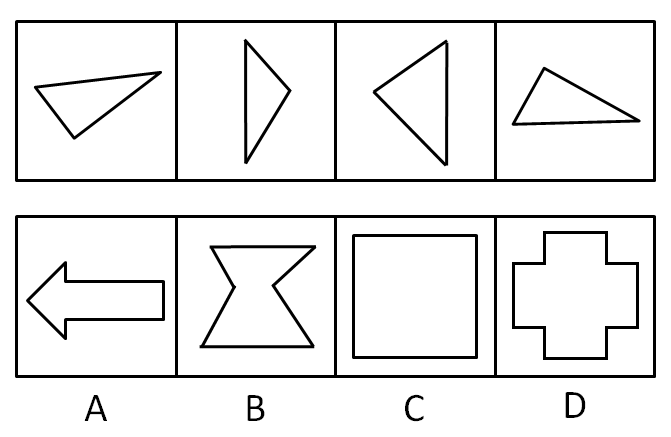

A. A

B. B

C. C

D. D

第 47 题 · 答案与解析

**参考答案（粉笔题库参考内容）**

C

**解析**

本题考查平面拼图。由于C项中的图形可以分割为如下图形：

故正确答案为C。

**来源**：2011年江苏省公务员录用考试《行测》题（C类）第47题

### 第 48 题

下面的四个图形中，只有一个是由所给出的四个图形拼合而成的，请把它找出来。

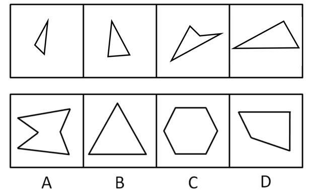

A. A

B. B

C. C

D. D

第 48 题 · 答案与解析

**参考答案（粉笔题库参考内容）**

B

**解析**

本题考查平面拼图，由于B项可分割为如下图形：

故正确答案为B。

**来源**：2011年江苏省公务员录用考试《行测》题（C类）第48题

### 第 49 题

下面的四个图形中，只有一个是由所给出的四个图形拼合而成的，请把它找出来。

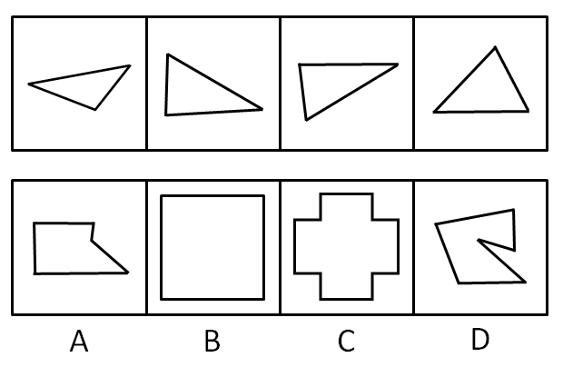

A. A

B. B

C. C

D. D

第 49 题 · 答案与解析

**参考答案（粉笔题库参考内容）**

A

**解析**

本题考查平面拼图。由于A项可分解为如下图形：

故正确答案为A。

**来源**：2011年江苏省公务员录用考试《行测》题（C类）第49题

### 第 50 题

从所给四个选项中，选择最合适的一个填入问号处，使之呈现一定的规律性：

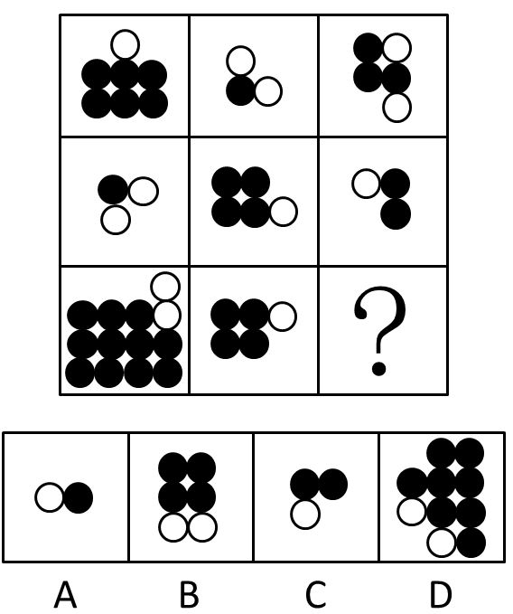

A. A

B. B

C. C

D. D

第 50 题 · 答案与解析

**参考答案（粉笔题库参考内容）**

C

**解析**

观察发现图形均由黑白圆组成，优先考虑元素的种类和数量。图形元素呈现明显的数量变化，且黑白圆总个数之和均为奇数，选项中A、B、D元素之和都是偶数，只有C项满足规律。

故正确答案为C。

**考点**：数量规律-素

**来源**：2011年江苏省公务员录用考试《行测》题（C类）第50题

### 第 51 题

从所给四个选项中，选择最合适的一个填入问号处，使之呈现一定的规律性：

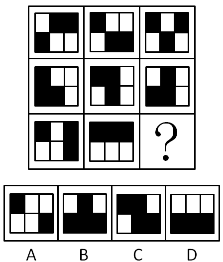

A. A

B. B

C. C

D. D

第 51 题 · 答案与解析

**参考答案（粉笔题库参考内容）**

D

**解析**

每个图中黑色方块的个数均为3。

故正确答案为D。

**考点**：数量规律-素

**来源**：2011年江苏省公务员录用考试《行测》题（C类）第51题

### 第 52 题

从所给四个选项中，选择最合适的一个填入问号处，使之呈现一定的规律性：

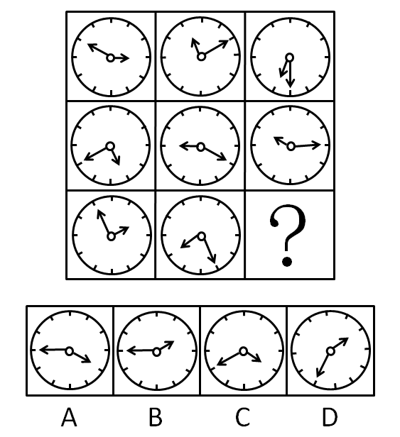

A. A

B. B

C. C

D. D

第 52 题 · 答案与解析

**参考答案（粉笔题库参考内容）**

A

**解析**

元素组成相同，但无位置规律，但每幅图均包含时针与分针，考虑指针的指向。观察发现，时针与分针在钟表上所指的数字之和均为13，只有A项符合规律。

故正确答案为A。

**考点**：特殊规律-功能元素

**来源**：2011年江苏省公务员录用考试《行测》题（C类）第52题

### 第 53 题

左边给定的是四面体的外表面展开图，右边哪一项能由它折叠而成？

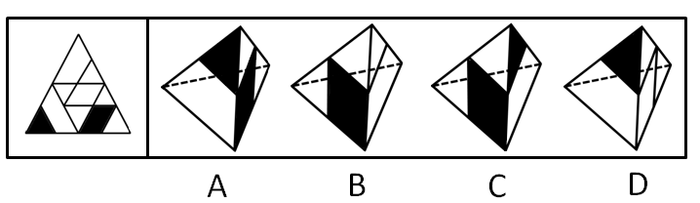

A. A

B. B

C. C

D. D

第 53 题 · 答案与解析

**参考答案（粉笔题库参考内容）**

C

**解析**

本题考查四面体的空间重构，可采用排除法。

白色小三角形的边不可能与黑色菱形的边处在同一条直线上，因此排除B项；黑色小三角形的边不可能与白色菱形的边处在同一条直线上，因此排除D项；当有黑色小三角形的面与有黑色菱形的面同时出现时，只能是有黑色菱形的面在左侧，有黑色小三角形的面在右侧，因此排除A项。

故正确答案为C。

**来源**：2011年江苏省公务员录用考试《行测》题（C类）第53题

### 第 54 题

左边给定的是纸盒外表面的展开图，右边哪一项能由它折叠而成？请把它找出来：

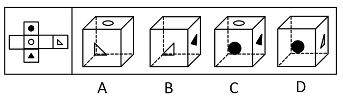

A. A

B. B

C. C

D. D

第 54 题 · 答案与解析

**参考答案（粉笔题库参考内容）**

D

**解析**

白色圆圈与白色三角形所在面是相对面，因此A项错误；黑色三角形的角指向白色圆圈，因此B项错误；黑色圆圈与黑色三角形所在面是相对面，因此C项错误。

故正确答案为D。

**考点**：空间类-空间重构-六面体

**来源**：2011年江苏省公务员录用考试《行测》题（C类）第54题

### 第 55 题

从所给四个选项中，选择最合适的一个，使之呈现一定的规律性：

A. A

B. B

C. C

D. D

第 55 题 · 答案与解析

**参考答案（粉笔题库参考内容）**

D

**解析**

由左边第一个图可知，箭头指向顶点的面与含阴影小三角形的面不相邻，故A项错误；箭头指向棱的面，与这条棱相邻的面并非阴影，故B项错误；由左边第二个图可知，有竖直线的面中的直线，与箭头指向棱的面中的箭尾，不相交于一点，故C项错误。

故正确答案为D。

**来源**：2011年江苏省公务员录用考试《行测》题（C类）第55题

### 第 56 题

小李申请的基金项目不必然通过评审。

据此，可以推出：

A. 小李申请的基金项目不可能通过评审

B. 小李申请的基金项目必然不通过评审

C. 小李申请的基金项目可能不通过评审

D. 小李申请的基金项目很可能通过评审

第 56 题 · 答案与解析

**参考答案（粉笔题库参考内容）**

C

**解析**

由于“不必然”=“可能不”，所以小李申请的基金项目不必然通过评审等价于小李申请的基金项目可能不通过评审。

故正确答案为C。

**考点**：常规翻译

**来源**：2011年江苏省公务员录用考试《行测》题（C类）第56题

### 第 57 题

有些媒体很开放，所有媒体都关注民生大事。

据此，可以推出：

A. 有些很开放的媒体关注民生大事

B. 有些关注民生大事的媒体不开放

C. 有些媒体不开放，但关注民生大事

D. 有些媒体很开放，但不关注民生大事

第 57 题 · 答案与解析

**参考答案（粉笔题库参考内容）**

A

**解析**

第一步：翻译题干。

有些媒体很开放，所有媒体⇒关注民生大事，即开放的媒体⇒关注民生大事的媒体。

第二步：逐一判断选项。

A项：与题干相符，当选；

B项：为肯定命题后件，排除；

C项：为肯定命题前件，由逆否规则可知无法得出任何结论，排除；

D项：与上述结论相悖，排除。

故正确答案为A。

**考点**：集合推理

**来源**：2011年江苏省公务员录用考试《行测》题（C类）第57题

### 第 58 题

所有火山都不处在活动期。

据此，可以推出：

A. 处在活动期的都是火山

B. 并非有的火山不处在活动期

C. 处在活动期的不都是火山

D. 并非有的火山处在活动期

第 58 题 · 答案与解析

**参考答案（粉笔题库参考内容）**

D

**解析**

第一步：翻译题干。

火山⇒不在活动期

第二步：逐一判断选项。

A、C项错误，由题干命题的逆否命题可知，活动期⇒不是火山；

B项与题干命题相悖；

D项可翻译为：有的火山在活动期的假命题；因此真命题为：所有火山都不在活动期，与题干相同。

故正确答案为D。

**考点**：集合推理

**来源**：2011年江苏省公务员录用考试《行测》题（C类）第58题

### 第 59 题

张某把所有的闲钱都投入H股，结果被套牢了，吕某炒股从不选H股。

据此，可以推出：

A. 吕某炒股没有被套牢

B. 张某通过购买其他股票摆脱困境

C. 吕某没有被H股套牢

D. 张某如果不选择H股就不会被套牢

第 59 题 · 答案与解析

**参考答案（粉笔题库参考内容）**

C

**解析**

第一步：抓住题干主要信息。

张某投H股，结果被套牢。吕某不投H股。

第二步：根据题干信息逐一分析选项。

由“吕某炒股从不选H股”可知，吕某没有被H股套牢，C项正确；

吕某是否被其他股套牢，张某是否通过其他股票摆脱困境，是否不选H股就不会被套牢，题干都没有体现，故A、B、D三项均无法从题干推出。

故正确答案为C。

**考点**：日常结论

**来源**：2011年江苏省公务员录用考试《行测》题（C类）第59题

### 第 60 题

小李、小张、小马、小王在一起讨论N地区的廉租房建设情况，小李说：“N地区的廉租房建设得都不错。”小张说：“N地区没有廉租房建设得好。”小马说：“N地区有的廉租房建设得不好。”小王说：“N地区还是有廉租房建设得不错的。”

假如小张和小马都说错了，那么可以推出：

A. 小李说错了

B. 小李和小王说错了

C. 小王说错了

D. 小王说对了

第 60 题 · 答案与解析

**参考答案（粉笔题库参考内容）**

D

**解析**

第一步：翻译题干。将小李、小张、小马、小王的话翻译为标准的直言命题。

小李：所有N地区的廉租房都建设得好

小张：所有N地区的廉租房都建设得不好

小马：有的N地区的廉租房建设得不好

小王：有的N地区的廉租房建设得好

根据直言命题的对当关系，可知小李和小马的话构成矛盾关系，两人的话必有一真一假，小张和小王的话构成矛盾关系，两人的话也是必有一真一假。

第二步：从事实信息开始推导，结合选项得出答案。

由题干可知，小张的话为假，那么小王的话为真；小马的话为假，那么小李的话为真，即小张和小马都说错了，小王和小李都说对了。

故正确答案为D。

**考点**：只有一真/一假

**来源**：2011年江苏省公务员录用考试《行测》题（C类）第60题

### 第 61 题

某单位纪检组决定对其所属单位的五个处室依次进行廉政检查。根据实际情况，纪检组决定：（1）二处和四处均在一处和五处之前检查；（2）如果首先检查三处，那么最后检查二处；（3）三处在四处之前检查。

根据以上陈述，可以得出：

A. 最后检查一处

B. 最后检查五处

C. 第三检查四处

D. 第三检查三处

第 61 题 · 答案与解析

**参考答案（粉笔题库参考内容）**

C

**解析**

第一步：找到突破口。

分析题干可知本题的突破口是二处。

第二步：根据突破口进行推导，并判断选项。

由（1）可知，二处肯定不是最后检查的。由“二处肯定不是最后检查的”否定了（2）的后件可以推出否定（2）的前件的结论，即“三处不是首先检查的”。由（1）、（3）可知，前三个检查的处室是三处、四处、二处。又因为“三处不是首先检查的”，因此三处只能第二个检查，四处第三个检查，二处第一个检查。

故正确答案为C。

**考点**：从确定信息开始推

**来源**：2011年江苏省公务员录用考试《行测》题（C类）第61题

### 第 62 题

在一次只有五座的圆桌会议上，已知出席会议的五人的座位情况是：

（1）王局长和赵科长、李秘书不相邻；

（2）如果李秘书与张副局长相邻，则赵科长与郭书记不相邻。

根据以上陈述，可以得出：

A. 郭书记与王局长、李秘书均相邻

B. 张副局长与王局长相邻，与赵科长不相邻

C. 郭书记与王局长相邻，与李秘书不相邻

D. 张副局长与王局长不相邻，与赵科长相邻

第 62 题 · 答案与解析

**参考答案（粉笔题库参考内容）**

A

**解析**

第一步：找突破口。

由条件（1）可知，王与赵、李均不相邻，因此王和张、郭相邻。具体如下图所示：

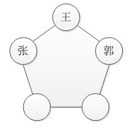

第二步：根据其余信息推出结论。

由上图可知，如果李与张相邻，赵与郭必相邻，与条件（2）相悖。因此李与郭相邻，赵与张相邻。如下图所示：

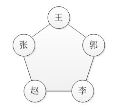

故正确答案为A。

**考点**：从确定信息开始推

**来源**：2011年江苏省公务员录用考试《行测》题（C类）第62题

### 第 63 题

某地房价过高，过高房价并非好事，这背后隐藏着一些不合理的东西。据此，有四个推论：

（1）有些地方高房价是合理的；

（2）不合理的东西引起高房价；

（3）高房价引起不合理现象；

（4）并非仅仅是某地房价高。

以上推论，错误的有：

A. 1个

B. 2个

C. 3个

D. 4个

第 63 题 · 答案与解析

**参考答案（粉笔题库参考内容）**

D

**解析**

第一步：抓住题干主要信息。

题干的主要信息是“房价过高并非好事，这背后隐藏着一些不合理的东西”。

第二步：根据题干信息逐一判断结论正确与否。

由题干可知房价过高隐藏着不合理的东西，而（1）提到高房价合理，这与题干相悖，因此（1）错误。题干中未提及导致高房价的原因，因此（2）错误。题干中未提及高房价将导致的后果，因此（3）错误。题干仅涉及某地的房价过高，并未涉及别处房价，因此（4）错误。

故正确答案为D。

**考点**：日常结论

**来源**：2011年江苏省公务员录用考试《行测》题（C类）第63题

### 第 64 题

董某没有去过美国、加拿大、德国、法国、英国、澳大利亚。据此，有四个推论：

（1）董某没有出过国；

（2）董某不是英国人；

（3）董某没有去过欧美国家；

（4）董某对很多国家不了解。

以上推理中，错误的有（    ）。

A. 1个

B. 2个

C. 3个

D. 4个

第 64 题 · 答案与解析

**参考答案（粉笔题库参考内容）**

D

**解析**

第一步：抓住题干主要信息。

董某没有去过美国、加拿大、德国、法国、英国、澳大利亚。

第二步：逐一判断选项。

（1）项，董某没去过上述六国不代表没有去过其他国家。该项错误。

（2）项，董某没有去过英国不代表他一定不是英国人，例如父母均为英国国籍，但出生在别国并长大的孩子，也具有英国国籍。该项错误。

（3）项，董某没有去过上述六国不代表没有去过别的欧美国家。该项错误。

（4）项，董某没去过上述六国不代表对很多国家都不了解。该项错误。

故正确答案为D。

**考点**：真假推理-其他

**来源**：2011年江苏省公务员录用考试《行测》题（C类）第64题

### 第 65 题

某基金经理按照以往经验买甲、乙、丙、丁、戊、己六种基金；不同时买乙和丁；如果不买丁，那么也不买丙；或者不买甲，或者买乙；如果同时买戊和己，那么也买丙。据此，可以推论：

（1）如果买丙，那么也买丁；

（2）如果买甲，那么也买丁；

（3）如果买乙，那么不同时买戊和己；

（4）如果同时买戊和己，那么也买丁。

以上推理中，正确的有：

A. 1个

B. 2个

C. 3个

D. 4个

第 65 题 · 答案与解析

**参考答案（粉笔题库参考内容）**

C

**解析**

第一步：翻译题干。

（1）-乙 或 -丁；

（2）-丁→-丙；

（3）-甲 或 乙；

（4）戊 且 己→丙。

第二步：逐一分析选项。

由条件（2）的逆否命题可知，丙→丁，因此结论（1）正确；

由条件（3）可知，根据或关系的否一推一，买甲能得出买了乙；再结合条件（1）可知，根据或关系否一推一，买乙能得出不买丁，因此结论（2）错误；

根据条件（1）可知，如果买了乙，则没有买丁，再结合条件（2）得到丙也没有买；再结合条件（4）否后推否前可知：戊没有买或者己没有买，即不能同时买戊和己，因此结论（3）正确；

根据条件（4）可知，买了戊和己是在肯前，必然能得出买了丙，再结合条件（2）可知，买了丁，因此结论（4）正确。

故正确答案为C。

**考点**：常规翻译

**来源**：2011年江苏省公务员录用考试《行测》题（C类）第65题

### 第 66 题

攀比效应，指社会经济活动中某些相关的经济主体或利益主体在分配利益方面存在的相互影响、轮番推进的现象。下列属于攀比效应的是（    ）。

A. 公司员工在工资上互相比较，要求公司调整工资

B. 两个中学生暗自较劲，努力学习，争当第一

C. 朋友之间经常在比谁的孩子最聪明

D. 通过实地参观，甲公司发现乙公司的管理比较科学

第 66 题 · 答案与解析

**参考答案（粉笔题库参考内容）**

A

**解析**

第一步：判断题干中的关键词。

主体：社会经济活动中的经济主体或利益主体。

方式：在分配利益方面相互影响、轮番推进。

第二步：逐一分析选项。

A项，公司员工是利益主体，要求公司调整工资，是在经济活动中的利益分配，符合题干。

B项，学生不是社会经济活动中的经济主体或利益主体，不符合题干。

C项，拿孩子作比较的朋友，不是社会经济活动中的经济主体或利益主体，不符合题干。

D项，公司间比较管理方法，不是在分配利益方面，不符合题干。

故正确答案为A。

**考点**：方式目的

**来源**：2011年江苏省公务员录用考试《行测》题（C类）第66题

### 第 67 题

物业费，指物业管理单位对居住小区内的房屋建筑及其设备、公共设备、物资和环境进行日常维护、修缮、整治及提供其他与居民生活相关的服务所收取的费用。

下列属于物业费的是：

A. 租户小王不小心损坏了小区大门的照明灯，小王承担了维修费80元

B. 小区门卫室的水电费80元

C. 小区居民每月的上网费100元

D. 业主起诉物业公司承担的律师费1000元

第 67 题 · 答案与解析

**参考答案（粉笔题库参考内容）**

B

**解析**

第一步：抓住定义中的关键词。

定义中强调“物业管理单位”、“公共设备”、“提供与居民生活相关的服务所收取的费用”等。

第二步：逐一判断选项。

A、D两项的收费主体不是物业管理单位；

C项的上网服务不是由物业管理单位提供的服务，因此不符合定义；

B项中门卫室属于公共设备，符合定义。

故正确答案为B。

**考点**：拆词

**来源**：2011年江苏省公务员录用考试《行测》题（C类）第67题

### 第 68 题

有氧运动，指人体在氧气充分供应的情况下进行的强度低、有节奏、不间断的、对运动技巧要求不高的体育锻炼。

下列属于有氧运动的是：

A. 小李为了增加臂力，一直坚持举重、投掷锻炼

B. 小赵、小苏、小吴、小武组队参加4×100米接力赛

C. 小王为在运动会取得好成绩，下午放学后练习撑杆跳

D. 小陈身体微胖，为有效减肥，他每天早晨到公园快走半小时

第 68 题 · 答案与解析

**参考答案（粉笔题库参考内容）**

D

**解析**

第一步：抓住定义中的关键词。

定义中强调“强度低”、“有节奏”、“不间断”、“对运动技巧要求不高”等。

第二步：逐一判断选项。

A项举重等不符合强度低的关键词；

B项中接力赛不符合有节奏、不间断的关键词；

C项中撑杆跳不满足技术要求低的关键词，因此不符合定义；

D项中的快走半小时符合定义中的关键词。

故正确答案为D。

**考点**：单定义-其他句式

**来源**：2011年江苏省公务员录用考试《行测》题（C类）第68题

### 第 69 题

包容性增长，指倡导机会平等的增长，即强调通过消除由个人背景不同所造成的机会不平等，从而缩小结果的不平等。

下列不属于包容性增长的是：

A. 北京市自2011年1月1日起将城市低保标准由家庭月人均430元上调为480元

B. 2010年11月16~21日，世人瞩目的第八届中国国家航空航天博览会在珠海开幕

C. 某著名大学蔡教授指出，缩小城乡居民收入差距的根本途径是加快城市化进程

D. 国务院医改文件鼓励社会资本进入医疗领域，同时规定了医疗机构药品的加价率

第 69 题 · 答案与解析

**参考答案（粉笔题库参考内容）**

B

**解析**

第一步：抓住定义中的关键词。

定义中强调“倡导机会平等的增长”等。

第二步：逐一判断选项。

A项中对低保标准的上调、C项中缩小收入差距符合提高收入的机会平等，D项中的医改文件强调接受医疗的机会平等，均符合定义；

B项中未体现定义中机会平等的关键词，不符合定义。

本题为选非题，故正确答案为B。

**考点**：方式目的

**来源**：2011年江苏省公务员录用考试《行测》题（C类）第69题

### 第 70 题

静脉产业，指运用现今的技术，将生产和消费过程中产生的废物转化为可重新利用的资源和产品，实现各类废物的再利用和资源化的产业，如同人体的血液循环中的静脉一样。

下列不属于静脉产业的是：

A. 某企业用“资源—产品—废弃物”的经济模式开采原生自然资源，并注重资源利用，关注经济系统对自然生态系统的影响

B. 德国的绿点公司负责社区黄色垃圾箱和垃圾袋中垃圾的收集、分类、回收和再利用，处理费用由获得“绿点”标志认证的企业或销售商支付

C. 某企业规定，生产者对其产品的整个生命周期负责，并明确废弃物的管理原则：避免产生—循环使用—最终处置

D. 当今，世界发展遇到两个共同难题：垃圾过剩和资源短缺。变废为宝是解决的有效途径，如某企业利用花生壳生产夹板作为建材，具有较好的抗震效果

第 70 题 · 答案与解析

**参考答案（粉笔题库参考内容）**

A

**解析**

第一步：找出定义关键词。

“将生产和消费过程中产生的废物转化为可重新利用的资源和产品”、“实现各类废物的再利用”。

第二步：逐一分析选项。

A项：用“资源-产品-废弃物”的经济模式开采原生自然资源，并没有涉及对废物的重新利用和转化，不是静脉产业，不符合定义，当选；

B项：将垃圾回收再利用，属于对废物的重新利用，符合定义，排除；

C项：对废弃物的管理原则是避免产生-循环利用-最终处置，其中的循环利用可以看出涉及到了对废物的重新利用，符合定义，排除；

D项：企业利用花生壳生产夹板作为建材，属于变废为宝，即对花生壳这一废弃物进行重新利用，符合定义，排除。

本题为选非题，故正确答案为A。

**考点**：方式目的

**来源**：2011年江苏省公务员录用考试《行测》题（C类）第70题

### 第 71 题

说明因果，指就一定的事实说明其中的因果联系。

下列不属于说明因果的是：

A. 既然小丘把那么深厚的感情灌注在自己的歌里，小丽她怎么会听不见呢

B. 物理学的发展，使得人们能够用光谱分析、光度测量等方法研究天体

C. 小吴之所以没有取得大的成就，是因为他过于骄傲

D. 一场大病，使得老章不得不提前离开了他心爱的工作岗位

第 71 题 · 答案与解析

**参考答案（粉笔题库参考内容）**

A

**解析**

第一步：抓住定义中的关键词。

定义中强调“说明因果联系”等。

第二步：逐一判断选项。

A项中“把深厚的感情灌注在自己的歌里”不能作为“小丽能听见”的原因，因此不符合定义；

B项中物理学的发展是人们能够研究天体的原因，C项中过于骄傲是没有取得成就的原因，D项中大病是离开岗位的原因，因此均符合定义。

本题为选非题，故正确答案为A。

**考点**：拆词

**来源**：2011年江苏省公务员录用考试《行测》题（C类）第71题

### 第 72 题

太空经济，指借助太空技术和太空活动所创造的产品、服务和市场而获得的经济效益。

下列不属于太空经济的是：

A. 欧洲计划2012年生产出太空旅游机，为旅客提供每次30分钟的太空旅游飞行，每位游客每次的收费约为15万到20万欧元

B. 太空中蕴藏着丰富的能源，比如有“超黄金”之称的氦-3，只要100吨，其提供的能源够全世界用一年

C. 世界上第一个太空游玩旅馆在2012年建成，届时，太空迷们可以花400万元玩一天，体验一天观看15次日出和80分钟环游地球一周的神奇感觉

D. 卫星直播电视、卫星无线电通信、固定卫星服务、移动卫星服务、全球定位及其他太空活动都直接或间接地产生巨额收益

第 72 题 · 答案与解析

**参考答案（粉笔题库参考内容）**

B

**解析**

第一步：抓住定义中的关键词。

定义中强调“借助太空技术和太空活动所创造的”、“产品、服务和市场”等。

第二步：逐一判断选项。

A项中太空飞行、C项中的太空旅行、D项中的通信服务均属于借助太空技术和太空活动所创造的产品、服务和市场，因此均符合定义；

B项中是对太空能源利用的描述，并没有创造出的产品，因此不符合定义。

本题为选非题，故正确答案为B。

**考点**：方式目的

**来源**：2011年江苏省公务员录用考试《行测》题（C类）第72题

### 第 73 题

核心能力，指能使公司在竞争中处于优势地位的强项，是其他对手很难达到或无法具备的一种能力。

下列不属于核心能力的是：

A. 某企业不仅能为顾客带来长期性的关键性利益，为企业创造了超过同业平均利润水平的超值利润，更为掌握长期性的竞争主动权奠定了雄厚基础

B. 索尼公司的小型化产品创新花样迭出；海尔公司的广告销售和售后服务独树一帜；科隆公司的无缺陷制造令人称奇

C. 某企业为避免由于一线员工不同而导致最终产品或服务的质量产生明显的差异，精心打造出传递品质几乎完全相同的产品或服务的能力

D. 某企业为提高员工的业务水平，坚持抓员工的注意力、观察力、记忆力、想象力等能力培训，效果显著

第 73 题 · 答案与解析

**参考答案（粉笔题库参考内容）**

D

**解析**

第一步：抓住定义中的关键词。

定义中强调“对手无法具备”等。

第二步：逐一判断选项。

A项中超过同业平均水平的超额利润，B项中的创新花样迭出、独树一帜、令人称奇，C项中几乎完全相同的产品或服务的能力，均符合“对手无法具备”的关键词，因此均符合定义；

D项中的对员工的培训，未体现“对手无法具备”，因此不符合定义。

本题为选非题，故正确答案为D。

**考点**：单定义-其他句式

**来源**：2011年江苏省公务员录用考试《行测》题（C类）第73题

### 第 74 题

企业成长性，指企业通过自身生产经营活动，不断扩大积累而形成的发展潜能。

下列属于企业成长性的是：

A. 销售额增加引起的资金需求增长，有两种途径来满足：一是内部保留盈余的增加；二是外部融资

B. 销售增长时企业往往需要补充资金，因为销售增加通常会引起存货或应收账款等资产的增加，且销售增长得越多，需要的资金越多

C. 某企业总资产增长率较高，资产经营规模扩张的速度加快，资产规模扩张的质和量的关系处理较好，避免盲目扩张

D. 资产净利率体现企业运用资产获取收益的能力，决定于企业的综合实力，是采用“薄利多销”还是“厚利少销”的方针，取决于政策选择

第 74 题 · 答案与解析

**参考答案（粉笔题库参考内容）**

C

**解析**

第一步：抓住定义中的关键词。

定义中强调“通过自身生产经营活动”、“扩大积累”等。

第二步：逐一判断选项。

A中的融资不是通过自身经营活动，B项只提到资金的需求，未体现资金的积累，D项也未提到扩大积累，因此均不符合定义；

C项中经营规模扩张符合“通过自身生产经营活动”，总资产增长率较高体现“扩大积累”，因此符合定义。

故正确答案为C。

**考点**：方式目的

**来源**：2011年江苏省公务员录用考试《行测》题（C类）第74题

### 第 75 题

高端客户，指资金充裕、信誉很好、回款及时的企事业单位或者是大企业的高层管理人员。

下列属于高端客户的是：

A. 一次，某人去快餐店不经意间让服务生记下了女儿的出生日期，从此以后，每年在他女儿过生日的前夜，快餐店总是打来问候电话，征询是否需要预订生日蛋糕，从无遗漏

B. 某企业踏踏实实地收集客户资料，建立客户档案，了解客户需求，在特别的日期给客户打去一个电话，多几声问候，常给客户提供一些经济信息

C. 中国已经成为仅次于美国及日本的全球第三大财富来源地，私人银行常争夺财富位于金字塔塔尖的客户

D. 某总经理真诚欢迎各位员工以主人公的姿态各抒己见，提出批评、建议，公司一旦采用，就用总经理奖励基金给予一定的奖励

第 75 题 · 答案与解析

**参考答案（粉笔题库参考内容）**

C

**解析**

第一步：抓住定义中的关键词。

定义中强调“资金充裕、信誉很好、回款及时的企事业单位”、“大企业”、“高层管理人员”等。

第二步：逐一判断选项。

A项某人的女儿、D项的员工均不是高层管理人员；

B项的企业客户也未体现是企事业单位或者大企业的高层管理人员，因此不符合定义；

C项中的金字塔塔尖的客户为高端客户，符合定义。

故正确答案为C。

**考点**：主客体

**来源**：2011年江苏省公务员录用考试《行测》题（C类）第75题

## 材料 2

一、根据以下资料，完成各题。

        2010年11月份，全国餐饮业实现零售额823.1亿元，比2004年同期增长14.5%，占全社会消费品零售总额的13.9%，其增幅高出社会消费品零售总额4个百分点。预计2011年全年餐饮业零售额将达到8800亿元，2011年将突破万亿元大关。

        从2006年起，我国餐饮业零售额连续4年实现每年一个千亿元台阶的跨越，由2005年的3000亿元已增加到2009年的7486亿元，餐饮网点已达400多万个，零售额和网点数分别为1978年的136倍和34倍。2009年我国餐饮业零售额相当于全国GDP的5.84%、第三产业增加值的17.62%。我国餐饮业已连续14年保持两位数增长，增长幅度不仅高于我国GDP的增长速度，而且也高于我国社会消费品零售总额的增长速度，一直领先于消费品市场中的各个行业。餐饮业还成为我国吸纳就业的重要渠道。2009年我国餐饮业从业人员与1978年104.4万人相比，增长了16倍。

### 第 76 题

2010年11月我国社会消费品零售总额是：

A. 937.5亿元

B. 942.4亿元

C. 5676.6亿元

D. 5921.6亿元

第 76 题 · 答案与解析

**参考答案（粉笔题库参考内容）**

D

**解析**

由第一段可知，2010年11月份，社会消费品零售总额为：823.1÷13.9%≈823÷14%≈5900 亿元，与D项最接近。

故正确答案为D。

**来源**：2011年江苏省公务员录用考试《行测》题（C类）第76题

### 第 77 题

下列判断不正确的有：

（1）1978年我国餐饮网点不足15万个

（2）2010年11月我国社会消费品零售总额同比增长10.5%

（3）2005—2009年我国服装鞋帽业零售额增长速度均低于餐饮业零售额年增长速度

A. 0个

B. 1个

C. 2个

D. 3个

第 77 题 · 答案与解析

**参考答案（粉笔题库参考内容）**

B

**解析**

（1）正确，由第二段可知，2009年餐饮网点达400多万个，是1978年的34倍，则1978年餐饮网点最多为：500÷34&lt;510÷34=15 万个；

（2）错误，由第一段可知，2010年11月社会消费品零售总额比2004年同期增长：14.5%-4%=10.5%，不是同比增长，2010年11月社会消费品零售总额比2009年同期增长才是同比增长；

（3）正确，由第二段可知，餐饮业零售额增长速度一直领先于消费品市场的各个行业，包括服装鞋帽业的零售额。

综上，不正确的只有一个。

故正确答案为B。

**来源**：2011年江苏省公务员录用考试《行测》题（C类）第77题

### 第 78 题

2009年我国餐馆网点平均零售额：

A. 不足14.0万元

B. 在14.0~19.0万元之间

C. 在19.0~20.0万元之间

D. 在20.0万元以上

第 78 题 · 答案与解析

**参考答案（粉笔题库参考内容）**

B

**解析**

由第二段可知，2009年零售额为7486亿元，零售网点达400多万个，则餐馆网点平均零售额在和之间，满足B项。

故正确答案为B。

**来源**：2011年江苏省公务员录用考试《行测》题（C类）第78题

### 第 79 题

下列判断正确的是：

（1）2009年我国第三产业增加值约占国内生产总值的三分之一

（2）我国餐饮业零售额占社会消费品零售总额的比重已连续14年不断增大

（3）2009年我国餐饮业从业人员比1978年增加了1566万人

A. （1）、（3）

B. （2）、（3）

C. （1）、（2）

D. （1）、（2）、（3）

第 79 题 · 答案与解析

**参考答案（粉笔题库参考内容）**

C

**解析**

（1）正确，根据第二段第二句，2009年我国餐饮业零售额为7486亿元，则我国GDP为，第三产业增加值为，第三产业增加值占GDP的比重为；

（2）正确，由第二段第三句可知“我国餐饮业已连续14年保持两位数增长，增长幅度不仅高于我国GDP的增长速度，而且也高于我国社会消费品零售总额的增长速度，一直领先于消费品市场中的各个行业”；

（3）错误，由第二段最后一句可知，2009年我国餐饮业从业人员数比1978年增加。

故正确答案为C。

**来源**：2011年江苏省公务员录用考试《行测》题（C类）第79题

### 第 80 题

按2005—2009年我国餐饮业零售额平均增长速度估算，2013年我国餐饮零售额可望达到：

A. 14010亿元

B. 16580亿元

C. 17680亿元

D. 18680亿元

第 80 题 · 答案与解析

**参考答案（粉笔题库参考内容）**

D

**解析**

2005—2009年是4年，2009—2013年也是4年，题干中要求按2006—2009年我国餐饮业零售额平均增长速度估算，这里我们可以用2005到2009年这4年的增长速度，再结合2009年的零售额计算到4年后即2013年的零售额，通过分析，可以发现2005年、2009年、2013年这三年的餐饮业零售额恰好为等比数列，因此2013年的餐饮业零售额为：，最接近D项。

故正确答案为D。

**来源**：2011年江苏省公务员录用考试《行测》题（C类）第80题

## 材料 3

二、根据以下资料，完成各题。

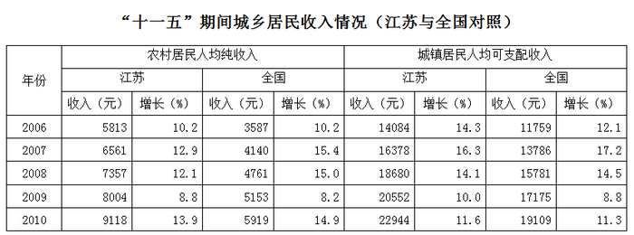

### 第 81 题

2007—2010年江苏农村居民人均纯收入的年均增长量比全国高出：

A. 195元

B. 212元

C. 243元

D. 259元

第 81 题 · 答案与解析

**参考答案（粉笔题库参考内容）**

C

**解析**

2007—2010年江苏农村居民人均纯收入年均增长量为：，全国为：，则所求为：元。

故正确答案为C。

**来源**：2011年江苏省公务员录用考试《行测》题（C类）第81题

### 第 82 题

2010年全国与江苏城镇居民人均可支配收入的差距比2009年又扩大了：

A. 428元

B. 438元

C. 448元

D. 458元

第 82 题 · 答案与解析

**参考答案（粉笔题库参考内容）**

D

**解析**

2010年全国与江苏城镇居民人均可支配收入的差距为：(22944-19109)元，2009年为：(20552-17175)元，所求为：(22944-19109)-(20552-17175)=3835-3377=458元。

故正确答案为D。

**来源**：2011年江苏省公务员录用考试《行测》题（C类）第82题

### 第 83 题

2007—2010年年均增长速度最快的是：

A. 全国农村居民人均纯收入

B. 江苏农村居民人均纯收入

C. 全国城镇居民人均可支配收入

D. 江苏城镇居民人均可支配收入

第 83 题 · 答案与解析

**参考答案（粉笔题库参考内容）**

A

**解析**

定位图表代入年均增长率计算公式，各选项2007-2010年年均增速分别为：

A项：全国农村居民人均纯收入=5919/3587开四次方然后减去1；

B项：江苏农村居民人均纯收入=9118/5813开四次方然后减去1；

C项：全国城镇居民人均可支配收入=19109/11759开四次方然后减去1；

D项：江苏城镇居民人均可支配收入=22944/14084开四次方然后减去1；

因仅需求出年均增速最快的一项，故只需比较根号内分数大小即可。

5919/3587≈1.65；9118/5813≈1.57；19109/11759≈1.63；22944/14084≈1.63。

对比可得A项分数最大，即年均增速最快。

故正确答案为A。

**来源**：2011年江苏省公务员录用考试《行测》题（C类）第83题

### 第 84 题

下列判断正确的是：

A. 2007—2010年江苏农村居民人均纯收入年增长量中有两年小于前一年

B. 2007—2010年全国农村居民人均纯收入年增长量中有两年小于前一年

C. 2007—2010年江苏城镇居民人均可支配收入年增长量中有两年小于前一年

D. 2007—2010年全国城镇居民人均可支配收入年增长量中有两年小于前一年

第 84 题 · 答案与解析

**参考答案（粉笔题库参考内容）**

D

**解析**

根据表格估算2007—2010年各指标年增长量，得到如下表格：

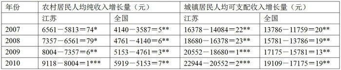

很明显江苏、全国农村居民人均纯收入及江苏城镇居民人均可支配收入年增长量中都只有一年小于前一年，全国城镇居民人均可支配收入年增长量中有两年小于前一年，排除A、B、C三项。

故正确答案为D。

**来源**：2011年江苏省公务员录用考试《行测》题（C类）第84题

### 第 85 题

下列说法正确的有：

（1）“十一五”时期江苏农村居民人均纯收入增长速度均低于其城镇居民人均可支配收入增长速度

（2）“十一五”时期全国农村居民人均纯收入增长速度均低于其城镇居民人均可支配收入增长速度

（3）“十一五”时期江苏农村居民人均纯收入增长速度有三年低于全国城镇居民人均可支配收入增长速度

（4）“十一五”时期江苏城镇居民人均可支配收入增长速度均高于全国城镇居民人均可支配收入增长速度

A. 1个

B. 2个

C. 3个

D. 4个

第 85 题 · 答案与解析

**参考答案（粉笔题库参考内容）**

A

**解析**

（1）错误，由表格数据可知，2010年江苏农村居民人均纯收入增长速度为13.9%，高于2010年城镇居民人均可支配收入的11.6%；

（2）错误，2008、2010年全国农村居民人均纯收入增长速度分别为15.0%、14.9%，均高于城镇居民人均可支配收入的14.5%、11.3%；

（3）正确，2006、2007、2008三年江苏农村居民人均纯收入增长速度低于全国城镇居民人均可支配收入增长速度；

（4）错误，2007、2008年江苏城镇居民人均可支配收入增长速度分别是16.3%、14.1%，低于全国的17.2%、14.5%。

综上，正确说法只有1个。

故正确答案为A。

**来源**：2011年江苏省公务员录用考试《行测》题（C类）第85题

## 材料 4

三、根据以下资料，完成各题。

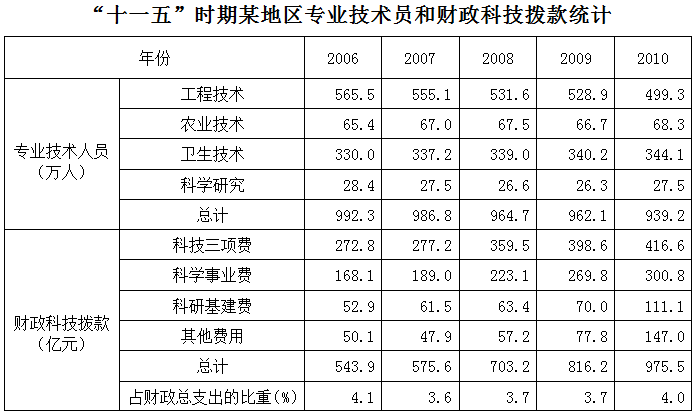

### 第 86 题

若用Ve、Va、Vh、Vs分别表示2007—2010年该地区工程技术、农业技术、卫生技术、科学研究人员数平均变动值，则：

A. Vs&lt;Va&lt;Ve&lt;Vh

B. Va&lt;Vs&lt;Ve&lt;Vh

C. Vs&lt;Va&lt;Vh&lt;Ve

D. Va&lt;Vs&lt;Vh&lt;Ve

第 86 题 · 答案与解析

**参考答案（粉笔题库参考内容）**

C

**解析**

根据表格数据可得：

该地区工程技术的平均变动值为：；

农业技术的平均变动值为：；

卫生技术的平均变动值为：；

科学研究人员数的平均变动值为：；

四个分数的分母相同，分子不同，可直接比较分子的大小进行排序，则有。

故正确答案为C。

**来源**：2011年江苏省公务员录用考试《行测》题（C类）第86题

### 第 87 题

2007—2010年该地区财政科技拨款增长呈逐年递增态势的是：

A. 科技三项费

B. 科学事业费

C. 科研基建费

D. 其他费用

第 87 题 · 答案与解析

**参考答案（粉笔题库参考内容）**

D

**解析**

A项错误，题干要求增长呈逐年递增态势的指标，没有指明要求的是增长量还是增长率，则理解为求增长量和增长率均为逐年递增态势的选项。科技三项费：2009年的增长量为398.6-359.5>30 亿元，2010年的增长量为416.6-398.6&lt;20 亿元，不满足增长量逐年递增；

B项错误，科学事业费：2009年的增长量为269.8-223.1>40 亿元，2010年的增长量为300.8-269.8&lt;40 亿元，不满足增长量逐年递增；

C项错误，科研基建费：2007年的增长量为61.5-52.9>8 亿元，2008年的增长量为63.4-61.5&lt;2 亿元，不满足增长量逐年递增；

D项正确，此时可以直接选出D项，事实上其他费用：2007年的增长量为47.9-50.1&lt;0，2008年57.2-47.9≈10 亿元，2009年为77.8-57.2≈20 亿元，2010年为147.0-77.8≈70 亿元，增长量逐年递增，2007—2010年的增长率分别是负数、10/47.9、20/57.2、70/77.8，可见分子成倍数增长，分母变化较小，则，则其他费用的增长率是逐年递增的。

故正确答案为D。

**来源**：2011年江苏省公务员录用考试《行测》题（C类）第87题

### 第 88 题

下列判断正确的有：

（1）“十一五”期间该地区每年“科研基建费”均多于“其他费用”

（2）“十一五”期间该地区专业技术人员人均财政科技拨款逐年增加

（3）“十一五”期间该地区财政科技拨款总额不到3500亿元

A. 0个

B. 1个

C. 2个

D. 3个

第 88 题 · 答案与解析

**参考答案（粉笔题库参考内容）**

B

**解析**

（1）错误，2009年与2010年的“科研基建费”均低于“其他费用”；

（2）正确，专业技术人员人均财政科技拨款，2006—2010年财政科技拨款额逐年递增，专业技术人员数逐年递减，则专业技术人员人均财政科技拨款逐年增加；

（3）错误，“十一五”期间该地区财政科技拨款总额为：543.9+575.6+703.2+816.2+975.5>1100+1500+950=3550 亿元。

综上，正确的只有1个。

故正确答案为B。

**来源**：2011年江苏省公务员录用考试《行测》题（C类）第88题

### 第 89 题

2007—2010年该地区财政科技拨款年增长率最高的年份是：

A. 2007年

B. 2008年

C. 2009年

D. 2010年

第 89 题 · 答案与解析

**参考答案（粉笔题库参考内容）**

B

**解析**

2007年该地区财政科技拨款年增长率为：，2008年的为：，2009年的为：，2010年的为：，通过分析四个数据都有-1项，因此只需比较前面分数项大小即可，通过观察可知2008年数据大于2007年数据，2010年数据大于2009年数据，下面只需比较2008年和2010年数据即可，，，因此2008年数据最大。

故正确答案为B。

**来源**：2011年江苏省公务员录用考试《行测》题（C类）第89题

### 第 90 题

“十一五”时期后两年该地区财政科技拨款占财政总支出的平均比重是：

A. 3.858%

B. 3.856%

C. 3.854%

D. 3.850%

第 90 题 · 答案与解析

**参考答案（粉笔题库参考内容）**

A

**解析**

“十一五”时期后两年该地区财政科技拨款额为(816.2+975.5)亿元，这两年的财政总支出为。

则所求为：，由于，，，则，与A项最接近。

故正确答案为A。

**来源**：2011年江苏省公务员录用考试《行测》题（C类）第90题

## 材料 5

四、根据以下资料，完成各题。

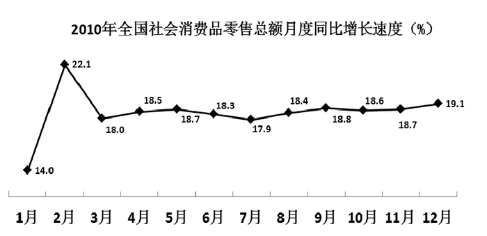

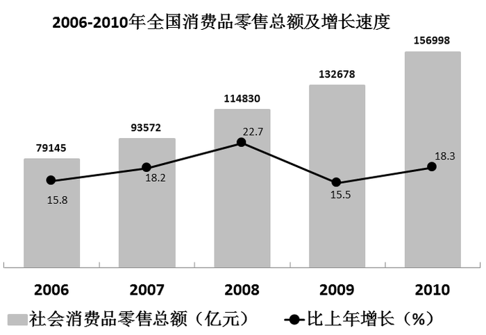

### 第 91 题

2006—2010年全国社会消费品零售总额增长量和增长率最高的年份分别是：

A. 2008、2008

B. 2010、2010

C. 2010、2008

D. 2008、2010

第 91 题 · 答案与解析

**参考答案（粉笔题库参考内容）**

C

**解析**

由图2中的折线可知，2006—2010年间全国社会消费品零售总额增长率最高的年份是2008年，排除B、D两项；

结合A、C两项，2008年增长量为：114830-93572=21258 亿元，2010年为：156998-132678=24320 亿元，排除A项。

故正确答案为C。

**来源**：2011年江苏省公务员录用考试《行测》题（C类）第91题

### 第 92 题

2010年全国社会消费品零售总额月度同比增长速度最高与最低相差：

A. 3.2个百分点

B. 4.9个百分点

C. 6.5个百分点

D. 8.1个百分点

第 92 题 · 答案与解析

**参考答案（粉笔题库参考内容）**

D

**解析**

由图1可知，月度同比增长速度最高的是2月为22.1%，最低的是1月为14.0%，相差：22.1-14.0=8.1个百分点。

故正确答案为D。

**来源**：2011年江苏省公务员录用考试《行测》题（C类）第92题

### 第 93 题

设2009年2月全国社会消费品零售总额与上月相比的增长率为a，2010年2月全国社会消费品零售总额比上月增长：

A. 0.96a

B. 1.07a

C. 1.36a

D. 1.58a

第 93 题 · 答案与解析

**参考答案（粉笔题库参考内容）**

B

**解析**

设2009年2月的社会消费品零售总额为x亿元，1月为y亿元，则有：，即x=y(a+1)，因此2010年2月的社会消费品零售总额为：(1+22.1%)x亿元，1月为：(1+14.0%)y亿元，所求为：。

故正确答案为B。

**来源**：2011年江苏省公务员录用考试《行测》题（C类）第93题

### 第 94 题

2010年全国社会消费品零售总额比2005年增加了：

A. 88652亿元

B. 86219亿元

C. 81368亿元

D. 77853亿元

第 94 题 · 答案与解析

**参考答案（粉笔题库参考内容）**

A

**解析**

2005年社会消费品零售总额为：，所求为：，因为，所以

，即：。

故正确答案为A。

**来源**：2011年江苏省公务员录用考试《行测》题（C类）第94题

### 第 95 题

下列说法正确的有：

（1）“十一五”时期全国社会消费品零售总额的年平均增长速度高于15%

（2）2010年全国社会消费品零售总额的月同比增长速度大多高于18%

（3）“十一五”时期全国社会消费品零售总额的年增长速度在2009年时最低

A. 0个

B. 1个

C. 2个

D. 3个

第 95 题 · 答案与解析

**参考答案（粉笔题库参考内容）**

D

**解析**

（1）正确，由图二可知，2006—2010年各年的全国社会消费品零售总额增长速度都高于15%，则年平均增长速度必然高于15%；

（2）正确，由图一可知，2010年12个月中只有1月和7月的全国社会消费品零售总额的月同比增长速度低于18%；

（3）正确，由图二可知，2009年全国社会消费品零售总额的年增长速度为15.5%，为“十一五”时期最低。

故正确答案为D。

**来源**：2011年江苏省公务员录用考试《行测》题（C类）第95题

## 材料 6

五、根据以下资料，完成各题。

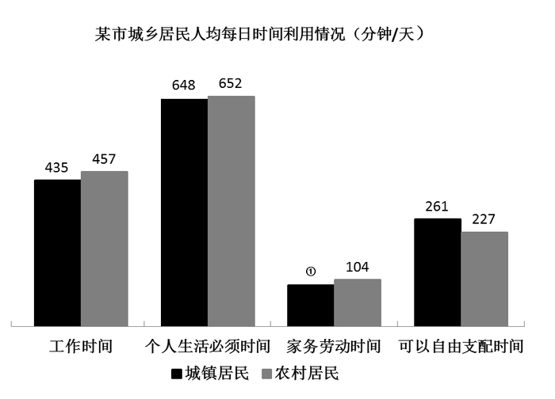

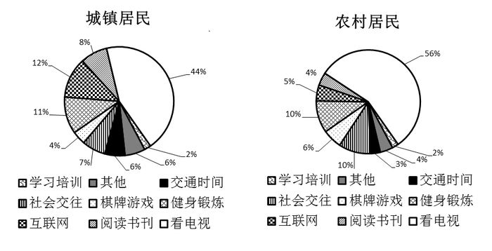

### 第 96 题

图中①所缺的数据是：

A. 104

B. 100

C. 96

D. 92

第 96 题 · 答案与解析

**参考答案（粉笔题库参考内容）**

C

**解析**

一天的时间共有：24×60=1440 分钟，由条形图可求出，城镇居民家务劳动时间为：1440-435-648-261=96 分钟，因此①处的数据应为96。

故正确答案为C。

**来源**：2011年江苏省公务员录用考试《行测》题（C类）第96题

### 第 97 题

该市城镇居民的人均工作时间比农村居民少：

A. 5.7%

B. 5.4%

C. 5.1%

D. 4.8%

第 97 题 · 答案与解析

**参考答案（粉笔题库参考内容）**

D

**解析**

由条形图可知，该市城镇居民的人均工作时间比农村居民少：，只有D项符合。

故正确答案为D。

**来源**：2011年江苏省公务员录用考试《行测》题（C类）第97题

### 第 98 题

该市农村居民人均每天用于健身锻炼的时间为：

A. 28.7分钟

B. 26.1分钟

C. 25.0分钟

D. 22.7分钟

第 98 题 · 答案与解析

**参考答案（粉笔题库参考内容）**

D

**解析**

由扇形图可知，该市农村居民人均每天用于健身锻炼的时间占每日可自由支配时间的比重为10%，结合条形图可求出该市农村居民人均每天用于健身锻炼的时间为：227×10%=22.7 分钟。

故正确答案为D。

**来源**：2011年江苏省公务员录用考试《行测》题（C类）第98题

### 第 99 题

该市城镇居民每年人均用于阅读书刊的时间是农村居民的：

A. 2.3倍

B. 2.0倍

C. 1.6倍

D. 1.2倍

第 99 题 · 答案与解析

**参考答案（粉笔题库参考内容）**

A

**解析**

由图可知，城镇居民人均每年用于阅读书刊的时间为(261×8%×365)分钟，农村居民人均每年用于阅读书刊的时间为(227×4%×365)分钟，则该市城镇居民人均每年用于阅读书刊的时间是农村居民的：倍，因此只有A项符合。

故正确答案为A。

**来源**：2011年江苏省公务员录用考试《行测》题（C类）第99题

### 第 100 题

下面关于该市城乡居民人均每日时间利用情况说法正确的有：

（1）该市城镇居民和农村居民用于学习培训的时间一样多

（2）该市城镇居民用于看电视的时间比农村居民少12%

（3）该市城镇居民用于社会交往的时间比农村居民少

A. 0个

B. 1个

C. 2个

D. 3个

第 100 题 · 答案与解析

**参考答案（粉笔题库参考内容）**

B

**解析**

（1）错误，由扇形图可知，城镇、农村居民每日人均用于学习培训的时间占可自由支配时间的比例均为2%，但城镇、农村居民人均每日可以自由支配时间不相等，故城镇、农村居民每日人均用于学习培训的时间也不相等；

（2）错误，由图可知，城镇居民人均每日用于看电视的时间为(261×44%)分钟，农村居民人均每日用于看电视的时间为(227×56%)分钟，则城镇居民用于看电视的时间比农村居民少：；

（3）正确，由图可知，城镇居民人均每日用于社会交往的时间为：261×7%&lt;20 分钟，农村居民人均每日用于社会交往的时间为：227×10%=22.7 分钟，则城镇居民用于社会交往的时间比农村居民少。

综上，正确的只有（3），即只有1个正确。

故正确答案为B。

**来源**：2011年江苏省公务员录用考试《行测》题（C类）第100题

