# 2012年江苏省公务员录用考试《行测》题（A类）

<!-- gwy:overview:start -->
> **江苏 · 2012 · 行测 · A类** ｜ 95 题 · 图片 25 处 · 答案随题折叠

| 题型模块 | 题量 | 题号 |
| --- | ---: | ---: |
| 言语理解与表达 | 15 | 1–15 |
| 数量关系 | 25 | 16–40 |
| 判断推理 | 40 | 41–80 |
| 资料分析 | 15 | 81–95 |
| **合计** | **95** | |

导航：[题型与作答说明](#题型与作答说明) · [题目](#题目) · [材料 1](#材料-1)
<!-- gwy:overview:end -->

> 候选采集稿。参考答案及解析来自粉笔页面，不代表官方答案或真实高分答卷；来源使用许可与原卷对应关系仍需人工核实。

## 题型与作答说明

言语理解与表达

（15题）

本部分包括片段阅读、文章阅读与选词填空三种类型的试题。

数量关系

（25题）

本部分包括数字推理与数学运算两种类型的试题。

判断推理

（40题）

本部分包括类比推理、图形推理、逻辑判断与定义判断四种类型的试题。

资料分析

（15题）

下列给出的文字、表格、图形资料均有5个问题要你回答，你应根据资料提供的信息进行分析、计算、处理，然后从备选答案中选择一个最恰当的答案。

## 题目

### 第 1 题

制度的监管离不开法律的依据。微博营销也一样，只要触犯了法律的行为就会启动相关的法律程序。遗憾的是，目前对于微博营销中出现的不正当竞争或者恶意诋毁的现象，并没有相对应的明确的法律条文。

作者通过这段文字意在强调：

A. 规范微博营销必须加强制度方面的监管

B. 应坚决制止微博营销中的不正当竞争

C. 应尽快出台规范微博营销的法律法规

D. 微博营销一旦违法就应启动法律程序

第 1 题 · 答案与解析

**参考答案（粉笔题库参考内容）**

C

**解析**

本题为中心理解题。本题的关键字眼是“遗憾的是”，这个短语表达了转折的意味，后边的内容是文段强调的重点，即微博营销中出现不好的现象是因为缺少相对应的法律条文，言下之意也就是呼吁尽快出台规范微博营销的法律法规，故C项符合题意。

A项偷换了概念，文段侧重的是规范微博营销的监管制度离不开法律，重点是出台相关的法律条文，并不是要强调加强制度监管，故排除；B项也没有指出应通过法律法规来制止微博营销中的不正当竞争；D项说法片面且过于绝对，不能概括文段主旨。故不选A、B、D三项。

故正确答案为C。

**考点**：关联词-转折

**来源**：2012年江苏省公务员录用考试《行测》题（A类）第1题

### 第 2 题

文学批评中有句老话叫“知人论世”，也就是说，论其世，才能知其人其文。接受美学有条重要原则叫“视野融合”，只有读者的期待视野和文学文本相融合时，才谈得上理解接受，而读者的期待视野因时而异，故讨论作品的接受就不能不牵涉到时事变迁。

作者通过这段文字重在说明：

A. 讨论作品的接受必须考虑读者所处的时代因素

B. 不同时期的读者对于作品的理解是不一样的

C. 不同人生阶段对于同一作品的理解也可能不同

D. 讨论作品必须考虑作者所处时代及作者的经历

第 2 题 · 答案与解析

**参考答案（粉笔题库参考内容）**

A

**解析**

文段通过讲述文学批评中的“知人论世”引出接受美学的“视野融合”的原则，关键字眼“故”对文段起到了总结作用，即“讨论作品的接受就不能不牵涉到时事变迁”，也就是“讨论作品的接受必须考虑读者所处的时代因素”，对应A项。

B、C两项主要谈论的是对作品的理解这一话题，而文段的重点在“作品的接受”这一话题，均排除；

D项是干扰项，文段强调的是读者讨论作品时要考虑到读者所处时代，而不是“作者所处的时代”，排除。

故正确答案为A。

**考点**：关联词-因果

**来源**：2012年江苏省公务员录用考试《行测》题（A类）第2题

### 第 3 题

世界气象组织的最新报告显示，在全球最热年份榜单上，前13位都出现在过去15年中。因全球变暖，北极冰盖仍在退缩。多数气象学家认为，全球变暖在时间上是不均匀的，有相对的冷期，也有相对的暖期，但气温总体呈上升趋势。因此，一些阶段性低温不能说明气候变暖的停滞或减缓；部分地区的寒冷，也不能阻止其他地区的变暖。世界气象组织预测，随着全球变暖，今后极端天气现象的发生将更为频繁，强度更大，影响地区更广。

从这段文字不能得出的结论是：

A. 最近十多年全球气温整体升高

B. 今后几年全球气温将越来越高

C. 近年世界各地气温并不均匀上升

D. 极端寒冷天气与全球变暖相关

第 3 题 · 答案与解析

**参考答案（粉笔题库参考内容）**

B

**解析**

本题考查对文段细节的判断。

材料阐述了全球变暖所造成的影响以及以后可能会出现的现象。对于预测，文段提到“今后极端天气现象的发生将更为频繁，强度更大，影响地区更广”，并未提到“今后几年全球气温将越来越高”，B项内容不能从原文中推出。

A项对应原文的“在全球最热年份榜单上，前13位都出现在过去15年中”；C项对应原文的“全球变暖在时间上是不均衡的，有相对的冷期，也有相对的暖期”；D项对应原文最后一句。

本题为选非题，故正确答案为B。

**考点**：细节判断题

**来源**：2012年江苏省公务员录用考试《行测》题（A类）第3题

### 第 4 题

很多技术类创业公司并没有想明白这个问题。他们往往有了一个自以为很牛的技术，就认为有了市场，其实市场需求和技术领不领先是两回事。很多看上去很炫的技术，几乎是没有市场的。你去看看科研院所和大学里的实验室的那些科研成果，大多数看上去都很炫，但能够转化为市场需求的产品，不到10％！这也是很多技术类创业公司容易失败的原因。

上述文段中的“这个问题”是指：

A. 他们自以为很牛的技术实际并不如此

B. 技术和市场之间并不能简单地画等号

C. 能够转化为产品的技术所占比例很低

D. 技术类创业公司根基在市场而非技术

第 4 题 · 答案与解析

**参考答案（粉笔题库参考内容）**

B

**解析**

“这个问题”出现在文段首句，从下文的句子中寻找答案。第二句话，“他们往往有了一个自以为很牛的技术，就认为有了市场，其实市场需求和技术领不领先是两回事”，即是说市场和技术不一样，同义替换得出B项。

A项表述不明确，排除；

C项是对这个问题进行论证的内容，不是问题本身，排除；

D项无中生有，排除。

故正确答案为B。

**考点**：代词

**来源**：2012年江苏省公务员录用考试《行测》题（A类）第4题

### 第 5 题

许多调查显示，实现了地域转移的农村劳动力，绝大部分集中在20—35岁之间，其中男性的比重大大高于女性，且受教育程度高于农村劳动力的平均水平。从迁移者的家庭经济状况来看，通常在其家乡处于中上等水平。和这些已经走出去的人相比，还留在农村的劳动力素质相对偏低，要实现向外转移，需要克服文化、年龄以及经济条件等方面的限制。

这段文字主要说明的问题是：

A. 农民具备什么条件才较易外出务工

B. 已外出务工的农村劳动力的主要特点

C. 农村劳动力留守家乡的具体缘由

D. 农村劳动力实现经济状况改善的途径

第 5 题 · 答案与解析

**参考答案（粉笔题库参考内容）**

A

**解析**

A选项正确，文段是“分-总”结构。前两句从年龄、性别、受教育程度、经济状况等方面说明调查的内容和结果，最后一句是对前面内容的概括，并得出相应的结论“要实现向外转移，需要克服文化、年龄以及经济条件等方面的限制”，即需要克服哪些条件的限制，对应A项。

B项错误，“已外出务工的农村劳动力”与文段中的“实现地域转移的农村劳动力”不是同一概念，主体不同；

C项错误，文段中说的是劳动力向外转移条件，不是劳动力留守的缘由，概念不同；

D项错误，“实现经济状况改善”在文段中没有提及。

故正确答案为A。

**考点**：关联词-对策

**来源**：2012年江苏省公务员录用考试《行测》题（A类）第5题

## 材料 1

我们将“衰老”＿＿＿＿为：机体的各个“组件”，特别是DNA，某些特殊蛋白质，碳水化合物和脂质（脂肪）所受到的随机损伤的大量累积，这一累积在生命初期就已经开始，并最终达到机体自我修复的极限。这种伤害会逐渐削弱细胞、组织、器官和系统的效能，使机体更易患病，且呈现出衰老的特征，比如肌肉损失、骨质疏松、反应迟缓、听力和视力降低等。

        这些累积损伤有不同的来源。其中甚至还包括我们生存所必须的将食物转化为可被我们使用的能量的过程。在线粒体（将糖转化为能量的细胞器）工作的时候，它们会同时制造出具有破坏性的氧化分子——自由基。这种活性分子所造成的大多数损伤都能得到修复，但是不乏漏网之鱼。生物学家怀疑，正是这些自由基的氧化侵蚀最终造成了线粒体的永久性损伤，让细胞不能继续保持诸多分子的结合，而这是维持机体正常工作的重要因素。除此之外，自由基也可能会对细胞的其他部分造成直接破坏。

        固然衰老让我们更易患上心脏病、阿兹海默氏症、中风或癌症之类的疾病，但这些和衰老有关的疾病只是叠加于衰老之上的不幸事件，而并非等同于“衰老”本身。所以，即使科学能够消灭当今老人的头号杀手，衰老依旧会发生，它迟早也会让别的疾病有隙可乘。另外，衰老也会让我们的某个关键部位（比如说心血管系统）最终面临灾难性的衰竭。

        现在，人类比他们的祖先在过去任何时期都要活得更久，有些国家男女平均寿命分别是75岁和80岁，而过去他们祖先的平均寿命只有25岁。这一切都是因为人类的智慧和创造给我们带来了卫生系统以及疫苗、抗生素等等，成功地消除了造成很多人早夭的因素，比如感染和寄生虫病。但“衰老”本身并非是一个按照既定的详细时间表严格执行的基因“程序”。

        演化没有给予我们任何专门用于激发机体衰竭的基因，让我们能够调控它，从而控制我们的寿命。毫无疑问，一些基因确实影响了我们的衰老过程，但是这种影响是间接的，是在生长、发育和维持健康和活力的过程中无心产生的副产品。我们并没有控制衰老和死亡的基因程序，这意味着我们无法像治愈疾病一样治愈衰老。

### 第 6 题

填入文中划横线处最恰当的一项是：

A. 概括

B. 定义

C. 限定

D. 规定

第 6 题 · 答案与解析

**参考答案（粉笔题库参考内容）**

B

**解析**

本题考查实词填空。

根据横线处的句子可知，原文是在运用下定义的方法解释什么叫做“衰老”，此处填入“定义”最符合语境。A、C、D都不符合语境。

故正确答案为B。

**来源**：2012年江苏省公务员录用考试《行测》题（A类）第6题

### 第 7 题

下列说法中与文意不符的是：

A. 人体患病说明机体已有衰老的特征

B. 人的机体具有自我修复随机损伤的功能

C. 人体累积的损伤达到机体自我修复的极限后会导致衰老

D. 人的机体所受的随机损伤累积从生命初期就已经开始

第 7 题 · 答案与解析

**参考答案（粉笔题库参考内容）**

A

**解析**

本题考查细节判断。

由“衰老”的定义可知，衰老是“随机损伤大量累积达到机体自我修复的极限”的状态，因此并不是所有的患病都代表机体的衰老，而且“人体患病说明机体已有衰老的特征”的表述也与常识不符，所以A项表述不符合文意。B、C、D三项都能从衰老的定义中找到依据。

本题为选非题，故正确答案为A。

**来源**：2012年江苏省公务员录用考试《行测》题（A类）第7题

### 第 8 题

下列对“自由基”的描述不准确的一项是：

A. 造成的损伤均是永久性的

B. 人人体内都具有

C. 是具有破坏性的氧化分子

D. 在将糖转化为能量的过程当中产生

第 8 题 · 答案与解析

**参考答案（粉笔题库参考内容）**

A

**解析**

本题考查细节判断。

由文中“这种活性分子（自由基）所造成的大多数损伤都能得到修复”可知，A项描述错误。

因为自由基是产生在“我们生存所必须的将食物转化为可被我们使用的能量的过程”中，故B项正确；由“在线粒体（将糖转化为能量的细胞器）工作的时候，它们会同时制造出具有破坏性的氧化分子——自由基”可知C、D两项正确。

本题为选非题，故正确答案为A。

**来源**：2012年江苏省公务员录用考试《行测》题（A类）第8题

### 第 9 题

作者认为现代人比古人活得更久的根本原因在于：

A. 现代人比古人更有智慧，更有创造力

B. 卫生系统以及疫苗、抗生素等等的出现

C. 很多老年性疾病找到了治疗的方法

D. 感染和寄生虫病已无法威胁人类

第 9 题 · 答案与解析

**参考答案（粉笔题库参考内容）**

B

**解析**

本题考查细节判断。

由材料第四段“这一切都是因为人类的智慧和创造给我们带来了卫生系统以及疫苗、抗生素等等，成功地消除了造成很多人早夭的因素”可知，B项正确。

题干要求选择根本原因，B项可推出A、C、D三项的内容，故不选这三项。

故正确答案为B。

**来源**：2012年江苏省公务员录用考试《行测》题（A类）第9题

### 第 10 题

下列概括全文大意最恰当的一项是：

A. 人类基因与衰老的关系

B. 衰老如何夺走人的生命

C. 造成衰老的几种主要原因

D. 衰老是无法控制和改变的

第 10 题 · 答案与解析

**参考答案（粉笔题库参考内容）**

D

**解析**

根据提问方式可知本题属于概括主旨题。

文段通过介绍衰老的定义及其影响因素，阐述了衰老不可控制、不可治愈的观点，所以D项正确。

A、B、C三项的内容都是为了说明衰老的无法控制及改变，不能概括文章大意，故不选。

故正确答案为D。

**来源**：2012年江苏省公务员录用考试《行测》题（A类）第10题

### 第 11 题

在一个开放竞争的市场环境中，不会有永远的垄断巨头。市场竞争永远＿＿＿＿＿＿，无论你是百年老店，还是在市场份额中占据绝对的优势，都不可能在竞争中＿＿＿＿＿＿。

依次填入画横线处最恰当的一项是：

A. 刀光剑影 屹立不倒

B. 危机四伏 稳操胜券

C. 此起彼伏 稳如磐石

D. 此消彼长 一劳永逸

第 11 题 · 答案与解析

**参考答案（粉笔题库参考内容）**

B

**解析**

第一空，客观陈述市场竞争的情况，A项“刀光剑影”形容处境险恶，程度过重，排除；C项“此起彼伏”形容事物发展变化不断，常常搭配“声音、斗争、浪潮”等；Ｄ项的“此消彼长”指的是这个下降，那个上升，二者均用来表述两个或者两个以上的主体，而文段只是在说市场竞争这一主体，排除。

第二空，代入验证，“竞争”的结果就是胜负，B项“稳操胜券”的意思是有把握赢得胜利，与文段中“竞争”一词对应，当选。

故正确答案为B。

**考点**：对应关系-前后呼应、成语填空、词的辨析-搭配对象、词的辨析-程度轻重

**来源**：2012年江苏省公务员录用考试《行测》题（A类）第11题

### 第 12 题

多年前，中国有位著名的能源技术科学家曾多次为相关领导＿＿＿＿＿＿地介绍了通过科学技术提高能源利用效率的基础知识，他所表述的观点直到今天仍然能够让我们有＿＿＿＿＿＿之感。

依次填入画横线处最恰当的一项是：

A. 郑重其事 振聋发聩

B. 不遗余力 豁然开朗

C. 深入浅出 茅塞顿开

D. 语重心长 耳目一新

第 12 题 · 答案与解析

**参考答案（粉笔题库参考内容）**

C

**解析**

第一空，作为专业人士的科学家在向相关领导介绍专业知识时，应尽量使自己的介绍使对方容易理解。“深入浅出”指讲话或文章的内容深刻，语言文字却浅显易懂，符合文意，保留C项。“郑重其事”和“不遗余力”侧重于态度的认真和努力，不符合语境，排除A、B两项；“语重心长”一般用于长辈对晚辈的教育，与语境不符，排除D项；

第二空，代入验证，C项“茅塞顿开”形容思想突然开窍，立刻明白了某个道理，符合文意，当选。

故正确答案为C。

**考点**：对应关系-前后呼应、成语填空

**来源**：2012年江苏省公务员录用考试《行测》题（A类）第12题

### 第 13 题

这也正是苏州古城的气质，一定要经历过变迁与＿＿＿＿，见证过繁华与＿＿＿＿，在一次次历史的锻打中，愈发地沉稳和＿＿＿＿，不动声色的沧桑背后，孕育了对风雨袭来时的从容，对世俗快乐的追求。

依次填入画横线处最恰当的一项是：

A. 动荡 落败 淡泊

B. 漂泊 破落 淡定

C. 飘摇 落魄 淡然

D. 动乱 破败 淡雅

第 13 题 · 答案与解析

**参考答案（粉笔题库参考内容）**

A

**解析**

第一空，“漂泊”比喻为生活所迫到处奔走，居无定所。苏州古城作为一个地点，不能漂泊，排除B项。

第二空，横线处所填词语应和“繁华”词义相对，“落魄”只能指人，排除C项。

第三空，“淡泊”侧重于强调恬淡寡欲，与后文“不动声色”“从容”对应恰当，A项当选；“淡雅”侧重于强调高雅、雅致，文段并无此意，排除D项。

故正确答案为A。

**考点**：实词填空、词的辨析-搭配对象、词的辨析-词义侧重

**来源**：2012年江苏省公务员录用考试《行测》题（A类）第13题

### 第 14 题

药品招标制度本应是对平抑药价起到＿＿＿＿＿＿的作用，但在“芦笋片事件”中，我们看到，它对推高药价起到了＿＿＿＿＿＿的作用。

依次填入画横线处最恰当的一项是：

A. 约束监管 推波助澜

B. 控制打压 助纣为虐

C. 调控监督 出尔反尔

D. 监督操纵 适得其反

第 14 题 · 答案与解析

**参考答案（粉笔题库参考内容）**

A

**解析**

本题可从第二空入手，“但”表转折，“平抑药价”和“推高药价”语意相反，横线处表达的意思为药品招标制度提升了药价。A项“推波助澜”比喻促使或助长事物（多指坏的事物）的发展，使其扩大影响，填入文段合适，保留。B项“助纣为虐”比喻帮助坏人做坏事，主语一般为人，文段中主语为制度，排除；C项“出尔反尔”今指说了又反悔或说了不照着做，表示言行前后自相矛盾，反复无常，D项“适得其反”是指结果跟期望正好相反，均与文意不符，排除。

第一空，代入验证，A项“约束监管”填入横线处表意恰当，当选。

故正确答案为A。

**考点**：关联关系-转折关系、成语填空、词的辨析-搭配对象

**来源**：2012年江苏省公务员录用考试《行测》题（A类）第14题

### 第 15 题

人类应该有所敬畏。对敬畏感的褒扬并非意味着宣传愚昧和迷信，抹杀人的主体性，＿＿＿＿主张对人的主体性加以适度限制，即对人的自负浅薄、妄自尊大、不自量力等予以合理规约。这种限制和规约，可以使人类＿＿＿＿毫无顾忌地为所欲为，＿＿＿＿得以拥有自己的自然和精神家园，这有助于人类心灵的净化、人格的完善。

依次填入画横线处最恰当的一项是：

A. 而且 无法 进一步

B. 而是 难以 况且

C. 却是 不能 并且

D. 而是 不至于 进而

第 15 题 · 答案与解析

**参考答案（粉笔题库参考内容）**

D

**解析**

本题考查关联词选择。

第一空，由第二句话中的“并非”可知，文段在否定后会应接着指出“对敬畏感的褒扬”是什么，有转折意味，故排除A项。

对比第二、第三空，会发现从第三空入手比较容易，第三空内容是手段与结果的递进关系，“进而”符合语境。“并且”表示的是并列关系；“况且”虽然也可表示递进，但多用于补充说明，排除B、C两项。

故正确答案为D。

**考点**：关联关系-转折关系、对应关系-前后呼应、词的辨析-程度轻重

**来源**：2012年江苏省公务员录用考试《行测》题（A类）第15题

### 第 16 题

2，6，11，18，29，（    ）

A. 41

B. 48

C. 45

D. 59

第 16 题 · 答案与解析

**参考答案（粉笔题库参考内容）**

B

**解析**

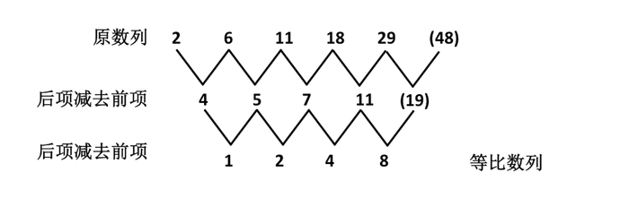

故正确答案为B。

**来源**：2012年江苏省公务员录用考试《行测》题（A类）第16题

### 第 17 题

1，1，2，8，64，（    ）

A. 1024

B. 1280

C. 512

D. 128

第 17 题 · 答案与解析

**参考答案（粉笔题库参考内容）**

A

**解析**

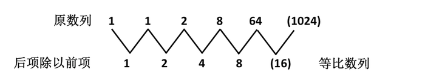

故正确答案为A。

**来源**：2012年江苏省公务员录用考试《行测》题（A类）第17题

### 第 18 题

5，9，19，37，75，（    ）

A. 79

B. 100

C. 149

D. 150

第 18 题 · 答案与解析

**参考答案（粉笔题库参考内容）**

C

**解析**

原数列为递推数列f(n＋2) ＝f(n＋1) ＋2f(n)，19＝9＋2×5，37＝19＋2×9，75＝37＋2×19，故未知项为75＋37×2＝149。

故正确答案为C。

**来源**：2012年江苏省公务员录用考试《行测》题（A类）第18题

### 第 19 题

212，424，234，446，658，（    ）

A. 245

B. 267

C. 233

D. 212

第 19 题 · 答案与解析

**参考答案（粉笔题库参考内容）**

B

**解析**

数列无明显特征，且作差、作和、递推均无规律。数列本身全是三位数，且变化趋势不单调，考虑数字本身的规律。将各项拆开加和之后为新数列5、10、9、14、19，无明显规律，考虑3的倍数，各项除以3依次余2、余1、余0、余2、余1，故规律为除以3之后余数成周期数列，则下一项应除以3余0，即3的整数倍，只有B项满足。

故正确答案为B。

**来源**：2012年江苏省公务员录用考试《行测》题（A类）第19题

### 第 20 题

8，4，8，10，14，（    ）

A. 22

B. 20

C. 19

D. 24

第 20 题 · 答案与解析

**参考答案（粉笔题库参考内容）**

C

**解析**

该数列无明显特征，作差无规律，考虑递推。观察可知，第三项8=8/2+4，第四项10 = 4/2 + 8，第五项14 = 8/2 + 10，即第三项= 第一项/2 + 第二项。故未知项为10/2 + 14 = 19。

故正确答案为C。

**来源**：2012年江苏省公务员录用考试《行测》题（A类）第20题

### 第 21 题

0，2，6，12，（    ），30

A. 14

B. 16

C. 26

D. 20

第 21 题 · 答案与解析

**参考答案（粉笔题库参考内容）**

D

**解析**

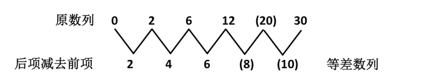

故正确答案为D。

**来源**：2012年江苏省公务员录用考试《行测》题（A类）第21题

### 第 22 题

\-26，-6，2，4，6，（    ）

A. 16

B. 12

C. 14

D. 6

第 22 题 · 答案与解析

**参考答案（粉笔题库参考内容）**

C

**解析**

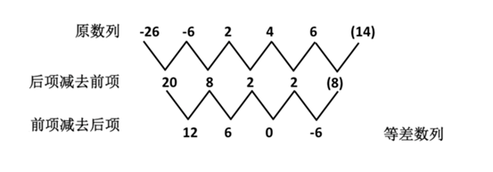

故正确答案为C。

**来源**：2012年江苏省公务员录用考试《行测》题（A类）第22题

### 第 23 题

4，7，12，20，33，（     ），88

A. 54

B. 42

C. 49

D. 40

第 23 题 · 答案与解析

**参考答案（粉笔题库参考内容）**

A

**解析**

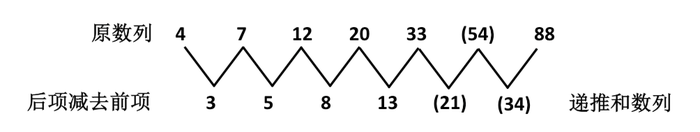

8=5+3，13=8+5，21=13+8，34=21+13，所以答案为54。

故正确答案为A。

**来源**：2012年江苏省公务员录用考试《行测》题（A类）第23题

### 第 24 题

6，10，16，24，32，（    ）

A. 29

B. 31

C. 33

D. 32

第 24 题 · 答案与解析

**参考答案（粉笔题库参考内容）**

D

**解析**

因数分解数列，6＝1×6，10＝2×5，16＝4×4，24＝8×3，32＝16×2，左侧子列1、2、4、8、16为等比数列，右侧子列6、5、4、3、2为等差数列，因此下一项为32×1＝32。

故正确答案为D。

**来源**：2012年江苏省公务员录用考试《行测》题（A类）第24题

### 第 25 题

1/3，1，1，13/17，（   ），21/65

A. 17/33

B. 15/33

C. 17/53

D. 1

第 25 题 · 答案与解析

**参考答案（粉笔题库参考内容）**

A

**解析**

原数列可反约分为：1/3，5/5，9/9，13/17，( )，21/65。

分子列为公差为4的等差数列；

分母列为递推数列，后项分母 = 2 × 前项分数的分母 − 1。5=2×3−1，9 = 2 × 5 − 1，17 = 2 × 9 − 1，33 = 2×17-1，65 = 2 × 33 - 1。

所以答案为17/33。

故正确答案为A。

**来源**：2012年江苏省公务员录用考试《行测》题（A类）第25题

### 第 26 题

小李乘公共汽车去某地，当行至一半路程时，他把座位让给一位老人后一直站着，离终点还有3千米时，他又坐下。在这次乘车过程中，他站的路程是坐的路程的三分之一，则小李这次乘车全程为：

A. 8千米

B. 12千米

C. 9千米

D. 14千米

第 26 题 · 答案与解析

**参考答案（粉笔题库参考内容）**

B

**解析**

行程问题，小李站的路程是坐的路程的1/3，故站的路程占全程的1/3÷(1+1/3)=1/4，则有小李乘车全程为3÷(1−1/2−1/4)=12千米。

故正确答案为B。

**考点**：普通行程

**来源**：2012年江苏省公务员录用考试《行测》题（A类）第26题

### 第 27 题

某项工程，小王单独做需15天完成，小张单独做需10天完成。现在两人合作，但中间小王休息了5天，小张也休息了若干天，最后该工程用11天完成。则小张休息的天数是：

A. 6

B. 2

C. 3

D. 5

第 27 题 · 答案与解析

**参考答案（粉笔题库参考内容）**

D

**解析**

设总工程量为1，小王的工作效率为1/15，小张的工作效率为1/10，两人合作中小王完成的工作量为1/15 × (11−5) = 2/5，则小张实际工作的天数为(1 - 2/5) ÷ 1/10 = 6天，因此小张休息的天数为11-6=5天。

故正确答案为D。

**考点**：给完工时间型

**来源**：2012年江苏省公务员录用考试《行测》题（A类）第27题

### 第 28 题

长方体棱长的和是48，其长、宽、高之比为3：2：1，则长方体的体积是：

A. 48

B. 46

C. 384

D. 3072

第 28 题 · 答案与解析

**参考答案（粉笔题库参考内容）**

A

**解析**

根据比例关系，设长方体的长、宽、高分别为3a、2a、a，则有4×(3a+2a+a) = 48，解得a＝2，长方体长、宽、高则分别为6、4、2，则长方体体积为6×4×2＝48。

故正确答案为A。

**考点**：几何公式类-立体图形

**来源**：2012年江苏省公务员录用考试《行测》题（A类）第28题

### 第 29 题

已知：√x=√a-(1/√a)，则x+2+√(x²+4x)=( )

A. 1/a

B. a

C. 2a

D. 2/a

第 29 题 · 答案与解析

**参考答案（粉笔题库参考内容）**

C

**解析**

令a＝1，则x＝0，原式计算结果为2，由此排除A、B两项。令a＝4，则x=9/4，原式计算结果为8，由此排除D项。

故正确答案为C。

**来源**：2012年江苏省公务员录用考试《行测》题（A类）第29题

### 第 30 题

甲、乙、丙三人的月收入分别是6000元、3000元、1000元。如果保持三人月收入比值不变而使平均月收入达到4000元，则丙的月收入增加了：

A. 400元

B. 200元

C. 300元

D. 350元

第 30 题 · 答案与解析

**参考答案（粉笔题库参考内容）**

B

**解析**

达到平均月收入4000元需要三人总收入增加4000×3-(6000+3000+1000)=2000元，而三人增加收入的比例与原收入比例一致，故可知丙的收入需增加：2000×1÷(6+3+1)=200元。

故正确答案为B。

**考点**：经济利润问题

**来源**：2012年江苏省公务员录用考试《行测》题（A类）第30题

### 第 31 题

某盐溶液的浓度为20%，加入水后，溶液的浓度变为15%。如果再加入同样多的水，则溶液的浓度变为：

A. 13%

B. 12.5%

C. 12%

D. 10%

第 31 题 · 答案与解析

**参考答案（粉笔题库参考内容）**

C

**解析**

等量加水的过程中，溶液的量发生变化，溶质保持不变。直接赋值溶质为60，可得60/300 → 60/400 → 60/500，因此溶液浓度变为12%。

故正确答案为C。

**来源**：2012年江苏省公务员录用考试《行测》题（C类）第30题

### 第 32 题

设有三个自然数，分别是一位数、两位数和三位数，这三个数的乘积为2004，则三数之和为：

A. 100

B. 180

C. 179

D. 178

第 32 题 · 答案与解析

**参考答案（粉笔题库参考内容）**

B

**解析**

2004进行因数分解，2004=1×2004=1×2×1002=1×2×2×501=1×2×2×3×167=1×12×167。所以三个数之和为1＋12＋167＝180。

故正确答案为B。

**考点**：公倍数与公约数问题

**来源**：2012年江苏省公务员录用考试《行测》题（A类）第32题

### 第 33 题

为响应推动我国社会主义文化事业大发展大繁荣的号召，某小区决定为小区内每位老人准备40元文化基金，同时为每位儿童比老人多准备20元文化基金。已知该小区老人比儿童多100人，文化基金一共14000元，则该小区老人和儿童总数是：

A. 220

B. 250

C. 300

D. 200

第 33 题 · 答案与解析

**参考答案（粉笔题库参考内容）**

C

**解析**

根据题意设小区的老人人数是x，则40x + (40 + 20) × (x − 100) = 14000，解得x=200，儿童人数为x-100=100人，所以一共有300人。

故正确答案选C。

**考点**：和差倍比问题

**来源**：2012年江苏省公务员录用考试《行测》题（A类）第33题

### 第 34 题

长为8宽为5的长方形内有一内接阴影四边形（如图所示），则阴影四边形的面积是：

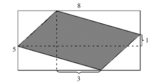

A. 15.5

B. 21.5

C. 20.5

D. 20

第 34 题 · 答案与解析

**参考答案（粉笔题库参考内容）**

B

**解析**

如图做辅助线，最中心的矩形面积为1×3=3，剩余阴影的面积等于空白的面积，即剩余阴影的面积为1/2×(5×8-3)。故阴影四边形的总面积为3 + 1/2 × (5 × 8 − 3) = 21.5。

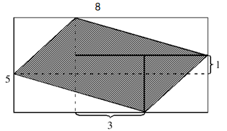

故正确答案为B。

**考点**：几何公式类-平面图形

**来源**：2012年江苏省公务员录用考试《行测》题（A类）第34题

### 第 35 题

一学生在期末考试中6门课成绩的平均分是92.5分，且6门课的成绩是互不相同的整数，最高分是99分，最低分是76分，则按分数从高到低居第三的那门课至少得分为：

A. 95

B. 93

C. 96

D. 97

第 35 题 · 答案与解析

**参考答案（粉笔题库参考内容）**

A

**解析**

分数从高到低排列，第2~5门分数之和为92.5×6－99－76＝380分，要令第三门成绩尽量小，则第二门成绩尽可能大，为98分，于是第3~5门总成绩为380－98＝282分。总分一定，要令第三门成绩尽量小，则第三、四、五门的成绩呈等差数列，可知第4门成绩为中位数282÷3＝94分，据此构造三门成绩依次为95、94、93分，符合题意，因此第三门课至少为95分。

故正确答案为A。

**考点**：构造数列

**来源**：2012年江苏省公务员录用考试《行测》题（A类）第35题

### 第 36 题

在数列2，3，5，8，12，17，23，······中，第2012个数被5除所得余数是：

A. 1

B. 3

C. 2

D. 4

第 36 题 · 答案与解析

**参考答案（粉笔题库参考内容）**

B

**解析**

注意到题目给出的数列是二级等差数列，据此可将数列各项拆分为2=2+0，3=2+1，5=2+1+2，8=2+1+2+3，12=2+1+2+3+4，17=2+1+2+3+4+5，据此可知第2012个数可以写成2＋1＋2＋3＋……＋2011，而连续5个整数之和必能被5整除，因此1＋2＋……＋2010能被5整除，故第2012个数除以5的余数即等于2+2011除以5的余数，此余数为3。

故正确答案为B。

**考点**：数列问题

**来源**：2012年江苏省公务员录用考试《行测》题（A类）第36题

### 第 37 题

商店经销某商品，第二次进货的单价是第一次进货单价的九折，而售价不变，利润率比第一次销售该商品时的利润率增加了15个百分点，则该商店第一次经销该商品时所定的利润率是：

A. 35%

B. 20%

C. 30%

D. 12%

第 37 题 · 答案与解析

**参考答案（粉笔题库参考内容）**

A

**解析**

设第一次进价为100，售价为x，则(x/90 − 1) − (x/100 − 1) = 15%，解得x=135，即第一次进货的利润率为35%。

故正确答案为A。

**考点**：经济利润问题

**来源**：2012年江苏省公务员录用考试《行测》题（A类）第37题

### 第 38 题

如图，正四面体ABCD，P、Q分别是棱AB、CD的三等分点和四等分点(AB=3AP=4CQ)，棱AC上有一点M，要使M到P、Q距离之和最小，则MC:MA=（  ）。

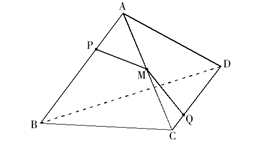

A. 1:2

B. 4:5

C. 3:4

D. 5:6

第 38 题 · 答案与解析

**参考答案（粉笔题库参考内容）**

C

**解析**

如图展开，PQ为最短距离。△APM与△CQM相似，MC:MA=CQ:AP=3:4。

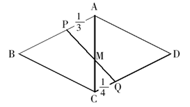

故正确答案为C。

**考点**：几何公式类-立体图形、几何结论类-几何小题型、几何结论类-相似图形

**来源**：2012年江苏省公务员录用考试《行测》题（A类）第38题

### 第 39 题

用印有“1”、“5”、“6”的三张卡片，可以组成许多不同的三位数，所有这些三位数的和为：

A. 5992

B. 5993

C. 5985

D. 5994

第 39 题 · 答案与解析

**参考答案（粉笔题库参考内容）**

D

**解析**

用“1”、“5”、“6”组成的三位数分别是156、165、516、561、615、651；

数字“6”倒过来即为“9”，用“1”、“5”、“9”组成的三位数分别是159、195、519、591、915、951。

因此“1”、“5”在个位、十位、百位分别出现4次，“6”、“9”在个位、十位、百位分别出现2次，所有这些三位数的和为(100 + 10 + 1) × (1 + 5) × 4+(100+10+1)×(6+9)×2=5994。

故正确答案为D。

**考点**：基础排列组合

**来源**：2012年江苏省公务员录用考试《行测》题（A类）第39题

### 第 40 题

编号为1~55号的55盏亮着的灯，按顺时针方向依次排列在一个圆周上，从1号灯开始顺时针方向留1号灯，关掉2号灯；留3号灯，关掉4号灯······这样每隔一盏灯关掉一盏，转圈关下去，则最后剩下的一盏亮灯编号是：

A. 50

B. 44

C. 47

D. 1

第 40 题 · 答案与解析

**参考答案（粉笔题库参考内容）**

C

**解析**

此题采用排除法，第一轮灭灯偶数号灯全熄，排除A、B两项，熄灭第54号灯后隔过55号灯灭掉1号灯，排除D项。

故正确答案选C。

**来源**：2012年江苏省公务员录用考试《行测》题（A类）第40题

### 第 41 题

美德：节俭

A. 出售：批发

B. 权力：产权

C. 城市：市场

D. 广告：宣传

第 41 题 · 答案与解析

**参考答案（粉笔题库参考内容）**

A

**解析**

第一步：判断题干词语间逻辑关系。

节俭是一种美德，二者为包容中的种属关系。

第二步：判断选项词语间逻辑关系。

A项：批发是一种出售行为，二者为包容中的种属关系，与题干逻辑关系一致，当选；

B项：产权是一种权利，与权力无关，与题干逻辑关系不一致，排除；

C项：市场泛指商品交换的领域，与城市无关，与题干逻辑关系不一致，排除；

D项：广告是一种宣传方式，但顺序与题干不一致，与题干逻辑关系不一致，排除。

故正确答案为A。

**考点**：逻辑关系-包容关系

**来源**：2012年江苏省公务员录用考试《行测》题（A类）第41题

### 第 42 题

手表：怀表

A. 抹布：台布

B. 钢笔：毛笔

C. 屏风：窗帘

D. 门廊：门柱

第 42 题 · 答案与解析

**参考答案（粉笔题库参考内容）**

B

**解析**

题干：手表和怀表是并列关系。二者都是表，都用于提示时间，且从时间概念上，怀表相对古老，手表相对现代。

A项，抹布和台布是并列关系，但二者的使用目的不同，抹布用于除污，台布用于防污和增加美观；

B项，钢笔和毛笔是并列关系，二者都是笔，都用于书写文字，且从时间概念上，毛笔相对古老，钢笔相对现代；

C项，屏风和窗帘是并列关系，屏风用于挡风、阻断视线，窗帘用于遮蔽和调节室内光照，虽然都有遮蔽的功能，但从时间概念上，屏风相对古老，窗帘相对现代，与题干顺序相反；

D项，门廊和门柱是并列关系，但二者的使用目的不同，门廊指的是门前的廊子，门柱是固定和支持大门的柱子。

故正确答案为B。

**考点**：逻辑关系-并列关系

**来源**：2012年江苏省公务员录用考试《行测》题（A类）第42题

### 第 43 题

雪中送炭：火上浇油

A. 家喻户晓：默默无闻

B. 凤毛麟角：多如牛毛

C. 胸有成竹：不知所措

D. 锦上添花：落井下石

第 43 题 · 答案与解析

**参考答案（粉笔题库参考内容）**

D

**解析**

第一步：判断题干词语间逻辑关系。

题干两词是反义词，且前者为褒义词，后者为贬义词。

第二步：判断选项词语间逻辑关系。

A、B、C选项的两个成语都能构成反义关系，但“默默无闻”“多如牛毛”“不知所措”都是中性词，不是贬义词，感情色彩与题干成语不一致，排除；

D选项的两个成语都能构成反义关系，且“锦上添花”是褒义词，“落井下石”是贬义词，感情色彩与题干成语一致，当选。

故正确答案为D。

**考点**：语义-其他、语义关系-反义关系

**来源**：2012年江苏省公务员录用考试《行测》题（A类）第43题

### 第 44 题

进出口商品：进口商品：出口商品

A. 地图：东半球：西半球

B. 硬币：正面：反面

C. 教授：哲学教授：非哲学教授

D. 汽车：环保型汽车：节能型汽车

第 44 题 · 答案与解析

**参考答案（粉笔题库参考内容）**

C

**解析**

第一步：判断题干词语间第一重逻辑关系，并在选项中进行选择。

题干第一个词语与后两个词语是包含关系，且是包含关系中的种属关系，与之相同逻辑关系的是C、D两项；A、B两项前者与后两者的关系是包含关系中的组成关系，因此排除A、B两项。

第二步：答案不唯一时，再判断题干词语间第二重逻辑关系。

题干中“进口商品”和“出口商品”一起组成“进出口商品”这个整体，二者是并列关系当中的矛盾关系。

C项“哲学教授”和“非哲学教授”一起组成“教授”这个整体，两词属于并列关系中的矛盾关系，与题干一致；

D项“环保型汽车”和“节能型汽车”两者不能组成“汽车”这个整体，两词属于并列关系中的反对关系。

故正确答案为C。

**考点**：逻辑关系-包容关系、逻辑关系-并列关系

**来源**：2012年江苏省公务员录用考试《行测》题（A类）第44题

### 第 45 题

（    ） 之于 蜜蜂 相当于 花草 之于 （    ）

A. 昆虫——兰花

B. 蜂蜜——草木

C. 园丁——园艺

D. 花粉——蝴蝶

第 45 题 · 答案与解析

**参考答案（粉笔题库参考内容）**

A

**解析**

第一步：将选项逐一代入，判断各选项前后部分的逻辑关系。

A选项，昆虫之于蜜蜂是包容关系中的种属关系，花草之于兰花是包容关系中的种属关系；

B选项，蜂蜜之于蜜蜂是结果与主体的对应关系，花草之于草木是包容关系；

C选项，前者无明显逻辑关系，花草之于园艺是客体与主体的对应关系；

D选项，花粉之于蜜蜂是客体与主体的对应关系，后者无明显逻辑关系。

第二步：逻辑关系相同即为答案。

综合以上分析，仅A项前后两组词语逻辑关系相同。

故正确答案为A。

**考点**：逻辑关系-包容关系

**来源**：2012年江苏省公务员录用考试《行测》题（A类）第45题

### 第 46 题

三角形 之于 平面 相当于 （    ） 之于 （    ）

A. 菱形——四面体

B. 棱柱——空间

C. 点——直线

D. 曲线——椭圆

第 46 题 · 答案与解析

**参考答案（粉笔题库参考内容）**

B

**解析**

第一步：将选项逐一代入，判断各选项前后部分的逻辑关系。

A选项，菱形之于四面体是平面与立体的对应关系；

B选项，棱柱之于空间是属性关系；

C选项，点之于直线是包含关系中的组成关系；

D选项，曲线之于椭圆是包容关系中的组成关系。

第二步：逻辑关系与题干相同即为答案。

题干中三角形之于平面是属性关系。综合以上分析，仅B选项前后两组词语逻辑关系相同。

故正确答案为B。

**考点**：逻辑关系-对应关系

**来源**：2012年江苏省公务员录用考试《行测》题（A类）第46题

### 第 47 题

光辉 之于 （    ） 相当于 正义 之于 （    ）

A. 太阳——法制

B. 恒星——民生

C. 自然——义务

D. 光明——圣人

第 47 题 · 答案与解析

**参考答案（粉笔题库参考内容）**

A

**解析**

将选项逐一代入，判断各选项前后部分的逻辑关系。

A选项，光辉之于太阳是属性关系，正义之于法制是属性关系，前后逻辑关系一致，当选；

B选项，光辉之于恒星是属性关系，正义之于民生是包容关系，前后逻辑关系不一致，排除；

C选项，光辉和自然无明显逻辑关系，正义和义务无明显逻辑关系，前后逻辑关系不一致，排除；

D选项，光辉、光明是全同关系，正义之于圣人是属性关系，前后逻辑关系不一致，排除。

故正确答案为A。

**考点**：逻辑关系-对应关系

**来源**：2012年江苏省公务员录用考试《行测》题（A类）第47题

### 第 48 题

请从四个选项中选出正确的一项，其特征或规律与题干给出的一串符号的特征或规律最为相似：

SWWSWG

A. WSSWSP

B. GVVGEV

C. AUUACU

D. FHFHHT

第 48 题 · 答案与解析

**参考答案（粉笔题库参考内容）**

A

**解析**

题干中第1个和第4个字母相同，第2个、第3个和第5个字母相同。

A选项与题干规律一致；

B、C选项第5个字母与第2个字母不同，与题干规律不一致；

D选项第2个字母和第3个字母不同，与题干规律不一致。

故正确答案为A。

**来源**：2013年江苏省公务员录用考试《行测》题（C类）第45题

### 第 49 题

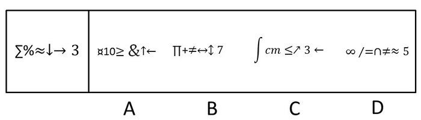

A. A

B. B

C. C

D. D

第 49 题 · 答案与解析

**参考答案（粉笔题库参考内容）**

B

**解析**

观察题干，可以发现题干由数学符号、箭头和数字组成，且最后一项是数字。

A、C选项最后一项是箭头，不是数字，排除；

继续观察，可发现，题干中倒数第二、三项都是箭头。

D选项倒数第二、三项都是数学符号，不是箭头，排除。

故正确答案为B。

**来源**：2012年江苏省公务员录用考试《行测》题（A类）第49题

### 第 50 题

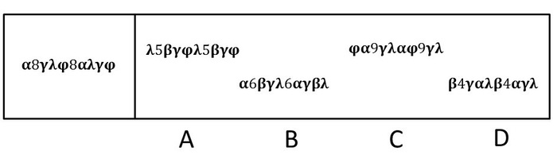

A. A

B. B

C. C

D. D

第 50 题 · 答案与解析

**参考答案（粉笔题库参考内容）**

B

**解析**

题干由希腊字母和数字组成，且第二、六项都是数字。四个选项中只有B选项第二、六项都是数字。

故正确答案为B。

**来源**：2012年江苏省公务员录用考试《行测》题（A类）第50题

### 第 51 题

请从所给的四个选项中，选择唯一的一个答案，使之呈现一定的规律性：

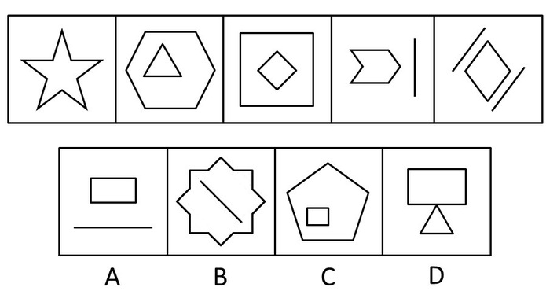

A. A

B. B

C. C

D. D

第 51 题 · 答案与解析

**参考答案（粉笔题库参考内容）**

A

**解析**

元素组成凌乱，考查数数。

观察可知，前五个图形中的线条数依次为10、9、8、7、6，因此接下来的图形应该有5条线段。

故正确答案为A。

**考点**：数量规律-线

**来源**：2012年江苏省公务员录用考试《行测》题（A类）第51题

### 第 52 题

请从所给的四个选项中，选择唯一的一个答案，使之呈现一定的规律性：

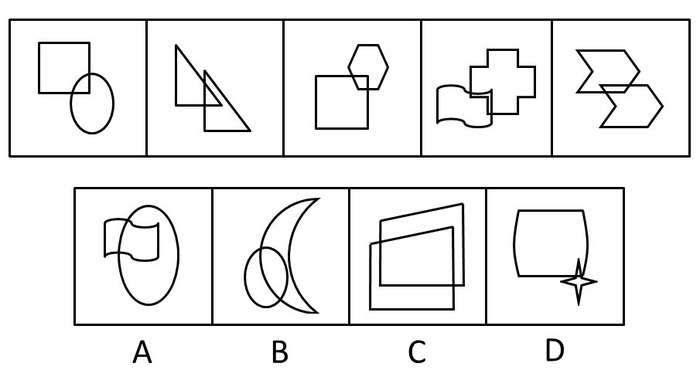

A. A

B. B

C. C

D. D

第 52 题 · 答案与解析

**参考答案（粉笔题库参考内容）**

D

**解析**

元素整体凌乱，每个图形都由两个元素组合而成，考查图形内部结构特征，题干图形均由两个几何图形构成，重叠部分均小于每个组成图形的一半。A、B、C三项图形的重叠部分均至少超过一个组成图形的一半，只有D项符合规律。

故正确答案为D。

**考点**：特殊规律-图形间关系

**来源**：2012年江苏省公务员录用考试《行测》题（A类）第52题

### 第 53 题

请从所给的四个选项中，选择唯一的一个答案，使之呈现一定的规律性：

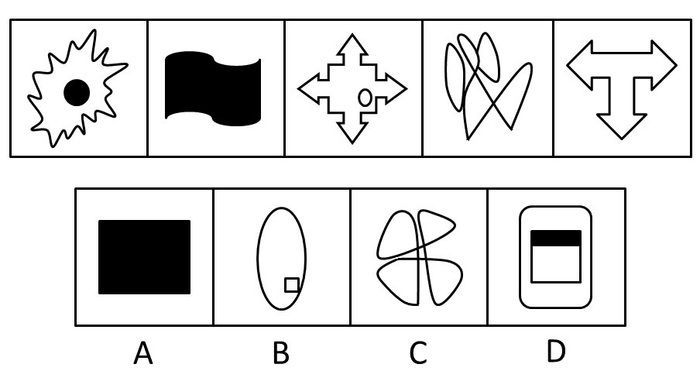

A. A

B. B

C. C

D. D

第 53 题 · 答案与解析

**参考答案（粉笔题库参考内容）**

C

**解析**

本题考查凹凸性。题干图形外围轮廓均是凹图形，观察选项，只有C选项图形外围轮廓是凹图形，与题干图形保持一致。

故正确答案为C。

**来源**：2012年江苏省公务员录用考试《行测》题（A类）第53题

### 第 54 题

请从所给的四个选项中，选择唯一的一个答案，使之呈现一定的规律性：

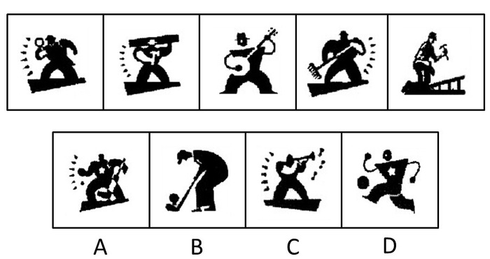

A. A

B. B

C. C

D. D

第 54 题 · 答案与解析

**参考答案（粉笔题库参考内容）**

C

**解析**

特殊考点，图形内部属性的考查。

观察题干可知，题干中的图形都是非竞技性职业，选项中只有C项和题干一致。

故正确答案为C。

**来源**：2012年江苏省公务员录用考试《行测》题（A类）第54题

### 第 55 题

请从所给的四个选项中，选择最合适的一项填在问号处，使之呈现一定的规律性：

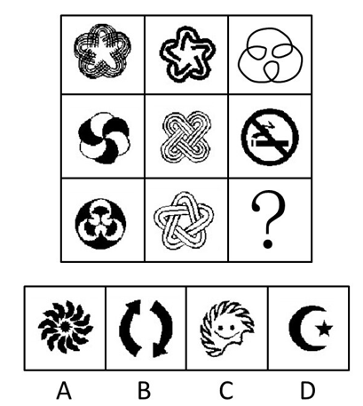

A. A

B. B

C. C

D. D

第 55 题 · 答案与解析

**参考答案（粉笔题库参考内容）**

C

**解析**

元素组成凌乱，考虑图形属性。观察可知，题干中的图形均为封闭图形，只有C项为封闭图形。

故正确答案为C。

**考点**：属性规律-开闭性

**来源**：2012年江苏省公务员录用考试《行测》题（A类）第55题

### 第 56 题

请从所给的四个选项中，选择最合适的一项填在问号处，使之呈现一定的规律性：

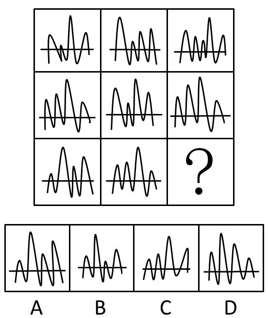

A. A

B. B

C. C

D. D

第 56 题 · 答案与解析

**参考答案（粉笔题库参考内容）**

A

**解析**

从每行来看，第一个图形的后半部分与第三个图形的后半部分相同，第二个图形的后半部分左右翻转，得到第三个图形的前半部分。根据此种规律，“？”处应该是A项图形。

故正确答案为A。

**考点**：位置规律-翻转

**来源**：2012年江苏省公务员录用考试《行测》题（A类）第56题

### 第 57 题

请从所给的四个选项中，选择最合适的一项填在问号处，使之呈现一定的规律性：

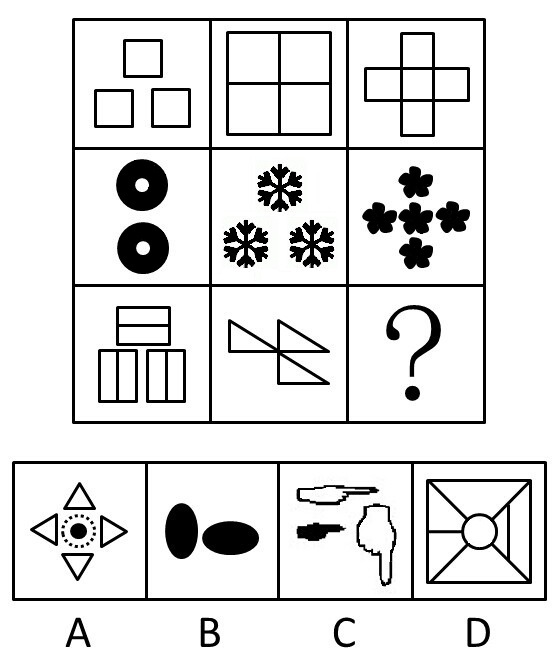

A. A

B. B

C. C

D. D

第 57 题 · 答案与解析

**参考答案（粉笔题库参考内容）**

B

**解析**

规则图形集合，考查元素种类。

观察题干可知，每一个图片均由相同的图形组成，根据此种规律，“？”处应该是元素种类唯一。

故正确答案为B。

**考点**：数量规律-素

**来源**：2012年江苏省公务员录用考试《行测》题（A类）第57题

### 第 58 题

请从所给的四个选项中，选择最合适的一项填在问号处，使之呈现一定的规律性：

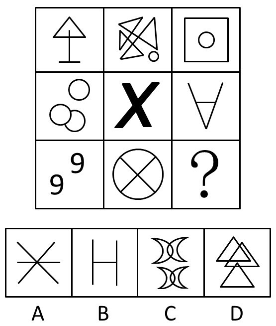

A. A

B. B

C. C

D. D

第 58 题 · 答案与解析

**参考答案（粉笔题库参考内容）**

C

**解析**

元素组成不同，且无明显属性规律，考虑数量规律。题干图形均由两笔画成，选项中A、B项为三笔画，D项为一笔画。只有C项图形是两笔画成的。

故正确答案为C。

**考点**：数量规律-线

**来源**：2012年江苏省公务员录用考试《行测》题（A类）第58题

### 第 59 题

左边给定的是纸盒外表面的展开图，右边哪一项能由它折叠而成？请把它找出来：

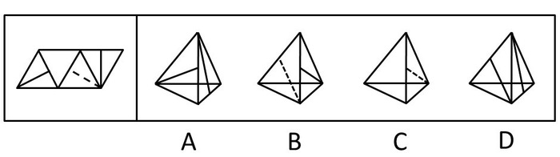

A. A

B. B

C. C

D. D

第 59 题 · 答案与解析

**参考答案（粉笔题库参考内容）**

C

**解析**

本题考查折纸盒。

平面展开图中，1、2、3三个面的平分线交于一点，折叠后顶点也应相交。四个选项中，A、B、D三项均不符合这一条件，只有C项正确。

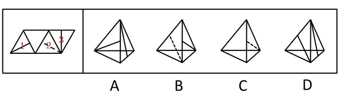

故正确答案为C。

**来源**：2012年江苏省公务员录用考试《行测》题（A类）第59题

### 第 60 题

左边给定的是纸盒外表面的展开图，右边哪一项能由它折叠而成？请把它找出来：

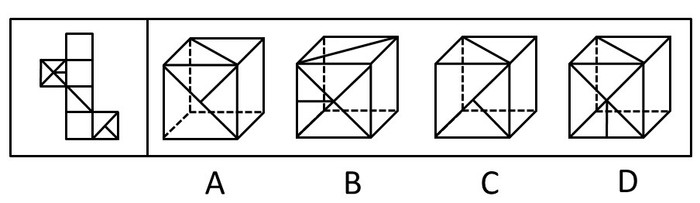

A. A

B. B

C. C

D. D

第 60 题 · 答案与解析

**参考答案（粉笔题库参考内容）**

B

**解析**

本题考查折纸盒。四个选项中，只有B项能够根据左边的展开图折出来，A、C、D三项均有误（如下图所示）。假如A项的正面和右侧面是对的，顶面对应的是第2面；假如C项的正面和右侧面是对的，顶面对应的是第3面，但C项中顶面线条的方向反了；假如D项的正面和右侧面是对的，顶面对应的是第4面。因此，只有B项三个面均正确。

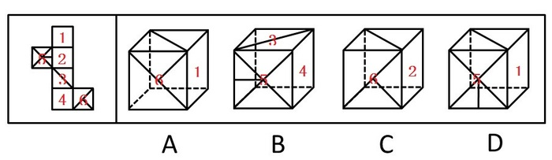

故正确答案为B。

**考点**：空间类-空间重构-六面体

**来源**：2012年江苏省公务员录用考试《行测》题（A类）第60题

### 第 61 题

人类的到来着实给这个世界的某些自然法则带来了不少挑战。比如说，植物的果实味道鲜美，就是因为它需要吸引动物前来将它的果实附赠的种子带往更远的地方，当然同时也将富含大量营养物的果实作为对传播种子的动物的报酬。这是一桩完美的公平交易。可是人类对于果实中的种子要么集中处理成垃圾，要么干脆集中种植成果园。

据此，可以推断：

A. 人类违背自然法则是为了改造自然

B. 动植物之间的公平交易总能完美地实现

C. 人类有时对植物果实中的种子展开科学研究

D. 人类有时会破坏自然界完美的公平交易

第 61 题 · 答案与解析

**参考答案（粉笔题库参考内容）**

D

**解析**

第一步：抓住题干主要信息。

第一句说明人类给世界的某些自然法则带来了挑战；第二句说明植物的果实味道鲜美是因为它需要吸引动物前来将它的果实附赠的种子带往更远的地方，同时也将富含大量营养物的果实作为对传播种子的动物的报酬；第三句说明人类对于果实中的种子要么集中处理成垃圾，要么干脆集中种植成果园。

第二步：分析题干信息，并结合选项得出答案。

A项：人类违背自然法则是为了改造自然，题干中并未涉及人类违背自然法则的目的，因此A中说法无法推断，排除；

B项：动植物之间的公平交易“总能”完美地实现，说法过于绝对，题干只是给出一个完美实现的例子，并没有提及其他动植物之间的公平交易能够完美实现，因此B中说法无法推断，排除；

C项：人类有时对植物果实中的种子展开科学研究，“展开科学研究”题干并未提及，属无关选项，因此C中说法无法推断，排除；

D项：由题干中“这是一桩完美的公平交易。可是人类对于果实中的种子要么集中处理成垃圾，要么干脆集中种植成果园”，可以得出人类有时会破坏自然界完美的公平交易，因此D中说法可以推断，当选。

故正确答案为D。

**考点**：日常结论

**来源**：2012年江苏省公务员录用考试《行测》题（A类）第61题

### 第 62 题

菠菜一年四季都有，但以春季为佳，其根红叶绿，鲜嫩异常，尤为可口。春季上市的菠菜，对解毒、防燥颇有益处。中医认为，菠菜性甘凉，能养血、止血、敛阴、润燥，因菠菜含草酸较多，有碍机体对钙和铁的吸收，因而吃菠菜时宜先用沸水烫软，捞出再炒。

以下各项判断如果为真，则哪项最能支持以上论证：

A. 草酸容易溶解于沸水之中

B. 在炒菠菜时加少许白酒，可以减少草酸的涩口感，增加一种清香感

C. 食用含草酸较多的食物，尿中草酸含量明显增多，尿路结石的危险性可能随之增加

D. 春天的菠菜比冬天的菠菜更加可口

第 62 题 · 答案与解析

**参考答案（粉笔题库参考内容）**

A

**解析**

第一步：找到论点和论据。

本题论点是吃菠菜时宜先用沸水烫软，捞出再炒；论据是菠菜含草酸较多，有碍机体对钙和铁的吸收。

第二步：判断加强方式。

论点强调吃菠菜用沸水，论据强调菠菜含草酸较多，所以论点与论据间不存在明显因果关系，需加强论证，在论点和论据间搭桥。

第三步：逐一判断选项的作用。

A中草酸容易溶解于沸水之中说明吃菠菜时用沸水可以减少草酸，即在吃菠菜和菠菜含草酸较多间搭桥，加强论证，当选；

B中在炒菠菜时加少许白酒，C中食用含草酸较多的食物的坏处，D中菠菜的可口，均与吃菠菜用沸水无直接关系，属无关选项，排除。

故正确答案为A。

**考点**：搭桥

**来源**：2012年江苏省公务员录用考试《行测》题（A类）第62题

### 第 63 题

有专家指出，“科学结论总会有某些不确定性，科学永远不能绝对地证明任何事物。当有人说社会应该等到科学家能绝对肯定时再采取行动，这等于说社会永远不应该采取行动，对于像气候变化，这种可能造成大灾难的问题而言，不采取行动就是让我们的星球冒险。”

据此，以下哪项论断一定是上述专家所同意的：

A. 如果采取行动，就不会让我们的星球冒险

B. 只有采取行动，才不会让我们的星球冒险

C. 只有等到科学家完全确信之后，社会才应该采取行动

D. 如果科学家不能绝对肯定什么，社会就不应该采取行动

第 63 题 · 答案与解析

**参考答案（粉笔题库参考内容）**

B

**解析**

第一步：翻译题干

“社会应该等到科学家能绝对肯定时再采取行动”即科学家的绝对肯定是采取行动的前提条件：①采取行动⇒科学家绝对肯定

不采取行动就是让我们的星球冒险：②-采取行动⇒冒险

第二步：逐一分析选项

A项：采取行动⇒—冒险，对②的否前推否后，否前得不出任何肯定性结论，排除；

B项：-冒险⇒采取行动，是②的逆否命题，当选；

C项：采取行动⇒科学家完全确信，是①的等价命题，但题干中专家对①的态度是否定的，排除；

D项：-科学家完全确信⇒—采取行动，是①的逆否命题，同理，也是专家不同意的态度，排除。

故正确答案为B。

**考点**：常规翻译

**来源**：2012年江苏省公务员录用考试《行测》题（A类）第63题

### 第 64 题

据悉，科学家已在肝脏中找到了真正清除炎症细胞的“功臣”之一——LSECtin。LSECtin能选择性地识别出被激活的炎症细胞，有效制止它们繁殖并抑制它们产生炎症因子。科学家利用最尖端的基因剔除技术，从动物机体内完全去掉LSECtin，发现机体内的炎症细胞明显增多，炎症因子也会随之急剧增加。人们由此推测，LSECtin很有可能发展成为治疗肝脏炎性疾病的特效药物。

以下各项判断如果为真，则哪项最能支持上述推测：

A. 给患有急性肝炎的动物注入LSECtin后，发现其肝脏内的炎症因子明显减少

B. 肝脏能清除不断从血液中循环到肝脏内的炎症细胞

C. LSECtin是迄今为止第一个被发现的在肝脏中特异表达的免疫调控分子

D. 这项重要的研究成果进一步丰富了肝脏免疫学理论

第 64 题 · 答案与解析

**参考答案（粉笔题库参考内容）**

A

**解析**

第一步：找出论点和论据。

论点：LSECtin很有可能发展成为治疗肝脏炎性疾病的特效药物。

论据：LSECtin能选择性地识别出被激活的炎症细胞，有效制止它们繁殖并抑制它们产生炎症因子。科学家利用最尖端的基因剔除技术，从动物机体内完全去掉LSECtin，发现机体内的炎症细胞明显增多，炎症因子也会随之急剧增加。

论点论据都在说LSECtin能治疗炎症，话题一致，加强考虑补充论据。

第二步：逐一分析选项。

A项：通过动物举例支持，可以加强，当选；

B项：肝脏能清除炎症细胞，而论点说的是LSECtin能治疗炎症，主体不一致，无关项，不能加强，排除；

C项：LSECtin是第一个被发现的在肝脏中特异表达的免疫调控分子，而论点说的是LSECtin能治疗炎症，话题不一致，无关项，不能加强，排除；

D项：这项重要的研究成果进一步丰富了肝脏免疫学理论，而论点说的是LSECtin能治疗炎症，话题不一致，无关项，不能加强，排除。

故正确答案为A。

**考点**：补充论据

**来源**：2012年江苏省公务员录用考试《行测》题（A类）第64题

### 第 65 题

如果生命的进化一直稳步向前，未曾经历任何挫折或提供了特殊机会的时期，要划分地质年代将非常困难，能够轻易分辨出地质年代，是因为地质学家们所说的“动物群演替”，也就是物种突然出现或消失的时期，我们可以将这些事件看作时间的关口——在那一刻，一个时期，通常代表着一种气候，让位于一个新的时期，一种新的气候。只有三种变化因素，强大到能够开启时间的关口——大陆漂移、星系碰撞和诸如温室气体等气候变化动力，所有这些因素的运作方式都不同，但它们通过同样的办法来推动进化——死亡和机遇。

据此可以推断：

A. 地质学家分辨地质年代未曾遭遇过任何挫折

B. 气候的变化并不一定带来物种的变化

C. “动物群演替”是划分地质年代的主要依据

D. 只有大陆漂移才能开启时间的关口

第 65 题 · 答案与解析

**参考答案（粉笔题库参考内容）**

B

**解析**

第一步：抓住题干主要信息。

第一点说明能够轻易地分辨出地质年代是根据物种突然出现或消失的时期，第二点说明当三种变化因素大陆漂移、星系碰撞和诸如温室气体等气候变化强大到一定程度时才会出现物种突然出现或消失，即物种突然出现或消失，三种变化因素大陆漂移、星系碰撞和诸如温室气体等气候变化强大到一定程度。

第二步：分析题干信息，并结合选项得出答案。

A项中地质学家分辨地质年代“未曾”遭遇过“任何”挫折，说法过于绝对，题干并未提及地质学家分辨地质年代时是否遭遇过挫折，因此无法推出，排除；

B项中气候的变化并不一定带来物种的变化，由第一步中第二点可知只有三种因素的变化才可能带来物种的变化，因此可以推出，当选；

C项中“动物群演替”是划分地质年代的主要依据，“划分地质年代的主要依据”这个概念题干并未提及，因此无法推出，排除；

D项中只有大陆漂移才能开启时间的关口，由第一步中第二点可知有三种因素的变化强大到一定程度后能够开启时间的关口，因此无法推出，排除。

故正确答案为B。

**考点**：日常结论

**来源**：2012年江苏省公务员录用考试《行测》题（A类）第65题

### 第 66 题

小王是一位新人，刚到某处级单位上班。处长鼓励他说：“我们单位所有的年轻人事业上都取得了很大的进步。”副处长则告诫他：“我们单位有的年轻人事业上并没有取得很大的进步！”科长对小王表示欢迎，并介绍说：“我们科所有的年轻人都很勤奋敬业。”同一科的老乡小李则告诉小王：“我们科长为人很勤奋敬业但不太诚实。”经过一段时间的工作及相处，小王发现上述四人的话中只有一句是假话。

据此，可以推断小王单位里：

A. 有的年轻人很勤奋敬业

B. 所有的年轻人都很勤奋敬业

C. 科长并不勤奋敬业但很诚实

D. 科长很勤奋敬业又很诚实

第 66 题 · 答案与解析

**参考答案（粉笔题库参考内容）**

A

**解析**

第一步：找突破口。

本题突破口为处长和副处长话语之间的矛盾关系，两人的话必有一真一假。

第二步：看其他的话。

本题只有一句为假，故科长和小李的话均为真话。由科长和小李所说的话可知，该科所有的年轻人都很勤奋敬业，科长为人很勤奋敬业但不太诚实。

第三步：结合选项得出答案。

A项：由第二步中结论“该科所有的年轻人都很勤奋敬业”说明有的年轻人很勤奋敬业，因此该项说法可以推出，当选；

B项：处级单位是包含科级的，因此由该科有的年轻人很勤奋敬业无法得到该处级单位所有的年轻人都很勤奋敬业，因此该项说法无法推出，排除；

C、D两项：由第二步中结论“科长为人很勤奋敬业但不太诚实”可知这两项的说法均不正确，无法推出，排除。

故正确答案为A。

**考点**：只有一真/一假

**来源**：2012年江苏省公务员录用考试《行测》题（A类）第66题

### 第 67 题

贪腐者都是智商有问题的，他们没有算清人生的经济账、事业账、家庭账。弄得经济受损、事业失败、众叛亲离。而清廉者都是具有大智慧的，他们守住底线，虽两袖清风，却赢得了人生的幸福和圆满。甲的智商是有问题的，而乙是具有大智慧的。

据此，可以推断：

A. 甲是贪腐者，乙是清廉者

B. 甲是清廉者，乙是贪腐者

C. 甲不是贪腐者，乙不是清廉者

D. 甲不是清廉者，乙不是贪腐者

第 67 题 · 答案与解析

**参考答案（粉笔题库参考内容）**

D

**解析**

第一步：抓住题干主要信息。

第一句：贪腐者→智商有问题；第二句：清廉者→具有大智慧；第三句：甲：智商有问题，乙：具有大智慧，该句为事实信息，即已经成立的事实。

第二步：从事实信息开始推导，得到结论。

根据题意可知：甲的智商有问题，说明甲不聪明，不聪明说明没有大智慧，所以甲不具有大智慧，又知第一步的第二句“清廉者→具有大智慧”，利用逆否等价得到“-具有大智慧→—清廉者”，可以推出甲不是清廉者；

同理，乙是有大智慧的，说明乙的智商是没有问题的，又知第一步的第一句“贪腐者→智商有问题”，利用逆否等价得到“-智商有问题→—贪腐者”，可以推出乙不是贪腐者。

综上，甲不是清廉者，乙不是贪腐者。通过分析，只有D项说法符合。

故正确答案为D。

**考点**：常规翻译

**来源**：2012年江苏省公务员录用考试《行测》题（A类）第67题

### 第 68 题

某单位共有18名员工，因缺乏科学管理，人浮于事和分配不合理的现象十分严重，工资只分高、低两类。单位中不干事的比干事的还多，干事者中工资低的人比不干事者中工资低的人还多。令人稍感欣慰的是，在不干事的人中，工资高的只占少数，另外，毕竟还有工资不低的干事者。最近，小张和小王离开了这个单位，但是该单位人员的上述结构并未因此而改变。

据此，可以推断小张或小王原来在单位中不可能是：

A. 工资高的不干事者

B. 工资低的干事者

C. 工资高的干事者

D. 工资低的不干事者

第 68 题 · 答案与解析

**参考答案（粉笔题库参考内容）**

C

**解析**

第一步：抓住题干主要信息。

（1）不干事＞干事，（2）干事低工资＞不干事低工资，（3）不干事高工资＜不干事低工资，（4）存在干事高工资。

第二步：分析题干信息，并结合选项得出答案。

由第一步中（2）和（3）得到干事低工资＞不干事低工资＞不干事高工资；又知（1）不干事＞干事，可得到干事高工资最少，即干事低工资＞不干事低工资＞不干事高工资＞干事高工资；

由于总计有18人，结合（1）可知，干事的最多有8人，不干事的最少有10人，从而不干事低工资最少有6人，所以干事低工资最少有7人；

结合（4）可知干事低工资为7人，干事高工资为1人，不干事低工资为6人，不干事高工资为4人。

综上，小张或小王不可能是干事高工资。通过分析，只有C项符合。

故正确答案为C。

**考点**：组合排列-单题-其他

**来源**：2012年江苏省公务员录用考试《行测》题（A类）第68题

### 第 69 题

教师节那天，小白、小黄、小蓝和小紫手里分别拿着不同颜色的花在校园里相遇，小白一看大家手里的花，思索了一会儿，就高兴地宣布她发现的规律：（1）四种花的颜色和她们的四个姓恰好相同，但每个人手里花的颜色与自己的姓并不相同；（2）如果将她手中的花与小黄交换，或与小蓝交换，或将小蓝手中的花与小紫交换，那么，每人手里花的颜色和自己的姓仍然不同。

根据以上陈述，可以推断小白、小黄、小蓝和小紫最初手里花的颜色分别是：

A. 紫、蓝、黄、白

B. 白、黄、蓝、紫

C. 黄、白、紫、蓝

D. 蓝、紫、白、黄

第 69 题 · 答案与解析

**参考答案（粉笔题库参考内容）**

A

**解析**

第一步：抓住题干主要信息。

（1）四种花的颜色和她们的四个姓恰好相同，但每个人手里花的颜色与自己的姓并不相同，（2）小白与小黄交换或小白与小蓝交换后，小白都不会拿白花，小黄都不会拿黄花，小蓝都不会拿蓝花，（3）小蓝与小紫交换后，小蓝不会拿蓝花，小紫不会拿紫花。

第二步：分析题干信息，并结合选项得出答案。

由第一步中（2）的“小白与小黄交换或小白与小蓝交换后，小白都不会拿白花，小黄都不会拿黄花，小蓝都不会拿蓝花”可知，小白拿的既不是黄花也不是蓝花，因此小白拿的只能是紫花；同时可知小黄和小蓝拿的都不是白花，因此白花只能是小紫拿。现在只剩小黄和小蓝两人，黄花和蓝花两花，因此只能是小黄拿蓝花，小蓝拿黄花。

综上，小白、小黄、小蓝和小紫最初手里花的颜色分别是紫、蓝、黄和白。

故正确答案为A。

**考点**：排除法

**来源**：2012年江苏省公务员录用考试《行测》题（A类）第69题

### 第 70 题

某单位要派出下乡扶贫人员1至2人，经过宣传号召，众人纷纷报名。经过一番考虑，领导最后将派出人选集中在小王、小张和小李三人身上，并达成如下共识：

（1）如果小王被挑选上，那么小张就会被挑选上；

（2）只有小李被挑选上，小王才不会被挑选上；

（3）如果小张被挑选上，那么小李就会被挑选上；

（4）小王和小李都会被挑选上是不可能的。

由此，可以判断：

A. 小王会被挑选上，而小李不会

B. 小张会被挑选上，而小王不会

C. 小李会被挑选上，而小张不会

D. 小李会被挑选上，而小王不会

第 70 题 · 答案与解析

**参考答案（粉笔题库参考内容）**

D

**解析**

第一步：翻译题干。利用充分必要条件。

（1）小王→小张，（2）-小王→小李，（3）小张→小李，（4）-（小王 且 小李），该句为事实信息，即已经成立的事实。

第二步：分析题干信息，并结合选项得出答案。

第一步中（4）的事实信息-（小王 且 小李）利用摩根规则得到-小王 或 -小李。

由第一步中（1）和（3）得到小王→小张→小李，又知（2）-小王→小李，即无论是否选小王，都一定有小李，又知事实信息（-小王） 或 （-小李），利用选言命题规则得到-小王。

综上，小李会被挑选上，而小王不会被挑选上，而根据得到的结论，小李会被挑选上，是对（3）的肯后，小张会不会被挑上不确定；根据小王不会被挑选上，是对（1）的否前，小张会不会被挑上不确定，所以小张不确定。通过分析，只有D项说法符合。

故正确答案为D。

**考点**：常规翻译

**来源**：2012年江苏省公务员录用考试《行测》题（A类）第70题

### 第 71 题

组织承诺，指员工对组织及其目标的认同，包括信任并接受组织的目标和价值观，愿意为组织出力，渴望保持组织成员资格等。

下列不属于组织承诺的是：

A. 酒店工作的小郑时刻保持着装整洁，她认为这既是对客人的尊重，也是对自己的尊重

B. 成某应聘到一家效益较差的制衣公司后，觉得有责任帮助公司走出困境，经过交流，他与老板达成转产共识，结果新产品上市后供不应求

C. 商场营业员小李认为，对工作有利的，对自己也有利；不重视自己的工作就是不尊敬自己，也绝不可能把工作做好

D. 网络公司的小苏工作勤奋，富有热情，他觉得公司的目标实现之时，就是他个人的价值实现之日

第 71 题 · 答案与解析

**参考答案（粉笔题库参考内容）**

A

**解析**

第一步：找出定义关键词。

“员工对组织及其目标的认同”。

第二步：逐一分析选项。

A项：小郑时刻保持着装整洁认为是对客人的尊重，也是对自己的尊重，没有体现出对公司及其目标的想法，不符合“员工对组织及其目标的认同”，不符合定义，当选；

B项：成某觉得有责任帮助公司走出困境，并与老板达成转产共识，体现了对公司及其目标的认同，符合“员工对组织及其目标的认同”，符合定义，排除；

C项：小李认为对工作有利的，对自己也有利，说明将公司利益与自己利益放在了一起，体现了对公司及其目标的认同，符合“员工对组织及其目标的认同”，符合定义，排除；

D项：小苏觉得公司的目标实现之时，就是他个人的价值实现之日，体现了对公司及其目标的认同，符合“员工对组织及其目标的认同”，符合定义，排除。

本题为选非题，故正确答案为A。

**考点**：单定义-其他句式

**来源**：2012年江苏省公务员录用考试《行测》题（A类）第71题

### 第 72 题

相似联想，指由某一事物或现象想到与它相似的其他事物或现象的心理过程。

下列不涉及相似联想的是：

A. 大雪纷纷何所似，未若柳絮因风起

B. 两岸青山相对出，孤帆一片日边来

C. 墙角数枝梅，凌寒独自开；遥知不是雪，为有暗香来

D. 白发三千丈，缘愁似个长；不知明镜里，何处得秋霜

第 72 题 · 答案与解析

**参考答案（粉笔题库参考内容）**

B

**解析**

第一步：抓住定义中的关键词。

关键词强调“相似”。

第二步：逐一分析选项。

A选项“大雪”与“柳絮”外形、颜色都相似；

B选项中不存在相似的事物；

C选项“梅”与“雪”颜色相似；

D选项“白发”与“秋霜”颜色相似。

本题为选非题，故正确答案为B。

**考点**：单定义-其他句式

**来源**：2012年江苏省公务员录用考试《行测》题（A类）第72题

### 第 73 题

行政授权，指在行政组织内部，上级机关把某些权力授予下级行政机关或职能机构，以便下级部门能在一定范围内自主处理行政事务。

下列属于行政授权的是：

A. 某市政府要求市卫生局全权处理疫情，紧急情况下卫生局可以启动应急预案，并自主决定完成任务的步骤和方法

B. 某市开发区党工委、管委会办公室先后下发文件，将“雄鹰”牌矿泉水列为辖区指定饮用水之一，授权辖区各乡镇自主选择

C. 某化肥厂保卫科科长李某患病，经医生诊断需在家休息。经厂领导同意，李某指定小王为保卫科临时负责人

D. 某县政府办公室王秘书接到乡政府李主任电话，称该乡居民喂养的上千只鸭子突然死亡，疑因禽流感所致。王秘书委托李主任立即采取措施，以免造成更大的损失

第 73 题 · 答案与解析

**参考答案（粉笔题库参考内容）**

A

**解析**

第一步：抓住定义中的关键词。

关键词强调“行政组织内部”、“上级机关把某些权力授予下级行政机关或职能机构”、“行政事务”。

第二步：逐一判断选项。

A选项中市政府是上级机关，市卫生局是下级机关，市政府授权市卫生局处理疫情，属于行政授权；

B选项中将矿泉水列为指定饮用水，不符合“行政事务”；

C选项不符合“行政组织内部”；

D选项中没有出现上级机关，只有相关人员，不符合“上级机关把某些权力授予下级行政机关或职能机构”。

故正确答案为A。

**考点**：主客体

**来源**：2012年江苏省公务员录用考试《行测》题（A类）第73题

### 第 74 题

绿色公关，指企业为避免在环境问题上的失误、造成自己的公众形象被损害，而预先针对公关开展传播、沟通和协调工作。

下列属于绿色公关的是：

A. 某化工企业就污水排放引起的环境污染，向当地居民解释，赔偿经济损失

B. 某电信公司组织“倡导绿色、传递爱心”公益短信大赛，筹集善款赈灾

C. 某制造公司认养城市绿地、郊区林地，提升了公司形象和公众的认同度

D. 某食品企业注重厂区景观和绿化工作，向上级部门申报“绿色厂区”的称号

第 74 题 · 答案与解析

**参考答案（粉笔题库参考内容）**

C

**解析**

第一步：抓住定义中的关键词。

关键词语包括“环境问题”、“公众形象”、“预先”。

第二步：逐一分析选项。

A选项中“向当地居民解释，赔偿经济损失”是造成环境污染后的措施，不符合关键词“预先”，排除；

B选项“筹集善款赈灾”不符合关键词“环境问题”，排除；

C选项符合定义，当选；

D选项“厂区景观和绿化工作”不符合关键词“公众形象”，排除。

故正确答案为C。

**考点**：方式目的

**来源**：2012年江苏省公务员录用考试《行测》题（A类）第74题

### 第 75 题

行为感染，指人群中的行动从一个人传向另一个人，直至一群人一致行动起来的过程。下列涉及行为感染的是：

A. 一个人偶然抬头望天，后面的人以为天空有什么异常，也都跟着抬头望天

B. 李熏在会议上号召大家视厂为家，群策群力，共同渡过难关，大家一致鼓掌赞同

C. 大专生求职更加务实了，纷纷前往劳动力市场寻机会

D. 老李、老王在一起闲聊，结果发现大家均对选秀节目层出不穷感到吃惊

第 75 题 · 答案与解析

**参考答案（粉笔题库参考内容）**

A

**解析**

第一步：抓住定义中的关键词。

关键词强调“行动从一个人传向另一个人”的过程。

第二步：逐一判断选项。

A选项从一个人抬头望天到后面的人都跟着抬头望天，符合定义；

B、C、D三项都不符合“行动从一个人传向另一个人”的过程。

故正确答案为A。

**考点**：单定义-其他句式

**来源**：2012年江苏省公务员录用考试《行测》题（A类）第75题

### 第 76 题

思维定势，指根据已有的知识、经验，在头脑中形成的一种固定的思维模式。遇到问题，会自然地沿着固有的思维模式进行思考。

下列认识不包含思维定势的是：

A. 纨绔子弟少伟男

B. 万般皆下品，唯有读书高

C. 螳螂捕蝉，黄雀在后

D. 汉字读半边，不会错上天

第 76 题 · 答案与解析

**参考答案（粉笔题库参考内容）**

C

**解析**

第一步：抓住定义中的关键词。

关键词为“固定的思维模式”。

第二步：逐一判断选项。

A选项是固定地认为纨绔子弟中一定少见英伟之人，符合定义；

B选项是固定地认为只有读书才是最有用，其他一定没用，符合定义；

C选项“螳螂捕蝉，黄雀在后”的意思是讽刺了那些只顾眼前利益，不顾身后祸患的人，说明的是一种状态，而不是说螳螂捕蝉，黄雀一定在后，不符合定义；

D选项是固定地认为只要汉字读一半就不会错得离谱，符合定义。

A、B、D三项都是一种思维定势。

本题为选非题，故正确答案为C。

**考点**：方式目的

**来源**：2012年江苏省公务员录用考试《行测》题（A类）第76题

### 第 77 题

社会保障，指国家或社会根据一定的法律和条件，通过国民收入的再分配，对社会成员的基本生活权利给予物质保障的一系列社会安全制度。

下列不属于社会保障的是：

A. 国家对发展滞后地区给予财政补贴

B. 社会给公民提供最低生活保障

C. 国家向生活有困难者提供物质补助

D. 社会给退休职工提供生活保障

第 77 题 · 答案与解析

**参考答案（粉笔题库参考内容）**

A

**解析**

第一步：抓住定义中的关键词。

关键词包括“社会成员”、“基本生活权利”。

第二步：逐一判断选项。

A选项补贴的对象是“发展滞后地区”，不符合“社会成员”。

B选项“给公民提供最低生活保障”属于对社会成员的基本生活权利给予物质保障，符合定义。

C选项“向生活有困难者提供物质补助”属于对社会成员的基本生活权利给予物质保障，符合定义。

D选项“给退休职工提供生活保障”属于对社会成员的基本生活权利给予物质保障，符合定义。

本题为选非题，故正确答案为A。

**考点**：方式目的

**来源**：2012年江苏省公务员录用考试《行测》题（A类）第77题

### 第 78 题

功能性文盲，指那些受过一定教育，会基本的读、写、算，却不能识别现代信息符号、图表，不能应用计算机进行信息交流与管理，无法利用现代化生活设施的人。

下列不涉及功能性文盲的是：

A. 李教授只会用手机打电话，但不会发短信

B. 律师老冯不会使用自家的音响

C. 白领小丹对自家小汽车陷入泥坑束手无策

D. 大学生小邵在银行自动取款机前不知如何操作

第 78 题 · 答案与解析

**参考答案（粉笔题库参考内容）**

C

**解析**

第一步：抓住定义中的关键词。

关键词包括“受过一定教育”、“无法利用现代化生活设施”。

第二步：逐一判断选项。

A选项中李教授、B选项中律师老冯、D选项中大学生小邵都是“受过一定教育”的人，“短信”“音响”“自动取款机”都属于现代化生活设施，故A、B、D三项均符合定义，排除；

C选项中白领小丹不是不会使用小汽车，而是对小汽车陷入泥坑这一问题没有解决办法，与“无法利用现代化生活设施”无关，当选。

本题为选非题，故正确答案为C。

**考点**：单定义-其他句式

**来源**：2012年江苏省公务员录用考试《行测》题（A类）第78题

### 第 79 题

印象管理，指一个人通过一定的方式影响别人对自己印象的过程，也包括了与他人的社会互动，是自我调节的一个重要方面。

下列不涉及印象管理的是：

A. 小李没有按时完成任务，他立即向经理表示歉意，并做出适当的解释

B. 小组工作计划不顺利，小陈觉得自己与这件事关系不大，就私下告诉老板，自己曾经反对这一计划，但被否决了

C. 当上级来视察时，组长小刘总是与组员在一起讨论问题，这常常会使上级觉得，小组所取得的成绩与小刘关系密切

D. 崔经理经常通过和员工交流来判定公司是否正朝着既定的目标健康地向前发展，以便在必要的时候及时采取矫正措施

第 79 题 · 答案与解析

**参考答案（粉笔题库参考内容）**

D

**解析**

第一步：抓住定义中的关键词。

关键词为“影响别人对自己印象”。

第二步：逐一判断选项。

A选项中“向经理表示歉意，并做出适当的解释”、B选项中“私下告诉老板，自己曾经反对这一计划”、C选项中“上级视察时，总是与组员一起讨论问题”都是为了影响他人对自己的印象，符合定义，排除；

D选项中崔经理与员工交流是为了“判定公司是否正朝着既定的目标健康地向前发展”，不符合“影响别人对自己印象”，当选。

本题为选非题，故正确答案为D。

**考点**：方式目的

**来源**：2012年江苏省公务员录用考试《行测》题（B类）第128题

### 第 80 题

差别定价，指企业根据市场的不同、顾客的不同而对企业生产的同一种产品采取不同的定价销售。下列不属于差别定价的是：

A. 旅游景点老年人票2折，儿童票3折，学生票5折，一般顾客全票

B. 某酒厂生产的52°白酒，批发价每瓶102元，零售价每瓶128元

C. 电力公司对居民用电实行分时计价，6：00到12：00每度0.9元，12：00到24：00每度1.5元，0：00到6：00每度0.3元

D. 某品牌手机内存8GB的售价4888元，16GB的5388元，32GB的6288元

第 80 题 · 答案与解析

**参考答案（粉笔题库参考内容）**

D

**解析**

第一步：抓住定义中的关键词。

关键词强调“同一种产品采取不同的定价”。

第二步：逐一判断选项。

A选项中老人票、儿童票、学生票、一般顾客全票价格不同，B选项中批发价、零售价不同，C选项中不同时段电价不同；都符合“同一种产品采取不同的定价”，排除；

D选项中不同的价格对应的是不同内存的产品，不符合“同一种产品采取不同的定价”，当选。

本题为选非题，故正确答案为D。

**考点**：方式目的

**来源**：2012年江苏省公务员录用考试《行测》题（A类）第80题

## 材料 2

2011年全国全年粮食种植面积11057万公顷，比上年增加70万公顷，棉花种植面积504万公顷，增加19万公顷，油料种植面积1379万公顷，减少10万公顷，糖料种植面积195万公顷，增加4万公顷。

        全年粮食产量57121万吨，比上年增加2473万吨，增产4.5%。其中，夏粮产量12627万吨，增产2.5%，早稻产量3276万吨，增产4.5%，秋粮产量41218万吨，增产5.1%。

        全年棉花产量660万吨，比上年增产10.7%。油料产量3279万吨，增产1.5%。糖料产量12520万吨，增产4.3%。茶叶产量162万吨，增产9.9%。

        全年肉类总产量7957万吨，比上年增长0.4%。其中，猪肉产量5053万吨，下降0.4%，牛肉产量648万吨，下降0.9%，羊肉产量393万吨，下降1.4%。年末生猪存栏46767万头，增长0.7%，生猪出栏66170万头，下降0.8%。牛奶产量3656万吨，增长2.2%。

        全年水产品产量5600万吨，比上年增长4.2%。其中，养殖水产品产量4026万吨，增长5.2%，捕捞水产品产量1574万吨，增长1.9%

### 第 81 题

2011年全国全年粮食、棉花平均亩产量与2010年相比：

A. 粮食有所提高、棉花有所降低

B. 粮食有所降低、棉花有所提高

C. 两者均有所提高

D. 两者均有所降低

第 81 题 · 答案与解析

**参考答案（粉笔题库参考内容）**

C

**解析**

根据题干“2011年······平均亩产量与2010年相比”，结合选项信息，可判定本题为两期平均数比较问题。定位文字材料第一段可得“2011年全国全年粮食种植面积11057万公顷，比上年增加70万公顷，棉花种植面积504万公顷，增加19万公顷”，定位文字材料第二段可得“全年粮食产量57121万吨，比上年增加2473万吨”，定位文字材料第三段“全年棉花产量660万吨，比上年增产10.7%”。故

粮食单位产量：2011年为57121/11057 ≈ 5^+，2010年为(57121−2473)/(11057−70) = 54648/10987 ≈ 4^+；前者大于后者，粮食单位产量增加。

棉花单位产量：2011年为660/504，2010年为660/((504−19)×(1+10.7%))= 660/(485 × 1.107) ≈ 660/(485 × 1.1) ≈ 660/534；明显前者大于后者，棉花单位产量增加。

故正确答案为C。

**来源**：2012年江苏省公务员录用考试《行测》题（B类）第136题

### 第 82 题

2011年末全国生猪存栏比2010年末多：

A. 325万头

B. 327万头

C. 330万头

D. 323万头

第 82 题 · 答案与解析

**参考答案（粉笔题库参考内容）**

A

**解析**

观察选项发现，各选项数值非常接近，估算可能造成误差过大而错选答案，因此只能精确计算。2010年年末生猪存栏46767/(1+0.7%)，则2011年末全国生猪出栏比2010年末多46767−46767/(1+0.7%)≈46767 - 46442 = 325万头。

故正确答案为A。

**来源**：2012年江苏省公务员录用考试《行测》题（B类）第137题

### 第 83 题

2011年全国全年夏粮和秋粮的产量比2010年平均增产：

A. 3.8%

B. 4.5%

C. 3.4%

D. 2.9%

第 83 题 · 答案与解析

**参考答案（粉笔题库参考内容）**

B

**解析**

根据题干“2011年全国全年夏粮和秋粮的产量比2010年平均增产”，结合选项都为百分数，且材料给出夏粮和秋粮的现期量以及增长率，可判定本题为混合增长率问题。定位文字材料第二段可得：2011年夏粮产量12627万吨，同比增产2.5%，秋粮产量41218万吨，同比增产5.1%。根据线段法，距离与量成反比，夏粮：秋粮=12627:41218≈1:3.3，所以设2011年总产量增长率为r，则(5.1%-r)×3.3=(r-2.5%)，则r≈4.5%。即2011年全国全年夏粮和秋粮的产量比2010年平均增产4.5%。

故正确答案为B。

**来源**：2012年江苏省公务员录用考试《行测》题（B类）第138题

### 第 84 题

对2011年全国全年肉类总产量增量影响程度最小的是：

A. 羊肉产量

B. 牛肉产量

C. 猪肉产量

D. 其他肉类产品

第 84 题 · 答案与解析

**参考答案（粉笔题库参考内容）**

A

**解析**

根据题干“······增量影响程度最小”，可判定本题为增长量比较问题。定位文字材料第四段可得：“全年肉类总产量7957万吨，比上年增长0.4%。其中，猪肉产量5053万吨，下降0.4%，牛肉产量648万吨，下降0.9%，羊肉产量393万吨，下降1.4%”，材料给出的猪肉、牛肉、羊肉的产量均是下降的，但肉类的总产量整体上是上升的，所以其他肉类的增长量必然大于猪肉、牛肉、羊肉产量的变化量，排除D项。故只需比较猪肉、牛肉、羊肉的变化量即可。

猪肉变化量：(5053×0.4%)/(1-0.4%)≈5053×0.4%≈20；

牛肉变化量：(648×0.9%)/(1−0.9%)≈648×0.9%≈5.8；

羊肉变化量：(393 × 1.4%)/(1 − 1.4%) ≈ 393 × 1.4% ≈ 5.5。

显然羊肉的变化量最小，故对2011年全国全年肉类总产量增量影响程度最小。

故正确答案为A。

**来源**：2012年江苏省公务员录用考试《行测》题（B类）第139题

### 第 85 题

下列判断不正确的有：

（1）2011年全国全年养殖水产品产量占全年水产品产量的比重比2010年有所提高

（2）2011年全国全年其他肉类增产4.3%

（3）2010年全国全年牛奶产量3577万吨

A. 0个

B. 3个

C. 2个

D. 1个

第 85 题 · 答案与解析

**参考答案（粉笔题库参考内容）**

D

**解析**

（1）定位文字材料第五段可得：“全年水产品产量5600万吨，比上年增长4.2%。其中，养殖水产品产量4026万吨，增长5.2%”，即a=5.2%，b=4.2%。根据两期比重比较结论，当a＞b时比重上升，即比重高于上年水平，故养殖水产品产量占全年水产品产量的比重比2010年有所提高，正确；

（2）定位文字材料第四段可得：“全年肉类总产量7957万吨，比上年增长0.4%。其中，猪肉产量5053万吨，下降0.4%，牛肉产量648万吨，下降0.9%，羊肉产量393万吨，下降1.4%”，故2011年其他肉类产量为7957-5053-648-393≈7960-5050-650-390=1870万吨，2011年其他肉类增长量= (7957×0.4%)/(1+0.4%) − (−(5053×0.4%)/(1−0.4%))−(−(648 × 0.9%)/(1 − 0.9%)) − (−(393 × 1.4%)/(1 − 1.4%))≈ 7957 × 0.4% + 5053 × 0.4%+648×0.9%+393×1.4%≈32+20+6+6=64万吨，则2011年全国全年其他肉类增产= 增长量/(现期 - 增长) = 64/(1870 - 64)≈ 60/1800 ≈ 3.33% ＜ 4.3%，错误；

（3）定位文字材料第四段可得：“牛奶产量3656万吨，增长2.2%”，故2010年全国全年牛奶产量为3656/(1+2.2%) ≈ 3656 × (1-2.2%) ≈ 3576万吨，估算值与题干所给的值接近，正确。

因此判断不正确的有1个。

本题为选非题，故正确答案为D。

**来源**：2012年江苏省公务员录用考试《行测》题（B类）第140题

## 材料 3

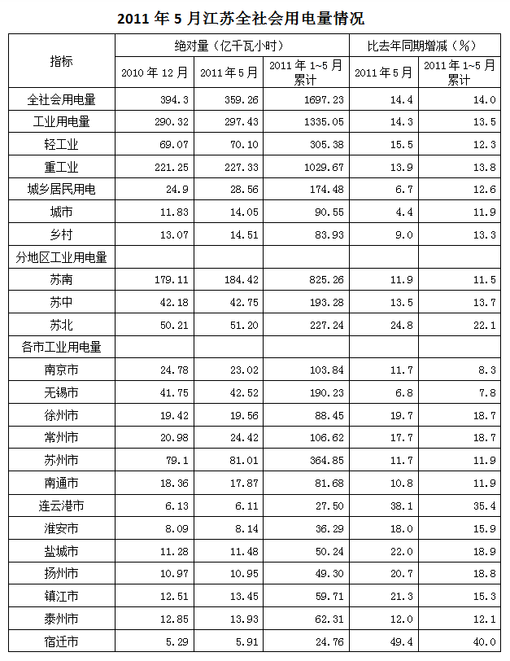

### 第 86 题

与2010年12月相比，2011年5月江苏用电量增速最快的是：

A. 轻工业用电量

B. 城市居民用电量

C. 重工业用电量

D. 乡村居民用电量

第 86 题 · 答案与解析

**参考答案（粉笔题库参考内容）**

B

**解析**

与2010年12月相比，2011年5月用电量增速分别如下：

A项：轻工业：(70.10 - 69.07)/69.07 = 1.03/69.07；

B项：城市居民：(14.05−11.83)/11.83=2.22/11.83；

C项：重工业：(227.33-221.25)/221.25=6.08/221.25；

D项：乡村居民：(14.51−13.07)/13.07=1.44/13.07。

很明显最大的是2.22/11.83，即城市居民用电量增速最快。

故正确答案为B。

**来源**：2012年江苏省公务员录用考试《行测》题（B类）第146题

### 第 87 题

如果2011年1~5月苏南、苏中和苏北用电量的月平均增速分别用V_S、V_n、V_n表示，则下列正确的是：

A. V̄ₛ＞V̄ₘ＞V̄ₙ

B. V̄_s ＜ V̄_n ＜ V̄_m

C. V̄m＜V̄s＜V̄n

D. V̄_S＞V̄_n＞V̄_m

第 87 题 · 答案与解析

**参考答案（粉笔题库参考内容）**

D

**解析**

比较2011年1~5月月均增速，只需要比较2011年5月相对于2010年12月用电量的增长率即可，根据表中数据代入如下：

苏南：184.42/179.11 − 1 = 5.31/179.11；

苏中：42.75/42.18−1=0.57/42.18；

苏北：51.20/50.21-1=0.99/50.21。

观察发现5.31约是0.57的10倍、是0.99的5倍，但179.11小于42.18的10倍、小于50.21的5倍，故可判断苏南增长率最大。同理0.99约是0.57的2倍，而42.18和50.21相近，故可判断苏北的增长率大于苏中。综合以上可得：苏南>苏北>苏中。

故正确答案为D。

**来源**：2012年江苏省公务员录用考试《行测》题（B类）第147题

### 第 88 题

2011年前5个月，江苏重工业用电量占工业用电量的比重、乡村居民用电量占城乡居民用电量的比重，与上年同期相比：

A. 都有所增长

B. 都有所减小

C. 前者增大，后者减小

D. 前者减小，后者增大

第 88 题 · 答案与解析

**参考答案（粉笔题库参考内容）**

A

**解析**

由表格第6列的2、4、5、7行数据可知，2011年前5个月，江苏重工业用电量占工业用电量的比重、乡村居民用电量占城乡居民用电量的比重分别是去年同期的(1 + 13.8%)/(1 + 13.5%)、(1 + 13.3%)/(1 + 12.6%)倍，均大于1，可知都有所增长。

故正确答案为A。

**来源**：2012年江苏省公务员录用考试《行测》题（B类）第148题

### 第 89 题

2011年前5个月，江苏13个市用电量的月平均增量为负值的市有：

A. 0个

B. 3个

C. 4个

D. 5个

第 89 题 · 答案与解析

**参考答案（粉笔题库参考内容）**

C

**解析**

月平均增量为负值，即2011年5月用电量小于2010年12月用电量，观察表中数据，南京、南通、连云港、扬州4个市符合条件。

故正确答案为C。

**来源**：2012年江苏省公务员录用考试《行测》题（B类）第149题

### 第 90 题

2010年前4个月，江苏累计用电量最多的三个市依次是：

A. 苏州、无锡、常州

B. 苏州、无锡、南京

C. 无锡、苏州、常州

D. 无锡、苏州、南京

第 90 题 · 答案与解析

**参考答案（粉笔题库参考内容）**

B

**解析**

综合选项，只需比较无锡和苏州、常州和南京即可得到正确答案。

无锡：190.23/(1+7.8%)-42.52/(1+6.8%) ≈ 150/1.07；

苏州：364.85/(1+11.9%) - 81.01/(1+11.7%) ≈ 280/1.12；

常州：106.62/(1+18.7%) - 24.42/(1+17.7%) ≈ 80/1.2；

南京：103.84/(1 + 8.3%) − 23.02/(1 + 11.7%) ≈ 80/1.1。

明显苏州>无锡，南京>常州。

故正确答案为B。

**来源**：2012年江苏省公务员录用考试《行测》题（B类）第150题

## 材料 4

2011年第一季度我国建筑业产值为16096.4亿元。其中，建筑工程产值14220.0亿元，安装工程产值1405.2亿元，其他471.2亿元。华东六省一市数据如下表。

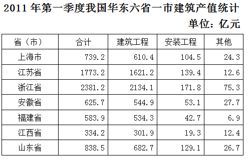

| 省（市） | 合计 | 建筑工程 | 安装工程 | 其他 |
| --- | ---: | ---: | ---: | ---: |
| 上海市 | 739.2 | 610.4 | 104.5 | 24.3 |
| 江苏省 | 1773.2 | 1621.2 | 139.4 | 12.6 |
| 浙江省 | 2381.2 | 2134.1 | 171.8 | 75.3 |
| 安徽省 | 625.7 | 544.9 | 53.1 | 27.7 |
| 福建省 | 583.9 | 534.3 | 42.7 | 6.9 |
| 江西省 | 334.2 | 301.9 | 19.3 | 12.4 |
| 山东省 | 838.5 | 682.7 | 129.1 | 26.7 |

### 第 91 题

2011年一季度，华东六省一市建筑业产值的平均值是：

A. 1437.8亿元

B. 1367.3亿元

C. 1039.4亿元

D. 872.7亿元

第 91 题 · 答案与解析

**参考答案（粉笔题库参考内容）**

C

**解析**

根据题干“2011年一季度······平均值是”，结合材料时间2011年一季度，可判定本题为现期平均数问题。定位表格材料第二列，可得华东六省一市建筑业产值的平均值为(739.2+1773.2+2381.2+625.7+583.9+334.2+838.5)÷7≈(700 + 1800 + 2400 + 600 + 600+300+800)÷7=7200÷7≈1028亿元，与C项最接近。

故正确答案为C。

**来源**：2012年江苏省公务员录用考试《行测》题（A类）第91题

### 第 92 题

2011年一季度，江苏省建筑业产值占我国建筑业产值的比重是：

A. 8.76%

B. 10.01%

C. 11.02%

D. 17.25%

第 92 题 · 答案与解析

**参考答案（粉笔题库参考内容）**

C

**解析**

根据题干“2011年一季度······占······的比重”，结合材料时间为2011年一季度，可判定本题为现期比重问题。定位表格材料和文字材料可得：2011年一季度，江苏省建筑业产值为1773.2亿元，我国建筑业产值为16096.4亿元。故江苏省建筑业产值占我国建筑业产值的比重= 1773.2/16096.4 ≈ 1773.2/16000 ≈ 11%，与C项最接近。

故正确答案为C。

**来源**：2012年江苏省公务员录用考试《行测》题（A类）第92题

### 第 93 题

2011年一季度，华东六省一市安装工程产值高于其平均产值的省（市）有：

A. 1个

B. 2个

C. 3个

D. 4个

第 93 题 · 答案与解析

**参考答案（粉笔题库参考内容）**

D

**解析**

根据题干“2011年一季度······平均产值”，结合材料时间为2011年一季度，可判定本题为现期平均数问题。定位表格材料第四列，可得安装工程产值的平均值为(104.5+139.4+171.8+53.1+42.7+19.3+129.1)÷7≈(105+139+172+53+43+19+129)÷7=660÷7≈94亿元，因此高于平均值的省（市）有上海市、江苏省、浙江省、山东省4个。

故正确答案为D。

**来源**：2012年江苏省公务员录用考试《行测》题（A类）第93题

### 第 94 题

2011年一季度，华东六省一市建筑工程产值与安装工程产值之比最大的三个省（市）是：

A. 浙江省、福建省、江西省

B. 江苏省、上海市、江西省

C. 福建省、安徽省、江西省

D. 浙江省、福建省、山东省

第 94 题 · 答案与解析

**参考答案（粉笔题库参考内容）**

A

**解析**

根据题干“······与······之比最大”，可判定本题为比值比较问题。定位表格材料第三四列，则各省（市）建筑工程产值与安装工程产值之比分别为：

上海市：610.4/104.5 ≈ 5^+；

江苏省：1621.2/139.4 ≈ 11^+；

浙江省：2134.1/171.8 ≈ 12^+；

安徽省：544.9/53.1 ≈ 10+；

福建省：534.3/42.7 ≈ 12^+；

江西省：301.9/19.3 ≈ 15^+；

山东省：682.7/129.1 ≈ 5+，

显然浙江省、福建省、江西省的比值较大。

故正确答案为A。

**来源**：2012年江苏省公务员录用考试《行测》题（A类）第94题

### 第 95 题

下列判断不正确的有：

（1）2011年一季度，江西省建筑业每项产值在华东六省一市中都是最低。

（2）2011年一季度，江苏省建筑业产值比上海市高出139.9%。

（3）2011年一季度，华东六省一市建筑工程产值占其建筑业产值的比重均超过80%。

A. 0个

B. 1个

C. 2个

D. 3个

第 95 题 · 答案与解析

**参考答案（粉笔题库参考内容）**

B

**解析**

（1）定位表格材料，江西省的“其他”一列为12.4亿元，比福建省的6.9亿元大，并不是华东六省一市最低，错误；

（2）定位表格材料，江苏省建筑业产值比上海高出1773.2/739.2 - 1 ≈ 139.9%，正确；

（3）定位表格材料第二、三列，题干“建筑工程产值占其建筑业产值的比重均超过80%”可理解为建筑工程产值应大于其建筑业产值的80%。

上海市：610.4＞739.2×80%≈740×80%=592亿元；

江苏省：1621.2＞1773.2×80%≈1800×80%=1440亿元；

浙江省：2134.1＞2381.2×80%≈2400×80%=1920亿元；

安徽省：544.9＞625.7×80%≈630×80%=504亿元；

福建省：534.3＞583.9×80%≈580×80%=464亿元；

江西省：301.9＞334.2×80%≈330×80%=264亿元；

山东省：682.7＞838.5×80%≈840×80%=672亿元。故均满足题干要求，正确；

判断不正确的有1个。

本题为选非题，故正确答案为B。

**来源**：2012年江苏省公务员录用考试《行测》题（A类）第95题

