# 2012年江苏省公务员录用考试《行测》题（B类）

<!-- gwy:overview:start -->
> **江苏 · 2012 · 行测 · B类** ｜ 155 题 · 图片 24 处 · 答案随题折叠

| 题型模块 | 题量 | 题号 |
| --- | ---: | ---: |
| 知觉速度与准确性 | 60 | 1–60 |
| 言语理解与表达 | 15 | 61–75 |
| 数量关系 | 20 | 76–95 |
| 判断推理 | 40 | 96–135 |
| 资料分析 | 20 | 136–155 |
| **合计** | **155** | |

导航：[题型与作答说明](#题型与作答说明) · [题目](#题目) · [材料 1](#材料-1)
<!-- gwy:overview:end -->

> 候选采集稿。参考答案及解析来自粉笔页面，不代表官方答案或真实高分答卷；来源使用许可与原卷对应关系仍需人工核实。

## 题型与作答说明

知觉速度与准确性

（60题）

本部分包括三种类型的试题。1~35题为同符查找，36~50题为数字区间定位，51~60为字符替换。

言语理解与表达

（15题）

本部分包括片段阅读、文章阅读与逻辑填空三种类型的试题。

数量关系

（20题）

本部分包括数字推理与数学运算两种类型的试题。

判断推理

（40题）

本部分包括类比推理、图形推理、逻辑判断与定义判断四种类型的试题。

资料分析

（20题）

下列给出了文字、表格、图形资料均有五个问题要你回答，你应根据资料提供的信息进行分析、计算、处理，然后从备选答案中选择一个最恰当的答案。

## 题目

### 第 1 题

MODERJT      SIMOVE

A. 1

B. 2

C. 3

D. 4

第 1 题 · 答案与解析

**参考答案（粉笔题库参考内容）**

C

**解析**

题干给出的两个字符组中重复的字符为“M”、“O”、“E”，共3个。

故正确答案为C。

**来源**：2012年江苏省公务员录用考试《行测》题（B类）第1题

### 第 2 题

NSFY25J      JLYBN26

A. 1

B. 2

C. 3

D. 4

第 2 题 · 答案与解析

**参考答案（粉笔题库参考内容）**

D

**解析**

题干给出的两个字符组中重复的字符为“N”、“Y”、“2”、“J”，共4个。

故正确答案为D。

**来源**：2012年江苏省公务员录用考试《行测》题（B类）第2题

### 第 3 题

▣⊙%@CTV T⊙&S@AHV

A. 1

B. 2

C. 3

D. 4

第 3 题 · 答案与解析

**参考答案（粉笔题库参考内容）**

D

**解析**

题干给出的两个字符组中重复的字符为“⊙、@、T、V、”共4个。

故正确答案为D。

**来源**：2012年江苏省公务员录用考试《行测》题（B类）第3题

### 第 4 题

CN4UD9      S7UXD4JK

A. 0

B. 2

C. 3

D. 4

第 4 题 · 答案与解析

**参考答案（粉笔题库参考内容）**

C

**解析**

题干给出的两个字符组中重复的字符为“4”、“U”、“D”，共3个。

故正确答案为C。

**来源**：2012年江苏省公务员录用考试《行测》题（B类）第4题

### 第 5 题

JCMXSE      LEDXJF

A. 1

B. 2

C. 3

D. 4

第 5 题 · 答案与解析

**参考答案（粉笔题库参考内容）**

C

**解析**

题干给出的两个字符组中重复的字符为“J”、“X”、“E”，共3个。

故正确答案为C。

**来源**：2012年江苏省公务员录用考试《行测》题（B类）第5题

### 第 6 题

AUWEX      KLFADS

A. 1

B. 2

C. 3

D. 4

第 6 题 · 答案与解析

**参考答案（粉笔题库参考内容）**

A

**解析**

题干给出的两个字符组中重复的字符为“A”，共1个。

故正确答案为A。

**来源**：2012年江苏省公务员录用考试《行测》题（B类）第6题

### 第 7 题

3Ω≡V∈ Ω3≡V∈

A. 6

B. 5

C. 4

D. 3

第 7 题 · 答案与解析

**参考答案（粉笔题库参考内容）**

B

**解析**

题干给出的两个字符组中全部重复出现，共5个。

故正确答案为B。

**来源**：2012年江苏省公务员录用考试《行测》题（B类）第7题

### 第 8 题

&※▦A▨□ ▦AD※⑥B

A. 1

B. 2

C. 3

D. 4

第 8 题 · 答案与解析

**参考答案（粉笔题库参考内容）**

C

**解析**

题干给出的两个字符组中重复的字符为“※、▦、A，”共3个。

故正确答案为C。

**来源**：2012年江苏省公务员录用考试《行测》题（B类）第8题

### 第 9 题

WSXEDC      CFDRXVE

A. 1

B. 2

C. 3

D. 4

第 9 题 · 答案与解析

**参考答案（粉笔题库参考内容）**

D

**解析**

题干给出的两个字符组中重复的字符为“X”、“E”、“D”、“C”，共4个。

故正确答案为D。

**来源**：2012年江苏省公务员录用考试《行测》题（B类）第9题

### 第 10 题

Q3W4ER56      U3ERLW4Q

A. 7

B. 6

C. 5

D. 4

第 10 题 · 答案与解析

**参考答案（粉笔题库参考内容）**

B

**解析**

题干给出的两个字符组中重复的字符为“Q”、“3”、“W”、“4”、“E”、“R”，共6个。

故正确答案为B。

**来源**：2012年江苏省公务员录用考试《行测》题（B类）第10题

### 第 11 题

TGBYHN      WSXEDC

A. 0

B. 1

C. 2

D. 3

第 11 题 · 答案与解析

**参考答案（粉笔题库参考内容）**

A

**解析**

题干给出的两个字符组中没有重复的字符。

故正确答案为A。

**来源**：2012年江苏省公务员录用考试《行测》题（B类）第11题

### 第 12 题

203948      1659274

A. 1

B. 2

C. 3

D. 4

第 12 题 · 答案与解析

**参考答案（粉笔题库参考内容）**

C

**解析**

题干给出的两个字符组中重复的字符为“2”、“9”、“4”，共3个。

故正确答案为C。

**来源**：2012年江苏省公务员录用考试《行测》题（B类）第12题

### 第 13 题

ALC2UZ      JHL0EGQ

A. 1

B. 6

C. 3

D. 4

第 13 题 · 答案与解析

**参考答案（粉笔题库参考内容）**

A

**解析**

题干给出的两个字符组中重复的字符为“L”，共1个。

故正确答案为A。

**来源**：2012年江苏省公务员录用考试《行测》题（B类）第13题

### 第 14 题

DFSLKH      KA38DLHJ29

A. 5

B. 3

C. 4

D. 2

第 14 题 · 答案与解析

**参考答案（粉笔题库参考内容）**

C

**解析**

题干给出的两个字符组中重复的字符为“D”、“L”、“K”，“H”，共4个。

故正确答案为C。

**来源**：2012年江苏省公务员录用考试《行测》题（B类）第14题

### 第 15 题

6G8CIM3      g0B619NT

A. 2

B. 3

C. 4

D. 1

第 15 题 · 答案与解析

**参考答案（粉笔题库参考内容）**

D

**解析**

题干给出的两个字符组中重复的字符为“6”，共1个。

故正确答案为D。

**来源**：2012年江苏省公务员录用考试《行测》题（B类）第15题

### 第 16 题

分开S了D合肥       来访F客户E的看到

A. 2

B. 5

C. 3

D. 0

第 16 题 · 答案与解析

**参考答案（粉笔题库参考内容）**

D

**解析**

题干给出的两个字符组中没有重复的字符。

故正确答案为D。

**来源**：2012年江苏省公务员录用考试《行测》题（B类）第16题

### 第 17 题

zb@njsuedc xcb@whuedn

A. 6

B. 7

C. 5

D. 4

第 17 题 · 答案与解析

**参考答案（粉笔题库参考内容）**

B

**解析**

题干给出的两个字符组中重复的字符为“b、@、n、u、e、d、c、”共7个。

故正确答案为B。

**来源**：2012年江苏省公务员录用考试《行测》题（B类）第17题

### 第 18 题

シHサVフー AフーテHサ

A. 1

B. 2

C. 3

D. 4

第 18 题 · 答案与解析

**参考答案（粉笔题库参考内容）**

D

**解析**

题干给出的两个字符组中重复的字符为“H”、“サ”、“7”、“—”，共4个。

故正确答案为D。

**来源**：2012年江苏省公务员录用考试《行测》题（B类）第18题

### 第 19 题

g834Z16      q72G095

A. 0

B. 1

C. 2

D. 3

第 19 题 · 答案与解析

**参考答案（粉笔题库参考内容）**

A

**解析**

题干给出的两个字符组中没有重复的字符。

故正确答案为A。

**来源**：2012年江苏省公务员录用考试《行测》题（B类）第19题

### 第 20 题

2046      9674      198042

A. 0

B. 1

C. 2

D. 3

第 20 题 · 答案与解析

**参考答案（粉笔题库参考内容）**

B

**解析**

题干给出的三个字符组中重复的字符为“4”，共1个。

故正确答案为B。

**来源**：2012年江苏省公务员录用考试《行测》题（B类）第20题

### 第 21 题

8297436      5746382      9703158

A. 1

B. 2

C. 3

D. 4

第 21 题 · 答案与解析

**参考答案（粉笔题库参考内容）**

C

**解析**

题干给出的三个字符组中重复的字符为“8”、“7”、“3”，共3个。

故正确答案为C。

**来源**：2012年江苏省公务员录用考试《行测》题（B类）第21题

### 第 22 题

5417683      6257041      7835092

A. 1

B. 2

C. 3

D. 4

第 22 题 · 答案与解析

**参考答案（粉笔题库参考内容）**

B

**解析**

题干给出的三个字符组中重复的字符为“5”、“7”，共2个。

故正确答案为B。

**来源**：2012年江苏省公务员录用考试《行测》题（B类）第22题

### 第 23 题

5034286      3827961      4759263

A. 1

B. 2

C. 3

D. 4

第 23 题 · 答案与解析

**参考答案（粉笔题库参考内容）**

C

**解析**

题干给出的三个字符组中重复的字符为“3”、“2”、“6”，共3个。

故正确答案为C。

**来源**：2012年江苏省公务员录用考试《行测》题（B类）第23题

### 第 24 题

TWQYN      W2BNQ      BPQTN

A. 1

B. 2

C. 3

D. 4

第 24 题 · 答案与解析

**参考答案（粉笔题库参考内容）**

B

**解析**

题干给出的三个字符组中重复的字符为“Q”、“N”，共2个。

故正确答案为B。

**来源**：2012年江苏省公务员录用考试《行测》题（B类）第24题

### 第 25 题

SEAPLY      IPHONE      PLAUSE

A. 1

B. 4

C. 3

D. 2

第 25 题 · 答案与解析

**参考答案（粉笔题库参考内容）**

D

**解析**

题干给出的三个字符组中重复的字符为“E”、“P”，共2个。

故正确答案为D。

**来源**：2012年江苏省公务员录用考试《行测》题（B类）第25题

### 第 26 题

2X+3Y=60; 5X-2Y=14; 3X-5Y=42

A. 3

B. 4

C. 5

D. 6

第 26 题 · 答案与解析

**参考答案（粉笔题库参考内容）**

B

**解析**

题干给出的三个字符组中重复的字符为“2、X、Y、=”，共4个。

故正确答案为B。

**来源**：2012年江苏省公务员录用考试《行测》题（B类）第26题

### 第 27 题

大里予木      太黑木子      禾了人且

A. 0

B. 1

C. 2

D. 3

第 27 题 · 答案与解析

**参考答案（粉笔题库参考内容）**

A

**解析**

题干给出的三个字符组中没有重复的字符。

故正确答案为A。

**来源**：2012年江苏省公务员录用考试《行测》题（B类）第27题

### 第 28 题

可以清心也      吾已清心可      无清心亦可以

A. 2

B. 3

C. 4

D. 5

第 28 题 · 答案与解析

**参考答案（粉笔题库参考内容）**

B

**解析**

题干给出的三个字符组中重复的字符为“可”、“清”、“心”，共3个。

故正确答案为B。

**来源**：2012年江苏省公务员录用考试《行测》题（B类）第28题

### 第 29 题

淋哉跟瘀蘸鲮      载根琳瘀脊癞      根戴琳瘀簮癞

A. 1

B. 2

C. 3

D. 4

第 29 题 · 答案与解析

**参考答案（粉笔题库参考内容）**

A

**解析**

题干给出的三个字符组中重复的字符为“瘀”，共1个。

故正确答案为A。

**来源**：2012年江苏省公务员录用考试《行测》题（B类）第29题

### 第 30 题

社设纸第赛崇风      没杜设纸第风嵩      低弟赛崇塞嵩风

A. 0

B. 1

C. 2

D. 3

第 30 题 · 答案与解析

**参考答案（粉笔题库参考内容）**

B

**解析**

题干给出的三个字符组中重复的字符为“风”，共1个。

故正确答案为B。

**来源**：2012年江苏省公务员录用考试《行测》题（B类）第30题

### 第 31 题

上忐天左红右      忑行红天上王      下十二工天土

A. 3

B. 1

C. 4

D. 0

第 31 题 · 答案与解析

**参考答案（粉笔题库参考内容）**

B

**解析**

题干给出的三个字符组中重复的字符为“天”，共1个。

故正确答案为B。

**来源**：2012年江苏省公务员录用考试《行测》题（B类）第31题

### 第 32 题

子小乒乓中曰      口乒日中木太      兵中大串夫由

A. 1

B. 2

C. 3

D. 4

第 32 题 · 答案与解析

**参考答案（粉笔题库参考内容）**

A

**解析**

题干给出的三个字符组中重复的字符为“中”，共1个。

故正确答案为A。

**来源**：2012年江苏省公务员录用考试《行测》题（B类）第32题

### 第 33 题

◆▼●◣★▲ ○▼●◣◎ ◎◆●○◣☆

A. 1

B. 2

C. 3

D. 4

第 33 题 · 答案与解析

**参考答案（粉笔题库参考内容）**

B

**解析**

题干给出的三个字符组中重复的字符为“●”、“◣”，共2个。

故正确答案为B。

**来源**：2012年江苏省公务员录用考试《行测》题（B类）第33题

### 第 34 题

三五收成中禾火夕      歹火年龙禾木申五      五已禾非多火中

A. 1

B. 2

C. 3

D. 4

第 34 题 · 答案与解析

**参考答案（粉笔题库参考内容）**

C

**解析**

题干给出的三个字符组中重复的字符为“五”、“禾”、“火”，共3个。

故正确答案为C。

**来源**：2012年江苏省公务员录用考试《行测》题（B类）第34题

### 第 35 题

W马到成功9丰       功9M6右马龙冯       N龙马M精9神

A. 1

B. 2

C. 3

D. 4

第 35 题 · 答案与解析

**参考答案（粉笔题库参考内容）**

B

**解析**

题干给出的三个字符组中重复的字符为“马”、“9”，共2个。

故正确答案为B。

**来源**：2012年江苏省公务员录用考试《行测》题（B类）第35题

### 第 36 题

| A | B | C | D |
| --- | --- | --- | --- |
| 8164—9327 | 4732—5682 | 7105—8046 | 3967—4378 |
| 2658—3796 | 6408—7051 | 1347—2568 | 5686—6048 |

7438

A. A

B. B

C. C

D. D

第 36 题 · 答案与解析

**参考答案（粉笔题库参考内容）**

C

**解析**

数字7438位于区间7105-8046。

故正确答案为C。

**来源**：2012年江苏省公务员录用考试《行测》题（B类）第36题

### 第 37 题

| A | B | C | D |
| --- | --- | --- | --- |
| 8164—9327 | 4732—5682 | 7105—8046 | 3967—4378 |
| 2658—3796 | 6408—7051 | 1347—2568 | 5686—6048 |

6026

A. A

B. B

C. C

D. D

第 37 题 · 答案与解析

**参考答案（粉笔题库参考内容）**

D

**解析**

数字6026位于区间5686-6048。

故正确答案为D。

**来源**：2012年江苏省公务员录用考试《行测》题（B类）第37题

### 第 38 题

| A | B | C | D |
| --- | --- | --- | --- |
| 8164—9327 | 4732—5682 | 7105—8046 | 3967—4378 |
| 2658—3796 | 6408—7051 | 1347—2568 | 5686—6048 |

7014

A. A

B. B

C. C

D. D

第 38 题 · 答案与解析

**参考答案（粉笔题库参考内容）**

B

**解析**

数字7014位于区间6408-7051。

故正确答案为B。

**来源**：2012年江苏省公务员录用考试《行测》题（B类）第38题

### 第 39 题

| A | B | C | D |
| --- | --- | --- | --- |
| 8164—9327 | 4732—5682 | 7105—8046 | 3967—4378 |
| 2658—3796 | 6408—7051 | 1347—2568 | 5686—6048 |

8045

A. A

B. B

C. C

D. D

第 39 题 · 答案与解析

**参考答案（粉笔题库参考内容）**

C

**解析**

数字8045位于区间7105-8046。

故正确答案为C。

**来源**：2012年江苏省公务员录用考试《行测》题（B类）第39题

### 第 40 题

| A | B | C | D |
| --- | --- | --- | --- |
| 8164—9327 | 4732—5682 | 7105—8046 | 3967—4378 |
| 2658—3796 | 6408—7051 | 1347—2568 | 5686—6048 |

9313

A. A

B. B

C. C

D. D

第 40 题 · 答案与解析

**参考答案（粉笔题库参考内容）**

A

**解析**

数字9313位于区间8164-9327。

故正确答案为A。

**来源**：2012年江苏省公务员录用考试《行测》题（B类）第40题

### 第 41 题

| A | B | C | D |
| --- | --- | --- | --- |
| 8164—9327 | 4732—5682 | 7105—8046 | 3967—4378 |
| 2658—3796 | 6408—7051 | 1347—2568 | 5686—6048 |

4918

A. A

B. B

C. C

D. D

第 41 题 · 答案与解析

**参考答案（粉笔题库参考内容）**

B

**解析**

数字4918位于区间4732-5682。

故正确答案为B。

**来源**：2012年江苏省公务员录用考试《行测》题（B类）第41题

### 第 42 题

| A | B | C | D |
| --- | --- | --- | --- |
| 8164—9327 | 4732—5682 | 7105—8046 | 3967—4378 |
| 2658—3796 | 6408—7051 | 1347—2568 | 5686—6048 |

7521

A. A

B. B

C. C

D. D

第 42 题 · 答案与解析

**参考答案（粉笔题库参考内容）**

C

**解析**

数字7521位于区间7105-8046。

故正确答案为C。

**来源**：2012年江苏省公务员录用考试《行测》题（B类）第42题

### 第 43 题

| A | B | C | D |
| --- | --- | --- | --- |
| 8164—9327 | 4732—5682 | 7105—8046 | 3967—4378 |
| 2658—3796 | 6408—7051 | 1347—2568 | 5686—6048 |

3567

A. A

B. B

C. C

D. D

第 43 题 · 答案与解析

**参考答案（粉笔题库参考内容）**

A

**解析**

数字3567位于区间2658-3796。

故正确答案为A。

**来源**：2012年江苏省公务员录用考试《行测》题（B类）第43题

### 第 44 题

| A | B | C | D |
| --- | --- | --- | --- |
| 8164—9327 | 4732—5682 | 7105—8046 | 3967—4378 |
| 2658—3796 | 6408—7051 | 1347—2568 | 5686—6048 |

5629

A. A

B. B

C. C

D. D

第 44 题 · 答案与解析

**参考答案（粉笔题库参考内容）**

B

**解析**

数字5629位于区间4732-5682。

故正确答案为B。

**来源**：2012年江苏省公务员录用考试《行测》题（B类）第44题

### 第 45 题

| A | B | C | D |
| --- | --- | --- | --- |
| 8164—9327 | 4732—5682 | 7105—8046 | 3967—4378 |
| 2658—3796 | 6408—7051 | 1347—2568 | 5686—6048 |

4279

A. A

B. B

C. C

D. D

第 45 题 · 答案与解析

**参考答案（粉笔题库参考内容）**

D

**解析**

数字4279位于区间3967-4378。

故正确答案为D。

**来源**：2012年江苏省公务员录用考试《行测》题（B类）第45题

### 第 46 题

| A | B | C | D |
| --- | --- | --- | --- |
| 8164—9327 | 4732—5682 | 7105—8046 | 3967—4378 |
| 2658—3796 | 6408—7051 | 1347—2568 | 5686—6048 |

9273

A. A

B. B

C. C

D. D

第 46 题 · 答案与解析

**参考答案（粉笔题库参考内容）**

A

**解析**

数字9273位于区间8164-9327。

故正确答案为A。

**来源**：2012年江苏省公务员录用考试《行测》题（B类）第46题

### 第 47 题

| A | B | C | D |
| --- | --- | --- | --- |
| 8164—9327 | 4732—5682 | 7105—8046 | 3967—4378 |
| 2658—3796 | 6408—7051 | 1347—2568 | 5686—6048 |

5268

A. A

B. B

C. C

D. D

第 47 题 · 答案与解析

**参考答案（粉笔题库参考内容）**

B

**解析**

数字5268位于区间4732-5682。

故正确答案为B。

**来源**：2012年江苏省公务员录用考试《行测》题（B类）第47题

### 第 48 题

| A | B | C | D |
| --- | --- | --- | --- |
| 8164—9327 | 4732—5682 | 7105—8046 | 3967—4378 |
| 2658—3796 | 6408—7051 | 1347—2568 | 5686—6048 |

7654

A. A

B. B

C. C

D. D

第 48 题 · 答案与解析

**参考答案（粉笔题库参考内容）**

C

**解析**

数字7654位于区间7105-8046。

故正确答案为C。

**来源**：2012年江苏省公务员录用考试《行测》题（B类）第48题

### 第 49 题

| A | B | C | D |
| --- | --- | --- | --- |
| 8164—9327 | 4732—5682 | 7105—8046 | 3967—4378 |
| 2658—3796 | 6408—7051 | 1347—2568 | 5686—6048 |

5958

A. A

B. B

C. C

D. D

第 49 题 · 答案与解析

**参考答案（粉笔题库参考内容）**

D

**解析**

数字5958位于区间5686-6048。

故正确答案为D。

**来源**：2012年江苏省公务员录用考试《行测》题（B类）第49题

### 第 50 题

| A | B | C | D |
| --- | --- | --- | --- |
| 8164—9327 | 4732—5682 | 7105—8046 | 3967—4378 |
| 2658—3796 | 6408—7051 | 1347—2568 | 5686—6048 |

2976

A. A

B. B

C. C

D. D

第 50 题 · 答案与解析

**参考答案（粉笔题库参考内容）**

A

**解析**

数字2976位于区间2658-3796。

故正确答案为A。

**来源**：2012年江苏省公务员录用考试《行测》题（B类）第50题

## 材料 1

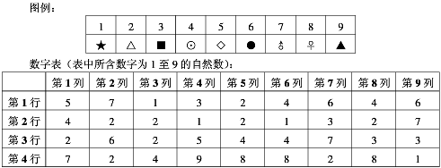

根据图例和数字表回答下列各题。

### 第 51 题

数字表中第4行第8列对应的符号是：

A. ☿ B. ♀ C. ▲ D. ●

A. A

B. B

C. C

D. D

第 51 题 · 答案与解析

**参考答案（粉笔题库参考内容）**

B

**解析**

数字表中第4行第8列的数字为8，由对应表可知对应的符号为♀。

故正确答案为B。

**来源**：2012年江苏省公务员录用考试《行测》题（B类）第51题

### 第 52 题

数字表中第5列第2行对应的符号是：

A. ⊙ B. ♀ C. △ D. ★

A. A

B. B

C. C

D. D

第 52 题 · 答案与解析

**参考答案（粉笔题库参考内容）**

C

**解析**

数字表中第5列第2行的数字为2，由对应表可知对应的符号为△。

故正确答案为C。

**来源**：2012年江苏省公务员录用考试《行测》题（B类）第52题

### 第 53 题

数字表中出现次数最多的数字对应的符号是：

A. △ B. ♀ C. ⊙ D. ★

A. A

B. B

C. C

D. D

第 53 题 · 答案与解析

**参考答案（粉笔题库参考内容）**

A

**解析**

数字表中出现次数最多的数字为2，在数字表中一共出现9次，由对应表可知2对应的符号是△。

故正确答案为A。

**来源**：2012年江苏省公务员录用考试《行测》题（B类）第53题

### 第 54 题

数字表中只出现1次的数字对应的符号：

A. ◇ B. ★ C. △ D. ▲

A. A

B. B

C. C

D. D

第 54 题 · 答案与解析

**参考答案（粉笔题库参考内容）**

D

**解析**

数字表中只出现1次的数字为9，由对应表可知对应的符号为▲。

故正确答案为D。

**来源**：2012年江苏省公务员录用考试《行测》题（B类）第54题

### 第 55 题

数字表中第4行出现次数最多的数字对应的符号是：

A. A

B. B

C. C

D. D

第 55 题 · 答案与解析

**参考答案（粉笔题库参考内容）**

B

**解析**

数字表中第4行出现次数最多的数字为8，在第4行中8共出现3次，由对应表可知对应的符号为♀。

故正确答案为B。

**来源**：2012年江苏省公务员录用考试《行测》题（B类）第55题

### 第 56 题

图例中◇对应的数字在数字表中出现的次数是：

A. 1

B. 2

C. 3

D. 4

第 56 题 · 答案与解析

**参考答案（粉笔题库参考内容）**

B

**解析**

由对应表可知 ◇ 对应的数字为5，在数字表中5共出现2次。

故正确答案为B。

**来源**：2012年江苏省公务员录用考试《行测》题（B类）第56题

### 第 57 题

与符号■对应的数字没有出现在数字表中的哪一行：

A. 第1行

B. 第2行

C. 第3行

D. 第4行

第 57 题 · 答案与解析

**参考答案（粉笔题库参考内容）**

D

**解析**

由对应表可知■对应的数字为3，没有出现在数字表中的第4行。

故正确答案为D。

**来源**：2012年江苏省公务员录用考试《行测》题（B类）第57题

### 第 58 题

与数字表第5列第2、3、4行的数字对应的符号依次是：

★

A. A

B. B

C. C

D. D

第 58 题 · 答案与解析

**参考答案（粉笔题库参考内容）**

A

**解析**

由对应表可知，数字表第5列第2、3、4行的数字对应的符号依次为△⊙♀，选项B、C、D均不符合。

故正确答案为A。

**来源**：2012年江苏省公务员录用考试《行测》题（B类）第58题

### 第 59 题

下列符号中，数字表第2列数字对应的符号没有出现的是：

A. A

B. B

C. C

D. D

第 59 题 · 答案与解析

**参考答案（粉笔题库参考内容）**

B

**解析**

数字表第2列出现的数字为7、2、6，由对应表可知对应的符号依次为♂、△、●，所以在选项中没有出现的是▲。

故正确答案为B。

**来源**：2012年江苏省公务员录用考试《行测》题（B类）第59题

### 第 60 题

数字表中数字之和最小的一列第4行中的数字对应的符号是：

A. A

B. B

C. C

D. D

第 60 题 · 答案与解析

**参考答案（粉笔题库参考内容）**

C

**解析**

数字表中数字之和最小的一列为第3列，第4行中的数字为4，由对应表可知对应的符号为⊙。

故正确答案为C。

**来源**：2012年江苏省公务员录用考试《行测》题（B类）第60题

### 第 61 题

随着通讯技术的进步，政府执政的舆论环境已发生了明显的变化，各种舆论可以借助网络、短信等方式跨越时空迅速传递，使意见空间加大、力度增强，而决策透明度的增加和公民民主参与意识的增强，又加大了政府的舆论压力。因此政府对“舆情危机”的处理需要改变以往的被动方式，针对新出现的情况，及时采取新的方式来应对。

对这段文字概括最准确的是：

A. 强调政府在新舆论环境下有必要转变应对方式

B. 对比不同时期政府的舆论宣传环境与工作方式

C. 剖析政府执政的舆论压力不断增大的外在原因

D. 分析通讯技术发展与舆论环境变化之间的关系

第 61 题 · 答案与解析

**参考答案（粉笔题库参考内容）**

A

**解析**

本题为中心理解题。

作者行文思路为先提出问题——舆论环境变化加大了政府的舆论压力，“因此”一词之后为解决问题——改变方式应对新情况。可知文段的重点是解决问题。

因此，结合选项应该选择A。

B项只强调“提出问题”部分，且偷换概念，“舆论宣传环境”和文段中的“舆论环境”不同；C项错在文段只是列举现象说明政府执政舆论压力不断增大的外在原因，文段主题不是为了剖析它；D项错在文段主体是政府，不是通讯技术和舆论环境的关系。

故正确答案为A。

**考点**：关联词-因果、关联词-对策

**来源**：2012年江苏省公务员录用考试《行测》题（B类）第61题

### 第 62 题

目前医保支付模式的改革方向大致为由“按项目付费”过渡为“按病种付费”。在病种付费方式下，医院获得医疗保险机构的费用偿付是按每位病人所属的疾病分类和等级“定额预付”的，因此医院只有提供更科学的诊断规范和医护计划才能增加医保结余，并有利于合理控制医疗成本。

下列说法不能从文段中推出的是：

A. 按病种付费有利于使医院更科学地实施医疗

B. 按病种付费促使医院考虑如何控制医疗成本

C. 按病种付费才能做到病人医疗费用逐年降低

D. 按病种付费可能是相对较好的医保支付模式

第 62 题 · 答案与解析

**参考答案（粉笔题库参考内容）**

C

**解析**

C项表述有误，文段中只说按病种付费有利于控制医疗成本，但并不意味着病人的医疗费用会逐年降低。因此，结合选项应该选择C项。A、B、D三项表述正确，从“因此医院只有提供更科学的诊断规范和医护计划······并有利于合理控制成本”可知。

本题为选非题，故正确答案为C。

**考点**：细节判断题

**来源**：2012年江苏省公务员录用考试《行测》题（B类）第62题

### 第 63 题

订单农业是一种远期交易，在合约期内，农产品价格受诸多因素的影响而多变，若在到期履约时价格波动大于预期，使履约成本高于违约成本或履约收益低于违约收益时，双方都会出现违约倾向：当市场价格高于订单价格时，农户存在着把农产品转售给市场的强烈动机；而当市场价格低于协议价格时，龙头企业则更倾向于违约从市场上收购。这段文字主要讨论：

A. 订单农业容易受到市场多种因素影响。

B. 订单农业常出现违约现象的主要原因。

C. 利益冲突使农户和企业出现违约现象。

D. 订单农业无法履约在于违约金额较低。

第 63 题 · 答案与解析

**参考答案（粉笔题库参考内容）**

B

**解析**

文段开篇引出订单农业的话题，并介绍双方都会出现违约倾向的情况，之后分别从两个方面进行具体的解释说明，故文段重点论述订单农业出现违约现象的原因，对应B项，。

A项，对应话题引入部分，非重点，排除；

C项，缺少文段核心话题“订单农业”，排除；

D项，“违约金额较低”表述片面，排除。

故正确答案为B。

**考点**：关联词-并列

**来源**：2012年江苏省公务员录用考试《行测》题（B类）第63题

### 第 64 题

飞扬公司开发的操作系统及相应的智能手机发展迅猛，然而近来一些IT公司通过专利权直接或间接向飞扬公司发难，如通过索取专利使用费抬高飞扬公司硬件生产商的成本，禁止其销售等。飞扬公司在操作系统的开发过程中对专利问题的马虎态度，已成为制约其发展的阿喀琉斯之踵。

文中的“阿喀琉斯之踵”寓指：

A. 技术上的缺陷

B. 设计上的败笔

C. 应用上的漏洞

D. 法律上的软肋

第 64 题 · 答案与解析

**参考答案（粉笔题库参考内容）**

D

**解析**

本题考查词句理解。

由原文“······对专利问题的马虎态度，已成为······阿喀琉斯之踵”可知，这里的“阿喀琉斯之踵”是对前文“对专利问题的马虎态度”的解释。这里的“专利”涉及法律层面。

故正确答案为D。

**考点**：实词

**来源**：2012年江苏省公务员录用考试《行测》题（B类）第64题

### 第 65 题

传统中国的日常生活世界总是曲里拐弯，充满细节、血肉，剪不断，理还乱。在是否宜居方面，与摩天大楼相比，苏州园林、四合院并不落后，与以购物为唯一目的的超市相比，庙会、集市带来的不是混乱，而是更顺乎人情。

作者通过这段文字意在强调：

A. 传统中国的日常生活其实并不混乱。

B. 表面纷乱的传统生活有自己的魅力。

C. 传统中国的日常生活比现代生活更好。

D. 摩天大楼和超市代表的现代生活缺乏人情味。

第 65 题 · 答案与解析

**参考答案（粉笔题库参考内容）**

B

**解析**

本题为中心理解题。

文段欲扬先抑，开头说中国传统生活“曲里拐弯”“乱”，最后则指出“并不落后”“不是混乱，而是顺乎人情”，重点在转折之后的内容。

因此，结合选项应该选择B。

A项表述与文段有出入，C项“更好”无从推知，D项“缺乏人情味”也不能从文段中得知。

故正确答案为B。

**考点**：关联词-转折

**来源**：2012年江苏省公务员录用考试《行测》题（B类）第65题

## 材料 2

①科学进步的简单模式是提出理论，并从中推导出假设，然后假设接受各种技术或方法的检验。如果假设通过了检验，该理论就得到了某种程度的确证，如果假设被实验证伪，这个理论就得做出某种程度的改变，或者被一个新理论所取代。

②科学中有很多理论已经被充分证实并被确认过无数次，它们被称为“公理”。我们不大可能在某一天发现，血液不是循环的，或者地球并没有在环日轨道上。

③这些＿＿＿＿的事实并不是我们一直在讨论的假说，它们也不是科学家们的兴趣关注点，因为它们已经是确定无疑的。科学家只对已有知识范围之外的问题感兴趣。

④科学家们总是更强调未知的事情而非已知事物。为了推进知识的进步，科学家们必须一直身处已知的前沿。当然，这里是很多事情都不确定的地方，但科学进步正是通过这个过程来实现的，即试图在已知的前沿减少不确定性。

⑤同样需要强调的是，当科学家通过观察法证伪一个理论或用一个新理论代替旧理论的时候，并不意味着他们要将先前用以建立旧理论的事实全都扔到一边。

⑥相反，新理论应该能够解释所有旧理论能解释的事实，还能够解释旧理论不能解释的事实。

⑦科普作家在一篇题为《错误的相对性》的文章中谈到我们对地球形状的理解是如何完善的。

⑧他首先提醒我们，不要以为“地球是平的”这一古老信念是愚蠢的，在平原上（大部分人类文明都发源于平原），地球看上去相当平坦。应该试着对不同的理论进行定量的比较，看结果会告诉我们什么。

⑨“地平理论”说每公里的曲率为0。现在我们都知道，这种理论是错误的。但从某种意义上说，它又很接近真理。

⑩亚里士多德之后的一个世纪，古希腊一位哲学家埃拉托塞尼斯指出，太阳在不同纬度上投射不同长度的影子。根据影子长度不同，他计算出地球的周长为2.5万英里，那么这个球体曲率是0.000126度/英里。这个数值非常接近0。

这从0到0.000126的差别解释了为何我们用了如此长的时间，才放弃“地球是平的”这一观念，并转而相信地球是球状的。

### 第 66 题

根据文意，判断一个新理论能否成立关键要看：

A. 其能否减少相关问题的不确定性

B. 其能否证实某些未知事物的属性

C. 其能否解决已有知识范围之外的问题

D. 其提出的假设能否通过实验的检验

第 66 题 · 答案与解析

**参考答案（粉笔题库参考内容）**

D

**解析**

本题考查细节判断。

由第①段“如果假设通过了检验，该理论就得到了某种程度的确证······”可知，D项正确。

A项的“减少相关问题的不确定性”是实现科学进步的一个环节；B项“证明未知事物的属性”在文章中没有提及；C项“解决已有知识范围之外的问题”是科学家的兴趣关注点，并不能判断新理论是否成立。

故正确答案为D。

**来源**：2012年江苏省公务员录用考试《行测》题（B类）第66题

### 第 67 题

填入文中画横线处最恰当的一项是：

A. 千真万确

B. 不言而喻

C. 众所周知

D. 言之有理

第 67 题 · 答案与解析

**参考答案（粉笔题库参考内容）**

C

**解析**

本题考查成语填空。

根据前后文，这里应该填入与“已经被充分证实并被确认过无数次”相近意思的词语，表达这一事实大家普遍知道，不会轻易改变的意思。只有“众所周知”最符合要求。

A项“千真万确”侧重真实性，与“事实”语意重复；B项“不言而喻”形容事理极其显明，无须解释；D项“言之有理”指说的话有道理。都不能与“事实”搭配。

故正确答案为C。

**来源**：2012年江苏省公务员录用考试《行测》题（B类）第67题

### 第 68 题

“公理”引不起科学家的兴趣，因为：

A. 它们已被充分证实过了

B. 它们已被一般人所掌握

C. 它们不能推动科学进步

D. 它们不是科学前沿问题

第 68 题 · 答案与解析

**参考答案（粉笔题库参考内容）**

A

**解析**

本题考查细节判断。

由第③段“它们不是科学家们的兴趣关注点，因为它们已经是确定无疑的”可知“公理”引不起科学家的兴趣，是因为它们已被充分证实过了。

故正确答案为A。

**来源**：2012年江苏省公务员录用考试《行测》题（B类）第68题

### 第 69 题

文章提到证明地球为球形的过程，意在强调：

A. 有时需要经过一个世纪的等待才能修正旧理论

B. “地球是平的”从某种意义上说很接近真理

C. 失之毫厘的数据可能带来大为不同的结论

D. 新理论应该能够解释旧理论能够解释的事实

第 69 题 · 答案与解析

**参考答案（粉笔题库参考内容）**

D

**解析**

本题考查隐含主旨。

从行文脉络来看，文章证明地球为球形的过程是对第⑤⑥段的例证。这两段主要是说“新理论要能解释所有旧理论能解释和不能解释的事实”，显然“地平理论”是旧理论。因此这一过程就是为了说明新理论能够解释旧理论能够解释的事实。

A项的“一个世纪”是对第⑩段内容的错误理解；B项强调旧理论，不是作者想要表达的主旨；C项侧重强调小数据带来的大不同，与主旨无关。

故正确答案为D。

**来源**：2012年江苏省公务员录用考试《行测》题（B类）第69题

### 第 70 题

下列对这篇文章层次的划分最恰当的一项是：

A. ①—③/④—⑥/⑦—⑩

B. ①/②—④/⑤—⑥/⑦—⑩

C. ①—②/③—⑤/⑥—⑩

D. ①—④/⑤—⑥/⑦—⑨/⑩

第 70 题 · 答案与解析

**参考答案（粉笔题库参考内容）**

B

**解析**

本题考查对文章结构的理解。

从文章的表达手法上可以将文段分为两大部分，其中第①—⑥段是第一部分，表达手法是讲道理。第⑦—⑩段属于摆事实。第一部分的内容又可分为三小部分。结构为“总—分—分”，第①段是总，是讲理论是如何提出并得以验证，第②—④段讲科学家如何发现新的理论，第⑤⑥段则是进一步讲如何证伪新理论或以一个新理论代替旧理论。

故正确答案为B。

**来源**：2012年江苏省公务员录用考试《行测》题（B类）第70题

### 第 71 题

“舞动的北京”是一方中国的印章，＿＿＿＿＿着一个有着56个民族的国家对于奥林匹克运动的誓言；“舞动的北京”是一幅中华民族的图腾，＿＿＿＿＿着悠久的岁月与民族的荣耀。

依次填入画横线处最恰当的一项是：

A. 镌刻 承载

B. 雕刻 呈现

C. 承载 依托

D. 铭刻 飞扬

第 71 题 · 答案与解析

**参考答案（粉笔题库参考内容）**

A

**解析**

本题考查近义实词的辨析。

第一空，由“印章”可以排除C项，“承载”和“印章”属于主谓搭配不当。B项“雕刻”没有句子语境中的庄重、正式的书面色彩，接近口语，也可排除。

第二空，由后面的宾语“岁月”“荣耀”可以排除B、D项，且“图腾”和“飞扬”不能搭配。“承载”表示“承受装载”，与岁月、荣耀搭配恰当。

故正确答案为A。

**考点**：实词填空、词的辨析-搭配对象

**来源**：2012年江苏省公务员录用考试《行测》题（B类）第71题

### 第 72 题

目前的中国政党制度是近代以来中国历史＿＿＿＿＿的产物，它既不同于西方国家的两党或多党制，也有别于有的国家实行的一党制，形成了具有自身特色的制度模式，蕴含着符合中国国情的＿＿＿＿＿。

依次填入画横线处最恰当的一项是：

A. 发生发展 独特规律

B. 有序发展 内部规律

C. 发展演进 内在逻辑

D. 发展变化 固有特色

第 72 题 · 答案与解析

**参考答案（粉笔题库参考内容）**

C

**解析**

第一空，根据“近代以来中国历史”可知，横线处应体现中国政党制度是随着近代历史的发展而逐渐形成之意。C项“发展演进”指逐渐发展变化而进化，D项“发展变化”可体现发展之意，均符合文意，保留。A项“发生”指产生，与“中国历史”搭配不当，排除；B项“有序发展”侧重于有秩序地发展，文段未强调秩序，排除。

第二空，搭配“中国国情”，C项“内在逻辑”与“中国国情”搭配恰当，当选。D项“固有特色”与前文“具有自身特色”语义重复，排除。

故正确答案为C。

**考点**：实词填空、对应关系-前后呼应、词的辨析-搭配对象

**来源**：2012年江苏省公务员录用考试《行测》题（B类）第72题

### 第 73 题

机遇与每个人的未来＿＿＿＿＿，把握机遇，就能更好地把握未来。然而，机遇又像是一个美丽而性情古怪的天使，她偶尔降临在你身边，如果你稍有不慎，如果你不懂珍惜，她将翩然离去，不管你怎样＿＿＿＿＿。

依次填入画横线处最恰当的一项是：

A. 休戚相关 捶胸顿足

B. 息息相关 扼腕叹息

C. 休戚与共 后悔莫及

D. 生死攸关 自怨自艾

第 73 题 · 答案与解析

**参考答案（粉笔题库参考内容）**

B

**解析**

本题考查成语辨析。

第一空，“休戚相关”“休戚与共”都是忧喜祸福互相关联的意思，常修饰有利害关系的双方，不能形容机遇和未来的关系，故排除A、C两项。

D项中的“生死攸关”形容关系到生死存亡的大问题，文中只是表达机遇与未来的关系，上升不到生存死亡的程度，故排除。B项“息息相关”比喻关系非常密切，符合文意，基本锁定答案。

第二空填入验证，“扼腕叹息”形容十分激动地发出长叹的情态，比喻不懂把握错失良机的后悔心情，符合语境。

故正确答案为B。

**考点**：对应关系-前后呼应、成语填空、词的辨析-程度轻重

**来源**：2012年江苏省公务员录用考试《行测》题（B类）第73题

### 第 74 题

公众参与的价值在于提高项目的科学性与可行性。公众的环境健康是最重要的，任何一个新项目，如果没有足够的时间去＿＿＿＿＿它的环境影响就＿＿＿＿＿，那么，大量的环境隐患一旦爆发将很难收拾。

依次填入画横线处最恰当的一项是：

A. 考虑 仓促开展

B. 避免 心存侥幸

C. 思考 避重就轻

D. 论证 轻率上马

第 74 题 · 答案与解析

**参考答案（粉笔题库参考内容）**

D

**解析**

本题考查近义实词的辨析和成语填空。

本题可先看第二空，根据“那么”之后的意思可知横线处的句子意在说明：要小心考证新项目的环境影响，不能轻举妄动。A项“仓促开展”侧重行动的匆忙性，B、C项中的“心存侥幸”和“避重就轻”只表达一种态度，并没有涉及具体行动。只有D项“轻率上马”最为全面，表达了不慎重，不认真地开展行动这一行为。

第一空，新项目的“环境影响”是需要调查考证的，所以应填“论证”，而非单纯“思考”“考虑”就可以。“避免”语义错误，并不是所有项目都有环境影响。

故正确答案为D。

**考点**：对应关系-前后呼应、混搭填空

**来源**：2012年江苏省公务员录用考试《行测》题（B类）第74题

### 第 75 题

正是这许许多多人们＿＿＿＿＿的变化，比起接踵而起的高楼、林立的工厂以及家用电器＿＿＿＿＿手机和互联网的普及，更深刻地记录着我们生活的变化。

依次填入画横线处最恰当的一项是：

A. 习焉不察 乃至

B. 视若无睹 加上

C. 习以为常 或者

D. 耳闻目睹 甚至

第 75 题 · 答案与解析

**参考答案（粉笔题库参考内容）**

A

**解析**

本题考查近义虚词辨析和成语填空。

第一空，横线处的意思与后文“接踵而起的高楼、林立的工厂”等显而易见的情况相反，即那些人们没有关注到的变化。B项“视若无睹”指对眼前事物漠不关心的态度，强调主观方面，与文段不符。D项“耳闻目睹”形容亲耳听到、亲眼见到，与文段想强调的“没有关注到”意思不符。排除B、D两项。

第二空，A项“乃至”表递进关系，符合高楼、工厂、家用电器到手机和互联网不断发展变化的过程。B项“加上”没有递进的意思，不够准确。C项的“或者”表并列，用在此处不当。

故正确答案为A。

**考点**：对应关系-前后呼应、混搭填空、词的辨析-程度轻重

**来源**：2012年江苏省公务员录用考试《行测》题（B类）第75题

### 第 76 题

2， 5， 14， 41， 122，（  ）

A. 243

B. 323

C. 365

D. 382

第 76 题 · 答案与解析

**参考答案（粉笔题库参考内容）**

C

**解析**

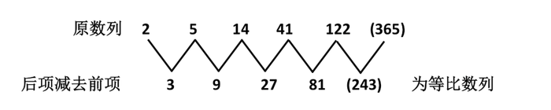

故正确答案为C。

**来源**：2012年江苏省公务员录用考试《行测》题（B类）第76题

### 第 77 题

21，43，65，87，109，（  ）

A. 130

B. 132

C. 1210

D. 1211

第 77 题 · 答案与解析

**参考答案（粉笔题库参考内容）**

D

**解析**

机械划分：2|1、4|3、6|5、8|7、10|9、（ ）；

看作交叉数列：

左侧部分：2、4、6、8、10、(12)，为等差数列；

右侧部分：1、3、5、7、9、(11)，为等差数列；

因此原数列未知项为1211。

故正确答案为D。

**来源**：2012年江苏省公务员录用考试《行测》题（B类）第77题

### 第 78 题

2，3，10，15，26，（  ）

A. 30

B. 35

C. 38

D. 57

第 78 题 · 答案与解析

**参考答案（粉笔题库参考内容）**

B

**解析**

原数列2 3 10 15 26 ( )；

平方数列1^2 2^2 3^2 4^2 5^2 6^2；

修正项+1−1+1−1+1−1。

原数列的空缺项为6^2 − 1 = 35。

故正确答案为B。

**来源**：2012年江苏省公务员录用考试《行测》题（B类）第78题

### 第 79 题

1，1，3，5，17，87，（  ）

A. 1359

B. 1479

C. 1481

D. 1563

第 79 题 · 答案与解析

**参考答案（粉笔题库参考内容）**

C

**解析**

数列中相邻两项的乘积，加2修正，等于数列的下一项。3=1×1+2，5 = 1 × 3 + 2，17 = 3 × 5 + 2，87 = 5×17 + 2，()=17×87+2。运用尾数法，未知项的尾数为1。

故正确答案为C。

**来源**：2012年江苏省公务员录用考试《行测》题（B类）第79题

### 第 80 题

√2/2，1，√2，2，2√2，()

A. 4

B. 8

C. 32

D. 42

第 80 题 · 答案与解析

**参考答案（粉笔题库参考内容）**

A

**解析**

该数列是公比为√2的等比数列。

后项除以前项，商值均为√2，因此下一项为4。

故正确答案为A。

**来源**：2012年江苏省公务员录用考试《行测》题（B类）第80题

### 第 81 题

7，10，16，22，34，（  ）

A. 36

B. 37

C. 39

D. 40

第 81 题 · 答案与解析

**参考答案（粉笔题库参考内容）**

D

**解析**

数列中各项分别为质数数列2、3、5、7、11、(13)的三倍再加1，因此未知项为13×3+1=40。

故正确答案为D。

**来源**：2012年江苏省公务员录用考试《行测》题（B类）第81题

### 第 82 题

0，2/3，8/9，（  ），16/15，10/9

A. 1

B. 13/15

C. 7/9

D. 17/15

第 82 题 · 答案与解析

**参考答案（粉笔题库参考内容）**

A

**解析**

原数列可以化为0/3、4/6、8/9、( )、16/15、20/18。其中分子项0、4、8、(12)、16、20为公差是4的等差数列，分母项3、6、9、(12)、15、18为公差是3的等差数列，则未知项为12/12，化简为1。

故正确答案为A。

**来源**：2012年江苏省公务员录用考试《行测》题（B类）第82题

### 第 83 题

3，6，12，（  ），130，732

A. 32

B. 48

C. 72

D. 100

第 83 题 · 答案与解析

**参考答案（粉笔题库参考内容）**

A

**解析**

原数列3，6，12，（  ），130，732；

阶乘数列1！，2！，3！，（4！），5！，6！；

修正项2，4，6，（8），10，12。

原数列的空缺项为4！+8=32。

故正确答案为A。

**来源**：2012年江苏省公务员录用考试《行测》题（B类）第83题

### 第 84 题

5，6，(  )，10，15，30

A. 7

B. 9

C. 7 1/2

D. 9 1/2

第 84 题 · 答案与解析

**参考答案（粉笔题库参考内容）**

C

**解析**

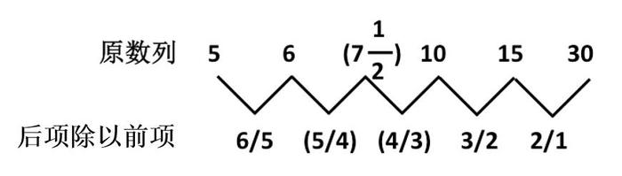

新数列的分子项和分母项均构成等差数列。

故正确答案为C。

**来源**：2012年江苏省公务员录用考试《行测》题（B类）第84题

### 第 85 题

21，59，1117，2325，（  ），9541

A. 3129

B. 4733

C. 6833

D. 8233

第 85 题 · 答案与解析

**参考答案（粉笔题库参考内容）**

B

**解析**

机械划分：2|1、5|9、11|17、23|25、（ ）、95|41

看作交叉数列：

左侧部分：2、5、11、23、(47)、95，为二级等比数列；

右侧部分：1、9、17、25、(33)、41，为等差数列；

因此原数列未知项为4733。

故正确答案为B。

**来源**：2012年江苏省公务员录用考试《行测》题（B类）第85题

### 第 86 题

小李乘公共汽车去某地，当行至一半路程时，他把座位让给一位老人，然后一直站着，在离终点还有3千米时，他又坐下。在这次乘车过程中，若他站的路程是坐的路程的三分之一，则小李这次乘车的全程为：

A. 8千米

B. 9千米

C. 12千米

D. 14千米

第 86 题 · 答案与解析

**参考答案（粉笔题库参考内容）**

C

**解析**

行程问题，小李站的路程是坐的路程的1/3，故站的路程占全程的1/3÷(1+1/3)=1/4，则小李乘车全程为3 ÷ (1 − 1/2 − 1/4) = 12千米。

故正确答案为C。

**考点**：普通行程

**来源**：2012年江苏省公务员录用考试《行测》题（B类）第86题

### 第 87 题

长方体的表面积是88，长、宽、高之比为3：2：1，则长方体的体积是：

A. 48

B. 45

C. 384

D. 3072

第 87 题 · 答案与解析

**参考答案（粉笔题库参考内容）**

A

**解析**

设长方体的长、宽、高分别为3a、2a、a，则有(3a×2a+2a×a+3a×a)×2=88，解得a＝2。长方体长、宽、高则分别为6、4、2，长方体体积为6 × 4 × 2 = 48。

故正确答案为A。

**考点**：几何公式类-立体图形

**来源**：2012年江苏省公务员录用考试《行测》题（B类）第87题

### 第 88 题

加工300个零件，加工出一件合格品可得加工费50元，加工出一件不合格品不仅得不到加工费，还要赔偿100元。如果加工完毕共得14550元，则加工出合格品的件数是：

A. 294

B. 295

C. 296

D. 297

第 88 题 · 答案与解析

**参考答案（粉笔题库参考内容）**

D

**解析**

解析1：

如果全部合格可得300×50=15000元，而实得14550元，则损失15000－14550＝450元。由题意可知一件不合格损失50＋100＝150元，则不合格品件数为450÷150=3个，合格品件数为300－3＝297个。

解析2：

设合格品件数为x，不合格品件数为300-x，则有50x − 100 × (300 − x) = 14550，解得x=297。因此合格品的件数为297个。

故正确答案为D。

**考点**：和差倍比问题

**来源**：2012年江苏省公务员录用考试《行测》题（B类）第88题

### 第 89 题

某种溶液的浓度为20%，加入水后溶液的浓度变为15%。如果再加入同样多的水，则溶液浓度变为：

A. 13%

B. 12.5%

C. 12%

D. 10%

第 89 题 · 答案与解析

**参考答案（粉笔题库参考内容）**

C

**解析**

等量加水的过程中，溶液的量发生变化，溶质保持不变。直接赋值溶质为60，可得60/300 → 60/400 → 60/500，因此溶液浓度变为12%。

故正确答案为C。

**来源**：2012年江苏省公务员录用考试《行测》题（B类）第89题

### 第 90 题

下列可以分解为三个质数相乘的最小的三位数是：

A. 100

B. 102

C. 104

D. 105

第 90 题 · 答案与解析

**参考答案（粉笔题库参考内容）**

B

**解析**

直接代入各选项求解。题目要求找出符合条件的最小的三位数，则从数值较小的选项开始验证。

A项错误，100 = 2 × 2 × 5 × 5，不符合题意，排除；

B项正确，102 = 2 × 3 × 17，符合题意，当选；

C、D两项错误，三位数即使可分解为三个质数相乘，数值也大于B项的102，因此不作考虑，排除。

故正确答案为B。

**考点**：公倍数与公约数问题

**来源**：2012年江苏省公务员录用考试《行测》题（B类）第90题

### 第 91 题

为响应推动我国社会主义文化事业大发展大繁荣的号召，某小区为小区内每位老人准备40元文化基金，同时为每位儿童准备60元文化基金。已知该小区老人比儿童多100人，文化基金一共准备14000元，则该小区老人和儿童总数为：

A. 300

B. 320

C. 360

D. 480

第 91 题 · 答案与解析

**参考答案（粉笔题库参考内容）**

A

**解析**

解析1：

设儿童人数为x，老人人数为x＋100，则有40 × (x + 100) + 60x = 14000，解得x=100。则小区内儿童有100人，老人有200人，一共有300人。

解析2：

由题意可知老人比儿童多100人，这多出的100位老人的文化基金为40 × 100 = 4000元，则剩下的相同人数的老人和儿童的文化基金为14000－4000＝10000元，剩下的老人和儿童的人数均为10000÷(40+60)=100人。因此小区内老人和儿童总数为100＋100＋100＝300人。

故正确答案为A。

**考点**：和差倍比问题

**来源**：2012年江苏省公务员录用考试《行测》题（B类）第91题

### 第 92 题

甲、乙、丙三人的月收入分别是5000元、4000元、1000元，如果保持三人月收入比值不变且使平均月收入达到5000元，则丙的月收入增加了：

A. 200元

B. 300元

C. 400元

D. 500元

第 92 题 · 答案与解析

**参考答案（粉笔题库参考内容）**

D

**解析**

解析1：

三人月收入比值为5:4:1。当平均月收入达到5000元时，三人月收入总额为5000×3=15000元，此时丙的月收入为15000 ÷ (5 + 4 + 1) ÷ 1 = 1500元，比原来增加了1500－1000＝500元。

解析2：

三人月收入比值为5:4:1。要使平均月收入达到5000元，则需三人月收入总额增加5000×3-（5000+4000+1000）=5000元。而总增加额中三人各自增加额的比值也为5:4:1，因此丙的月收入增加额为5000÷(5+4+1)×1=500元。

故正确答案为D。

**考点**：和差倍比问题

**来源**：2012年江苏省公务员录用考试《行测》题（B类）第92题

### 第 93 题

甲、乙合作一项工作需15天才能完成。现甲、乙合作10天后，乙再单独做6天，还剩下这项工作的1/10。则甲单独做这项工作需要的天数是：

A. 40

B. 38

C. 36

D. 32

第 93 题 · 答案与解析

**参考答案（粉笔题库参考内容）**

C

**解析**

方法一：设工作总量为30（取10和15的最小公倍数），则甲、乙合作的工作效率为30÷15=2。甲、乙合作10天后，还剩工作量30-2×10=10，则乙单独的工作效率为(10 − 30 × 1/10) ÷ 6 = 7/6。甲单独的工作效率为2 - 7/6 = 5/6，则甲单独做这项工作需要30÷5/6=36天。

方法二：甲乙合作需要15天，现合作了10天，完成了总工作量的10/15=2/3，还剩下1-2/3=1/3的工作量。乙单独做6天，还剩下1/10，则乙单独做了总工作量的1/3 − 1/10 = 7/30，则乙的效率是7/30 ÷ 6 = 7/180，甲的效率是1/15 - 7/180 = 1/36。所以甲单独做这项工作需要1 ÷ 1/36 = 36天。

故正确答案为C。

**考点**：给效率比例型

**来源**：2012年江苏省公务员录用考试《行测》题（B类）第93题

### 第 94 题

一学生在期末考试中6门课成绩的平均分为92.5分，且6门课的成绩是互不相同的整数，最高分是99分，最低分是76分，则将这些分数从高到低排列居第三的那门课至少得分为：

A. 93

B. 95

C. 96

D. 97

第 94 题 · 答案与解析

**参考答案（粉笔题库参考内容）**

B

**解析**

要使第三高的分数尽可能低，则需第二高的分数尽可能高。因此设第二高的分数为98分，则第三高、第四高、第五高的分数总和至少为92.5×6-99-98-76=282分，三个分数的平均分为282÷3=94分。由于各课成绩互不相同，可构造第三高、第四高、第五高的分数分别为95、94、93，因此第三高的分数至少为95分。

故正确答案为B。

**考点**：构造数列

**来源**：2012年江苏省公务员录用考试《行测》题（B类）第94题

### 第 95 题

50个数1，2，3，2，3，4，3，4，5，4，5，6，5，6，7，6，7，8，······的和是：

A. 568

B. 497

C. 523

D. 491

第 95 题 · 答案与解析

**参考答案（粉笔题库参考内容）**

D

**解析**

这50个数三个一组可以分成17组：(1,2,3)，(2,3,4)，……，(16,17,18)，(17,18)。每组都是三个连续的自然数，第17组只有两个数。前16组中，每一组三个数之和都比前一组大3，因此这16组数的和构成首项为1+2+3=2×3=6，末项为16+17+18=17×3=51的等差数列。根据等差数列求和公式：S = (首项 + 末项)/2 × 项数，这16组数的和为(6+51)/2 × 16 = 456，第17组数的和为17+18=35，则这50个数的和为456＋35＝491。

故正确答案为D。

**考点**：数列问题

**来源**：2012年江苏省公务员录用考试《行测》题（B类）第95题

### 第 96 题

国画：油画

A. 香蕉：苹果

B. 生物：生态

C. 青山：森林

D. 青年：年轻

第 96 题 · 答案与解析

**参考答案（粉笔题库参考内容）**

A

**解析**

第一步：判断题干词语间的逻辑关系。

题干两词为并列关系，二者同为绘画的种类。

第二步：判断选项词语间的逻辑关系。

A项中，香蕉和苹果是水果中的两个品种，也是并列关系，与题干逻辑关系相符。B项中“生态”是生物的生活状态，二者之间为属性关系；C项中，青山和森林之间虽然是并列关系，但青山和森林是完全独立的两种地方，不存在上一级的概念；D项中“青年”是年轻的人，二者之间为必然属性关系。B、C、D三项均与题干逻辑关系不一致，予以排除。

故正确答案为A。

**考点**：逻辑关系-并列关系

**来源**：2012年江苏省公务员录用考试《行测》题（B类）第96题

### 第 97 题

亚洲：欧洲

A. 开放：开发

B. 正数：负数

C. 红色：蓝色

D. 正确：不正确

第 97 题 · 答案与解析

**参考答案（粉笔题库参考内容）**

C

**解析**

第一步：判断题干词语间的逻辑关系。

“亚洲”和“欧洲”都是大洲，二者为并列关系中的反对关系，且“亚洲”和“欧洲”都是个体概念。

第二步：判断选项词语间的逻辑关系。

A项：“开放”和“开发”无明显逻辑关系，与题干逻辑关系不一致，排除；

B项：“正数”和“负数”都是实数，二者为并列关系中的反对关系，但“正数”和“负数”均属于集合，与题干逻辑关系不一致，排除；

C项：“红色”和“蓝色”都是颜色，二者为并列关系中的反对关系，且“红色”和“蓝色”均属于个体概念，与题干逻辑关系一致，当选；

D项：“正确”和“不正确”非此即彼，二者为并列关系中的矛盾关系，与题干逻辑关系不一致，排除。

故正确答案为C。

**考点**：逻辑关系-并列关系

**来源**：2012年江苏省公务员录用考试《行测》题（B类）第97题

### 第 98 题

守时：整洁：习惯

A. 密度：密集：程度

B. 贿赂：偷盗：违法

C. 速记：速写：速度

D. 谦虚：诚信：品德

第 98 题 · 答案与解析

**参考答案（粉笔题库参考内容）**

D

**解析**

第一步：判断题干词语间的逻辑关系。

“守时”和“整洁”是并列关系，都是“习惯”的一种，与第三个词构成种属关系。

第二步：判断选项词语间的逻辑关系。

A项：“密度”和“密集”没有逻辑关系，与题干逻辑关系不一致，排除；

B项：“贿赂”和“偷盗”都是“违法”的，前两个词和后一个词之间是属性关系，与题干逻辑关系不一致，排除；

C项：“速记”和“速写”都是“速度”的，前两个词和后一个词之间是属性关系，与题干逻辑关系不一致，排除；

D项：“谦虚”和“诚信”是并列关系，都是“品德”的一种，与第三个词构成种属关系，与题干逻辑关系一致，当选。

故正确答案为D。

**考点**：逻辑关系-包容关系、逻辑关系-并列关系

**来源**：2012年江苏省公务员录用考试《行测》题（B类）第98题

### 第 99 题

香港：澳门：港澳

A. 广东：广西：两广

B. 海洋：岛屿：海岛

C. 上海：南京：沪宁高速

D. 科技：伦理：科技伦理

第 99 题 · 答案与解析

**参考答案（粉笔题库参考内容）**

A

**解析**

第一步：判断题干前两词间的逻辑关系，并在选项中进行选择。

题干中前两词都是地名，且构成并列关系。A、C项前两个词语也都是地名，前后构成并列关系，与题干逻辑关系一致。B、D显然与题干逻辑关系不一致，予以排除。

第二步：答案不唯一时，再判断题干词语间第二重逻辑关系，并在选项中进行选择。

题干中“港澳”是香港和澳门的合称。选项中，A项“两广”是广东和广西的合称，与题干逻辑关系一致。C项“沪宁高速”与前两个词语之间并没有这种关系，因此排除。

故正确答案为A。

**考点**：逻辑关系-包容关系、逻辑关系-并列关系

**来源**：2012年江苏省公务员录用考试《行测》题（B类）第99题

### 第 100 题

（  ）之于  大米  相当于（  ）之于  面粉

A. 米粉 小麦

B. 农民 面点师

C. 稀饭 早点

D. 稻谷 麦子

第 100 题 · 答案与解析

**参考答案（粉笔题库参考内容）**

D

**解析**

第一步：将选项逐一代入，判断各选项前后部分的逻辑关系。

A项代入后，“米粉”是大米的制成物，而后两词中“小麦”却是面粉的材料，前后逻辑不一致；B项代入后，“农民”种植大米，而“面点师”使用面粉来加工面包，前后逻辑不一致；C项前两个词构成对应关系，而“早点”和面粉之间没有逻辑关系；D项代入题干后，“稻谷”制成大米，“麦子”制成面粉，这是事物与原材料之间的对应关系。

第二步：逻辑关系相同即为答案。

由第一步可知逻辑关系完全相同的是D项。

故正确答案为D。

**考点**：逻辑关系-对应关系

**来源**：2012年江苏省公务员录用考试《行测》题（B类）第100题

### 第 101 题

（  ）之于  石匠  相当于  画笔  之于  （  ）

A. 技巧 画师

B. 凿子 画家

C. 工匠 颜料

D. 玉石 宣纸

第 101 题 · 答案与解析

**参考答案（粉笔题库参考内容）**

B

**解析**

第一步：将选项逐一代入，判断各选项前后部分的逻辑关系。

A项代入后，“画师”与画笔之间构成对应关系，即职业和使用工具的对应，而“技巧”和石匠之间并没有此种对应关系；B项代入后，前后两组词语之间都构成对应关系，即使用工具和职业的对应；C项“工匠”和石匠构成种属关系，画笔和“颜料”之间为并列关系；D项“玉石”和石匠构成对应关系，而画笔和“宣纸”之间为并列关系。

第二步：逻辑关系相同即为答案。

由第一步可知逻辑关系完全相同的是B项。

故正确答案为B。

**考点**：逻辑关系-对应关系

**来源**：2012年江苏省公务员录用考试《行测》题（B类）第101题

### 第 102 题

（  ）之于  中国  相当于 （  ）之于  英国

A. 指南针 航天飞机

B. 长江 伦敦

C. 曹雪芹 莎士比亚

D. 京剧 舞蹈

第 102 题 · 答案与解析

**参考答案（粉笔题库参考内容）**

C

**解析**

第一步：将选项逐一代入，判断各选项前后部分的逻辑关系。

A项代入后，指南针是中国的“四大发明”之一，构成对应关系，而“航天飞机”与英国之间没有逻辑关系；B项“长江”是中国最长的河，“伦敦”是英国的首都，前后逻辑不一致；C项代入后，前后两词均为对应关系，即作家和其国籍的对应；D项“京剧”与中国构成对应关系，而“舞蹈”和英国没有逻辑关系。

第二步：逻辑关系相同即为答案。

由第一步可知逻辑关系完全相同的是C项。

故正确答案为C。

**考点**：逻辑关系-对应关系

**来源**：2012年江苏省公务员录用考试《行测》题（B类）第102题

### 第 103 题

8GG8EG

请从所给的四个选项中，选择最合适的一个填在问号处，使之呈现一定的规律性：

A. 7KK4HK

B. 4DD4WD

C. 6EE6EG

D. 8UUU8Y

第 103 题 · 答案与解析

**参考答案（粉笔题库参考内容）**

B

**解析**

观察题干，可以发现题干中有两个数字相同，第一、二、四个字母相同。选项中，只有B项与题干一致。

故正确答案为B。

**来源**：2012年江苏省公务员录用考试《行测》题（B类）第103题

### 第 104 题

5433543？

请从所给的四个选项中，选择最合适的一个填在问号处，使之呈现一定的规律性：

A. 4355435

B. 7588778

C. 5599866

D. 4522445

第 104 题 · 答案与解析

**参考答案（粉笔题库参考内容）**

A

**解析**

观察题干，可以发现题干中前三位数字与后三位相同。选项中，只有A项与题干一致。

故正确答案为A。

**来源**：2012年江苏省公务员录用考试《行测》题（B类）第104题

### 第 105 题

G5g3F2f

A. M6m3N7g

B. k9K7T4t

C. X7x5R3R

D. Q6q4Y3y

第 105 题 · 答案与解析

**参考答案（粉笔题库参考内容）**

D

**解析**

观察题干，可以发现题干由字母（包含大小写）和数字组成，且大小写字母由数字隔开。其中，前两个字母和最后两个字母分别是同一个字母的大写和小写。选项中，只有D项与题干一致。

故正确答案为D。

**来源**：2012年江苏省公务员录用考试《行测》题（B类）第105题

### 第 106 题

在题干中给出一套图形，其中有五个图，这五个图呈现一定的规律性。在给出的另一套图形中，有四个图，从中选出唯一的一项作为保持左边五个图规律性的第六个图。

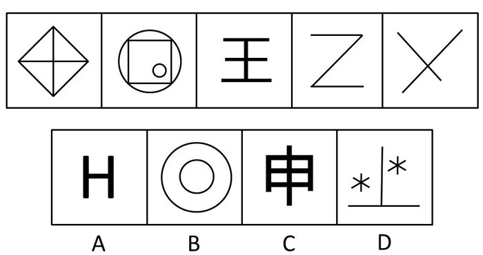

A. A

B. B

C. C

D. D

第 106 题 · 答案与解析

**参考答案（粉笔题库参考内容）**

B

**解析**

元素组成凌乱，考查数数。题干五个图的交点个数依次为5、4、3、2、1，故应选图形交点个数为0。选项交点个数依次为2 ，0 ，9 ，3。

故正确答案为B。

**考点**：数量规律-点、文字/字母/数字类

**来源**：2012年江苏省公务员录用考试《行测》题（B类）第106题

### 第 107 题

在题干中给出一套图形，其中有五个图，这五个图呈现一定的规律性。在给出的另一套图形中，有四个图，从中选出唯一的一项作为保持左边五个图规律性的第六个图：

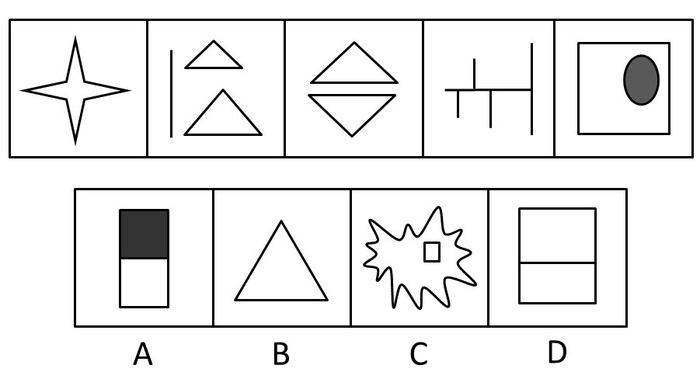

A. A

B. B

C. C

D. D

第 107 题 · 答案与解析

**参考答案（粉笔题库参考内容）**

B

**解析**

元素组成不同，无明显属性规律，考虑数量规律。题干图形出现单一直线，考虑数直线，五个图形的直线数分别为8、7、6、5、4，故应该选3条直线数的图形。

故正确答案为B。

**考点**：数量规律-线

**来源**：2012年江苏省公务员录用考试《行测》题（B类）第107题

### 第 108 题

请从所给的四个选项中，选择最合适的一个，使之呈现一定的规律性：

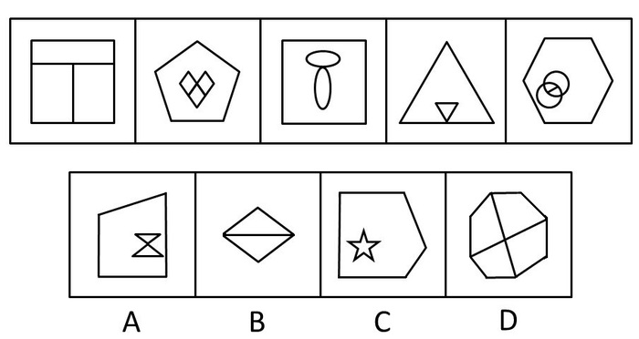

A. A

B. B

C. C

D. D

第 108 题 · 答案与解析

**参考答案（粉笔题库参考内容）**

A

**解析**

元素组成凌乱，而且分内外两部分，看外部数量和内部的关系。题干中每个图形的空间数与其外面图形的边数相差1，A项中的图形有3个空间，外边图形有4条边，符合规律。

故正确答案为A。

**考点**：数量规律-复合

**来源**：2012年江苏省公务员录用考试《行测》题（B类）第108题

### 第 109 题

请从所给的四个选项中，选择最合适的一个，使之呈现一定的规律性：

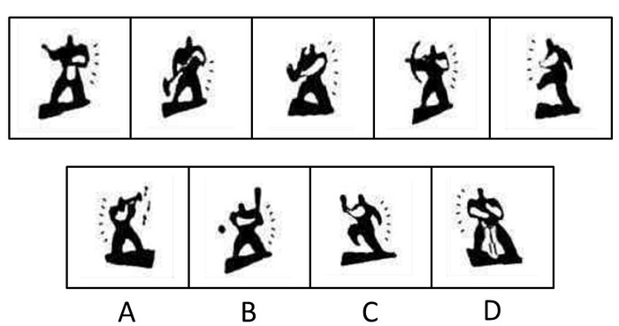

A. A

B. B

C. C

D. D

第 109 题 · 答案与解析

**参考答案（粉笔题库参考内容）**

C

**解析**

本题考查图形的实际意义，寻找最大共同点。观察发现，题干所有图形人物都是左手为白色，右手为黑色，故正确答案的人物也应左手为白色，右手为黑色，只有C项符合。

故正确答案为C。

**来源**：2012年江苏省公务员录用考试《行测》题（B类）第109题

### 第 110 题

请从所给的四个选项中，选择最合适的一个填在问号处，使之呈现一定的规律性：

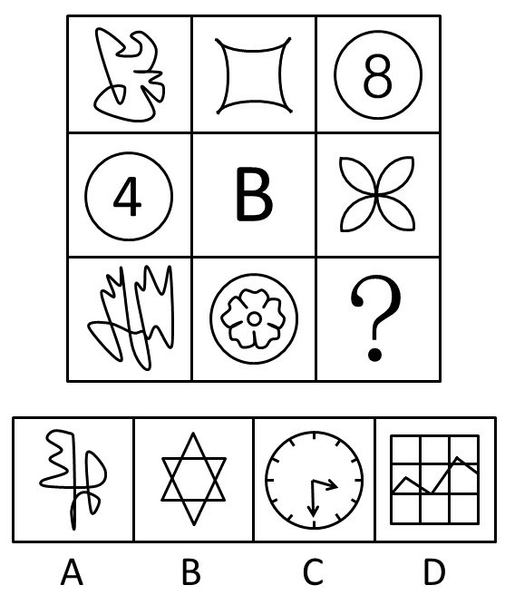

A. A

B. B

C. C

D. D

第 110 题 · 答案与解析

**参考答案（粉笔题库参考内容）**

B

**解析**

元素组成凌乱，考虑数数。题干中每一行前两个图形封闭空间数之和为第三个图形封闭空间数。第一行图形封闭空间数规律为2+1=3；第二行为2+2=4；故第三行所求图形封闭空间数为4+3=7。B项封闭空间数为7。

故正确答案为B。

**考点**：数量规律-面

**来源**：2012年江苏省公务员录用考试《行测》题（B类）第110题

### 第 111 题

请从所给的四个选项中，选择最合适的一个填在问号处，使之呈现一定的规律性：

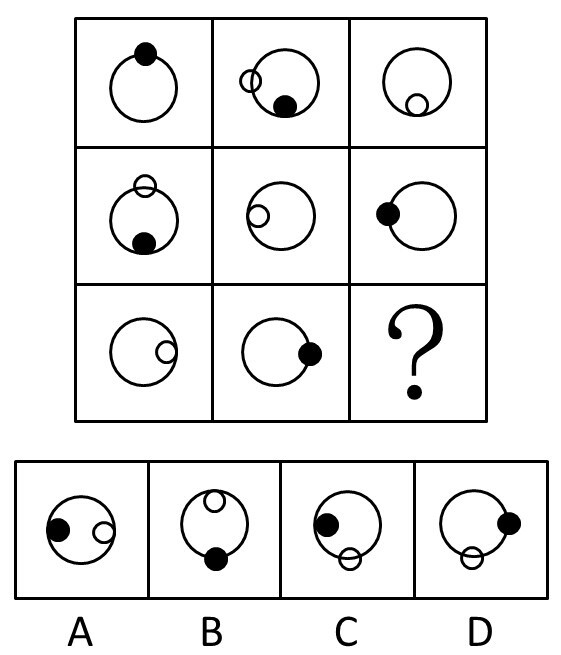

A. A

B. B

C. C

D. D

第 111 题 · 答案与解析

**参考答案（粉笔题库参考内容）**

C

**解析**

内外元素组成，考查静态位置关系。已知图形黑白圆圈位置规律为：一黑在圈内、一黑在圈上、一白在圈内、一白在圈上。分析第三行可知，所缺情况为一黑在圈内、一白在圈上。分析选项，C符合黑白所在位置。

故正确答案为C。

**考点**：样式规律-遍历

**来源**：2012年江苏省公务员录用考试《行测》题（B类）第111题

### 第 112 题

请从所给的四个选项中，选择最合适的一个填在问号处，使之呈现一定的规律性：

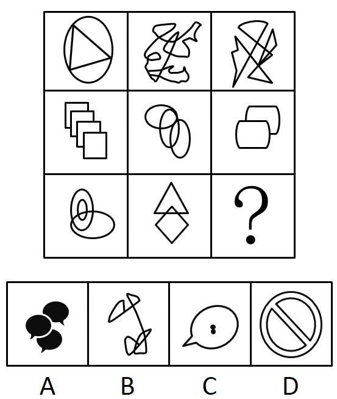

A. A

B. B

C. C

D. D

第 112 题 · 答案与解析

**参考答案（粉笔题库参考内容）**

B

**解析**

九宫格，题干中每幅图都只由一个部分组成，观察选项，只有B选项仅有一个部分，答案为B。

故正确答案为B。

**考点**：数量规律-素

**来源**：2012年江苏省公务员录用考试《行测》题（B类）第112题

### 第 113 题

请从所给的四个选项中，选择最合适的一个填在问号处，使之呈现一定的规律性：

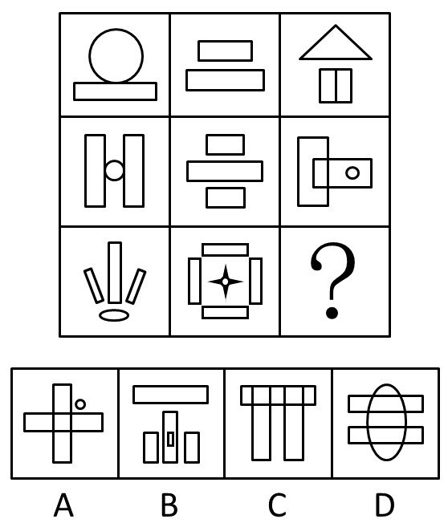

A. A

B. B

C. C

D. D

第 113 题 · 答案与解析

**参考答案（粉笔题库参考内容）**

B

**解析**

特殊考点，数某种图形的个数。数矩形的个数，重复数，第一列长方形数目依次为1、2、3；第二列长方形数目依次为2、3、4；第三列前两图长方形数目为3、4，故所缺图形长方形数目应为5。选项B共有5个长方形。

故正确答案为B。

**考点**：数量规律-面

**来源**：2012年江苏省公务员录用考试《行测》题（B类）第113题

### 第 114 题

右边所给的四个选项中，哪一个由左边第一个图形叠成？

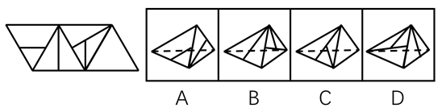

A. A

B. B

C. C

D. D

第 114 题 · 答案与解析

**参考答案（粉笔题库参考内容）**

C

**解析**

本题考查四面体的空间重构。对平面展开图中的面进行标记，用排除法解题。

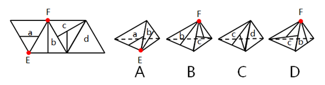

A项：选项由面a与面b构成，展开图中面a中的小三角形的顶点E没有发出线，而选项中该点发出了一条线，选项与展开图不一致，排除；

B项：选项由面b与面c构成，展开图中面b的顶点F发出一条线，而选项中该点发出2条线，选项与展开图不一致，排除；

C项：选项由面c与面d构成，选项与展开图一致，当选；

D项：选项由面b与面c构成，展开图中面b的顶点F发出一条线，而选项中该点发出2条线，选项与展开图不一致，排除。

故正确答案为C。

**来源**：2012年江苏省公务员录用考试《行测》题（B类）第114题

### 第 115 题

右边所给的四个选项中，哪一个由左边第一个图形叠成？

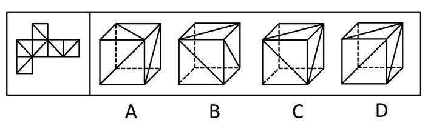

A. A

B. B

C. C

D. D

第 115 题 · 答案与解析

**参考答案（粉笔题库参考内容）**

C

**解析**

相邻两面的线是相交的，

故A项应为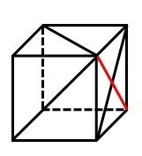，

B项应为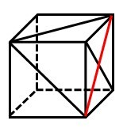，

D项应为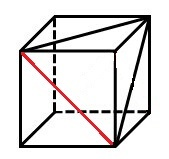。

故正确答案为C。

**考点**：空间类-空间重构-六面体

**来源**：2012年江苏省公务员录用考试《行测》题（B类）第115题

### 第 116 题

在一次联欢晚会上，小李登台表演了一段越剧，博得满堂喝彩。老张道：“小李的越剧唱得这么好，一定是南方人。”

以下哪项是老张的话所不包含的意思：

A. 不是南方人，越剧不可能唱得那么好

B. 只有越剧唱得好，才是南方人

C. 只要越剧唱得像小李那样好，就是南方人

D. 除非小李是南方人，否则她的越剧不可能唱得那么好

第 116 题 · 答案与解析

**参考答案（粉笔题库参考内容）**

B

**解析**

第一步：利用充分必要条件，翻译题干。

小李：越剧唱得那么好⇒南方人。

第二步：逐一翻译选项并判断选项的正确。

A项：－南方人⇒－越剧唱得那么好，是题干推导关系的逆否规则，因此A项正确；

B项：南方人⇒越剧唱得那么好，“南方人”属肯后件，无法推出绝对表达的结论，因此B项错误；

C项：越剧唱得那么好⇒南方人，是题干推导关系，因此C项正确；

D项：小李：越剧唱得那么好⇒南方人，是题干推导关系，因此D项正确。

故正确答案为B。

**考点**：常规翻译

**来源**：2012年江苏省公务员录用考试《行测》题（B类）第116题

### 第 117 题

物理学家费米曾提出过一个著名的“费米佯谬”，假设银河系中果真存在外星智慧生命，考虑到银河系古老的年龄以及其他因素，他们应当早已造访地球了，但事实是，当我们仰望星空，我们所面对的是所谓的“大寂静”──宇宙一片安宁，无声无息。

以下各项判断如果为真，则哪项不能解释“费米佯谬”：

A. 我们也许还没有达到能够发现外星智慧生命的水平

B. 外星文明已经足够进步，使得我们无法直接观测到他们

C. 外星智慧生命已在地球上制造了很多神秘的“UFO”事件

D. 外星文明可能达成了与自然界的平衡态，与星系背景巧妙地融为一体

第 117 题 · 答案与解析

**参考答案（粉笔题库参考内容）**

C

**解析**

此题属于原因解释类题目，需要解释的矛盾现象为假设银河系中果真存在外星智慧生命，考虑到银河系古老的年龄以及其他因素，他们应当早已造访地球了，但事实是，当我们仰望星空，我们所面对的是所谓的“大寂静”──宇宙一片安宁，无声无息。

A项：没有达到能够发现外星智慧生命的水平，能解释为什么看不到外星智慧生命，排除；

B项：无法直接观测到外星文明，能解释为什么看不到外星智慧生命，排除；

C项：制造神秘的“UFO”事件，说明看到了外星智慧生命的踪迹，不能解释费米佯谬，当选；

D项：与自然界平衡，与星系背景巧妙地融为一体，可以解释为什么看不到外星智慧生命，排除。

本体为选非题，故正确答案为C。

**考点**：原因解释

**来源**：2012年江苏省公务员录用考试《行测》题（B类）第117题

### 第 118 题

人类的到来着实给这个世界的某些自然法则带来了不少挑战。比如说，植物的果实之所以味道鲜美，就是因为它需要吸引动物前来将它的果实中附赠的种子带往更远的地方，当然同时也将富含大量营养物的果实作为对传播种子的动物的报酬。这是一桩完美的公平交易。可是，人类对于果实中的种子要么集中处理成垃圾，要么干脆集中种植成果园。

据此，可以推断出的是：

A. 人类违背自然法则是为了改造自然

B. 动植物之间的交易总是完美的

C. 人类挑战自然法则的勇气可敬可佩

D. 人类有时会破坏自然界的公平交易

第 118 题 · 答案与解析

**参考答案（粉笔题库参考内容）**

D

**解析**

第一步：抓住题干主要信息。

第一句说明人类给世界的某些自然法则带来了挑战，第二句说明植物的果实味道鲜美是因为它需要吸引动物前来将它的果实附赠的种子带往更远的地方，同时也将富含大量营养物的果实作为对传播种子的动物的报酬，第三句说明人类对于果实中的种子要么集中处理成垃圾，要么干脆集中种植成果园。

第二步：分析题干信息，并结合选项得出答案。

A项：人类违背自然法则是为了改造自然，题干中并未涉及人类违背自然法则的目的，因此A中说法无法推断，排除；

B项：动植物之间的交易“总是”完美的，说法过于绝对，题干只是给出一个完美实现的例子，并没有提及其他动植物之间的交易也是完美的，因此B中说法无法推断，排除；

C项：人类挑战自然法则的勇气可敬可佩，“勇气可敬可佩”，题干并未提及，属无关选项，因此C中说法无法推断，排除；

D项：由题干中“这是一桩完美的公平交易。可是人类对于果实中的种子要么集中处理成垃圾，要么干脆集中种植成果园”，可以得出人类有时会破坏自然界的公平交易，因此D中说法可以推断，当选。

故正确答案为D。

**考点**：日常结论

**来源**：2012年江苏省公务员录用考试《行测》题（B类）第118题

### 第 119 题

迄今为止，某乡镇辖区内的所有企业都不是高新企业。在该县范围内，由县招商局负责联系从而与外资公司实现合作的都是高新企业。去年，由县招商局负责联系，该乡镇辖区内的一个企业与托雷斯公司成功地进行了合作。

据此，可以推断：

A. 托雷斯公司是高新企业

B. 托雷斯公司不是高新企业

C. 托雷斯公司是外资公司

D. 托雷斯公司不是外资公司

第 119 题 · 答案与解析

**参考答案（粉笔题库参考内容）**

D

**解析**

第一步：利用充分必要条件，翻译题干。

第一句：乡镇辖区内企业⇒－高新企业，第二句：由县招商局负责联系∧与外资公司实现合作⇒高新企业，第三句：由县招商局负责联系，乡镇辖区内企业与托雷斯公司实现合作，为三个事实信息，即已经成立的事实。

第二步：从事实信息开始推导，得到结论。

由第一步中第一句的“乡镇辖区内企业⇒－高新企业”和第三句的事实信息“乡镇辖区内企业”得到“－高新企业”，又知第二句的“由县招商局负责联系且与外资公司实现合作⇒高新企业”，利用逆否规则再得到“－（由县招商局负责联系且与外资公司实现合作）”，利用摩根规则再得到“（－由县招商局负责联系）或（－与外资公司实现合作）”，又知第三句的事实信息“由县招商局负责联系”，利用选言命题规则得到“－与外资公司实现合作”，又知第三句的事实信息“与托雷斯公司实现合作”，从而得到托雷斯公司不是外资公司。通过分析，只有D项中说法符合。

故正确答案为D。

**考点**：常规翻译

**来源**：2012年江苏省公务员录用考试《行测》题（B类）第119题

### 第 120 题

今天的火星与它的早期历史形成鲜明的对比，早期火星更温暖、更湿润，也许那时才更适合生命存在。未来的火星探测将更深入地挖掘生命存在的证据，那些生命或许仍然在火星地底下避难。

以下哪项是以上论述所预设的：

A. 早期火星地下可能有生命存在

B. 火星表面并不适宜任何生命存活

C. 今天火星地下仍然可能存在着和地表不一样的生存环境

D. 火星表面的冰可能是火星早期温暖湿润的环境中遗留下来的

第 120 题 · 答案与解析

**参考答案（粉笔题库参考内容）**

C

**解析**

第一步：找出论点和论据。

论点：未来的火星探测将更深入地挖掘生命存在的证据，那些生命或许仍然在火星地底下避难。

论据：今天的火星与它的早期历史形成鲜明的对比，早期火星更温暖、更湿润，也许那时才更适合生命存在。

论据是早期火星有生命，论点是未来可以在火星地底下找到生命，二者分别说的过去和未来，要使这一论证成立，需要说明未来的情况和过去的一致。

第二步：逐一分析选项。

A项：论点讨论的是未来我们可以在火星地底下挖掘生命，而A项说的是早期地底下可能有生命，二者无必然关系，A项不是题干论述的预设，排除；

B项：火星表面不适宜任何生命存活，并不能说明火星地底下有生命，无关项，不是题干论述的预设，排除；

C项：今天火星地下仍然可能存在着和地表不一样的生存环境，说明今天的火星地下可能和过去的火星是一样的，适合生命存在，是题干论述的预设，当选；

D项：火星表面的冰是哪里遗留下来的，跟火星地底下是否存在生命无关，不是题干论述的预设，排除。

故正确答案为C。

**考点**：必要条件

**来源**：2012年江苏省公务员录用考试《行测》题（B类）第120题

### 第 121 题

由于一线大城市存在房价偏高、竞争压力较大等问题，近年来有些在这些城市中工作生活的外地年轻人，掀起了“逃离北上广”的热潮——离开大城市，回到自己家乡的中小城市谋求发展。然而，最新的调查数据却表明：当初选择“逃离北上广”的人，有一大部分又选择“返回北上广”等大城市，重新谋求工作生活的机会。

以下各项如果为真，则哪项不能解释上述现象：

A. 由于国家“限购令”的影响，部分大城市的房价已经开始松动

B. 由大城市返回到中小城市的人，大部分在工作生活上不适应

C. 在大城市中常会遇到比在中小城市更难以克服的困难

D. 大城市的基础设施比中小城市更为优越便利

第 121 题 · 答案与解析

**参考答案（粉笔题库参考内容）**

C

**解析**

第一步：找出题干矛盾现象。

本题矛盾是当初选择“逃离北上广”的人，有一大部分又选择“返回北上广”等大城市，重新谋求工作生活的机会。

第二步：逐一分析选项。

A项：部分大城市的房价松动，很好解释了大部分又选择“返回北上广”等大城市，能够解释，排除；

B项：由大城市返回到中小城市的人工作生活上不适应，很好解释了大部分又选择“返回北上广”等大城市，能够解释，排除；

C项：大城市中常会遇到比在中小城市更难以克服的困难，说明了大城市的不好方面，无法解释题干矛盾现象，当选；

D项：大城市的基础设施优越便利，说明了大城市有优势吸引人，从而很好解释了大部分又选择“返回北上广”等大城市，排除。

本题为选非题，故正确答案为C。

**考点**：原因解释

**来源**：2012年江苏省公务员录用考试《行测》题（B类）第121题

### 第 122 题

千万不能因为近期物价有所回落，就减少对农产品生产经营的关注。要保证农产品价格不涨，功夫恰恰要下在其价格最低的时候。只有在这个时候保护农民的积极性，让农民不退出生产，才能使农产品价格保持稳定。

据此，可以推断：

A. 如果农民退出生产，农产品价格就不能保持稳定

B. 只有让农民不退出生产才能保护农民的生产积极性

C. 只要关注农产品的生产经营就能保证农民不退出生产

D. 只有在农产品价格最低的时候保护农民的生产积极性才最有效

第 122 题 · 答案与解析

**参考答案（粉笔题库参考内容）**

A

**解析**

第一步：抓住题干主要信息。

第一句说明不能因为近期物价有所回落，就减少对农产品生产经营的关注；第二句说明保证农产品价格不涨⇒在农产品价格最低的时候下功夫；第三句说明农产品价格保持稳定⇒保护农民的积极性，农产品价格保持稳定⇒－农民退出生产。

第二步：逐一翻译选项并判断选项的正确。

A项：农民退出生产⇒－农产品价格保持稳定，正是第一步中第三句的“农产品价格保持稳定⇒－农民退出生产”的逆否规则，因此A项中说法可以推出；

B项：保护农民的积极性⇒－农民退出生产，由题干可知，两者之间不存在推导关系，因此B项中说法无法推出；

C项：关注农产品的生产经营⇒－农民退出生产，题干并未涉及两者间的关系，因此C项中说法无法推出；

D项：只有在农产品价格最低的时候保护农民的生产积极性才“最有效”，说法过于绝对，题干并未涉及，属无关选项，因此D项中说法无法推出。

故正确答案为A。

**考点**：常规翻译

**来源**：2012年江苏省公务员录用考试《行测》题（B类）第122题

### 第 123 题

梅、兰、竹、菊是张老汉的四个女儿。有一次，某客人问起四姐妹的年龄，得到不同的回答。梅说：“兰比竹小。”兰说：“我比梅小。”竹说：“兰不是三姐。”菊说：“我是大姐。”憨厚的张老汉在旁补充道：“大女儿和三女儿撒谎呢，二女儿和小女儿说得对。”

据此，按年龄从大到小的顺序，可以推断四姐妹依次为：

A. 梅、兰、竹、菊

B. 梅、兰、菊、竹

C. 兰、菊、梅、竹

D. 菊、兰、梅、竹

第 123 题 · 答案与解析

**参考答案（粉笔题库参考内容）**

B

**解析**

第一步：找突破口。

本题突破口为菊说自己是大姐，假设她的话为真，那么这就与张老汉的说法矛盾，因此菊的话为假，即菊不是大姐。

第二步：根据突破口继续推导。

由第一步知菊的话为假，即菊不是大姐，又知只有大女儿和三女儿撒谎，因此菊只能是三女儿；从而竹说兰不是三姐为真，又知竹称三女儿为三姐，因此竹只能是四女儿；从而梅说兰比竹小为假，由此可以判断梅是大女儿，兰是二女儿。综上，按年龄从大到小的顺序，四姐妹依次为梅、兰、菊、竹。

故正确答案为B。

**考点**：框架题

**来源**：2012年江苏省公务员录用考试《行测》题（B类）第123题

### 第 124 题

如果紫色不代表社区，那么黄色不代表幸福；如果紫色代表社区，那么绿色代表海港；蓝色不是代表社区，就是代表环境；紫色或者代表社区，或者代表海港；黄色代表幸福。一种颜色只能代表幸福、社区、海港、环境中的一种。

据此，可以推断：

A. 蓝色代表环境

B. 蓝色代表海港

C. 紫色代表环境

D. 紫色代表海港

第 124 题 · 答案与解析

**参考答案（粉笔题库参考内容）**

A

**解析**

第一步：利用充分必要条件，翻译题干。

第一句：－紫色代表社区⇒－黄色代表幸福，第二句：紫色代表社区⇒绿色代表海港，第三句：蓝色代表社区/蓝色代表环境，第四句：紫色代表社区/紫色代表海港，第五句：黄色代表幸福，该句为事实信息，即已经成立的事实，第六句：一种颜色只能代表幸福、社区、海港、环境中的一种。

第二步：从事实信息开始推导，得到结论。

由第一步中第一句的“－紫色代表社区⇒－黄色代表幸福”和第五句中的事实信息“黄色代表幸福”利用逆否规则得到紫色代表社区，又知第二句的“紫色代表社区⇒绿色代表海港”，从而再得到绿色代表海港；由事实信息“紫色代表社区”和第三句的“蓝色代表社区/蓝色代表环境”，又知第六句“一种颜色只能代表幸福、社区、海港、环境中的一种”，利用选言命题规则再得到蓝色代表环境。

综上，紫色代表社区，绿色代表海港，蓝色代表环境。通过分析，只有A项中说法符合。

故正确答案为A。

**考点**：常规翻译

**来源**：2012年江苏省公务员录用考试《行测》题（B类）第124题

### 第 125 题

某单位需要派出下乡扶贫人员1至2人，经过宣传号召，众人纷纷报名，经过一番考虑，领导最后将扶贫人选集中在小王和小张两人身上，大家对最终的挑选结果作了如下猜测：

（1）小王会被挑选上；（2）如果小王被挑选上，那么小张就不会被挑选上；（3）只有小王被挑选上，小张才会被挑选上；（4）小王和小张都会被挑选上。

事后得知，这四句猜测中只有一句是真话。据此，可以推断：

A. 两人都会被挑选上

B. 两人都不会被挑选上

C. 小王会被挑选上，而小张不会

D. 小张会被挑选上，而小王不会

第 125 题 · 答案与解析

**参考答案（粉笔题库参考内容）**

D

**解析**

第一步：翻译题干，利用充分必要条件。

（1）小王，（2）小王→小张，（3）小张→小王，（4）小王 且 小张。

第二步：找突破口。

本题突破口为猜测（2）和（4）之间的矛盾关系，两个猜测必有一真和一假。

第三步：看其他的猜测。

本题只有一个猜测为真，故猜测（1）和（3）均为假。由猜测（1）为假可得：-小王；由猜测（3）为假可得：小张 且 -小王，综上得到小张 且 -小王，即小张会被挑选上，而小王不会。通过分析，只有D中说法符合。

故正确答案为D。

备注：本题需特别注意矛盾关系：A→B与A 且 -B的矛盾，望考生加深理解。

**考点**：只有一真/一假

**来源**：2012年江苏省公务员录用考试《行测》题（C类）第64题

### 第 126 题

组织职业生涯管理，指由组织实施的、旨在开发员工潜力并使员工实现自我价值的一系列管理方法。下列不属于组织职业生涯管理的是：

A. 小赵到某公司一年后被公司委派去欧洲考察

B. 矿工小王上班的第一天就被主管领导安排下井锻炼

C. 某企业对处于职业中期的员工采用轮换岗位方式让其保持对职业的新鲜感

D. 办公室的小蔡要求调到市场部负责组织一个市场调研项目

第 126 题 · 答案与解析

**参考答案（粉笔题库参考内容）**

D

**解析**

第一步：抓住定义中的关键词。

关键词强调“由组织实施的”、“旨在开发员工潜力”、“使员工实现自我价值”。

第二步：逐一判断选项。

A、B、C三项都符合关键词强调的内容，即都是“由组织实施的”，均属于组织职业生涯管理。D项中，小蔡是主动提出要求的，不满足实施组织职业生涯规划的主体要求，不属于组织职业生涯管理。

本题为选非题，故正确答案为D。

**考点**：方式目的

**来源**：2012年江苏省公务员录用考试《行测》题（B类）第126题

### 第 127 题

强化仪式：指组织公开承认或奖励员工贡献的一种礼仪活动，具有激励、强化员工对组织的承诺，使员工与组织牢固地联系在一起的作用。 下列属于强化仪式的是：

A. 新领导班子就职大会

B. 区划调整工作会议

C. 先进事迹报告会

D. 新产品上市揭幕仪式

第 127 题 · 答案与解析

**参考答案（粉笔题库参考内容）**

C

**解析**

第一步：抓住定义中的关键词。

关键词强调“公开承认或奖励员工贡献”。

第二步：逐一判断选项。

A、B、D三项均与“公开承认或奖励员工贡献”无关，不属于强化仪式。只有C项是“公开承认或奖励员工贡献”，属于强化仪式。

故正确答案为C。

**考点**：方式目的

**来源**：2012年江苏省公务员录用考试《行测》题（B类）第127题

### 第 128 题

印象管理，指一个人通过一定的方式影响别人对自己印象的过程，也包括了与他人的社会互动，是自我调节的一个重要方面。

下列不涉及印象管理的是：

A. 小李没有按时完成任务，他立即向经理表示歉意，并做出适当的解释

B. 小组工作计划不顺利，小陈觉得自己与这件事关系不大，就私下告诉老板，自己曾经反对这一计划，但被否决了

C. 当上级来视察时，组长小刘总是与组员在一起讨论问题，这常常会使上级觉得，小组所取得的成绩与小刘关系密切

D. 崔经理经常通过和员工交流来判定公司是否正朝着既定的目标健康地向前发展，以便在必要的时候及时采取矫正措施

第 128 题 · 答案与解析

**参考答案（粉笔题库参考内容）**

D

**解析**

第一步：抓住定义中的关键词。

关键词为“影响别人对自己印象”。

第二步：逐一判断选项。

A选项中“向经理表示歉意，并做出适当的解释”、B选项中“私下告诉老板，自己曾经反对这一计划”、C选项中“上级视察时，总是与组员一起讨论问题”都是为了影响他人对自己的印象，符合定义，排除；

D选项中崔经理与员工交流是为了“判定公司是否正朝着既定的目标健康地向前发展”，不符合“影响别人对自己印象”，当选。

本题为选非题，故正确答案为D。

**考点**：方式目的

**来源**：2012年江苏省公务员录用考试《行测》题（B类）第128题

### 第 129 题

联觉心理，指由一种感觉引起另一种感觉变化的心理现象。 下列利用了联觉心理的是：

A. 节日里各家店铺都挂上了一排排红灯笼

B. 卧室装修为暖色调让人感到温暖

C. 迷彩服是现代军队普遍使用的一种军服

D. 职场套装的发明帮助女性更好地融入工作环境

第 129 题 · 答案与解析

**参考答案（粉笔题库参考内容）**

B

**解析**

第一步：抓住定义中的关键词。

关键词强调“由一种感觉引起另一种感觉”。

第二步：逐一判断选项。

A项中只有视觉这一种感觉，C、D两项中无感觉，均不满足定义要求，不属于联觉心理。B项中由视觉产生了心理感觉，属于联觉心理。

故正确答案为B。

**考点**：单定义-其他句式

**来源**：2012年江苏省公务员录用考试《行测》题（B类）第129题

### 第 130 题

职业社会化，指个体按社会需求选择职业，掌握从事某种职业的知识和技能，或者从事某职业后进行知识更新、技能再训练的过程。

下列属于职业社会化的是：

A. 小张是某单位的技术工，当他看到很多领域急需翻译人才时，便利用业余时间学习，取得翻译资格证后，离职到另一家公司任职

B. 小刘参军后被分配至汽车班，学得精湛的修车技艺，退役后自己开了一家修理厂

C. 会计师小李热爱厨艺，业余时间参加了一个培训班，学习营养知识，提高烹饪技艺

D. 小陈在抚育孩子期间积累了丰富的知识和经验，后在朋友建议下开办了一所幼儿园

第 130 题 · 答案与解析

**参考答案（粉笔题库参考内容）**

A

**解析**

第一步：抓住定义中的关键词。

关键词强调“个体按照社会需求选择职业”。

第二步：逐一判断选项。

题干中指出“职业社会化”有两种情况，由“或者”一词可知，只要符合其中任意一种情况即可。

A项符合第二种情况，属于职业社会化；

B、D项无法判断出是按照社会需求来选择职业；

C项学习厨艺只是一种兴趣，无法判断出小李有去当职业厨师的想法。

因此，B、C、D三项均不属于职业社会化。

故正确答案为A。

**考点**：单定义-其他句式

**来源**：2012年江苏省公务员录用考试《行测》题（B类）第130题

### 第 131 题

功能性文盲：指那些受过一定教育，会基本的读、写、算，却不能识别现代信息符号、图表，不能应用计算机进行信息交流与管理，无法利用现代生活设施的人。

下列不涉及功能性文盲的是：

A. 白领小丹对自家小汽车陷入泥坑束手无策

B. 律师老冯不会使用自己的音响

C. 李教授只会用手机打电话，但是不会发短信

D. 大学生小邵在银行自动取款机前不知如何操作

第 131 题 · 答案与解析

**参考答案（粉笔题库参考内容）**

A

**解析**

第一步：抓住定义中的关键词。

关键词强调“无法利用现代生活设施”。

第二步：逐一判断选项。

B项“不会使用音响”、C项“不会发短信”以及D项“不会使用自动取款机”都是“无法利用现代生活设施”的体现，因此B、C、D三项都属于功能性文盲。A项中小丹并非不会使用小汽车，只是对小汽车陷入泥坑这种事情束手无策，A项与功能性文盲无关。

故正确答案为A。

**考点**：单定义-其他句式

**来源**：2012年江苏省公务员录用考试《行测》题（B类）第131题

### 第 132 题

社会风险，指由于个人或团体的行为使社会生产及人们生活遭受损失的风险。 下列不属于社会风险的是：

A. 盗窃

B. 抢劫

C. 冻灾

D. 玩忽职守

第 132 题 · 答案与解析

**参考答案（粉笔题库参考内容）**

C

**解析**

第一步：抓住定义中的关键词。

关键词强调“个人或团体的行为”。

第二步：逐一判断选项。

A、B、D三项都符合定义关键词强调的内容，属于社会风险。C项“冻灾”是自然灾害，不是由个人或团体的行为引起的，因此不属于社会风险。

本题为选非题，故正确答案为C。

**考点**：原因结果

**来源**：2012年江苏省公务员录用考试《行测》题（B类）第132题

### 第 133 题

绿色消费指从满足生态需要出发，以有益健康和保护环境为基本内涵，符合人的健康和环境保护标准的各种消费行为和消费方式的统称。

下列不属于绿色消费的是：

A. 骑自行车出游

B. 闲置物品交换使用

C. 砍伐荒山树木造纸

D. 使用低能耗的空调

第 133 题 · 答案与解析

**参考答案（粉笔题库参考内容）**

C

**解析**

第一步：抓住定义中的关键词。

关键词强调“有益健康”和“保护环境”。

第二步：逐一判断选项。

A、B、D三项都符合定义关键词强调的内容，属于绿色消费；C项砍伐荒山树木不符合保护环境的要求，因此不属于绿色消费。

本题为选非题，故正确答案为C。

**考点**：单定义-其他句式

**来源**：2012年江苏省公务员录用考试《行测》题（C类）第69题

### 第 134 题

行为感染：指人群中的行动从一个人传向另一个人，直至一群人一致行动起来的过程。

下列涉及行为感染的是：

A. 李董在会议上号召大家视厂为家，群策群力，共同渡过难关，大家一致鼓掌赞同

B. 一个人偶然抬头望天，后面的人以为天空有什么异常，也都跟着抬头望天

C. 大专生求职更加务实了，纷纷前往劳动力市场寻找机会

D. 老李、老王在一起闲聊，结果发现大家均对选秀节目的层出不穷感到吃惊

第 134 题 · 答案与解析

**参考答案（粉笔题库参考内容）**

B

**解析**

第一步：抓住定义中的关键词

关键词强调“行动从一个人传向另一个人”。

第二步：逐一判断选项

B项中，由一个人抬头望天到后面的人都跟着抬头望天，属于行为感染。A、C、D三项中都没有“行动从一个人传向另一个人”的过程，因此都不涉及行为感染。故正确答案为B。

**考点**：单定义-其他句式

**来源**：2012年江苏省公务员录用考试《行测》题（B类）第134题

### 第 135 题

酝酿效应：指的是“难题一直没有解决，经过一段时间后意外得到满意答案”的现象。 下列不涉及酝酿效应的是：

A. 山重水复疑无路，柳暗花明又一村

B. 蓦然回首，那人却在灯火阑珊处

C. 踏破铁鞋无觅处，得来全不费工夫

D. 两句三年得，一吟双泪流

第 135 题 · 答案与解析

**参考答案（粉笔题库参考内容）**

D

**解析**

第一步：抓住定义中的关键词。

关键词强调“意外得到满意答案”。

第二步：逐一判断选项。

A项诗句的意思为“正怀疑会有无路可行的时候，忽然看见柳色暗绿，花色明丽，又一个村庄出现在眼前”；B项词句常用来形容经过苦苦追寻，寂寞奋斗之后突然获得惊喜的收获；C项诗句比喻急需的东西费了很大的力气找不到，却在无意中得到了。A、B、C三项都符合定义关键词强调的内容，涉及到酝酿效应。D项是说“两个诗句是构思了三年才得来的，一吟诵起来就双泪长流”，说明诗人作诗的用心之苦，诗句并不是意外得到的。因此，D项与酝酿效应无关。

本题为选非题，故正确答案为D。

**考点**：单定义-其他句式

**来源**：2012年江苏省公务员录用考试《行测》题（B类）第135题

## 材料 3

2011年全国全年粮食种植面积11057万公顷，比上年增加70万公顷，棉花种植面积504万公顷，增加19万公顷，油料种植面积1379万公顷，减少10万公顷，糖料种植面积195万公顷，增加4万公顷。

        全年粮食产量57121万吨，比上年增加2473万吨，增产4.5%。其中，夏粮产量12627万吨，增产2.5%，早稻产量3276万吨，增产4.5%，秋粮产量41218万吨，增产5.1%。

        全年棉花产量660万吨，比上年增产10.7%。油料产量3279万吨，增产1.5%。糖料产量12520万吨，增产4.3%。茶叶产量162万吨，增产9.9%。

        全年肉类总产量7957万吨，比上年增长0.4%。其中，猪肉产量5053万吨，下降0.4%，牛肉产量648万吨，下降0.9%，羊肉产量393万吨，下降1.4%。年末生猪存栏46767万头，增长0.7%，生猪出栏66170万头，下降0.8%。牛奶产量3656万吨，增长2.2%。

        全年水产品产量5600万吨，比上年增长4.2%。其中，养殖水产品产量4026万吨，增长5.2%，捕捞水产品产量1574万吨，增长1.9%

### 第 136 题

2011年全国全年粮食、棉花平均亩产量与2010年相比：

A. 粮食有所提高、棉花有所降低

B. 粮食有所降低、棉花有所提高

C. 两者均有所提高

D. 两者均有所降低

第 136 题 · 答案与解析

**参考答案（粉笔题库参考内容）**

C

**解析**

根据题干“2011年······平均亩产量与2010年相比”，结合选项信息，可判定本题为两期平均数比较问题。定位文字材料第一段可得“2011年全国全年粮食种植面积11057万公顷，比上年增加70万公顷，棉花种植面积504万公顷，增加19万公顷”，定位文字材料第二段可得“全年粮食产量57121万吨，比上年增加2473万吨”，定位文字材料第三段“全年棉花产量660万吨，比上年增产10.7%”。故

粮食单位产量：2011年为57121/11057 ≈ 5^+，2010年为(57121−2473)/(11057−70) = 54648/10987 ≈ 4^+；前者大于后者，粮食单位产量增加。

棉花单位产量：2011年为660/504，2010年为660/((504−19)×(1+10.7%))= 660/(485 × 1.107) ≈ 660/(485 × 1.1) ≈ 660/534；明显前者大于后者，棉花单位产量增加。

故正确答案为C。

**来源**：2012年江苏省公务员录用考试《行测》题（B类）第136题

### 第 137 题

2011年末全国生猪存栏比2010年末多：

A. 325万头

B. 327万头

C. 330万头

D. 323万头

第 137 题 · 答案与解析

**参考答案（粉笔题库参考内容）**

A

**解析**

观察选项发现，各选项数值非常接近，估算可能造成误差过大而错选答案，因此只能精确计算。2010年年末生猪存栏46767/(1+0.7%)，则2011年末全国生猪出栏比2010年末多46767−46767/(1+0.7%)≈46767 - 46442 = 325万头。

故正确答案为A。

**来源**：2012年江苏省公务员录用考试《行测》题（B类）第137题

### 第 138 题

2011年全国全年夏粮和秋粮的产量比2010年平均增产：

A. 3.8%

B. 4.5%

C. 3.4%

D. 2.9%

第 138 题 · 答案与解析

**参考答案（粉笔题库参考内容）**

B

**解析**

根据题干“2011年全国全年夏粮和秋粮的产量比2010年平均增产”，结合选项都为百分数，且材料给出夏粮和秋粮的现期量以及增长率，可判定本题为混合增长率问题。定位文字材料第二段可得：2011年夏粮产量12627万吨，同比增产2.5%，秋粮产量41218万吨，同比增产5.1%。根据线段法，距离与量成反比，夏粮：秋粮=12627:41218≈1:3.3，所以设2011年总产量增长率为r，则(5.1%-r)×3.3=(r-2.5%)，则r≈4.5%。即2011年全国全年夏粮和秋粮的产量比2010年平均增产4.5%。

故正确答案为B。

**来源**：2012年江苏省公务员录用考试《行测》题（B类）第138题

### 第 139 题

对2011年全国全年肉类总产量增量影响程度最小的是：

A. 羊肉产量

B. 牛肉产量

C. 猪肉产量

D. 其他肉类产品

第 139 题 · 答案与解析

**参考答案（粉笔题库参考内容）**

A

**解析**

根据题干“······增量影响程度最小”，可判定本题为增长量比较问题。定位文字材料第四段可得：“全年肉类总产量7957万吨，比上年增长0.4%。其中，猪肉产量5053万吨，下降0.4%，牛肉产量648万吨，下降0.9%，羊肉产量393万吨，下降1.4%”，材料给出的猪肉、牛肉、羊肉的产量均是下降的，但肉类的总产量整体上是上升的，所以其他肉类的增长量必然大于猪肉、牛肉、羊肉产量的变化量，排除D项。故只需比较猪肉、牛肉、羊肉的变化量即可。

猪肉变化量：(5053×0.4%)/(1-0.4%)≈5053×0.4%≈20；

牛肉变化量：(648×0.9%)/(1−0.9%)≈648×0.9%≈5.8；

羊肉变化量：(393 × 1.4%)/(1 − 1.4%) ≈ 393 × 1.4% ≈ 5.5。

显然羊肉的变化量最小，故对2011年全国全年肉类总产量增量影响程度最小。

故正确答案为A。

**来源**：2012年江苏省公务员录用考试《行测》题（B类）第139题

### 第 140 题

下列判断不正确的有：

（1）2011年全国全年养殖水产品产量占全年水产品产量的比重比2010年有所提高

（2）2011年全国全年其他肉类增产4.3%

（3）2010年全国全年牛奶产量3577万吨

A. 0个

B. 3个

C. 2个

D. 1个

第 140 题 · 答案与解析

**参考答案（粉笔题库参考内容）**

D

**解析**

（1）定位文字材料第五段可得：“全年水产品产量5600万吨，比上年增长4.2%。其中，养殖水产品产量4026万吨，增长5.2%”，即a=5.2%，b=4.2%。根据两期比重比较结论，当a＞b时比重上升，即比重高于上年水平，故养殖水产品产量占全年水产品产量的比重比2010年有所提高，正确；

（2）定位文字材料第四段可得：“全年肉类总产量7957万吨，比上年增长0.4%。其中，猪肉产量5053万吨，下降0.4%，牛肉产量648万吨，下降0.9%，羊肉产量393万吨，下降1.4%”，故2011年其他肉类产量为7957-5053-648-393≈7960-5050-650-390=1870万吨，2011年其他肉类增长量= (7957×0.4%)/(1+0.4%) − (−(5053×0.4%)/(1−0.4%))−(−(648 × 0.9%)/(1 − 0.9%)) − (−(393 × 1.4%)/(1 − 1.4%))≈ 7957 × 0.4% + 5053 × 0.4%+648×0.9%+393×1.4%≈32+20+6+6=64万吨，则2011年全国全年其他肉类增产= 增长量/(现期 - 增长) = 64/(1870 - 64)≈ 60/1800 ≈ 3.33% ＜ 4.3%，错误；

（3）定位文字材料第四段可得：“牛奶产量3656万吨，增长2.2%”，故2010年全国全年牛奶产量为3656/(1+2.2%) ≈ 3656 × (1-2.2%) ≈ 3576万吨，估算值与题干所给的值接近，正确。

因此判断不正确的有1个。

本题为选非题，故正确答案为D。

**来源**：2012年江苏省公务员录用考试《行测》题（B类）第140题

## 材料 4

2011年一季度我国建筑业产值为16096.4亿元，其中，建筑工程产值14220.0亿元，安装工程产值1405.2亿元，其他471.2亿元。华东六省一市相关数据见下表：

| 省（市） | 合计 | 建筑工程 | 安装工程 | 其他 |
| --- | ---: | ---: | ---: | ---: |
| 上海市 | 739.2 | 610.4 | 104.5 | 24.3 |
| 江苏省 | 1773.2 | 1621.2 | 139.4 | 12.6 |
| 浙江省 | 2381.2 | 2134.1 | 171.8 | 75.3 |
| 安徽省 | 625.7 | 544.9 | 53.1 | 27.7 |
| 福建省 | 583.9 | 534.3 | 42.7 | 6.9 |
| 江西省 | 334.2 | 301.9 | 19.3 | 12.4 |
| 山东省 | 838.5 | 682.7 | 129.1 | 26.7 |

### 第 141 题

2011年一季度，华东六省一市建筑业产值的平均值是：

A. 1437.8亿元

B. 1367.3亿元

C. 1039.4亿元

D. 872.7亿元

第 141 题 · 答案与解析

**参考答案（粉笔题库参考内容）**

C

**解析**

华东六省一市建筑业产值的平均值为(739.2+1773.2+2381.2+625.7+583.9+334.2+838.5)÷7≈ (700 + 1800 + 2400 + 600+600+300+800)÷7=7200÷7≈1028亿元，C项最接近。

故正确答案为C。

**来源**：2012年江苏省公务员录用考试《行测》题（C类）第81题

### 第 142 题

2011年一季度，江苏省建筑业产值占我国建筑业产值的比重是：

A. 8.76%

B. 10.01%

C. 11.02%

D. 17.25%

第 142 题 · 答案与解析

**参考答案（粉笔题库参考内容）**

C

**解析**

2011年一季度，江苏省建筑业产值为1773.2亿元，我国建筑业产值为16096.4亿元，江苏省建筑业产值占我国建筑业产值的比重为1773.2 ÷ 16096.4 ≈ 18/160 = 11.25%。估算值与真实值接近，且大于真实值。

故正确答案为C。

**来源**：2012年江苏省公务员录用考试《行测》题（C类）第82题

### 第 143 题

2011年一季度，华东六省一市安装工程产值高于其平均产值的省（市）有：

A. 1个

B. 2个

C. 3个

D. 4个

第 143 题 · 答案与解析

**参考答案（粉笔题库参考内容）**

D

**解析**

解析1：

安装工程产值的平均值为(104.5 + 139.4 + 171.8 + 53.1+(42.7+19.3+129.1)÷7≈(105 + 139 + 172 + 53 +43 + 19 + 129) ÷ 7 ≈ 94亿元。因此高于平均值的省市有4个。

解析2：

根据表格倒数第二列相关数据可知，其中有4个数远大于100，3个数远小于100。大于100的4个数中，每个数比100多的部分的加和为4+39+71+29；小于100的3个数中，每个数比100小的部分的加和为47+58+81。显然(4+39+71+29)略小于(47+58+81)，可知安装工程产值的平均值接近100，但稍小于100。因此高于平均值的省市有4个。

故正确答案为D。

**来源**：2012年江苏省公务员录用考试《行测》题（C类）第83题

### 第 144 题

2011年一季度，华东六省一市建筑工程产值与安装工程产值之比最大的三个省（市）是：

A. 浙江省、福建省、江西省

B. 江苏省、上海市、江西省

C. 福建省、安徽省、江西省

D. 浙江省、福建省、山东省

第 144 题 · 答案与解析

**参考答案（粉笔题库参考内容）**

A

**解析**

各省建筑工程产值与安装工程产值之比分别为：

上海市610.4/104.5；江苏省1621.2/139.4；浙江省2134.1/171.8；安徽省544.9/53.1；福建省534.3/42.7；江西省301.9/19.3；山东省682.7/129.1。

相当于比较6104/1045、16212/1394、21341/1718、5449/531、5343/427、3019/193、6827/1291的大小。

显然6104/1045、6827/1291的比值小于10，小于其它分数。16212/1394、21341/1718、5449/531、5343/427、3019/193量级相当，直除得前两位依次为11、12、10、12、15，则浙江省、福建省、江西省的比值较大。

故正确答案为A。

**来源**：2012年江苏省公务员录用考试《行测》题（C类）第84题

### 第 145 题

下列判断不正确的有：

（1）2011年一季度，江西省建筑业每项产值在华东六省一市中都是最低。

（2）2011年一季度，江苏省建筑业产值比上海市高出139.9%。

（3）2011年一季度，华东六省一市建筑工程产值占其建筑业产值的比重均超过80%。

A. 0个

B. 1个

C. 2个

D. 3个

第 145 题 · 答案与解析

**参考答案（粉笔题库参考内容）**

B

**解析**

（1）错误，江西省的“其他”一列并不是华东六省一市最低；

（2）正确，江苏省建筑业产值比上海高出1773.2/739.2 − 1 ≈ 177/74 − 1 ≈ 1.39；

（3）正确，华东六省一市建筑工程产值占其建筑业产值的比重分别为610.4/739.2、1621.2/1773.2、2134.1/2381.2、544.9/625.7、534.3/583.9、301.9/334.2、682.7/838.5。由估算可知，各分数均大于80%。

判断不正确的有1个。

故正确答案为B。

**来源**：2012年江苏省公务员录用考试《行测》题（C类）第85题

## 材料 5

### 第 146 题

与2010年12月相比，2011年5月江苏用电量增速最快的是：

A. 轻工业用电量

B. 城市居民用电量

C. 重工业用电量

D. 乡村居民用电量

第 146 题 · 答案与解析

**参考答案（粉笔题库参考内容）**

B

**解析**

与2010年12月相比，2011年5月用电量增速分别如下：

A项：轻工业：(70.10 - 69.07)/69.07 = 1.03/69.07；

B项：城市居民：(14.05−11.83)/11.83=2.22/11.83；

C项：重工业：(227.33-221.25)/221.25=6.08/221.25；

D项：乡村居民：(14.51−13.07)/13.07=1.44/13.07。

很明显最大的是2.22/11.83，即城市居民用电量增速最快。

故正确答案为B。

**来源**：2012年江苏省公务员录用考试《行测》题（B类）第146题

### 第 147 题

如果2011年1~5月苏南、苏中和苏北用电量的月平均增速分别用V_S、V_n、V_n表示，则下列正确的是：

A. V̄ₛ＞V̄ₘ＞V̄ₙ

B. V̄_s ＜ V̄_n ＜ V̄_m

C. V̄m＜V̄s＜V̄n

D. V̄_S＞V̄_n＞V̄_m

第 147 题 · 答案与解析

**参考答案（粉笔题库参考内容）**

D

**解析**

比较2011年1~5月月均增速，只需要比较2011年5月相对于2010年12月用电量的增长率即可，根据表中数据代入如下：

苏南：184.42/179.11 − 1 = 5.31/179.11；

苏中：42.75/42.18−1=0.57/42.18；

苏北：51.20/50.21-1=0.99/50.21。

观察发现5.31约是0.57的10倍、是0.99的5倍，但179.11小于42.18的10倍、小于50.21的5倍，故可判断苏南增长率最大。同理0.99约是0.57的2倍，而42.18和50.21相近，故可判断苏北的增长率大于苏中。综合以上可得：苏南>苏北>苏中。

故正确答案为D。

**来源**：2012年江苏省公务员录用考试《行测》题（B类）第147题

### 第 148 题

2011年前5个月，江苏重工业用电量占工业用电量的比重、乡村居民用电量占城乡居民用电量的比重，与上年同期相比：

A. 都有所增长

B. 都有所减小

C. 前者增大，后者减小

D. 前者减小，后者增大

第 148 题 · 答案与解析

**参考答案（粉笔题库参考内容）**

A

**解析**

由表格第6列的2、4、5、7行数据可知，2011年前5个月，江苏重工业用电量占工业用电量的比重、乡村居民用电量占城乡居民用电量的比重分别是去年同期的(1 + 13.8%)/(1 + 13.5%)、(1 + 13.3%)/(1 + 12.6%)倍，均大于1，可知都有所增长。

故正确答案为A。

**来源**：2012年江苏省公务员录用考试《行测》题（B类）第148题

### 第 149 题

2011年前5个月，江苏13个市用电量的月平均增量为负值的市有：

A. 0个

B. 3个

C. 4个

D. 5个

第 149 题 · 答案与解析

**参考答案（粉笔题库参考内容）**

C

**解析**

月平均增量为负值，即2011年5月用电量小于2010年12月用电量，观察表中数据，南京、南通、连云港、扬州4个市符合条件。

故正确答案为C。

**来源**：2012年江苏省公务员录用考试《行测》题（B类）第149题

### 第 150 题

2010年前4个月，江苏累计用电量最多的三个市依次是：

A. 苏州、无锡、常州

B. 苏州、无锡、南京

C. 无锡、苏州、常州

D. 无锡、苏州、南京

第 150 题 · 答案与解析

**参考答案（粉笔题库参考内容）**

B

**解析**

综合选项，只需比较无锡和苏州、常州和南京即可得到正确答案。

无锡：190.23/(1+7.8%)-42.52/(1+6.8%) ≈ 150/1.07；

苏州：364.85/(1+11.9%) - 81.01/(1+11.7%) ≈ 280/1.12；

常州：106.62/(1+18.7%) - 24.42/(1+17.7%) ≈ 80/1.2；

南京：103.84/(1 + 8.3%) − 23.02/(1 + 11.7%) ≈ 80/1.1。

明显苏州>无锡，南京>常州。

故正确答案为B。

**来源**：2012年江苏省公务员录用考试《行测》题（B类）第150题

## 材料 6

**2010、2011年前三季度江苏城乡居民收入、消费情况**

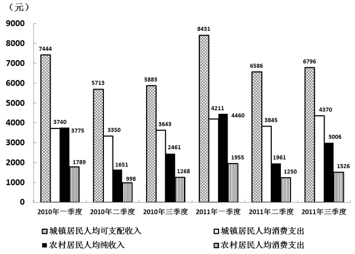

### 第 151 题

2011年第三季度，江苏城镇居民人均可支配收入的月平均数是：

A. 1002元

B. 2265元

C. 1457元

D. 2195元

第 151 题 · 答案与解析

**参考答案（粉笔题库参考内容）**

B

**解析**

根据题干“2011年第三季度······月平均数”，结合材料给出2011年第三季度数据，可判定本题为现期平均数问题。定位统计图可得：2011年第三季度江苏城镇居民人均可支配收入为6796元。一个季度有3个月，故月平均数=6796÷3≈2265元。

故正确答案为B。

**来源**：2012年江苏省公务员录用考试《行测》题（B类）第151题

### 第 152 题

2011年上半年，江苏农村居民人均纯收入同比增长：

A. 14.8%

B. 15.3%

C. 18.3%

D. 18.8%

第 152 题 · 答案与解析

**参考答案（粉笔题库参考内容）**

C

**解析**

根据题干“······同比增长”,结合选项都为百分数，可判定本题为一般增长率问题。上半年人均纯收入=第一季度人均纯收入+第二季度人均纯收入。定位统计图可得：2011年上半年江苏农村居民人均纯收入为

4460+1961=6421元，2010年同期为3775+1651=5426元，则同比增长率为：(6421 − 5426)/5426 = 995/5426 ≈ 995/5430 ≈ 18.3%。

故正确答案为C。

**来源**：2012年江苏省公务员录用考试《行测》题（B类）第152题

### 第 153 题

2010、2011两年前三季度中，江苏城镇居民人均消费支出占人均可支配收入的比重都最低的是：

A. 一季度

B. 二季度

C. 三季度

D. 不能确定

第 153 题 · 答案与解析

**参考答案（粉笔题库参考内容）**

A

**解析**

根据题干“2010、2011两年······占······比重”，结合材料给出2010、2011两年数据，可判定本题为现期比重问题。

方法一：2010年前三季度，城镇居民人均消费支出占人均可支配收入的比重分别为：

一季度：3740/7444 ≈ 37/74 = 0.5；

二季度：3350/5713≈34/57≈0.6；

三季度：3643/5883 ≈ 36/59 ≈ 0.6。

2011年前三季度，城镇居民人均消费支出占人均可支配收入的比重分别为：

一季度：4211/8431 ≈ 42/84 = 0.5；

二季度：3845/6586 ≈ 38/66 ≈ 0.6；

三季度：4370/6796 ≈ 44/68 ≈ 0.6。

2010、2011两年前三季度中一季度占比均最低。

方法二：观察统计图，江苏城镇居民人均消费支出为白色柱状图，人均可支配收入为网状柱状图。2010、2011年一季度人均消费支出柱状图高度近似人均可支配收入柱状图高度的一半，而二、三季度人均消费支出柱状图高度高于人均可支配收入柱状图高度的一半。因此可得第一季度占比均为最低。

故正确答案为A。

**来源**：2012年江苏省公务员录用考试《行测》题（B类）第153题

### 第 154 题

2011年第二季度同比增长最快的是：

A. 江苏农村居民人均纯收入

B. 江苏农村居民人均消费支出

C. 江苏城镇居民人均可支配收入

D. 江苏城镇居民人均消费支出

第 154 题 · 答案与解析

**参考答案（粉笔题库参考内容）**

B

**解析**

根据题干“······同比增长最快”,可判定本题为一般增长率问题。

四类数据同比增长分别如下：

2011年第二季度农村居民人均纯收入同比增长：(1961−1651)/1651≈310/1700≈18%；

2011年第二季度农村居民人均消费支出同比增长：(1250−998)/998≈250/1000=25%；

2011年第二季度城镇居民人均可支配收入同比增长：(6586 − 5713)/5713 ≈ 900/5700 ≈ 16%；

2011年第二季度城镇居民人均消费支出同比增长：(3845 - 3350)/3350 ≈ 500/3400 ≈ 15%。

显然江苏农村居民人均消费支出同比增长最快。

故正确答案为B。

**来源**：2012年江苏省公务员录用考试《行测》题（B类）第154题

### 第 155 题

2011年前三季度，江苏农村居民人均纯收入是农村居民人均消费支出的：

A. 1.45倍

B. 1.56倍

C. 1.97倍

D. 1.99倍

第 155 题 · 答案与解析

**参考答案（粉笔题库参考内容）**

D

**解析**

根据题干“2011年前三季度，······是······的”，结合材料给出前三季度数据且选项均为倍数，可判定本题为现期倍数问题。定位统计图可得：2011年前三个季度，江苏农村居民人均纯收入分别为4460、1961、3006元；农村居民人均消费支出分别为1955、1250、1526元。观察选项发现，C、D选项数值非常接近，估算可能造成误差过大而错选答案，因此只能精确计算。故江苏农村居民人均纯收入/农村居民人均消费支出= (4460 + 1961 + 3006)/(1955 + 1250 + 1526)= 9427/4731 ≈ 1.99倍。

故正确答案为D。

**来源**：2012年江苏省公务员录用考试《行测》题（B类）第155题

