# 2012年江苏省公务员录用考试《行测》题（C类）

<!-- gwy:overview:start -->
> **江苏 · 2012 · 行测 · C类** ｜ 85 题 · 图片 19 处 · 答案随题折叠

| 题型模块 | 题量 | 题号 |
| --- | ---: | ---: |
| 言语理解与表达 | 15 | 1–15 |
| 数量关系 | 20 | 16–35 |
| 判断推理 | 37 | 36–72 |
| 资料分析 | 13 | 73–85 |
| **合计** | **85** | |

导航：[题型与作答说明](#题型与作答说明) · [题目](#题目) · [材料 1](#材料-1)
<!-- gwy:overview:end -->

> 候选采集稿。参考答案及解析来自粉笔页面，不代表官方答案或真实高分答卷；来源使用许可与原卷对应关系仍需人工核实。

## 题型与作答说明

言语理解与表达

（15题）

本部分包括片段阅读、文章阅读与逻辑填空三种类型的试题。

数量关系

（20题）

本部分包括数字推理与数学运算两种类型的试题。

判断推理

（37题）

本部分包括类比推理、图形推理、逻辑判断与定义判断四种类型的试题。

资料分析

（13题）

下列给出的文字、表格、图形资料均有5个问题要你回答，你应根据资料提供的信息进行分析、计算、处理，然后从备选答案中选择一个最恰当的答案。

## 题目

### 第 1 题

调查显示，2010年，有41.6%的城镇居民对文化消费持谨慎态度，有24%的居民家庭没有订报纸和杂志，有75%的居民很少去或没有去过电影院。

这段文字意在说明：

A. 城镇居民对文化消费没有兴趣

B. 报纸、杂志、电影票价格偏高

C. 城镇居民的文化消费水平偏低

D. 文化产品不重视城镇消费群体

第 1 题 · 答案与解析

**参考答案（粉笔题库参考内容）**

C

**解析**

本题为中心理解题。

文段通过一系列数字具体地说明了城镇居民的文化消费情况，由此可以推出城镇居民的文化消费水平较低。

因此，结合选项应该选择C。

A选项“没有兴趣”表述错误，文中说的是“持谨慎态度”；B、D选项文中没有提及，无法得知，因此排除A、B、D。

故正确答案为C。

**考点**：关联词-并列

**来源**：2012年江苏省公务员录用考试《行测》题（C类）第1题

### 第 2 题

目前医保支付模式的改革方向大致为由“按项目付费”过渡为“按病种付费”，在病种付费方式下，医院获得医疗保险机构的费用偿付是按每位病人所属的疾病分类和等级“定额预付”的，因此医院只有提供更科学的诊断规范和医护计划，才能增加医保结余，并有利于合理控制医疗成本。

下列说法不能从文段中推出的是：

A. 按病种付费有利于使医院更科学地实施医疗

B. 按病种付费促使医院考虑如何控制医疗成本

C. 按病种付费才能做到病人医疗费用逐年降低

D. 按病种付费可能是相对比较好的医保支付模式

第 2 题 · 答案与解析

**参考答案（粉笔题库参考内容）**

C

**解析**

C项表述有误，文段中只说按病种付费有利于控制医疗成本，但并不意味着病人的医疗费用会逐年降低。因此，结合选项应该选择C项。A、B、D三项表述正确，从“因此医院只有提供更科学的诊断规范和医护计划······并有利于合理控制医疗成本”可知。

本题为选非题，故正确答案为C。

**考点**：细节判断题

**来源**：2012年江苏省公务员录用考试《行测》题（C类）第2题

### 第 3 题

长期的不透明，耗损着慈善组织的信誉，更伤害了公众的公益热情。最近曝出的几个事件显示出公益与社会的“对立困局”，一边是公众权利意识的提升，另一边却是慈善组织公开透明的缺席；一边是社会慈善需求的扩大，另一边却是公众不信任感的增加。

这段文字的中心议题是：

A. 慈善组织的公益性

B. 慈善组织的公信力

C. 公益组织与社会的关系

D. 公众觉醒的权利意识

第 3 题 · 答案与解析

**参考答案（粉笔题库参考内容）**

B

**解析**

文段首句交代观点，“长期的不透明，耗损着慈善组织的信誉，更伤害了公众的公益热情”。后文通过“曝光事件”进行详细的解释说明。文段属于“观点+解释说明”结构，因此，其中心议题必然和“不透明”有关，四个选项中，只有B项的“公信力”最接近。因此，结合选项应该选择B。

A项“公益性”文段没有提及，排除；C项“公益组织与社会的关系”文中没有提及，文段重在说明不透明对慈善组织和社会公众的伤害，排除；D项“觉醒”表述错误，文中说的是“提升”，排除。

故正确答案为B。

**考点**：主题词

**来源**：2012年江苏省公务员录用考试《行测》题（C类）第3题

### 第 4 题

溃疡病是可以由不同因素引起的一类疾病，患者可以因为一种或多种不同的原因致病。中国约92.6%的溃疡病患者由幽门螺杆菌感染。而另一些研究表明，约30%—65%的溃疡病是由精神压力引起的。另外，过去药物引起的溃疡病很少，但是随着长期服用阿司匹林的病人越来越多，药物引起的溃疡病也呈逐渐上升的趋势。

对这段文字概括最准确的是：

A. 现在中国溃疡病患者数量越来越多

B. 幽门螺杆菌感染是造成溃疡病发生的重要因素

C. 长期服用某些药物可能会导致溃疡病发生

D. 造成溃疡病发生的因素是多方面的

第 4 题 · 答案与解析

**参考答案（粉笔题库参考内容）**

D

**解析**

本题为中心理解题。

D选项概括最准确、全面。

因此，结合选项应该选择D。

文段属于“总—分”结构，首句是文段的主旨句，即溃疡病可以是不同的原因引起的。后面两句是具体说明可能引起溃疡的一些因素。A选项“溃疡病患者数量越来越多”表述错误，文中讲的是“药物引起的溃疡病也呈逐渐上升的趋势”，是指的病因而不是患者；B、C选项只是造成溃疡病的某一个方面，是D选项的支撑材料。

故正确答案为D。

**考点**：分述句特征-多角度论述

**来源**：2012年江苏省公务员录用考试《行测》题（C类）第4题

### 第 5 题

平均来说，一个人在一家酒店住宿一晚，所产生的二氧化碳为10至30千克，相当于一辆汽车行驶60至180公里的排放量。在夏季或冬季集中使用空调时，这个数字将达到最高值。

这段文字意在说明：

A. 酒店是碳排放大户

B. 尽量避免夏冬季住酒店

C. 住酒店最好少用空调

D. 短途差旅开车往返较好

第 5 题 · 答案与解析

**参考答案（粉笔题库参考内容）**

A

**解析**

本题为中心理解题。

文段第一句即用具体数字说明住酒店所产生的碳排放量比较大，第二句则进一步说明季节对住酒店碳排放量的影响。显然这两句话都是在说酒店碳排放量大，换言之，酒店是碳排放大户。

因此，结合选项应该选择A。

B、C选项是为了减少碳排放量可以采取的措施，文段并没有要说怎样减少碳排放量，过度推断；D选项“开车”并不能减少碳排放量。因此排除B、C、D。

故正确答案为A。

**来源**：2012年江苏省公务员录用考试《行测》题（C类）第5题

## 材料 1

医生和营养专家都说，黄曲霉素比三聚氰胺更可怕，比砒霜毒性大几十倍。那么有什么食物能消减黄曲霉素对人体的危害呢？有专家撰文说，绿叶菜中的叶绿素能大幅度减少黄曲霉素的吸收率。

        一家著名的医学杂志在2007年刊登了一项研究，该项研究发现天然叶绿素可以＿＿＿＿＿黄曲霉素B1引起的大鼠多器官致癌作用。研究者表示，叶绿素的抗癌机制可能是因为它能大幅度减少黄曲霉素的吸收率，从而降低了黄曲霉素对肝脏DNA的加成作用。他们认为，叶绿素是一种极好的化学保护物质，对抗致癌物的作用非常有效，从减少吸收，到减少致癌物与遗传物质的作用，直到减少各组织的癌前病变出现，各环节都有明显效果。

        当然，这只是一项动物研究，对人体来说，叶绿素是不是也有同样作用呢，在大鼠试验的启发下，2009年有学者进行了一项人体实验，该研究证明，在人类志愿者当中，叶绿素一样能有效地对抗黄曲霉素的致癌作用。研究者们给志愿者服用微量标记的黄曲霉素B1胶囊，然后正常进食和饮水，测定他们在72小时之内对黄曲霉素的吸收和代谢情况。若干天后，再给志愿者服用同样的黄曲霉素胶囊，但另加叶绿素或叶绿酸。结果和大鼠实验相当类似，叶绿素和叶绿酸能大大降低黄曲霉素的吸收率。

        深绿色的叶菜，在世界上大部分国家里都价格高昂，难得中国人能吃上品种丰富、价格低廉的绿叶菜。但是我们似乎没有好好珍惜这种罕有的幸福和幸运，总把绿叶菜看成不值钱的东西、低档的食品，没有好好享受它的健康效益，真是太遗憾了

### 第 6 题

填入文中画横线处最恰当的一项是：

A. 控制

B. 阻止

C. 抑制

D. 阻击

第 6 题 · 答案与解析

**参考答案（粉笔题库参考内容）**

C

**解析**

本题考查实词填空。

根据“大幅度减少黄曲霉素的吸收率，从而降低了黄曲霉素对肝脏DNA的加成作用”可知，叶绿素能够减轻黄曲霉素引起的致癌作用，横线处填的词语应当含有“减轻”、“缓解”的意思，四个选项中，只有“抑制”含“减少”意。

因此，结合选项应该选择C。

A、B、D选项都夸大了叶绿素对抗致癌物质的作用，因此排除。

故正确答案为C。

**来源**：2012年江苏省公务员录用考试《行测》题（C类）第6题

### 第 7 题

下列有关黄曲霉素的描述不正确的一项是：

A. 是一种剧毒药物

B. 能引起动物及人的癌变

C. 可以被人体吸收

D. 进入人体后可以被排出

第 7 题 · 答案与解析

**参考答案（粉笔题库参考内容）**

D

**解析**

本题考查细节判断。

D选项“可以被排出”表述错误，文中没有提及“排出”，只讲了“吸收”。

因此，结合选项应该选择D。

从“黄曲霉素比三聚氰胺更可怕，比砒霜毒性大几十倍”可推知，A选项正确；从第二段的内容可知，黄曲霉素能引起动物的癌变，从第三段的内容可知，黄曲霉素能引起人的癌变，因此B选项正确；从“他们在72小时之内对黄曲霉素的吸收和代谢情况”可推知C选项正确。

本题为选非题，故正确答案为D。

**来源**：2012年江苏省公务员录用考试《行测》题（C类）第7题

### 第 8 题

叶绿素对人体最重要的抗癌作用是：

A. 减少各组织的癌前病变

B. 降低黄曲霉素对肝脏DNA的加成作用

C. 大幅度减少黄曲霉素的吸收率

D. 减少遗传物质的致癌作用

第 8 题 · 答案与解析

**参考答案（粉笔题库参考内容）**

C

**解析**

本题考查细节判断。

从第三段中的“叶绿素和叶绿酸能大大降低黄曲霉素的吸收率”可以知道，叶绿素对人体最重要的抗癌作用是大幅度减少黄曲霉素的吸收率。

A、B选项是叶绿素的抗癌机制，并非最重要的作用；D选项表述错误，文中讲的是“减少致癌物与遗传物质的作用”，因此排除A、B、D。

故正确答案为C。

**来源**：2012年江苏省公务员录用考试《行测》题（C类）第8题

### 第 9 题

黄曲霉素对人体不利，相关实验之所以可针对人体进行的原因有多种，其中不包括：

A. 试验只进行72小时

B. 服用的是微量标志的试验胶囊

C. 有志愿者愿意参加试验

D. 已用大鼠做过相关试验

第 9 题 · 答案与解析

**参考答案（粉笔题库参考内容）**

A

**解析**

本题考查细节判断。

A选项“只进行72小时”表述错误，文中讲的是“测定他们在72小时之内对黄曲霉素的吸收和代谢情况”，并不是说试验时长只有72小时，从常识来说，试验时长明显大于72小时。

B选项“微量”是从量的方面控制黄曲霉素对人体的危害；C选项“志愿者”体现了人体试验的自愿原则；D选项“已用大鼠做过相关试验”说明试验的可行性。

本题为选非题，故正确答案为A。

**来源**：2012年江苏省公务员录用考试《行测》题（C类）第9题

### 第 10 题

下列作为文章标题最合适的一项是：

A. 试验证明叶绿素可抗癌

B. 多多食用健康食品绿叶菜

C. 黄曲霉素对人体的危害

D. 专家发现抗癌的新方法

第 10 题 · 答案与解析

**参考答案（粉笔题库参考内容）**

B

**解析**

本题考查标题选择。

文段首先讲了动物和人体两个方面的试验，说明绿叶菜中的叶绿素能减少黄曲霉素对人体的致癌作用，最后作者提出自己的观点：多吃绿叶菜。前三段都是为最后一段做的铺垫，重点在最后一段。

A选项“可抗癌”夸大了叶绿素的抗癌作用，文中只讲了叶绿素在对抗黄曲霉素的致癌作用方面有一定作用，而对抗其他致癌因素则无从得知；C选项“对人体的危害”文中并没有具体说明；D选项“新方法”表述错误，文中并没有讲如何抗癌。因此，A、C、D选项都不适合做标题。

故正确答案为B。

**来源**：2012年江苏省公务员录用考试《行测》题（C类）第10题

### 第 11 题

改革开放30余年，中国的经济社会发展成就＿＿＿＿＿，综合国力大大增强，人民生活水平显著提高，纵向自我对比，与改革开放之前已有＿＿＿＿＿。

依次填入画横线中最恰当的一项是：

A. 无与伦比 突飞猛进

B. 世人皆知 巨大落差

C. 举世瞩目 霄壤之别

D. 空前绝后 天国之遥

第 11 题 · 答案与解析

**参考答案（粉笔题库参考内容）**

C

**解析**

本题考查成语填空。

“霄壤之别”与“天壤之别”语义一致，“霄”即指“天”，用来形容人民生活水平的巨大变化，符合文意。

因此，结合选项应该选择C。

“无与伦比”指事物非常完美，没有能与它相比的同类的东西；“世人皆知”指知道的人很多；“举世瞩目”指全世界的人都关注，形容影响很大；“空前绝后”指从前没有过，以后也没有，夸张地形容独一无二。

第一个空用来形容“成就”，显然不能用“无与伦比”“空前绝后”，因此排除A、D两项；“巨大落差”指现在不如以前，这显然与“人民生活水平显著提高”不符，排除B项。

故正确答案为C。

**考点**：对应关系-前后呼应、成语填空、词的辨析-程度轻重

**来源**：2012年江苏省公务员录用考试《行测》题（C类）第11题

### 第 12 题

信念是人的生命得以闪光的火花，信念的火花一旦熄灭，人的生命就不再有闪光点了，人的生命如不以信念为＿＿＿＿＿，将会逐渐萎缩以至＿＿＿＿＿。

依次填入画横线中最恰当的一项是：

A. 前提 干涸

B. 基础 消亡

C. 基石 枯竭

D. 依托 枯槁

第 12 题 · 答案与解析

**参考答案（粉笔题库参考内容）**

D

**解析**

本题考查近义实词的辨析。

本题可采用排除法。根据文意，第二个空所填的词语应表示萎缩的结果。

因此，结合选项应该选择D，“枯槁”指草木枯萎，是“萎缩”的进一步结果，可以与前面的“萎缩”相对应。将“依托”代入第一空验证，句意通顺。

“萎缩”指物体干枯、缩小、衰退。而“干涸”、“枯竭”多用来指水的消失不见，排除A、C。“消亡”指消失、灭亡，形体已经不存在了，但“萎缩”的事物形体仍存在，两者不能相对应，排除B。

故正确答案为D。

**考点**：实词填空、对应关系-前后呼应

**来源**：2012年江苏省公务员录用考试《行测》题（C类）第12题

### 第 13 题

随着国际文化交流的日益频繁，各国文学读物大量涌现，使人＿＿＿＿＿，其中不乏各种文化珍品的翻译精编，但也有选材不严的＿＿＿＿＿现象，为读者所诟病。

依次填入画横线中最恰当的一项是：

A. 目不暇接 鱼目混珠

B. 叹为观止 哗众取宠

C. 琳琅满目 鱼龙混杂

D. 招架不住 泥沙俱下

第 13 题 · 答案与解析

**参考答案（粉笔题库参考内容）**

A

**解析**

第一空，“使”引导因果关系，且根据“各国文学读物大量涌现”可知，文学读物的数量之多让人们看不过来，A项“目不暇接”形容眼前美好事物太多，或景物变化太快，眼睛来不及观看，符合文意，当选。B项“叹为观止”形容赞叹所见的事物好到了极点，用于此处程度过重，排除；C项“琳琅满目”比喻充满了美好珍贵的事物，多用于搭配“商品”等，与“人”搭配不当，排除；D项“招架不住”指抵挡不住，文段只是客观介绍了各国文学读物大量涌入的现状，并没有体现需要抵抗的含义，与文意不符，排除。

第二空，代入验证。A项“鱼目混珠”比喻以假乱真，填入此处可与“文化珍品的翻译精编”形成对比，体现选材不严带来的后果，符合文意，当选。

故正确答案为A。

**考点**：关联关系-因果关系、对应关系-前后呼应、成语填空、词的辨析-搭配对象

**来源**：2012年江苏省公务员录用考试《行测》题（C类）第13题

### 第 14 题

在通胀问题尚未完全解决的情况下，面对发达国家的主权债务危机，新兴经济体又不得不再次放松经济政策。这种内热外冷的＿＿＿＿＿导致新兴经济体既要促进经济增长，又要防止通胀＿＿＿＿＿。

依次填入画横线中最恰当的一项是：

A. 境况 张牙舞爪

B. 困境 死灰复燃

C. 形式 来势汹汹

D. 事态 卷土重来

第 14 题 · 答案与解析

**参考答案（粉笔题库参考内容）**

B

**解析**

从第二空入手，根据文意可知，通货膨胀在一定程度上得到了解决，但还没彻底解决，新兴经济体要防止通胀再次出现。“张牙舞爪”、“来势汹汹”都形容气焰嚣张，与文意不符，排除A、C两项。

第一空，“内热外冷”说明状况并不好，“事态”只是单纯的指局势，偏中性，而“困境”指困难的处境，显然“困境”更能说明新兴经济体所面临的问题，排除D项。

故正确答案为B。

**考点**：对应关系-前后呼应、混搭填空、词的辨析-感情色彩

**来源**：2012年江苏省公务员录用考试《行测》题（C类）第14题

### 第 15 题

美无处不在，然而它却总需要人去发现，不然，它就将永远＿＿于黑暗之中或在我们的感觉之外而默无声响地白白地流逝着，文学家的天职，就是磨砺心灵，擦亮双目去将它一一发现，然后用反复＿＿的文字昭示于众。

依次填入画横线中最恰当的一项是：

A. 消失 修订

B. 沉没 出现

C. 消逝 修饰

D. 潜藏 斟酌

第 15 题 · 答案与解析

**参考答案（粉笔题库参考内容）**

D

**解析**

本题考查近义实词的辨析。

第一空，根据“美无处不在”可知，美是客观存在的，不论发现与否，都不会改变，因此第一空填“消失”、“消逝”不合文意，排除A、C。

第二空，从“磨砺”、“反复”可知，“出现”与语境不符，排除B。填入“斟酌”，表明文学家反复琢磨选用最佳的文字。

故正确答案为D。

**考点**：实词填空、对应关系-前后呼应

**来源**：2012年江苏省公务员录用考试《行测》题（C类）第15题

### 第 16 题

7，9，13，21，37，（  ）

A. 57

B. 69

C. 87

D. 103

第 16 题 · 答案与解析

**参考答案（粉笔题库参考内容）**

B

**解析**

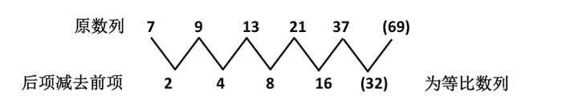

故正确答案为B。

**来源**：2012年江苏省公务员录用考试《行测》题（C类）第16题

### 第 17 题

12，34，56，（  ），910，1112

A. 62

B. 75

C. 78

D. 1002

第 17 题 · 答案与解析

**参考答案（粉笔题库参考内容）**

C

**解析**

机械划分：1|2、3|4、5|6、（｜）、9|10、11|12。

看作交叉数列：左侧部分：1、3、5、(7)、9、11，为等差数列；右侧部分：2、4、6、(8)、10、12，为等差数列，因此原数列未知项为78。

故正确答案为C。

**来源**：2012年江苏省公务员录用考试《行测》题（C类）第17题

### 第 18 题

1，0，9，16，（  ），48

A. 25

B. 33

C. 36

D. 42

第 18 题 · 答案与解析

**参考答案（粉笔题库参考内容）**

B

**解析**

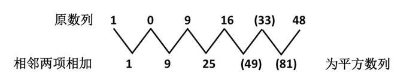

故正确答案为B。

**来源**：2012年江苏省公务员录用考试《行测》题（C类）第18题

### 第 19 题

1，3，4，13，53，（  ），36571

A. 690

B. 780

C. 850

D. 920

第 19 题 · 答案与解析

**参考答案（粉笔题库参考内容）**

A

**解析**

数列中相邻两项的乘积，再加1，等于数列的后一项。4 = 1 × 3 + 1，13=3×4+1，53=4×13+1，(690) = 13 × 53 + 1，36571 = 53 × 690 + 1。

故正确答案为A。

**来源**：2012年江苏省公务员录用考试《行测》题（C类）第19题

### 第 20 题

√2，2，2√2，4，4√2，()

A. 8

B. 4

C. 4√2

D. 3√2

第 20 题 · 答案与解析

**参考答案（粉笔题库参考内容）**

A

**解析**

原数列为等比数列，公比为√2，故未知项为4√2 × √2 = 8。

故正确答案为A。

**来源**：2012年江苏省公务员录用考试《行测》题（C类）第20题

### 第 21 题

4，6，10，14，22，（  ）

A. 24

B. 26

C. 32

D. 38

第 21 题 · 答案与解析

**参考答案（粉笔题库参考内容）**

B

**解析**

方法一：数列中各项分别为质数数列2、3、5、7、11、(13)的两倍。故未知项为13×2 = 26。

故正确答案为B。

方法二：未发现特征，考虑作差。作差后得到新数列为：2，4，4，8，（  ），呈现递推规律：2×4÷2=4，4×4÷2=8，即第一项×第二项÷2=第三项，则新数列最后一项=4×8÷2=16，则原数列最后一项为22+16=38。

故正确答案为D。

注：本题两个规律可以推出两个答案，是争议题。不过质数两倍的规律更为直接，因此粉笔倾向于质数的规律。

**来源**：2012年江苏省公务员录用考试《行测》题（C类）第21题

### 第 22 题

1/2，1，7/6，5/4，13/10，（    ）

A. 4/3

B. 3/4

C. 11/14

D. 17/18

第 22 题 · 答案与解析

**参考答案（粉笔题库参考内容）**

A

**解析**

对原数列进行反约分，变为1/2、4/4、7/6、10/8、13/10。

分子列：1、4、7、10、13、(16)是等差数列；

分母列：2、4、6、8、10、(12)是等差数列。

因此未知项为16/12=4/3。

故正确答案为A。

**来源**：2012年江苏省公务员录用考试《行测》题（C类）第22题

### 第 23 题

2，3，7，（  ），121，721

A. 11

B. 17

C. 19

D. 25

第 23 题 · 答案与解析

**参考答案（粉笔题库参考内容）**

D

**解析**

递推关系为：A_(n+1) = A_n×(n+1)-n。3 = 2 × 2 − 1，7 = 3×3−2，(25) = 7 × 4 − 3，121 = (25) × 5 - 4，721=121×6−5。

故正确答案为D。

**来源**：2012年江苏省公务员录用考试《行测》题（C类）第23题

### 第 24 题

10，12，15，20，30，（  ）

A. 35

B. 45

C. 60

D. 76

第 24 题 · 答案与解析

**参考答案（粉笔题库参考内容）**

C

**解析**

新数列每一项的分子为前一项的分母，分母为分子减1。

故正确答案为C。

**来源**：2012年江苏省公务员录用考试《行测》题（C类）第24题

### 第 25 题

4，9，8，11，12，（  ）

A. 13

B. 14

C. 17

D. 19

第 25 题 · 答案与解析

**参考答案（粉笔题库参考内容）**

C

**解析**

依据已知数列分析可得：

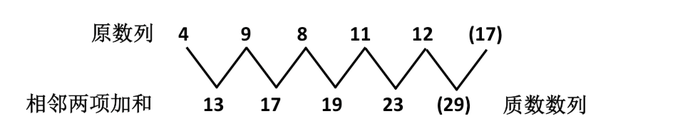

故正确答案为C。

备注：此题出得不够严谨，也可以通过两两作差，连续作差两次，得到-6，4，-2，0正负交替的等差数列，此时答案应该选A。

**来源**：2012年江苏省公务员录用考试《行测》题（C类）第25题

### 第 26 题

经技术改进，A、B两城间列车的运行速度由150千米/小时提升到250千米/小时，行车时间因此缩短了48分钟，则A、B两城间的距离为：

A. 291千米

B. 300千米

C. 310千米

D. 320千米

第 26 题 · 答案与解析

**参考答案（粉笔题库参考内容）**

B

**解析**

48分钟=4/5小时。设技术改进后行车时间为t小时，则有150 × (t + 4/5) = 250t，解得t=6/5。因此A、B两城间的距离为250×6/5 = 300千米。

故正确答案为B。

**考点**：普通行程

**来源**：2012年江苏省公务员录用考试《行测》题（C类）第26题

### 第 27 题

一项工程甲单独完成需12天，乙单独完成需9天，若甲先做若干天后，改由乙接着做共用10天完成，则甲做的天数是：

A. 6

B. 5

C. 4

D. 3

第 27 题 · 答案与解析

**参考答案（粉笔题库参考内容）**

C

**解析**

令工作量为1，则甲的工作效率为1/12，乙的工作效率为1/9。设甲做了A天，乙做了(10-A)天，则有(1/12)×A+(1/9)×(10−A)=1，解得A=4。

故正确答案为C。

**考点**：给完工时间型

**来源**：2012年江苏省公务员录用考试《行测》题（C类）第27题

### 第 28 题

小张从华兴园到软件公司上班要经过多条街道（软件公司在华兴园的东北方）。假如他只能向东或者向北行走，则他上班不同走法共有：

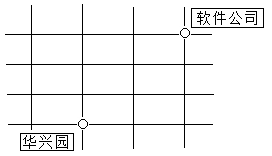

A. 12种

B. 15种

C. 20种

D. 10种

第 28 题 · 答案与解析

**参考答案（粉笔题库参考内容）**

D

**解析**

不管怎么走，小张到达目的地共要经过5条街道，并且这5条街道里包括3条向北的和2条向东的。因此，上班的不同走法就是从这5条街道里选出2条向东的，或者3条向北的。因此走法有C_5^2=10种。

故正确答案为D。

**考点**：基础排列组合

**来源**：2012年江苏省公务员录用考试《行测》题（C类）第28题

### 第 29 题

甲、乙、丙三人的月收入分别为6000元、3000元、1000元。如果保持三人月收入比值不变且使平均月收入达到5000元，则丙的月收入增加了：

A. 600元

B. 500元

C. 400元

D. 300元

第 29 题 · 答案与解析

**参考答案（粉笔题库参考内容）**

B

**解析**

解析1：

三人月收入比值为6:3:1。当平均月收入达到5000元时，三人月收入总额为5000×3=15000元，此时丙的月收入为15000 ÷ (6 + 3 + 1) × 1 = 1500元，比原来增加了1500-1000=500元。

解析2：

三人月收入比值为6:3:1。要使平均月收入达到5000元，则需三人月收入总额增加5000×3−(6000+3000+1000)=5000元。而总增加额中三人各自增加额的比值也为6:3:1，因此丙的月收入增加额为5000÷(6+3+1)×1=500元。

故正确答案为B。

**考点**：和差倍比问题

**来源**：2012年江苏省公务员录用考试《行测》题（C类）第29题

### 第 30 题

某盐溶液的浓度为20%，加入水后，溶液的浓度变为15%。如果再加入同样多的水，则溶液的浓度变为：

A. 13%

B. 12.5%

C. 12%

D. 10%

第 30 题 · 答案与解析

**参考答案（粉笔题库参考内容）**

C

**解析**

等量加水的过程中，溶液的量发生变化，溶质保持不变。直接赋值溶质为60，可得60/300 → 60/400 → 60/500，因此溶液浓度变为12%。

故正确答案为C。

**来源**：2012年江苏省公务员录用考试《行测》题（C类）第30题

### 第 31 题

长方体棱长的和是48，其长、宽、高之比为3：2：1，则长方体的体积是：

A. 45

B. 48

C. 384

D. 386

第 31 题 · 答案与解析

**参考答案（粉笔题库参考内容）**

B

**解析**

设长方体的长、宽、高分别为3a、2a、a，则有4×(3a+2a+a) = 48，解得a=2。长方体长、宽、高则分别为6、4、2，长方体体积为6 × 4 × 2 = 48。

故正确答案为B。

**考点**：几何公式类-立体图形

**来源**：2012年江苏省公务员录用考试《行测》题（C类）第31题

### 第 32 题

下列可以分解为三个不同质数相乘的三位数是：

A. 100

B. 102

C. 104

D. 125

第 32 题 · 答案与解析

**参考答案（粉笔题库参考内容）**

B

**解析**

直接代入各选项求解。

A项：100 = 2 × 2 × 5 × 5，不符合题意，排除；

B项：102=2×3×17，符合题意，当选；

C项：104=2×2×2×13，不符合题意，排除；

D项：125=5×5×5，不符合题意，排除。

故正确答案为B。

**考点**：公倍数与公约数问题

**来源**：2012年江苏省公务员录用考试《行测》题（C类）第32题

### 第 33 题

为响应推动我国社会主义文化事业大发展大繁荣的号召，某小区决定为小区内每位老人准备40元文化基金，同时为每位儿童比老人多准备20元文化基金。已知该小区老人比儿童多100人，文化基金一共14000元，则该小区老人和儿童总数为：

A. 300

B. 320

C. 360

D. 480

第 33 题 · 答案与解析

**参考答案（粉笔题库参考内容）**

A

**解析**

解析1：

设儿童人数为x，老人人数为x+100，则有40(x+100)+(20+40)x=14000，解得x=100。则小区内儿童有100人，老人有200人，一共有300人。

解析2：

由题意可知老人比儿童多100人，这多出的100位老人的文化基金为40 × 100 = 4000元，则剩下的相同人数的老人和儿童的文化基金为14000-4000=10000元，剩下的老人和儿童的人数均为10000 ÷ (40 + 20 + 40) = 100人。因此小区内老人和儿童总数为100+100+100=300人。

故正确答案为A。

**考点**：和差倍比问题

**来源**：2012年江苏省公务员录用考试《行测》题（C类）第33题

### 第 34 题

加工300个零件，加工出一件合格品可得加工费6元，加工出一件不合格品不仅得不到加工费，还要赔偿18元，如果加工完毕共得1752元，则加工出合格品的件数是：

A. 294

B. 295

C. 296

D. 298

第 34 题 · 答案与解析

**参考答案（粉笔题库参考内容）**

D

**解析**

解析1：

如果全部合格可得300 × 6 = 1800元，而实得1752元，则损失1800-1752=48元。由题意可知一件不合格损失6+18=24元，则不合格品件数为48 ÷ 24 = 2个，合格品件数为300-2=298个。

解析2：

设合格品件数为x，不合格品件数为300-x，则有6x−18×(300−x)=1752，解得x=298。因此合格品的件数为298个。

故正确答案为D。

**考点**：和差倍比问题

**来源**：2012年江苏省公务员录用考试《行测》题（C类）第34题

### 第 35 题

50个数字，2，3，4，3，4，5，4，5，6，5，6，7，6，7，8，......之和是：

A. 497

B. 523

C. 541

D. 568

第 35 题 · 答案与解析

**参考答案（粉笔题库参考内容）**

C

**解析**

这50个数三个一组可以分成17组：(2,3,4)，(3,4,5)，…，(17,18,19)，(18,19)。前16组都是三个连续的自然数，第17组只有两个数。前16组中，每一组三数之和都比前一组大3，因此这16组数的和构成首项为9，末项为54的等差数列。根据等差数列求和公式，这16组数的和为[(9 + 54) ÷ 2] × 16 = 504。再加上第17组数的和37，则这50个数的和为504+37=541。

故正确答案为C。

等差数列求和公式：和 = (首项+末项)/2 × 项数。

**考点**：数列问题

**来源**：2012年江苏省公务员录用考试《行测》题（C类）第35题

### 第 36 题

眼睛：光线

A. 航母：航行

B. 草坪：环保

C. 山峦：风景

D. 耳朵：声音

第 36 题 · 答案与解析

**参考答案（粉笔题库参考内容）**

D

**解析**

第一步：判断题干词语间逻辑关系。

题干两词是对应关系，且是人体器官与所感受到的客体之间的对应。

第二步：判断选项词语间逻辑关系。

与题干相同逻辑关系的即为D。A是主谓关系，B没有逻辑关系，C是包容关系。

故正确答案为D。

**考点**：逻辑关系-对应关系

**来源**：2012年江苏省公务员录用考试《行测》题（C类）第36题

### 第 37 题

困境：面对

A. 问题：解决

B. 人生：信仰

C. 攀登：山峰

D. 社会：和谐

第 37 题 · 答案与解析

**参考答案（粉笔题库参考内容）**

A

**解析**

第一步：判断题干词语间逻辑关系。

题干两词是语法关系，“面对困境”构成动宾结构。

第二步：判断选项词语间逻辑关系。

与题干相同逻辑关系的即为A项，“解决问题”也构成动宾结构。B项没有逻辑关系，与题干逻辑关系不一致，排除；C项前后本身就是动宾关系，与题干位置相反，与题干逻辑关系不一致，排除；D项中“和谐”用来形容“社会”，不构成动宾结构，与题干逻辑关系不一致，排除。

故正确答案为A。

**考点**：语法关系

**来源**：2012年江苏省公务员录用考试《行测》题（C类）第37题

### 第 38 题

国家：崛起：繁荣

A. 学生：努力：成绩

B. 人生：奋斗：精彩

C. 市场：盈利：亏损

D. 乡村：建设：规划

第 38 题 · 答案与解析

**参考答案（粉笔题库参考内容）**

B

**解析**

第一步：判断题干词语间的双重逻辑关系。

题干前两词是对应关系，前者是后者的行为主体，与之逻辑相同的有A、B和D，C中的“盈利”为名词，与“崛起”词性不同。

第二步：答案不唯一时，再判断题干词语间第二重逻辑关系，并在选项中进行选择。

题干后两词为因果关系，国家因崛起而实现了繁荣，与之逻辑相同的是B，人生因奋斗而实现精彩。“繁荣”和“精彩”都是一种状态，A中“成绩”为名词，排除。D中后两词不构成因果关系，排除。

故正确答案为B。

**考点**：语法关系、逻辑关系-对应关系

**来源**：2012年江苏省公务员录用考试《行测》题（C类）第38题

### 第 39 题

巡查：巡视：巡逻

A. 考试：考察：考核

B. 目标：目的：目前

C. 数学：数控：数量

D. 人生：人际：人员

第 39 题 · 答案与解析

**参考答案（粉笔题库参考内容）**

A

**解析**

第一步：判断题干词语间逻辑关系。

题干三个词属于近义词，三者都有来回到各处检查的意思。

第二步：判断选项词语间逻辑关系。

A项，三个词属于近义词，都有考量审查的意思，符合题意。

B项，目标和目的意思相近，但目前是表示时间的副词，三者不是近义词，与题干不符。

C项，数学是一门学科，数控是数字控制的简称，数量指事物数目的多少，三者不是近义词，与题干不符。

D项，人生是一个抽象概念，可泛指人一生中的活动。人际指社会上人与人之间的交往和交际，人员指担任某种工作或某种职务的人，三个词不是近义词，与题干不符。

第三步：再次标注答案。

故正确答案为A。

**考点**：语义关系-近义关系

**来源**：2012年江苏省公务员录用考试《行测》题（C类）第39题

### 第 40 题

（    ） 之于 计算机 相当于 （    ） 之于 相机

A. 运算——摄影

B. 公式——程序

C. 键盘——屏幕

D. 数学——风景

第 40 题 · 答案与解析

**参考答案（粉笔题库参考内容）**

A

**解析**

第一步：将选项逐一代入，判断各选项前后部分的逻辑关系。

A项代入后，前后两词均为对应关系，用计算机来运算，用相机来摄影；B项不构成逻辑关系；C项前两词为必然组成关系，即计算机必须有键盘，后两词为或然组成关系，即相机不一定都有屏幕；D项无逻辑关系。

第二步：逻辑关系相同即为答案。

综合以上分析，仅A项前后两组词语逻辑关系相同。

故正确答案为A。

**考点**：逻辑关系-对应关系

**来源**：2012年江苏省公务员录用考试《行测》题（C类）第40题

### 第 41 题

法律 之于 民法 相当于 （    ） 之于 （    ）

A. 物理——公理

B. 定律——方法

C. 实数——自然数

D. 华东——江苏

第 41 题 · 答案与解析

**参考答案（粉笔题库参考内容）**

C

**解析**

第一步：判断题干词语间逻辑关系。

民法是一部法律，二者为种属关系。

第二步：判断选项词语间逻辑关系。

A项：物理是一门自然科学，公理是经过人类长期反复实践的考验，不需要再加以证明的命题，二者没有明显关系，与题干逻辑关系不一致，排除；

B项：定律是科学上对某种客观规律的概括，方法是指为达到某种目的而采取的途径、步骤、手段等，二者没有明显关系，与题干逻辑关系不一致，排除；

C项：自然数是一类实数，二者为种属关系，与题干逻辑关系一致，当选；

D项：江苏是华东的一个省份，是华东地区的一部分，二者为组成关系，与题干逻辑关系不一致，排除。

故正确答案为C。

**考点**：逻辑关系-包容关系

**来源**：2012年江苏省公务员录用考试《行测》题（C类）第41题

### 第 42 题

（    ） 之于 学校 相当于 士兵 之于 （    ）

A. 班级——军队

B. 学生——部队

C. 班长——连长

D. 老师——军校

第 42 题 · 答案与解析

**参考答案（粉笔题库参考内容）**

B

**解析**

第一步：将选项逐一代入，判断各选项前后部分的逻辑关系。

A项代入后，前两词为对应关系，后两词为组成关系；B项前后两词均为包容关系中的组成关系；C项前两个词为对应关系，后两个词只是级别上不同而已；D项前后两词都是对应关系，但“老师”在学校中担任的是“教育人”的角色，而士兵在“军校”是“受教育”的角色，“老师”与“士兵”不对应。

第二步：逻辑关系相同即为答案。

综合以上分析，仅B项前后两组词语逻辑关系相同。

故正确答案为B。

**考点**：逻辑关系-包容关系

**来源**：2012年江苏省公务员录用考试《行测》题（C类）第42题

### 第 43 题

6A2B6H

A. 9H4H9M

B. 1W4G7G

C. 3R3T6U

D. 9D6T9W

第 43 题 · 答案与解析

**参考答案（粉笔题库参考内容）**

D

**解析**

题干中第1个和第3个数字是相同的，所以在A、D两项中选择；再看题干中的字母，没有出现相同的，排除A项。

故正确答案为D。

**来源**：2012年江苏省公务员录用考试《行测》题（C类）第43题

### 第 44 题

cTT33LL6

A. OMM55NN9

B. uVV22KK3

C. aDD66BD8

D. eKK5JJ77

第 44 题 · 答案与解析

**参考答案（粉笔题库参考内容）**

B

**解析**

观察题干，第一个字母为小写，排除A项；然后是两个相同字母、两个相同数字、两个相同字母的排序，C、D两项不符合此规律，排除。

故正确答案为B。

**来源**：2012年江苏省公务员录用考试《行测》题（C类）第44题

### 第 45 题

##β9USD

A. §@@5ZXY

B. $$u8aBC

C. &&a5CNY

D. &&3∠JPY

第 45 题 · 答案与解析

**参考答案（粉笔题库参考内容）**

C

**解析**

观察题干，先是两个相同的符号，排除A项；然后是一个希腊字母，排除B、D两项。再看题干结尾为三个大写字母，C项符合，验证C项正确。

故正确答案为C。

**来源**：2012年江苏省公务员录用考试《行测》题（C类）第45题

### 第 46 题

上边的题干中给出一套图形，其中有五个图，这五个图呈现一定的规律性。在下边给出一套图形，从中选出唯一的一项作为保持上边五个图规律性的第六个图。

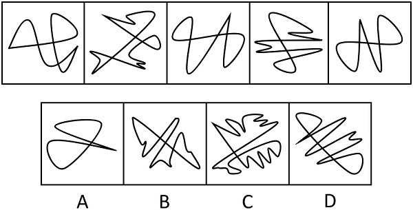

A. A

B. B

C. C

D. D

第 46 题 · 答案与解析

**参考答案（粉笔题库参考内容）**

B

**解析**

元素组成凌乱，考虑数数。数面（封闭空间）。已知图形中，每个图形的面数均为4，所以选有4个面的B。

故正确答案为B。

**考点**：数量规律-面

**来源**：2012年江苏省公务员录用考试《行测》题（C类）第46题

### 第 47 题

从所给四个选项中，选择最合适的一个填入问号处，使之呈现一定的规律性：

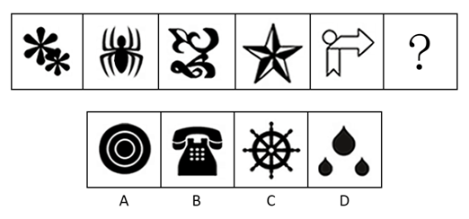

A. A

B. B

C. C

D. D

第 47 题 · 答案与解析

**参考答案（粉笔题库参考内容）**

C

**解析**

元素组成凌乱，考虑数数——数部分，已知图形都连接在一起，没有分开来独立呈现。都是连通图形，A、B、D选项都有分开呈现的部分。

故正确答案为C。

**考点**：数量规律-素

**来源**：2012年江苏省公务员录用考试《行测》题（C类）第47题

### 第 48 题

从所给四个选项中，选择最合适的一个，使之呈现一定的规律性：

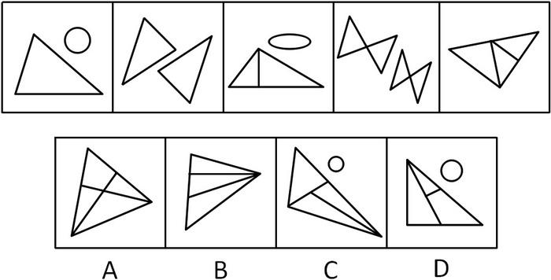

A. A

B. B

C. C

D. D

第 48 题 · 答案与解析

**参考答案（粉笔题库参考内容）**

B

**解析**

特殊考点-数三角形个数，包含重复数（即两个小图形组成的三角形也算在内）。已知图形三角形的个数分别为1、2、3、4、5，所以选有6个三角形的B。

故正确答案为B。

**考点**：数量规律-素

**来源**：2012年江苏省公务员录用考试《行测》题（C类）第48题

### 第 49 题

从所给四个选项中，选择最合适的一个填入问号处，使之呈现一定的规律性：

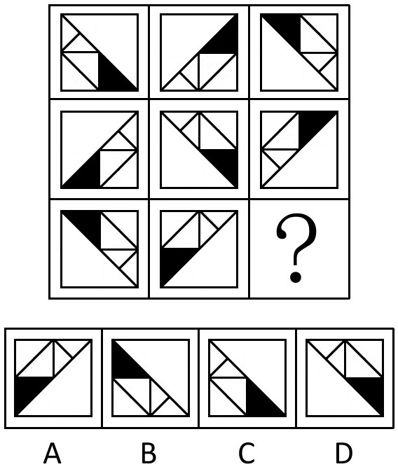

A. A

B. B

C. C

D. D

第 49 题 · 答案与解析

**参考答案（粉笔题库参考内容）**

C

**解析**

元素组成相同，看位置。每一行图形依次逆时针旋转90度得到下一个图形。

故正确答案为C。

**考点**：位置规律-旋转

**来源**：2012年江苏省公务员录用考试《行测》题（C类）第49题

### 第 50 题

从所给四个选项中，选择最合适的一个填入问号处，使之呈现一定的规律性：

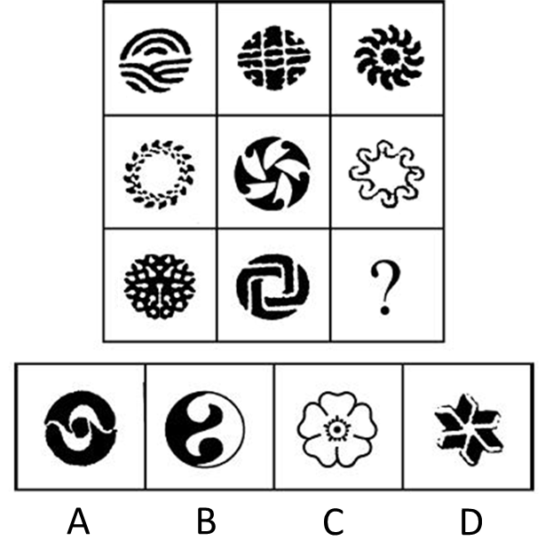

A. A

B. B

C. C

D. D

第 50 题 · 答案与解析

**参考答案（粉笔题库参考内容）**

B

**解析**

元素组成不同，考查对称性，已知图形第一行图一不对称，图二轴对称+中心对称，图三中心对称，第二行图一中心对称，图二不对称，图三中心对称，每行图形均有一个不对称图形，两个对称图形，第三行图一轴对称图形，图二中心对称图形，问号处选一个不对称的图形，只有B项符合。

故正确答案为B。

**考点**：属性规律-对称性

**来源**：2012年江苏省公务员录用考试《行测》题（C类）第50题

### 第 51 题

从所给四个选项中，选择最合适的一个填入问号处，使之呈现一定的规律性：

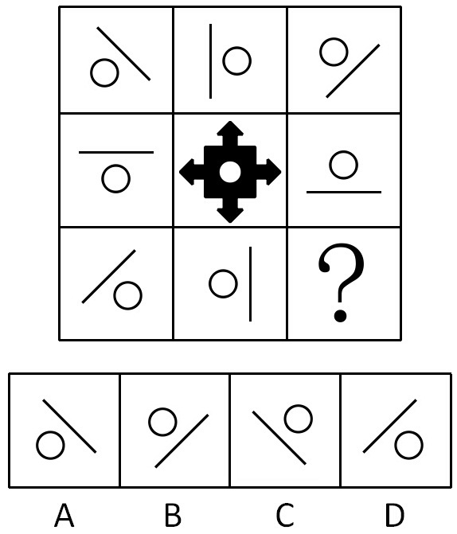

A. A

B. B

C. C

D. D

第 51 题 · 答案与解析

**参考答案（粉笔题库参考内容）**

C

**解析**

元素组成相同，整体观察位置，米字格中心对称。所有方格以第二行第二格为中心形成对称。因此问号处的图形与第一行第一格中的图形形成中心对称。

故正确答案为C。

**考点**：属性规律-对称性

**来源**：2012年江苏省公务员录用考试《行测》题（C类）第51题

### 第 52 题

选项的四个图形中，只有一个是由题干中的四个图形拼合（只能上、下、左、右平移）而成的，请把它找出来：

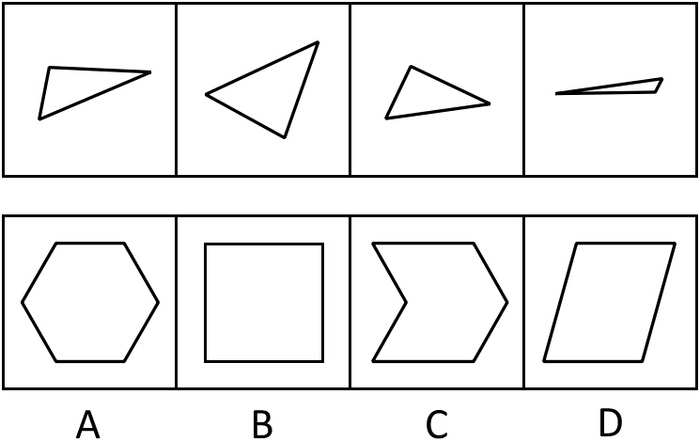

A. A

B. B

C. C

D. D

第 52 题 · 答案与解析

**参考答案（粉笔题库参考内容）**

D

**解析**

题干中四个图形拼合在一起得到如下图形。

故正确答案为D。

**来源**：2012年江苏省公务员录用考试《行测》题（C类）第52题

### 第 53 题

选项的四个图形中，只有一个是由题干中的四个图形拼合（只能上、下、左、右平移）而成的，请把它找出来：

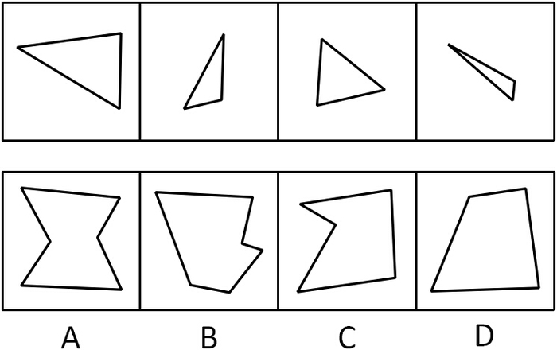

A. A

B. B

C. C

D. D

第 53 题 · 答案与解析

**参考答案（粉笔题库参考内容）**

C

**解析**

题干中四个图形拼合在一起得到如下图形。

故正确答案为C。

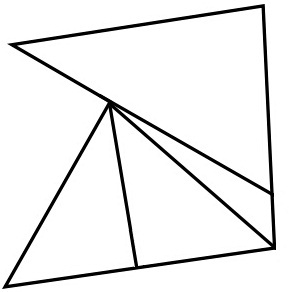

**来源**：2012年江苏省公务员录用考试《行测》题（C类）第53题

### 第 54 题

选项的四个图形中，只有一个是由题干中的四个图形拼合（只能上、下、左、右平移）而成的，请把它找出来：

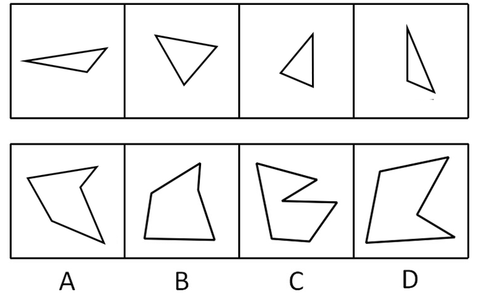

A. A

B. B

C. C

D. D

第 54 题 · 答案与解析

**参考答案（粉笔题库参考内容）**

A

**解析**

题干中四个图形拼合在一起得到如下图形。

故正确答案为A。

**来源**：2012年江苏省公务员录用考试《行测》题（C类）第54题

### 第 55 题

有些紫砂壶是有生命的，因此，有些有生命的东西有品质好坏之分。以下各项判断如果为真，则哪项最能加强上述论证：

A. 紫砂壶都有品质好坏之分

B. 有些紫砂壶是没有生命的

C. 紫砂壶都没有品质好坏之分

D. 有些有生命的东西不是紫砂壶

第 55 题 · 答案与解析

**参考答案（粉笔题库参考内容）**

A

**解析**

第一步：分析题干信息。

条件：紫砂壶与有生命的关系，

结论：有生命与有品质好坏之分的关系。

第二步：根据三段论特点得到以下步骤，直接得出结论。

1、在条件和结论不同的对象间搭桥，即在紫砂壶和有品质好坏之分间搭桥；

2、搭桥的方向：由条件的对象指向结论的对象，即由紫砂壶推出有品质好坏之分；

3、该表达必须是充分的表达，即所有紫砂壶都有品质好坏之分。

第三步：分析选项得出答案。

通过分析，A项中说法正是第二步的结论。

故正确答案为A。

**考点**：搭桥

**来源**：2012年江苏省公务员录用考试《行测》题（C类）第55题

### 第 56 题

以前，为了吃到放心蔬菜，很多消费者喜欢购买有虫眼的蔬菜，他们认为这样的蔬菜没有打过农药，因为如果打过农药，虫子肯定就不会去吃这样的蔬菜了。而现在，大多数消费者已经转变了观念。

以下各项判断如果为真，则哪项能够解释消费者观念的转变：

A. 蔬菜有虫眼，表明虫子吃过蔬菜

B. 如果虫子会吃某种蔬菜，则这种蔬菜一定没有打过农药

C. 如果蔬菜打过农药，虫子就不会吃了

D. 有虫眼的蔬菜也可能打过农药，因为农药可以在虫害之后喷洒

第 56 题 · 答案与解析

**参考答案（粉笔题库参考内容）**

D

**解析**

第一步：找到题干矛盾现象。

本题矛盾现象是：以前，为了吃到放心蔬菜，很多消费者喜欢购买有虫眼的蔬菜，他们认为这样的蔬菜没有打过农药，因为如果打过农药，虫子肯定就不会去吃这样的蔬菜了，而现在，大多数消费者已经转变了观念。

第二步：逐一分析选项。

A项：蔬菜有虫眼，表明虫子吃过蔬菜，这是符合消费者以前的观念，与转变观念无关，无法解释题干矛盾现象，排除；

B项：虫子会吃→打过农药，这也是符合消费者以前的观念，与转变观念无关，无法解释题干矛盾现象，排除；

C项：打过农药→虫子会吃，这也是符合消费者以前的观念，与转变观念无关，无法解释题干矛盾现象，排除；

D项：菜农在虫害之后也可能会喷洒农药，说明“有虫眼”和“没有打过农药”之间并没有必然联系，这就否定了以前的观念，很好地解释他们观念的转变，当选。

故正确答案为D。

**考点**：原因解释

**来源**：2012年江苏省公务员录用考试《行测》题（C类）第56题

### 第 57 题

张大妈与李老汉同在一个市场中卖瓜子。张大妈总是用香精炒瓜子，而李老汉从不用香精炒瓜子。事实证明，用香精炒的瓜子不好卖。

据此，可以推断：

A. 张大妈的瓜子可能好卖

B. 张大妈的瓜子可能不好卖

C. 李老汉的瓜子肯定好卖

D. 李老汉的瓜子可能不好卖

第 57 题 · 答案与解析

**参考答案（粉笔题库参考内容）**

B

**解析**

本题命题并不严谨，故请学员以掌握思路方法为主。

第一步：利用充分必要条件，翻译题干。

第二句：张大妈的瓜子：用香精炒，李老汉的瓜子：-用香精炒，该句为两个事实信息，即已经成立的事实；

第三句：用香精炒→好卖。

第二步：从事实信息开始推导，得到结论。

由第一步中第二句的事实信息“张大妈的瓜子：用香精炒”和第三句的“用香精炒→好卖”得到“张大妈的瓜子必然不好卖”必然成立，则可能一定成立，故B项正确；

而“李老汉的瓜子：-用香精炒”是第三句的“用香精炒→好卖”的否前件，无法推出绝对表达的结论，因此无法得到确定性信息，可能好卖，也可能不好卖，D项也正确。

考生只把思路掌握即可。近两年，命题越来越规范，这样的情况一定会越来越少。

**考点**：常规翻译

**来源**：2012年江苏省公务员录用考试《行测》题（C类）第57题

### 第 58 题

物理学家费米提出过一个著名的“费米佯谬”，假设银河系中果真存在外星智慧生命，考虑到银河系古老的年龄以及其他因素，他们应当早已造访地球了，但事实是，当我们仰望星空，我们所面对的是所谓的“大寂静”——宇宙一片安宁，无声无息。

以下各项判断如果为真，则哪项不能解释“费米佯谬”：

A. 我们创造的地球文明也许还没有达到能够发现外星智慧生命的水平

B. 目前缺乏对于外星智慧生命存在的直接观测

C. 外星智慧生命在地球上制造了很多神秘的“UFO事件”

D. 外星智慧文明可能已经实现了“绿色化”，已与星系背景巧妙地融为一体

第 58 题 · 答案与解析

**参考答案（粉笔题库参考内容）**

C

**解析**

第一步：找到论点和论据。

本题论点是假设银河系中果真存在外星智慧生命，考虑到银河系古老的年龄以及其他因素，他们应当早已造访地球了，但事实是，当我们仰望星空，我们所面对的是所谓的“大寂静”──宇宙一片安宁，无声无息，没有明显论据。

第二步：判断加强方式。

本题只有论点，没有论据，所以需加强论点。

第三步：逐一判断选项的作用。

A项中没有达到能够发现外星智慧生命的水平，解释为什么看不到外星智慧生命，加强了论点，排除；

B项中无法直接观测到外星文明，解释为什么看不到外星智慧生命，加强了论点，排除；

C项中制造神秘的“UFO”事件，说明看到了外星智慧生命的踪迹，是削弱论点；

D项中与星系背景巧妙地融为一体，解释为什么看不到外星智慧生命，加强了论点，排除。

本题为选非题，故正确答案为C。

**考点**：加强选非题

**来源**：2012年江苏省公务员录用考试《行测》题（C类）第58题

### 第 59 题

对植物的转基因成分进行有效检测，其必要条件是育种者向检测主体提供充分完整的信息。如果检测主体和育种者同在一国政权管辖范围内，则育种者向检测主体提供充分完整的信息是该国主权范围内可控的操作流程，但如果育种者和检测者分属不同的国家，尤其是当育种者的技术能力领先于检测者时，则检测者很难要求育种者提供该种子的充分完整的信息。

据此，可以推断：

A. 植物进行转基因成分的有效检测是一项不可能完成的任务

B. 若育种者能够提供充分完整的信息，就能对植物进行有效的转基因成分检测

C. 某种植物的育种者和检测者分属不同的国家，对其进行的基因成分检测较为容易

D. 如果能对植物进行有效的转基因成分检测，则育种者已向检测主体提供充分完整的信息

第 59 题 · 答案与解析

**参考答案（粉笔题库参考内容）**

D

**解析**

第一步：抓住题干主要信息。

第一句：对植物的转基因成分进行有效检测→育种者向检测主体提供充分完整的信息；第二句：检测主体和育种者同在一国政权管辖范围内→育种者向检测主体提供充分完整的信息是该国主权范围内可控的操作流程；第三句：育种者和检测者分属不同的国家，尤其是当育种者的技术能力领先于检测者→检测者很难要求育种者提供该种子的充分完整的信息。

第二步：分析题干信息，并结合选项得出答案。

A项，植物进行转基因成分的有效检测是一项“不可能完成”的任务，说法过于绝对，题干只是交代对植物进行转基因成分的有效检测不易，并没有说不可能完成。该项无法推出，排除。

B项，育种者向检测主体提供充分完整的信息→对植物的转基因成分进行有效检测，“育种者向检测主体提供充分完整的信息”是第一步中第一句的“对植物的转基因成分进行有效检测→育种者向检测主体提供充分完整的信息”的结果，无法推出绝对表达的结论。该项无法推出，排除。

C项，植物的育种者和检测者分属不同的国家，对其进行的基因成分检测较为容易，由第一步中第三句关系可知。该项无法推出，排除。

D项，对植物的转基因成分进行有效检测→育种者向检测主体提供充分完整的信息，正是第一步中第一句的推导关系。该项可以推出，当选。

第三步：再次标注答案。

故正确答案为D。

**考点**：常规翻译

**来源**：2012年江苏省公务员录用考试《行测》题（C类）第59题

### 第 60 题

历史是一面镜子，20世纪60—70年代，地球正在经历着一轮降温的洗礼。当时，国际上流行一种“变冷说”，全球正面临着一次小冰期的到来，气温将持续下降，针对这种“变冷说”，当时的各国政府并没有采取减缓或阻止继续降温的行动。现在，国际社会又流行全球气候“变暖说”，我们该怎么办呢，如果当初采取了一点行动，让全球气温升上来，现在是功劳还是过错，就很难说清楚了。科学显然不能靠任何形式的“共识”来推动，而应建立在客观、严肃的研究基础之上。

据此，可以判断：

A. 现在流行的全球“变暖说”相对于“变冷说”更带有真理的成分

B. 对于现在流行的全球“变暖说”，国际社会不应采取任何减缓或阻止变暖的行动

C. 对于全球气候变化，还需进一步开展客观、严肃的科学研究

D. 如果科学家与政治家在一定范围内达成共识，就能推动科学前进

第 60 题 · 答案与解析

**参考答案（粉笔题库参考内容）**

C

**解析**

第一步：抓住题干主要信息。

第一点说明20世纪60—70年代地球经历一轮降温，第二点说明针对“变冷说”，当时的各国政府并没有采取减缓或组阻止继续降温的行动，第三点说明现在国际社会流行全球气候“变暖说”，第四点说明科学不能靠任何形式的“共识”来推动，而应建立在客观、严肃的研究基础之上。

第二步：分析题干信息，并结合选项得出答案。

A项：现在流行的全球“变暖说”相对于“变冷说”更带有真理的成分，题干并未涉及“变暖说”和“变冷说”哪一个更带有真理的成分，因此A项中说法无法推出；

B项：国际社会不应针对全球“变暖说”采取任何减缓或阻止变暖的行动，题干并未涉及国际社会该不该采取行动，因此B项中说法无法推出；

C项：对于全球气候变化，还需进一步开展客观、严肃的科学研究，由第一步中第四点的内容可知，C项中说法可以推出；

D项：科学家与政治家在一定范围内达成共识⇒推动科学前进，题干并未涉及“科学家与政治家”，也没提到“推动科学前进”，因此D项中说法无法推出。

故正确答案为C。

**考点**：日常结论

**来源**：2012年江苏省公务员录用考试《行测》题（C类）第60题

### 第 61 题

孔、庄、杨三人是某单位的处长、副处长和科长。可以确定的是，庄至今尚未去过长江村调研，杨虽未去过长江村，但是他就调研这件事曾与处长商量过，科长曾去长江村调研多次，写过专门的调查报告。据此，可以推断担任处长、副处长和科长职务的人依次分别是：

A. 孔、杨、庄

B. 庄、杨、孔

C. 杨、庄、孔

D. 孔、庄、杨

第 61 题 · 答案与解析

**参考答案（粉笔题库参考内容）**

B

**解析**

第一步：找突破口。

本题突破口是科长去过长江村。由“庄至今尚未去过长江村调研”知，庄不是科长，由“杨虽未去过长江村”知，杨不是科长，因此科长是孔。

第二步：抄信息于表中，即将题干和第一步的所有信息放在一个表中。

人：                           杨                   孔

职务：处长                                     科长

第三步：填空，即填上每一个集合的空格。

人：  （庄）              杨                   孔

职务：处长         （副处长）           科长

通过分析，担任处长、副处长和科长职务的人依次分别是庄、杨、孔。

故正确答案为B。

**考点**：从最大信息开始推

**来源**：2012年江苏省公务员录用考试《行测》题（C类）第61题

### 第 62 题

某单位人事制度规定，只有平时表现好，无迟到早退现象，年底才能够拿到考勤奖或年终奖。

以下哪项所反映的情况违反了该单位的人事制度规定：

A. 老吴在单位表现积极，全年没有迟到早退现象，年度却没有拿到年终奖

B. 小李全年有三次迟到，都是堵车引起的，单位决定不给他发考勤奖

C. 老张平时表现突出，从不迟到早退，年底单位给他颁发了年终奖

D. 小王一次早退被领导发现，考勤奖没有了，可他还是拿到了年终奖

第 62 题 · 答案与解析

**参考答案（粉笔题库参考内容）**

D

**解析**

第一步：利用充分必要条件，翻译题干。

考勤奖或年终奖→平时表现好 且 -迟到早退现象。

第二步：分析题干信息，并结合选项得出答案。

题干中违反该单位的人事制度规定，即由第一步中的推导关系的矛盾关系“（考勤奖或年终奖） 且 -（平时表现好 且 -迟到早退现象）”能够推出得到的就是违反该单位的人事制度规定，“（考勤奖或年终奖） 且 -（平时表现好 且 -迟到早退现象）”利用摩根规则得到“（考勤奖或年终奖） 且 （-平时表现好 或 迟到早退现象）”，即平时表现不好或者有迟到早退现象，但却拿到了考勤奖或者年终奖的。

通过分析，只有D项中情况符合上面得到的结论。

故正确答案为D。

**考点**：常规翻译

**来源**：2012年江苏省公务员录用考试《行测》题（C类）第62题

### 第 63 题

某单位共有18名员工，因缺乏科学管理，人浮于事和分配不合理的现象十分严重，工资只分高、低两类。单位中不干事的比干事的还多，干事者中工资低的人比不干事者中工资低的人还多。令人感到欣慰的是，在不干事的人中，工资高的只占少数，另外，毕竟还有工资不低的干事者。最近，小张和小王离开了这个单位，但是该单位人员的上述结构并未因此而改变。 据此，可以推断小张或小王原来在单位中不可能是：

A. 工资高的干事者

B. 工资低的干事者

C. 工资高的不干事者

D. 工资低的不干事者

第 63 题 · 答案与解析

**参考答案（粉笔题库参考内容）**

A

**解析**

第一步：抓住题干主要信息。

（1）不干事＞干事，（2）干事低工资＞不干事低工资，（3）不干事高工资＜不干事低工资，（4）存在干事高工资。

第二步：分析题干信息，并结合选项得出答案。

由第一步中（2）和（3）得到干事低工资＞不干事低工资＞不干事高工资；又知（1）不干事＞干事，可得到干事高工资最少，即干事低工资＞不干事低工资＞不干事高工资＞干事高工资。由于总计有18人，结合（1）可知，干事的最多有8人，不干事的最少有10人，从而不干事低工资最少有6人，所以干事低工资最少有7人，结合（4）可知干事低工资为7人，干事高工资为1人，不干事低工资为6人，不干事高工资为4人。

综上，小张或小王不可能是干事高工资。通过分析，只有A项符合。

故正确答案为A。

**考点**：组合排列-单题-其他

**来源**：2012年江苏省公务员录用考试《行测》题（C类）第63题

### 第 64 题

某单位需要派出下乡扶贫人员1至2人，经过宣传号召，众人纷纷报名，经过一番考虑，领导最后将扶贫人选集中在小王和小张两人身上，大家对最终的挑选结果作了如下猜测：

（1）小王会被挑选上；（2）如果小王被挑选上，那么小张就不会被挑选上；（3）只有小王被挑选上，小张才会被挑选上；（4）小王和小张都会被挑选上。

事后得知，这四句猜测中只有一句是真话。据此，可以推断：

A. 两人都会被挑选上

B. 两人都不会被挑选上

C. 小王会被挑选上，而小张不会

D. 小张会被挑选上，而小王不会

第 64 题 · 答案与解析

**参考答案（粉笔题库参考内容）**

D

**解析**

第一步：翻译题干，利用充分必要条件。

（1）小王，（2）小王→小张，（3）小张→小王，（4）小王 且 小张。

第二步：找突破口。

本题突破口为猜测（2）和（4）之间的矛盾关系，两个猜测必有一真和一假。

第三步：看其他的猜测。

本题只有一个猜测为真，故猜测（1）和（3）均为假。由猜测（1）为假可得：-小王；由猜测（3）为假可得：小张 且 -小王，综上得到小张 且 -小王，即小张会被挑选上，而小王不会。通过分析，只有D中说法符合。

故正确答案为D。

备注：本题需特别注意矛盾关系：A→B与A 且 -B的矛盾，望考生加深理解。

**考点**：只有一真/一假

**来源**：2012年江苏省公务员录用考试《行测》题（C类）第64题

### 第 65 题

差别定价：指企业根据市场的不同、顾客的不同而对企业生产的同一种产品采用不同的定价销售。

下列不属于差别定价的是：

A. 旅游景点老年人票2折，儿童票3折，学生票5折，一般顾客全票

B. 电力公司对居民用电实行分时计价，6:00到12:00每度0.9元，12:00到24:00每度1.5元，0:00到6:00每度0.3元

C. 某酒厂生产的52°白酒，批发价每瓶售价102元，零售价每瓶128元

D. 某品牌手机内存8GB的售价4888元，16GB的5388元，32GB的6288元

第 65 题 · 答案与解析

**参考答案（粉笔题库参考内容）**

D

**解析**

第一步：抓住定义中的关键词。

关键词包括“企业生产的同一种产品”、“不同的定价销售”。

第二步：逐一判断选项。

A项中的“旅游景点票价”，B项中的“供电”，C项中的“52°的白酒”均是同一种产品，但是价格不同，属于差别定价。D项中的“内存不同”的相同品牌的手机不是同一种产品，因此定价自然不同，不符合定义中的“企业生产的同一种产品”。

本题为选非题，故正确答案为D。

**考点**：主客体

**来源**：2012年江苏省公务员录用考试《行测》题（C类）第65题

### 第 66 题

侧向思维：指利用其他领域里的知识和资讯，从侧面迂回地解决问题的一种思维方式。

下列属于侧向思维的是：

A. 一名医生在解决怎样检查出人的胸腔积水这个问题时，想到了自己的酒商父亲敲缸沽酒的方法，发明了叩诊

B. 某种酱，跟同类产品相比较，浓度更高更稠，但销路不畅，经销公司认为该产品营养更丰富，味道更纯正，就加强了宣传力度，不久该产品市场占有率便跃居同类榜首

C. 在职代会分组讨论有关条文时，人们有时会长时间地集体沉默，但随后又一致通过

D. 在一线攻打敌人101阵地的过程中，解放军某硬骨头营看到敌人正面火力很猛，于是绕开敌人的正面阵地，派尖刀连迂回到敌人的后面，前后夹击，一举拿下敌人阵地

第 66 题 · 答案与解析

**参考答案（粉笔题库参考内容）**

A

**解析**

第一步：抓住定义中的关键词。

关键词包括“利用其他领域里的知识和资讯”、“从侧面迂回地解决问题”。

第二步：逐一判断选项。

A项中的“敲缸沽酒的方法”不是医学领域的知识，符合关键词“利用其他领域里的知识和咨询”来解决问题，属于侧向思维；B项中的“加强了宣传力度”依然是营销领域的，并未涉及其他领域，不是侧向思维；C项中“随后”太笼统，未体现利用其他领域的知识；D项为直接解决问题，不是“从侧面迂回地解决问题”，不是侧向思维。

故正确答案为A。

**考点**：方式目的

**来源**：2012年江苏省公务员录用考试《行测》题（C类）第66题

### 第 67 题

通感：在描述客观事物时，用形象的语言使感觉转移，将人的听觉、视觉、嗅觉、味觉、触觉等不同感觉沟通交错，挪移转换的修辞方法。

下列描述使用通感的是：

A. 在中国共产党领导下，中国人民用小米加步枪，打垮了反动派

B. 农民们都说，看见这样鲜绿的苗，就可以推断今年是丰收年

C. 方某觉得女友不笑的时候，脸上似乎还留着笑容，像音乐停止后空中袅袅的余音

D. 几千双眼睛都盯着你，就等着看你笑话了

第 67 题 · 答案与解析

**参考答案（粉笔题库参考内容）**

C

**解析**

第一步：抓住定义中的关键词。

关键词包括“用形象的语言使感觉转移”、“不同感觉沟通交错”。

第二步：逐一判断选项。

C项中“像音乐停止后空中袅袅的余音”一句将视觉“笑容”转化为了听觉“音乐”，属于通感。A、B、D三项中均未涉及感觉的转移，不属于通感。

故正确答案为C。

**考点**：方式目的

**来源**：2012年江苏省公务员录用考试《行测》题（C类）第67题

### 第 68 题

视角转换：从不同角度对同一事物或现象加以观察、思考，从而获得新的认识。

下列最能体现视角转换的是：

A. 横看成岭侧成峰，远近高低各不同

B. 山重水复疑无路，柳暗花明又一村

C. 踏破铁鞋无觅处，得来全不费工夫

D. 众里寻他千百度，蓦然回首，那人却在灯火阑珊处

第 68 题 · 答案与解析

**参考答案（粉笔题库参考内容）**

A

**解析**

第一步：抓住定义中的关键词。

关键词强调从“不同角度”对“同一事物或现象”加以观察、思考。

第二步：逐一判断选项。

A项对同一座山峰通过横看、侧看、远看、近看、高看、低看六个角度观察，体现出了关键词“不同角度”和“同一事物”，属于视角转换；

B项“山重水复疑无路，柳暗花明又一村”形容遇到了困难，突然眼前一亮，想到了解决问题或困难的方法，喜出望外，没有体现出从“不同角度”观察，不属于视角转换；

C项“踏破铁鞋无觅处，得来全不费工夫”比喻急需的东西费了很大的力气找不到，却在无意中得到了，没有体现出“不同角度”，不属于视角转换；

D项“众里寻他千百度，蓦然回首，那人却在灯火阑珊处”指寻找他千百次，都见不到，不经意间一回头，却看见了他立在灯火深处，“回头”体现出了角度的转换，但对“同一事物”的思考却无从体现，不属于视角转换。

故正确答案为A。

**考点**：方式目的

**来源**：2012年江苏省公务员录用考试《行测》题（C类）第68题

### 第 69 题

绿色消费指从满足生态需要出发，以有益健康和保护环境为基本内涵，符合人的健康和环境保护标准的各种消费行为和消费方式的统称。

下列不属于绿色消费的是：

A. 骑自行车出游

B. 闲置物品交换使用

C. 砍伐荒山树木造纸

D. 使用低能耗的空调

第 69 题 · 答案与解析

**参考答案（粉笔题库参考内容）**

C

**解析**

第一步：抓住定义中的关键词。

关键词强调“有益健康”和“保护环境”。

第二步：逐一判断选项。

A、B、D三项都符合定义关键词强调的内容，属于绿色消费；C项砍伐荒山树木不符合保护环境的要求，因此不属于绿色消费。

本题为选非题，故正确答案为C。

**考点**：单定义-其他句式

**来源**：2012年江苏省公务员录用考试《行测》题（C类）第69题

### 第 70 题

价格竞争：企业根据市场情况，通过价格的提高、维持或降低等方式，或针对竞争者的情况采取定价、调价等措施来与竞争者争夺市场份额的一种竞争方式。

下列不属于价格竞争的是：

A. 某品牌服装元旦期间在各大商场专柜优惠销售旧款羽绒服

B. 某地厂商雇佣销售员在闹市派发宣传单及纪念品吸引客户

C. 某品牌汽车推出新款，同系列旧款汽车大幅降价

D. 某保险公司针对私家车用户的增加推出一次性购买的小额折扣保险业务

第 70 题 · 答案与解析

**参考答案（粉笔题库参考内容）**

B

**解析**

第一步：抓住定义中的关键词。

关键词包括“通过价格的提高、维持或降低等方式”、“针对竞争者的情况采取定价、调价等措施”。

第二步：逐一判断选项。

A项中的“专柜优惠销售”，C项中的“同系列旧款汽车大幅降价”，D项中的“小额折扣保险业务”均涉及价格的变化，符合定义，属于价格竞争。B项中根本没有价格的变化，当选。

本题为选非题，故正确答案为B。

**考点**：方式目的

**来源**：2012年江苏省公务员录用考试《行测》题（C类）第70题

### 第 71 题

市场集中度：指某行业在市场结构中的集中程度，它用来衡量企业的数目和相对规模的差异，是市场势力的重要量化指标。

下列属于市场集中度比较低的现象是：

A. 某城市的大部分菜市场附近都会有糕点店

B. 某地拥有大量皮鞋生产厂家

C. 日用电子产品的生产企业多设在珠三角和长三角

D. 某小商品市场附近的青岩村在网络零售市场占据相当大的份额

第 71 题 · 答案与解析

**参考答案（粉笔题库参考内容）**

A

**解析**

第一步：抓住定义中的关键词。

关键词强调“在市场结构中的集中程度”。

第二步：逐一判断选项。

A项中“大部分菜市场附近都会有糕点店”说明菜市场该行业的分布并不集中，属于市场集中度比较低；

B项说明大量皮鞋生产厂家都位于某地，皮鞋制造业在该地集中分布；

C项说明珠三角和长三角地区分布着大量的日用电子产品的生产企业，分布集中；

D项中“占据相当大的份额”的零售行业大部分位于青岩村，说明集中程度高。

故正确答案为A。

**考点**：单定义-其他句式

**来源**：2012年江苏省公务员录用考试《行测》题（C类）第71题

### 第 72 题

制度化程序：指人们将某种行为模式、行为规范内在化和习惯化为一种过程。表现为一定的社会生活规范、风俗习惯、礼节仪式，从而当人们以某种社会角色出现时，自觉不自觉地按这种行为模式和行为规范行事的现象。

下列不属于制度化程序的是：

A. 学校每天按时升国旗

B. 科研秘书小李在开会时即使没有要求也会做记录

C. 退休后的老张常常回忆工作上的种种琐事

D. 某村庄每年祭祀都要从村中选出一位德高望重的主祭来主持活动

第 72 题 · 答案与解析

**参考答案（粉笔题库参考内容）**

C

**解析**

第一步：抓住定义中的关键词。

关键词包括将某种行为模式、行为规范“内在化和习惯化”、表现为一定的“社会生活规范、风俗习惯、礼节仪式”。

第二步：逐一判断选项。

A项中的“学校每天按时升国旗”已成为一种礼节仪式；B项中的“没有要求也会做记录”表现为一定的社会生活规范；D项中的“每年选出一位主祭来主持活动”表现为风俗习惯；C项中的“常常回忆工作上的种种琐事”仅仅为自己的思想活动，不属于行为活动，不属于制度化程序。

本题为选非题，故正确答案为C。

**考点**：单定义-其他句式

**来源**：2012年江苏省公务员录用考试《行测》题（C类）第72题

## 材料 2

2010年第六次全国人口普查查明，2010年11月1日零时，江苏省常住人口为78659903人。同第五次全国人口普查2000年11月1日零时的74382809人相比，增长5.75%。江苏省常住人口中，男性人口为39630233人，占50.38%；女性人口为39029670人，占49.62%。总人口性别比，以女性为100，男性对女性的比例，由2000年第五次全国人口普查的102.58下降为101.54。

        全省常住人口中，0—14岁人口为10230180人，占13.01%；15—64岁人口为59861916人，占76.10%；65岁及以上人口为8567807人，占10.89%。同2000年第五次全国人口普查相比，0—14岁人口的比重下降6.64个百分点；15—64岁人口的比重上升4.51个百分点；65岁及以上人口的比重上升2.13个百分点。

        全省常住人口中，具有大学（指大专以上）文化程度的人口为8506817人，具有高中文化（含中专）程度的人口为12697799人，具有初中文化程度的人口为30417500人，具有小学文化程度的人口为19016862人（以上各种受教育程度的人包括各类学校的毕业生、肄业生和在校生）。同2000年第五次全国人口普查相比，每10万人中具有大学文化程度的由3917人上升为10815人，具有高中文化程度的由13039人上升为16143人，具有初中文化程度的由36372人上升为38670人，具有小学文化程度的由32881人下降为24176人。

### 第 73 题

第五次全国人口普查时，江苏省常住人口中65岁及以上人口的比重是：

A. 13.07%

B. 10.89%

C. 8.76%

D. 7.98%

第 73 题 · 答案与解析

**参考答案（粉笔题库参考内容）**

C

**解析**

定位文字材料第二段可得：第六次全国人口普查时，65岁及以上人口比重是10.89%，相比第五次全国人口普查上升2.13个百分点。故第五次全国人口普查时，江苏省常住人口中65岁及以上人口的比重=10.89%-2.13%=8.76%。

故正确答案为C。

**来源**：2012年江苏省公务员录用考试《行测》题（C类）第73题

### 第 74 题

第五次全国人口普查时，江苏省常住人口中具有大学（指大专以上）文化程度的人口为：

A. 2347125人

B. 2913575人

C. 4077041人

D. 5234682人

第 74 题 · 答案与解析

**参考答案（粉笔题库参考内容）**

B

**解析**

根据题干“第五次全国人口普查时，江苏省······大学（指大专以上）文化程度的人口为”，结合材料给出江苏第五次全国人口普查人数以及大学（指大专以上）文化程度的人口比重，可判定本题为基期计算问题。定位文字材料第一段可得：第五次全国人口普查江苏省常住人口为74382809人；定位文字材料第三段可得：第五次全国人口普查，江苏每10万人中具有大学文化程度的有3917人。

第五次全国人口普查时，江苏省常住人口中具有大学（指大专以上）文化程度的人口为74382809×3917/100000≈ 740 × 4000 = 2960000人，与B项最接近。

故正确答案为B。

**来源**：2012年江苏省公务员录用考试《行测》题（C类）第74题

### 第 75 题

同第五次全国人口普查相比，第六次全国人口普查时江苏省常住人口中15—64岁人口增加了：

A. 9871683人

B. 9057341人

C. 9680873人

D. 6611263人

第 75 题 · 答案与解析

**参考答案（粉笔题库参考内容）**

D

**解析**

根据题干“…增加了”，结合选项带单位，可判定本题为增长量计算问题。定位文字材料第一段可得：“第六次全国人口普查江苏省常住人口为78659903人，第五次人口普查为74382809人”；定位材料第二段可得：“15~64岁人口为59861916人，占76.10%，同第五次全国人口普查相比，比重上升4.51个百分点”。故第六次全国人口普查时江苏省常住人口中15—64岁人口增长量=现期-基期=59861916-74382809×（76.10%-4.51%）≈60000000-75000000×71%=6750000人，与D项最接近。

故正确答案为D。

**来源**：2012年江苏省公务员录用考试《行测》题（C类）第75题

### 第 76 题

下列判断正确的有：

（1）第六次全国人口普查时，江苏省常住人口中文盲人口为8020925人

（2）同第五次全国人口普查相比，第六次全国人口普查时江苏省常住人口0—14岁减少的人口少于15岁及以上增加的人口

（3）第六次全国人口普查时，江苏省常住人口中女性人口所占比重比第五次全国人口普查时有所提高

A. 0个

B. 1个

C. 2个

D. 3个

第 76 题 · 答案与解析

**参考答案（粉笔题库参考内容）**

D

**解析**

（1）定位文字材料第一段可得：“2010年11月1日零时，江苏省常住人口为78659903人”；定位文字材料第三段可得：“具有大学（指大专以上）文化程度的人口为8506817人，具有高中文化（含中专）程度的人口为12697799人，具有初中文化程度的人口为30417500人，具有小学文化程度的人口为19016862人（以上各种受教育程度的人包括各类学校的毕业生、肄业生和在校生）”。故第六次全国人口普查时，文盲人口为78659903-8506817-12697799-30417500–19016862=8020925人，正确；

（2）定位文字材料第一段可得：“同第五次全国人口普查2000年11月1日零时的74382809人相比，增长5.75%”，说明第六次全国人口增长量＞0。分析题干“0—14岁减少的人口”说明0—14岁增长量＜0，因为0—14岁增长量+15岁及以上增长量=全国人口增长量，如果0—14岁减少的人口=15岁及以上增加的人口，则全国人口增长量=0，因此0—14岁减少的人口应小于15岁及以上增加的人口，正确；

（3）定位文字材料第一段可得：“以女性为100，男性对女性的比例，由2000年第五次全国人口普查的102.58下降为101.54”，即第五次全国人口普查时，男：女 = 102.58：100；第六次全国人口普查时，男：女=101.54：100，显然男性比例下降了，则女性人口所占比重有所提高，正确。

判断正确的有3个。

故正确答案为D。

**来源**：2012年江苏省公务员录用考试《行测》题（C类）第76题

## 材料 3

2010年江苏各种运输方式运输量统计

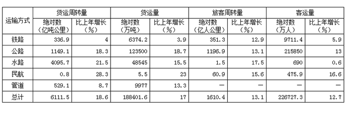

| 运输方式 | 货运周转量 绝对数（亿吨公里） | 货运周转量 比上年增长（%） | 货运量 绝对数（万吨） | 货运量 比上年增长（%） | 旅客周转量 绝对数（亿人公里） | 旅客周转量 比上年增长（%） | 客运量 绝对数（万人） | 客运量 比上年增长（%） |
| --- | ---: | ---: | ---: | ---: | ---: | ---: | ---: | ---: |
| 铁路 | 336.9 | 4 | 6374.2 | 3.9 | 351.3 | 12.9 | 9711.4 | 5.9 |
| 公路 | 1149.1 | 18.3 | 123500 | 18.7 | 1196.9 | 13.1 | 215850 | 13 |
| 水路 | 4095.7 | 21.5 | 48545 | 15.5 | 1.5 | 17.5 | 690 | 0.6 |
| 民航 | 0.8 | 28.3 | 5.5 | 23 | 60.9 | 15.6 | 475.9 | 16.6 |
| 管道 | 529.1 | 8.7 | 9977 | 13.3 | — | — | — | — |
| 总计 | 6111.5 | 18.6 | 188401.6 | 17 | 1610.4 | 13.1 | 226727.3 | 12.7 |

### 第 77 题

与上年相比，2010年江苏省各种运输方式完成的运输量增长最快的是：

A. 货运周转量

B. 货运量

C. 旅客周转量

D. 客运量

第 77 题 · 答案与解析

**参考答案（粉笔题库参考内容）**

A

**解析**

定位表格材料可得：货运周转量、货运量、旅客周转量、客运量增长率分别为18.6%、17%、13.1%、12.7%，显然货运周转量的增长率最大。故2010年江苏省各种运输方式完成的运输量增长最快的是货运周转量。

故正确答案为A。

**来源**：2012年江苏省公务员录用考试《行测》题（C类）第77题

### 第 78 题

2009年江苏省旅客周转量为：

A. 1610.3亿人公里

B. 1423.8亿人公里

C. 6111.5亿人公里

D. 1156.6亿人公里

第 78 题 · 答案与解析

**参考答案（粉笔题库参考内容）**

B

**解析**

根据题干“2009年江苏省旅客周转量为”，结合材料给定时间为2010年，可判定本题为基期计算问题。定位表格材料可得：2010年江苏省旅客周转量为1610.4亿人公里，同比增长率为13.1%。故2009年江苏省旅客周转量= 现期/(1+r) = 1610.4/(1+13.1%) ≈ 1610.4/1.1 = 1464亿人公里，与B项最接近。

故正确答案为B。

**来源**：2012年江苏省公务员录用考试《行测》题（C类）第78题

### 第 79 题

对2009年江苏省客运量贡献由大到小的顺序是：

A. 铁路、公路、民航、水路

B. 公路、民航、铁路、水路

C. 公路、铁路、水路、民航

D. 民航、公路、铁路、水路

第 79 题 · 答案与解析

**参考答案（粉笔题库参考内容）**

C

**解析**

根据题干“2009年······由大到小······”，结合材料给定时间为2010年，可判定本题为基期比较问题。定位表格材料可得：2010年铁路、公路、水路、民航客运量分别为9711.4万人、215850万人、690万人、475.9万人；四者增长率分别为5.9%、13%、0.6%、16.6%。由于贡献的大小取决于四者基期值的大小，因此只需要计算2009年各运输方式的运输量即可。

故2009年各运输方式的运输量分别如下：

铁路：9711.4/(1+5.9%) ≈ 9711.4/1.1 ≈ 8800万人；

公路：215850/(1+13%) ≈ 215850/1.1 ≈ 200000万人；

水路：690/(1+0.6%)≈690/1=690万人；

民航：475.9/(1+16.6%) ≈ 475.9/1.2 ≈ 400万人。

因此由大到小的顺序为：公路、铁路、水路、民航。

故正确答案为C。

**来源**：2012年江苏省公务员录用考试《行测》题（C类）第79题

### 第 80 题

2010年江苏省旅客周转量与客运量之比最大的运输方式是：

A. 铁路

B. 公路

C. 水路

D. 民航

第 80 题 · 答案与解析

**参考答案（粉笔题库参考内容）**

D

**解析**

根据题干“······与······之比最大”，可判定本题为比值比较问题。定位表格材料可得：2010年江苏省铁路、公路、水路、民航的旅客周转量分别为351.3亿人公里、1196.9亿人公里、1.5亿人公里、60.9亿人公里；客运量分别为9711.4万人、215850万人、690万人、475.9万人。

故2010年江苏省旅客周转量与客运量之比分别如下：

铁路：351.3/9711.4 ≈ 351.3/9700 ≈ 0.036；

公路:1196.9/215850 ≈ 1196.9/220000 ≈ 0.005；

水路：1.5/690≈0.002；

民航：60.9/475.9 ≈ 60.9/480 ≈ 0.13。

显然民航数值最大。

故正确答案为D。

**来源**：2012年江苏省公务员录用考试《行测》题（C类）第80题

## 材料 4

2011年一季度我国建筑业产值为16096.4亿元，其中，建筑工程产值14220.0亿元，安装工程产值1405.2亿元，其他471.2亿元。华东六省一市相关数据见下表：

| 省（市） | 合计 | 建筑工程 | 安装工程 | 其他 |
| --- | ---: | ---: | ---: | ---: |
| 上海市 | 739.2 | 610.4 | 104.5 | 24.3 |
| 江苏省 | 1773.2 | 1621.2 | 139.4 | 12.6 |
| 浙江省 | 2381.2 | 2134.1 | 171.8 | 75.3 |
| 安徽省 | 625.7 | 544.9 | 53.1 | 27.7 |
| 福建省 | 583.9 | 534.3 | 42.7 | 6.9 |
| 江西省 | 334.2 | 301.9 | 19.3 | 12.4 |
| 山东省 | 838.5 | 682.7 | 129.1 | 26.7 |

### 第 81 题

2011年一季度，华东六省一市建筑业产值的平均值是：

A. 1437.8亿元

B. 1367.3亿元

C. 1039.4亿元

D. 872.7亿元

第 81 题 · 答案与解析

**参考答案（粉笔题库参考内容）**

C

**解析**

华东六省一市建筑业产值的平均值为(739.2+1773.2+2381.2+625.7+583.9+334.2+838.5)÷7≈ (700 + 1800 + 2400 + 600+600+300+800)÷7=7200÷7≈1028亿元，C项最接近。

故正确答案为C。

**来源**：2012年江苏省公务员录用考试《行测》题（C类）第81题

### 第 82 题

2011年一季度，江苏省建筑业产值占我国建筑业产值的比重是：

A. 8.76%

B. 10.01%

C. 11.02%

D. 17.25%

第 82 题 · 答案与解析

**参考答案（粉笔题库参考内容）**

C

**解析**

2011年一季度，江苏省建筑业产值为1773.2亿元，我国建筑业产值为16096.4亿元，江苏省建筑业产值占我国建筑业产值的比重为1773.2 ÷ 16096.4 ≈ 18/160 = 11.25%。估算值与真实值接近，且大于真实值。

故正确答案为C。

**来源**：2012年江苏省公务员录用考试《行测》题（C类）第82题

### 第 83 题

2011年一季度，华东六省一市安装工程产值高于其平均产值的省（市）有：

A. 1个

B. 2个

C. 3个

D. 4个

第 83 题 · 答案与解析

**参考答案（粉笔题库参考内容）**

D

**解析**

解析1：

安装工程产值的平均值为(104.5 + 139.4 + 171.8 + 53.1+(42.7+19.3+129.1)÷7≈(105 + 139 + 172 + 53 +43 + 19 + 129) ÷ 7 ≈ 94亿元。因此高于平均值的省市有4个。

解析2：

根据表格倒数第二列相关数据可知，其中有4个数远大于100，3个数远小于100。大于100的4个数中，每个数比100多的部分的加和为4+39+71+29；小于100的3个数中，每个数比100小的部分的加和为47+58+81。显然(4+39+71+29)略小于(47+58+81)，可知安装工程产值的平均值接近100，但稍小于100。因此高于平均值的省市有4个。

故正确答案为D。

**来源**：2012年江苏省公务员录用考试《行测》题（C类）第83题

### 第 84 题

2011年一季度，华东六省一市建筑工程产值与安装工程产值之比最大的三个省（市）是：

A. 浙江省、福建省、江西省

B. 江苏省、上海市、江西省

C. 福建省、安徽省、江西省

D. 浙江省、福建省、山东省

第 84 题 · 答案与解析

**参考答案（粉笔题库参考内容）**

A

**解析**

各省建筑工程产值与安装工程产值之比分别为：

上海市610.4/104.5；江苏省1621.2/139.4；浙江省2134.1/171.8；安徽省544.9/53.1；福建省534.3/42.7；江西省301.9/19.3；山东省682.7/129.1。

相当于比较6104/1045、16212/1394、21341/1718、5449/531、5343/427、3019/193、6827/1291的大小。

显然6104/1045、6827/1291的比值小于10，小于其它分数。16212/1394、21341/1718、5449/531、5343/427、3019/193量级相当，直除得前两位依次为11、12、10、12、15，则浙江省、福建省、江西省的比值较大。

故正确答案为A。

**来源**：2012年江苏省公务员录用考试《行测》题（C类）第84题

### 第 85 题

下列判断不正确的有：

（1）2011年一季度，江西省建筑业每项产值在华东六省一市中都是最低。

（2）2011年一季度，江苏省建筑业产值比上海市高出139.9%。

（3）2011年一季度，华东六省一市建筑工程产值占其建筑业产值的比重均超过80%。

A. 0个

B. 1个

C. 2个

D. 3个

第 85 题 · 答案与解析

**参考答案（粉笔题库参考内容）**

B

**解析**

（1）错误，江西省的“其他”一列并不是华东六省一市最低；

（2）正确，江苏省建筑业产值比上海高出1773.2/739.2 − 1 ≈ 177/74 − 1 ≈ 1.39；

（3）正确，华东六省一市建筑工程产值占其建筑业产值的比重分别为610.4/739.2、1621.2/1773.2、2134.1/2381.2、544.9/625.7、534.3/583.9、301.9/334.2、682.7/838.5。由估算可知，各分数均大于80%。

判断不正确的有1个。

故正确答案为B。

**来源**：2012年江苏省公务员录用考试《行测》题（C类）第85题

