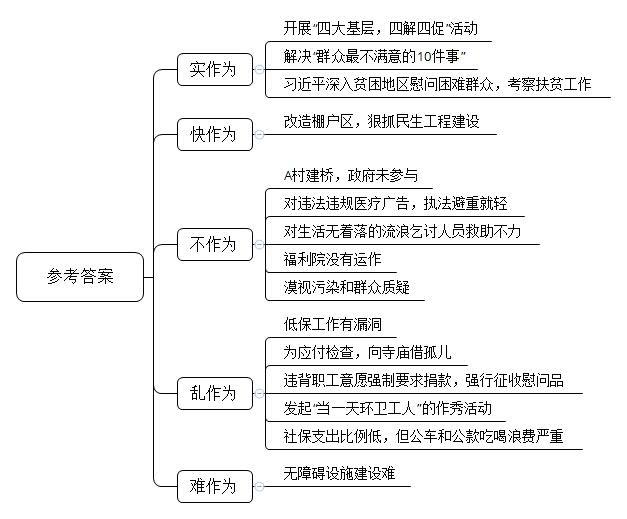
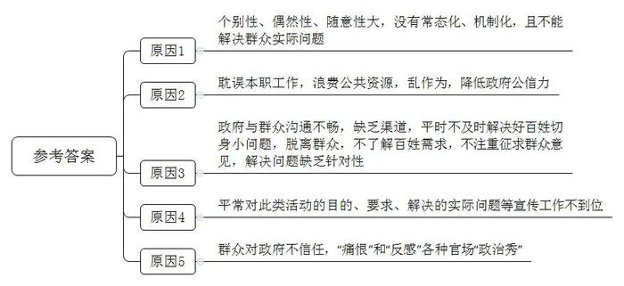
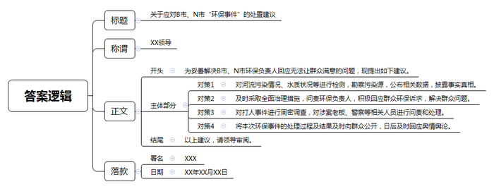
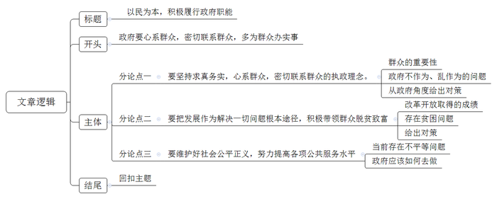

# 2013年江苏省公考《申论》题

<!-- gwy:overview:start -->
> **江苏 · 2013 · 申论 · 统考** ｜ 4 题 · 图片 4 处 · 答案随题折叠

导航：[题目](#题目) · [材料 1](#材料-1)
<!-- gwy:overview:end -->

> 候选采集稿。参考答案及解析来自粉笔页面，不代表官方答案或真实高分答卷；来源使用许可与原卷对应关系仍需人工核实。

## 给定材料

### 材料 1

R市是相对欠发达地区。受交通条件的限制，资源得不到有效开发和合理利用，经济社会发展相对滞后，群众贫困面较大。该市开展“四大基层，四解四促”活动以来，市、县机关干部挂钩联系项目4600多个，企业3800多个，困难党员群众18000多人，为基层办实事32000多件。一位村党支书道出了干部到村里帮扶带来的变化，“村中溪边装上了防护栏，走夜路不再怕摔进溪中；改造茶园种植金观音茶叶新品种200亩，每亩可增收上千元；村宣传文化站建起了，群众有了读书学习好去处；在家也能清晰收看49个电视频道了”。一位85岁的村民竖着大拇指说：“通村道路铺上了水泥，自来水通了，造福工程新村建起来了，我们盼了一辈子的几件大事都办成了。”

G市新城区棚户多，有些棚户区低洼阴暗，不通气不通暖，几百人共用一个旱厕，与繁华商业区形成强列反差。该区李区长走进棚户区考察后说：“在现代繁华都市，还有群众生活在这种环境里，这是我们的失职，棚户区里看民生，这里的改造就是最大的民生问题。”区委区政府抓民生工程建设，从解决一个个小问题做起：群众反映小区改造后搬迁到另外的区，孩子就近上不了学，区委书记立即叫来教育局领导现场解决；群众反映社区没有诊所看病不方便，卫生部门现场布置全科医生建起了社区诊所；火车站附近，穿越通道灯一盏不亮，老百姓意见大，区长立即叫人换上了灯；群众埋怨社区菜价贵，区政府就建立蔬菜基地直接配送社区机制，减少中间环节降低菜价。李区长说，正是平时这一个个小问题没有解决好，才造成了民忧民怨民困。

2012年12月11日，Q市委办公室会同有关部门，精心设计调查问卷以市委书记名义向有关人士和网民征询“群众最不满意的10件事”，此活动共收回调查问卷764份，征求到不满意事项32件，内容涉及城建、交通、教育、医疗、卫生等方方面面。在此基础上，该市又召开市委扩大会，决定将其归纳衍化成“为民所办10件实事”，并确定了解决原则，将解决10件实事纳入Q市2013年工作重点，写进市委十三届二次全会报告和市政府工作报告。据报道，为解决好“群众最不满意的10件事”，该市决定把新增财力的80%以上用于改善民生、并进一步征求群众对解决不满意事项的具体措施，建立健全群众评价和监督长效机制，真正把老百姓关心的问题解决好，切实提高群众满意度。

### 材料 2

A村平均海拔2200米，素有“屋脊”之称。全村近300户人家散落在一个不大的山坡上，而村里的大部分耕地却在另一个山头，从山坡到山头要经过一条狭长的沟壑，每年农忙时节也是夏季山洪集中暴发的时期，沟壑的水更急于往常。老人、妇女和孩子，涉水通过这里非常危险。一位70多岁的老人，肩负一背篓猪草，连草带人被沟壑里的洪水冲走。面对“死亡之沟”，村民柏姓夫妇于1996年起了建桥的念头，并于当年在山脚下开始炸石，切拉、分拣、搬运。当建桥材料运到沟壑旁时，岸上的一户村民却说建桥占用了他家的土地，要求补偿，否则不让开工，没有办法，柏某只好到离家两百多里路的煤厂挖煤挣钱，迎寒送暑，冬去春来，在第三年油菜花开的季节，柏某带着挖煤攒来的钱，回到村里开工建桥。

石桥建好后，柏姓夫妇又有了新的念头。A村一半属云南，一半属贵州，以A村段的北盘江为起点，向左向右分别约有8公里和40公里才能见到桥，不少人为抄近路而过江。因此，每年总有人葬身于滔滔江水之中。村里许多人家均有因“过河”而失去亲人的痛苦经历，都希望有一天能在北盘江上架起一条“天路”。要建一座跨度70多米的大桥，少说也得几百万元，就算是倾全村之力也难以筹集这么多资金。然而，柏姓夫妇一直都没有放弃努力，他们不止一次带领乡亲，垫高两岸的基石，以便为将来建桥打好基础。

记者知道柏某要建第二座桥消息后，赶到他家，不禁大吃一惊：房子用土坯和石块垒砌而成，整个墙面经多年风化已是凹凸不平，墙体裂开了几条如蛇一样的长缝，还有那些长出块块污斑的窗框；片片呈黑的瓦片，以及散发着霉味的木门木桌木椅。在这样的情况下，柏姓夫妇还是下定决心，把后半生的全部精力和财力，投入到这座桥上，让它屹立在北盘江上，千年不倒。

柏某夫妇的感人事迹在网上传播后，很多网友大受感动，但也有网友感叹地说，像建桥这类有关民生的事，怎么看不见政府的影子呢?

### 材料 3

古语云：“不患寡而患不均”，意为不担心分的少，而担心分的不均匀。然而，对于目前享受低保待遇的家庭来说，却是“即患寡又患不均”，当前我国仍有相当数量的贫困人口，这些家庭中仅有部分成员可以享受60到300多元不等的低保金。要想用这点钱在当前物价水平下维持最基本的生活已属不易，更别谈上学、看病和发展生产了。再加上低保分配不公，损伤公平正义的现象时有发生。民政部社会求助司有关负责人指出，从2012年上半年国家审计署公布的《全国社会保障资金审计结果》看，尽管我们的低保工作成效显著，但一些地方仍存在“错保”“漏保”“骗保”等问题，全国错保率约为4%。在媒体报道中，可以看到，其中既有“千万富翁低保长达8年”这样的“不应保而保”的情况，亦有农民带瘫妻打工10多年却领不上低保的“应保未保”现象，这些都在一点一滴地透支着人们对于低保制度的信任度。

我国是世界上唯一一个老年人口超过1亿的国家。全国65岁以上的“空巢老人”有4150万人；残疾人有8500万人，占人口总数的6.34%。82岁的刘老住在某市西城区一栋上世纪70年代修建的老楼里，刘老身子骨虽然还比较硬朗，但走路基本靠助行器帮忙。年轻人走一步的距离，他要挪上四五步，3年前，老楼单元门出口处修建了无障碍坡道，刘老等老年居民特别高兴，但这一小工程却曾引起不小的波澜。由于三个无障碍通道要占用几个车位，这就使小区原本十分紧张的车位供应雪上加霜，很多居民持反对意见。最终居委会只好拆除了两个自行车车棚，为无障碍通道挪空间。43岁的按摩师罗先生说：“由于天生重度弱视，我很少出门，吃住都在公司里，连日常用品也由经理代购。”对罗先生而言，只有微弱提示音的红绿灯、被机动车挤占的盲道、只有旋转门的饭馆……都是“地雷阵”。2010年夏天，为了赚点钱，罗先生曾独自一人赶场，一段一般人走20分钟的路，他居然气喘吁吁地走了一个多小时。罗先生说：“一个人上街太可怕了，就像走一趟鬼门关。”

### 材料 4

国家工商管理总局，卫生部联合制定的《医疗广告管理办法》规定，对违规发布广告应采取警告、吊销有关诊疗科目、吊销“医疗机构许可证”的行政处罚。同时，《广告法》也明确规定：“对利用广告对商品或服务作虚拟宣传的，应责令其公开消除影响，情节严重的要依法停止其广告业务。”

然而，2013年1月30日，新华社却披露了某市某医院涉嫌通过虚假宣传，欺诈患者，违法敛财的的问题，该医院成立不过五年多时间，但问题不断。仅2008年至2010年，就因违规发布医疗广告，曾四次被该市某区卫生监管部门给予“警告”处罚。然而，就在这同一时段，该医院涉嫌违法违规的广告宣传仍势头不减。

该医院为什么如此不怕处罚?有人认为，该区卫生监管部门对这家医院处罚太轻，连续四次查出都仅仅是“警告”而已。也有人认为，该区卫生监管部门的执法行为是避重就轻，是在给自己行政不作为找“挡箭牌”。

### 材料 5

国务院《城市生活无着的流浪乞讨人员救助管理办法》规定：“公安机关和其他有关行政机关的工作人员在执行职务时发现流浪乞讨人员的，应告知其向救助站求助；对其中的残疾人、未成年人、老年人和行动不便的其他人员，还应当引导、护送到救助站。”

2012年12月1日中午，C市解放路立交桥下冻死了一个农民工。有人说他是病死的，也有人说他是冻死的。在其他农民工看来，他不该死。这位农民工在桥下待了一个多月，最近20多天，整天躺在地上不能起身。一些市民，包括公交车司机都给他送过饭，“120”来过两次，救助站的人也来过，但看看都走了。据目击者透露，这男子曾有几天一直坐在一个小饭馆的台阶上。其间，有一位女环卫工曾经多次询问他是否需要帮助。他只是摆手，她想给他点钱吃饭，也被他拒绝了。最后，女环卫工还是用一个矿泉水瓶装了热水，给他暖暖手。想不到，3天后他被发现死去了。

某镇一居民楼发生火灾，“爱心妈妈”袁女士收养的孩童中7人不幸丧生。此事发生后，民政部要求各地民政部门对当地收养孤儿工作进行自查。而某地的民政部门下属的一个福利院为应付检查，竟然到当地寺庙借孤儿。以扶孤济贫普度众生为己任的寺庙方丈，断然拒绝了这一荒唐要求。此事暴露后，该民政局开始称只是协商接收孤儿事宜，后又回应称“借孤儿”的工作人员属于临时借用职工，已被清退。据报道，该福利院已成立18年，并且有“编制”，但一直没有运作。

2013年1月19日下午3时有微博称，D市某镇政府在5名儿童到垃圾箱生火取暖被闷死的事情之后，将“严禁人畜入内，违者责任自负”12个字印在垃圾桶上，此时距儿童闷死已一个月。19日晚该市宣传部门负责人接受媒体采访时说：“印字垃圾桶位于D市某区内，不是所有D市垃圾桶都印了字，目前，相关部门已了解到网友的相关言论及建议。”

### 材料 6

2013年春节前，某县政府下发文件，要求每位职工捐出500元用于救助贫困农户，拒不缴纳者从工资中扣除，且只收现金。这一做法违背了自愿原则，引起大家强烈不满。

E市某副食品店张某告诉记者，元宵节前，她进了元宵卖，100多袋装箱放在了家门口，早晨7点多摆在那，9点多就不见了，后听说城管收去了，某水果批发店郭某也被强征60多袋元宵，张、郭找到E市城管局，才知道元宵送到养老院慰问老人了，养老院副院长说：城管局当天的确给养老院送来140多袋元宵。城管局周局长电话中告诉记者，当天拿去元宵的事他知道，他承认执法人员执法时“走样”，已对相关人员进行了教育。

### 材料 7

2013年2月，金某在微博上叫板B市环保局领导：“这条河是我们童年游泳、母亲洗衣服的地方，现在这条河的污染严重，环保局局长要敢在河里游泳20分钟，我愿意拿出20万元作为‘奖赏’。”就在这个春节，很多人也把这条河流的照片传到网上。一张张受污染的图片触目惊心、让人不忍卒睹。人们说：“早知发展会带来这么沉重的代价，当初宁可不要这样的发展。”面对金某的“邀请”，B市环保局局长一笑置之，并称“经过初步勘查，没发现有工业方面的污染，主要污染源为生活垃圾。”

N市陈先生也因家门口河水污染严重，微博发布悬赏公告：“我宁愿倾家荡产悬赏环保局局长，邀请他到河里游一次泳。”某日，某公司老板竟指使他人带40多名不明身份的人到陈先生家打砸抢，陈多处受伤。陈的女儿说：“他们到家我们就报了警，但警察在报案后迟迟才赶到，到场后并没有阻止暴行。”陈先生的女儿还告诉记者，她父亲从2003年开始就多次向市环保局举报村里造纸厂污染环境的问题，环境问题未得到解决，却遭到当地不少造纸厂老板的恐吓和报复。面对网上排山倒海的质疑，该市官方回应：“邻里纠纷，无打人事件”。而N市某环保所所长掷地有声地说：“水质合格，无惧下河游泳。”

### 材料 8

2013年2月，S市某新区环保市容局发起“当一天环卫工人”体验活动。首批活动从2月17日进行到3月1日，共有70名机关干部和107名团支部书记等人员报名参加。目的是让参加者亲身体验环卫工人的疾苦，听一听“办公室里听不到的声音”。根据要求，参加体验机关干部须穿上环卫作业服，与环卫工人同吃同劳动，每天工作6小时以上。在这次体验活动中还解决了环卫工人吃饭、喝水难，上厕所难，以及没有避雨场所等问题。区环卫处韩处长体验的岗位是跟车作业工。他说：“垃圾箱蛮重的，总感觉使不上劲。一般情况下，两名环卫工人一天要搬250次左右的垃圾箱，真不容易啊！”他希望市民能养成良好的卫生习惯，不再乱扔乱倒，以实际行动支持环卫工作。据了解，下一步S市该新区环保市容局还将深入推进“当一天环卫工人”活动，让普通市民也参与进来。然而，这项体验活动却与媒体上报道的某省某职能部门负责人“世界粮食日”当天带头参加24小时饥饿体验活动，某市一区长在微博上征人拼车，某省某厅副厅长邀请农民工吃饭，某市级机关公务员走上街头为民擦鞋，等等，都被市民们贴上了“作秀”的标签。近期一项调查显示，对当前官场的各种“政治秀”，56.6%的受调查者选择“痛恨”，41.7%的受调查者选择了“反感”，只有不到2%的选择正面评价。

### 材料 9

据2011年统计，中国各级财政用于社会保障方面的支出，占比10%左右。同为发展中国家的巴西，这一比例超过了30%，在德国、瑞典等欧洲国家，比例则超过了40%。中国社保缴费率为全球最高，约为“金砖四国”其他三国平均水平的2倍，是东亚邻国和邻近地区（中国香港和中国台湾）的4.6倍、北欧五国的3倍。2011年，中央行政单位、事业单位、其他单位的“三公经费”中车辆购置及运行费59.15亿。2012年间，在公务用车问题专项治理中，全国清理出的违规车辆就达19.96万辆。做过两届全国人大代表的省统计局副局长叶某，曾连续8年就公车问题提交提案，他接受记者采访时说，公车浪费主要体现在三个方面：一是公车私用严重，真正用于公务的时间较少；二是占用道路资源，加剧交通拥堵；三是维修费用很高，运行效率低下。某县县长算了一笔账：每年行驶两万多公里，油费和过桥过路费相加3万多元，再加上维修保养费用、司机的工资等，全年下来一辆公车少说也要10万。Y省某市一个不过60万人口的县级区，竟然拥有1430辆公务用车。

中央“八项规定”公布，使公款吃喝达到一定程度的遏制。但上有政策下有对策的现象依然存在。春节前，一些地方和单位将公务接待由宾馆、饭店转为食堂。场所变了，但标准仍然不低。据称，团体餐一桌的标准最低也要2000元，而请领导吃饭至少要达到500元一位的标准，达到800元一位的才像个样。媒体探访到了一桌宴请，标准每位800元，桌上放的是单价2180元每瓶的茅台及每瓶1080元的广西特色白酒丹泉，香烟是每包108元的软中华和每包150元的真龙。2013年1月18日发布的数据显示，2012年全国城镇居民人均可支配收入24565元，农村居民人均纯收入7917元。城镇居民辛苦一年，只不过一顿公款吃喝；农村居民一年收入，竟然抵不上一桌公务宴，让人情何以堪。

### 材料 10

12月29日下午，习近平冒着零下十几摄氏度的严寒，驱车300多公里来到地处太行山深处的阜平县。阜平是革命老区，是当年晋察冀边区政府所在地。阜平县也是全国重点贫困县。习近平对老区干部群众十分挂念，元旦前特地来到这里看望。

抵达阜平县后，习近平连夜听取了河北省保定市阜平县经济社会发展特别是扶贫开发工作的汇报。他表示，革命老区和老区人民为中国革命胜利作出了重要贡献，党和人民永远不会忘记。改革开放30多年来，我国人民生活水平总体上发生很大变化。同时，由于我国还处在社会主义初级阶段，还有为数不少的困难群众。全面建成小康社会，最艰巨最繁重的任务在农村、特别是在贫困地区。没有农村的小康，特别是没有贫困地区的小康，就没有全面建成小康社会。中央对扶贫开发工作高度重视。各级党委和政府要增强做好扶贫开发工作的责任感和使命感，做到有计划、有资金、有目标、有措施、有检查，大家一起来努力，让乡亲们都能快点脱贫致富奔小康。

30日一大早，习近平在河北省委书记张庆黎陪同下，踏着皑皑残雪，来到地处深山的龙泉关镇骆驼湾村。这个村是特困村，村里608口人有428人为贫困人口。习近平逐一走进困难群众唐荣斌家、唐宗秀家看望，盘腿坐在炕上，同乡亲手拉手，详细询问他们一年下来有多少收入，粮食够不够吃，过冬的棉被有没有，取暖的煤炭够不够，小孩上学远不远，看病方便不方便。看到老区一些乡亲尚未摆脱贫困、生活还比较困难，习近平强调，只要有信心，黄土变成金。各级党委和政府要把帮助困难群众特别是革命老区、贫困地区的困难群众脱贫致富摆在更加突出位置，因地制宜、科学规划、分类指导、因势利导，各项扶持政策要进一步向革命老区、贫困地区倾斜，进一步坚定信心、找对路子，坚持苦干实干，推动贫困地区脱贫致富、加快发展。各级领导干部要心里装着困难群众，多做雪中送炭的工作，满腔热情为困难群众办事。

随后，习近平来到龙泉关镇顾家台村看望困难农户。在村委会，习近平同村干部、群众、驻村干部促膝相坐，共商加快脱贫致富之策。会上气氛热烈，大家争相发言。习近平听取了大家发言后强调，农村要发展，农民要致富，关键靠支部。“农村基层的同志，工作在第一线，条件也不好，一年到头操劳得很，很辛苦，很不容易，我向你们表示诚挚的慰问。”他叮嘱当地干部和随行有关部门负责同志，要原原本本把党的政策落实好，大家拧成一股绳，心往一处想，劲往一处使，汗往一处流，一定要想方设法尽快让乡亲们过上好日子。临别时，习近平满怀期待对村支书顾叔军说，希望早日听到乡亲们脱贫致富的好消息。

2月3日是腊月二十三，农历小年，习近平总书记来到有“瘠苦甲天下”之称的甘肃省定西市，深入偏远山村困难户家，看望慰问乡亲们。习近平表示，党和政府会关心和帮助大家，咱们一块儿努力，把日子越过越红火。

## 题目

### 第 1 题

**仔细阅读“给定资料”，分类归纳资料中所反映出来的政府及相关职能部门的不同“作为”并作简要说明。（20分）**

关联材料：材料 1、材料 2、材料 3、材料 4、材料 5、材料 6、材料 7、材料 8、材料 9、材料 10

作答要求：

要求：全面、准确、紧贴资料，篇幅不超过250字。

第 1 题 · 答案与解析

**参考答案（粉笔题库参考内容）**

实作为：开展“四大基层，四解四促”活动；解决“群众最不满意的10件事”；习近平深入贫困地区慰问困难群众，考察扶贫工作；

快作为：改造棚户区，狠抓民生工程建设；

不作为：A村建桥，政府未参与。对违法违规医疗广告，执法避重就轻；对生活无着落的流浪乞讨人员救助不力；福利院没有运作；漠视污染和群众质疑；

乱作为：低保工作有漏洞；为应付检查，向寺庙借孤儿；违背职工意愿强制要求捐款，强行征收慰问品；发起“当一天环卫工人”的作秀活动；社保支出比例低，但公车和公款吃喝浪费严重；

难作为：无障碍设施建设难。

**解析**

**参考答案说明：**从“实作为”“快作为”“不作为”“乱作为”“难作为”这五个方面进行了分条撰写。每条要点之间内容上没有交叉。

**考点**：对比分析类

**来源**：2013年江苏省公考《申论》题

### 第 2 题

**假如你是“给定资料8”中的“当一天环卫工人”活动的参与者，并且做了很多实事。当听到一些市民把这一体验活动与“作秀”行为相提并论时，你心里肯定不是滋味，请你对市民们形成这种看法的深层次原因作出分析。（20分）**

关联材料：材料 8

作答要求：

要求：全面、辩证，符合实际，篇幅不超过250字。

第 2 题 · 答案与解析

**参考答案（粉笔题库参考内容）**

一、个别性、偶然性、随意性大，没有常态化、机制化，且不能解决群众实际问题。二、耽误本职工作，浪费公共资源，乱作为，降低政府公信力。三、政府与群众沟通不畅，缺乏渠道，平时不及时解决好百姓切身小问题，脱离群众，不了解百姓需求，不注重征求群众意见，解决问题缺乏针对性。四、平常此类活动的目的、要求、解决的实际问题等宣传工作不到位。五、群众对政府不信任，“痛恨”和“反感”各种官场“政治秀”。

**解析**

**参考答案说明：**从“活动随意”“耽误本职工作”“与群众沟通不畅”“宣传不到位”“对政府不信任”这五个方面进行了分条撰写。每条要点之间内容上没有交叉。

**考点**：原因类

**来源**：2013年江苏省公考《申论》题

### 第 3 题

**“给定资料7”中两位环保部门负责人的“回应”显然不能令人满意。假如你是上级主管部门的一名督查员。请你拟定一份应对这一“环保事件”的处置建议，供领导参考。（20分）**

关联材料：材料 7

作答要求：

要求：内容具体，针对性强，措施得力，篇幅不超过300字。

第 3 题 · 答案与解析

**参考答案（粉笔题库参考内容）**

关于应对B市、N市 “环保事件”的处置建议

XX领导：

为妥善解决B市、N市环保负责人回应无法让群众满意的问题，现提出如下建议：

一、对河流污染情况、水质状况等进行检测，勘察污染源，公布相关数据，披露事实真相。二、及时采取全面治理措施，问责环保负责人，积极回应群众环保诉求，解决群众问题。三、对打人事件进行周密调查，对涉案老板、警察等相关人员进行问责和处理。四、将本次环保事件的处理过程及结果及时向群众公开，日后及时回应舆情舆论。

以上建议，请领导审阅。

XXX

XX年XX月XX日

**解析**

**参考答案说明：**（1）格式方面，本参考答案写到了“标题”“称谓”和“落款”。（2）正文部分，一方面从内容来看，开头部分简单叙述发文的目的；主体部分从“河流污染检测与公布”“河流污染问责与处理”“打人事件的调查与问责”“公开处理过程和结果”四个方面对提出了处置建议。另一方面，形式上，本参考答案做到了分段、分条撰写，整体上条理较为清晰。

**考点**：方案类

**来源**：2013年江苏省公考《申论》题

### 第 4 题

**阅读“给定资料10”中习总书记在阜平县和定西市的讲话，反观“给定资料”中所提供的正反事例，你在思想上一定会有所触动，请展开想象，自拟标题，自选角度，写一篇文章。（40分）**

关联材料：材料 1、材料 2、材料 3、材料 4、材料 5、材料 6、材料 7、材料 8、材料 9、材料 10

作答要求：

要求：主题鲜明，内容充实，结构合理，语言通顺，篇幅为800-1000字。

第 4 题 · 答案与解析

**参考答案（粉笔题库参考内容）**

**以民为本，积极履行政府职能**

习近平总书记在阜平县与定西市考察时发表的重要讲话发人深思，他用行动做出表率并提醒着广大政府公职人员：**要始终心系群众，密切联系群众，多为群众办实事。**然而反观当前，乡村建桥不见政府影子，相关政府部门对河流污染视而不见，强征群众钱物虚假捐助等政府不作为、虚假作为、乱作为等消极行为屡屡出现，直接造成干群关系疏远，损害了政府公信力。因此，这要求**各级政府要更加注重以民为本，密切联系群众，积极履行政府职能，带领群众脱贫致富，大力提高公共服务水平，努力赢得群众的信任和支持。**

**以民为本，积极履行政府职能，首先要坚持求真务实，心系群众，密切联系群众的执政理念。**群众利益比天大，求真务实，以人为本，执政为民是立党之本。然而当前，各种公车私用，“政治秀”，工业生产污染河流危及群众生命健康，有关领导面对群众质疑一笑了之，敷衍了事等不作为、假作为现象无不撕裂着政府和群众的血肉联系，威胁着我国基层社会，乃至国家的长治久安。这就要求我们**必须建立良好的干群沟通机制，完善相关规章制度和监督体系，让群众在宽松的制度下讲真话、讲实话，政府在听取群众的意见后干真事、干实事。**

**以民为本，积极履行政府职能，其次要把发展作为解决一切问题根本途径，积极带领群众脱贫致富。**改革开放以来，我国城乡经济得到了极大发展，全国经济总量跃居世界第二。但与此同时，仍有大量困难群众存在，尤其是老少边穷地区，数千万人还挣扎在温饱线上。没有他们的小康，就没有祖国的昌盛与富强。**各级党委和政府要深入基层一线，认真调研，找对路子，因地制宜、因势利导，与当地群众拧成一股绳，依靠当地群众，科学规划，进一步坚定信心、坚持苦干实干，努力推动贫困地区脱贫致富、加快发展。**

**以民为本，积极履行政府职能，最后还要维护好社会公平正义，努力提高各项公共服务水平。**在全国社保缴费多，发放少的同时，各级政府机关、事业单位的“三公经费”却开支巨大，各种超规格兴建政府办公楼、配车等现象长期存在。当一个贫困县的政府办公室配有双人大床，当几个官员一桌公务宴的开支，竟然超过农村居民一年收入时，让人情何以堪。对此，要按照中央八项规定要求，严格控制政府行政经费支出，把更多的资金投入改善民生中。既要着力解决好路桥等基础设施不完善、上学难、看病难、买房难等各种长期性、普遍性、结构性的大问题，更要注重解决好环卫工人吃饭难、喝水难、住宿难，上厕所难等民生“小事”。

**“民惟邦本，本固邦宁。”** 以民为本，积极履行政府职能，**需要政府做到心中时时有群众，刻刻心系群众，全心全意解决好关系群众切身利益的“小事”“琐事”。要把一个强调管制，高高在上的政府，转型为公开、透明、为民的服务型政府。**这是当前政府改革的关键，也是中国政治文明迈向现代化的标志，做好这一工作势必能大大促进我国经济社会的永续发展！

**解析**

**文章分析**

**以民为本，积极履行政府职能**

【**标题的优点**：范文的标题突出了“积极履行政府职能”这一主题。】

（1）习近平总书记在阜平县与定西市考察时发表的重要讲话发人深思，他用行动做出表率并提醒着广大政府公职人员：**要始终心系群众，密切联系群众，多为群众办实事。**（2）然而反观当前，乡村建桥不见政府影子，相关政府部门对河流污染视而不见，强征群众钱物虚假捐助等政府不作为、虚假作为、乱作为等消极行为屡屡出现，直接造成干群关系疏远，损害了政府公信力。（3）因此，这要求**各级政府要更加注重以民为本，密切联系群众，积极履行政府职能，带领群众脱贫致富，大力提高公共服务水平，努力赢得群众的信任和支持。**

【**开头的优点**：★内容方面。范文的开头是紧扣“积极履行政府职能”这一主题展开的。首先，开头第一句话点出了“要始终心系群众”，做到了主题明确。其次，对“积极履行政府职能”这一主题进行了分析阐述，介绍了：（1）习近平总书记的要求，（2）当前存在的问题。★文字表达方面。使用了“然而”“因此”等关联词，使语言表达有逻辑性。】

**以民为本，积极履行政府职能，首先要坚持求真务实，心系群众，密切联系群众的执政理念。**（1）群众利益比天大，求真务实，以人为本，执政为民是立党之本。（2）然而当前，各种公车私用，“政治秀”，工业生产污染河流危及群众生命健康，有关领导面对群众质疑一笑了之，敷衍了事等不作为、假作为现象无不撕裂着政府和群众的血肉联系，威胁着我国基层社会，乃至国家的长治久安。（3）这就要求我们必须**建立良好的干群沟通机制，完善相关规章制度和监督体系，让群众在宽松的制度下讲真话、讲实话，政府在听取群众的意见后干真事、干实事。**

【**论述段1的优点**：★观点句：范文的观点句是紧扣“积极履行政府职能”这一文章主题提出的。形式上，它在段首处直接写出，位置突出，容易被发现；内容上，关键词突出，内容要点明确，可以明显看出它是从“执政理念”的角度入手，指出了“要坚持求真务实，心系群众，密切联系群众的执政理念”。★论述内容：本段主要围绕“积极履行政府职能”这一主题进行分析阐述，指出了：（1）群众的重要性，（2）政府不作为、乱作为的问题，（3）从政府角度给出对策。注意：以上三个方面的内容都是紧扣观点句“以民为本，积极履行政府职能，首先要坚持求真务实，心系群众，密切联系群众的执政理念”进行分析论述的，针对性强、内容层次丰富。并且，这三个方面的论述有内在逻辑顺序：先写“重要性”，再写“问题”，最后写“对策”。最后，在论证方法和论据选取方面，讲道理和举例子相结合，做到了丰富多样。】

**以民为本，积极履行政府职能，其次要把发展作为解决一切问题根本途径，积极带领群众脱贫致富。**（1）改革开放以来，我国城乡经济得到了极大发展，全国经济总量跃居世界第二。（2）但与此同时，仍有大量困难群众存在，尤其是老少边穷地区，数千万人还挣扎在温饱线上。没有他们的小康，就没有祖国的昌盛与富强。（3）**各级党委和政府要深入基层一线，认真调研，找对路子，因地制宜、因势利导，与当地群众拧成一股绳，依靠当地群众，科学规划，进一步坚定信心、坚持苦干实干，努力推动贫困地区脱贫致富、加快发展。**

【**论述段2的优点**：★观点句：范文的观点句是紧扣“积极履行政府职能”这一文章主题提出的。形式上，它在段首处直接写出，位置突出，容易被发现；内容上，关键词突出，内容要点明确，可以明显看出它是从“积极带领群众脱贫致富”的角度入手，指出了“要把发展作为解决一切问题根本途径，积极带领群众脱贫致富”。★论述内容：本段主要围绕“积极履行政府职能”这一主题进行分析阐述，指出了：（1）改革开放取得的成绩，（2）存在贫困问题，（3）给出对策。注意：以上三个方面的内容都是紧扣观点句“以民为本，积极履行政府职能，其次要把发展作为解决一切问题根本途径，积极带领群众脱贫致富”进行分析论述的，针对性强、内容层次丰富。并且，这三个方面的论述有内在逻辑顺序：先写“成绩”，再写“问题”，最后写“对策”。最后，在论证方法和论据选取方面，以讲道理为主，具有说服力。】

**以民为本，积极履行政府职能，最后还要维护好社会公平正义，努力提高各项公共服务水平。**（1）在全国社保缴费多，发放少的同时，各级政府机关、事业单位的“三公经费”却开支巨大，各种超规格兴建政府办公楼、配车等现象长期存在。当一个贫困县的政府办公室配有双人大床，当几个官员一桌公务宴的开支，竟然超过农村居民一年收入时，让人情何以堪。（2）对此，要按照中央八项规定要求，严格控制政府行政经费支出，把更多的资金投入改善民生中。既要着力解决好路桥等基础设施不完善、上学难、看病难、买房难等各种长期性、普遍性、结构性的大问题，更要注重解决好环卫工人吃饭难、喝水难、住宿难，上厕所难等民生“小事”。

【**论述段3的优点**：★观点句：范文的观点句是紧扣“积极履行政府职能”这一文章主题提出的。形式上，它在段首处直接写出，位置突出，容易被发现；内容上，关键词突出，内容要点明确，可以明显看出它是从“公共服务均等化”的角度入手，指出了“最后还要维护好社会公平正义，努力提高各项公共服务水平”。★论述内容：本段主要围绕“积极履行政府职能”这一主题进行分析阐述，指出了：（1）当前存在不平等问题，（2）政府应该如何去做。注意：以上两个方面的内容都是紧扣观点句“以民为本，积极履行政府职能，最后还要维护好社会公平正义，努力提高各项公共服务水平”进行分析论述的，针对性强、内容层次丰富。并且，这两个方面的论述有内在逻辑顺序：先写“问题”，后写“对策”。最后，在论证方法和论据选取方面，讲道理和举例子相结合，并运用对比分析，做到了丰富多样。】

【**论述段之间的关系**：★内容的内在逻辑：论述段按照“执政理念-脱贫致富-公平服务”的思路展开，先谈“思想认识”，再谈“实际行动”。】

**“民惟邦本，本固邦宁。”** 以民为本，积极履行政府职能，**需要政府做到心中时时有群众，刻刻心系群众，全心全意解决好关系群众切身利益的“小事”“琐事”。要把一个强调管制，高高在上的政府，转型为公开、透明、为民的服务型政府。**这是当前政府改革的关键，也是中国政治文明迈向现代化的标志，做好这一工作势必能大大促进我国经济社会的永续发展！

【**结尾的优点**：（1）再次提到了“积极履行政府职能”；（2）发出了号召。】

**考点**：文章写作题

**来源**：2013年江苏省公考《申论》题

