# 2013年江苏省公务员录用考试《行测》题（A类）

<!-- gwy:overview:start -->
> **江苏 · 2013 · 行测 · A类** ｜ 105 题 · 图片 127 处 · 答案随题折叠

| 题型模块 | 题量 | 题号 |
| --- | ---: | ---: |
| 言语理解与表达 | 15 | 1–15 |
| 数量关系 | 25 | 16–40 |
| 判断推理 | 40 | 41–80 |
| 资料分析 | 25 | 81–105 |
| **合计** | **105** | |

导航：[题型与作答说明](#题型与作答说明) · [题目](#题目) · [材料 1](#材料-1)
<!-- gwy:overview:end -->

> 候选采集稿。参考答案及解析来自粉笔页面，不代表官方答案或真实高分答卷；来源使用许可与原卷对应关系仍需人工核实。

## 题型与作答说明

言语理解与表达

（15题）

本部分包括片段阅读、文章阅读与选词填空三种类型的试题。

数量关系

（25题）

本部分包括数字推理与数学运算两种类型的试题。

判断推理

（40题）

本部分包括类比推理、图形推理、逻辑判断与定义判断四种类型的试题。

资料分析

（25题）

下列给出的文字、表格、图形资料均有5个问题要你回答，你应根据资料提供的信息进行分析、计算、处理，然后从备选答案中选择一个最恰当的答案。

## 题目

### 第 1 题

如果不在《统计法》中增加社会公众监督的实体内容与公开透明的程序规定，让统计机构脱离行政性质，建构以社会统计为主、政府监督为辅的新型统计方式，统计机构将陷入政治生态的命门中因献媚而不能自拔，这种自己评价自己的方式不仅使其“费力不讨好”的形象很难改变，甚至可能酿成大祸。

这段文字意在强调“统计机构”：

A. 必须脱离行政性质

B. 必须接受公众监督

C. 必须规定公开程序

D. 必须改变现有现象

第 1 题 · 答案与解析

**参考答案（粉笔题库参考内容）**

A

**解析**

本题为中心理解题。根据“如果不”可知，这是一句反证句，作者意在强调让统计机构脱离行政性质，建构新型统计方式，否则会造成不好的后果，后面具体阐述了有哪些不好后果。因此，前面反证这句话本身就是中心句，对应A 项。

B 项“接受公众监督”材料没有涉及，属于无关选项，排除。C 项没有抓住提问的主体是“统计机构”，“规定公开程序”在材料中是针对《统计法》的，且具体是什么规定文段已做具体说明，在这表示不明确，排除。D 项属于无中生有，材料只说明统计机构现行的统计方式会使其不良形象难以改变，并没有说明统计机构是否“必须改变现有现象”，排除。

故正确答案为A。

**考点**：关联词-对策

**来源**：2013年江苏省公务员录用考试《行测》题（A类）第1题

### 第 2 题

一是要逐步建设完整的居民收入和住房信息统计系统，为准入与退出机制的设计与运行提供基础数据支撑；二是要加强保障性住房申请、公示、分配等环节的透明度，并实行动态调整和持续跟踪；三是要逐步构建政府监督与社会监督、新闻媒体监督互补、互动的良好局面，确保分配公平。

上述三项措施主要针对的问题是：

A. 如何建设完整的住房信息系统

B. 如何加强保障性住房建设的透明度

C. 如何完善保障性住房建设的监督机制

D. 如何确保保障性住房的分配公平

第 2 题 · 答案与解析

**参考答案（粉笔题库参考内容）**

D

**解析**

本题为中心理解题。通览材料，可以发现整个文段用“一、二、三”及两个分号串联起来进行分点论述，构成分—分结构，故需要对三个分句进行总结概括。第一个分句强调建立完善的住房信息系统，第二个分句强调加强保障性住房建设的透明度，第三个分句强调构建保障性住房建设的监督机制，这三个分句都围绕同一话题，即如何确保保障性住房的分配公平，D项是文段的主旨所在。A、B、C三项都只能对应其中一个分句，不够全面。

故正确答案为D。

**考点**：关联词-并列

**来源**：2013年江苏省公务员录用考试《行测》题（A类）第2题

### 第 3 题

研究者持续观察发现，母雁鹅喜欢色彩艳丽、翅膀肥厚的公雁鹅，其结果是，公雁鹅变得色彩越来越艳丽，翅膀越来越肥厚。不幸的是，鲜艳的色彩使得雁鹅容易暴露，肥厚的翅膀影响飞行。本属“同种竞争”的优势，反而成为“自然竞争”的劣势。于是，一代一代下来，雁鹅在大自然中面临了灭亡的危险。

作者通过以上例证试图强调的观点是：

A. 母雁鹅的喜好是导致公雁鹅“同种竞争”的重要因素

B. “同种竞争”的优势未必有利于种群的发展

C. “同种竞争”和“自然竞争”之间大都具有矛盾关系

D. 雁鹅群目前已经遭遇了重大的生存危机

第 3 题 · 答案与解析

**参考答案（粉笔题库参考内容）**

B

**解析**

本题为中心理解题。文段首先介绍了雁鹅“同种竞争”的优势，然后以“不幸的是”做连接表示转折，强调同时也是“自然竞争”的劣势，最终导致种群灭亡危险。这一例子可作为“‘同种竞争’的优势一定有利于种群发展”的反例，说明“同种竞争”的优势不一定有利于种群的发展，对应B项。

A 项只能对应转折前的内容，非重点，排除。C 项“大都具有矛盾关系”表述绝对，从雁鹅的例子只能说明“同种竞争”与“自然竞争”之间具有矛盾关系的可能，但无法推断这种可能性的概率大小，排除。D 项只能对应文段结尾，是对转折后的内容做进一步解释说明，非重点，排除。

故正确答案为B。

**考点**：关联词-转折

**来源**：2013年江苏省公务员录用考试《行测》题（A类）第3题

### 第 4 题

工艺品的核心是严格的秩序与工序，“秩序”是它的美学原理，因此易于复制。艺术品倾注了创作者的创造和力量，或观念或爱意或人生哲学，“力量”或“力量的表达”是它的美学原理，因此不易被复制。

造成艺术品与工艺品有所区别的根本原因是：

A. 复制方式不同

B. 创作手法不同

C. 美学原理不同

D. 制作流程不同

第 4 题 · 答案与解析

**参考答案（粉笔题库参考内容）**

C

**解析**

本题为细节判断题。材料第一句强调工艺品的美学原理是“秩序”，第二句强调艺术品的美学原理是“力量”或“力量的表达”；“易于复制”和“不易被复制”是在这两种不同的美学原理引导下形成的不同结果，因此整个文段属于分—分结构，概括起来即美学原理不同就是造成艺术品与工艺品有所区别的根本原因，对应C项。B、D 两项“创作手法”和“制作流程”材料都没有涉及，属于无关选项，排除。A 项“复制方式”是原因导致的结果，而题干是要找原因，排除。

故正确答案为C。

**考点**：细节判断题

**来源**：2013年江苏省公务员录用考试《行测》题（A类）第4题

### 第 5 题

学术著作的翻译质量问题，在很大程度上关涉到我们是否有可能读懂或评价的问题，因为只有在译著具有令人满意的学术水准的前提下，我们才可能展开有效的阅读和评价。

作者通过这段文字意在强调：

A. 让人读懂是学术译著的首要目标

B. 学术译著应该具有很高的学术水准

C. 达到一定水准的译者才可以进行翻译

D. 学术著作的翻译应该确保翻译质量

第 5 题 · 答案与解析

**参考答案（粉笔题库参考内容）**

D

**解析**

本题为中心理解题。

根据结构层次可知材料是“提出论点—解释原因”的总分结构，“总”的部分——“学术著作的翻译质量问题”是谈论的核心，只有D项围绕核心论点“学术著作的翻译质量问题”，符合文意，当选。

A项无中生有，材料没有涉及到学术译著的首要目标，排除；

B项“具有很高的学术水准”与材料中“令人满意的学术水准”程度不同，此外，学术译著该达到怎样的水准并非材料讨论的重点，排除；

C项与材料无关，排除。

故正确答案为D。

**考点**：主题词、分述句特征-其他

**来源**：2013年江苏省公务员录用考试《行测》题（A类）第5题

## 材料 1

20世纪，水资源短缺尤其是水质性缺水成了世界共同面对的资源危机，生活、工业、农业污水是污水主要来源，污水处理顺理成章地成为新兴朝阳产业。

        污水生物处理的实质就是通过微生物的新陈代谢活动，将污水中的有机物分解，从而达到净化污水的目的。污水处理在水质改善的同时，还要求所采用技术低能耗、少资源损耗，厌氧氨氧化与亚硝化工艺相结合的氮的完全自养转换方式是一种最可持续的污水脱氮途径。厌氧氨氧化菌就是这一途径的神奇承载者。

        新闻报道中称厌氧氨氧化菌叫红菌，这是为什么呢？ 厌氧氨氧化菌呈球形、卵形，直径约0.8—1.1μm，在自然界以及废水生物处理系统中, 厌氧氨氧化菌丰度很低，几乎检测不到其活性，当其在生物膜上有低活性的时候，污泥就不是通常的黑色了，呈现为灰色；驯化一段时间后，随着菌群数量的增加，污泥颜色转变为红棕色；由于厌氧氨氧化菌含有丰富的细胞色素, 当其成为优势菌群时，成熟的厌氧氨氧化污泥呈现美丽的深红色。污泥颜色的变化也可用作厌氧氨氧化反应器启动进程的指示。由于这＿＿＿＿＿的红色，污水处理厂的工人们就俗称其为红菌。

        但这种神奇的细菌不容易控制，采用传统的系列稀释分离、平板划线分离、显微单细胞分离等微生物分离方法都以失败告终。1999 年，荷兰科学家利用密度梯度离心的方法，第一次得到了厌氧氨氧化菌，约200到800个细胞中只含有1个污染细胞。遗憾的是时至今日，全世界都还未获得厌氧氨氧化菌纯培养菌株。庆幸的是众多科学家协同攻关，在2006 年利用环境基因组学的方法完成了这一非纯培养菌株厌氧氨氧化菌的全基因组序列测定，发现200 多个基因参与其氨氮的短程转化代谢过程。

        占细胞总体积的30% 以上的厌氧氨氧化体是厌氧氨氧化菌中最为重要的也是最独特的细胞器，目前被假定为内共生起源的细胞能量产生体，这也是第一个从原核细胞中发现的独立产能细胞器，类似于真核细胞中线粒体的功能。厌氧氨氧化菌在缺氧条件下，无需有机物参与，可以直接将氨氮和亚硝态氮氧化成氮气，较之传统硝化反硝化反应较繁琐的电子传递过程, 大大降低了能耗，是最经济的生物脱氮途径，脱氮成本仅为传统的十分之一，无疑成为污水脱氮处理的一个极富吸引力的方向。

### 第 6 题

关于厌氧氨氧化菌，下列说法不符合文意的是：

A. 目前还无法通过人工方式获得这种细菌

B. 自然界污泥颜色随其菌落数量的多少而发生变化

C. 在其除污过程中厌氧氨氧化体起了非常重要的作用

D. 科学家已测定非纯培养厌氧氨氧化菌的全基因组序列

第 6 题 · 答案与解析

**参考答案（粉笔题库参考内容）**

A

**解析**

本题为细节判断题。

从第四段第二句“1999年，荷兰科学家利用密度梯度离心的方法，第一次得到了厌氧氨氧化菌”可知，A项目前还无法通过人工方式获得这种细菌的说法错误。

因此，结合选项应该选择A。

B项可从第三段“随着菌群数量的增加，污泥颜色转变为红棕色”推出；C项可从第五段第一句“占细胞总体积的30%以上的厌氧氨氧化体是厌氧氨氧化菌中最为重要的也是最独特的细胞器”推出；D项可从第四段最后一句得出。

本题为选非题，故正确答案为A。

**来源**：2013年江苏省公务员录用考试《行测》题（A类）第6题

### 第 7 题

关于污水处理的说法，下列不符合文意的是：

A. 污水通过脱氮处理可以得到净化

B. 水质性缺水催生了污水处理需求

C. 污水要通过微生物的新陈代谢才能得到净化

D. 厌氧氨氧化菌技术是目前最经济的污水生物处理方式

第 7 题 · 答案与解析

**参考答案（粉笔题库参考内容）**

C

**解析**

本题为细节判断题。

材料第二段第一句“污水生物处理的实质就是通过微生物的新陈代谢活动”，C项错在偷换了污水处理和污水生物处理的概念。

因此，结合选项应该选择C。

从第二段“污水处理在水质改善的同时，还要求所采用技术低能耗、少资源损耗，厌氧氨氧化与亚硝化工艺相结合的氮的完全自养转换方式是一种最可持续的污水脱氮途径”可知A项正确；从第一段“水资源短缺尤其是水质性缺水成了世界共同面对的资源危机······污水处理顺理成章地成为新兴朝阳产业”可以推出B项正确；从第五段最后一句“厌氧氨氧化菌······是最经济的生物脱氮途径，脱氮成本仅为传统的十分之一”可知D项正确。

本题为选非题，故正确答案为C。

**来源**：2013年江苏省公务员录用考试《行测》题（A类）第7题

### 第 8 题

作者写作本文的主要目的是：

A. 介绍厌氧氨氧化菌脱氮除污的主要过程

B. 说明厌氧氨氧化菌技术是未来污水处理的发展方向

C. 说明厌氧氨氧化菌污水处理技术的除污原理

D. 指出利用厌氧氨氧化菌进行污水处理时应注意的问题

第 8 题 · 答案与解析

**参考答案（粉笔题库参考内容）**

B

**解析**

本题为中心理解题。材料主要介绍了污水处理产生的背景、厌氧氨氧化菌技术的除污原理、红菌一词的来源、有关厌氧氨氧化菌技术的科学研究和发展前景等，这些都意在说明厌氧氨氧化菌是经济高效的污水处理方式，值得发展，这点在最后一段最后一句中也有体现。A 项和 C 项虽然文章中也有提及，但只是对文段某一方面的总结，过于片面。D 项材料没有提及，属于无关选项。

故正确答案为B。

**来源**：2013年江苏省公务员录用考试《行测》题（A类）第8题

### 第 9 题

厌氧氨氧化菌污水处理技术的最大优势在于：

A. 厌氧氨氧化菌可与亚硝化工艺结合起来处理污水

B. 厌氧氨氧化菌能够在污泥中不断进行自我繁殖

C. 污泥可通过厌氧氨氧化体的硝化反应分解

D. 厌氧氨氧化菌能够直接将氨氮和亚硝态氮氧化成氮气

第 9 题 · 答案与解析

**参考答案（粉笔题库参考内容）**

D

**解析**

本题为细节判断题。由第五段最后一句“厌氧氨氧化菌在缺氧条件下，无需有机物参与，可以直接将氨氮和亚硝态氮氧化成氮气，……大大降低了能耗，是最经济的生物脱氮途径……”可知，“直接将氨氮和亚硝态氮氧化成氮气”是厌氧氨氧化菌污水处理技术的最大优势。A项只是能实现可持续的污水脱氮途径。B项只是为说明红菌的特点。C项硝化反应以往也有，同样不是其最大优势。

故正确答案为D。

**来源**：2013年江苏省公务员录用考试《行测》题（A类）第9题

### 第 10 题

最适合放入第三自然段划横线处的词语是：

A. 与众不同

B. 不同凡响

C. 司空见惯

D. 平淡无奇

第 10 题 · 答案与解析

**参考答案（粉笔题库参考内容）**

A

**解析**

本题为篇章阅读-成语填空题。“与众不同”指和大家都不一样；“不同凡响”形容人或事物非常出色，与众不同，词义程度比“与众不同”更重；“司空见惯”和“平淡无奇”都指非常普通。此处空格在第三段尾句，需要结合上文，厌氧氨氧化菌成为优势菌群时，污泥会呈现深红色，这点是厌氧氨氧化菌的独特之处，C、D 两项的意思与语境相反，先排除。再比较 A、B 两项，文段对厌氧氨氧化菌的这一特点只做客观的描述，选择“与众不同“更符合科技类说明文的文体特征，“不同凡响”则语义过重，文段并未体现它有多么不平凡、出色，排除B项。

故正确答案为A。

**来源**：2013年江苏省公务员录用考试《行测》题（A类）第10题

### 第 11 题

新一轮的城镇化，势必更加＿＿＿＿质量，＿＿＿＿要让农民进城，＿＿＿＿要以产业转移为依托，确保农民进城后能找到稳定的工作并享有市民待遇，真正做到安居乐业。

依次填入划横线处最恰当的一项是：

A. 注重 不仅 还

B. 关注 可是 就

C. 侧重 既然 也

D. 顾及 如果 就

第 11 题 · 答案与解析

**参考答案（粉笔题库参考内容）**

A

**解析**

本题为考查实词和虚词的填空题。

先看第三空，“确保农民进城后能找到稳定的工作并享有市民待遇”是对前一空格语句“要让农民进城”的递进，应当填入递进关联词“不仅……还……”，故选A。

验证第一空，“注重”有“重视”之意，后两空语句是对第一空语句的分说，选择“注重”与下文相呼应。

故正确答案为A。

**考点**：对应关系-前后呼应、混搭填空

**来源**：2013年江苏省公务员录用考试《行测》题（A类）第11题

### 第 12 题

从\_\_\_\_\_\_到质疑唏嘘，从“待价而沽”到“折价而售”，“海归”们不再是所谓的“天之骄子”。当求职简历\_\_\_\_\_\_，当残酷的现实远不及当初设想的蓝图那么美好，他们开始反思当初的留学是否值得。

依次填入画横线处最恰当的一项是：

A. 众星拱月 石沉大海

B. 步月登云 泥牛入海

C. 坚定不移 杳无音信

D. 春风得意 如石投水

第 12 题 · 答案与解析

**参考答案（粉笔题库参考内容）**

A

**解析**

第一空，与下文“待价而沽”对应，“待价而沽”比喻有才能的人在等待好的待遇或条件才答应任职，这里是要说明以前的“海归们”高高在上，很受欢迎。“众星拱月”比喻众人拥护他们喜爱的人，与语境相符；“步月登云”形容志向远大；“坚定不移”形容意志坚定；“春风得意”形容获得成功或事业顺畅时洋洋得意的样子，都不适合填入第一空。第二空，“石沉大海”比喻毫无消息，与下文的“残酷的现实”相照应，验证A项正确。

故正确答案为A。

**考点**：对应关系-前后呼应、成语填空

**来源**：2013年江苏省公务员录用考试《行测》题（A类）第12题

### 第 13 题

网络举报是一把双刃剑，监督和隐私各有边界，如脱缰之马的“网络监督”，很多时候＿＿＿＿＿，一旦＿＿＿＿＿到普通公民的“隐私领地”或者＿＿＿＿＿集体权益，必将会使整个社会陷入不安。

依次填入划横线处最恰当的一项是：

A. 扑朔迷离 触及 影响

B. 真假难辨 践踏 危及

C. 良莠不齐 侵犯 损伤

D. 鱼龙混杂 闯入 伤害

第 13 题 · 答案与解析

**参考答案（粉笔题库参考内容）**

B

**解析**

第一空，“良莠不齐”和“鱼龙混杂”都是指好的、坏的混在一起，而文段中的“网络监督”并无好与坏之分，故排除C、D两项。

后两空，根据后文“必将会使整个社会陷入不安”可知，“网络监督”必定是对普通公民的“隐私领域”或者集体权益造成了重大的影响或危害，“触及”和“影响”语义太轻，排除A项。验证B项，“真假难辨”指分不清真假，“践踏”和“危及”的词义与后文相呼应。

故正确答案为B。

**考点**：对应关系-前后呼应、混搭填空、词的辨析-词义侧重

**来源**：2013年江苏省公务员录用考试《行测》题（A类）第13题

### 第 14 题

一般而言，史学家对史料有兴趣，文学家对铺张场景、\_\_\_\_\_\_气氛有兴趣，司马光的《资治通鉴》，爱好文学的人读不下去；太史公写的《鸿门宴》，史学家认为\_\_\_\_\_\_。

依次填入画横线处最恰当的一项是：

A. 烘托 有失偏颇

B. 制造 不忍卒读

C. 描绘 堪为典范

D. 渲染 不足奉法

第 14 题 · 答案与解析

**参考答案（粉笔题库参考内容）**

D

**解析**

从第二空入手，从爱好文学的人对待司马光撰写的《资治通鉴》的态度，可知史学家对待太史公司马迁写的《鸿门宴》同样是持否定态度的。B项“不忍卒读”形容文章内容悲惨动人，C项“堪为典范”的感情色彩也明显不符，可首先排除B、C两项。A项“有失偏颇”指有失公允，D项“不足奉法”指不值得仿效，这里并没有对《鸿门宴》的内容是否有失公允做出评价，排除A项。

验证第一空，D项“渲染”可与“气氛”搭配，同时与前文“铺张场景”相呼应。

故正确答案为D。

**考点**：对应关系-前后呼应、混搭填空、词的辨析-词义侧重

**来源**：2013年江苏省公务员录用考试《行测》题（A类）第14题

### 第 15 题

文化与生命\_\_\_\_\_\_，与生命相渗透的前人的文化已随生命的消失而消失，我们仅是得到了它们的倒影——人类历史文化的倒影。好比我们弯腰低头俯对河水，我们看到的水中映像便\_\_\_\_\_\_是正像了；但是我们总得直起身来，赧颜羞色地接受这\_\_\_\_\_\_的倒影。

依次填入画横线处最恰当的一项是：

A. 同在 俨然 宿命

B. 共生 完全 可怕

C. 伴随 必然 艰难

D. 纠缠 几乎 麻木

第 15 题 · 答案与解析

**参考答案（粉笔题库参考内容）**

A

**解析**

本题为考查实词的填空题。

先看第一空，从下文“与生命相渗透的前人的文化已随生命的消失而消失”可知，空格要表达的是文化与生命连接在一起之意，A 项“同在”恰好表达此意。B 项“共生”指两种不同的生物生活在一起形成的互利共惠的关系，与文段主体“文化与生命”不搭配，排除。C 项“伴随”作“伴同”之意时，后面多跟着宾语，排除。D 项“纠缠”带有贬义色彩，与文段的感情色彩不一致，排除。

第二空，“俨然”形容很像，“正像”是相对“倒影”来说的，并非真的正像，用“俨然”与文段意思一致；“必然”表达的是一种客观事实，但是不能够突出倒影和自身只是相像，却永远无法等同的无奈之感。

第三空“宿命”指一切都被注定，隐含人们无力改变，不得不接受之意，与上文“前人的文化已随生命的消失而消失”相呼应。

故正确答案为A。

**考点**：实词填空、对应关系-前后呼应

**来源**：2013年江苏省公务员录用考试《行测》题（A类）第15题

### 第 16 题

2，4，12，48，240，( )。

A. 1645

B. 1440

C. 1240

D. 360

第 16 题 · 答案与解析

**参考答案（粉笔题库参考内容）**

B

**解析**

第一步：分析问题。

数字之间有明显的倍数关系，考虑多级数列的作商。

第二步：计算过程。

相邻两项作商，后项除前项：

作商所得数列2，3，4，5，6是等差数列，所以题干括号所求数字为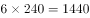。

第三步：再次标注答案 。

故正确答案为B。

**来源**：2013年江苏省公务员录用考试《行测》题（A类）第16题

### 第 17 题

3，8，23，68，( )，608。

A. 183

B. 188

C. 203

D. 208

第 17 题 · 答案与解析

**参考答案（粉笔题库参考内容）**

C

**解析**

第一步：分析问题。

相邻两数字间有明显的3倍左右关系，可考虑递推数列中一推一加减修正项解法。

第二步：计算过程。

从左到右，以相邻两个数字为一组，前一个数字的3倍减1等于后一个数字。即3×3-1=8，8×3-1=23，23×3-1=68，所以题干括号所求数字为68×3-1=203，满足203×3-1=608。

第三步：再次标注答案 。

故正确答案为C。

第四步：考点拓展。

【相关知识点】递推数列二推一问题。

**来源**：2013年江苏省公务员录用考试《行测》题（A类）第17题

### 第 18 题

2，1，4，6，26，158，( )。

A. 5124

B. 5004

C. 4110

D. 3676

第 18 题 · 答案与解析

**参考答案（粉笔题库参考内容）**

C

**解析**

第一步：分析问题

题干数字趋势呈现由下降到上升的抛物线形式，基本可排除多级数列的作差寻找规律。

根据题干数字“158”附近无幂次数，可判定此题不是考核幂次数列。

数字之间无明显的相同倍数关系，可判定此题不是考核递推数列中的一推一加减修正项数列。

通过观察数字“4、6、26”可发现第三个数字和前两个数字的乘积很接近，以此类推发现“6、26、158”三个数字也满足此规律，基本可确定此规律为本题考核项。

第二步：计算过程

从左到右，以相邻三个数字为一组，最后一个数字等于前两个数字的乘积加2。即：2×1+2=4，1×4+2=6，4×6+2=26，6×26+2=158，则题干括号所求数字为26×158+2=4110（此处计算可采用尾数法）。

第三步：再次标注答案

故正确答案为C。

第四步：考点拓展

【相关知识点】尾数法

**来源**：2013年江苏省公务员录用考试《行测》题（A类）第18题

### 第 19 题

7.1，8.6，14.2，16.12，28.4，（  ）

A. 32.24

B. 30.4

C. 32.4

D. 40.24

第 19 题 · 答案与解析

**参考答案（粉笔题库参考内容）**

A

**解析**

方法一：数字较多，拆分开。奇数项：7.1，14.2，28.4，是一个公比为 2 的等比数列；偶数项：8.6，16.12，（32.24），小数点前后均是公比为 2 的等比数列。

方法二：前一项小数点前后两数之和等于后一项整数部分，前一项小数点前后两数之差等于后一项小数部分。

故正确答案为A。

**来源**：2013年江苏省公务员录用考试《行测》题（A类）第19题

### 第 20 题

9，10，65，26，217，( )。

A. 289

B. 89

C. 64

D. 50

第 20 题 · 答案与解析

**参考答案（粉笔题库参考内容）**

D

**解析**

第一步：分析问题。

题干所有数字附近都有幂次数字，可考虑幂次数列解法。但前面四个数字附近既有平方数又有立方数，对寻找此题规律造成了较大障碍，解题的重点在于最后一个数字，“217”附近只有一个幂次数216，为，往前寻找联系：26附近的幂次数应寻找和5有关系的，65附近的幂次数应寻找和4有关系的，10附近的幂次数应寻找和3有关系的······

第二步：计算过程。

将题干中数字变为幂次数形式，幂次数的底数为2，3，4，5，6，构成等差数列，幂次数的指数是以3、2、3、2进行循环，修正项都是+1，所以题干括号所求数字为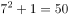

第三步：再次标注答案 。

故正确答案为D。

第四步：考点拓展。

【相关知识点】幂次数的敏感性：1-19数字的平方，1-9数字的立方，1-5数字的1-5次方。

**来源**：2013年江苏省公务员录用考试《行测》题（A类）第20题

### 第 21 题

12，23，35，47，511，（  ）

A. 613

B. 612

C. 611

D. 610

第 21 题 · 答案与解析

**参考答案（粉笔题库参考内容）**

A

**解析**

根据数位划分，各项首位构成新数列：1、2、3、4、5、(6)，为等差数列；

其余数位构成新数列：2、3、5、7、11、(13)，成质数数列，所以未知项为613。

故正确答案为A。

**来源**：2013年江苏省公务员录用考试《行测》题（A类）第21题

### 第 22 题

－2，－2，0，4，10，（  ）

A. 18

B. 16

C. 15

D. 12

第 22 题 · 答案与解析

**参考答案（粉笔题库参考内容）**

A

**解析**

后项减去前项得到0、2、4、6、(8)，为等差数列，所以未知项为10+8=18。

故正确答案为A。

**来源**：2013年江苏省公务员录用考试《行测》题（A类）第22题

### 第 23 题

0，4，11，24，49，（  ）

A. 98

B. 99

C. 101

D. 103

第 23 题 · 答案与解析

**参考答案（粉笔题库参考内容）**

A

**解析**

方法一：数列中相邻两项，前项的2倍加上一个修正项得到后项，修正项为等差数列。具体规律如下：0×2+4=4，4×2+3=11，11×2+2=24，24×2+1=49，所以未知项为49×2+0=98。

方法二：后项减前项得到新数列：4，7，13，25，（ ），大致成等比数列，需要进行修正，前一项的2倍减1后为后一项。

故正确答案为A。

**来源**：2013年江苏省公务员录用考试《行测》题（A类）第23题

### 第 24 题

1/2，1，，，，（  ）

A. 

B. 

C. 

D. 

第 24 题 · 答案与解析

**参考答案（粉笔题库参考内容）**

A

**解析**

1变形为，则分子列构成新数列：1、4、9、16、25、(36)，为平方数列；

分母列：2、4、7、11、16、(22)，后项减去前项得到数列2、3、4、5、6，为等差数列；所以未知项为，即。

故正确答案为A。

**来源**：2013年江苏省公务员录用考试《行测》题（A类）第24题

### 第 25 题

9997，7964，3463，8447，5632，（  ）

A. 8884

B. 8886

C. 8887

D. 8888

第 25 题 · 答案与解析

**参考答案（粉笔题库参考内容）**

D

**解析**

各项除以3的余数依次为1、2、1、2、1，交叉出现，所以下一项除以3的余数应为2，只有D符合。

故正确答案为D。

**来源**：2013年江苏省公务员录用考试《行测》题（A类）第25题

### 第 26 题

一项工程，甲、乙合作12天完成，乙、丙合作9天完成，丙、丁合作12天完成。如果甲、丁合作，则完成这项工程需要的天数是：

A. 16

B. 18

C. 24

D. 26

第 26 题 · 答案与解析

**参考答案（粉笔题库参考内容）**

B

**解析**

题干只给出了合作所需时间，可以给工程总量赋值，设工程总量为12与9的最小公倍数36，则合作效率分别为：甲＋乙＝36÷12＝3，乙＋丙＝36÷9＝4，丙＋丁＝36÷12＝3。所以甲＋丁＝（甲＋乙）＋（丙＋丁）－（乙＋丙）＝2，甲、丁合作的天数为36÷2＝18天。

故正确答案为B。

**考点**：给完工时间型

**来源**：2013年江苏省公务员录用考试《行测》题（A类）第26题

### 第 27 题

5名学生参加某学科竞赛，共得91分，已知每人得分各不相同且均为整数，且最高是21分，则最低分最低为：

A. 14

B. 16

C. 13

D. 15

第 27 题 · 答案与解析

**参考答案（粉笔题库参考内容）**

C

**解析**

要使最低分得分最低，则其他人得分应尽可能高。已知最高分为21分，且得分各不相同均为整数，那么其他人依次应为20、19、18、n，则n=91-21-20-19-18=91-78=13分。故正确答案为C。

**考点**：构造数列

**来源**：2013年江苏省公务员录用考试《行测》题（A类）第27题

### 第 28 题

2013年是中国农历蛇年。在本世纪余下年份里，农历是蛇年的年份还有：

A. 5个

B. 6个

C. 7个

D. 8个

第 28 题 · 答案与解析

**参考答案（粉笔题库参考内容）**

C

**解析**

常识判断，我们知道有12生肖，即12个年份为一个周期，本世纪（2000~2099）还余下有100-14=86年，则还剩下的蛇年有，即剩下农历为蛇年的年份还有7个。

故正确答案为C。

**考点**：周期余数问题

**来源**：2013年江苏省公务员录用考试《行测》题（A类）第28题

### 第 29 题

如图正四面体P—ABC的棱长为a，D、E、F分别为棱PA、PB、PC的中点，G、H、M分别为DE、EF、FD的中点，则三角形GHM的面积与正四面体P—ABC表面积之比为：

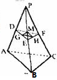

A. 1：8

B. 1：16

C. 1：32

D. 1：64

第 29 题 · 答案与解析

**参考答案（粉笔题库参考内容）**

D

**解析**

设正四面体P—ABC设每一面的面积为S，则表面积为4S。由题意可知，小三角形的边长是各面边长的1/4，则其面积为，。

故正确答案为D。

**考点**：几何公式类-立体图形

**来源**：2013年江苏省公务员录用考试《行测》题（A类）第29题

### 第 30 题

一个三位数除以53，商是a，余数是b(a,b都是正整数)，则a+b的最大值是：

A. 69

B. 80

C. 65

D. 75

第 30 题 · 答案与解析

**参考答案（粉笔题库参考内容）**

A

**解析**

由题意可知53a+b为三位数，且最大三位数为999，当53a+b=999时，即999÷53=18余45，此时a为最大值18，b为45。要想a+b值最大，需要让a与b都尽可能取较大值，①当a取最大值为18时，b最大值为45，a+b的最大值为63。②当b取最大值为52时，a取最大值18时，53a+b＞999，不满足题意；当a取次大值17时，满足条件，此时a+b=69＞63，故a+b的最大值为69。

故正确答案为A。

**来源**：2013年江苏省公务员录用考试《行测》题（A类）第30题

### 第 31 题

一个公比为2的等比数列，第n项与前n－1项和的差等于5，则此数列前4项之和为：

A. 70

B. 85

C. 80

D. 75

第 31 题 · 答案与解析

**参考答案（粉笔题库参考内容）**

D

**解析**

设首项为a，则有，解得a=5；前四项分别为5、10、20、40，和为75。

故正确答案为D。

**考点**：数列问题

**来源**：2013年江苏省公务员录用考试《行测》题（A类）第31题

### 第 32 题

长江上游的A港与下游S港相距270千米，一轮船以恒定速度从A港到S港需6.75小时，返回需9小时。如果一只漂流瓶从A港顺水漂流到S港，则需要的时间是：

A. 84小时

B. 50小时

C. 54小时

D. 81小时

第 32 题 · 答案与解析

**参考答案（粉笔题库参考内容）**

C

**解析**

船速+水速=270÷6.75=40，船速-水速=270÷9=30，则水速=(40-30)÷2=5；270÷5=54小时。

故正确答案为C。

**考点**：流水行船

**来源**：2013年江苏省公务员录用考试《行测》题（A类）第32题

### 第 33 题

现需购买三种调料加工成一种新调料，三种调料价格分别为每千克20元、30元、60元。如果购买这三种调料所花钱一样多，则每千克调料的成本是：

A. 30元

B. 35元

C. 40元

D. 60元

第 33 题 · 答案与解析

**参考答案（粉笔题库参考内容）**

A

**解析**

赋值法。根据题意，设三种调料所花价格均为60元，那么20元/千克的调料的重量为60÷20=3千克；30元/千克的调料的重量为60÷30=2千克；60元/千克的调料的重量为60÷60=1千克。三种调料的总重量为6千克，总价格为60×3=180元，所以三种调料的每千克的成本：180÷6=30元/千克。

故正确答案为A。

**考点**：经济利润问题

**来源**：2013年江苏省公务员录用考试《行测》题（A类）第33题

### 第 34 题

某盐溶液100克，加入20克水稀释，浓度变为50%，然后加入80克浓度为25%的盐溶液，此时，混合后的盐溶液浓度为：

A. 30%

B. 40%

C. 45%

D. 50%

第 34 题 · 答案与解析

**参考答案（粉笔题库参考内容）**

B

**解析**

由题意可得混合后溶液中溶质即盐质量为（100+20）×50%+80×25%=60+20=80克，混合后溶液质量为100+20+80=200克。所以混合后浓度为80÷200=40%。

巧算：根据线段法，混合前浓度写两边（默认左小右大），混合溶液质量之比等于混合后浓度与两边浓度距离的反比，溶液质量之比为80∶120=2∶3，把线段分为5段，每一段为（50%–25%）÷5=5%，与线段左侧相比，混合后浓度为25%+3×5%=40%。

故正确答案为B。

**来源**：2013年江苏省公务员录用考试《行测》题（A类）第34题

### 第 35 题

有一类分数，每个分子与分母的和是100，如果分子减K，分母加K，得新的分数约分后等于，其中K是正整数，则该类分数中分数值最小的是：

A. 

B. 

C. 

D. 

第 35 题 · 答案与解析

**参考答案（粉笔题库参考内容）**

C

**解析**

优先选用代入排除的方法，观察四个选项，分子与分母之和均为100。首先将变形为，因为K为正整数，原分数分子减去K得到40，排除D项，C项分数值最小且C项分子减1分母加1等于满足条件。

故正确答案为C。

**来源**：2013年江苏省公务员录用考试《行测》题（A类）第35题

### 第 36 题

设x⊕y＝2x+3y，x⊙y＝x•y，且x、y均为正整数，若当x⊙y=6时，x⊕y取得最小值，则x等于：

A. 2

B. 6

C. 4

D. 3

第 36 题 · 答案与解析

**参考答案（粉笔题库参考内容）**

D

**解析**

，即x、y可取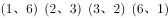，则2x+3y最小为，解得x=3。

故正确答案为D。

**来源**：2013年江苏省公务员录用考试《行测》题（A类）第36题

### 第 37 题

整数8可以写成1、1、2、4这4个整数的和，也可以写成这4个整数的乘积。那么最少有多少个不等于2008的整数，使得它们的和等于2008，它们的乘积也等于2008？

A. 1002

B. 1004

C. 1006

D. 2

第 37 题 · 答案与解析

**参考答案（粉笔题库参考内容）**

B

**解析**

根据题意，这组整数乘积为2008，且，因此这组数中必有2、251的倍数；又要求这组整数个数最少，则能被251整除的数要尽量大，最大只能取1004，乘积为2008，则这组数还要包含一个2，其余若干个数取1，要求这些数加和也为2008，由于2008-2-1004=1002，因此有1002个1，整数总共有1004个。

故正确答案为B。

**考点**：公倍数与公约数问题、非典型最值问题

**来源**：2013年江苏省公务员录用考试《行测》题（A类）第37题

### 第 38 题

小李驾车从甲地去乙地。如果比原车速提高25%，则比原定时间提前30分钟到达。原车速行驶120千米后，再将车速提高25%，可提前15分钟到达，则原车速是：

A. 84千米/小时

B. 108千米/小时

C. 96千米/小时

D. 110千米/小时

第 38 题 · 答案与解析

**参考答案（粉笔题库参考内容）**

C

**解析**

全程提速提前30分钟，部分路程提速提前15分钟，所以原速行驶的120千米为全程的一半，则全程为120×2=240千米，设原速为v，则加速后为1.25v，时间与速度成反比，则全程提速后时间为原时间的80%，二者相差30分钟，即0.5小时，则有原时间为0.5÷(1-80%)=2.5小时，所以原速度v=240÷2.5=96千米/小时。

故正确答案为C。

**考点**：普通行程

**来源**：2013年江苏省公务员录用考试《行测》题（A类）第38题

### 第 39 题

若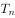\=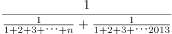，其中n是小于2013的自然数，则的最大值是（    ）。

A. 1013048

B. 1013046

C. 1013045

D. 1013042

第 39 题 · 答案与解析

**参考答案（粉笔题库参考内容）**

D

**解析**

因分子一定，分母越小，商值越大，故要使取值最大，则分母部分“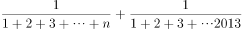”应取最小值，即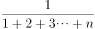应取最小值，故n应取最大值。因n是小于2013的自然数，n取最大值2012时，取值最小。

故的最大值=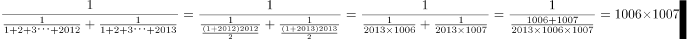

计算可得尾数应为42，只有D项满足。

故正确答案为D。

**来源**：2013年江苏省公务员录用考试《行测》题（A类）第39题

### 第 40 题

有89吨货物要从甲地运往乙地，大卡车的载重量是7吨，小卡车的载重量是4吨。大卡车与小卡车每次的耗油量分别是14升、9升，如果使所派车辆运完货物耗油量最小，则最小耗油量是：

A. 141升

B. 162升

C. 181升

D. 193升

第 40 题 · 答案与解析

**参考答案（粉笔题库参考内容）**

C

**解析**

大卡车平均每吨货物耗油2升，小卡车平均每吨货物耗油2.25升，因此首先尽量安排大卡车运送，并且使得空载量尽量小。此时对应的最佳方案为大卡车运送77吨，小卡车运送12吨，两类车型运送车次分别为11次、3次，耗油量为11×14+3×9=181升。

故正确答案为C。

**考点**：统筹规划问题

**来源**：2013年江苏省公务员录用考试《行测》题（A类）第40题

### 第 41 题

翠竹：高洁

A. 牡丹：华贵

B. 青松：高山

C. 金属：金银

D. 青草：植物

第 41 题 · 答案与解析

**参考答案（粉笔题库参考内容）**

A

**解析**

第一步：判断题干词语间逻辑关系。

题干两词是事物与其象征意义的对应关系，翠竹象征着高洁。

第二步：判断选项词语间逻辑关系。

A项：牡丹象征着华贵，两者是事物与其象征意义的对应关系，与题干逻辑关系一致，当选；

B项：青松与高山不是事物与其象征意义的对应关系，与题干逻辑关系不一致，排除；

C项：金属包含金银，金银是金属，两者是种属关系，与题干逻辑关系不一致，排除；

D项：植物包含青草，青草是植物，两者是种属关系，与题干逻辑关系不一致，排除。

故正确答案为A。

**考点**：语义关系-比喻象征义

**来源**：2013年江苏省公务员录用考试《行测》题（A类）第41题

### 第 42 题

花草：植物

A. 森林：家禽

B. 牛羊：家畜

C. 环境：田野

D. 初春：严冬

第 42 题 · 答案与解析

**参考答案（粉笔题库参考内容）**

B

**解析**

第一步：判断题干词语间逻辑关系。

题干两词为种属关系，花草都属于植物。与之关系相同的是B项，牛羊都属于家畜。

第二步：逐一判断其他选项。

A项森林和家禽没有明显的逻辑关系，排除；

C项田野和环境是包容关系，田野是环境的一部分，排除；

D项初春和严冬是并列关系，排除。

故正确答案为B。

**考点**：逻辑关系-包容关系

**来源**：2013年江苏省公务员录用考试《行测》题（A类）第42题

### 第 43 题

丝线：编制：花边

A. 毛笔：描画：美景

B. 竹木：铺设：浮桥

C. 专家：总结：理论

D. 电影：编辑：文字

第 43 题 · 答案与解析

**参考答案（粉笔题库参考内容）**

B

**解析**

第一步：判断题干词语间逻辑关系。

丝线经过编制成为花边，即原材料、工艺、成品的对应关系。

第二步：判断选项词语间逻辑关系。

A项：毛笔不是原材料，美景也不是成品，与题干的逻辑关系不一致，排除；

B项：竹木经过铺设成为浮桥，为原材料、工艺、成品的对应关系，与题干的逻辑关系一致，当选；

C项：专家不是原材料，理论也不是成品，与题干的逻辑关系不一致，排除；

D项：电影不是原材料，文字也不是成品，与题干的逻辑关系不一致，排除。

故正确答案为B。

**考点**：逻辑关系-对应关系

**来源**：2013年江苏省公务员录用考试《行测》题（A类）第43题

### 第 44 题

提出 之于 （  ） 相当于 钻研 之于 （  ）

A. 疑难—研究

B. 发现—学术

C. 理论—技术

D. 工程—思想

第 44 题 · 答案与解析

**参考答案（粉笔题库参考内容）**

C

**解析**

第一步：判断题干词语间逻辑关系。

题干是动宾结构的语法关系，即“提出”“理论”，“钻研”“技术”。

第二步：逐一判断其他选项。

A项“研究”不能作为“钻研”的宾语，排除；

B项“发现”不能作为“提出”的宾语，排除；

D项“工程”不能作为“提出”的宾语，排除。

故正确答案为C。

**考点**：语法关系

**来源**：2013年江苏省公务员录用考试《行测》题（A类）第44题

### 第 45 题

字体 之于 （  ） 相当于 德行 之于 （  ）

A. 字号—教育

B. 楷书—德性

C. 行距—行政

D. 宋体—廉洁

第 45 题 · 答案与解析

**参考答案（粉笔题库参考内容）**

D

**解析**

第一步：判断题干词语间逻辑关系。

题干是包容关系中的种属关系，宋体是字体的一种，廉洁是德行的一种。

第二步：逐一判断其他选项。

A项字体和字号都是字的属性，为并列关系，德行和教育是对应关系，教育的好坏会影响德行，排除；

B项字体和楷书是种属关系，德行和德性是全同关系，排除；

C项字体和行距，德行和行政都不存在明显的逻辑关系，排除。

故正确答案为D。

**考点**：逻辑关系-包容关系

**来源**：2013年江苏省公务员录用考试《行测》题（A类）第45题

### 第 46 题

解决 之于 （  ） 相当于 克服 之于 （  ）

A. 问题—障碍

B. 顺利—惰性

C. 完成—克制

D. 理念—困难

第 46 题 · 答案与解析

**参考答案（粉笔题库参考内容）**

A

**解析**

第一步：判断题干词语间逻辑关系。

题干是动宾结构的语法关系。

第二步：逐一判断选项。

A项两级词构成动宾结构，当选；

B项“解决”和“顺利”是或然的对应关系，解决的过程或许是顺利的，不是动宾结构，后者克服惰性是动宾结构的语法关系，排除；

C项“解决”和“完成”是并列关系，“克服”和“克制”没有明显的逻辑关系，排除；

D项“理念”不能作为“解决”的宾语，克服困难是动宾结构的语法关系，排除。

故正确答案为A。

**考点**：语法关系

**来源**：2013年江苏省公务员录用考试《行测》题（A类）第46题

### 第 47 题

请从四个选项中选出正确的一项，其特征或规律与题干给出的一串符号的特征或规律最为相似。

A. 

B. 

C. 

D. 

第 47 题 · 答案与解析

**参考答案（粉笔题库参考内容）**

D

**解析**

题干中字符串的规律为：第一个字符与第三个字符相同，第二个字符与第四个字符相同，第五个字符与第七个字符相同，第六个字符与第八个字符相同，只有D项与题干规律一致。

故正确答案为D。

**来源**：2013年江苏省公务员录用考试《行测》题（A类）第47题

### 第 48 题

请从四个选项中选出正确的一项，其特征或规律与题干给出的一串符号的特征或规律最为相似：

ab4Pab4Q

A. 

B. 

C. 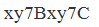

D. 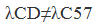

第 48 题 · 答案与解析

**参考答案（粉笔题库参考内容）**

C

**解析**

题干中字符串的规律为：第一个字符与第五个字符相同，第二个字符与第六个字符相同，第三个字符与第七个字符相同，第四个和第八个字符与其他所有字符都不相同，只有C项与题干规律一致。

故正确答案为C。

**来源**：2013年江苏省公务员录用考试《行测》题（A类）第48题

### 第 49 题

请从四个选项中选出正确的一项，其特征或规律与题干给出的一串符号的特征或规律最为相似：

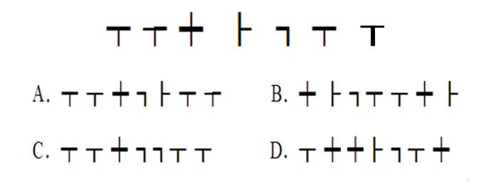

A. A

B. B

C. C

D. D

第 49 题 · 答案与解析

**参考答案（粉笔题库参考内容）**

A

**解析**

题干一串符号的规律是只有第一个符号和倒数第二个符号相同，其它各不相同，符合此规律的只有A项。B项第二个和最后一个相同，C项最后两个与第二个是相同的，D项第二个、第三个与最后一个相同。

故正确答案为A。

**来源**：2013年江苏省公务员录用考试《行测》题（A类）第49题

### 第 50 题

请从四个选项中选出正确的一项，其特征或规律与题干给出的一串符号的特征或规律最为相似：

DFGDFH

A. IJKIJL

B. MOPMOP

C. QRSTQR

D. UVWXWX

第 50 题 · 答案与解析

**参考答案（粉笔题库参考内容）**

A

**解析**

题干中字符串的规律为：第一个字符与第四个字符相同，第二个字符与第五个字符相同，第三个和第六个字符与其他所有字符都不同，只有A项与题干规律一致。

故正确答案为A。

**来源**：2013年江苏省公务员录用考试《行测》题（A类）第50题

### 第 51 题

请从所给的四个选项中，选择唯一的一个答案，使之呈现一定的规律性：

A. A

B. B

C. C

D. D

第 51 题 · 答案与解析

**参考答案（粉笔题库参考内容）**

A

**解析**

本题元素组成凌乱，考数数。本题数封闭空间的数量，已知题干图形的封闭空间均为4个。A项的封闭空间为4个，B项为7个，C项为3个，D项为2个。

故正确答案为A。

**考点**：数量规律-面

**来源**：2013年江苏省公务员录用考试《行测》题（A类）第51题

### 第 52 题

请从所给的四个选项中，选择唯一的一个答案，使之呈现一定的规律性：

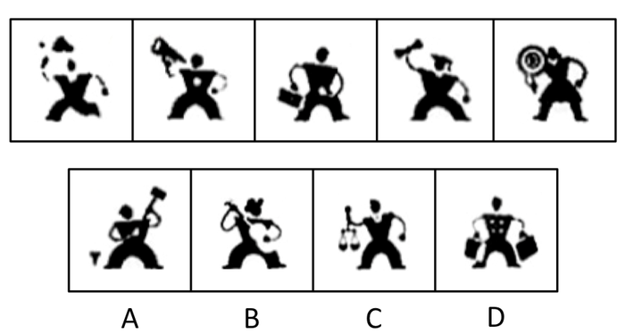

A. A

B. B

C. C

D. D

第 52 题 · 答案与解析

**参考答案（粉笔题库参考内容）**

C

**解析**

本题考查人物的动作特征。

已知题干图形中的人物都是单手持物，只有C项符合；A、B、D三项中的人物都是双手持物。

故正确答案为C。

**来源**：2013年江苏省公务员录用考试《行测》题（A类）第52题

### 第 53 题

下边的四个图形中，只有一个是由上边的四个图形拼合（只能通过上、下、左、右平移）而成的，请把它找出来：

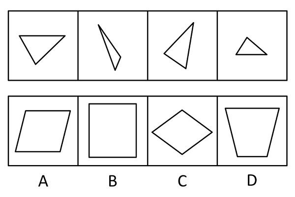

A. A

B. B

C. C

D. D

第 53 题 · 答案与解析

**参考答案（粉笔题库参考内容）**

D

**解析**

本题考查拼图。将上边各部分拼起来，形成的图形如下图所示。

故正确答案为D。

**来源**：2013年江苏省公务员录用考试《行测》题（A类）第53题

### 第 54 题

下边四个图形中，只有一个是由上边的四个图形拼合（只能通过上、下、左、右平移）而成的，请把它找出来。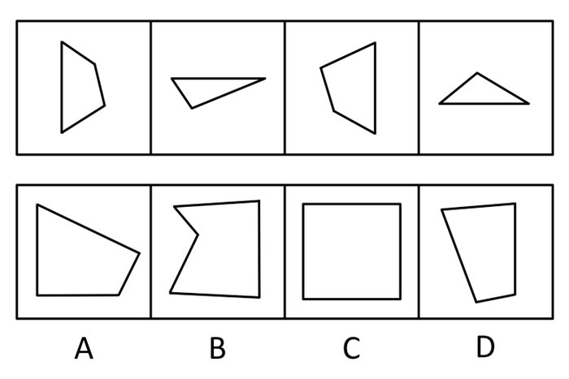

A. A

B. B

C. C

D. D

第 54 题 · 答案与解析

**参考答案（粉笔题库参考内容）**

C

**解析**

本题考查拼图。将上边各部分图形拼起来，形成的图形如下图所示。

故正确答案为C。

**来源**：2013年江苏省公务员录用考试《行测》题（A类）第54题

### 第 55 题

左边给定的是三棱锥的外表面展开图，右边哪一项能由它折叠而成？

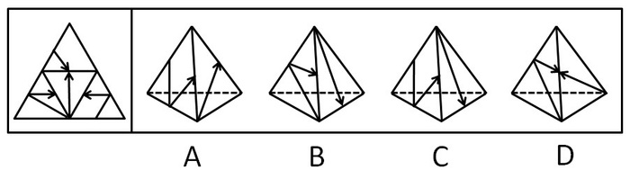

A. A

B. B

C. C

D. D

第 55 题 · 答案与解析

**参考答案（粉笔题库参考内容）**

C

**解析**

将题干展开图标上序号，如下图所示，逐一分析选项。

A项：选项由面h和面g构成，如图所示，以面g中箭头指向的边为起始边，对面g进行顺时针画边。题干展开图中边2挨着面h，而选项中边3挨着面h，选项与题干不一致，排除；

B项：选项由面f和面g构成，如图所示，以面g中箭头指向的边为起始边，对面g进行顺时针画边。题干展开图中边3挨着面f，而选项中边2挨着面f，选项与题干不一致，排除；

C项：选项由面h和面g构成，选项与题干一致，当选；

D项：选项由面f和面g构成，如图所示，题干展开图面g中的箭头指向面e，而选项面g中的箭头指向面f，选项与题干不一致，排除。

故正确答案为C。

**来源**：2013年江苏省公务员录用考试《行测》题（A类）第55题

### 第 56 题

左边给定的是纸盒外表面的展开图，右边哪一项能由它折叠而成？请把它找出来：

A. A

B. B

C. C

D. D

第 56 题 · 答案与解析

**参考答案（粉笔题库参考内容）**

A

**解析**

将题干展开图中的面依次标注为面e、f、g、h，如下图：

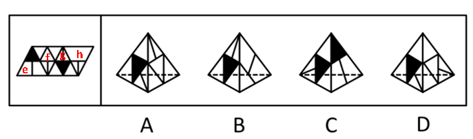

A项：选项由面f、g构成，与题干一致，当选；

B项：右侧的面是无中生有的面，与题干不一致，排除；

C项：选项由面e、g构成，展开图中面g中黑色三角形与面e中的竖线正对，选项中面g中黑色三角形与面e中的竖线不正对，与题干不一致，排除；

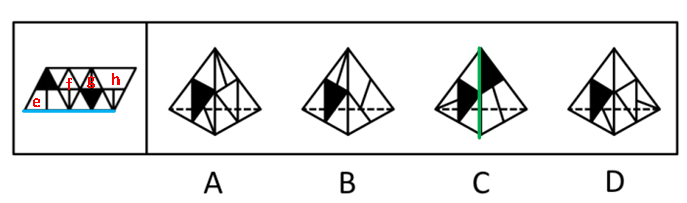

D项：选项由面f、g构成，题干展开图中面f和面g的公共边挨着面f的直角三角形的斜边，而选项中面f和面g的公共边没有挨着面f的直角三角形的斜边，与题干不一致，排除。

故正确答案为A。

**来源**：2013年江苏省公务员录用考试《行测》题（A类）第56题

### 第 57 题

左边给定的是纸盒外表面的展开图，右边哪一项能由它折叠而成？请把它找出来：

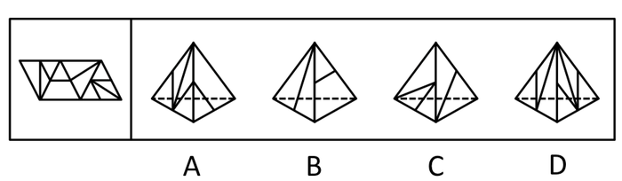

A. A

B. B

C. C

D. D

第 57 题 · 答案与解析

**参考答案（粉笔题库参考内容）**

D

**解析**

本题考查空间重构能力，通常采用排除的思想。

A项错误，假设左侧面是对的，右侧面中的小横线应该是与底边和右腰相交，排除；

B项错误，假设左侧面是对的，右侧面应该是展开图中最右边的那一面，排除；

C项错误，假设左侧面是对的，右侧面中的直线应该是从上顶点指向底边，排除；

D项可由展开图折成，当选。

故正确答案为D。

**来源**：2013年江苏省公务员录用考试《行测》题（A类）第57题

### 第 58 题

左边给定的是纸盒外表面的展开图，右边哪一项能由它折叠而成?请把它找出来：

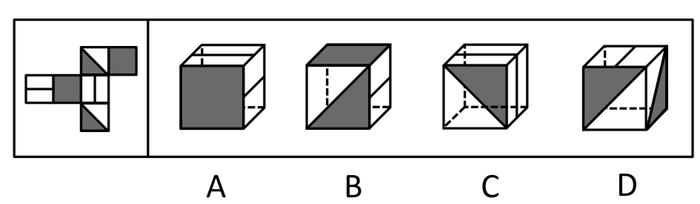

A. A

B. B

C. C

D. D

第 58 题 · 答案与解析

**参考答案（粉笔题库参考内容）**

B

**解析**

本题考查空间重构能力，通常采用排除的思想。

根据相对面不相邻的原则，中间带线条的两面是相对面，折成之后不可能同时出现，排除A项和C项；

带有三角形阴影的两面也是相对面，折成后同样不可能同时出现，D项排除；

B项可根据展开图折成，当选。

故正确答案为B。

**考点**：空间类-空间重构-六面体

**来源**：2013年江苏省公务员录用考试《行测》题（A类）第58题

### 第 59 题

右边图形哪一个是由左边图形折叠而来：

A. A

B. B

C. C

D. D

第 59 题 · 答案与解析

**参考答案（粉笔题库参考内容）**

B

**解析**

本题考查空间重构能力，通常采用排除的思想。由平面展开图可知，相同图案的两面是相对面，根据相对面不相邻的原则，可迅速排除A、C、D三项。

故正确答案为B。

**考点**：空间类-空间重构-六面体

**来源**：2013年江苏省公务员录用考试《行测》题（A类）第59题

### 第 60 题

给定的是纸盒外表面的展开图，右边哪一项能由它折叠而成？

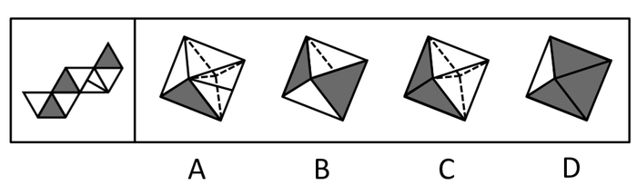

A. A

B. B

C. C

D. D

第 60 题 · 答案与解析

**参考答案（粉笔题库参考内容）**

B

**解析**

本题考查空间重构能力，通常采用排除的思想。

平面展开图中，空白面和空白面之间互不相邻，阴影面和阴影面之间互不相邻，因此折成后不可能出现相邻的情况，排除A、C、D。B项可由展开图折成。

故正确答案为B。

**来源**：2013年江苏省公务员录用考试《行测》题（A类）第60题

### 第 61 题

生活中的浪费，不管是时间的浪费还是物质财富的浪费，都意味着某种东西没有发挥出它应该发挥的价值，意味着我们的劳动和创造全部或部分做了无用功。因此，从本质上说，浪费与经济发展、生活富裕没有必然的关系，它仅仅是一种应该被彻底改变的生活陋习。

根据以上陈述，可以得出以下哪项：

A. 生活中的浪费无所不在，但改变浪费陋习却很难

B. “舌尖上的中国”不应该出现“舌尖上的浪费”

C. 只有经济发展、生活富裕了，才有可能出现浪费现象

D. 如果我们的部分劳动打了水漂，就意味着存在浪费现象

第 61 题 · 答案与解析

**参考答案（粉笔题库参考内容）**

B

**解析**

本题为日常结论题型。

第一步：抓住题干主要信息。

第一句说明浪费意味着什么，第二句说明浪费是应该被彻底改变的生活陋习，跟经济发展和生活富裕无关。

第二步：逐一分析选项。

A项，题干只说需要彻底改变浪费陋习，没有说明改变浪费陋习是否很难，无法推出，排除；

B项，从题干第二句话浪费是应该被彻底改变的生活陋习可知，浪费是不应该出现的现象，可以推出，当选；

C项，由第二句可知，浪费跟经济发展、生活富裕无关，无法得出，排除；

D项，由第一句可知，浪费意味着我们的劳动和创造全部或部分做了无用功（翻译为“浪费→我们的全部或部分劳动和创造做了无用功”），选项中“我们的部分劳动打了水漂”是肯定第一句中的后件，肯定后件不能推出任何绝对表达的结论，排除。

故正确答案为B。

**考点**：日常结论

**来源**：2013年江苏省公务员录用考试《行测》题（A类）第61题

### 第 62 题

因饮酒后驾驶营运机动车或者醉酒驾驶机动车依法被吊销驾驶证的，5年内不得重新申领；因醉酒驾驶营运机动车依法被吊销驾驶证的，10年内不得重新申领；饮酒后或者醉酒驾驶机动车发生重大交通事故并构成犯罪的，终身不得申请驾驶证。

根据上述规定，可以得知以下哪项：

A. 某人饮酒后驾驶机动车，依法被吊销驾驶证，5年内不得重新申领

B. 某人醉酒驾驶机动车，依法被吊销驾驶证，10年内不得重新申领

C. 某人饮酒后驾驶营运机动车发生重大交通事故，10年内不得申请驾驶证

D. 某人醉酒驾驶营运机动车发生重大交通事故构成犯罪，终身不得申请驾驶证

第 62 题 · 答案与解析

**参考答案（粉笔题库参考内容）**

D

**解析**

日常结论题，根据题干信息逐一分析选项。

A项：饮酒后驾驶机动车与饮酒后驾驶营运机动车不同，与醉酒驾驶机动车也不同，该项不能推出，排除；

B项：醉酒驾驶机动车与醉酒驾驶营运机动车不同，该项不能推出，排除；

C项：饮酒后驾驶营运机动车与醉酒驾驶营运机动车不同，该项不能推出，排除；

D项，醉酒后驾驶营运机动车，可以推出醉酒驾驶机动车，并且发生重大交通事故并构成犯罪，说明终身不得申请驾驶证，该项可以推出，当选。

故正确答案为D。

**考点**：日常结论

**来源**：2013年江苏省公务员录用考试《行测》题（A类）第62题

### 第 63 题

大多数老百姓反感官员讲官话套话，例如“高度重视”、“亲自过问”、“研究研究”等。如果不讲官话套话，一些官员就觉得无话可说或没有优越感。

根据以上陈述，可以得出以下哪项：

A. 有些老百姓去政府办事并不反感官员“亲自过问”

B. 一听到官员讲“研究研究”，有些老百姓就反感

C. 一讲“高度重视”，有些官员就会增强自身优越感

D. 官员讲话如果滔滔不绝，一般都是在讲官话套话

第 63 题 · 答案与解析

**参考答案（粉笔题库参考内容）**

B

**解析**

本题为翻译推理题型。

第一步：翻译题干。

第一句：大多数老百姓反感官员讲官话套话，例如“高度重视”、“亲自过问”、“研究研究”等；

第二句：不讲官话套话→无话可说∨没有优越感。

第二步：分析各选项。

A项，老百姓去政府办事题干没有提及，无法得出任何结论，错误；

B项，“研究研究”是官话套话，由第一句大多数老百姓反感官员讲官话套话可推知，该项的说法正确；

C项可翻译为：有些官员讲官话套话→有优越感，“讲官话套话”是否定题干第二句的前件，无法推出任何结论，错误；

D项可翻译为：-无话可说（滔滔不绝）→讲官话套话，-无话可说只否定了后件一个选言支，无法得出任何结论，错误。

故正确答案为B。

**考点**：常规翻译

**来源**：2013年江苏省公务员录用考试《行测》题（A类）第63题

### 第 64 题

据研究，到2013年底，全球互联网用户将达到27亿，相当于全球人口的39%。发达国家与发展中国家在互联网使用方面存在较大差异。到2013年底，发达国家将有77%的居民使用互联网，而发展中国家仅有31%的居民使用互联网。欧洲是互联网用户比例最高的地区，达75%，远远超过亚太地区（32%）和非洲（16%）。

根据以上陈述，可以得出以下哪项：

A. 发达国家的互联网用户超过发展中国家

B. 亚太地区的互联网用户超过非洲

C. 英国的互联网用户比例超过日本

D. 发展中国家互联网用户比例低于全球

第 64 题 · 答案与解析

**参考答案（粉笔题库参考内容）**

D

**解析**

本题属于日常结论题型。

第一步：抓住题干主要信息。

第一句：全球互联网用户将达到27亿，相当于全球人口的39%；

第三句：到2013年底，发达国家将有77%的居民使用互联网，而发展中国家仅有31%的居民使用互联网；

第四句：欧洲是互联网用户比例最高的地区，达75%，亚太地区为32%，非洲为16%。

第二步：逐步分析各选项。

A项，由第三句可知，发达国家的互联网用户比例大于发展中国家，但题干没有给出发达国家和发展中国家的人口数量，因此无法推知发达国家的互联网用户是否超过发展中国家，排除；

B项，同理，题干没有给出亚太地区和非洲的具体人口数量，因此无法从亚太地区的互联网用户比例高于非洲得出亚太地区的互联网用户超过非洲，排除；

C项，题干没有提供英国和日本的相关信息，无法得出结论，排除；

D项，从第一句和第三句可知，发展中国家互联网用户比例低于全球，当选。

故正确答案为D。

**考点**：日常结论

**来源**：2013年江苏省公务员录用考试《行测》题（A类）第64题

### 第 65 题

恐龙到底是一群呆头呆脑、行动迟缓的冷血动物，还是一群新陈代谢率高、动作敏捷的温血动物？研究发现，对此问题的不同回答存在以下四条相关证据：

（1）所有的恐龙都是腿部直立地“站在”地面上，这不同于那些四肢趴伏在地上的冷血爬行动物

（2）有些海龟的骨组织构造与哺乳动物的骨组织构造类似，而这些海龟是冷血动物

（3）恐龙骨骼中的骨组织构造与温血的哺乳动物的骨组织构造相类似

（4）鲸类、海豹等海生哺乳动物并不是直立的，但是它们都是温血动物

在以上陈述中，支持恐龙是温血动物的证据是哪几条：

A. 仅（1）

B. （1）、（2）

C. （1）、（3）

D. （2）、（3）和（4）

第 65 题 · 答案与解析

**参考答案（粉笔题库参考内容）**

C

**解析**

第一步：找到论点和论据。

论点：恐龙是温血动物。

论据：无。

第二步：逐一分析选项。

（1）恐龙与冷血爬行动物有区别，说明恐龙可能是温血动物，支持了论点；（2）说的是海龟，与恐龙无关，不能支持论点；（3）恐龙和温血的哺乳动物类比，说明恐龙可能是温血动物，支持了论点；（4）未涉及恐龙，不能支持论点。综上分析，（1）、（3）支持了论点，（2）、（4）不能支持论点。

故正确答案为C。

**考点**：补充论据

**来源**：2013年江苏省公务员录用考试《行测》题（A类）第65题

### 第 66 题

有哲学家指出，人生其实应该追求两个简单：物质生活的简单和人际关系的简单。有了这两个简单，心灵就拥有了广阔的空间和美好的宁静。但是，大多数现代人却在这两方面很复杂，物质生活上是财富的无穷追逐，人际关系上是利益的不尽纠葛，两者几乎占满了生活的全部空间，而有了这两种复杂，就产生了现代人的大部分烦恼。

根据上述哲学家的观点，可以得出以下哪项？

A. 大多数现代人的心灵或者没有广阔的空间，或者没有美好的宁静

B. 有些现代人生活很复杂，但却拥有心灵的广阔和宁静

C. 只有在物质生活或人际关系两方面简单了，现代人的大部分烦恼才不会产生

D. 如果在物质生活和人际关系两方面都简单了，现代人的大部分烦恼就不会产生

第 66 题 · 答案与解析

**参考答案（粉笔题库参考内容）**

C

**解析**

第一步：翻译题干。

① 物质生活的简单 且 人际关系的简单→拥有广阔的空间 且 美好的宁静；

② -物质生活的简单 且 -人际关系的简单→产生现代人的大部分烦恼。

第二步：逐一分析选项。

A项：大多数现代人的心灵是-广阔的空间 或 -美好的宁静，题干中没有谈及大多数现代人的心灵与广阔的空间和美好的宁静之间的关系，无法推出，排除；

B项：题干中只涉及物质生活和人际关系，并未涉及有些现代人生活很复杂，无法推出，排除；

C项：-产生现代人的大部分烦恼→物质生活的简单 或 人际关系的简单，是题干条件②的逆否命题，可以推出，当选；

D项：物质生活的简单 且 人际关系的简单→-产生现代人的大部分烦恼，物质生活的简单且人际关系的简单是对题干条件②前件的否定，否定前件不能得出确定性结论，无法推出，排除。

故正确答案为C。

**考点**：常规翻译

**来源**：2013年江苏省公务员录用考试《行测》题（A类）第66题

### 第 67 题

经过努力，甲、乙、丙、丁4位品学兼优的中学生考上了北京大学、清华大学、南京大学、东南大学4所名校。9月初，甲、丙与乙、丁分别奔赴两座不同的城市去上学了。已知：

（1）甲没有上北京大学

（2）乙没有上清华大学

（3）丙没有上南京大学

（4）丁没有上东南大学

根据以上陈述，可以得出以下哪项：

A. 甲没有上清华大学

B. 乙没有上北京大学

C. 丙没有上东南大学

D. 丁没有上北京大学

第 67 题 · 答案与解析

**参考答案（粉笔题库参考内容）**

D

**解析**

本题为排列组合题型。

本题根据题干已知信息难以推理，故采用假设法。

根据“甲、丙与乙、丁分别奔赴两座不同的城市”，假设甲、丙分别去了清华大学和北京大学，则乙、丁分别去了南京大学和东南大学。

由（1）知，甲去清华大学，丙去北京大学；

由（4）知，丁去南京大学，乙去东南大学，与题干已知信息不矛盾。

假设甲、丙分别去了南京大学和东南大学，则乙、丁分别去了清华大学和北京大学。

由（3）知，丙去了东南大学，甲去了南京大学；

由（2）知，乙去了北京大学，丁去了清华大学，也与题干信息没有矛盾。因此这两种情况都可能存在。

若是第一种情况，则A项错误；

若是第二种情况，则B、C两项均错误；

两种情况下丁都没有去北京大学，D项正确。

故正确答案为D。

**考点**：假设

**来源**：2013年江苏省公务员录用考试《行测》题（A类）第67题

### 第 68 题

甲、乙、丙三队进行足球循环赛。已知有下列情况：

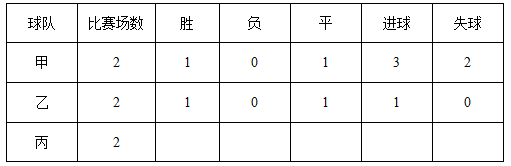

根据上表情况，可以得出甲队对丙队的进球数之比是：

A. 3：1

B. 3：2

C. 1：0

D. 0：0

第 68 题 · 答案与解析

**参考答案（粉笔题库参考内容）**

B

**解析**

本题属于排列组合题型。

通过表格可以发现，乙的情况比较简单，因此从乙入手。已知乙一胜一平且进球数为1，假设乙丙平局，那么乙比甲为胜，但是已知条件中甲没有负，因此只能甲乙平局，又因乙只进1球且胜一场，那么甲乙的比分应为0:0，因此根据甲的进球数和失球数可知，甲的另一场比赛即甲丙比分为3:2。

故正确答案为B。

**考点**：假设

**来源**：2013年江苏省公务员录用考试《行测》题（A类）第68题

### 第 69 题

因工作需要，某单位决定从本单位的3位女性（小王、小李、小孙）和5位男性（小张、小金、小吴、小孟，小余）中选出4人组建谈判小组参与一次重要谈判，选择条件如下：

（1） 小组成员既要有女性，也要有男性

（2） 小张与小王不能都入选

（3） 小李与小孙不能都入选

（4） 如果选小金，则不选小吴

如果小张一定要入选，可以得出以下哪项：

A. 如果选小吴，则选小余

B. 如果选小金，则选小孟

C. 要么选小余，要么选小孟

D. 要么选小李，要么选小孙

第 69 题 · 答案与解析

**参考答案（粉笔题库参考内容）**

D

**解析**

第一步：翻译题干。

（1）既要有女性（小王、小李、小孙），也要有男性（小张、小金、小吴、小孟，小余）；

（2）-（小张 且 小王）=-小张 或 -小王；

（3）-（小李 且 小孙）=-小李 或 -小孙；

（4）小金→ -小吴；

（5）小张一定入选（事实信息）。

第二步：从事实信息开始推导并得出结论。

根据事实信息“小张一定入选”，由（2）可知，小王不入选；再由（1）可知，小李和小孙至少有一人入选；再由（3）可知，小李和小孙不能都入选，可推出要么选小李，要么选小孙，D项当选。

第三步：分析其他选项。

A项，题干已知小张入选，由（3）可知，小孙、小李只能入选一个人，小组还需要两个人，且都是男性，男性中（金吴孟余）四个人谁去是不确定的，无法推出，排除；

B项，同A项，小组还需要两个人，且都是男性，男性中（金吴孟余）四个人谁去是不确定的，无法推出，排除；

C项，要么小余，要么小孟，二者只能进一人；题干已知小张入选，由（3）可知，小孙、小李只能入选一个人，小组还需要两个人，且都是男性（金吴孟余），小余和小孟均为男性，可以同时入选，无法推出，排除。

故正确答案为D。

**考点**：常规翻译

**来源**：2013年江苏省公务员录用考试《行测》题（A类）第69题

### 第 70 题

因工作需要，某单位决定从本单位的3位女性（小王、小李、小孙）和5位男性（小张、小金、小吴、小孟，小余）中选出4人组建谈判小组参与一次重要谈判，选择条件如下：

（1）小组成员既要有女性，也要有男性

（2）小张与小王不能都入选

（3）小李与小孙不能都入选

（4）如果选小金，则不选小吴

如果小王和小吴都入选，可以得出以下哪项？

A. 或者选小余，或者选小孟

B. 或者选小李，或者选小孙

C. 如果选小李，那么选小张

D. 如果选小孙，那么选小金

第 70 题 · 答案与解析

**参考答案（粉笔题库参考内容）**

A

**解析**

本题为关联词推导题型。

第一步：翻译题干。

（1）既要有女性（小王、小李、小孙），也要有男性（小张、小金、小吴、小孟，小余）；（2）-小张 或 -小王；（3）-小李 或 -小孙；（4）小金→\-小吴；（5）小王，小吴（事实信息）。

第二步：从事实信息开始推导并得出结论。

根据事实信息小王入选，由（2）可知，小张不入选；根据事实信息小吴入选，由（4）的逆否规则可知，小金不入选；因为参加谈判的总共有4人，又知（3）小李和小孙不能同时入选，要确保两人不同时入选，则需要从小余和小孟中选出一人，或者选小余，或者选小孟，A项当选。

第三步：分析其他选项。

B项：根据条件（3）“小李与小孙不能都入选”，即可以小李和小孙二选一、也可以两者都不入选，而B项无“两者都不入选”的情况，无法推出，排除；

C、D项由第二步推论可知，小张不入选，小金不入选，C项和D项均排除。

故正确答案为A。

**考点**：常规翻译

**来源**：2013年江苏省公务员录用考试《行测》题（A类）第70题

### 第 71 题

碎片式学习：指学习者通过一点一滴的方式积累或获取知识和信息。

下列不属于碎片式学习的是：

A. 妈妈开车送小敏上学时，小敏常常悄悄看小人书

B. 小马严格执行自己的学习计划，每天记5个成语典故，读一篇时文

C. 某品牌手机刚上市，小刘到专卖店连夜排队，一边排队一边翻阅莫言的《蛙》

D. 小顾为了完成一篇论文，每天晚上花数小时查阅相关文献

第 71 题 · 答案与解析

**参考答案（粉笔题库参考内容）**

D

**解析**

第一步：找到定义关键词。

“通过一点一滴的方式积累或获取”。

第二步：逐一分析选项。

A项小敏是在妈妈开车送其上学的途中看的小人书；

B项每天记5个成语典故，读一篇时文；

C项边排队边读书，都属于“通过一点一滴的方式”；

D项小顾每晚花数小时查阅相关文献，不满足关键词“通过一点一滴的方式”，是本题答案。

本题为选非题，故正确答案为D。

**考点**：方式目的

**来源**：2013年江苏省公务员录用考试《行测》题（A类）第71题

### 第 72 题

约拿情结：指人们面对将获得的成功产生畏惧心理，导致不敢去做自己本来能做好的事情，甚至逃避发掘自己的潜能。

下列属于约拿情结的是：

A. 小张立志要考上名牌大学，为此他定下计划，刻苦学习，三年后终于如愿以偿，考上了他心仪的大学

B. 小王在乒乓球大赛中一路过关斩将进入决赛，但在决赛中战术发挥不佳，以3：4的比分输掉了比赛

C. 小吕口才好，反应快，知识面广，已入选校辩论队准备参加电视辩论。随着赛期的临近，小吕愈发紧张，临赛前申请退出了比赛

D. 小卢对某个问题已研究多年，写成论文后想投给某刊物又恐遭拒，最终还是投给了那家刊物

第 72 题 · 答案与解析

**参考答案（粉笔题库参考内容）**

C

**解析**

第一步：找到定义关键词。

面对将获得的成功产生畏惧心理，不敢去做自己本来能做好的事情。

第二步：逐一分析选项。

A项小张考上心仪的大学和D项最终还是投给了那家刊物，不满足关键词“不敢去做自己本来能做好的事情”，均排除；

B项小王输掉比赛是因发挥不佳，不满足关键词“面对将获得的成功产生畏惧心理”，排除；

C项小吕口才好，反应快，知识面广，但赛前因紧张申请退出比赛，满足关键词“不敢去做自己本来能做好的事情”，当选。

故正确答案为C。

**考点**：原因结果

**来源**：2013年江苏省公务员录用考试《行测》题（A类）第72题

### 第 73 题

化归法：指在解决问题的过程中，不是直接解决原问题，而是对问题进行变形、转化，直至把它化归为某个（些）已经解决的问题，或容易解决的问题，再返回去求得原问题的解答。

下列不属于化归法的是：

A. 小张通过把多边形分解为若干个三角形，求得多边形内角和

B. 小吴和小文闹别扭，小吴想道歉又放不下面子，于是把前因后果告诉了小蔡，请小蔡向小文解释，小蔡解释后，小吴主动招呼小文，两人和好如初

C. 小李与小江解决同一类问题方法截然不同，小李先研究特殊情况，最终解决了一般问题；而小江先解决了一般问题，然后再研究特殊情形

D. 小赵采用先易后难的原则，很快完成了老师布置的一大堆物理作业

第 73 题 · 答案与解析

**参考答案（粉笔题库参考内容）**

D

**解析**

第一步：找到定义关键词。

在解决问题的过程中不是直接的，对问题进行变形、转化。

第二步：逐一分析选项。

A项分解为若干个三角形，满足对问题进行变形、转化；

B项是请小蔡向小文解释，满足“不是直接的”；

C项是小李和小江在解决问题的过程中都对问题进行不同方式的转化，非直接求解，满足定义关键词；

D项小赵采用先易后难的原则，没有对问题进行变形、转化，不满足定义关键词，是答案。

本题为选非题，故正确答案为D。

**考点**：方式目的

**来源**：2013年江苏省公务员录用考试《行测》题（A类）第73题

### 第 74 题

无影灯效应：指通过诸多要素互相作用而形成的一种整体性机制，可把某问题的不完全或缺点部分减到最低限度，甚至消失，并最终使这一问题得到很好解决。

下列不属于无影灯效应的是：

A. 某省为了杜绝医生吃医药回扣致使患者看病贵的问题，加大医药采购监督力度，开设了专门的患者热线，在各家医院的咨询服务台公布了卫生部门的举报电话

B. 某城市为了形成大力发展绿色生态文明的有效机制，充分集中民众智慧，成立了公民监督委员会和环境保护组织等，让广大民众更好地建言献策并发挥监督作用

C. 2012年中国网民数量突破5亿，越来越多的人利用互联网媒体充分获取和传播信息，信息和民意也得到广泛的立体传播，中国正在形成透明的信息空间和舆论力量

D. 某地方政府为治理公车私用顽症，特聘多名义务监督员，并配有数码相机，监督员可随时抓拍发现的疑车并将照片发送到相关网络，被拍者须对此作出合理的解释

第 74 题 · 答案与解析

**参考答案（粉笔题库参考内容）**

C

**解析**

第一步：找到关键词。

诸多要素互相作用、整体性机制、不完全或缺点部分减到最低限度、甚至消失、问题最终得到解决。

第二步：逐一分析选项。

A项：回扣、看病贵体现了“缺点”，加大监督力度、开设热线、公布举报电话等措施体现了“诸多要素互相作用”、“整体性机制”；

B项：发展绿色生态文明体现了现有环境状况不佳的“缺点”，集中智慧、成立监督委员会和环境保护组织等体现了“诸多要素互相作用”、“整体性机制”；

C项：并没有体现出缺点、问题得到解决。文字只是对中国网民情况进行了介绍，并没有提出问题。本选项为正确答案；

D项：公车私用体现了“缺点”，监督员、抓拍、网络、解释等反映了“诸多要素互相作用”、“整体性机制”。

虽然A、B、C三项都没有体现出“问题最终得到解决”，但是相比较C项，A、B两项更符合定义。

本题为选非题，故正确答案为C。

**考点**：方式目的

**来源**：2013年江苏省公务员录用考试《行测》题（A类）第74题

### 第 75 题

生物灾害：指在处理微生物病原体或者包含微生物病原体的材料以及被其感染的个体时造成的对工作人员的危害或者伤害。

下列属于生物灾害的是：

A. 由于抗生素的滥用，普遍细菌产生了耐药性，在经历结构变异后，变得更难治疗，或成为超级病菌，仅欧洲每年就有2万多人被感染，参与救治的多名医生被击倒

B. 在自然界中，人类与各种动植物相互依存，可一旦失去平衡，灾难就会接踵而至。某地鸟、蛇被大量捕杀，结果招致老鼠泛滥成灾

C. 水葫芦繁殖速度极快，大量的水葫芦覆盖河面，容易造成水质恶化，影响水底生物的生长，滇池、太湖等地均出现过水葫芦

D. 由于干旱，蝗灾开始泛滥，大片芦苇叶被蝗虫吃得精光，尚未长出翅膀的成群蝗虫正向附近的草滩和农田逼近

第 75 题 · 答案与解析

**参考答案（粉笔题库参考内容）**

A

**解析**

第一步：分析题干关键词。

微生物病原体、被感染、工作人员、危害或伤害。

第二步：逐一分析选项关键词。

A项：耐药细菌体现出“微生物病原体”，参与救治的医生被击倒体现出“被感染”、“工作人员”、“危害或伤害”，是正确答案；

B项：并未体现出对工作人员的伤害或危害，只是说老鼠泛滥成灾；

C项：并未体现出对工作人员的伤害或危害，只是影响了水体环境；

D项：并未体现出对工作人员的伤害或危害，只是对农业生产的影响。

故正确答案为A。

**考点**：原因结果

**来源**：2013年江苏省公务员录用考试《行测》题（A类）第75题

### 第 76 题

白化现象是指在正常环境下，植物由于某些内在因素不能形成叶绿素的现象。

下列属于白化现象的是：

A. 某地是世代玉米主产区，每年都发现一些玉米的叶子因遗传而出现局部白斑

B. 某地农民发现当地向日葵的叶子变白了，这在化工厂未建时从没有发现过

C. 某地污染几年后，人民在当地不时会发现一种污染前从未出现过的白蛇

D. 某人十多年前得了一种病至今未愈，皮肤、头发，甚至眉毛全都变白了

第 76 题 · 答案与解析

**参考答案（粉笔题库参考内容）**

A

**解析**

第一步：找到定义关键词。

“正常环境下”、“植物”、“内在因素”。

第二步：逐一分析选项。

A项“某地是世代玉米主产区，每年都发现”说明是正常环境下，“玉米”是植物，“遗传”是内在因素，满足定义关键词，当选。

B项向日葵叶子变白是建化工厂之后发现的，C项白蛇不是植物，D项某人不是植物，B、C、D三项均不满足定义关键词，排除。

故正确答案为A。

**考点**：大前提

**来源**：2013年江苏省公务员录用考试《行测》题（A类）第76题

### 第 77 题

蓝海战略：指跨越现有竞争边界，视线将超越竞争对手移向买方需求，对不同市场的买方价值元素筛选并重新排序，从给定结构下的定位选择向改变市场结构本身转变。

下列属于蓝海战略的是：

A. 某企业将创新与效用、价格与成本整合一体，比照现有产业的最佳实践去赶超对手，瞄准现有市场“高端” 或“低端”顾客，细分市场满足顾客偏好

B. 某马戏团从传统马戏的儿童观众转向成年人和各界人士，以马戏的形式表达戏剧的情节，吸引人们以高于传统马戏数倍的门票来享受这项前所未见的娱乐

C. 某企业正视行业圈内水质混浊、营养贫乏的现状，决定筑牢自己的“防鲨网”，人人参与市场竞争，力争在一年内“鹤立鸡群”

D. 某企业充分重视现有的市场空间竞争，在推销中作降价竞争，虽然增加了销售成本或是减少了利润，但争取到了效率

第 77 题 · 答案与解析

**参考答案（粉笔题库参考内容）**

B

**解析**

第一步：找到定义关键词。

视线将超越竞争对手移向买方需求，对不同市场的买方价值元素筛选并重新排序，向改变市场结构本身转变。

第二步：逐一分析选项。

A项比照现有产业的最佳实践去超越对手不满足“视线将超越竞争对手移向买方需求”，排除；

B项马戏团将视线移向成年人和各界人士满足“视线移向买方需求”，“以马戏的形式表达戏剧的情节”满足“对不同市场的买方价值元素筛选并重新排序”，“以高于传统马戏数倍的门票”满足“超越竞争对手”，“前所未见的娱乐”满足“向改变市场结构本身转变”，当选；

C项“某企业正视行业圈内现状，决定筑牢自己的‘防鲨网’”，同样不满足“视线将超越竞争对手移向买方需求”，排除；

D项充分重视现有的市场空间竞争不满足“向改变市场结构本身转变”，排除。

故正确答案为B。

**考点**：单定义-其他句式

**来源**：2013年江苏省公务员录用考试《行测》题（A类）第77题

### 第 78 题

吸管效应：指用一根吸管吸杯中果汁，就能把管子周围的果汁都吸入，比喻在某区域植入某种“吸管”，就能聚集资源，引起明显的区域反应。

以下不属于吸管效应的是：

A. 石油探矿的常识是，两个矿区的标准距离为一百公尺，中国目前在东海已经勘探八座油气田，包括“八角亭”新油气田在内

B. 随着广州城市功能的向南转移，铁路新客站附近的番禺钟村、南海平洲、三山、顺德的楼价都已被推高

C. 某镇凭借其纺织产业的雄厚基础，确立以纺织特色为主攻方向，纺织企业由粗放式向集约式转变，实行集群发展

D. 某地几年内让现代服务业的繁荣搭配便捷交通方式，两者“二合一”，让某地成为人流、物流、资金流纷纷向往的繁华地

第 78 题 · 答案与解析

**参考答案（粉笔题库参考内容）**

A

**解析**

第一步：分析题干关键词。

某区域植入某种“吸管”、聚集资源、引起明显的区域反应。

第二步：逐一验证选项关键词。

A项：文字并没有体现出“引起明显的区域反应”，有些同学认为限制距离是因为有吸管效应，但题干并没有对吸管效应的距离做出具体说明，所以不符合吸管效应定义；

B项：铁路新客站犹如某种“吸管”，城市功能南移、周边楼价升高，体现出“聚集资源”、“引起明显的区域反应”；

C项：纺织特色产业犹如某种“吸管”，纺织企业由粗放式向集约式转变体现了“聚集资源”，带动某镇的发展，引起了“明显的区域反应”；

D项：现代服务业与便捷交通方式犹如某种“吸管”，人流、物流、资金流集中体现了“聚集资源”，纷纷向往体现了“明显的区域反应”。

本题为选非题，故正确答案为A。

**考点**：故事类

**来源**：2013年江苏省公务员录用考试《行测》题（A类）第78题

### 第 79 题

幽默诉求广告指通过幽默情趣来淡化广告的直接功利性，减少人们对广告所持的逆反心理，使消费者在轻松快乐中接受某种商业或文化信息。

下列属于幽默诉求广告的是：

A. 某商场电子屏：您还在为手里的几张号码卡而烦恼吗？本商场隆重推出新款手机，一台手机同时装三张号码卡，手机还免费送，免去您携带多部手机的烦恼

B. 某电视汽车广告：0油耗也能时速200公里！以清洁能源，甩掉碳排放对世界的压力；凭借超前科技激发电力能效，于风驰电掣中驾驭澎湃激情；通过感应地面电磁场无线充电，不受任何人牵制

C. 某杂志“幽默”栏目：一顾客对售货员大发雷霆：“自打我用了从你们这里买的生发水以后，我的头发就全脱掉了！”售货员：“一点儿不错，先生。要想长出新头发，就必须先腾出地方”

D. 某山区公路电子屏：阁下驾驶汽车，时速不超过30公里，可以欣赏到本地的美丽景色；超过60公里，请到法庭做客；超过80公里，请光顾本地设备最新的医院；上了100公里，祝您安息吧

第 79 题 · 答案与解析

**参考答案（粉笔题库参考内容）**

D

**解析**

第一步：分析题干关键词。

“幽默情趣”、“淡化功利性”、“减少逆反心理”、“快乐中接受”、“商业或文化信息”。

第二步：逐一分析选项关键词。

A项，没有体现出任何题干中的关键词，纯属商业广告；

B项，也没有体现出任何题干中的关键词，也是商业广告；

C项，虽然体现出了“幽默情趣”，但并不属于广告，只是杂志的专题栏目，目的是让读者轻松愉快；

D项，行文风格充分体现出了“幽默情趣”，行文内容体现出了“淡化功利性”，行文效果体现出了“减少逆反心理”、“快乐中接受”。要注意这里是一则公益广告，传达的是“文化信息”。

故正确答案为D。

**考点**：方式目的

**来源**：2013年江苏省公务员录用考试《行测》题（A类）第79题

### 第 80 题

过度探索行为指好奇的兴趣不是随着对新事物熟悉程度的增加而下降，而是持续不减，结果造成对所着迷事物损毁的行为。

下列属于过度探索行为的是：

A. 小侯对玩具遥控汽车爱不释手，而且每次都不准别人碰。就是平时最有威信的妈妈也不能碰一碰，否则就会大哭大闹

B. 小南对小航模越来越喜爱，每天都要一个一个的反复把玩，他的小床上已经有4个不同类型的小航模散了架

C. 小宝对魔方很着迷，每次吃饭的时候都要先把魔方的一面调整到同一色，有几次竟然把饭粒都掉到了魔方上

D. 3岁的小贝，有时要玩印有米老鼠图案的实心球，还要爸爸妈妈讲米老鼠踢球的故事，有时又闹着要看会说话的鹩哥

第 80 题 · 答案与解析

**参考答案（粉笔题库参考内容）**

B

**解析**

第一步：找到定义关键词。

关键词为“好奇的兴趣持续不减，造成对所着迷事物损毁的行为”。

第二步：逐一分析选项。

A、C两项都没有造成对所着迷事物损毁的行为，排除；

B项小南对小航模越来越喜爱，满足“兴趣持续不减”，4个不同类型的小航模散了架，满足“造成对所着迷事物损毁的行为”，符合定义，是答案；

D项不满足“好奇的兴趣持续不减”，排除。

故正确答案为B。

**考点**：原因结果

**来源**：2013年江苏省公务员录用考试《行测》题（A类）第80题

## 材料 2

一、根据以下资料，回答81-85题。

        2012年末，全国总人口135404万人。出生人口1635万人，人口出生率为12.1‰，比上年提高0.17个千分点；人口死亡率为7.15 ‰，比上年提高0.01个千分点；人口自然增长率比上年提高0.16个千分点。

         从性别结构看，男性人口69395万人，女性人口66009万人；总人口性别比为105.13（以女性为100，男性对女性的比例），比上年末下降0.05；出生人口性别比为117.70，比上年末下降0.08。

        从年龄构成看，60岁及以上人口19390万人，占总人口的14.32%，比上年末提高0.59个百分点；65岁及以上人口12714万人，占总人口的9.39%，比上年末提高0.27个百分点；15-59岁劳动年龄人口93727万人，比上年末减少345万人，占总人口的比重为69.22%，比上年末下降0.60个百分点，比重首次下降。

        从城乡结构看，城镇人口71182万人，比上年末增加2103万人；乡村人口64222万人，比上年末减少1434万人；城镇人口占总人口比重达到52.57%，比上年末提高1.30个百分点。全国流动人口为2.36亿人，增长率比上年末提高2.92个百分点。年末全国就业人数76704万人，比上年末增加284万人；其中城镇就业人数37102万人，比上年末增加1188万人。

### 第 81 题

2012年全国出生的女婴数是：

A. 884万

B. 838万

C. 797万

D. 751万

第 81 题 · 答案与解析

**参考答案（粉笔题库参考内容）**

D

**解析**

根据题干结合材料给定出生总人口和出生人口性别比，可判定本题为比值计算问题。定位文字材料第一段可得：“出生人口1635万人”；定位文字材料第二段可得：“出生人口性别比为117.70”。故

2012年全国出生的女婴数万人，最接近D选项。

故正确答案为D。

**来源**：2013年江苏省公务员录用考试《行测》题（A类）第81题

### 第 82 题

2011年全国总人口性别比是：

A. 105.18

B. 105.13

C. 117.70

D. 117.78

第 82 题 · 答案与解析

**参考答案（粉笔题库参考内容）**

A

**解析**

定位文字材料第二段可得，2012年末全国“总人口性别比为105.13（以女性为100，男性对女性的比例），比上年末下降0.05”，故2011年全国总人口性别比=105.13+0.05=105.18。

故正确答案为A。

**来源**：2013年江苏省公务员录用考试《行测》题（A类）第82题

### 第 83 题

2011年全国城镇人口与乡村人口之比是：

A. 0.90

B. 0.95

C. 1.05

D. 1.15

第 83 题 · 答案与解析

**参考答案（粉笔题库参考内容）**

C

**解析**

根据题干“······与······之比”，可判定本题为比值计算问题。

方法一：定位文字材料第四段可得，2012年末，全国城镇人口占总人口比重达到52.57%，比上年末提高1.30个百分点。则2011年，城镇人口占总人口比重=52.57%-1.30%=51.27%，全国城镇人口与乡村人口之比。

方法二：定位文字材料第四段可得，2012年末，全国城镇人口71182万人，比上年末增加2103万人；乡村人口64222万人，比上年末减少1434万人。则2011年全国城镇人口与乡村人口之比为。

故正确答案为C。

**来源**：2013年江苏省公务员录用考试《行测》题（A类）第83题

### 第 84 题

下列选项中，2012年上升幅度最高的是：

A. 全国人口出生率

B. 全国城镇就业增长率

C. 全国流动人口增长率

D. 全国60岁及以上人口占总人口的比重

第 84 题 · 答案与解析

**参考答案（粉笔题库参考内容）**

C

**解析**

定位材料第一段可得：“2012年全国人口出生率比上年提高0.17个千分点”；定位材料第四段可得：“2012年全国流动人口增长率比上年末提高2.92个百分点，其中城镇就业人数37102万人，比上年末增加1188万人”，2012全国城镇就业增长率为，但根据材料无法求得2011年城镇就业人数增长率，所以无法得知全国城镇就业增长率的上升幅度；定位材料第三段可得：“全国60岁及以上人口占总人口的比重上升了0.59个百分点”；故比较2012年全国人口出生率、全国流动人口增长率、全国60岁及以上人口占总人口的比重的上升幅度可知，全国流动人口增长率上升幅度最高。

故正确答案为C。

**来源**：2013年江苏省公务员录用考试《行测》题（A类）第84题

### 第 85 题

下列判断正确的有：

（1）2012年全国死亡人口968万人

（2）2008年全国劳动年龄人口比重下降

（3）2011年全国65岁及以上人口数为12714万

A. 0个

B. 1个

C. 2个

D. 3个

第 85 题 · 答案与解析

**参考答案（粉笔题库参考内容）**

A

**解析**

（1）方法一：定位文字材料第一段可得：“2012年末，全国总人口135404万人。出生人口1635万人”；定位文字材料第四段可得：“ 从城乡结构看，城镇人口71182万人，比上年末增加2103万人；乡村人口64222万人，比上年末减少1434万人”。故2012年全国死亡人口=1635-(2103-1434)=966万人，错误；

方法二：定位文字材料第一段可得：“ 2012年末，全国总人口135404万人。出生人口1635万人，人口出生率为12.1‰，比上年提高0.17个千分点；人口死亡率为7.15‰”。可计算出2012年全国死亡人口万人，错误；

（2）定位文字材料第三段可得，2012年末全国“15-59岁劳动年龄人口……比重首次下降”和题干信息矛盾，错误；

（3）定位文字材料第一段可得：“2012年末，全国总人口135404万人。出生人口1635万人”，且经过（1）计算可知死亡人口966万人；定位文字材料第三段可得：“65岁及以上人口占总人口的9.39%，比上年末提高0.27个百分点”。故2011年全国65岁及以上人口数（135404-1635+966）×(9.39%-0.27%)=134735×9.12%≈12288&lt;12714，错误。

所有表述均错误，故正确答案为A。

**来源**：2013年江苏省公务员录用考试《行测》题（A类）第85题

## 材料 3

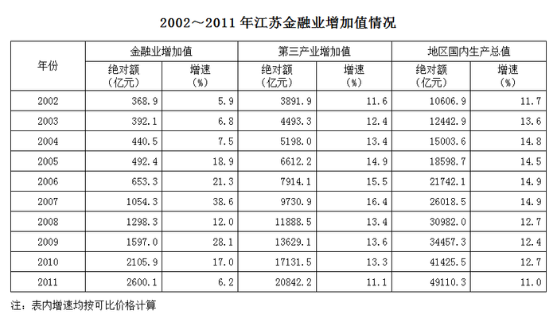

### 第 86 题

2003—2011年九年，江苏金融业增加值年增量最多的年份是：

A. 2011年

B. 2007年

C. 2009年

D. 2010年

第 86 题 · 答案与解析

**参考答案（粉笔题库参考内容）**

D

**解析**

简单计算：

2007年的增量是1054.3-653.3≈400；

2009年的增量1597.0-1298.3≈300；

2010年的增量2105.9-1597.0>500；

2011年的增量2600.1-2105.9&lt;500。

2010年增量最大。

故正确答案为D。

**来源**：2013年江苏省公务员录用考试《行测》题（A类）第86题

### 第 87 题

2002—2011年十年，江苏第三产业增加值占地区国内生产总值比重的最大值是：

A. 39.6%

B. 41.4%

C. 40.1%

D. 42.4%

第 87 题 · 答案与解析

**参考答案（粉笔题库参考内容）**

D

**解析**

观察可知，2011年江苏第三产业增加值占地区国内生产总值比重最大，为。

故正确答案为D。

**来源**：2013年江苏省公务员录用考试《行测》题（A类）第87题

### 第 88 题

若不考虑价格因素，与2003年相比，2011年江苏金融业增加值增长的倍数是：

A. 5.6倍

B. 3.6倍

C. 6.6倍

D. 4.6倍

第 88 题 · 答案与解析

**参考答案（粉笔题库参考内容）**

A

**解析**

从表格中得到数据，与2003年相比，2011年江苏金融业增加值增长的倍数是。A项最接近。

故正确答案为A。

**来源**：2013年江苏省公务员录用考试《行测》题（A类）第88题

### 第 89 题

2003年—2011年九年，江苏金融业增加值占第三产业增加值比重最小的年份是：

A. 2006年

B. 2005年

C. 2004年

D. 2003年

第 89 题 · 答案与解析

**参考答案（粉笔题库参考内容）**

B

**解析**

2006年的比值为；

2005年比值为；

2004年比值为；

2003年比值为。

直除首位依次为8、7、8、8，2005年最小。

故正确答案为B。

**来源**：2013年江苏省公务员录用考试《行测》题（A类）第89题

### 第 90 题

若不考虑价格因素，则2003年—2011年九年，江苏金融业增加值年均增速、第三产业增加值年均增速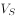，地区国内生产总值年均增速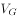的大小关系是：

A. \>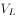\>

B. \>\>

C. \>\>

D. \>\>

第 90 题 · 答案与解析

**参考答案（粉笔题库参考内容）**

C

**解析**

比较三者大小，只需要比较三个参数2011年与2002年比值的大小，各自如下：

金融业：，第三产业：，国内生产总值：，直除首位依次为7、5、4，即。

故正确答案为C。

**来源**：2013年江苏省公务员录用考试《行测》题（A类）第90题

## 材料 4

三、根据以下资料，回答91-95题。

                                    2012年1-11月份我国汽油、煤油、柴油产量完成情况

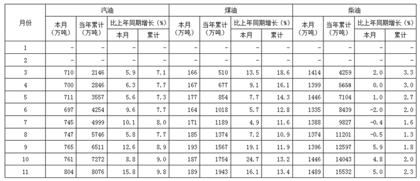

注：表中1月、2月相应数据略去。

### 第 91 题

2012年3-11月我国汽油、煤油、柴油月产量均最小的月份是：

A. 4月

B. 5月

C. 6月

D. 7月

第 91 题 · 答案与解析

**参考答案（粉笔题库参考内容）**

C

**解析**

定位表格材料可知我国汽油、煤油、柴油月产量均最小的月份是6月。

故正确答案为C。

**来源**：2013年江苏省公务员录用考试《行测》题（A类）第91题

### 第 92 题

2012年1-2月我国柴油产量累计是：

A. 2835万吨

B. 2845万吨

C. 2855万吨

D. 2865万吨

第 92 题 · 答案与解析

**参考答案（粉笔题库参考内容）**

B

**解析**

定位表格材料可得：2012年柴油产量1-3月共4259万吨，3月份产量为1414万吨，故1-2月我国柴油产量累计=4259-1414=2845万吨。

故正确答案为B。

**来源**：2013年江苏省公务员录用考试《行测》题（A类）第92题

### 第 93 题

2012年11月我国汽油、柴油产量之和同比增长了：

A. 6.5%

B. 8.6%

C. 10.4%

D. 11.9%

第 93 题 · 答案与解析

**参考答案（粉笔题库参考内容）**

B

**解析**

根据题干“同比增长”，结合选项都为百分数，且材料给出汽油和柴油的现期量以及增长率，可判定本题为混合增长率问题。定位表格材料可得：2012年11月我国汽油、柴油产量分别为804万吨、1489万吨，汽油、柴油增长率分别15.8%、5.0%。根据线段法，距离与量成反比，汽油：柴油，所以设汽油、柴油产量之和的增长率为r，则，解得r=8.6%。

故正确答案为B。

**来源**：2013年江苏省公务员录用考试《行测》题（A类）第93题

### 第 94 题

2012年1-10月我国汽油产量累计比上年同期多：

A. 600万吨

B. 624万吨

C. 661万吨

D. 683万吨

第 94 题 · 答案与解析

**参考答案（粉笔题库参考内容）**

A

**解析**

根据题干“······比上年同期多”，结合选项带单位，可判定本题为增长量计算问题。定位表格材料可得：2012年1-10月我国汽油产量累计为7272万吨，比上年同期增长9.0%，故2012年1-10月我国汽油产量累计同比增加万吨。

故正确答案为A。

**来源**：2013年江苏省公务员录用考试《行测》题（A类）第94题

### 第 95 题

下列判断正确的有：

（1）2012年6月我国柴油产量比上年同期减产27万吨

（2）2012年4-11月我国煤油产量月增产最多的是8月

（3）2012年3-11月我国汽油月产量均超过柴油月产量的一半

A. 0个

B. 1个

C. 2个

D. 3个

第 95 题 · 答案与解析

**参考答案（粉笔题库参考内容）**

C

**解析**

（1）定位表格材料可得：2012年我国6月柴油产量1335万吨，同比增长-2%，故2012年6月我国柴油产量同比减少量，正确；

（2）定位表格材料，2012年4-11月中我国煤油产量环比增长量中8月份增长量为14万吨，其余月份增长量均不超过10万吨，故8月份增长额最大，正确；

（3）定位表格材料可得，2012年3-11月中，5月份我国汽油月产量711万吨，没有超过当月柴油月产量1446万吨的一半，错误。

只有（1）和（2）正确。

故正确答案为C。

**来源**：2013年江苏省公务员录用考试《行测》题（A类）第95题

## 材料 5

四、根据以下资料，回答96-100题

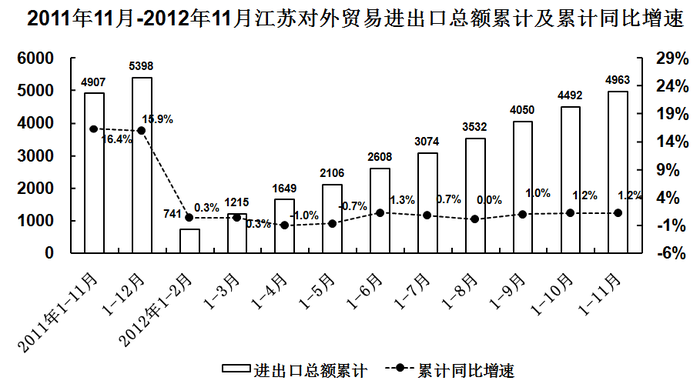

### 第 96 题

自2012年1月起，江苏对外贸易进出口总额累计大于去年同期的时段有：

A. 5个

B. 6个

C. 7个

D. 8个

第 96 题 · 答案与解析

**参考答案（粉笔题库参考内容）**

C

**解析**

定位统计图，对外贸易进出口总额累计大于去年同期，则累计同比增速为正。

观察可知：自2012年1月起，1-2月、1-3月、1-6月、1-7月、1-9月、1-10月、1-11月共计7个时段累计同比增速为正，故满足题干要求共计7个时段。

故正确答案为C。

**来源**：2013年江苏省公务员录用考试《行测》题（A类）第96题

### 第 97 题

2012年8月江苏对外贸易进出口总额与上年同期相比：

A. 少21亿美元

B. 少40亿美元

C. 多32亿美元

D. 多45亿美元

第 97 题 · 答案与解析

**参考答案（粉笔题库参考内容）**

A

**解析**

根据题干“······与上年同期相比”，结合选项带单位，可判定本题为增长量计算问题。定位统计图可得：2012年1-8月进出口总额为3532亿美元，增长率为0.0%；1-7月进出口总额为3074亿美元，增长率为0.7%。则2012年8月进出口总额=（3532-3074）亿元，2011年8月进出口总额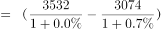亿元，故2012年8月进出口总额比上年增长量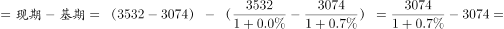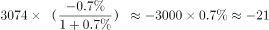亿美元，即减少21亿美元。

故正确答案为A。

**来源**：2013年江苏省公务员录用考试《行测》题（A类）第97题

### 第 98 题

2012年前9个月江苏对外贸易进出口总额累计与上年同期相比多：

A. 50亿美元

B. 40亿美元

C. 30亿美元

D. 20亿美元

第 98 题 · 答案与解析

**参考答案（粉笔题库参考内容）**

B

**解析**

根据题干“······与上年同期相比多”，结合选项带单位，可判定本题为增长量计算问题。定位统计图可得：2012年前9个月进出口总额累计为4050亿美元，增长率为1.0%，故2012年前9个月江苏对外贸易进出口总额累计比上年同期增长。

故正确答案为B。

**来源**：2013年江苏省公务员录用考试《行测》题（A类）第98题

### 第 99 题

2012年4-11月江苏对外贸易进出口总额月增加最多的月份是：

A. 5月

B. 6月

C. 9月

D. 10月

第 99 题 · 答案与解析

**参考答案（粉笔题库参考内容）**

C

**解析**

根据题干“月增加最多”，可判定本体为环比增长量比较问题。

直接查找图中的数据可知：

A项：5月的环比增量=(2106-1649)-(1649-1215)=457-434=23；

B项：6月的环比增量=(2608-2106)-(2106-1649)=502-457=45；

C项：9月的环比增量=(4050-3532)-(3532-3074)=518-458=60；

D项：10月的环比增量=(4492-4050)-(4050-3532)=442-518=-76；

则江苏对外贸易进出口总额月增加最多的是9月。

故正确答案为C。

**来源**：2013年江苏省公务员录用考试《行测》题（A类）第99题

### 第 100 题

下列判断正确的有：

（1）2011年12月江苏对外贸易进出口总额不足2011年的10%

（2）2011年1-8月江苏对外贸易进出口总额为3532亿美元

（3）2011年12月-2012年11月江苏最多有2个月的对外贸易进出口总额少于400亿美元

A. 0个

B. 1个

C. 2个

D. 3个

第 100 题 · 答案与解析

**参考答案（粉笔题库参考内容）**

D

**解析**

（1）定位统计图可得：2011年1-11月江苏对外贸易进出口总额为4907亿美元，2011年1-12月（即全年）进出口总额为5398亿美元，故2011年12月进出口总额=5398-4907=491＜5398×10%=539.8亿美元，正确；

（2）定位统计图可得：2012年1-8月进出口贸易总额为3532亿美元，增长率为0.0%，故2011年1-8月进出口贸易总额=亿美元，正确；

（3）定位统计图可得，2011年12月-2012年11月中，进出口额少于400亿美元的月份最多只能是2012年1月与2012年2月，正确。

（1）、（2）、（3）均正确。

故正确答案为D。

**来源**：2013年江苏省公务员录用考试《行测》题（A类）第100题

## 材料 6

五、根据以下资料，回答101-105题

        初步核算，2012年我国国内生产总值519322亿元，扣除价格因素，比上年增长7.8%，其中，第一产业增加值52377亿元，增长4.5%；第二产业增加值235319亿元，增长8.1%；第三产业增加值231626亿元，增长8.1%。2003-2011年我国国内生产总值、人均国内生产总值及其增长数据见图1和图2。

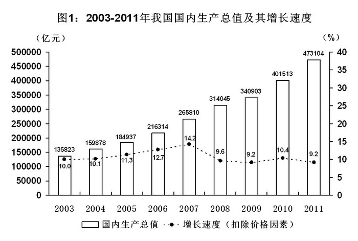

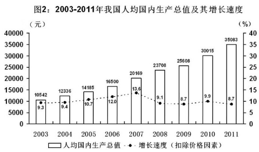

### 第 101 题

2004-2012年九年，我国国内生产总值年增加量最少的年份是：

A. 2004年

B. 2009年

C. 2011年

D. 2012年

第 101 题 · 答案与解析

**参考答案（粉笔题库参考内容）**

A

**解析**

根据题干“······增加量最少”，可判定本题为增长量比较问题。定位文字材料可得：2012年我国国内生产总值519322亿元，结合选项给定年份定位统计图一，则四个选项对应的年增加量分别为：

2004年：159878-135823≈24000；

2009年：340903-314045≈26000；

2011年：473104-401513≈70000；

2012年：519322-473104≈50000；

因此同比增加量最少的年份为2004年。

故正确答案为A。

**来源**：2013年江苏省公务员录用考试《行测》题（A类）第101题

### 第 102 题

2003-2011年九年，我国国内生产总值增速比人均国内生产总值增速至少高0.6个百分点的年数有：

A. 3年

B. 4年

C. 5年

D. 6年

第 102 题 · 答案与解析

**参考答案（粉笔题库参考内容）**

C

**解析**

定位统计图一和统计图二可知：2003-2011年九年中，我国国内生产总值同比增速比人均国内生产总值增速至少高0.6个百分点的有2003年（10.0%-9.3%=0.7%）、2004年（10.1%-9.4%=0.7%）、2005年（11.3%-10.7%=0.6%）、2006年（12.7%-12.0%=0.7%）、2007年（14.2%-13.6%=0.6%），共计5年。

故正确答案为C。

**来源**：2013年江苏省公务员录用考试《行测》题（A类）第102题

### 第 103 题

2011年我国人口比上年增长了：

A. 0.2个百分点

B. 0.8个百分点

C. 1.1个百分点

D. 1.3个百分点

第 103 题 · 答案与解析

**参考答案（粉笔题库参考内容）**

B

**解析**

根据题干“······比上年增长了”，结合选项并非具体单位，可判定本题为增长率问题。定位统计图一可得：2011年国内生产总值为473104亿元，2010年国内生产总值为401513亿元；定位统计图二可得：2011年人均国内生产总值为35083元，2010年人均国内生产总值为30015元。故2011年我国人口与上年相比，增长率,与B选项最接近。

故正确答案为B。

**来源**：2013年江苏省公务员录用考试《行测》题（A类）第103题

### 第 104 题

如果“十二五”时期我国国内生产总值与“十一五”（2006－2010年）时期保持相同的年平均增速（不扣除价格因素），则“十二五”末我国国内生产总值可望达到：

A. 867819亿元

B. 871717亿元

C. 891980亿元

D. 900230亿元

第 104 题 · 答案与解析

**参考答案（粉笔题库参考内容）**

B

**解析**

根据题干“······‘十二五’末我国国内生产总值”，结合材料给定假设“‘十二五’与‘十一五’保持相同的年平均增速”和“十一五”国内生产总值，可判断本题为现期计算问题。定位统计图一可得：2010年国内生产总值为401513亿元，2005年国内生产总值为184937亿元，故2010年相较于2005年的增长率，若保持此增速不变，则2015年末国内生产总值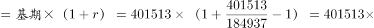亿元，与B选项最接近。

故正确答案为B。

**来源**：2013年江苏省公务员录用考试《行测》题（A类）第104题

### 第 105 题

下列判断正确的有：

（1）2004-2011年八年，我国国内生产总值与人均国内生产总值保持相同的变动态势

（2）2003-2011年九年，造成我国国内生产总值增速快于人均国内生产总值增速的主要原因是我国总人口在逐渐增长

（3）2012年我国第一产业增加值占国内生产总值的比重比2011年有所降低

A. 0个

B. 1个

C. 2个

D. 3个

第 105 题 · 答案与解析

**参考答案（粉笔题库参考内容）**

D

**解析**

（1）定位统计图一和统计图二，观察可知2004-2011年八年，我国国内生产总值与人均国内生产总值均为不断上升，正确；

（2）国内生产总值=人均国内生产总值×人口总数，因此国内生产总值增速快于人均国内生产总值增速必然是由于人口总数在增长，正确；

（3）定位文字材料可得，2012年我国国内生产总值519322亿元，比上年增长7.8%；第一产业增加值52377亿元，增长4.5%。即a=4.5%，b=7.8%，根据两期比重比较结论，当a&lt;b时，比重下降，即比重低于上年同期。所以2012年我国第一产业增加值占国内生产总值的比重比2011年有所降低，正确。

（1）、（2）和（3）均正确。

故正确答案为D。

**来源**：2013年江苏省公务员录用考试《行测》题（A类）第105题

