# 2013年江苏省公务员录用考试《行测》题（B类）

<!-- gwy:overview:start -->
> **江苏 · 2013 · 行测 · B类** ｜ 155 题 · 图片 76 处 · 答案随题折叠

| 题型模块 | 题量 | 题号 |
| --- | ---: | ---: |
| 知觉速度与准确性 | 60 | 1–60 |
| 言语理解与表达 | 15 | 61–75 |
| 数量关系 | 20 | 76–95 |
| 判断推理 | 40 | 96–135 |
| 资料分析 | 20 | 136–155 |
| **合计** | **155** | |

导航：[题型与作答说明](#题型与作答说明) · [题目](#题目) · [材料 1](#材料-1)
<!-- gwy:overview:end -->

> 候选采集稿。参考答案及解析来自粉笔页面，不代表官方答案或真实高分答卷；来源使用许可与原卷对应关系仍需人工核实。

## 题型与作答说明

知觉速度与准确性

（60题）

本部分包括三种类型的试题。1~35题为同符查找，36~50题为数字区间定位，51~60为字符替换。

言语理解与表达

（15题）

本部分包括片段阅读、文章阅读与逻辑填空三种类型的试题。

数量关系

（20题）

本部分包括数字推理与数学运算两种类型的试题。

判断推理

（40题）

本部分包括类比推理、图形推理、逻辑判断与定义判断四种类型的试题。

资料分析

（20题）

下列给出了文字、表格、图形资料均有五个问题要你回答，你应根据资料提供的信息进行分析、计算、处理，然后从备选答案中选择一个最恰当的答案。

## 题目

### 第 1 题

EDUCATIO STUDYWA

A. 1

B. 2

C. 3

D. 4

第 1 题 · 答案与解析

**参考答案（粉笔题库参考内容）**

D

**解析**

题干给出的两个字符组中重复的字符为D、U、A、T，共4个。

故正确答案为D。

**来源**：2013年江苏省公务员录用考试《行测》题（B类）第1题

### 第 2 题

ROAD619 MOBIL468

A. 1

B. 2

C. 3

D. 4

第 2 题 · 答案与解析

**参考答案（粉笔题库参考内容）**

B

**解析**

题干给出的两个字符组中重复的字符为O、6，共2个。

故正确答案为B。

**来源**：2013年江苏省公务员录用考试《行测》题（B类）第2题

### 第 3 题

A. 1

B. 2

C. 3

D. 4

第 3 题 · 答案与解析

**参考答案（粉笔题库参考内容）**

B

**解析**

题干给出的两个字符组中重复的字符为⊙、●，共2个。

故正确答案为B。

**来源**：2013年江苏省公务员录用考试《行测》题（B类）第3题

### 第 4 题

G10NAJI   X20SUZH

A. 1

B. 2

C. 3

D. 4

第 4 题 · 答案与解析

**参考答案（粉笔题库参考内容）**

A

**解析**

题干给出的两个字符组中重复的字符为“0”，共1个。

故正确答案为A。

**来源**：2013年江苏省公务员录用考试《行测》题（B类）第4题

### 第 5 题

A. 1

B. 2

C. 3

D. 4

第 5 题 · 答案与解析

**参考答案（粉笔题库参考内容）**

B

**解析**

题干给出的两个字符组中重复的字符为&, ※，共2个。

故正确答案为B。

**来源**：2013年江苏省公务员录用考试《行测》题（B类）第5题

### 第 6 题

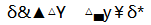

A. 1

B. 2

C. 3

D. 4

第 6 题 · 答案与解析

**参考答案（粉笔题库参考内容）**

B

**解析**

题干给出的两个字符组中重复的字符为δ、△，共2个。

故正确答案为B。

**来源**：2013年江苏省公务员录用考试《行测》题（B类）第6题

### 第 7 题

OK1W7QE   E13Q7FG

A. 2

B. 3

C. 4

D. 5

第 7 题 · 答案与解析

**参考答案（粉笔题库参考内容）**

C

**解析**

题干给出的两个字符组中重复的字符为1、7、Q、E，共4个。

故正确答案为C。

**来源**：2013年江苏省公务员录用考试《行测》题（B类）第7题

### 第 8 题

€Do¶§® M¶@ōǓ®

A. 1

B. 2

C. 3

D. 4

第 8 题 · 答案与解析

**参考答案（粉笔题库参考内容）**

B

**解析**

题干给出的两个字符组中重复的字符为¶ ®，共2个。

故正确答案为B。

**来源**：2013年江苏省公务员录用考试《行测》题（B类）第8题

### 第 9 题

d91356   1286f7

A. 1

B. 2

C. 3

D. 4

第 9 题 · 答案与解析

**参考答案（粉笔题库参考内容）**

B

**解析**

题干给出的两个字符组中重复的字符为6、1，共2个。

故正确答案为B。

**来源**：2013年江苏省公务员录用考试《行测》题（B类）第9题

### 第 10 题

二L一SAN八   八月ERSHI日L时

A. 2

B. 3

C. 4

D. 5

第 10 题 · 答案与解析

**参考答案（粉笔题库参考内容）**

B

**解析**

题干给出的两个字符组中重复的字符为L、S、八，共3个。

故正确答案为B。

**来源**：2013年江苏省公务员录用考试《行测》题（B类）第10题

### 第 11 题

arikfde   farvou

A. 0

B. 2

C. 3

D. 5

第 11 题 · 答案与解析

**参考答案（粉笔题库参考内容）**

C

**解析**

题干给出的两个字符组中重复的字符为a、r、f，共3个。

故正确答案为C。

**来源**：2013年江苏省公务员录用考试《行测》题（B类）第11题

### 第 12 题

9fg4w   4fg21w8

A. 0

B. 1

C. 3

D. 4

第 12 题 · 答案与解析

**参考答案（粉笔题库参考内容）**

D

**解析**

题干给出的两个字符组中重复的字符为f、g、4、w，共4个。

故正确答案为D。

**来源**：2013年江苏省公务员录用考试《行测》题（B类）第12题

### 第 13 题

指定此粟赶要   文要刊这定防

A. 1

B. 2

C. 3

D. 4

第 13 题 · 答案与解析

**参考答案（粉笔题库参考内容）**

B

**解析**

题干给出的两个字符组中重复的字符为定、要，共2个。

故正确答案为B。

**来源**：2013年江苏省公务员录用考试《行测》题（B类）第13题

### 第 14 题

xj1987   983x4q2

A. 1

B. 2

C. 3

D. 4

第 14 题 · 答案与解析

**参考答案（粉笔题库参考内容）**

C

**解析**

题干给出的两个字符组中重复的字符为x、9、8，共3个。

故正确答案为C。

**来源**：2013年江苏省公务员录用考试《行测》题（B类）第14题

### 第 15 题

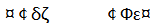

A. 0

B. 1

C. 2

D. 3

第 15 题 · 答案与解析

**参考答案（粉笔题库参考内容）**

C

**解析**

题干给出的两个字符组中重复的字符为¤、¢，共2个。

故正确答案为C。

**来源**：2013年江苏省公务员录用考试《行测》题（B类）第15题

### 第 16 题

cp20134    18ty723

A. 1

B. 2

C. 3

D. 4

第 16 题 · 答案与解析

**参考答案（粉笔题库参考内容）**

C

**解析**

题干给出的两个字符组中重复的字符为1、2、3，共3个。

故正确答案为C。

**来源**：2013年江苏省公务员录用考试《行测》题（B类）第16题

### 第 17 题

歌另士历水   瓦申夕阳卜土

A. 0

B. 1

C. 2

D. 3

第 17 题 · 答案与解析

**参考答案（粉笔题库参考内容）**

A

**解析**

题干给出的两个字符组中没有重复的字符。

故正确答案为A。

**来源**：2013年江苏省公务员录用考试《行测》题（B类）第17题

### 第 18 题

qe56913   67r12u8

A. 1

B. 2

C. 3

D. 4

第 18 题 · 答案与解析

**参考答案（粉笔题库参考内容）**

B

**解析**

题干给出的两个字符组中重复的字符为6、1，共2个。

故正确答案为B。

**来源**：2013年江苏省公务员录用考试《行测》题（B类）第18题

### 第 19 题

f－12＋465     56＋23－79

A. 2

B. 3

C. 4

D. 5

第 19 题 · 答案与解析

**参考答案（粉笔题库参考内容）**

D

**解析**

题干给出的两个字符组中重复的字符为＋、－、2、5、6，共5个。

故正确答案为D。

**来源**：2013年江苏省公务员录用考试《行测》题（B类）第19题

### 第 20 题

捡顺炎笔销  炎要化河查

A. 0

B. 1

C. 2

D. 3

第 20 题 · 答案与解析

**参考答案（粉笔题库参考内容）**

B

**解析**

题干给出的两个字符组中重复的字符为炎，共1个。

故正确答案为B。

**来源**：2013年江苏省公务员录用考试《行测》题（B类）第20题

### 第 21 题

A. 4

B. 3

C. 2

D. 1

第 21 题 · 答案与解析

**参考答案（粉笔题库参考内容）**

B

**解析**

题干给出的两个字符组中重复的字符为，共3个。

故正确答案为B。

**来源**：2013年江苏省公务员录用考试《行测》题（B类）第21题

### 第 22 题

years  earst

A. 0

B. 1

C. 2

D. 4

第 22 题 · 答案与解析

**参考答案（粉笔题库参考内容）**

D

**解析**

题干给出的两个字符组中重复的字符为e、a、r、s，共4个。

故正确答案为D。

**来源**：2013年江苏省公务员录用考试《行测》题（B类）第22题

### 第 23 题

biolgy  philosy

A. 1

B. 2

C. 3

D. 4

第 23 题 · 答案与解析

**参考答案（粉笔题库参考内容）**

D

**解析**

题干给出的两个字符组中重复的字符为i、o、l、y，共4个。

故正确答案为D。

**来源**：2013年江苏省公务员录用考试《行测》题（B类）第23题

### 第 24 题

Dauhtg     Laugh

A. 1

B. 2

C. 3

D. 4

第 24 题 · 答案与解析

**参考答案（粉笔题库参考内容）**

D

**解析**

题干给出的两个字符组中重复的字符为a、u、h、g，共4个。

故正确答案为D。

**来源**：2013年江苏省公务员录用考试《行测》题（B类）第24题

### 第 25 题

china     americ

A. 1

B. 2

C. 3

D. 4

第 25 题 · 答案与解析

**参考答案（粉笔题库参考内容）**

C

**解析**

题干给出的两个字符组中重复的字符为c、i、a，共3个。

故正确答案为C。

**来源**：2013年江苏省公务员录用考试《行测》题（B类）第25题

### 第 26 题

STUDEN  TEACGR

A. 0

B. 1

C. 2

D. 3

第 26 题 · 答案与解析

**参考答案（粉笔题库参考内容）**

C

**解析**

题干给出的两个字符组中重复的字符为T、E，共2个。

故正确答案为C。

**来源**：2013年江苏省公务员录用考试《行测》题（B类）第26题

### 第 27 题

和谐社会美丽中国   神州大地风和日丽

A. 1

B. 2

C. 3

D. 4

第 27 题 · 答案与解析

**参考答案（粉笔题库参考内容）**

B

**解析**

题干给出的两个字符组中重复的字符为和、丽，共2个。

故正确答案为B。

**来源**：2013年江苏省公务员录用考试《行测》题（B类）第27题

### 第 28 题

众高子之要比义较   保之存一比照鑫高

A. 0

B. 1

C. 2

D. 3

第 28 题 · 答案与解析

**参考答案（粉笔题库参考内容）**

D

**解析**

题干给出的两个字符组中重复的字符为高、之、比，共3个。

故正确答案为D。

**来源**：2013年江苏省公务员录用考试《行测》题（B类）第28题

### 第 29 题

24＋37＝68   40÷8＝5    3×6＝18

A. 1

B. 2

C. 3

D. 4

第 29 题 · 答案与解析

**参考答案（粉笔题库参考内容）**

B

**解析**

题干给出的三个字符组中重复的字符为＝、8，共2个。

故正确答案为B。

**来源**：2013年江苏省公务员录用考试《行测》题（B类）第29题

### 第 30 题

RDEWI   BLUEWA   WHEITA

A. 1

B. 2

C. 3

D. 4

第 30 题 · 答案与解析

**参考答案（粉笔题库参考内容）**

B

**解析**

题干给出的三个字符组中重复的字符为E、W，共2个。

故正确答案为B。

**来源**：2013年江苏省公务员录用考试《行测》题（B类）第30题

### 第 31 题

●◎△■⊙      ⊙㊣★■●    ●⊙■▼★

A. 1

B. 2

C. 3

D. 4

第 31 题 · 答案与解析

**参考答案（粉笔题库参考内容）**

C

**解析**

题干给出的三个字符组中重复的字符为●、■、⊙，共3个。

故正确答案为C。

**来源**：2013年江苏省公务员录用考试《行测》题（B类）第31题

### 第 32 题

Y405X＋3   ÷856X    6583Y×

A. 1

B. 2

C. 3

D. 4

第 32 题 · 答案与解析

**参考答案（粉笔题库参考内容）**

A

**解析**

题干给出的三个字符组中重复的字符为“5”，共1个。

故正确答案为A。

**来源**：2013年江苏省公务员录用考试《行测》题（B类）第32题

### 第 33 题

TUESDAY    MDONAY     FARIDY

A. 1

B. 2

C. 3

D. 4

第 33 题 · 答案与解析

**参考答案（粉笔题库参考内容）**

C

**解析**

题干给出的三个字符组中重复的字符为D、A、Y，共3个。

故正确答案为C。

**来源**：2013年江苏省公务员录用考试《行测》题（B类）第33题

### 第 34 题

HAITNO    AIBXNG    NGAIE

A. 0

B. 1

C. 2

D. 3

第 34 题 · 答案与解析

**参考答案（粉笔题库参考内容）**

D

**解析**

题干给出的三个字符组中重复的字符为A、I、N，共3个。

故正确答案为D。

**来源**：2013年江苏省公务员录用考试《行测》题（B类）第34题

### 第 35 题

NAJGI    IBEJNG    SHANGI

A. 0

B. 1

C. 2

D. 3

第 35 题 · 答案与解析

**参考答案（粉笔题库参考内容）**

D

**解析**

题干给出的三个字符组中重复的字符为N、G、I，共3个。

故正确答案为D。

**来源**：2013年江苏省公务员录用考试《行测》题（B类）第35题

## 材料 1

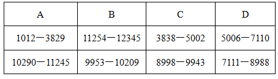

### 第 36 题

11202

A. A

B. B

C. C

D. D

第 36 题 · 答案与解析

**参考答案（粉笔题库参考内容）**

A

**解析**

11202在10290—11245区间。

故正确答案为A。

**来源**：2013年江苏省公务员录用考试《行测》题（B类）第36题

### 第 37 题

7310

A. A

B. B

C. C

D. D

第 37 题 · 答案与解析

**参考答案（粉笔题库参考内容）**

D

**解析**

7310在7111—8988区间。

故正确答案为D。

**来源**：2013年江苏省公务员录用考试《行测》题（B类）第37题

### 第 38 题

4209

A. A

B. B

C. C

D. D

第 38 题 · 答案与解析

**参考答案（粉笔题库参考内容）**

C

**解析**

4209在3838—5002区间。

故正确答案为C。

**来源**：2013年江苏省公务员录用考试《行测》题（B类）第38题

### 第 39 题

7899

A. A

B. B

C. C

D. D

第 39 题 · 答案与解析

**参考答案（粉笔题库参考内容）**

D

**解析**

7899在7111—8988区间。

故正确答案为D。

**来源**：2013年江苏省公务员录用考试《行测》题（B类）第39题

### 第 40 题

9988

A. A

B. B

C. C

D. D

第 40 题 · 答案与解析

**参考答案（粉笔题库参考内容）**

B

**解析**

9988在9953—10209区间。

故正确答案为B。

**来源**：2013年江苏省公务员录用考试《行测》题（B类）第40题

### 第 41 题

6789

A. A

B. B

C. C

D. D

第 41 题 · 答案与解析

**参考答案（粉笔题库参考内容）**

D

**解析**

6789在5006—7110区间。

故正确答案为D。

**来源**：2013年江苏省公务员录用考试《行测》题（B类）第41题

### 第 42 题

10001

A. A

B. B

C. C

D. D

第 42 题 · 答案与解析

**参考答案（粉笔题库参考内容）**

B

**解析**

10001在9953—10209区间。

故正确答案为B。

**来源**：2013年江苏省公务员录用考试《行测》题（B类）第42题

### 第 43 题

3992

A. A

B. B

C. C

D. D

第 43 题 · 答案与解析

**参考答案（粉笔题库参考内容）**

C

**解析**

3992在3838—5002区间。

故正确答案为C。

**来源**：2013年江苏省公务员录用考试《行测》题（B类）第43题

### 第 44 题

6011

A. A

B. B

C. C

D. D

第 44 题 · 答案与解析

**参考答案（粉笔题库参考内容）**

D

**解析**

6011在5006—7110区间。

故正确答案为D。

**来源**：2013年江苏省公务员录用考试《行测》题（B类）第44题

### 第 45 题

9494

A. A

B. B

C. C

D. D

第 45 题 · 答案与解析

**参考答案（粉笔题库参考内容）**

C

**解析**

9494在8998—9943区间。

故正确答案为C。

**来源**：2013年江苏省公务员录用考试《行测》题（B类）第45题

### 第 46 题

6110

A. A

B. B

C. C

D. D

第 46 题 · 答案与解析

**参考答案（粉笔题库参考内容）**

D

**解析**

6110在5006—7110区间。

故正确答案为D。

**来源**：2013年江苏省公务员录用考试《行测》题（B类）第46题

### 第 47 题

9954

A. A

B. B

C. C

D. D

第 47 题 · 答案与解析

**参考答案（粉笔题库参考内容）**

B

**解析**

9954在9953—10209区间。

故正确答案为B。

**来源**：2013年江苏省公务员录用考试《行测》题（B类）第47题

### 第 48 题

10292

A. A

B. B

C. C

D. D

第 48 题 · 答案与解析

**参考答案（粉笔题库参考内容）**

A

**解析**

10292在10290—11245区间。

故正确答案为A。

**来源**：2013年江苏省公务员录用考试《行测》题（B类）第48题

### 第 49 题

4526

A. A

B. B

C. C

D. D

第 49 题 · 答案与解析

**参考答案（粉笔题库参考内容）**

C

**解析**

4526在3838—5002区间。

故正确答案为C。

**来源**：2013年江苏省公务员录用考试《行测》题（B类）第49题

### 第 50 题

2987

A. A

B. B

C. C

D. D

第 50 题 · 答案与解析

**参考答案（粉笔题库参考内容）**

A

**解析**

2987在1012—3829区间。

故正确答案为A。

**来源**：2013年江苏省公务员录用考试《行测》题（B类）第50题

## 材料 2

**字符替换**

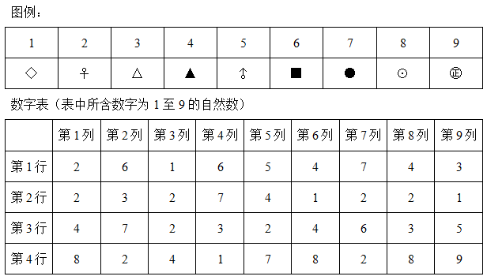

根据图例和数字表回答下列问题：

### 第 51 题

数字表中第2行第4列的数字对应符号是：

A. ♂

B. ♀

C. ▲

D. ●

第 51 题 · 答案与解析

**参考答案（粉笔题库参考内容）**

D

**解析**

数字表中第2行第4列的数字为7，对应符号●。

故正确答案为D。

**来源**：2013年江苏省公务员录用考试《行测》题（B类）第51题

### 第 52 题

数字表中第7列第4行的数字对应符号是：

A. ⊙

B. ♀

C. ▲

D. △

第 52 题 · 答案与解析

**参考答案（粉笔题库参考内容）**

B

**解析**

数字表中第7列第4行的数字为2，对应符号♀。

故正确答案为B。

**来源**：2013年江苏省公务员录用考试《行测》题（B类）第52题

### 第 53 题

数字表中出现次数最多的数字对应的符号是：

A. ●

B. ♀

C. ▲

D. △

第 53 题 · 答案与解析

**参考答案（粉笔题库参考内容）**

B

**解析**

数字表中出现次数最多的数字为2，对应符号♀。

故正确答案为B。

**来源**：2013年江苏省公务员录用考试《行测》题（B类）第53题

### 第 54 题

数字表中只出现1次的数字对应符号是：

A. ◇

B. △

C. ㊣

D. ▲

第 54 题 · 答案与解析

**参考答案（粉笔题库参考内容）**

C

**解析**

数字表中只出现1次的数字为9，对应符号㊣。

故正确答案为C。

**来源**：2013年江苏省公务员录用考试《行测》题（B类）第54题

### 第 55 题

数字表中第6列出现次数最多的数字对应符号是：

A. ◇

B. ●

C. ▲

D. ㊣

第 55 题 · 答案与解析

**参考答案（粉笔题库参考内容）**

C

**解析**

数字表中第6列出现次数最多的数字为4，对应符号▲。

故正确答案为C。

**来源**：2013年江苏省公务员录用考试《行测》题（B类）第55题

### 第 56 题

图例中△对应的数字在数字表中出现的次数是：

A. 1

B. 2

C. 3

D. 4

第 56 题 · 答案与解析

**参考答案（粉笔题库参考内容）**

D

**解析**

图例中△对应的数字为3，在数字表中出现的次数为4次。

故正确答案为D。

**来源**：2013年江苏省公务员录用考试《行测》题（B类）第56题

### 第 57 题

符号◇对应的数字没有出现在数字表的哪一行：

A. 第1行

B. 第2行

C. 第3行

D. 第4行

第 57 题 · 答案与解析

**参考答案（粉笔题库参考内容）**

C

**解析**

符号◇对应的数字为1，第3行没有出现过。

故正确答案为C。

**来源**：2013年江苏省公务员录用考试《行测》题（B类）第57题

### 第 58 题

数字表中第2行5、7、8列的数字对应的符号是：

A. ♀◇△

B. ◇△△

C. ●◇●

D. ▲♀♀

第 58 题 · 答案与解析

**参考答案（粉笔题库参考内容）**

D

**解析**

数字表中第2行5、7、8列的数字为4、2、2，对应的符号依次为▲、♀、♀。

故正确答案为D。

**来源**：2013年江苏省公务员录用考试《行测》题（B类）第58题

### 第 59 题

下列不属于数字表中第3列数字对应的符号是：

A. ◇

B. ♀

C. ⊙

D. ▲

第 59 题 · 答案与解析

**参考答案（粉笔题库参考内容）**

C

**解析**

数字表中第3列数字有1、2、4，对应符号为◇、♀、▲，不包括⊙。

故正确答案为C。

**来源**：2013年江苏省公务员录用考试《行测》题（B类）第59题

### 第 60 题

数字表中数字之和最小的一列第4行数字对应的符号是：

A. ◇

B. ▲

C. ♂

D. ♀

第 60 题 · 答案与解析

**参考答案（粉笔题库参考内容）**

B

**解析**

第3列数字之和最小，第4行数字为4，对应符号▲。

故正确答案为B。

**来源**：2013年江苏省公务员录用考试《行测》题（B类）第60题

### 第 61 题

里尔克说，灵魂没有宇宙，雨水就会落在心上。如果一个人的灵魂不够辽阔，就常常会觉得处处与奸邪之人狭路相逢。因为越是在狭窄的空间里，丑恶越容易被放大。而当你的心灵盛下世界，那么，即便偶见一隅的阴风浊浪，在阔大的视野里，也不过是沧海一粟。

以上文字试图说明：

A. 灵魂和宇宙的关系

B. 狭隘与丑恶的关系

C. 为人应该心胸宽广

D. 为人应该胸怀天下

第 61 题 · 答案与解析

**参考答案（粉笔题库参考内容）**

C

**解析**

本题为中心理解题。

文段前两句主要说明心胸狭隘的弊害，之后用转折词“而”转到材料重要部分，即心灵盛下世界时，阴风浊浪也会变得极为渺小，概括起来便是心胸要宽广。

因此，结合选项应该选择C。

A项宇宙和灵魂的关系只在文段第一句中提到，是作为引入语，非文段重心；

B项狭隘与丑恶的关系是转折之前文段所论述的内容，同样非文段重心；

D项“胸怀天下”指心胸宽广，有抱负，文段并没有涉及“有抱负”这层意思，D项过度引申。

故正确答案为C。

**考点**：关联词-转折

**来源**：2013年江苏省公务员录用考试《行测》题（B类）第61题

### 第 62 题

一是要逐步建设完整的居民收入和住房信息统计系统，为准入与退出机制的设计与运行提供基础数据支撑；二是要加强保障性住房申请、公示、分配等环节的透明度，并实行动态调整和持续跟踪；三是要逐步构建政府监督与社会监督、新闻媒体监督互补、互动的良好局面，确保分配公平。

上述三项措施主要针对的问题是：

A. 如何建设完整的住房信息系统

B. 如何加强保障性住房建设的透明度

C. 如何完善保障性住房建设的监督机制

D. 如何确保保障性住房的分配公平

第 62 题 · 答案与解析

**参考答案（粉笔题库参考内容）**

D

**解析**

本题为中心理解题。通览材料，可以发现整个文段用“一、二、三”及两个分号串联起来进行分点论述，构成分—分结构，故需要对三个分句进行总结概括。第一个分句强调建立完善的住房信息系统，第二个分句强调加强保障性住房建设的透明度，第三个分句强调构建保障性住房建设的监督机制，这三个分句都围绕同一话题，即如何确保保障性住房的分配公平，D项是文段的主旨所在。A、B、C三项都只能对应其中一个分句，不够全面。

故正确答案为D。

**考点**：关联词-并列

**来源**：2013年江苏省公务员录用考试《行测》题（A类）第2题

### 第 63 题

调查发现，中青年“孤岛指数”比老年人更大。虽然在“病痛孤岛”方面异常检出率随年龄的增长而显著增加，“经济孤岛”和“情感孤岛”检出率却是倒U型趋势，即中青年人的检出率高。有关解释称，这是因为中青年通常是家庭的经济支柱，心理负担更重。

下列说法不符合文意的一项是：

A. 老年人病痛孤岛指数比中青年大

B. 老年人经济孤岛指数比中青年小

C. 中青年情感孤岛指数大于其他人群

D. 中青年病痛孤岛指数大于其他人群

第 63 题 · 答案与解析

**参考答案（粉笔题库参考内容）**

D

**解析**

由“在‘病痛孤岛’方面异常检出率随年龄的增长而显著增加”可知，老年人病痛孤岛指数比中青年大，A项符合文意，D项表述错误；

由“‘经济孤岛’和‘情感孤岛’检出率却是倒U型趋势，即中青年人的检出率高”可知，老年人经济孤岛指数比中青年小，中青年情感孤岛指数大于其他人群，B、C均正确。

本题为选非题，故正确答案为D。

**考点**：细节判断题

**来源**：2013年江苏省公务员录用考试《行测》题（B类）第63题

### 第 64 题

历史学家有责任把人物的原貌和事件的真相尽可能准确、完整地向读者讲清楚。说“尽可能”，是因为受史料的局限，有些人物和事件无法核实，难以还原事实真相，只能根据掌握的史料做出推断。历史不是自然科学，不能通过公式计算获得精确的数据和结论，对人物和事件的叙述，对动机和起因的推论，对结果和影响的分析，都需要历史学家作出主观的评判。

以上文字重点阐述的是：

A. 自然科学和历史学的研究方法大不相同

B. 历史研究常常因史料限制而无法还原史实

C. 历史学家进行推理判断必须依据史料

D. 历史学家需要以史料为基础进行主观评判

第 64 题 · 答案与解析

**参考答案（粉笔题库参考内容）**

D

**解析**

文段开篇指出，历史学家还原历史真相只能做到“尽可能准确”，接着进行了解释说明，通过与自然科学的对比，最终得出结论，即需要历史学家依据史料做出主观评判。因此，结合选项应该选择D项。A项没有体现历史学家这一主体；B项不是文段重点内容；C项文段重点是在强调需要历史学家的主观判断，而非依据史料。

故正确答案为D。

**考点**：主题词、关联词-对策

**来源**：2013年江苏省公务员录用考试《行测》题（B类）第64题

### 第 65 题

“法之必行”的真正动力来自哪里？有人说靠监督，有人说靠激励，也有人寄希望于惩戒。这些都不无道理，但还有一点往往被人忽视，那就是法治精神的作用。常见媒体有这样的报道，一些考试尽管监考人员众多，监考规则严格，技术手段先进，却依然难以杜绝各种作弊行为。所谓“破山中贼易，破心中贼难”，如果规则活在心中，自然会有“不逾矩”的行动约束。

以上文字意在强调：

A. “法之必行”可有多种动力来源

B. 法治精神是民众守法的内在动力

C. 规则本身并不能杜绝违规行为

D. 法治精神是活在人们心中的规则

第 65 题 · 答案与解析

**参考答案（粉笔题库参考内容）**

B

**解析**

文段一、二两句引出论题，根据第二句中的转折词“但”可知文段的核心内容是“法治精神的作用”，后面媒体的报道和“如果……”一句则是进一步反证了“法治精神的作用”。本题考查的是隐含主旨题，因此需要进一步引申，即法治精神的具体作用，让规则活在民众的心中，使民众自觉守法，“法之必行”“动力”“活在心中”等措辞呼应“民众守法的内在动力”。因此，结合选项应该选择B。

A项是对文段第二句的总结概括，并非文段的主旨，排除；

C项谈的是“规则”，只涵盖了文段第四句的内容，没抓住文段的关键词“法治精神”，排除；

D项谈的是法治精神的内涵，没有引申到文段的中心内容“法治精神的作用”，排除。

故正确答案为B。

**考点**：主题词

**来源**：2013年江苏省公务员录用考试《行测》题（B类）第65题

## 材料 3

阅读文章并回答第66~70题。

        在中国古代传统科学技术中，最能充分体现传统系统思维特色的就是中医学。中医学一开始就将人视为天地人大环境中的一个子系统，将人体自身视为一个有机的整体，看成是与天地自然相感应的小环境、小宇宙，这是符合人体生命实质的。西方将人看成是机器，18世纪法国唯物主义的开创者拉美特里即明确提出“人是机器”。西医学以原子论、还原论为思维方法，中医学以元气论、整体论为思维方法。在谈到中医的思维方式时，美国当代著名的物理学家卡普也认为：“中医把身体作为一个不可分割、各个部分相互联系的系统的概念，显然比古典的笛卡尔模式更加接近现代系统方法。”

        从科学角度看，中医学虽然不是现代科学，但却是一种传统科学。科学的形态应该是多样的，既有传统科学形态，也有现代科学形态。中医学不是那种建立在结构论、形态论学基础之上的科学，却是一种建立在生成论、功能学基础之上的科学；中医学不是公理论、原型论科学，而是模型论科学。应该注意的是，科学的形态不等于科学性，中医学不是现代科学，但不等于中医学不科学。

        中医学能够发展延续至今，正是把握住了人与外在环境密切相联系的规律，从生理、心理、社会、环境等多因素出发，整体、全面地把握人与自然的联系，揭示人的生命价值和意义，保护生命，维护健康，防治疾病，提高生存质量。中医以人为本，尊重生命、尊重人、保护人，以德为先，治病的同时将人作为活生生的个体来看待，注重人文因素在发病过程中的影响，将治病与医人融洽地结合起来，德术并重，体现了工具理性与价值理性的巧妙结合。在西方工具理性的科学之外，为人类提供了一个具有东方特色的科学范式的典型：“气—阴阳—五行”思维及理论工具，迥异于西方科学，为科学的多样性提供了一个鲜明的注脚。可以说，中医学为人类的思维方式提供了另一个不竭的源泉，丰富了人类思维的宝库，将为未来世界科学发展提供源源不断的动力。

        当西方科学家积极地从中国传统思维中寻找创造灵感的时候，当中医在国外日益受到重视的时候，当中华民族的复兴需要强大精神动力和支柱的时候，我们对自己的中医科学不仅不应＿＿＿＿＿、全盘否定，相反，应当积极地发掘其中的优秀成分。

### 第 66 题

以下概念能用以描述中医学理论的一项是：

A. 模型论

B. 结构论

C. 原型论

D. 公理论

第 66 题 · 答案与解析

**参考答案（粉笔题库参考内容）**

A

**解析**

本题为细节判断题。

根据第二段第三句“中医学不是公理论、原型论科学，而是模型论科学”，可直接得出答案。

故正确答案为A。

**来源**：2013年江苏省公务员录用考试《行测》题（B类）第66题

### 第 67 题

填入文末划横线处最恰当的词语是：

A. 顾影自怜

B. 妄自菲薄

C. 自怨自艾

D. 自惭形秽

第 67 题 · 答案与解析

**参考答案（粉笔题库参考内容）**

B

**解析**

本题为成语填空题。

结合语境，该空与下文的“全盘否定”形成并列关系，语义相近。B项“妄自菲薄”指毫无根据地小看自己，强调不自信，符合语境，当选。A项“顾影自怜”形容孤独失意的样子，也指自我欣赏，C项“自怨自艾”原指悔恨并且改正自己的错误，后多指悔恨，均不符合语境，排除；D项“自惭形秽”指觉得自己不如别人而感到惭愧，侧重于“感到惭愧”，文段并没有体现这层意思，排除。

故正确答案为B。

**来源**：2013年江苏省公务员录用考试《行测》题（B类）第67题

### 第 68 题

根据文章内容，以下关于中医学的说法不正确的是：

A. 中医学比较符合西方现代系统方法

B. 中医为当代科学的发展提供了动力

C. 就科学形态看中医学不是现代科学

D. 中医学能融合工具理性和价值理性

第 68 题 · 答案与解析

**参考答案（粉笔题库参考内容）**

B

**解析**

本题为细节判断题。

从第一段最后一句所引述的美国物理学家卡普的观点可知，中医比古典的笛卡尔模式更加接近现代系统方法，A项的说法正确；

从第二段第一句“从科学角度看，中医学虽然不是现代科学，但却是一种传统科学”可以推出，C项的说法正确；

从第三段倒数第三句“中医……体现了工具理性与价值理性的巧妙结合”可知，D项的说法正确；

B项时态出错，材料第三段最后一句指出“中医……将为未来世界科学发展提供源源不断的动力”，B项的说法是“为当代科学的发展”，与材料不吻合。

本题为选非题，故正确答案为B。

**来源**：2013年江苏省公务员录用考试《行测》题（B类）第68题

### 第 69 题

从文章内容看，中医学能够发展延续至今的主要原因不包括：

A. 中医学为人类提供了具有东方特色的科学范式的典型

B. 中医注重整体把握人与自然的联系以治病救人

C. 中医重视人文因素对发病的影响，将治病与医人融合起来

D. 中医学突破了古代西方学者把人看做机器的观念

第 69 题 · 答案与解析

**参考答案（粉笔题库参考内容）**

D

**解析**

本题为细节判断题。

文章中分析中医药能够发展延续至今的主要原因集中在第三段，锁定该段材料。

A项“中医学为人类提供了具有东方特色的科学范式的典型”可从倒数第二句得出；

B项“中医注重整体把握人与自然的联系以治病救人”可从第一句推出；

C项“中医重视人文因素对发病的影响，将治病与医人融合起来”可从第二句得出；

D项强拉关系，“中医学突破了古代西方学者把人看做机器的观念”无依据，材料第一段提到“西方将人看成是机器”，但并没有说明中医学是否突破了该观念。

本题为选非题，故正确答案为D。

**来源**：2013年江苏省公务员录用考试《行测》题（B类）第69题

### 第 70 题

作者撰写此文，其目的在于：

A. 介绍中医学不同于西医学的科学范式

B. 阐释中医与西医在科学形态上的差别

C. 说明中医比西医更有科学性和合理性

D. 提醒人们正确认识中医学的科学价值

第 70 题 · 答案与解析

**参考答案（粉笔题库参考内容）**

D

**解析**

本题为中心理解题。

材料为分总结构，前三段材料分别介绍了中西医学在科学范式和科学形态上的差别，并分析中医学发展延续至今的主要原因，最后一段材料点明主旨，呼吁人们不要对中医学全盘否定，应该积极发掘其优秀成分。

因此，结合选项应该选择D，D项是对全文主旨的总结。

A、B、C三项都只对材料某一部分进行总结，过于片面。

故正确答案为D。

**来源**：2013年江苏省公务员录用考试《行测》题（B类）第70题

### 第 71 题

项羽，中国军事史上“实力派”和“勇战派”的代表人物，有着\_\_\_\_\_\_之勇。和汉高祖刘邦相比，更多人认为项羽是\_\_\_\_\_\_的英雄。

依次填入划横线处最恰当的一项是：

A. 锐不可当 举世无双

B. 万夫不当 当之无愧

C. 无所畏惧 虚有其表

D. 威武不屈 独一无二

第 71 题 · 答案与解析

**参考答案（粉笔题库参考内容）**

B

**解析**

本题为成语填空题。

先看第一空。锐不可当：形容勇往直前的气势，不可抵挡；万夫不当：一万个人也抵挡不住，形容极为勇猛，无人匹敌；无所畏惧：没有什么可害怕的，形容非常勇敢；威武不屈：权势武力不能使之屈服，形容有骨气，坚贞顽强。根据前文的“中国军事史上‘实力派’和‘勇战派’的代表人物”可知，此处强调项羽的勇猛，排除A项和D项。

再看第二空。由前文的表述和后文的“英雄”可知，此处是对项羽能力的肯定，不可能“虚有其表”，排除C项。

故正确答案为B。

**考点**：对应关系-前后呼应、成语填空

**来源**：2013年江苏省公务员录用考试《行测》题（B类）第71题

### 第 72 题

网络举报是一把双刃剑，监督和隐私各有边界，如脱缰之马的“网络监督”，很多时候＿＿＿＿＿，一旦＿＿＿＿＿到普通公民的“隐私领地”或者＿＿＿＿＿集体权益，必将会使整个社会陷入不安。

依次填入划横线处最恰当的一项是：

A. 扑朔迷离 触及 影响

B. 真假难辨 践踏 危及

C. 良莠不齐 侵犯 损伤

D. 鱼龙混杂 闯入 伤害

第 72 题 · 答案与解析

**参考答案（粉笔题库参考内容）**

B

**解析**

第一空，“良莠不齐”和“鱼龙混杂”都是指好的、坏的混在一起，而文段中的“网络监督”并无好与坏之分，故排除C、D两项。

后两空，根据后文“必将会使整个社会陷入不安”可知，“网络监督”必定是对普通公民的“隐私领域”或者集体权益造成了重大的影响或危害，“触及”和“影响”语义太轻，排除A项。验证B项，“真假难辨”指分不清真假，“践踏”和“危及”的词义与后文相呼应。

故正确答案为B。

**考点**：对应关系-前后呼应、混搭填空、词的辨析-词义侧重

**来源**：2013年江苏省公务员录用考试《行测》题（A类）第13题

### 第 73 题

新一轮的城镇化，势必更加＿＿＿＿质量，＿＿＿＿要让农民进城，＿＿＿＿要以产业转移为依托，确保农民进城后能找到稳定的工作并享有市民待遇，真正做到安居乐业。

依次填入划横线处最恰当的一项是：

A. 注重 不仅 还

B. 关注 可是 就

C. 侧重 既然 也

D. 顾及 如果 就

第 73 题 · 答案与解析

**参考答案（粉笔题库参考内容）**

A

**解析**

本题为考查实词和虚词的填空题。

先看第三空，“确保农民进城后能找到稳定的工作并享有市民待遇”是对前一空格语句“要让农民进城”的递进，应当填入递进关联词“不仅……还……”，故选A。

验证第一空，“注重”有“重视”之意，后两空语句是对第一空语句的分说，选择“注重”与下文相呼应。

故正确答案为A。

**考点**：对应关系-前后呼应、混搭填空

**来源**：2013年江苏省公务员录用考试《行测》题（A类）第11题

### 第 74 题

市场经济最神奇也最让人\_\_\_\_\_\_之处，就是市场中不同的主体通过自发的博弈与\_\_\_\_\_\_而各得其所。对所谓完美、超然、成熟改革方案的渴望与膜拜，其实仍然是典型的计划思维，指望用一套方案打遍天下更是南辕北辙、\_\_\_\_\_\_。

依次填入划横线处最恰当的一项是：

A. 奇特 取舍 刻舟求剑

B. 惊喜 碰撞 离题万里

C. 赞叹 磨合 缘木求鱼

D. 佩服 交汇 天壤之别

第 74 题 · 答案与解析

**参考答案（粉笔题库参考内容）**

C

**解析**

先看第三空，该空与前面的“南辕北辙”用顿号隔开，表明两者为并列关系，因此应该选择语义与之相近的词语。“南辕北辙”比喻行动和目的截然相反，不可能达到目的；“刻舟求剑”比喻拘泥、不变通，不懂得根据实际情况处理问题，侧重于不懂得变通方法；“离题万里”指说话或写文章离开主题很远；“缘木求鱼”比喻方向、方法不对，不可能达到目的；“天壤之别”形容差别巨大。由此，可排除A、B、D三项。

验证前两空，第一空填入“赞叹”与“最神奇”相呼应，第二空填入“磨合”与“博弈”相呼应。

故正确答案为C。

**考点**：关联关系-并列关系、混搭填空、词的辨析-词义侧重

**来源**：2013年江苏省公务员录用考试《行测》题（B类）第74题

### 第 75 题

在生命中，刁难最初似乎是\_\_\_\_\_\_，但后来却是\_\_\_\_\_\_。因为一个被生活刁难过的人，都知道该怎样与世界\_\_\_\_\_\_，也明白生活有时是一门\_\_\_\_\_\_的艺术。

依次填入划横线处最恰当的一项是：

A. 伤害 成全 周旋 妥协

B. 危险 机遇 战斗 坚守

C. 障碍 机会 斡旋 放弃

D. 挑战 成功 妥协 坚持

第 75 题 · 答案与解析

**参考答案（粉笔题库参考内容）**

A

**解析**

本题考查词语填空。

前两空通过转折构成词语的对应关系，因此应填入词义相反的词语，“挑战”与“成功”都有积极意义，排除D；

第三空，分析词义，周旋——和对方相持下去以等待有利时机；战斗——斗争，比喻艰苦的工作；斡旋——扭转，引申为调解争端。被生活刁难的“人”不能“扭转”与世界的关系，也不是“调解争端”，由此排除C；

分析文段，后一句是对第一句的解释和扩展，因此前两空和后两空是对应关系。B选项中的“机遇”与“坚守”不对应，排除B；

“刁难”若是“伤害”，受到“伤害”的人就懂得怎样和世界“周旋”，以待有利时机，当“刁难”变成“成全”，生活就是一种“妥协”（相互的）。

故正确答案为A。

**考点**：关联关系-转折关系、实词填空、词的辨析-词义侧重

**来源**：2013年江苏省公务员录用考试《行测》题（B类）第75题

### 第 76 题

2，3，5，9，（  ）， 33

A. 15

B. 17

C. 18

D. 19

第 76 题 · 答案与解析

**参考答案（粉笔题库参考内容）**

B

**解析**

后项减去前项得到新数列：1、2、4、(8)、(16)，为等比数列，所以未知项为9+8=17，验证后项，33-16=17，符合。

故正确答案为B。

**来源**：2013年江苏省公务员录用考试《行测》题（B类）第76题

### 第 77 题

1/3，1，9，243，（  ）

A. 19683

B. 19785

C. 19827

D. 19869

第 77 题 · 答案与解析

**参考答案（粉笔题库参考内容）**

A

**解析**

后项除以前项得到新数列：3、9、27、81，为等比数列，所以未知项为243×81，计算尾数为3，只有A符合。

故正确答案为A。

**来源**：2013年江苏省公务员录用考试《行测》题（B类）第77题

### 第 78 题

2，1 ，6 ，14，40，108 ，（  ）

A. 288

B. 296

C. 304

D. 312

第 78 题 · 答案与解析

**参考答案（粉笔题库参考内容）**

B

**解析**

相邻两项之和的2倍等于下一项，所以未知项为(40+108)×2=296。

故正确答案为B。

**来源**：2013年江苏省公务员录用考试《行测》题（B类）第78题

### 第 79 题

1/2，1，9/7，16/11，25/16，（  ）

A. 18/11

B. 21/11

C. 23/11

D. 36/23

第 79 题 · 答案与解析

**参考答案（粉笔题库参考内容）**

A

**解析**

1变形为4/4，分子项构成新数列：1、4、9、16、25、(36)，为平方数列；分母项构成新数列：2、4、7、11、16、(22)，为二级等差数列，后项减去前项得到一个等差数列：2、3、4、5、6。所以未知项为36/22=18/11。

故正确答案为A。

**来源**：2013年江苏省公务员录用考试《行测》题（B类）第79题

### 第 80 题

1，2，5，26，677，（  ）

A. 458329

B. 458330

C. 458331

D. 458332

第 80 题 · 答案与解析

**参考答案（粉笔题库参考内容）**

B

**解析**

数列中相邻两项，前项的平方加上1等于后项，所以未知项为677×677+1，计算尾数，7×7+1=50，尾数为0。

故正确答案为B。

**来源**：2013年江苏省公务员录用考试《行测》题（B类）第80题

### 第 81 题

1， 3， 12， 60， 360，（  ）

A. 1080

B. 2160

C. 2165

D. 2520

第 81 题 · 答案与解析

**参考答案（粉笔题库参考内容）**

D

**解析**

后项除以前项得到新数列：3、4、5、6、(7)，为等差数列，所以未知项为360×7＝2520。

故正确答案为D。

**来源**：2013年江苏省公务员录用考试《行测》题（B类）第81题

### 第 82 题

2，4，0，－16，－50，（  ）

A. －104

B. －108

C. －125

D. －128

第 82 题 · 答案与解析

**参考答案（粉笔题库参考内容）**

B

**解析**

后项减去前项得到2、-4、-16、-34、（x）；再次后项减去前项得到-6、-12、-18、(-24)，构成等差数列，故x的数值为x-（-34）=-24，得x=-58；所以未知项为-50-58=-108。

故正确答案为B。

**来源**：2013年江苏省公务员录用考试《行测》题（B类）第82题

### 第 83 题

－2，－2，0，4，10，（  ）

A. 18

B. 16

C. 15

D. 12

第 83 题 · 答案与解析

**参考答案（粉笔题库参考内容）**

A

**解析**

后项减去前项得到0、2、4、6、(8)，为等差数列，所以未知项为10+8=18。

故正确答案为A。

**来源**：2013年江苏省公务员录用考试《行测》题（A类）第22题

### 第 84 题

3，8，15，24，35，（  ）

A. 39

B. 43

C. 48

D. 63

第 84 题 · 答案与解析

**参考答案（粉笔题库参考内容）**

C

**解析**

数列变化趋势平缓，优先考虑作差。后项减前项得到新数列：5，7，9，11，构成公差为2的等差数列，下一项为13。则（    ）=35+13=48，对应C项。

故正确答案为C。

**来源**：2013年江苏省公务员录用考试《行测》题（B类）第84题

### 第 85 题

7.1，8.6，14.2，16.12，28.4，（  ）

A. 32.24

B. 30.4

C. 32.4

D. 40.24

第 85 题 · 答案与解析

**参考答案（粉笔题库参考内容）**

A

**解析**

方法一：数字较多，拆分开。奇数项：7.1，14.2，28.4，是一个公比为 2 的等比数列；偶数项：8.6，16.12，（32.24），小数点前后均是公比为 2 的等比数列。

方法二：前一项小数点前后两数之和等于后一项整数部分，前一项小数点前后两数之差等于后一项小数部分。

故正确答案为A。

**来源**：2013年江苏省公务员录用考试《行测》题（A类）第19题

### 第 86 题

用一根绳子测量一口枯井的深度，如果绳子对折去量就多出4米，三折去量就多出1米，则该井的深度是：

A. 6米

B. 5米

C. 4米

D. 3米

第 86 题 · 答案与解析

**参考答案（粉笔题库参考内容）**

B

**解析**

设井深为n，则有(n+4)×2=(n+1)×3，解得n=5米。

故正确答案为B。

**考点**：和差倍比问题

**来源**：2013年江苏省公务员录用考试《行测》题（B类）第86题

### 第 87 题

甲乙丙三人同去商城购物，甲花的钱的1/2等于乙花的钱的1/3，乙花的钱的3/4等于丙花的钱的4/7，结果丙比甲多花93元，则三人一共花的钱是：

A. 432元

B. 422元

C. 429元

D. 430元

第 87 题 · 答案与解析

**参考答案（粉笔题库参考内容）**

C

**解析**

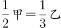，甲:乙=2:3=32:48，，乙:丙=16:21=48:63，可得甲:乙:丙=32:48:63，丙比甲多花93元，则每份对应，所以三人共花了。

故正确答案为C。

**考点**：和差倍比问题

**来源**：2013年江苏省公务员录用考试《行测》题（B类）第87题

### 第 88 题

某人购买A、B两种调料的单价分别为20元/千克、30元/千克。假设购买这两种调料所花费的钱数额一样，则由A、B两种调料混合后的新调料每千克的成本是：

A. 23元

B. 24元

C. 25元

D. 26元

第 88 题 · 答案与解析

**参考答案（粉笔题库参考内容）**

B

**解析**

本题实际考查调和平均数问题。设A买了30克，B买了20克，可得混合后成本为元。

故正确答案为B。

**考点**：经济利润问题

**来源**：2013年江苏省公务员录用考试《行测》题（B类）第88题

### 第 89 题

一个公比为2的等比数列，第n项与前n－1项的和的差等于3，则此数列的前4项之和是：

A. 54

B. 45

C. 42

D. 36

第 89 题 · 答案与解析

**参考答案（粉笔题库参考内容）**

B

**解析**

由等比数列公式可知，公比为2的等比数列，其第n项与前n-1项的和的差即为该数列的首项，所以前4项依次为3、6、12、24，前4项和为3+6+12+24=45。

故正确答案为B。

**考点**：数列问题

**来源**：2013年江苏省公务员录用考试《行测》题（B类）第89题

### 第 90 题

有100克溶液，第一次加入20克水，溶液的浓度变成50%；第二次再加入80克浓度为40%的同种溶液，则溶液的浓度变为：

A. 45%

B. 47%

C. 48%

D. 46%

第 90 题 · 答案与解析

**参考答案（粉笔题库参考内容）**

D

**解析**

解析1：

由题意可得，混合后溶液中盐质量为，溶液为100+20+80=200克，所以混合后浓度为92÷200×100%=46%。

解析2：

设混合后的溶液浓度为n，根据线段法，混合的溶液量与浓度差成反比例关系，有120:80=(n-40%):(50%-n)，解得n=46%。

故正确答案为D。

**来源**：2013年江苏省公务员录用考试《行测》题（B类）第90题

### 第 91 题

三位数A除以51，商是a（a是正整数），余数是商的一半，则A的最大值是：

A. 927

B. 928

C. 929

D. 990

第 91 题 · 答案与解析

**参考答案（粉笔题库参考内容）**

A

**解析**

最大三位数为999，999÷51=19余30，即商最大为19，所以取商为18，余数应为9，此时A=51×18+9=927，为最大。

故正确答案为A。

**来源**：2013年江苏省公务员录用考试《行测》题（B类）第91题

### 第 92 题

长江上游A港与下游S港相距270千米，一轮船以恒定速度从A港到S港需要6.75小时，而返回需要9小时，则长江的水流速度是：

A. 7千米/小时

B. 6千米/小时

C. 5千米/小时

D. 4.5千米/小时

第 92 题 · 答案与解析

**参考答案（粉笔题库参考内容）**

C

**解析**

顺水速度=270÷6.75=40千米/小时，逆水速度=270÷9=30千米/小时，。

故正确答案为C。

**考点**：流水行船

**来源**：2013年江苏省公务员录用考试《行测》题（B类）第92题

### 第 93 题

有一个分数，分子与分母的和是100，如果分子加23，分母加32，新的分数约分后是2/3，则原来的分数是(  )

A. 37/63

B. 35/65

C. 33/67

D. 39/61

第 93 题 · 答案与解析

**参考答案（粉笔题库参考内容）**

D

**解析**

数字问题直接代入排除，依次代入发现只有D项满足，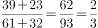。

故正确答案为D。

**来源**：2013年江苏省公务员录用考试《行测》题（B类）第93题

### 第 94 题

若T=1/(1/2002+1/2003+···+1/2012)，则T的整数部分是：

A. 180

B. 181

C. 182

D. 183

第 94 题 · 答案与解析

**参考答案（粉笔题库参考内容）**

C

**解析**

由题意可得，，，所以T整数部分为182。

故正确答案为C。

**来源**：2013年江苏省公务员录用考试《行测》题（B类）第94题

### 第 95 题

小张和小李二人在400米标准环形跑道起点处，同向分别以120米/分钟，40米/分钟的速度同时出发。小张每追上小李一次，小张的速度减少10米/分钟，小李的速度增加10米/分钟，当二人速度相等时，则他们需要的时间是：

A. 40 1/3分钟

B. 40 2/3分钟

C. 41 1/3分钟

D. 41 2/3分钟

第 95 题 · 答案与解析

**参考答案（粉笔题库参考内容）**

D

**解析**

根据追及运动的规律。

第一次追上需要的时间为400÷(120-40)=5分钟；

第二次追上需要的时间为；

第三次追上需要的时间为400÷(100-60)=10分钟；

第四次小张追上小李时速度相等，追上需要的时间为400÷(90-70)=20分钟，此时速度相当。

总共需要。

故正确答案为D。

**考点**：相遇追及

**来源**：2013年江苏省公务员录用考试《行测》题（B类）第95题

### 第 96 题

嫦娥奔月

A. 后羿射日

B. 鸡鸣起舞

C. 欢呼雀跃

D. 海纳百川

第 96 题 · 答案与解析

**参考答案（粉笔题库参考内容）**

A

**解析**

第一步：判断题干词语的逻辑关系。

题干成语来源于神话传说，且成语的语法结构为主谓宾结构，“嫦娥”是主语，“奔”是谓语，“月”是宾语。

与之逻辑关系相同的是A项，“后羿射日”来源于神话传说，“后羿”是主语，“射”是谓语，“日”是宾语。

第二步：逐一判断其他选项。

B中“鸡鸣起舞”来源于历史故事，是紧缩式结构；

C中“欢呼雀跃”源自文学作品，是联合式结构；

D中“海纳百川”是主谓宾结构，但源自文学作品，与题干逻辑不符。

故正确答案为A。

**考点**：拆分思维、语法关系

**来源**：2013年江苏省公务员录用考试《行测》题（B类）第96题

### 第 97 题

空气：人类

A. 雾霾：风暴

B. 自由：思想

C. 明月：人脑

D. 真空：灵活

第 97 题 · 答案与解析

**参考答案（粉笔题库参考内容）**

B

**解析**

第一步：判断题干词语间的逻辑关系。

空气是人类生存的必要条件，二者为条件对应关系。

第二步：判断选项词语间的逻辑关系。

A项：雾霾会影响风暴，二者不是条件对应关系，与题干逻辑关系不一致，排除；

B项：自由是思想产生的必要条件，二者为条件对应关系，与题干逻辑关系一致，当选；

C项：明月和人脑之间无明显的逻辑关系，与题干逻辑关系不一致，排除；

D项：真空和灵活之间无明显的逻辑关系，与题干逻辑关系不一致，排除。

故正确答案为B。

**考点**：逻辑关系-对应关系

**来源**：2013年江苏省公务员录用考试《行测》题（B类）第97题

### 第 98 题

澳大利亚：骑在羊背上

A. 沙特阿拉伯：盛产石油

B. 中国：人口最多

C. 美国：坐在车轮上

D. 俄罗斯：世界加油站

第 98 题 · 答案与解析

**参考答案（粉笔题库参考内容）**

C

**解析**

第一步：判断题干词语间逻辑关系。

题干两词是对应关系，澳大利亚被称为“骑在羊背上的国家”，后者是对前者的描述，用的是拟人手法。

与之关系相同的是C项，美国被称为“坐在车轮上的国家”，“坐在车轮上”的描述也是拟人手法。

第二步：判断选项词语间逻辑关系。

A项是对应关系，但“盛产石油”是事实描述；

B项是对应关系，但“人口最多”也是事实描述，没运用拟人手法；

D项是对应关系，但“世界加油站”用的比喻手法。

故正确答案为C。

**考点**：逻辑关系-对应关系

**来源**：2013年江苏省公务员录用考试《行测》题（B类）第98题

### 第 99 题

休息室 之于 （  ） 相当于 阅览室 之于 （  ）

A. 图画——图书

B. 房间——桌椅

C. 客厅——书店

D. 休息——阅读

第 99 题 · 答案与解析

**参考答案（粉笔题库参考内容）**

D

**解析**

第一步：判断题干词语间逻辑关系。

题干是主体和用途的对应关系，休息室是供人休息的场所，阅览室是供人阅读的场所。

第二步：逐一判断选项。

A项，阅览室和图书是主体和客体的对应关系，阅览室里有图书，但休息室和图画不是；

B项，阅览室和桌椅是主体和客体的对应关系，阅览室里放有桌椅，但休息室和房间不是；

C项，客厅和休息室、阅览室和书店之间都不存在明显的逻辑关系。

故正确答案为D。

**考点**：逻辑关系-对应关系

**来源**：2013年江苏省公务员录用考试《行测》题（B类）第99题

### 第 100 题

工人 之于 （  ） 相当于 农民 之于 （  ）

A. 建设——园圃

B. 工厂——农田

C. 砖瓦——昆虫

D. 工程师——教授

第 100 题 · 答案与解析

**参考答案（粉笔题库参考内容）**

B

**解析**

第一步：判断题干词语间逻辑关系。

将B项带入题干是主体和地点的对应关系，工人在工厂工作，农民在农田干活。

第二步：逐一判断其他选项。

A项工人和建设是主体和行为的对应关系，农民和园圃是主体和对象的对应关系；

C项工人和砖瓦没有明显的逻辑关系，农民和昆虫是主体和客体的对应关系，农民可以消灭昆虫；

D项工人和工程师没有明显的逻辑关系，农民和教授之间是交叉关系。

故正确答案为B。

**考点**：逻辑关系-对应关系

**来源**：2013年江苏省公务员录用考试《行测》题（B类）第100题

### 第 101 题

聘请 之于 （  ） 相当于 推动 之于 （  ）

A. 工作——现象

B. 雇佣——促进

C. 程序——积极

D. 请求——扩大

第 101 题 · 答案与解析

**参考答案（粉笔题库参考内容）**

B

**解析**

逐一代入选项。

A项：聘请员工来工作，二者为对应关系，推动与现象无明显逻辑关系，前后逻辑关系不一致，排除；

B项：聘请与雇佣均指通过正式方式请他人从事某项工作，二者为近义关系，推动与促进都表示促使事物向前发展或加快进程，二者为近义关系，前后逻辑关系一致，当选；

C项：按程序聘请员工，二者为对应关系，积极地推动，二者为偏正关系，前后逻辑关系不一致，排除；

D项：请求与聘请无明显逻辑关系，扩大可能是推动的一种结果表现，前后逻辑关系不一致，排除。

故正确答案为B。

**考点**：语义关系-近义关系

**来源**：2013年江苏省公务员录用考试《行测》题（B类）第101题

### 第 102 题

请从四个选项中选出正确的一项，其特征或规律与题干给出的一串符号的特征或规律最为相似：

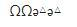

A. 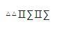

B. 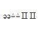

C. 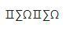

D. 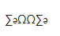

第 102 题 · 答案与解析

**参考答案（粉笔题库参考内容）**

A

**解析**

题干中字符串的规律为：第一个和第二个符号相同，第三个和第五个符号相同，第四个和第六个符号相同。只有A项与题干规律一致。

故正确答案为A。

**来源**：2013年江苏省公务员录用考试《行测》题（B类）第102题

### 第 103 题

请从四个选项中选出正确的一项，其特征或规律与题干给出的一串符号的特征或规律最为相似：

RERTTRE

A. FDFGGFD

B. DASDDSA

C. QWEEQWQ

D. FGFHGHG

第 103 题 · 答案与解析

**参考答案（粉笔题库参考内容）**

A

**解析**

题干中字符串的规律为：第一、三、六个符号相同，第二个和第七个符号相同，第四个和第五个符号相同。只有A项与题干规律一致。

故正确答案为A。

**来源**：2013年江苏省公务员录用考试《行测》题（B类）第103题

### 第 104 题

请从四个选项中选出正确的一项，其特征或规律与题干给出的一串符号的特征或规律最为相似：

h8icc33f6

A. f6gbb22d4

B. dd22f6gh6

C. 4de66f7h9

D. cg7dee55d

第 104 题 · 答案与解析

**参考答案（粉笔题库参考内容）**

A

**解析**

题干中字符串的规律为：第四个和第五个符号相同，第六个和第七个符号相同，其他符号均不相同，只有A项与题干规律一致。

故正确答案为A。

**来源**：2013年江苏省公务员录用考试《行测》题（B类）第104题

### 第 105 题

请从四个选项中选出正确的一项，其特征或规律与题干给出的一串符号的特征或规律最为相似：

∠3ABC3∠

A. 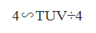

B. 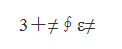

C. 

D. 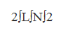

第 105 题 · 答案与解析

**参考答案（粉笔题库参考内容）**

C

**解析**

题干中的字符串规律为：第一个和最后一个符号相同，第二个和倒数第二个符号相同，中间的三个符号均不相同，只有C项与题干规律一致。

故正确答案为C。

**来源**：2013年江苏省公务员录用考试《行测》题（B类）第105题

### 第 106 题

请从所给的四个选项中，选择唯一的一个答案，使之呈现一定的规律性：

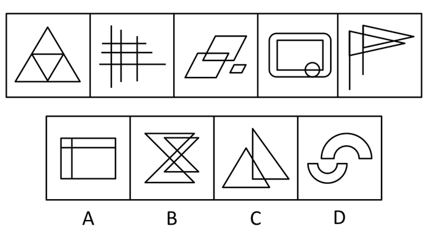

A. A

B. B

C. C

D. D

第 106 题 · 答案与解析

**参考答案（粉笔题库参考内容）**

A

**解析**

本题元素组成凌乱，考数数。本题数封闭空间的数量，已知题干图形的封闭空间均为4个。A项的封闭空间为4个，B项为7个，C项为3个，D项为2个。

故正确答案为A。

**考点**：数量规律-面

**来源**：2013年江苏省公务员录用考试《行测》题（A类）第51题

### 第 107 题

从所给的四个选项中，选择最合适的一个，使之呈现一定的规律性：

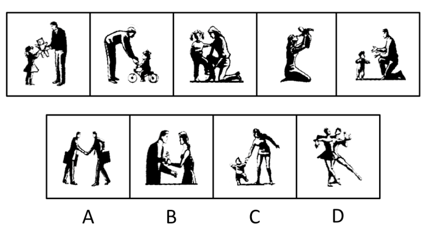

A. A

B. B

C. C

D. D

第 107 题 · 答案与解析

**参考答案（粉笔题库参考内容）**

C

**解析**

特殊考点，观察图形内容，本题考查人物构成特点。已知图形都包含一个大人和一个小孩，只有C项符合。

A、B、D描述的场景都只有大人，没有小孩。

故正确答案为C。

**来源**：2013年江苏省公务员录用考试《行测》题（B类）第107题

### 第 108 题

下边四个图形中，只有一个是由上边的四个图形拼合（只能通过上、下、左、右平移）而成的，请把它找出来。

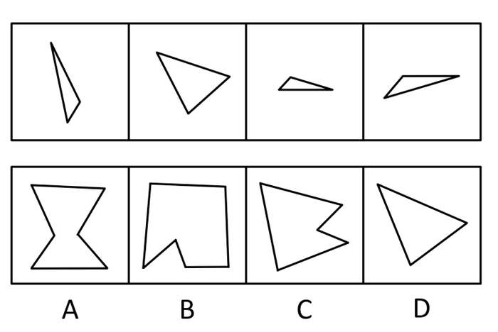

A. A

B. B

C. C

D. D

第 108 题 · 答案与解析

**参考答案（粉笔题库参考内容）**

C

**解析**

本题考查平面拼合，可采用平行且等长相消的方式解题。消去平行且等长的线段后进行拼合即可得到轮廓图，即为C项。平行且等长相消的方式如下图所示：

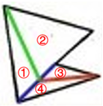

故正确答案为C。

**来源**：2013年江苏省公务员录用考试《行测》题（B类）第108题

### 第 109 题

选项四个图形中，只有一个是由题干的四个图形拼合（只能通过上、下、左、右平移）而成的，请把它找出来。

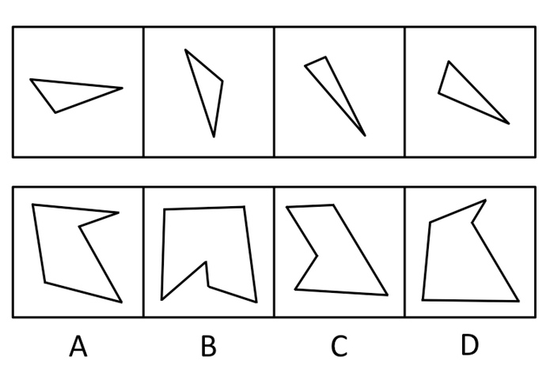

A. A

B. B

C. C

D. D

第 109 题 · 答案与解析

**参考答案（粉笔题库参考内容）**

A

**解析**

本题考查拼图。将题干各部分拼接起来，形成的图形如下图所示：

故正确答案为A。

**来源**：2013年江苏省公务员录用考试《行测》题（B类）第109题

### 第 110 题

下边的四个图形中，只有一个是由上边的四个图形拼合（只能通过上、下、左、右平移）而成的，请把它找出来。

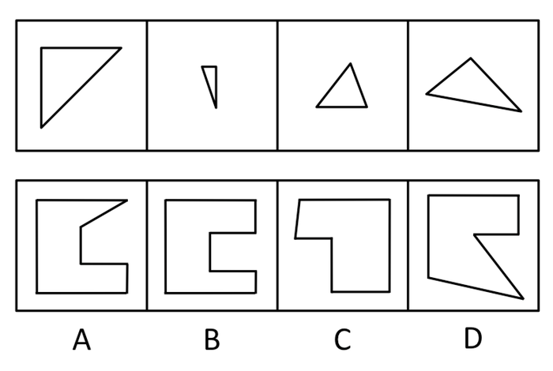

A. A

B. B

C. C

D. D

第 110 题 · 答案与解析

**参考答案（粉笔题库参考内容）**

D

**解析**

本题考查拼图。将上方各部分拼起来，形成的图形如下图所示：

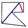

故正确答案为D。

**来源**：2013年江苏省公务员录用考试《行测》题（B类）第110题

### 第 111 题

左边给定的是三棱锥的外表面展开图，右边哪一项能由它折叠而成？

A. A

B. B

C. C

D. D

第 111 题 · 答案与解析

**参考答案（粉笔题库参考内容）**

C

**解析**

将题干展开图标上序号，如下图所示，逐一分析选项。

A项：选项由面h和面g构成，如图所示，以面g中箭头指向的边为起始边，对面g进行顺时针画边。题干展开图中边2挨着面h，而选项中边3挨着面h，选项与题干不一致，排除；

B项：选项由面f和面g构成，如图所示，以面g中箭头指向的边为起始边，对面g进行顺时针画边。题干展开图中边3挨着面f，而选项中边2挨着面f，选项与题干不一致，排除；

C项：选项由面h和面g构成，选项与题干一致，当选；

D项：选项由面f和面g构成，如图所示，题干展开图面g中的箭头指向面e，而选项面g中的箭头指向面f，选项与题干不一致，排除。

故正确答案为C。

**来源**：2013年江苏省公务员录用考试《行测》题（A类）第55题

### 第 112 题

左边给定的是纸盒外表面的展开图，右边哪一项能由它折叠而成？请把它找出来：

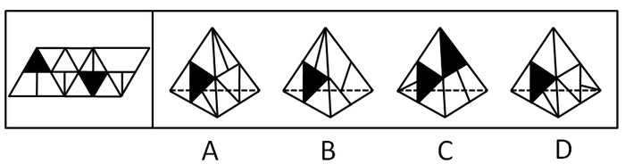

A. A

B. B

C. C

D. D

第 112 题 · 答案与解析

**参考答案（粉笔题库参考内容）**

A

**解析**

将题干展开图中的面依次标注为面e、f、g、h，如下图：

A项：选项由面f、g构成，与题干一致，当选；

B项：右侧的面是无中生有的面，与题干不一致，排除；

C项：选项由面e、g构成，展开图中面g中黑色三角形与面e中的竖线正对，选项中面g中黑色三角形与面e中的竖线不正对，与题干不一致，排除；

D项：选项由面f、g构成，题干展开图中面f和面g的公共边挨着面f的直角三角形的斜边，而选项中面f和面g的公共边没有挨着面f的直角三角形的斜边，与题干不一致，排除。

故正确答案为A。

**来源**：2013年江苏省公务员录用考试《行测》题（A类）第56题

### 第 113 题

左边给定的是正方体的外表面展开图，右边哪一项能由它折叠而成？

A. A

B. B

C. C

D. D

第 113 题 · 答案与解析

**参考答案（粉笔题库参考内容）**

A

**解析**

本题考查空间重构能力，通常采用排除的思想。A项可以由左侧图形折成。如下图所示，第1面和第5面为相对面，根据相对面不相邻的原则，排除B、D。C项错误，假设左侧面和右侧面是对的，那么顶面应该是第5面而非第1面。

故正确答案为A。

**考点**：空间类-空间重构-六面体

**来源**：2013年江苏省公务员录用考试《行测》题（B类）第113题

### 第 114 题

右边图形哪一个是由左边图形折叠而来：

A. A

B. B

C. C

D. D

第 114 题 · 答案与解析

**参考答案（粉笔题库参考内容）**

B

**解析**

本题考查空间重构能力，通常采用排除的思想。由平面展开图可知，相同图案的两面是相对面，根据相对面不相邻的原则，可迅速排除A、C、D三项。

故正确答案为B。

**考点**：空间类-空间重构-六面体

**来源**：2013年江苏省公务员录用考试《行测》题（A类）第59题

### 第 115 题

右边图形哪一个是由左边图形折叠而来：

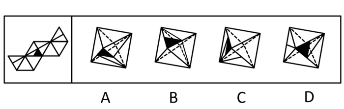

A. A

B. B

C. C

D. D

第 115 题 · 答案与解析

**参考答案（粉笔题库参考内容）**

B

**解析**

本题考查空间重构能力，通常采用排除的思维。观察展开图可发现，含阴影三角形的面中的直线与相邻面的直线相接，因此在折成的立体图形中，与含阴影三角形的面中的直线应与其中一个相邻面中的直线相接，可迅速排除A、C、D。

B项可由展开图折成。

故正确答案为B。

**来源**：2013年江苏省公务员录用考试《行测》题（B类）第115题

### 第 116 题

我国正在加速步入汽车社会。曾几何时，中国人把开汽车看成神话一般的事情。可没想到，短短十几年过去，成千上万辆汽车就开进了寻常百姓家。有专家指出，随之而来的不是我们生活质量的迅速提高，而是生活质量的迅速下降。

以下哪项如果为真，最能支持上述结论？

A. 汽车尾气加剧了大气污染，近年来我国某些地区的雾霾天越来越多

B. 过多汽车造成的道路拥堵和大气污染严重困扰着我们的日常生活

C. 私家汽车的使用和养护需要大量费用，减少了家庭其他方面的消费

D. 开车人必须有足够的环保意识，能少开就少开，能不开就不开

第 116 题 · 答案与解析

**参考答案（粉笔题库参考内容）**

B

**解析**

本题属于加强题型。

第一步：找出论点论据。

论点：汽车增加造成生活质量的迅速下降。

论据：本题没有明显论据。

第二步：逐一分析选项。

A项加剧大气污染，C项减少家庭其他方面的消费，均没有说明是否直接造成生活质量的下降，无法加强论点，排除；

B项汽车过多造成道路拥堵和大气污染，给人们的日常生活造成困扰，降低了人们的生活质量，加强了论点，当选；

D项开车人的环保意识跟生活质量的迅速下降无关，属于无关选项，排除。

故正确答案为B。

**考点**：补充论据

**来源**：2013年江苏省公务员录用考试《行测》题（B类）第116题

### 第 117 题

某科研机构的员工情况是：并非所有工程师都不是研究生，所有的工程师都是男性。

根据以上陈述，可以得出以下哪项：

A. 有的男性不是工程师

B. 有的男研究生不是工程师

C. 有的研究生是男性

D. 有的研究生是女性

第 117 题 · 答案与解析

**参考答案（粉笔题库参考内容）**

C

**解析**

第一步：翻译题干。

（1）并非所有工程师都不是研究生，即有的工程师→研究生；

（2）工程师→男性。

将条件（2）（3）结合后可得条件（3）有的男性→研究生。

第二步：逐一分析选项。

A项：有的男性→—工程师，“有的男性”是对条件（2）的肯后，肯后推不出必然结论，无法推出，排除；

B项：有的男研究生→—工程师，“有的男研究生”是对条件（1）（2）的肯后，肯后推不出必然结论，无法推出，排除；

C项：有的研究生→男性，条件（3）直接换位后即可得到，可以推出，当选；

D项：有的研究生→女性，“有的研究生”是对条件（3）的肯后，肯后推不出必然结论，无法推出，排除。

故正确答案为C。

**考点**：集合推理

**来源**：2013年江苏省公务员录用考试《行测》题（B类）第117题

### 第 118 题

经过努力，甲、乙、丙、丁4位品学兼优的中学生考上了北京大学、清华大学、南京大学、东南大学4所名校。9月初，甲、丙与乙、丁分别奔赴两座不同的城市去上学了。已知：

（1）甲没有上北京大学

（2）乙没有上清华大学

（3）丙没有上南京大学

（4）丁没有上东南大学

根据以上陈述，可以得出以下哪项：

A. 甲没有上清华大学

B. 乙没有上北京大学

C. 丙没有上东南大学

D. 丁没有上北京大学

第 118 题 · 答案与解析

**参考答案（粉笔题库参考内容）**

D

**解析**

本题为排列组合题型。

本题根据题干已知信息难以推理，故采用假设法。

根据“甲、丙与乙、丁分别奔赴两座不同的城市”，假设甲、丙分别去了清华大学和北京大学，则乙、丁分别去了南京大学和东南大学。

由（1）知，甲去清华大学，丙去北京大学；

由（4）知，丁去南京大学，乙去东南大学，与题干已知信息不矛盾。

假设甲、丙分别去了南京大学和东南大学，则乙、丁分别去了清华大学和北京大学。

由（3）知，丙去了东南大学，甲去了南京大学；

由（2）知，乙去了北京大学，丁去了清华大学，也与题干信息没有矛盾。因此这两种情况都可能存在。

若是第一种情况，则A项错误；

若是第二种情况，则B、C两项均错误；

两种情况下丁都没有去北京大学，D项正确。

故正确答案为D。

**考点**：假设

**来源**：2013年江苏省公务员录用考试《行测》题（A类）第67题

### 第 119 题

有哲学家指出，人生其实应该追求两个简单：物质生活的简单和人际关系的简单。有了这两个简单，心灵就拥有了广阔的空间和美好的宁静。但是，大多数现代人却在这两方面很复杂，物质生活上是财富的无穷追逐，人际关系上是利益的不尽纠葛，两者几乎占满了生活的全部空间，而有了这两种复杂，就产生了现代人的大部分烦恼。

根据上述哲学家的观点，可以得出以下哪项？

A. 大多数现代人的心灵或者没有广阔的空间，或者没有美好的宁静

B. 有些现代人生活很复杂，但却拥有心灵的广阔和宁静

C. 只有在物质生活或人际关系两方面简单了，现代人的大部分烦恼才不会产生

D. 如果在物质生活和人际关系两方面都简单了，现代人的大部分烦恼就不会产生

第 119 题 · 答案与解析

**参考答案（粉笔题库参考内容）**

C

**解析**

第一步：翻译题干。

① 物质生活的简单 且 人际关系的简单→拥有广阔的空间 且 美好的宁静；

② -物质生活的简单 且 -人际关系的简单→产生现代人的大部分烦恼。

第二步：逐一分析选项。

A项：大多数现代人的心灵是-广阔的空间 或 -美好的宁静，题干中没有谈及大多数现代人的心灵与广阔的空间和美好的宁静之间的关系，无法推出，排除；

B项：题干中只涉及物质生活和人际关系，并未涉及有些现代人生活很复杂，无法推出，排除；

C项：-产生现代人的大部分烦恼→物质生活的简单 或 人际关系的简单，是题干条件②的逆否命题，可以推出，当选；

D项：物质生活的简单 且 人际关系的简单→-产生现代人的大部分烦恼，物质生活的简单且人际关系的简单是对题干条件②前件的否定，否定前件不能得出确定性结论，无法推出，排除。

故正确答案为C。

**考点**：常规翻译

**来源**：2013年江苏省公务员录用考试《行测》题（A类）第66题

### 第 120 题

某单位的小张、小王、小李、小赵同在人事处工作。在工作上，他们4个都恪尽职守，表现优秀。今年年终，人事处需要推荐两名同志参加本年度单位“优秀员工”的评选。经过商议，处里最终确定的推荐人选是小张和小李。

根据以上陈述，可以得出以下哪项：

A. 今年人事处“优秀员工”至少有2人

B. 今年人事处“优秀员工”至多有2人

C. 今年人事处“优秀员工”至少有1人

D. 今年人事处“优秀员工”其实有4人

第 120 题 · 答案与解析

**参考答案（粉笔题库参考内容）**

B

**解析**

本题为日常结论题型。

第一步：抓住题干主要信息，即处里最终确定的推荐人选是小张和小李。

第二步：分析各选项。

“优秀员工”的评选是从推荐人选中产生的，处里最终确定的推荐人选只有小张和小李两人，人事处“优秀员工”只从这两人中产生，因此至多只有两人获得“优秀员工”的称号，B正确。

B正确，A、C、D就都错误。

故正确答案为B。

**考点**：日常结论

**来源**：2013年江苏省公务员录用考试《行测》题（B类）第120题

### 第 121 题

只要被猫狗等动物抓伤、咬伤，无论是否出血，都要在24小时内到医院注射狂犬疫苗，万不可抱侥幸心理。猫狗在夏天最躁动，最容易咬伤人，但在春节期间也很容易受鞭炮惊吓而咬人。

根据以上陈述，可以得出以下哪项：

A. 如果被猫狗抓伤，但是没有出血，就不要到医院注射狂犬疫苗

B. 如果被不带狂犬病毒的狗咬伤，就不要到医院注射狂犬疫苗

C. 如果没必要去医院注射狂犬疫苗，就肯定没有被动物抓伤、咬伤

D. 如果没有去过医院注射狂犬疫苗，就肯定没有被动物抓伤、咬伤

第 121 题 · 答案与解析

**参考答案（粉笔题库参考内容）**

C

**解析**

本题为翻译推理题型。

第一步：翻译题干。

被猫狗抓伤、咬伤⇒要到医院注射狂犬疫苗。

第二步：逐一翻译选项并判断正确答案。

A项，被猫狗抓伤且﹣出血⇒﹣要到医院注射狂犬疫苗；题干说明无论是否出血，被猫狗抓伤、咬伤⇒要到医院注射狂犬疫苗，A项推导关系与题干不一致，排除；

B项，被不带狂犬病毒的狗咬伤⇒﹣要到医院注射狂犬疫苗；由题干推导关系可知，无论是否带狂犬病毒，被猫狗抓伤、咬伤⇒要到医院注射狂犬疫苗，B项推导关系与题干不一致，排除；

C项，﹣要到医院注射狂犬疫苗⇒ ﹣被猫狗抓伤、咬伤，是题干推导关系的逆否规则，当选；

D项，“没有去过医院注射狂犬疫苗”不在翻译的推导关系中，无法推出结论，排除。

故正确答案为C。

**考点**：常规翻译

**来源**：2013年江苏省公务员录用考试《行测》题（B类）第121题

### 第 122 题

某林场入口处的标语牌上清晰地写着“禁止破坏森林！违者罚款！”有一天，附近村民杨某到林场里面砍了一棵树，正待运下山时被林场护林员张某发现，张某不仅批评了杨某，而且要对杨某实施罚款，杨某不服，双方展开了激烈的论辩。杨某说道，我砍的是一棵树又不是森林，你不应该罚我的款。

以下哪项是张某最合乎逻辑的反驳：

A. 破坏森林的都要罚款，你砍的一棵树也是森林

B. 砍一棵树就是破坏森林，破坏森林的都要罚款

C. 我是护林员，谁不保护森林我就要罚谁的款

D. 破坏森林重在教育，罚款其实不是我们的目的

第 122 题 · 答案与解析

**参考答案（粉笔题库参考内容）**

B

**解析**

第一步：找到论点和论据。

论点：我砍的是一棵树又不是森林，你不应该罚我的款。

论据：无明显论据。

第二步：逐一分析选项。

A项：“你砍的一棵树也是森林”，意思是说砍的这棵树本身就是森林，但是砍一棵树是不是破坏森林，并没有明确说，是一个不明确的表述，因此不能反驳论点，排除；

B项：砍树就是破坏森林，破坏森林要罚款，对论点进行削弱，当选；

C项：选项只是说谁破坏森林就罚款，但是没有在砍一棵树和破坏森林之间搭关系，属于无关选项，排除；

D项：选项说的是罚款的目的，同样没有在砍一棵树和破坏森林之间搭关系，属于无关选项，排除。

故正确答案为B。

**考点**：日常结论

**来源**：2013年江苏省公务员录用考试《行测》题（B类）第122题

### 第 123 题

妈妈每天早上都会为上小学的儿子做早餐。妈妈会做的早餐品种有面条、水饺、稀饭、蛋炒饭、煎饼等5种，但每天她只为儿子做其中的一种。已知：

（1）做面条比较容易，一周做两次，两次在一周内相隔3天

（2）做稀饭的时间是在第一次做面条的前一天或后一天，一周仅做一次

（3）做水饺也是一周仅做一次，但这次是在第二次做面条之前的任何一天

（4）做蛋炒饭也仅限一次，时间与第一次做面条那天在一周内相隔4天

（5）有一次做煎饼的时间是在第一次做面条之前

假定周一为一周的第一天，根据以上陈述，可以得出以下哪项：

A. 周一做稀饭

B. 周二做面条

C. 周四做水饺

D. 周日做煎饼

第 123 题 · 答案与解析

**参考答案（粉笔题库参考内容）**

B

**解析**

本题为排列组合题型。

第一步：找突破口。

一周有7天，由“（4）做蛋炒饭与第一次做面条那天在一周内相隔4天”可知，第一次做面条只能是在周一或周二；

又知（5），可知第一次做面条是在周二，B正确。

第二步：分析其他选项。

由（2）和（5）可知，周一做的是煎饼，周三做稀饭，A项和D项错误；

由上述推论可知，周一煎饼、周二面条、周三稀饭，结合（1）和（3）可知，周六做面条，做水饺可选在周四或周五，所以C项无法推出。

故正确答案为B。

**考点**：从确定信息开始推

**来源**：2013年江苏省公务员录用考试《行测》题（B类）第123题

### 第 124 题

因工作需要，某单位决定从本单位的3位女性（小王、小李、小孙）和5位男性（小张、小金、小吴、小孟，小余）中选出4人组建谈判小组参与一次重要谈判，选择条件如下：

（1） 小组成员既要有女性，也要有男性

（2） 小张与小王不能都入选

（3） 小李与小孙不能都入选

（4） 如果选小金，则不选小吴

如果小张一定要入选，可以得出以下哪项：

A. 如果选小吴，则选小余

B. 如果选小金，则选小孟

C. 要么选小余，要么选小孟

D. 要么选小李，要么选小孙

第 124 题 · 答案与解析

**参考答案（粉笔题库参考内容）**

D

**解析**

第一步：翻译题干。

（1）既要有女性（小王、小李、小孙），也要有男性（小张、小金、小吴、小孟，小余）；

（2）-（小张 且 小王）=-小张 或 -小王；

（3）-（小李 且 小孙）=-小李 或 -小孙；

（4）小金→ -小吴；

（5）小张一定入选（事实信息）。

第二步：从事实信息开始推导并得出结论。

根据事实信息“小张一定入选”，由（2）可知，小王不入选；再由（1）可知，小李和小孙至少有一人入选；再由（3）可知，小李和小孙不能都入选，可推出要么选小李，要么选小孙，D项当选。

第三步：分析其他选项。

A项，题干已知小张入选，由（3）可知，小孙、小李只能入选一个人，小组还需要两个人，且都是男性，男性中（金吴孟余）四个人谁去是不确定的，无法推出，排除；

B项，同A项，小组还需要两个人，且都是男性，男性中（金吴孟余）四个人谁去是不确定的，无法推出，排除；

C项，要么小余，要么小孟，二者只能进一人；题干已知小张入选，由（3）可知，小孙、小李只能入选一个人，小组还需要两个人，且都是男性（金吴孟余），小余和小孟均为男性，可以同时入选，无法推出，排除。

故正确答案为D。

**考点**：常规翻译

**来源**：2013年江苏省公务员录用考试《行测》题（A类）第69题

### 第 125 题

因工作需要，某单位决定从本单位的3位女性（小王、小李、小孙）和5位男性（小张、小金、小吴、小孟，小余）中选出4人组建谈判小组参与一次重要谈判，选择条件如下：

（1）小组成员既要有女性，也要有男性

（2）小张与小王不能都入选

（3）小李与小孙不能都入选

（4）如果选小金，则不选小吴

如果小王和小吴都入选，可以得出以下哪项？

A. 或者选小余，或者选小孟

B. 或者选小李，或者选小孙

C. 如果选小李，那么选小张

D. 如果选小孙，那么选小金

第 125 题 · 答案与解析

**参考答案（粉笔题库参考内容）**

A

**解析**

本题为关联词推导题型。

第一步：翻译题干。

（1）既要有女性（小王、小李、小孙），也要有男性（小张、小金、小吴、小孟，小余）；（2）-小张 或 -小王；（3）-小李 或 -小孙；（4）小金→\-小吴；（5）小王，小吴（事实信息）。

第二步：从事实信息开始推导并得出结论。

根据事实信息小王入选，由（2）可知，小张不入选；根据事实信息小吴入选，由（4）的逆否规则可知，小金不入选；因为参加谈判的总共有4人，又知（3）小李和小孙不能同时入选，要确保两人不同时入选，则需要从小余和小孟中选出一人，或者选小余，或者选小孟，A项当选。

第三步：分析其他选项。

B项：根据条件（3）“小李与小孙不能都入选”，即可以小李和小孙二选一、也可以两者都不入选，而B项无“两者都不入选”的情况，无法推出，排除；

C、D项由第二步推论可知，小张不入选，小金不入选，C项和D项均排除。

故正确答案为A。

**考点**：常规翻译

**来源**：2013年江苏省公务员录用考试《行测》题（A类）第70题

### 第 126 题

白化现象是指在正常环境下，植物由于某些内在因素不能形成叶绿素的现象。

下列属于白化现象的是：

A. 某地是世代玉米主产区，每年都发现一些玉米的叶子因遗传而出现局部白斑

B. 某地农民发现当地向日葵的叶子变白了，这在化工厂未建时从没有发现过

C. 某地污染几年后，人民在当地不时会发现一种污染前从未出现过的白蛇

D. 某人十多年前得了一种病至今未愈，皮肤、头发，甚至眉毛全都变白了

第 126 题 · 答案与解析

**参考答案（粉笔题库参考内容）**

A

**解析**

第一步：找到定义关键词。

“正常环境下”、“植物”、“内在因素”。

第二步：逐一分析选项。

A项“某地是世代玉米主产区，每年都发现”说明是正常环境下，“玉米”是植物，“遗传”是内在因素，满足定义关键词，当选。

B项向日葵叶子变白是建化工厂之后发现的，C项白蛇不是植物，D项某人不是植物，B、C、D三项均不满足定义关键词，排除。

故正确答案为A。

**考点**：大前提

**来源**：2013年江苏省公务员录用考试《行测》题（A类）第76题

### 第 127 题

无影灯效应：指通过诸多要素互相作用而形成的一种整体性机制，可把某问题的不完全或缺点部分减到最低限度，甚至消失，并最终使这一问题得到很好解决。

下列不属于无影灯效应的是：

A. 某省为了杜绝医生吃医药回扣致使患者看病贵的问题，加大医药采购监督力度，开设了专门的患者热线，在各家医院的咨询服务台公布了卫生部门的举报电话

B. 某城市为了形成大力发展绿色生态文明的有效机制，充分集中民众智慧，成立了公民监督委员会和环境保护组织等，让广大民众更好地建言献策并发挥监督作用

C. 2012年中国网民数量突破5亿，越来越多的人利用互联网媒体充分获取和传播信息，信息和民意也得到广泛的立体传播，中国正在形成透明的信息空间和舆论力量

D. 某地方政府为治理公车私用顽症，特聘多名义务监督员，并配有数码相机，监督员可随时抓拍发现的疑车并将照片发送到相关网络，被拍者须对此作出合理的解释

第 127 题 · 答案与解析

**参考答案（粉笔题库参考内容）**

C

**解析**

第一步：找到关键词。

诸多要素互相作用、整体性机制、不完全或缺点部分减到最低限度、甚至消失、问题最终得到解决。

第二步：逐一分析选项。

A项：回扣、看病贵体现了“缺点”，加大监督力度、开设热线、公布举报电话等措施体现了“诸多要素互相作用”、“整体性机制”；

B项：发展绿色生态文明体现了现有环境状况不佳的“缺点”，集中智慧、成立监督委员会和环境保护组织等体现了“诸多要素互相作用”、“整体性机制”；

C项：并没有体现出缺点、问题得到解决。文字只是对中国网民情况进行了介绍，并没有提出问题。本选项为正确答案；

D项：公车私用体现了“缺点”，监督员、抓拍、网络、解释等反映了“诸多要素互相作用”、“整体性机制”。

虽然A、B、C三项都没有体现出“问题最终得到解决”，但是相比较C项，A、B两项更符合定义。

本题为选非题，故正确答案为C。

**考点**：方式目的

**来源**：2013年江苏省公务员录用考试《行测》题（A类）第74题

### 第 128 题

信息茧房：指人们在自己的信息领域会习惯性地被兴趣所引导，最终束缚住自己，就像是蚕茧，最终桎梏于自己的“茧房”中。

下列不属于信息茧房的是：

A. 工薪族王小姐很喜欢网购，一年下来购买的各种网络商品堆满了一房间

B. 李女士是个微博控，无论走到哪里都要用手机拍图并上传到自己的微博里

C. 大三学生小徐经常利用校园网或社交网站搜寻和交换学习和娱乐资料

D. 某男士晚上的时间基本都泡在天涯社区里，浏览各类论坛的帖子并留言

第 128 题 · 答案与解析

**参考答案（粉笔题库参考内容）**

C

**解析**

第一步：找到定义关键词。

“习惯性地”、“束缚住自己”。

第二步：逐一分析选项。

A项各种网络商品堆满了一房间，满足“习惯性地”、“束缚住自己”，符合定义，排除。

B项无论走到哪里，满足“习惯性地”、“束缚住自己”，符合定义，排除。

C项小徐利用网络搜寻和交换学习和娱乐资料是对网络的正常利用，并非习惯性地被兴趣所引导，不满足定义关键词，当选。

D项晚上的时间基本都泡在天涯社区，满足“习惯性地”、“束缚住自己”，符合定义，排除。

本题为选非题，故正确答案为C。

**考点**：单定义-其他句式

**来源**：2013年江苏省公务员录用考试《行测》题（B类）第128题

### 第 129 题

幽默诉求广告指通过幽默情趣来淡化广告的直接功利性，减少人们对广告所持的逆反心理，使消费者在轻松快乐中接受某种商业或文化信息。

下列属于幽默诉求广告的是：

A. 某商场电子屏：您还在为手里的几张号码卡而烦恼吗？本商场隆重推出新款手机，一台手机同时装三张号码卡，手机还免费送，免去您携带多部手机的烦恼

B. 某电视汽车广告：0油耗也能时速200公里！以清洁能源，甩掉碳排放对世界的压力；凭借超前科技激发电力能效，于风驰电掣中驾驭澎湃激情；通过感应地面电磁场无线充电，不受任何人牵制

C. 某杂志“幽默”栏目：一顾客对售货员大发雷霆：“自打我用了从你们这里买的生发水以后，我的头发就全脱掉了！”售货员：“一点儿不错，先生。要想长出新头发，就必须先腾出地方”

D. 某山区公路电子屏：阁下驾驶汽车，时速不超过30公里，可以欣赏到本地的美丽景色；超过60公里，请到法庭做客；超过80公里，请光顾本地设备最新的医院；上了100公里，祝您安息吧

第 129 题 · 答案与解析

**参考答案（粉笔题库参考内容）**

D

**解析**

第一步：分析题干关键词。

“幽默情趣”、“淡化功利性”、“减少逆反心理”、“快乐中接受”、“商业或文化信息”。

第二步：逐一分析选项关键词。

A项，没有体现出任何题干中的关键词，纯属商业广告；

B项，也没有体现出任何题干中的关键词，也是商业广告；

C项，虽然体现出了“幽默情趣”，但并不属于广告，只是杂志的专题栏目，目的是让读者轻松愉快；

D项，行文风格充分体现出了“幽默情趣”，行文内容体现出了“淡化功利性”，行文效果体现出了“减少逆反心理”、“快乐中接受”。要注意这里是一则公益广告，传达的是“文化信息”。

故正确答案为D。

**考点**：方式目的

**来源**：2013年江苏省公务员录用考试《行测》题（A类）第79题

### 第 130 题

社会定型是指人们对不同社会集团的人所持的固定看法，通常是概括而笼统的，并非都有充分根据。

下列属于社会定型的是：

A. 小李是湖南人，尽管她不吃辣，但是一到聚餐，同事们都认为她一定能吃辣

B. 小王遭受多次挫折后，自信力不足，对所处环境很是不满，甚至产生厌恶情绪

C. 从小生活在南京的小赵，刚到北京工作时对北京的气候非常不适应

D. 网络的发展改变了人们的通信方式，纸质书信逐渐淡出人们的视野

第 130 题 · 答案与解析

**参考答案（粉笔题库参考内容）**

A

**解析**

第一步：找到定义关键词。

“人们对不同社会集团的人”“固定看法”。

第二步：逐一分析选项。

A项同事们认为小李是湖南人，所以一定能吃辣，这是对湖南人的一种固定看法，满足定义关键词，当选。

B、C、D项都没有体现对不同社会团体的人的固定看法，不符合定义，均排除。

故正确答案为A。

**考点**：单定义-其他句式

**来源**：2013年江苏省公务员录用考试《行测》题（B类）第130题

### 第 131 题

过度探索行为指好奇的兴趣不是随着对新事物熟悉程度的增加而下降，而是持续不减，结果造成对所着迷事物损毁的行为。

下列属于过度探索行为的是：

A. 小侯对玩具遥控汽车爱不释手，而且每次都不准别人碰。就是平时最有威信的妈妈也不能碰一碰，否则就会大哭大闹

B. 小南对小航模越来越喜爱，每天都要一个一个的反复把玩，他的小床上已经有4个不同类型的小航模散了架

C. 小宝对魔方很着迷，每次吃饭的时候都要先把魔方的一面调整到同一色，有几次竟然把饭粒都掉到了魔方上

D. 3岁的小贝，有时要玩印有米老鼠图案的实心球，还要爸爸妈妈讲米老鼠踢球的故事，有时又闹着要看会说话的鹩哥

第 131 题 · 答案与解析

**参考答案（粉笔题库参考内容）**

B

**解析**

第一步：找到定义关键词。

关键词为“好奇的兴趣持续不减，造成对所着迷事物损毁的行为”。

第二步：逐一分析选项。

A、C两项都没有造成对所着迷事物损毁的行为，排除；

B项小南对小航模越来越喜爱，满足“兴趣持续不减”，4个不同类型的小航模散了架，满足“造成对所着迷事物损毁的行为”，符合定义，是答案；

D项不满足“好奇的兴趣持续不减”，排除。

故正确答案为B。

**考点**：原因结果

**来源**：2013年江苏省公务员录用考试《行测》题（A类）第80题

### 第 132 题

微突发事件：指发生在小范围的一个事件，经当事人或他人在网络等传媒上披露后，产生比较大的社会反响。

下列不属于微突发事件的是：

A. 某官员在参加一工程剪彩活动时，其佩戴名贵手表的照片被网友发到微博上，引起社会广泛关注

B. 2010年5月，某大学生上传一段动画片时说“这就是天竺吗？不给力啊老湿！”，“给力”一词旋即风靡网络。当年11月10日，“给力”一词出现在《人民日报》头版标题中

C. 2012年底，乞丐周某在某商场附近举着失物招领牌子，寻找钱包失主。路人俞某发现后，拍下一张照片并发到微博上。该微博被迅速转发，大家都对周某的行为表示赞赏

D. 2012年11月25日，歼-15舰载机在我国首艘航母“辽宁舰”上顺利实现起降，引发世界各大媒体热议

第 132 题 · 答案与解析

**参考答案（粉笔题库参考内容）**

D

**解析**

第一步：找到定义关键词。

“小范围”、“传媒”、“较大社会反响”。

第二步：逐一分析选项。

D项，航母舰载机顺利实现起降是一个公共事件，并非小范围，不符合定义要件。是答案。

A、B、C项的叙述结构均对应三个定义要件，符合定义。

本题为选非题，故正确答案为D。

**考点**：拆词

**来源**：2013年江苏省公务员录用考试《行测》题（B类）第132题

### 第 133 题

化归法：指在解决问题的过程中，不是直接解决原问题，而是对问题进行变形、转化，直至把它化归为某个（些）已经解决的问题，或容易解决的问题，再返回去求得原问题的解答。

下列不属于化归法的是：

A. 小张通过把多边形分解为若干个三角形，求得多边形内角和

B. 小吴和小文闹别扭，小吴想道歉又放不下面子，于是把前因后果告诉了小蔡，请小蔡向小文解释，小蔡解释后，小吴主动招呼小文，两人和好如初

C. 小李与小江解决同一类问题方法截然不同，小李先研究特殊情况，最终解决了一般问题；而小江先解决了一般问题，然后再研究特殊情形

D. 小赵采用先易后难的原则，很快完成了老师布置的一大堆物理作业

第 133 题 · 答案与解析

**参考答案（粉笔题库参考内容）**

D

**解析**

第一步：找到定义关键词。

在解决问题的过程中不是直接的，对问题进行变形、转化。

第二步：逐一分析选项。

A项分解为若干个三角形，满足对问题进行变形、转化；

B项是请小蔡向小文解释，满足“不是直接的”；

C项是小李和小江在解决问题的过程中都对问题进行不同方式的转化，非直接求解，满足定义关键词；

D项小赵采用先易后难的原则，没有对问题进行变形、转化，不满足定义关键词，是答案。

本题为选非题，故正确答案为D。

**考点**：方式目的

**来源**：2013年江苏省公务员录用考试《行测》题（A类）第73题

### 第 134 题

同城效应：指相邻地区或更大范围内不同地区相互间能发挥重要的作用和联动效应。同城效应是城市现代化发展的新趋势。

下列属于同城效应的是：

A. 在欧洲有一个非常普遍的现象，就是许多居民工作和居住往往不在一个城市，他们乘火车非常便捷，快乐工作、幸福生活两不误

B. 在长三角地区，某县级市提出“文化崛起”战略，以著名历史文化古镇、千亩湖面为中心形成重要战略支点

C. 某新干线通车后，由于空间成本降低，没有优势，特色城市的资源被吸纳至较高回报的地方，导致有些地区发展不平衡

D. 某市政府发挥资源和区位优势，找准产业定位，优化了产业结构，彰显本地区产业发展特色，短短两年就融入省会经济圈

第 134 题 · 答案与解析

**参考答案（粉笔题库参考内容）**

D

**解析**

第一步：找到定义关键词。

“相邻地区或更大范围内不同地区”、“联动效应”、“城市现代化发展的趋势”。

第二步：逐一分析选项。

A项：欧洲居民不满足“城市现代化”；

B项：只涉及某县级市自身，没有与相邻地区或更大范围内不同地区产生联动效应；

C项：导致有些地区发展不平衡不满足联动效应；

D项：某市政府发挥区位优势，使本地区融入省会经济圈，满足定义关键词，是答案。

故正确答案为D。

**考点**：单定义-其他句式

**来源**：2013年江苏省公务员录用考试《行测》题（B类）第134题

### 第 135 题

生物灾害：指在处理微生物病原体或者包含微生物病原体的材料以及被其感染的个体时造成的对工作人员的危害或者伤害。

下列属于生物灾害的是：

A. 由于抗生素的滥用，普遍细菌产生了耐药性，在经历结构变异后，变得更难治疗，或成为超级病菌，仅欧洲每年就有2万多人被感染，参与救治的多名医生被击倒

B. 在自然界中，人类与各种动植物相互依存，可一旦失去平衡，灾难就会接踵而至。某地鸟、蛇被大量捕杀，结果招致老鼠泛滥成灾

C. 水葫芦繁殖速度极快，大量的水葫芦覆盖河面，容易造成水质恶化，影响水底生物的生长，滇池、太湖等地均出现过水葫芦

D. 由于干旱，蝗灾开始泛滥，大片芦苇叶被蝗虫吃得精光，尚未长出翅膀的成群蝗虫正向附近的草滩和农田逼近

第 135 题 · 答案与解析

**参考答案（粉笔题库参考内容）**

A

**解析**

第一步：分析题干关键词。

微生物病原体、被感染、工作人员、危害或伤害。

第二步：逐一分析选项关键词。

A项：耐药细菌体现出“微生物病原体”，参与救治的医生被击倒体现出“被感染”、“工作人员”、“危害或伤害”，是正确答案；

B项：并未体现出对工作人员的伤害或危害，只是说老鼠泛滥成灾；

C项：并未体现出对工作人员的伤害或危害，只是影响了水体环境；

D项：并未体现出对工作人员的伤害或危害，只是对农业生产的影响。

故正确答案为A。

**考点**：原因结果

**来源**：2013年江苏省公务员录用考试《行测》题（A类）第75题

## 材料 4

2012年全国国内生产总值519322亿元，按可比价格计算，比上年增长7.8%。其中，第一产业增加值52377亿元，比上年增长4.5%；第二产业增加值235319亿元，增长8.1%；第三产业增加值231626亿元，增长8.1%。

        全年规模以上工业增加值按可比价格计算比上年增长10.0%，增速比上年回落3.9个百分点。分经济类型看，国有及国有控股企业增加值比上年增长6.4%，集体企业增长7.1%，股份制企业增长11.8%，外商及港澳台商投资企业增长6.3%。分行业看，41个工业大类行业增加值全部实现比上年增长。分产品看，全年471种工业产品中有345种产品产量比上年增长。其中，发电量增长4.7%，粗钢增长3.1%，钢材增长7.7%，水泥增长7.4%，十种有色金属增长9.3%，焦炭增长5.2%，硫酸（折100%）增长4.8%，烧碱（折100%）增长3.8%，化学纤维增长11.8%，微型计算机设备增长11.7%，集成电路增长9.3%，汽车增长6.3%（其中，轿车增长8.3%）。乙烯下降2.5%，平板玻璃下降3.2%。全国规模以上工业企业产销率达到98.0% ，比上年下降0.5个百分点。12月份，规模以上工业增加值同比增长10.3%，环比增长0.9%。

### 第 136 题

2012年产业增加值增长幅度高于全国规模以上工业增加值的经济类型是：

A. 外商及港澳台商投资企业

B. 集体企业

C. 国有及国有控股企业

D. 股份制企业

第 136 题 · 答案与解析

**参考答案（粉笔题库参考内容）**

D

**解析**

定位文字材料第二段可得：“2012年规模以上工业增加值按可比价格计算比上年增长10.0%，……分经济类型看，国有及国有控股企业增加值比上年增长6.4%，集体企业增长7.1%，股份制企业增长11.8%，外商及港澳台商投资企业增长6.3%”，显然只有股份制企业增加值增长幅度高于全国规模以上工业增加值。

故正确答案为D。

**来源**：2013年江苏省公务员录用考试《行测》题（B类）第136题

### 第 137 题

用V_1、V_2、V_3分别表示2012年全国钢材、集成电路、汽车产量的增长率，则下列关系式正确的是：

A. 

B. V_3 ＞ V_2 ＞ V_1

C. V2＞V3＞V1

D. 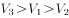

第 137 题 · 答案与解析

**参考答案（粉笔题库参考内容）**

A

**解析**

定位文字材料第二段可得：2012年钢材增长7.7%，集成电路增长9.3%，汽车增长6.3%，故集成电路>钢材>汽车对应。

故正确答案为A。

**来源**：2013年江苏省公务员录用考试《行测》题（B类）第137题

### 第 138 题

2012年全国国内生产总值中，第一产业增加值与第二产业增加值的比值是：

A. 0.20

B. 0.21

C. 0.22

D. 0.24

第 138 题 · 答案与解析

**参考答案（粉笔题库参考内容）**

C

**解析**

根据题干“……与……的比值是”，可判定本题为比值计算问题。定位文字材料第一段可得：“第一产业增加值52377亿元，第二产业增加值235319亿元”，故第一产业增加值与第二产业增加值的比值。

故正确答案为C。

**来源**：2013年江苏省公务员录用考试《行测》题（B类）第138题

### 第 139 题

设某公司2011年、2012年产品产量相同，其产品产销率均与当年全国规模以上工业企业相同，则该公司2012年与2011年的产品销售量之比是：

A. 99/98

B. 196/197

C. 98/99

D. 197/196

第 139 题 · 答案与解析

**参考答案（粉笔题库参考内容）**

B

**解析**

根据题干“……与……之比是”，可判定本题为比值计算问题。定位文字材料第二段可得：“2012年全国规模以上工业企业产销率达到98.0%，比上年下降0.5个百分点”。结合题干“某公司2011年、2012年产品产量相同”，即2012年产量=2011年产量，则根据产销率=销量/产量，公式可变形为销量=产量×产销率，故2012年与2011年的产品销售量之比。

故正确答案为B。

**来源**：2013年江苏省公务员录用考试《行测》题（B类）第139题

### 第 140 题

下列判断正确的有：

（1）2012年12月全国规模以上工业增加值同比增长10.0%

（2）2012年全国第三产业增加值为235319亿元

（3）2012年全国471种工业产品中产量下降幅度最大的产品是平板玻璃

A. 0个

B. 1个

C. 2个

D. 3个

第 140 题 · 答案与解析

**参考答案（粉笔题库参考内容）**

A

**解析**

①定位文字材料第二段可得：“ 12月份，规模以上工业增加值同比增长10.3%”，错误；

②定位文字材料第一段可得：“第三产业增加值231626亿元”，错误；

③定位文字材料第二段可知，资料中并没有提到全部工业产品的种类，故不能确定平板玻璃为最低，错误。

综上，没有正确的说法。

故正确答案为A。

**来源**：2013年江苏省公务员录用考试《行测》题（B类）第140题

## 材料 5

根据以下资料，回答141-145题

        2012年末我国总人口为135404万人。其中城镇人口为71182万人，占总人口比重为52.6%，比上年末提高1.3个百分点。全年出生人口为1635万人，出生率为12.10‰；死亡人口为966万人，死亡率为7.15‰，自然增长率为4.95‰，出生人口性别比为117.70（女性=100）。

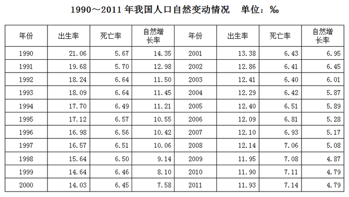

### 第 141 题

1991~2012年二十二年，我国人口死亡率的变动态势是：

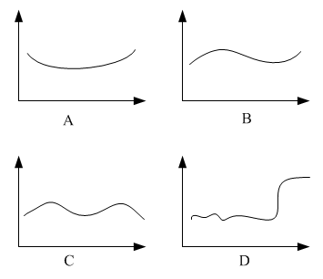

A. A

B. B

C. C

D. D

第 141 题 · 答案与解析

**参考答案（粉笔题库参考内容）**

D

**解析**

定位表格材料，观察可知，增减反复变化超过两次，只有D选项变动态势最符合。

故正确答案为D。

**来源**：2013年江苏省公务员录用考试《行测》题（B类）第141题

### 第 142 题

与1990年相比，2012年我国人口出生率下降：

A. 42.5%

B. 45.8%

C. 47.4%

D. 49.1%

第 142 题 · 答案与解析

**参考答案（粉笔题库参考内容）**

A

**解析**

根据题干“与1990年相比，……下降”，结合选项都为百分数，可判定本题为增长率问题。定位文字材料可得：2012年出生率为12.10‰；定位表格材料可得：1990年出生率为21.06%。故与1990年相比，2012年我国人口出生率下降=≈42.8%，只有A项符合。

故正确答案为A。

**来源**：2013年江苏省公务员录用考试《行测》题（B类）第142题

### 第 143 题

2012年我国新出生女性人口是：

A. 751万人

B. 776万人

C. 854万人

D. 884万人

第 143 题 · 答案与解析

**参考答案（粉笔题库参考内容）**

A

**解析**

根据题干“2012年……新出生女性人口”，结合材料给出2012年新出生人口和出生人口性别比的数据，可判定本题为比值计算问题。定位文字材料可得：“全年出生人口为1635万人，出生人口性别比为117.20(女性=100）”，即。故2012年我国新出生女性人口万人，与A选项最接近。

故正确答案为A。

**来源**：2013年江苏省公务员录用考试《行测》题（B类）第143题

### 第 144 题

1991~2012年二十二年，我国人口出生率比上年有所回升的年份有：

A. 3个

B. 4个

C. 5个

D. 7个

第 144 题 · 答案与解析

**参考答案（粉笔题库参考内容）**

C

**解析**

定位表格材料，观察可知：我国人口出生率比上年有所回升的年份有2005年、2007年、2008年、2011年、2012年，共5个。

故正确答案为C。

**来源**：2013年江苏省公务员录用考试《行测》题（B类）第144题

### 第 145 题

下列判断正确的有：

（1）1991~2012年二十二年，我国人口自然增长率逐年下降

（2）1991~2012年二十二年，我国人口出生率下降幅度最大的年份是1992年

（3）2011年我国农村人口占总人口比重为48.7%

A. 0个

B. 1个

C. 2个

D. 3个

第 145 题 · 答案与解析

**参考答案（粉笔题库参考内容）**

C

**解析**

（1）定位表格材料，观察可知2004年自然增长率＜2005年自然增长率，不满足要求，错误；

（2）定位表格材料，观察可知我国人口出生率下降的年份中1992下降幅度为，幅度最大，正确；

（3）定位文字材料可得：“2012年末城镇人口为71182万人，占总人口比重为52.6%，比上年末提高1.3个百分点”，故2011年农村人口占总人口比重=1-2011年城镇人口占总人口比重=1-（52.6%-1.3%）=48.7%，正确。

只有（2）和（3）正确。

故正确答案为C。

**来源**：2013年江苏省公务员录用考试《行测》题（B类）第145题

## 材料 6

### 第 146 题

2003—2011年九年，江苏金融业增加值年增量最多的年份是：

A. 2011年

B. 2007年

C. 2009年

D. 2010年

第 146 题 · 答案与解析

**参考答案（粉笔题库参考内容）**

D

**解析**

简单计算：

2007年的增量是1054.3-653.3≈400；

2009年的增量1597.0-1298.3≈300；

2010年的增量2105.9-1597.0>500；

2011年的增量2600.1-2105.9&lt;500。

2010年增量最大。

故正确答案为D。

**来源**：2013年江苏省公务员录用考试《行测》题（A类）第86题

### 第 147 题

2002—2011年十年，江苏第三产业增加值占地区国内生产总值比重的最大值是：

A. 39.6%

B. 41.4%

C. 40.1%

D. 42.4%

第 147 题 · 答案与解析

**参考答案（粉笔题库参考内容）**

D

**解析**

观察可知，2011年江苏第三产业增加值占地区国内生产总值比重最大，为。

故正确答案为D。

**来源**：2013年江苏省公务员录用考试《行测》题（A类）第87题

### 第 148 题

若不考虑价格因素，与2003年相比，2011年江苏金融业增加值增长的倍数是：

A. 5.6倍

B. 3.6倍

C. 6.6倍

D. 4.6倍

第 148 题 · 答案与解析

**参考答案（粉笔题库参考内容）**

A

**解析**

从表格中得到数据，与2003年相比，2011年江苏金融业增加值增长的倍数是。A项最接近。

故正确答案为A。

**来源**：2013年江苏省公务员录用考试《行测》题（A类）第88题

### 第 149 题

2003年—2011年九年，江苏金融业增加值占第三产业增加值比重最小的年份是：

A. 2006年

B. 2005年

C. 2004年

D. 2003年

第 149 题 · 答案与解析

**参考答案（粉笔题库参考内容）**

B

**解析**

2006年的比值为653.3/7914.1；

2005年比值为492.4/6612.2；

2004年比值为440.5/5198.0；

2003年比值为392.1/4493.3。

直除首位依次为8、7、8、8，2005年最小。

故正确答案为B。

**来源**：2013年江苏省公务员录用考试《行测》题（A类）第89题

### 第 150 题

若不考虑价格因素，则2003年—2011年九年，江苏金融业增加值年均增速V_L、第三产业增加值年均增速V_s，地区国内生产总值年均增速V_G的大小关系是：

A. V_s\>V_L\>V_G

B. V_L\>V_G\>V_s

C. V_L\>V_s\>V_G

D. V_s\>V_G\>V_L

第 150 题 · 答案与解析

**参考答案（粉笔题库参考内容）**

C

**解析**

比较三者大小，只需要比较三个参数2011年与2002年比值的大小，各自如下：

金融业：2600.1/368.9，第三产业：20842.2/3891.9，国内生产总值：49110.3/10606.9，直除首位依次为7、5、4，即。

故正确答案为C。

**来源**：2013年江苏省公务员录用考试《行测》题（A类）第90题

## 材料 7

2011年全国共发生地质灾害15664起，其中滑坡11490起、崩塌2319起、泥石流1380起、地面塌陷360起、地裂缝86起、地面沉降29起，与上年相比，发生数量下降48.9%，造成人员伤亡的地质灾害119起，共造成245人死亡、32人失踪、138人受伤，直接经济损失40.1亿元。

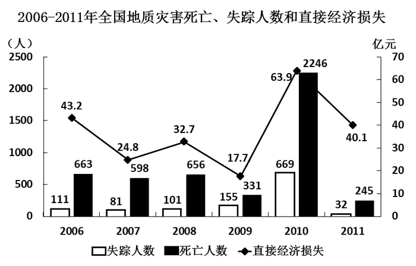

### 第 151 题

2011年全国发生各类地质灾害造成的死亡人数比上年下降了：

A. 89.1%

B. 90.5%

C. 91.2%

D. 91.6%

第 151 题 · 答案与解析

**参考答案（粉笔题库参考内容）**

A

**解析**

根据题干“比上年下降了”，结合选项都为百分数，可判定本题为增长率问题。定位统计图可得：2011年死亡人数245人，2010年死亡人数2246人，故2011年全国发生各类地质灾害造成的死亡人数比上年下降=，与A选项最接近。

故正确答案为A。

**来源**：2013年江苏省公务员录用考试《行测》题（B类）第151题

### 第 152 题

“十一五”（2006—2010年）时期全国发生各类地质灾害造成的年平均直接经济损失为：

A. 27.2亿元

B. 32.4亿元

C. 36.5亿元

D. 39.1亿元

第 152 题 · 答案与解析

**参考答案（粉笔题库参考内容）**

C

**解析**

根据题干“2006—2010年······年平均”，结合材料给出2006年—2010年全国发生各类地质灾害造成直接经济损失的数据，可判定本题为现期平均数问题。定位统计图可得：2006-2010年直接经济损失分别为43.2、24.8、32.7、17.7、63.9亿元，故五年的年平均直接经济损失亿元，与C选项最接近。

故正确答案为C。

**来源**：2013年江苏省公务员录用考试《行测》题（B类）第152题

### 第 153 题

2011年在全国发生各类地质灾害总数中所占比重超过10%的地质灾害有：

A. 1类

B. 2类

C. 3类

D. 4类

第 153 题 · 答案与解析

**参考答案（粉笔题库参考内容）**

B

**解析**

根据题干“2011年……占比重……”，结合材料给出2011年数据，可判定本题为现期比重问题。定位文字材料可得：“2011年全国共发生地质灾害15664起，其中滑坡11490起、崩塌2319起、泥石流1380起、地面塌陷360起、地裂缝86起、地面沉降29起”， 2011年在全国发生各类地质灾害总数中所占比重超过10%，发生数量应大于起，显然只有滑坡和崩塌两类符合条件。

故正确答案为B。

**来源**：2013年江苏省公务员录用考试《行测》题（B类）第153题

### 第 154 题

2011年全国发生各类地质灾害的数量比2010年少：

A. 8004起

B. 16753起

C. 16369起

D. 14990起

第 154 题 · 答案与解析

**参考答案（粉笔题库参考内容）**

D

**解析**

根据题干“2011年……比2010年少”，结合选项带单位，可判定本题为增长量计算问题。定位文字材料可得：“2011年全国共发生地质灾害15664起，与上年相比，发生数量下降48.9%”，结合百化分计算减少量，故可得2011年全国发生各类地质灾害的数量比2010年=15664/1.04则结果应略小于15664，显然只有D项符合。

故正确答案为D。

**来源**：2013年江苏省公务员录用考试《行测》题（B类）第154题

### 第 155 题

下列判断正确的是：

（1）2007—2011年五年，全国发生各类地质灾害造成的死亡人数、失踪人数和直接经济损失呈现相同的变动趋势

（2）2010年全国发生各类地质灾害死亡人数占2006—2011年六年全国发生各类地质灾害死亡总人数的一半以上

（3）2011年全国发生各类地质灾害造成的直接经济损失比上年下降了约37%

A. 0个

B. 1个

C. 2个

D. 3个

第 155 题 · 答案与解析

**参考答案（粉笔题库参考内容）**

B

**解析**

（1）定位统计图，观察可知2007—2011年五年，死亡人数趋势为升降升降，失踪人数趋势为升升升降，显然二者变动趋势不同，错误；

（2）定位统计图可得：2010年死亡人数为2246人，2006-2011年六年死亡总人数=（663+598+656+331+2246+245）人，故可得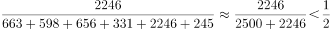，所以没有超过一半，错误；

（3）定位统计图可得：2011年直接经济损失为40.1亿元，2010年为63.9亿元，故2011年全国发生各类地质灾害造成的直接经济损失比上年下降，很接近37%，正确。

只有（3）正确。

故正确答案为B。

**来源**：2013年江苏省公务员录用考试《行测》题（B类）第155题

