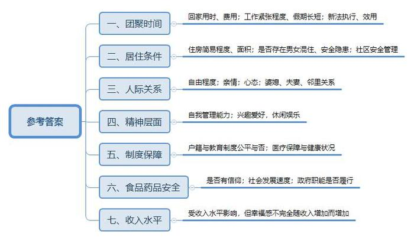
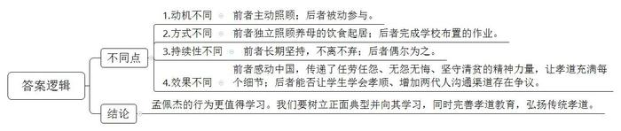
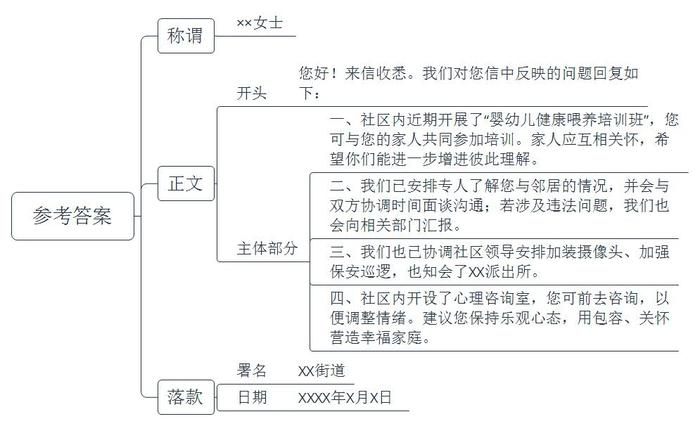
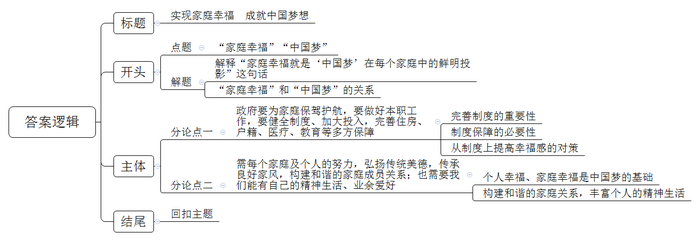

# 2014年江苏省公考《申论》题

<!-- gwy:overview:start -->
> **江苏 · 2014 · 申论 · 统考** ｜ 4 题 · 图片 4 处 · 答案随题折叠

导航：[题目](#题目) · [材料 1](#材料-1)
<!-- gwy:overview:end -->

> 候选采集稿。参考答案及解析来自粉笔页面，不代表官方答案或真实高分答卷；来源使用许可与原卷对应关系仍需人工核实。

## 给定材料

### 材料 1

民族的复兴最终必将反馈到个人身上，体现为个人幸福，否则，民族复兴就抽空了意义。就这种关系而言，个体幸福是根，民族复兴为表。

习近平总书记在解释“中国梦”时，说了一句极为重要的话：“‘中国梦’归根到底是人民的梦。”人民作为无数个体的集合体，中国的亿万家庭构成了全体国人的一个个生活的港湾，承载着全体国人对幸福的渴望与梦想。因此，家庭幸福就是“中国梦”在每个家庭中的鲜明投影。

这正如广西壮族自治区的一位女镇长所说的那样：“作为一名乡镇干部，如能把一个个‘小家’的梦圆好，中华民族‘大家’的梦就一定能实现。”

中国家庭幸福么？2013年5月15日中国人口福利基金会等机构发布了相关报告。报告显示，目前我国有1/3以上家庭感到非常幸福，但是，影响家庭幸福的因素也很多。

### 材料 2

春节长假即将结束，归家的游子又将远去。路上，微博上，网友纷纷“晒团圆”“晒幸福”。有些内容让你看后，感到既甜蜜，又心酸。

网友“冬日温柔”在微博上写道：“我坐了一天一夜火车，倒了三次车，终于从繁华都市到了家，可以盘腿坐在炕上看电视，大口大口地吃着母亲刚烤出来的大红薯，还有苹果干、脆花生、野红果、黑枣——太阳大了，院子里的小黄狗撵着大母鸡跑……”在陪父母贴窗花、挂灯笼、放鞭炮的一团喜气中，有网友深情地问自己：“父母年迈，我们跟他们还能见几回面？”“中国人的平均寿命是72岁，就算妈妈超出13岁活到85，算一算，这辈子还能和妈妈相处多久？”这些发问让不少网友感到鼻子酸酸，直想哭。

大学毕业之后就留在香港的张迪，至今已经离家5年了。“今年春节回家，行李沉甸甸的，可是一想到回家，我就像吃了菠菜的大力水手，下机的速度跟跑一百米似的。”张迪说，“从出机场的路上就开始吃，妈妈准备了我喜欢的鱿鱼丝、干果，吃到我每次回去都要重几斤。被子满满的都是太阳香，满满的都是幸福。”不少网友表示，一年到头在外打拼，以往觉得幸福可能是上司的一句嘉奖，拿下一个大订单，或者是升职加薪，过年回家才发现，“成功”，远远不是幸福的标准。一家团圆，吃到父母的饭菜，跟父母唠唠家常，才是从心底满溢的最真实的幸福，但是这种幸福的短暂却让不少网友感到心酸。

新修订的《老年人权益保障法》中，“常回家看看”有了法律约束条款：“与老年人分开居住的赡养人，要经常看望或者问候老人。子女不看望父母的，父母可向法院起诉。”

新法的“探老”规定，让“企业假期”备受关注，诸多企业员工表示：“也想常回家看看，怎奈人在谋生，身不由己。”

张先生是黑龙江齐齐哈尔人，现在广州一家国企上班。他说，坐火车回家来回得花四五天时间，虽然坐飞机一天可以到，但一个来回路费就得5000元。毕业第一年，他平均到手月薪不足3000元，想省出一笔回家费用确实不易，只能一周一个电话关心下父母。现在张先生的薪水倍涨，钱已经不是问题，但时间却更加紧张了，他说：“我也想五一、端午、中秋、国庆每个假期都回，但没那么多假期。”

张先生认为：“常回家看看能不能落实，关键在企业能不能将探亲假执行下去。作为职工不能找领导强行要假，更无法与之叫板、对簿公堂。”在张先生看来，新法实际效用不大，症结在于对企业没有强制性约束，没有合理投诉制度。

### 材料 3

这是Z市东郊一处工地宿舍，上下两层共34间简易房，其中一间，十几平方米的空间里摆放了5张架子床，10人居住。每个床头前都挂着一顶安全帽和一个比脸盆小一点的饭碗，床底下塞满了五颜六色的蛇皮袋和杂物，刘某夫妻就住在这个简易房里。这个工棚里住了9位男性，只有他媳妇一个女人。

这是又一间简易房，里面有一张看不清内容的床面用大床单遮着，床下是两双拖鞋，男女各一双。里面的人担心晚上起风帘子“跑光”，所以中间流出的缝隙也夹上了几个塑料夹子，外面几个光着膀子大汉胡乱地睡着。此刻，有些情绪需要克制，因为帘子里躺着一对小夫妻。帘子外的人紧张，帘子里的人更委屈，整夜都要屏住呼吸，生怕惊醒了“左邻右舍”。

41岁的马某夫妻和哥哥嫂嫂同住在二楼东头的一间宿舍里，其余三张架子床上住着6位男性，大家相处得很好，带媳妇的可优先挑选床位。当问到他为什么选择东头？马某说这里的隔音，屋里的工友都知道马某说的意思，不说话光笑。荒郊野外的工地上一个蚊子飞过去都能听到动静，翻个身床板发出的响声会让大家彻夜难眠，单身男子怎么受得了。而马某比他们更难熬，零距离躺着自己的媳妇，却不敢有丝毫的动静。

### 材料 4

8月初暑后的几场小雨，让S市凉爽了许多。李某庆幸全家终于又挨过了一个酷暑，李某一家四口居住的城中工矿棚户区，曾是S市煤矿职工住宿区。在这个建于1951年，不足30平方米的两间简易房内，几道裂缝从天花板和地面延伸下来。由于担心墙体承重能力差，家里一直没安空调。

S市曾是华东煤炭资源丰富的地区，在计划经济年代共调出原煤4亿多吨，担负着江浙沪50%的煤炭供给。而当年“先生产、后生活”的理念，使得数以万计的像李某一样的矿工家庭在简易搭建的房子里一住就是几十年。

李某的儿子婚后搬走，现在留在蜗居的是她和丈夫、22岁的女儿及孙子。李某一家最大的愿望是能尽快搬进楼房，过上“亮堂堂”的生活。

我国新一届领导集体提出了中华民族伟大复兴的“中国梦”。对于老百姓而言，住房梦是他们的‘中国梦’里最重要的梦想之一。距S市西北1200多公里外的棚户区，因国务院总理李克强两次现场调研而出名。李克强表示，“要打好新一轮棚户区改造攻坚战，破除城市内部二元结构难题。”这让那些久居棚户区的居民看到了实现梦想的曙光。

许多人之所以常把婚姻比做“围城”，是因为家虽然温暖，可若久困其中，难免有被束缚的感觉。特别是现在，很多父母，总寸步不离地呵护着自己的“独苗苗”。上大学了每天打电话嘘寒问暖，成家了还要随时关注着他们的一举一动。有的妻子，结婚后把老公看得紧紧的，10分钟一个电话掌握动向……彼此“圈”得紧紧的，完全失去了自由。殊不知家长看得太紧，孩子长大后很容易成为“啃老族”；夫妻之间过于牵绊，会让对方对家庭生活产生厌倦，最后互相失去信任和眷恋。

给予自由，是一种更高明的爱和关心，就像美国心理学家勒诺兹《抚养孩子》一书中所说，把需要的社会技能教给孩子，然后给孩子体验失败和赢得成功的历程。给予自由，不表示放任，更不是溺爱。夫妻之间最好不要扰乱对方的空间，自己也可以利用这些独立的时间和机会，做点喜欢的事。

M街道为推进和谐社区建设，在街道网站专门开设了信箱，为社区提供咨询服务，帮助居民解决难题，着力营造社区家庭幸福的和谐氛围。下面是一名社区居民的来信摘录：

我和老公结婚6年，我们一起住。好不容易怀孕了，由于身体不方便，婆婆就搬来和我们一起住。婆婆来了，我发现在生活细节上，我和她有很多不一样，婆婆很多习惯都让我感到别扭。比如，毛巾只有一条，一个星期才洗一次澡，还有很多不卫生的生活习惯。这些我都可以接受，但孩子一生下来她就给孩子喂糖水，后来又常常把食物嚼碎了喂孩子。为此，我和她争论过很多次，她反而对我很有意见，我实在无法忍受。跟老公说，他摆出一副不管不问的样子，让我自行解决。这样一来，我对他也越来越失望了。

生活真是烦透了，家里的烦事没完没了，邻居又给我添堵。住在我家对面的那个男人就是个“神经病”，半夜里常常大声唱歌，不但走调，还杂着吼叫，常常惊吓到我的孩子，多次与他交涉，他就是不听。小区的安全也存在问题，近期，我就被偷了两辆电瓶车，反映给小区保安，可却没了下文，也没有看到小区加强安全管理的措施。

这些烦心事，我曾向社区领导反映过。他们领导当面说得很好，可没有解决问题。看看我的那些小姐妹们生活得那么幸福，我为什么就这么不幸，日子怎么过啊？有时候想想，连死的心都有了。

### 材料 5

“在我女儿的眼中，她们班里的同学分成了三类，一类是有B市户口的，另一类是有居住证的，还有一类就是户口和居住证都没有的。她觉得自己是中间一类的，不算太坏。”说这话的陆女士是一位年薪12万的白领，她是海南人，因丈夫到B市发展，2000年，带着5岁的女儿来B市定居。2004年时，像陆女士这样的B市绿卡族约有4万多人。所谓绿卡，即可在购房、购车、子女入托入中小学、因公出国、申请驾照等方面与B市市民享受同等待遇，但后来的事实证明，所谓的同等待遇，其实极为有限。

2007年4月，B市某区公立初中入学登记，陆女士和丈夫却找不到愿意接收女儿的学校，几家中学都答复，只接收持有《2007年某区初中入学报名卡》的学生，而报名卡的获得，条件之一是具有B市户口。

陆女士最终通过“走后门”勉强让女儿上了一所中学，但她此时已明白，没有B市户口，女儿的高考注定是一场挣扎。陆女士的户口所在地在海南，分数线比内地平均低100多分，加上户口管理日渐宽松，因此成了高考移民最严重的地区之一。为此，海南规定，除户籍外，考生本人高中阶段后两个学年需要在本省就读才能报名参加高考。之后，又规定空挂学籍者一律取消学籍。

没有学籍就不能在B市参加高考，没有学籍又不能回到户籍所在地参加高考，陆女士女儿的两条高考之路被堵死了。在这种情况下城市新移民的孩子们只有两条路可走：要么出国留学，要么找关系、想办法回户籍地高考。2013年是陆女士女儿的高考年，她最终选择了第一条路。“我女儿就是‘被出国’的那一种。”陆女士事后说。

### 材料 6

命运对孟佩杰很残忍，她却用微笑回报这个世界。5岁那年爸爸遭遇车祸身亡，妈妈将孟佩杰送给别人领养，不久也因病去世。在新家庭，孟佩杰还是没能过上幸福的生活，养母刘芳英在3年后瘫痪在床，养父不堪压力，一走了之。绝望中，刘芳英企图自杀，但她放在枕头下的40多粒止痛片被孟佩杰发现。“妈，你别死，妈妈不死就是我的天，有妈就有家。”

从此，母女二人相依为命，家中唯一的收入来源是刘芳英的病退工资。当别人家的孩子享受宠爱时，8岁的孟佩杰已独自撑起了家。她每天早上6点起床，替养母穿衣、刷牙洗脸，换尿布、喂早饭，然后一路小跑去上学，中午回家替养母生火做饭，敷药按摩、换洗床单……晚上又是一堆家务活，等服侍养母睡觉后，她才坐下做功课，那时已经9点了。

“女儿身上最大的优点是有孝心、爱心和耐心。”刘芳英说，如果有来生，她要好好补偿女儿。2009年，孟佩杰考上了山西师范大学临汾学院，权衡之下，她决定带着养母去上大学，在学校附近租了间房子。大一那年暑假，孟佩杰顶着炎炎烈日上街发广告传单，拿到工资后的第一件事就是买养母最爱吃的红烧肉。

“我只不过做了每个女儿都应该做的事。”不少好心人提出过帮助，都被孟佩杰婉拒了，她坚持自己照顾养母。孟佩杰的毕业愿望是当一名小学老师，安安稳稳，与养母简单快乐地生活。

“感动中国”对孟佩杰的评语是：在贫困中，她任劳任怨，蓬勃朝气驱赶各种不幸；在艰难里，她无怨无悔，坚守清贫，让传统的孝道充满每个细节。虽然艰辛填满四千多个日子，可她的笑容依然灿烂如花。

为了培养孩子的孝道，很多学校给学生们布置了一项特殊的家庭作业——帮父母洗脚；有的则组织学生给父母做一顿饭、梳一次头……

近日，某校100个学生跪着给父母喂了一顿饭，以报答父母的养育之恩。该校吴同学边给爸爸喂饭，边对记者说：“小时候是爸妈给我喂饭，他们抚养了我17年，我给爸爸喂饭还是第一次！”吴同学的爸爸则说：“孩子用筷子把饭菜喂给我时，我感到很幸福。”现场被喂饭的父母被蒙上了双眼，校方工作人员解释说，这是为了给父母一个惊喜，也是为了防止家长阻止孩子喂饭。

该校校长说：“感恩宴”的目的是让学生们学会孝顺，下跪喂饭只是一种形式。孩子给父母喂饭是反哺，互换角色可以让两代人多一个沟通的通道。

学校组织的这一类“孝心教育”，在网上引起了各方议论，有人表示赞成，但更多的人则不以为然。

### 材料 7

10年以后中国三大癌症将会困扰更多家庭。肝癌，很多可能是因为水；肺癌，很多可能是因为空气；胃癌，很多可能是因为食物。2013年2月22日，一位网购企业老总，在回答媒体的采访时说：“很多人问我什么东西让你睡不着觉，我的企业从来没有让我睡不着觉，让我睡不着觉的是我们的食品。是我们的水不敢喝了，我们的食品不敢吃了，我们的孩子不敢喝牛奶了。”

2014年2月，人民网连续第13年推出两会热点调查。“食品药品安全”在热点问题中的排名，由2011、2012年的第九位，2013年的第七位，一跃升至今年的第三位，不难看出网友对这一问题的关注在逐步升温。

民以食为天，食以安为先。过去的2013年，“镉大米”“奶粉掺假”“假羊肉”“地沟油”等问题，给中国的家庭生活带不小的困扰。有网友留言称：“每天为食品安全担忧，生活在污染中，时刻有生命之忧、健康之忧，收入再多也不幸福。”

这个问题不仅仅是发展速度快造成的，也不仅仅是因为政府的失职造成的，是我们社会缺乏一种抗体，缺乏一种信仰。何为信仰？信就是感恩，仰就是敬畏。缺乏信仰会影响我们的心态，我们的心态变了，我们的形态也变了，形态变了生态自然会变。所以这是一个危机，一个全人类的危机，是中国的巨大危机，以前我们为世界工厂而骄傲，今天相信大家意识到工厂带来的灾难也是非常之大的。

### 材料 8

近年来，随着农村经济实力显著增强，缺医少药问题有所解决，农民整体健康水平不断提高，但“看不起病”“因病致贫返贫”等问题仍十分突出。

“大病一场，小康泡汤。”按目前态势估算，到2020年，我国将有过亿的家庭可能因治病返贫，负债累累。中国人经过几十年奋斗迎来的小康社会也将面临“小康不康”的隐忧。家住东北农村的张某靠种田和打工生活，每年收入几万元，日子过得幸福殷实。但自患结肠癌治疗以来，她已近乎倾家荡产。在北京某地，记者找到她的丈夫李某。他眼神中充满绝望：“为治病，积蓄花光了，家里已一无所有，现在只能等死。”李某算了一笔治病账：妻子患病的前几年治病已经花掉了20万元，参加新农合报销医药费2.4万元，政府大病补助只给了6000元，只够几次化疗的费用。2010年，病情加重，医药费陡增十六七万元，家里值钱的东西都卖了。北京某医院党委书记说，像李家的情况已经屡见不鲜，谁家有一个大病患者，这个家庭也意味着告别了幸福。

中国健康促进基金会的调查显示，慢性大病患者住一次院，一般要花费城镇居民人均年收入的一半左右，农村居民则要花掉人均年收入的1.5倍。医疗专家和医务工作者认为，新中国成立以来，我国在改善城乡卫生条件和人民健康状况方面创造了举世瞩目的奇迹，人均预期寿命已接近发达国家的平均预期寿命。但国家疾控中心组织的新一轮死因调查证实，慢性大病的高发病、高消耗、高死亡率势头如得不到遏制，将给我国人民健康和国家长远发展埋下巨大隐患。

### 材料 9

“经过这两年，我认为钱多并不是幸福的保证。如果听别人这么说，我会觉得很虚伪。我现在这样说，别人也会说我虚伪！”互联网创始人张某在接受记者采访中说。

记者：“对，别人会说你站着说话不腰疼！”

张某：“但是真的是这么回事儿，因为我是一步步走过来的，我现在什么都有，想要什么就可以买到什么，但是我居然这么痛苦，所以我知道幸福跟钱多少真的没关系。而且我认为钱多或者名气大，如果你没有管理好自己，往往更容易让你陷入精神痛苦。”

近来，中国人口宣传教育中心和有关媒体联合进行的首次“中国家庭幸福感调查”结果显示：按幸福感自评分由0-10分选项，受访者中中等收入者对幸福感的自评分最高，平均7.5分；高收入者平均7.1分；低收入者平均6.3分。高收入人群的幸福感高于低收入人群，却低于中等收入人群，这说明收入水平与幸福感确实相关，但幸福感并不完全随收入增加而增加。

### 材料 10

新华社曾刊发特稿，披露了习近平家庭生活的众多细节。这些家庭生活细节和所有中国人和谐幸福的家庭一样，传递了中华民族传统的家庭美德，更诠释了家庭亲情带来的温情、温暖和温馨。

幸福的家庭各有各的幸福。作为儿子，习近平孝敬父母——每当有时间就要陪母亲一起吃饭，饭后他会拉着母亲的手散步，陪她聊天；作为丈夫，习近平对妻子体贴入微——只要条件允许，无论多晚，习近平每天都要跟妻子至少通一次电话，互致平安后才放心休息。每逢除夕，彭丽媛常要参加中央电视台的春节联欢晚会演出，在外地工作的习近平只要回北京过年，就总是边看节目边包饺子，等她演出结束回家后才煮饺子一起吃。作为父亲，习近平教女有方，夫妇俩为女儿取名明泽。“清清白白做人，做个对社会有用的人”，是他们对女儿的期许，也是他们质朴家风的写照。善于治国，更善于治家，习近平对于家庭的小爱也深深地嵌入到了他对国家的大爱之中，相互融通，和谐共生。

习近平喜欢游泳、登山，爱看篮球、足球、拳击等比赛，有时也会在深夜看电视转播的体育节目。他也和成千上万的普通老百姓一样有着自己的业余爱好，有着自己的业余精神生活，有着平民的娱乐休闲追求，他好像就是你的大哥，朋友聚会时还会喝酒助兴，随和地说笑，亲切地拉家常。特别而不特殊，更增添了他的人格魅力。

“家之不存，事之不有，业之难成，国之不再。”美好而幸福的家庭可以产生激人奋进的力量，更可以增添社会的和谐氛围。

## 题目

### 第 1 题

**给定资料列举了诸多影响我国家庭幸福的事例，请对这些事例背后深层次原因作出归纳与概括，并作简要说明。（20分）**

关联材料：材料 1、材料 2、材料 3、材料 4、材料 5、材料 6、材料 7、材料 8、材料 9、材料 10

作答要求：

要求：准确全面，条理清楚。篇幅不超过300字。

第 1 题 · 答案与解析

**参考答案（粉笔题库参考内容）**

一、团聚时间。回家用时、费用；工作紧张程度、假期长短；新法执行、效用。

二、居住条件。住房简易程度、面积；是否存在男女混住、安全隐患；社区安全管理。

三、人际关系。自由程度；亲情；心态；婆媳、夫妻、邻里关系。

四、精神层面。自我管理能力；兴趣爱好，休闲娱乐。

五、制度保障。户籍与教育制度公平与否；医疗保障与健康状况。

六、食品药品安全。是否有信仰；社会发展速度；政府职能是否履行。

七、收入水平。受收入水平影响，但幸福感不完全随收入增加而增加。

**解析**

**参考答案说明：**本参考答案从“团聚时间”“居住条件”“人际关系”“精神层面”“制度保障”“食品药品安全”“收入水平”这七个方面进行了分条撰写。各条要点之间在内容上相互并列，没有交叉。并且撰写每条要点时，都提炼出了概括性强的总括词并前置，满足了题目中“归纳与概括”“简要说明”的要求。

### 第 2 题

**请对“给定资料**6**”中所展现的两种不同“孝心”举动，作出比较分析，并谈谈自己的见解。（15分）**

关联材料：材料 6

作答要求：

要求：分析透彻、观点明确。篇幅不超过200字。

第 2 题 · 答案与解析

**参考答案（粉笔题库参考内容）**

1.动机不同：前者主动照顾；后者被动参与。2.方式不同：前者独立照顾养母的饮食起居；后者完成学校布置的作业。3.持续性不同：前者长期坚持，不离不弃；后者偶尔为之。4.效果不同：前者感动中国，传递了任劳任怨、无怨无悔、坚守清贫的精神力量，让孝道充满每个细节；后者能否让学生学会孝顺、增加两代人沟通渠道存在争议。

孟佩杰的行为更值得学习。我们要树立正面典型并向其学习，同时完善孝道教育，弘扬传统孝道。

**解析**

**参考答案说明：**本参考答案分别从动机、方式、持续性、效果这四个角度入手，对两个孝心举动的不同点进行了比较，并总结性地给出了结论，既包括对孝心举动的评价，又给出了对策。

### 第 3 题

**“给定资料**4**”中摘录了一篇M街道网上信箱的居民来信。假如你是该街道一名信访工作人员，请你针对来信反映的问题写一篇回信。（25分）**

关联材料：材料 4

作答要求：

要求：针对性强，条理清楚，语言得体，有说服力，篇幅不超过300字。（回信中，若涉及单位、姓名、日期、地址等一律用“XX”代替。）

第 3 题 · 答案与解析

**参考答案（粉笔题库参考内容）**

XX女士：

您好！来信收悉。我们对您信中反映的问题回复如下：

一、社区内近期开展了“婴幼儿健康喂养培训班”，您可与您的家人共同参加培训。家人应互相关怀，希望你们能进一步增进彼此理解。

二、我们已安排专人了解您与邻居的情况，并会与双方协调时间面谈沟通；若涉及违法问题，我们也会向相关部门汇报。

三、我们也已协调社区领导安排加装摄像头、加强保安巡逻，也知会了XX派出所。

四、社区内开设了心理咨询室，您可前去咨询，以便调整情绪。建议您保持乐观心态，用包容、关怀营造幸福家庭。

XX街道

XXXX年XX月XX日

**解析**

**参考答案说明：**本答案按照信件的写作结构写到了称谓、正文和落款。正文部分，一方面从内容看，开头（主要结合实际添加了问候语，并写到了回信的背景）、主体部分（从“家庭成员关系处理”“邻里关系处理”“小区管理”“调整个人情绪”四大方面针对居民反映的问题提出了对策）。另一方面，从形式看，做到了分段、分条，且各条答案之间在内容上相互并列，没有交叉。

### 第 4 题

**“给定资料**1**”中提到，“家庭幸福就是‘中国梦’在每个家庭中的鲜明投影。”请根据你对这句话的理解，结合自己的经验与感受，自拟标题，写一篇议论文。（40分）**

关联材料：材料 1、材料 2、材料 3、材料 4、材料 5、材料 6、材料 7、材料 8、材料 9、材料 10

作答要求：

要求：联系实际，不必拘泥于给定资料。符合议论文写作要求。篇幅为800-1000字。

第 4 题 · 答案与解析

**参考答案（粉笔题库参考内容）**

**实现家庭幸福** **成就中国梦想**

**中国梦归根到底是人民的梦。**人民作为无数个体的集合体，中国的亿万家庭构成了每个国人生活的港湾，承载着国人对幸福的渴望和梦想。因此，家庭幸福就是“中国梦”在每个家庭中的投影。

**准确地说，个体幸福、家庭幸福是根，社会和谐、民族复兴是表，家庭幸福就是****“中国梦”的鲜明投影和直接体现。**毕竟，人民群众从来都是历史的创造者，人们的家庭从来都是构成社会的基本单元。因此，**只有个人幸福了，家庭才能幸福，如此我们才能安心于社会主义的建设事业，让中国梦的大厦拥有坚实的地基。**

当然，我们每个家庭对幸福的定义或许不同，但它却体现在生活的方方面面。当父母年迈，我们却不能“常回家看看”；当我们被“镉大米、奶粉掺假、假羊肉、地沟油”等各种劣质食品包裹……我们的幸福从何而来？

**首先，政府要为家庭保驾护航，要做好本职工作，要健全制度、加大投入，完善住房、户籍、医疗、教育等多方保障。**《易·节》有言“天地节，而四时成。节以制度，不伤财，不害民。”这也意味着一个符合生产力水平，符合人民意愿的制度是非常重要的。像生活在“北上广”，没有当地户口的人们对户籍制度就感触良多。购房享受的优惠少、购车限制的条件多、孩子上学困难等。当然，我亦相信如果你住在面积狭小的简易房里，担忧明天到哪里上工时，此时的你一样不会感到幸福。故而，政府应完善户籍、学籍制度；改革医保报销制度，提高大病补贴的金额，改善农民工的居住条件，改造棚户区，让人们享受到均等化的公共服务，使生活更有尊严、更有幸福感。

**与此同时，还需每个家庭及个人的努力，弘扬传统美德，传承良好家风，构建和谐的家庭成员关系；也需要我们能有自己的精神生活、业余爱好。**很多时候，我们每个人的幸福都是很简单，很容易实现的。我们只盼望夫妻和睦、父慈子孝；我们只盼望父母平安，子女孝顺；我们只盼自己能有闲暇时光，去享受自己的业余爱好。自己幸福了，家庭幸福了，中国梦自然也就有了实现的现实基础。所以，每个家庭成员都应该保持积极乐观的心态，有丰富的业余爱好；家人之间，要增加理解和信任，给以足够的自由；对父母，要孝敬父母；对伴侣，要体贴入微；对孩子，要循循善诱，正确引导、教育……

“家之不存，事之不有，业之难成，国之不再。”**幸福的家庭诠释了亲情带来的温暖，传递了中华传统美德，可增添社会的和谐氛围。**让我们携手同行，共筑家庭“幸福梦”，成就民族复兴“中国梦”！

**文章分析**

**实现家庭幸福** **成就中国梦想**

【**标题的优点**：首先，范文的标题“实现家庭幸福 成就中国梦想”突出了主题。其次，形式上，文字简洁明快。】

（1）**中国梦归根到底是人民的梦****。**人民作为无数个体的集合体，中国的亿万家庭构成了每个国人生活的港湾，承载着国人对幸福的渴望和梦想**。**因此，家庭幸福就是“中国梦”在每个家庭中的投影。

准确地说，（2）**个体幸福、家庭幸福是根****，****社会和谐、民族复兴是表****，****家庭幸福就是****“中国梦”的鲜明投影和直接体现****。**毕竟，人民群众从来都是历史的创造者，人们的家庭从来都是构成社会的基本单元。因此，只有个人幸福了，家庭才能幸福，如此我们才能安心于社会主义的建设事业，让中国梦的大厦拥有坚实的地基。

【**开头的优点：**★内容方面：范文的开头是紧扣题目给定的“家庭幸福就是‘中国梦’在每个家庭中的鲜明投影”这句话展开的。首先，开头前三句话点出主题，做到了主题明确。其次，对“家庭幸福”“中国梦”等主题词进行了分析阐述：（1）先对“家庭幸福就是‘中国梦’在每个家庭中的鲜明投影”这句话进行解释；（2）接着指出了“家庭幸福”和“中国梦”的关系。★文字表达方面：使用了“是……是……就是……”“只有……才能……”等关联词和并列句式，使语言表达有逻辑性。】

当然，我们每个家庭对幸福的定义或许不同，但它却体现在生活的方方面面。当父母年迈，我们却不能“常回家看看”；当我们被“镉大米、奶粉掺假、假羊肉、地沟油”等各种劣质食品包裹……我们的幸福从何而来？

【**过渡段的优点：**范文过渡段分析了“家庭不幸福”的表现，此外，还要注意过渡段末尾的“我们的幸福从何而来”是用来引起下文的过渡句。】

**首先，政府要为家庭保驾护航，要做好本职工作，要健全制度、加大投入，完善住房、户籍、医疗、教育等多方保障。**（1）《易·节》有言“天地节，而四时成。节以制度，不伤财，不害民。”这也意味着一个符合生产力水平，符合人民意愿的制度是非常重要的。（2）像生活在“北上广”，没有当地户口的人们对户籍制度就感触良多。购房享受的优惠少、购车限制的条件多、孩子上学困难等。当然，我亦相信如果你住在面积狭小的简易房里，担忧明天到哪里上工时，此时的你一样不会感到幸福。（3）故而，政府应完善户籍、学籍制度；改革医保报销制度，提高大病补贴的金额，改善农民工的居住条件，改造棚户区，让人们享受到均等化的公共服务，使生活更有尊严、更有幸福感。

【**论述段****1****的优点**：★观点句：范文的观点句是紧扣题目给定的“家庭幸福就是‘中国梦’在每个家庭中的鲜明投影”这句话展开的。形式上，它在段首处直接写出，位置突出，容易被发现；内容上，关键词突出，内容要点明确，可以明显看出它是从政府的角度入手，指出如何提升幸福，实现中国梦。★论述内容：本段主要围绕“家庭幸福”“中国梦”等主题词进行分析阐述，介绍了：（1）完善制度的重要性；（2）制度保障的必要性；（3）如何从制度上提高幸福感。注意：以上三个方面的内容都是紧扣观点句“政府要为家庭保驾护航，要做好本职工作，要健全制度、加大投入，完善住房、户籍、医疗、教育等多方保障”进行分析论述的，针对性强、内容层次丰富。最后，在论证方法和论据选取方面，讲道理和举例子相结合，做到了丰富多样。】

**与此同时，还需每个家庭及个人的努力，弘扬传统美德，传承良好家风，构建和谐的家庭成员关系；也需要我们能有自己的精神生活、业余爱好。**（1）很多时候，我们每个人的幸福都是很简单，很容易实现的。我们只盼望夫妻和睦、父慈子孝；我们只盼望父母平安，子女孝顺；我们只盼自己能有闲暇时光，去享受自己的业余爱好。（2）自己幸福了，家庭幸福了，中国梦自然也就有了实现的现实基础。所以，（3）每个家庭成员都应该保持积极乐观的心态，有丰富的业余爱好；家人之间，要增加理解和信任，给以足够的自由；对父母，要孝敬父母；对伴侣，要体贴入微；对孩子，要循循善诱，正确引导、教育……

【**论述段****2****的优点**：★观点句：范文的观点句是紧扣题目给定的“家庭幸福就是‘中国梦’在每个家庭中的鲜明投影”这句话展开的。形式上，它在段首处直接写出，位置突出，容易被发现；内容上，关键词突出，内容要点明确，可以明显看出它是从家庭的角度入手，指出如何提升幸福，实现中国梦。★论述内容：本段主要围绕“家庭幸福”“中国梦”等主题词进行分析阐述，介绍了：（1）个人幸福、家庭幸福是中国梦的基础；（2）构建和谐的家庭关系，丰富个人的精神生活。注意：以上三个方面的内容都是紧扣观点句“需每个家庭及个人的努力，弘扬传统美德，传承良好家风，构建和谐的家庭成员关系；也需要我们能有自己的精神生活、业余爱好”进行分析论述的，针对性强、内容层次丰富。最后，在论证方法和论据选取方面，讲道理和举例子相结合，做到了丰富多样。】

【**论述段之间的关系**：★内在逻辑上：范文的论述段之间呈现出并列关系，从政府、家庭的角度阐述如何提升幸福，实现中国梦。★外在衔接上：论述段2的首句“与此同时”承接上文“政府”的对策，引出下文的“从家庭角度提升幸福”。】

“家之不存，事之不有，业之难成，国之不再。”**幸福的家庭诠释了亲情带来的温暖，传递了中华传统美德，可增添社会的和谐氛围。**让我们携手同行，共筑家庭“幸福梦”，成就民族复兴“中国梦”！

【**结尾的优点：**范文的结尾回扣了“家庭幸福”“中国梦”等主题词，并发出了呼吁号召。此外，结尾短小精悍，不拖沓。】

**解析状态：unknown（来源未提供）**

