# 2014年江苏省公务员录用考试《行测》题（A类）

<!-- gwy:overview:start -->
> **江苏 · 2014 · 行测 · A类** ｜ 105 题 · 图片 99 处 · 答案随题折叠

| 题型模块 | 题量 | 题号 |
| --- | ---: | ---: |
| 言语理解与表达 | 25 | 1–25 |
| 数量关系 | 15 | 26–40 |
| 判断推理 | 40 | 41–80 |
| 资料分析 | 25 | 81–105 |
| **合计** | **105** | |

导航：[题型与作答说明](#题型与作答说明) · [题目](#题目) · [材料 1](#材料-1)
<!-- gwy:overview:end -->

> 候选采集稿。参考答案及解析来自粉笔页面，不代表官方答案或真实高分答卷；来源使用许可与原卷对应关系仍需人工核实。

## 题型与作答说明

言语理解与表达

（25题）

本部分包括片段阅读、文章阅读与选词填空三种类型的试题。

数量关系

（15题）

本部分包括数字推理与数学运算两种类型的试题。

判断推理

（40题）

本部分包括类比推理、图形推理、逻辑判断与定义判断四种类型的试题。

资料分析

（25题）

下列给出的文字、表格、图形资料均有5个问题要你回答，你应根据资料提供的信息进行分析、计算、处理，然后从备选答案中选择一个最恰当的答案。

## 题目

### 第 1 题

凡是符合立案条件，并已办理立案手续的所有案件，除涉及国家机密或个人隐私等不宜公开的理由外，均应当在人民法院决定立案的7日内在网上公示，同时告知合议庭组成人员和案件审理期限，便于当事人和社会监督，防止拖延案件审理期限，提高司法效率。

这段文字主要说明的是：

A. 怎样提高司法工作效率

B. 加强立案公开制度的措施

C. 案件审理期限告知方式

D. 司法工作怎样接受社会监督

第 1 题 · 答案与解析

**参考答案（粉笔题库参考内容）**

B

**解析**

本题为中心理解题。文段首先由“凡是······均······”提出立案应在7日内进行网上公示，又提出了要同时告知合议庭组成人员和案件审理期限，都是加强立案公开制度的措施。因此，结合选项应该选择B项。文段最后说到这些措施可以“便于当事人和社会监督，防止拖延案件审理期限，提高司法效率”，A项“提高司法工作效率”、D项“司法工作怎样接受社会监督”均只讲到其中一条，过于片面，排除；C项“告知方式”只涉及“在网上公示”，过于片面，排除。

故正确答案为B。

**考点**：关联词-对策、关联词-并列

**来源**：2014年江苏省公务员录用考试《行测》题（C类）第2题

### 第 2 题

在中国，让公众理解科学将是一个长期的奋斗目标，除了科学界和教育界的参与，除了更好发挥现有科普资源的作用，眼下更需要做的一件事情是：职业科学普及工作者的培养和扶持，包括一支科普作家队伍的造就，国际上的经验表明，一批职业科学普及撰稿人的存在是科学普及的重要支撑，如果我们能抓紧培养一批职业的科学工作者，或许能为我们的科学普及注入新的动力。
通过此段文字，作者意在：

A. 阐明让公众理解科学是一项长期而艰巨的任务

B. 介绍和评价国际上新的科学普及方面的经验

C. 呼吁尽快培养职业的科学工作者和科普工作者

D. 指出科普工作需要科学教育界和公众的共同努力

第 2 题 · 答案与解析

**参考答案（粉笔题库参考内容）**

C

**解析**

本题为中心理解题。文段中“眼下更需要做的一件事情是：职业科学普及工作者的培养和扶持，包括······”通过递进与对策词，表明作者是在呼吁尽快培养职业的科学工作者和科普工作者。接下来用“国际上的经验表明”来解释说明。因此，结合选项应该选择C项。A、D两项“阐明让公众理解科学是一项长期而艰巨的任务”及“需要科学教育界和公众的共同努力”在文段中仅为引入作用，不是强调的重点，排除；B项介绍经验是为了论证前面的对策，排除。

故正确答案为C。

**考点**：关联词-对策

**来源**：2014年江苏省公务员录用考试《行测》题（A类）第2题

### 第 3 题

屏幕阅读与在线阅读的兴起，以及海量信息的便捷搜索，使人们的阅读呈现出“浅阅读”的特征。即时的在线阅读取代了传统的青灯黄卷式的经典阅读。快餐式、浏览式、随意性、跳跃性、碎片化的阅读是典型的浅阅读。其实，不仅在网络阅读中有较为突出的浅阅读，纸面阅读中的浅阅读同样不容忽视。
作者通过这段文字意在强调：

A. 浅阅读形成的客观原因

B. 浅阅读有哪些基本特点

C. 浅阅读存在于哪些领域

D. 浅阅读显现的消极影响

第 3 题 · 答案与解析

**参考答案（粉笔题库参考内容）**

B

**解析**

文段首句提出人们的阅读呈现“浅阅读”的特点，然后具体分析浅阅读的特点，故文段重在强调浅阅读的特点，对应B项。

A项“形成原因”、C项“领域”虽然文段有所提及，但是表述过于片面，可以排除；D项“消极影响”无中生有，文段没有提及，排除。

故正确答案为B。

**考点**：分述句特征-其他

**来源**：2014年江苏省公务员录用考试《行测》题（A类）第3题

### 第 4 题

中国的传统廉政文化源远流长，它对历代执政者的操守要求与为政规则不外乎五个方面：重民生而知根本，畏法度而能自律，明廉耻而守气节，崇节俭而重情操，知恩惠而思报国。

下列对传统廉政文化特点的概括与文意不符的一项是：

A. 执法如山，遵章守纪

B. 注重民生，情操高尚

C. 学识渊博，乐善好施

D. 生活简朴，严于律己

第 4 题 · 答案与解析

**参考答案（粉笔题库参考内容）**

C

**解析**

由提问方式可知，本题为细节判断题。逐项判断：A项正确，“执法如山，遵章守纪”对应文中“畏法度而能自律”；B项正确，“注重民生，情操高尚”对应文中“重民生”“明廉耻而守气节”；C项错误，“学识渊博，乐善好施”在文中没有体现；D项正确，“生活简朴，严于律己”对应文中“崇节俭”及“能自律”。

本题为选非题，故正确答案为C。

**考点**：细节判断题

**来源**：2014年江苏省公务员录用考试《行测》题（C类）第3题

### 第 5 题

财产安全一直是人们忧虑的一个问题，如果人们无法保障其个人财产的安全，就不可能有积极性去创造财富，即使创造财富，也会转移。个人财产的安全，既体现在保有环节，也体现在交易环节。为避免交易风险，需要通过国家机关的登记行为来确认其物权状态，从而保障其真实性，登记行为本身是以国家信用做担保的，而国家信用的背后又是法律信用。
这段文字的关键词是：

A. 交易风险 物权登记 法律信用

B. 财产安全 交易环节 国家信用

C. 财产安全 物权登记 国家信用

D. 物权登记 国家担保 法律信用

第 5 题 · 答案与解析

**参考答案（粉笔题库参考内容）**

C

**解析**

本题为中心理解题。“财产安全”是整个文段的主语和话题，“如果······就不可能······”用反面论证说明财产安全为何是人们忧虑的问题，“需要”对策引导词后面是重点，即“物权登记”。文段可以分为两个层次，第一层次不断强调的是财产安全的重要性，关键词为“财产安全”，排除A、D两项。第二层次是如何保证财产安全、避免交易风险而采取的措施，即“通过国家机关的登记行为来确认其物权状态”——物权登记，排除B项。

故正确答案为C。

**考点**：主题词、关联词-对策

**来源**：2014年江苏省公务员录用考试《行测》题（A类）第5题

### 第 6 题

汽车产业是一个长期性产业，作为产业革命带来的核心产品，它形成了相当长的产业链，不仅产业自身的发展会对经济增长具有一定的扩展或成倍的乘数效应，而且会带动金属、电器设备、橡胶等一系列相关产业的发展，极大地解决了就业问题，提升了社会福利，这反过来又会促进汽车工业的进一步发展。

这段文字主要说明的是：

A. 汽车产业与其他相关产业的关系

B. 汽车产业与社会就业问题的关系

C. 汽车产业与产业革命进程的关系

D. 汽车产业与经济社会发展的关系

第 6 题 · 答案与解析

**参考答案（粉笔题库参考内容）**

D

**解析**

本题为中心理解题。文段指出汽车产业“带动了其他产业的发展，极大地解决了就业问题”“提升了社会福利”，当中既有经济效益，还有社会效益，即本段内容可概括为汽车产业及经济社会发展的关系。因此，结合选项应该选择D项。A、B、C选项均为文段的部分内容，不全面，排除。

故正确答案为D。

**考点**：关联词-并列、关联词-转折

**来源**：2014年江苏省公务员录用考试《行测》题（B类）第6题

### 第 7 题

妇女的生育决策受到经济、社会、文化和生育政策等的共同影响。生育的经济成本和心理成本对妇女生育二胎的计划有着显著影响，生育政策已经不是生育决策的唯一决定因素，经济社会发展和妇女地位以及个人发展将会对人们的生育决策产生越来越重要的影响。
这段文字意在强调：

A. 生育政策已无法决定妇女的生育意愿

B. 当下妇女的生育决策并非完全取决于生育政策

C. 生育的经济成本是决定妇女生育意愿的关键

D. 妇女的地位与个人发展决定了妇女的生育决策

第 7 题 · 答案与解析

**参考答案（粉笔题库参考内容）**

B

**解析**

根据提问“意在强调”可知本题为中心理解题。文段指出，妇女的生育决策受到多种因素共同影响。其中，生育政策不再是唯一决定性因素，经济成本（经济社会发展）和心理成本（妇女地位和个人发展）的影响越来越重要。因此B项“当下妇女的生育决策并非完全取决于生育政策”，符合文意，当选。A项“生育政策已无法决定妇女的生育意愿”，文段中仅提到生育政策不再是唯一决定性因素，A项过于绝对，排除；C项“生育的经济成本是决定妇女生育意愿的关键”及D项“妇女的地位与个人发展决定了妇女的生育决策”均曲解了“越来越重要的影响”，无中生有，排除。

故正确答案为B。

**考点**：分述句特征-其他

**来源**：2014年江苏省公务员录用考试《行测》题（A类）第7题

### 第 8 题

当前，劳动密集型产业从沿海地区向中西部转移，说明劳动力成本因素起的作用越来越大，配套性和规模经济所起的作用相对变小。虽然中西部地区暂时还没有这种产业配套的聚焦效应，但国内的中部省份和沿海地区，往往只有一河一山之隔，所以配套中心在国内范围的转移，比起向其他国家转移的可能性高得多，效率也高得多。
下面列举的中西部所具有的优势在文段中没有涉及的一项是：

A. 土地价格相对便宜

B. 工资水平较沿海低

C. 劳动力相当丰富

D. 与沿海地区距离不遥远

第 8 题 · 答案与解析

**参考答案（粉笔题库参考内容）**

A

**解析**

本题考查细节判断。文段对劳动密集型产业从沿海地区向中西部转移的原因进行了阐述。对选项逐项进行判断，A项“土地价格相对便宜”在文中没有体现，当选。B项“工资水平较沿海低”、C项“劳动力相当丰富”对应文段中“劳动力成本因素起的作用越来越大”、“劳动密集型产业从沿海地区向中西部转移”，均体现了产业转移的原因，排除；D项“与沿海地区距离不遥远”对应文段中“国内的中部省份和沿海地区，往往只有一河一山之隔”，体现了产业转移的原因，排除。

本题为选非题，故正确答案为A。

**考点**：细节判断题

**来源**：2014年江苏省公务员录用考试《行测》题（C类）第1题

### 第 9 题

2010年的一项研究显示，参与研究的老年人中，拥有适度社交联系的人比孤独的人活到研究结束时高出50%。另一份发表于今年的研究，追踪了2000余名中老年人，研究显示，那些自诉孤独感较强的人在6年的研究期间死亡的比率，是孤独感较低的人的两倍左右。

下列对文意概括最准确的一项是：

A. 老年人孤独致死比例高

B. 适当的社交活动可延长寿命

C. 孤独感较强的人往往不会长寿

D. 孤独感对人的寿命有消极影响

第 9 题 · 答案与解析

**参考答案（粉笔题库参考内容）**

D

**解析**

文段中的两份研究都指出“孤独的人”和“孤独感较强的人”活的时间比有社交能力的人短，因此，文段意在说明孤独感对人的寿命的消极影响，对应D项。

A项，“孤独致死比例高”的说法错误，文段并未指出由于孤独这个原因导致老年人死亡人数多，排除。B项文段没有提及延长寿命，排除。根据文段可知适当社交的人会比孤独的人活得更长一些，并不能得出“孤独感较强的人往往不会长寿”这一结论，所以C项错误，排除。

故正确答案为D。

**考点**：关联词-并列

**来源**：2014年江苏省公务员录用考试《行测》题（A类）第9题

### 第 10 题

在现代性的基础上，艺术语言出现重大转折，表现的抽象的语言取代了写实的再现的语言，艺术主体对艺术客体的诗意表现永久性地摧毁了先前对自然界客观真实的信仰，如实摹写物象不再被看作是唯一再现艺术真实的途径；相反，现在人们相信，是在自己的感觉和感情中体验艺术真实。

这段文字强调“在现代性的基础上”：

A. 艺术语言更注重艺术表现

B. 艺术语言更注重艺术真实

C. 艺术语言更注重艺术主体

D. 艺术语言更注重艺术情感

第 10 题 · 答案与解析

**参考答案（粉笔题库参考内容）**

A

**解析**

文段从三个方面表现了在现代性的基础上，艺术语言出现重大转折：①“表现的抽象的语言取代了写实的再现的语言”，强调表现方式发生改变，现在侧重于表现的抽象的语言；②“艺术客体的诗意表现”摧毁了“客观真实的信仰”同样强调重在诗意表现；③“如实摹写物象不再被看作是唯一再现艺术真实的途径”仍是强调写实的不再是唯一的，还有其他表现形式，因此可以概括为艺术语言要注重艺术表现，应选A。从文段中“抽象的语言取代了写实的再现的语言”，“诗意表现永久性地摧毁了先前对自然界客观真实的信仰”以及“如实摹写物象不再被看作是唯一再现艺术真实的途径”，体现了现代语言艺术逐渐将写实变为抽象，客观变成诗意，更注重感觉和感情，排除B、C两项；D项“艺术语言更注重艺术情感”比较片面，文段只在最后一句中提到，不能全面概括文段内容，排除。

故正确答案为A。

**考点**：关联词-并列

**来源**：2014年江苏省公务员录用考试《行测》题（A类）第10题

## 材料 1

现在媒体对随机取样、样本代表性等概念备加关注。这种关注导致许多人错误地认为，随机取样和代表性是所有学科做调查研究的必要条件，人体生物学研究因为很少使用随机的被试样本，许多研究成果都会受到批评。

       但只要想一下其他学科的情况，就很容易理解这种想法的荒谬，化学家从没尝试过抽取化合物的随机样本，生物学家也不曾用细胞或组织的随机样本进行实验，这些研究结果都可以帮助我们理解，非学术研究都需要使用随机样本。因此，我们在此需要强调的重点是随机取样和随机分配不是一回事。随机分配和随机取样两个词里都包含“随机”，因此许多人以为它们所指的是一回事。事实上，它们是非常不同的概念，唯一相似之处在于它们都采用了随机生成数字这一点，然而其目的却\_\_\_\_\_\_。

       随机取样涉及的是如何选择被试进行研究，如前所述，并不是所有研究都要求随机取样，但当它成为必要条件时（例如在市场调查中），我们则需要用一种方法从总体中抽取一个样本，这种方法要确保总体中的每一个个体都有同等的机会被选中，被抽中的个体就成为之后调查研究中的被试。有一点非常重要，这种随机取样的调查研究既可能是相关研究，也可能是一个真实验，只有使用了随机分配的方式，才有可能成为一个真实验。

       随机分配是真实验所必需的条件，实验人员将被试分为实验组和控制组，当每一名被试被分到实验组的机会和被分到控制组的机会相等则实现了随机分配。为了达到这一点，常会用到像掷硬币这样的随机化手段（更常用的是特殊的随机化数字表格）——因为它在给被试分组时没有任何偏向。

       随机分配和随机取样不是一回事，牢记这一点的最好方法是弄清楚四种组合：非随机分配的非随机样本，随机分配的非随机样本，非随机分配的随机样本，以及随机分配的随机样本。大部分心理学实验没有使用随机样本，因为没有这个必要。正如下一章将讲到的，研究可以检验理论，我们所需要的只是一个方便取得的样本。如果一个研究中使用了随机分配的方法，那么它就是一项真实验，如果没有使用，那么它是一项相关调查。许多使用随机取样的研究没有使用随机分配，那是因为它们只是调查性研究，旨在寻找关联——也就是说，这些研究属于相关调查研究。然而，一些研究既使用了随机取样，又使用了随机分配，那么它们肯定是真实验。

### 第 11 题

根据文意，下列有关“随机取样”的说法不正确的一项是：

A. 市场调查中常常采用这种方法

B. 学术研究有些需用该方法有些则不需

C. 媒体常常使用这些方法因而误导了大众

D. 人体生物学研究很少采用这种方法

第 11 题 · 答案与解析

**参考答案（粉笔题库参考内容）**

C

**解析**

A项，根据文段“并不是所有研究都要求随机取样，但当它成为必要条件时（例如在市场调查中），我们则需要用一种方法从总体中抽取一个样本”可知，市场调查非常依赖，常常使用这种方法，符合文意，排除。

B项，根据文段“并不是所有研究都要求随机取样”可知，可知并非所有学术研究都需要随机取样这一方法，即学术研究有些需用该方法有些则不需，符合文意，排除。

C项，根据文段“现在媒体对随机取样、样本代表性等概念备加关注。这种关注导致许多人错误地认为，随机取样和代表性是所有学科做调查研究的必要条件”可知，误导大众的是媒体的关注，而非对方法的使用，表述错误，当选。

D项，根据文段“化学家从没尝试过抽取化合物的随机样本，生物学家也不曾用细胞或组织的随机样本进行实验”可知，D项表述正确，排除。

本题为选非题，故正确答案为C。

**来源**：2014年江苏省公务员录用考试《行测》题（A类）第11题

### 第 12 题

文章提到四种组合：
①非随机分配的非随机样本    ②随机分配的非随机样本
③非随机分配的随机样本      ④随机分配的随机样本
其中符合做“真实验”的是：

A. ③④

B. ①④

C. ②④

D. ②③

第 12 题 · 答案与解析

**参考答案（粉笔题库参考内容）**

C

**解析**

四种组合出现在文段的第五段，由“如果一个研究中使用了随机分配的方法，那么它就是一项真实验，如果没有使用，那么它是一项相关调查”可知，使用了“随机分配”就是“真实验”，故②④当选。

故正确答案为C。

**来源**：2014年江苏省公务员录用考试《行测》题（A类）第12题

### 第 13 题

文章认为“随机分配”不同于“随机取样”的关键在于：

A. 被试机会相等地被分在实验组或控制组

B. 采用掷硬币或数字表格这样的随机方法

C. 实验人员分配被试不附加任何外在条件

D. 所做研究的目的不是为了寻求某种关联

第 13 题 · 答案与解析

**参考答案（粉笔题库参考内容）**

A

**解析**

由文章第三、四段可知，随机取样只需确保总体中的每一个个体有同等机会被选中，而随机分配时，被试要相等地被分到实验组和控制组，而“每一名被试被分到实验组的机会和被分到控制组的机会相等则实现了随机分配”，可见被试样本“被分到实验组的机会和被分到控制组的机会相等”才是“随机分配”不同于“随机取样”的关键，A项正确，当选；

由第二段“它们是非常不同的概念，唯一相似之处在于它们都采用了随机生成数字这一点”可知，随机方法二者可能都会用到，排除B项；

第三段告诉我们，随机取样要“确保总体中的每一个个体都有同等的机会被选中”。第四段中，“每一名被试被分到实验组的机会和被分到控制组的机会相等则实现了随机分配”，可见随机取样与随机分配两者都强调同等的机会，即不附加外在条件，排除C项；

由末段“如果一个研究中使用了随机分配的方法，那么它就是一项真实验，如果没有使用，那么它是一项相关调查。许多使用随机取样的研究没有使用随机分配，那是因为它们只是调查性研究，旨在寻找关联”可知，旨在寻找关联的调查性研究只是一些随机取样的特征，排除D项。

故正确答案为A。

**来源**：2014年江苏省公务员录用考试《行测》题（A类）第13题

### 第 14 题

填入文章中横线处最恰当的一项是：

A. 南辕北辙

B. 泾渭分明

C. 本末倒置

D. 大相径庭

第 14 题 · 答案与解析

**参考答案（粉笔题库参考内容）**

D

**解析**

由文段语境来看，此句意思是指“随机分配”与“随机取样”是不同的。“大相径庭”表示彼此相差很远，有不同之义，正确。“南辕北辙”比喻行动和目的相反，指的是同一主体的“行动”和“目的”相反，不符合语境，排除A项；“泾渭分明”本意是指泾河水清，渭河水浑，泾河的水流入渭河时，清浊不混，比喻界限清楚。二者相近或相混才有界限之分，而两个不同的“目的”并不用界限来划分，排除B项；“本末倒置”比喻把主要事物和次要事物或事物的主要方面和次要方面弄颠倒了。“随机分配”与“随机取样”并无主次之分，排除C项。

故正确答案为D。

**来源**：2014年江苏省公务员录用考试《行测》题（A类）第14题

### 第 15 题

这篇文章主要强调的观点是：

A. 随机分配和随机取样是不同的概念

B. 科学研究与媒体调查的方法差别很大

C. “真实验”必须采用随机分配的方法

D. 随机取样与科学研究并无很大关系

第 15 题 · 答案与解析

**参考答案（粉笔题库参考内容）**

A

**解析**

文章为“总—分—总”结构。第一、二两段介绍背景，以“因此”引出文段讨论主题：“我们在此需要强调的重点是随机取样和随机分配不是一回事”，第二段再次明确点出主旨“它们是非常不同的概念”，并概括介绍二者区别。第三、四两段分别介绍随机取样和随机分配的特点，第五段对这二者的区别进行进一步阐述。因此，结合选项应该选A项。B项中“媒体调查”在文段中没有提及，排除；C项说法正确但没有涵盖文章全部内容，关键词“随机取样”完全没有被提及，排除；D项未提及关键词“随机分配”，且与文章表达的主旨不符，排除。

故正确答案为A。

**来源**：2014年江苏省公务员录用考试《行测》题（A类）第15题

### 第 16 题

要因地制宜、\_\_\_\_\_\_，不搞“一刀切”，不追求一步到位，允许采取差异性、过渡性的制度和政策安排。

填入画横线处最恰当的一项是：

A. 量体裁衣

B. 因时制宜

C. 循序渐进

D. 对症下药

第 16 题 · 答案与解析

**参考答案（粉笔题库参考内容）**

C

**解析**

根据文段可知，“因地制宜”与“不搞‘一刀切’”、“差异性”语义对应，横线部分词语与“不追求一步到位”、“过渡性”语义对应，A项“量体裁衣”比喻按实际情况办事；B项“因时制宜”可以理解为按照不同时期的具体情况规定适宜的办法；C项“循序渐进”指学习、工作按照一定的步骤逐渐深入或提高；D项“对症下药”比喻针对具体情况决定解决问题的办法，故“循序渐进”一词填入更恰当，与“不追求一步到位”、“过渡性”语义对应恰当。

故正确答案为C。

【文段出处】《关于全面深化农村改革加快推进农业现代化的若干意见》

**考点**：对应关系-前后呼应、成语填空

**来源**：2014年江苏省公务员录用考试《行测》题（B类）第16题

### 第 17 题

文字是人们现实生活的一部分，是人类思维方式、生活方式等最生动的＿＿＿＿。一种文字发明、演变过程越是漫长，它所反映的这些方面的内容就越深刻。

填入画横线部分最恰当的一项是：

A. 工具

B. 形式

C. 载体

D. 记录

第 17 题 · 答案与解析

**参考答案（粉笔题库参考内容）**

C

**解析**

所填词语所在句子主干为“文字是······”且词语应和“最生动的”搭配。C项“载体”泛指能够承载其他事物（多为抽象概念）的事物，用在此处符合语境，当选。A 项“工具”比喻用以达到目的的事物，与“生动的”搭配不当，排除；B 项“形式”指事物的形状、结构等，用在此处不合语境，排除；D 项“记录”多指当场记录下来的材料，从后文可以看出这里的“文字”指的不是文字记录的内容含义，而是其发明、演变过程中所反映的文化，用在此处搭配不当，排除。

故正确答案为C。

【文段出处】《汉字魅力的历史与现实》

**考点**：实词填空、对应关系-前后呼应、词的辨析-搭配对象

**来源**：2014年江苏省公务员录用考试《行测》题（C类）第12题

### 第 18 题

从法官的精英化到法官的专业化，无不\_\_\_\_\_\_着人们对法官资格和法官职位的憧憬和理想。当前，应当建立以职业品德、专业知识、实践经验三位一体的法官培养\_\_\_\_\_\_标准。

依次填入画横线处最恰当的一项是：

A. 承载 遴选

B. 寄托 挑选

C. 肩负 选取

D. 承担 入选

第 18 题 · 答案与解析

**参考答案（粉笔题库参考内容）**

A

**解析**

第一空：填入画线部分词语应与“憧憬和理想”搭配，A项“承载”指承受装载，可搭配抽象概念，符合语境，保留；B项“寄托”指把理想、希望、感情等放在（某人身上或某种事物上），也符合语境，保留；C项“肩负”、D项“承担”都有担负的意思，指承当（责任、工作、费用），主语多为实际的人或集体，用在此处不合语境，排除。

第二空：A项“遴选”多指选拔人才，用法较正式，符合语境，当选；B项“挑选”指从若干人或事物中找出适合要求的，与“标准”搭配不妥，排除。

故正确答案为A。

【文段出处】《法官专业化——法官制度改革的新路径》

**考点**：实词填空、对应关系-前后呼应、词的辨析-搭配对象

**来源**：2014年江苏省公务员录用考试《行测》题（C类）第16题

### 第 19 题

从认识论来讲，一个理论的产生与发展，需要从人类社会方方面面的火热实践中去＿＿＿＿去升华；一个理论对实践的指导，也需要循环往复地到实际中去检验去\_\_\_\_。
依次填入画横线处最恰当的一项是：

A. 锤炼 矫正

B. 提炼 补正

C. 锻炼 修正

D. 凝练 校正

第 19 题 · 答案与解析

**参考答案（粉笔题库参考内容）**

D

**解析**

第一空：填入画线部分词语应与“理论”搭配。C项“锻炼”主体多为具体的人或集体，不符合语境，排除。A项“锤炼”搭配恰当，保留；B项“提炼”与“升华”有相似的抽象含义，“提炼理论”为常见的搭配，保留；D项“凝练”一词为形容词，形容紧凑简练，也可分作两个动词理解，指凝结提炼，“凝练理论”亦可用在此处，保留。

第二空：填入画线部分词语应与“检验”同义。“检验”为发现问题，D项“校正”指予以校对，符合语境，当选。A项“矫正”多指更正错误，与文意不符，排除。B项“补正”指补充和改正文字上的疏漏和错误，用在此处不妥，排除B。

故正确答案为D。

【文段出处】《“快餐理论”令人忧虑》

**考点**：关联关系-并列关系、实词填空、词的辨析-搭配对象

**来源**：2014年江苏省公务员录用考试《行测》题（C类）第14题

### 第 20 题

信息技术的发展及广泛应用是一个重大的系统工程，其日新月异的发展与\_\_\_\_\_\_的应用令人\_\_\_\_\_\_，或者有些始料未及。

依次填入画横线处最恰当的一项是：

A. 五花八门 瞠目结舌

B. 无孔不入 无法招架

C. 无所不在 目不暇接

D. 形形色色 猝不及防

第 20 题 · 答案与解析

**参考答案（粉笔题库参考内容）**

C

**解析**

第一空：“与”表并列，填入成语应与“日新月异”相对应，体现出信息技术发展迅猛的语义。B项“无孔不入”比喻利用一切机会，多指做坏事，含贬义，与语境不符，排除B项；C项“无所不在”指到处都有，到处都存在，与前文“广泛应用”对应，保留；A项“五花八门”比喻花样繁多或变化多端；D项“形形色色”指各种各样，这两个词都指花样繁多，用在此处也说得通。

第一空无论选择A、C、D哪一个选项，都能够体现“多”的意思，故第二空所填的词语也应该和“多”相对应，C项“目不暇接”形容东西多，来不及观看或看不过来，符合文意，当选；D项“猝不及防”指事情突然发生，来不及防备，A项“瞠目结舌”形容人窘迫或惊呆的样子，也形容人害怕的表情，两项均无法体现“多”的含义，排除。

故正确答案为C。

**考点**：关联关系-并列关系、对应关系-前后呼应、成语填空

**来源**：2014年江苏省公务员录用考试《行测》题（B类）第20题

### 第 21 题

胡同大多形成于13世纪的元朝，胡同从诞生之日起，就与北京城建立了一种天然的联系，胡同也就\_\_\_\_\_\_地成为北京城的标志。一条条横平竖直、纵横交错的胡同不仅仅是老北京城市的命脉，同时也是普通百姓生活的场所，蕴含了北京悠久的历史文化，形成了与这座城市\_\_\_\_\_\_的胡同文化。
依次填入划横线处最恰当的一项是：

A. 理所当然 交相辉映

B. 顺理成章 水乳交融

C. 顺其自然 唇齿相依

D. 名正言顺 天人合一

第 21 题 · 答案与解析

**参考答案（粉笔题库参考内容）**

B

**解析**

第一空，“理所当然”指从道理上说应当这样；“顺理成章”比喻某种情况合乎情理，自然产生某种结果，A、B两项均符合语境。“顺其自然”指顺应事物的自然发展，重在不人为地去干涉；“名正言顺”指名义正当，道理上也讲得通，文段与名义正当无关。故C、D两项与文意不符，排除。

第二空，“交相辉映”多指各种光亮、色彩等相互映照，用在此处欠妥，排除A项；“水乳交融”比喻关系非常融洽或结合十分紧密，符合语境。

故正确答案为B。

【文段出处】《现当代散文中的北京胡同文化》

**考点**：对应关系-前后呼应、成语填空

**来源**：2014年江苏省公务员录用考试《行测》题（A类）第21题

### 第 22 题

作家只有\_\_\_\_\_\_公共关怀，个人化的审美追求才不会被个人功利淹没，才不会\_\_\_\_\_\_谋取私利的工具，时下流行的某些“青春文学”因为缺少批判现实的公共关怀，它们对现实的\_\_\_\_\_\_其实是对现实的粉饰。

依次填入画横线处最恰当的一项是：

A. 坚持 落入 描画

B. 秉持 沦为 描摹

C. 兼具 成为 描述

D. 坚守 变为 描绘

第 22 题 · 答案与解析

**参考答案（粉笔题库参考内容）**

B

**解析**

第一空：填入词语搭配“关怀”。A项“坚持”指坚决保持、维护或进行，保留；B项“秉持”有主持、掌握的意思，保留。“兼具”指同时具有，而文段中并没有提到作家应具有的其他品质，用“兼具”不妥，排除C项；“坚守”指坚决守卫，不离开，搭配“关怀”不妥，排除D项。

第二空：如用“落入”，则主谓宾为“作家落入工具”，显然不妥，排除A项。“沦为”有没落的意思，呼应“谋取私利的工具”，用在此处最为妥当，B项当选。

故正确答案为B。

**考点**：实词填空、词的辨析-搭配对象

**来源**：2014年江苏省公务员录用考试《行测》题（A类）第22题

### 第 23 题

要按照稳定政策，改革创新，持续发展的总要求，力争在体制机制创新上取得\_\_\_\_\_\_，在现代农业发展上取得\_\_\_\_\_\_，在社会主义新农村建设上取得\_\_\_\_\_\_，为保持经济社会持续发展提供有力支撑。
依次填入画横线处最恰当的一项是：

A. 新突破 新成就 新进展

B. 新成就 新突破 新进展

C. 新成就 新进展 新突破

D. 新进展 新突破 新成就

第 23 题 · 答案与解析

**参考答案（粉笔题库参考内容）**

A

**解析**

“突破”指打破困难、限制等，与“体制机制创新”搭配最为合适；“成就”指事业上的成绩，填入二三空皆可，与“体制机制创新”搭配较少；“进展”指事情向前发展，若填入第二空则显表达重复，与“社会主义新农村建设”搭配最为妥当。

故正确答案为A。

【文段出处】《关于全面深化农村改革加快推进农业现代化的若干意见》

**考点**：实词填空、词的辨析-搭配对象

**来源**：2014年江苏省公务员录用考试《行测》题（A类）第23题

### 第 24 题

义务教育阶段是为终身学习打好基础，形成城乡之间和不同收入家庭之间孩子的同一“起跑线”的关键，政府给予充分的公共资源投入\_\_\_\_\_\_。值得指出的是，\_\_\_\_\_\_学前教育具有最高社会收益率，意味着政府买单是符合教育规律和使全社会受益原则的，应该逐步\_\_\_\_\_\_义务教育的范围。
依次填入画横线处最恰当的一项是：

A. 责无旁贷 鉴于 纳入

B. 正当其时 因为 扩大

C. 天经地义 缘于 加大

D. 刻不容缓 由于 拓宽

第 24 题 · 答案与解析

**参考答案（粉笔题库参考内容）**

A

**解析**

第一空，从文段内容来看，侧重于说明政府投入义务教育的合理性和必须性，并没有提到时间上的紧迫性。“正当其时”指正处在合适的时间；“刻不容缓”指片刻也不能拖延，形容形势紧迫，排除B、D两项。“责无旁贷”指自己的责任不能推卸给别人；“天经地义”指非常正确、不容置疑的道理，二者均可用，但“责无旁贷”更为妥当。

第三空，所填词语要和“范围”进行搭配，“加大”与“范围”不搭配，排除C项；纳入教育范围搭配恰当，符合文意。

第二空，代入验证，“鉴于学前教育具有最高社会收益率”搭配恰当，符合语境。

故正确答案为A。

**考点**：对应关系-前后呼应、混搭填空、词的辨析-搭配对象

**来源**：2014年江苏省公务员录用考试《行测》题（A类）第24题

### 第 25 题

当然，这并不是说政府必须\_\_\_\_\_\_，也不是所有社会责任都得\_\_\_\_\_\_。比如助弱扶贫，政府可以自己出手，也可以让企业相助。典型的例子就是养老，早年的养老院皆为政府投资，而今天私人投资的养老院则\_\_\_\_\_\_。

依次填入画横线处最恰当的一项是：

A. 大包大揽 事必躬亲 比比皆是

B. 一包到底 责无旁贷 遍地开花

C. 恪尽职守 出手相助 随处可见

D. 鼎力相助 亲力亲为 纷至沓来

第 25 题 · 答案与解析

**参考答案（粉笔题库参考内容）**

A

**解析**

第一空：从文段含义来看，空格所在句子是指政府没有必要包揽全部工作。“大包大揽”指把工作或事情全部兜揽、承担起来，“一包到底”指一切都包括进去，均可用在此处；“恪尽职守”指谨慎认真地做好本职工作，政府必须恪尽职守，排除C项；“鼎力相助”指大力帮助，与文意无关，排除D项。

第二空：由“政府可以自己出手，也可以让企业相助”一句可知，这里是说不是所有的社会责任都由政府直接承担。“事必躬亲”指不管什么事情一定亲自去做，可用在此处；“责无旁贷”指自己的责任不能推卸给别人，与语境不符，排除B项。

故正确答案为A。

【文段出处】《王东京：政府的社会责任》

**考点**：对应关系-前后呼应、成语填空

**来源**：2014年江苏省公务员录用考试《行测》题（B类）第25题

### 第 26 题

\-3，-1，3，11，27，(    )

A. 29

B. 39

C. 49

D. 59

第 26 题 · 答案与解析

**参考答案（粉笔题库参考内容）**

D

**解析**

数列起伏不大，优先考虑作差。相邻两项作差后得到新数列：2，4，8，16，（    ），是公比为2的等比数列，则下一项为32，故题干所求为27+32=59。

故正确答案为D。

**来源**：2014年江苏省公务员录用考试《行测》题（A类）第26题

### 第 27 题

1，121，441，961，1681，(    )

A. 2401

B. 2601

C. 3721

D. 4961

第 27 题 · 答案与解析

**参考答案（粉笔题库参考内容）**

B

**解析**

数列起伏较大，且存在特征数字，考虑幂次规律。观察发现，题干数列分别为：1²，11²，21²，31²、41²，，则下一项应为51^2。

故正确答案为B。

**来源**：2014年江苏省公务员录用考试《行测》题（B类）第28题

### 第 28 题

9，30，69，132，225，(    )

A. 354

B. 387

C. 456

D. 540

第 28 题 · 答案与解析

**参考答案（粉笔题库参考内容）**

A

**解析**

数列起伏较大，无递推规律，考虑变型幂次数列。方法一：观察发现，题干数列分别为：2³+1、3³+3、4³+5、5³+7、6³+9，列式前一项为连续立方数列，后一项为连续奇数列，则下一项应为7³+11=354。

方法二：作差变为新数列：21，39，63，93，（    ），观察发现新数列都能被3整除，都除以3后成新数列：7，13，21，31，（    ），发现变动不大，再次作差后成新数列：6，8，10，（    ），此为公差为2的等差数列。则空格处应为（12+31）×3+225=354。

故正确答案为A。

**来源**：2014年江苏省公务员录用考试《行测》题（A类）第28题

### 第 29 题

2.1，2.2，4.1，4.4，16.1，(    )

A. 32.4

B. 16.4

C. 32.16

D. 16.16

第 29 题 · 答案与解析

**参考答案（粉笔题库参考内容）**

D

**解析**

题干为小数数列，考虑整数与小数部分之间进行机械划分。观察发现，前一项整数与小数部分之积为下一项整数部分，前一项整数与小数部分之商为下一项小数部分，则题干所求数值整数部分为16×1=16，小数部分为16÷1=16，所以该数值为16.16。

故正确答案为D。

**来源**：2014年江苏省公务员录用考试《行测》题（A类）第29题

### 第 30 题

1/3，1/7，7/9，1/31，19/45，（    ）

A. 11/21

B. 13/51

C. 63/65

D. 91/165

第 30 题 · 答案与解析

**参考答案（粉笔题库参考内容）**

C

**解析**

题干分数数列相邻分子、分母之间无递推规律，考虑每项分数之间的关系。观察发现，每项分数分子与分母之和分别为4，8，16，32，64，（    ），是公比为2的等比数列，则下一项应为128，且题干分数均为最简分数，故所求项分子分母之和为128，只有C项符合。

故正确答案为C。

**来源**：2014年江苏省公务员录用考试《行测》题（A类）第30题

### 第 31 题

如图，在长方形的跑道上，甲乙两人分别从A处和B处同时出发，均按顺时针方向沿跑道匀速奔跑，已知甲的速度为5米/秒，且甲第一次追上乙时，甲恰好跑了5圈回到A处，则乙的速度为：

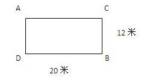

A. 4.8米/秒

B. 4.5米/秒

C. 4米/秒

D. 5米/秒

第 31 题 · 答案与解析

**参考答案（粉笔题库参考内容）**

B

**解析**

根据题干条件，甲在恰好跑了5圈之后追上乙，则追及所用的时间为5×（20＋12）×2÷5＝64秒。设乙的速度为x米/秒，则根据追及问题公式：追及时间＝追及路程÷速度差，，解得x＝4.5。

故正确答案为B。

**考点**：相遇追及

**来源**：2014年江苏省公务员录用考试《行测》题（A类）第31题

### 第 32 题

从1，2，3，4，5，6，7中任取2个数字，分别作为一个分数的分子和分母，则在所得分数中不相同的最简真分数一共有多少个：

A. 14

B. 17

C. 18

D. 21

第 32 题 · 答案与解析

**参考答案（粉笔题库参考内容）**

B

**解析**

真分数为分子比分母小的分数，最简分数为分子和分母互质的分数。可分类计算最简真分数的个数：

①当分子为1时，分母可为2、3、4、5、6、7，共6个最简真分数；

②当分子为2时，分母可为3、5、7，共3个最简真分数；

③当分子为3时，分母可为4、5、7，共3个最简真分数；

④当分子为4时，分母可为5、7，共2个最简真分数；

⑤当分子为5时，分母可为6、7，共2个最简真分数；

⑥当分子为6时，分母可为7，共1个最简真分数；

⑦当分子为7时，不能构成最简真分数。

故共有6+3+3+2+2+1=17个最简真分数。

故正确答案为B。

**考点**：基础排列组合

**来源**：2014年江苏省公务员录用考试《行测》题（A类）第32题

### 第 33 题

师徒两人生产一产品，每套产品由甲乙配件各1个组成。师傅每天生产150个甲配件或75个乙配件；徒弟每天生产60个甲配件或24个乙配件，师徒决定合作生产，并进行合理分工，则他们工作15天后最多能生产该种产品的套数为：

A. 900

B. 950

C. 1000

D. 1050

第 33 题 · 答案与解析

**参考答案（粉笔题库参考内容）**

D

**解析**

根据题干条件可知要使生产最多，需效率最大，不管是甲配件还是乙配件都是师傅的效率比较大，但是对于师傅做甲乙配件的效率之比为150/75=2/1，对于徒弟做甲乙配件的效率之比为，可以看出徒弟做甲配件的相对效率比师傅要高，所以让徒弟去做甲配件，师傅去做乙配件。可让徒弟的全部时间做他比较擅长的甲配件，即个。为避免浪费，先让师傅做完与徒弟数量相同的乙配件900个，需要天，还剩下3天时间，师傅每天生产甲配件个数是乙配件的两倍，则花一天时间生产甲配件，剩下两天时间生产乙配件，则该种产品套数为900 + 150 = 1050套。

故正确答案为D。

**考点**：给具体单位型、统筹规划问题

**来源**：2014年江苏省公务员录用考试《行测》题（A类）第33题

### 第 34 题

有甲乙丙三种盐水，浓度分别为5%、8%、9%，质量分别为60克、60克、47克，若用这三种盐水配置浓度为7%的盐水100克，则甲种盐水最多可用：

A. 49克

B. 39克

C. 35克

D. 50克

第 34 题 · 答案与解析

**参考答案（粉笔题库参考内容）**

A

**解析**

设配置100克浓度为7%的盐水需要甲、乙、丙三种溶液各x、y、z克，根据题意，可列方程组：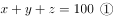；。
联立①②，化简后可得：3x=100+z。要想甲溶液即x尽可能大，则需要让z取值尽可能大，z最大可取47 克，当z=47时，x=49。

故正确答案为A。

**考点**：非典型最值问题

**来源**：2014年江苏省公务员录用考试《行测》题（A类）第34题

### 第 35 题

已知实数x、y满足：，

A. 0

B. 2

C. 1

D. 3

第 35 题 · 答案与解析

**参考答案（粉笔题库参考内容）**

C

**解析**

题干列式较为复杂，考虑赋特值求解。根据列式，当x=-1，y=0时，满足所给条件，故。

故正确答案为C。

**来源**：2014年江苏省公务员录用考试《行测》题（A类）第35题

### 第 36 题

小张的手表每天快30分钟，小李的手表每天慢20分钟，某天中午12点两人同时把表调到标准时间，则两人的手表再次同时显示标准时间最少需要的天数为：

A. 24

B. 36

C. 72

D. 114

第 36 题 · 答案与解析

**参考答案（粉笔题库参考内容）**

C

**解析**

小张的手表每天快30分钟，则2天快1小时。小李的手表每天慢20分钟，则3天慢1小时。手表再次显示标准时间12∶00，即与标准时间相差12个小时。对于小张，快12小时需要24天。小李慢12小时需要36天。同时显示12∶00最少需要的天数为24和36的最小公倍数，即72天。

故正确答案为C。

**来源**：2014年江苏省公务员录用考试《行测》题（B类）第38题

### 第 37 题

甲、乙两种商品，其成本价共100元，如甲、乙商品分别按30%和20%的利润定价，并以定价的90%出售，全部售出后共获得利润14.3元，则甲商品的成本价是：

A. 55元

B. 60元

C. 70元

D. 98元

第 37 题 · 答案与解析

**参考答案（粉笔题库参考内容）**

C

**解析**

设甲的成本为x元，则定价为1.3x元。乙的成本为（100-x）元，定价为1.2(100-x)元。根据利润公式：售价-成本=利润。可列方程为：=14.3，解得x=70。

故正确答案为C。

**考点**：经济利润问题

**来源**：2014年江苏省公务员录用考试《行测》题（A类）第37题

### 第 38 题

在数列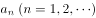中，，，且从第三项起，每项是它前两项平均数的整数部分，则

A. 1980

B. 1981

C. 1983

D. 1982

第 38 题 · 答案与解析

**参考答案（粉笔题库参考内容）**

D

**解析**

由所给定义可知，，，则从第三项起，每项是前两项平均数的整数部分：，，，，，，······故。

故正确答案为D。

**考点**：数列问题

**来源**：2014年江苏省公务员录用考试《行测》题（B类）第32题

### 第 39 题

甲乙两个工程队共同修建一段长为2100千米的公路，甲队每天比乙队少修50千米，甲队先单独修3天，余下的路程与乙队合修6天完成，则乙队每天所修公路的长度是：

A. 135千米

B. 140千米

C. 160千米

D. 170千米

第 39 题 · 答案与解析

**参考答案（粉笔题库参考内容）**

D

**解析**

根据条件，设甲的工作效率为P千米/天，则乙的工作效率为（P+50)千米/天。则由题意可列式：3P+(P+ P+50)×6=2100，解方程得：P=120。则乙的工作效率为：P+50=170千米/天。

故正确答案为D。

**考点**：给具体单位型

**来源**：2014年江苏省公务员录用考试《行测》题（A类）第39题

### 第 40 题

如图，A-BCD是棱长为3的正四面体，M是棱上的一点，且MB=2MA，G是三角形BCD的重心，动点P在棱BC上，则PM+PG的最小值：

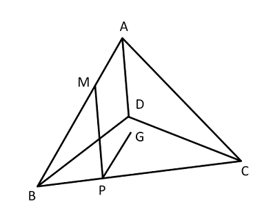

A. √10

B. √7

C. 3

D. √11

第 40 题 · 答案与解析

**参考答案（粉笔题库参考内容）**

B

**解析**

方法一：重心是三边中线的交点，具有特殊性质，即到顶点的距离与到对边中点的距离之比为2：1。

思路：将图形展开连成直线，利用重心的特性，可以求出其他两边的值，继而求得直角边的值。

展开图如下：

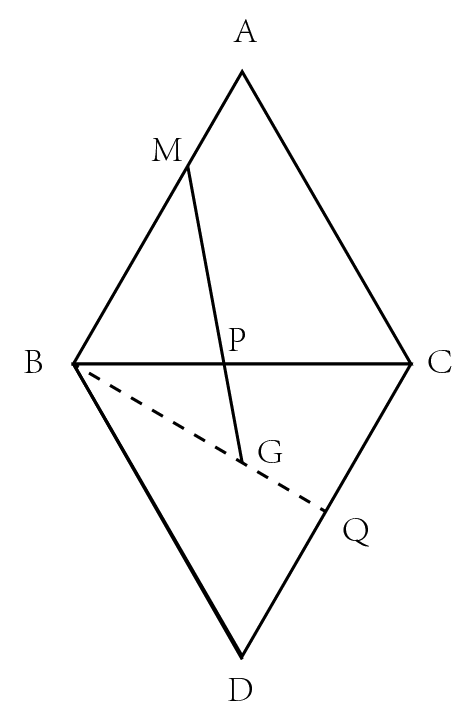

已知：，， ,

则，延长_BG_交_CD_于_Q_点，

则_B__Q_\=，

则_BG_\=，。

方法二：正式考试时，可以在图纸上画出上图，但是要相对标准，然后用尺子量取。

故正确答案为B。

**考点**：几何结论类-三角形相关、几何结论类-几何小题型

**来源**：2014年江苏省公务员录用考试《行测》题（A类）第40题

### 第 41 题

绿洲：荒漠

A. 开放：乐观

B. 白玉：玉石

C. 翠柳：黄花

D. 冷静：紧张

第 41 题 · 答案与解析

**参考答案（粉笔题库参考内容）**

D

**解析**

“绿洲”和“荒漠”属于反义词。

A 项：“乐观”的反义词是“悲观”，而不是“开放”，“乐观”和“开放”无明显的逻辑关系，排除。B 项：“白玉”是“玉石”的一种，二者之间是种属关系，与题干逻辑关系不符，排除。C 项：“翠柳”和“黄花”是并列关系，与题干逻辑关系不符，排除。D项：“冷静”和“紧张”属于反义词，与题干逻辑关系相符，当选。

故正确答案为D。

**考点**：语义关系-反义关系

**来源**：2014年江苏省公务员录用考试《行测》题（A类）第41题

### 第 42 题

喜气洋洋：欢乐

A. 气象万千：天气

B. 寻根究底：问题

C. 画蛇添足：多余

D. 眼明手快：好动

第 42 题 · 答案与解析

**参考答案（粉笔题库参考内容）**

C

**解析**

第一步：判断题干词语间逻辑关系。

“喜气洋洋”形容非常得意或异常欢乐的样子。“喜气洋洋”用来形容“欢乐”，二者之间为对应关系。

第二步：判断选项词语间逻辑关系。

A项：“气象万千”形容景象或事物壮丽而多变化，而不是形容“天气”，二者之间无明显的逻辑关系，排除。

B项：“寻根究底”指追求根底，一般指追问一件事的原由。“寻根究底”和“问题”之间无明显的逻辑关系，排除。

C项：“画蛇添足”比喻做多余、不恰当的事，以致弄巧成拙。“画蛇添足”用来形容“多余”，二者之间为对应关系，当选。

D项：“眼明手快”形容看得准，动作敏捷，而不是用来形容“好动”，二者之间无明显的逻辑关系，排除。

故正确答案为C。

**考点**：逻辑关系-对应关系

**来源**：2014年江苏省公务员录用考试《行测》题（A类）第42题

### 第 43 题

花儿：因开放而飘香

A. 水稻：种在水田里的稻

B. 果实：从苦涩走向香甜

C. 玉米：籽实比黄豆稍大

D. 青苗：没有成熟的庄稼

第 43 题 · 答案与解析

**参考答案（粉笔题库参考内容）**

B

**解析**

“花儿：因开放而飘香”，描述了一个美好的变化过程，二者之间为对应关系。A、C、D三项均是对事物的单纯解释或描述，排除；B项“果实：从苦涩走向香甜”描述了果实美好的变化过程，与题干逻辑关系相符，当选。

故正确答案为B。

**考点**：逻辑关系-对应关系

**来源**：2014年江苏省公务员录用考试《行测》题（A类）第43题

### 第 44 题

手链 之于 （    ） 相当于 工资 之于 （    ）。

A. 精美；工作

B. 手镯；工人

C. 饰品；收入

D. 手腕；津贴

第 44 题 · 答案与解析

**参考答案（粉笔题库参考内容）**

C

**解析**

将选项逐一代入，判断各选项前后部分的逻辑关系。

A项：“精美”形容“手链”，“精美的手链”是偏正短语；“工资”是因“工作”而得到的报酬，“工作”而非用来形容“工资”。两组词逻辑关系不一致，排除；

B项：“手链”与“手镯”是并列关系；“工资”是“工人”工作的报酬，而非并列关系。两组词逻辑关系不一致，排除；

C项：“手链”是“饰品”的一种，“工资”是“收入”的一种，前后两组词均为种属关系，逻辑关系一致，当选；

D项：“手链”与“手腕”是主宾关系；“津贴”包含在“工资”之内，是“工资”的组成部分，“津贴”与“工资”是组成关系。两组词逻辑关系不一致，排除。

故正确答案为C。

**考点**：逻辑关系-包容关系

**来源**：2014年江苏省公务员录用考试《行测》题（A类）第44题

### 第 45 题

构建 之于 （    ） 相当于 破除 之于 （    ）。

A. 外交模式；利益藩篱

B. 养老保险；城乡二元

C. 良好习惯；侥幸心理

D. 学术思想；环境污染

第 45 题 · 答案与解析

**参考答案（粉笔题库参考内容）**

A

**解析**

将选项逐一代入，判断各选项前后部分的逻辑关系。

A项：“构建外交模式”“破除利益藩篱”，满足动宾关系且符合搭配习惯，当选；

B项：“构建”多用于抽象事物，与“养老保险”搭配不当，排除；

C项：常用搭配为“养成良好习惯”，而非“构建良好习惯”，排除；

D项：“构建学术思想”构成动宾关系，“破除”是对不符合客观规律的事物给以破坏和铲除，“破除环境污染”属于搭配不当，排除。

故正确答案为A。

**考点**：语法关系

**来源**：2014年江苏省公务员录用考试《行测》题（A类）第45题

### 第 46 题

（    ） 之于 钢琴 相当于 乒乓球 之于 （    ）。

A. 舞台；球台

B. 手风琴；足球

C. 音乐家；运动员

D. 琴声；喝彩

第 46 题 · 答案与解析

**参考答案（粉笔题库参考内容）**

B

**解析**

将选项逐一代入，判断各选项前后部分的逻辑关系。

A项：“钢琴”可以放置于“舞台”之上，“乒乓球”可以放置于“球台”之上，逻辑关系正确，但“乒乓球”与“球台”两个词语的位置错误，排除。

B项：“手风琴”与“钢琴”是一组并列关系，二者都是琴，“乒乓球”与“足球”是一组并列关系，二者都是球，前后逻辑关系一致，当选。

C项：“音乐家”与“钢琴”是主宾关系，“乒乓球”与“运动员”也是主宾关系，但是“乒乓球”“运动员”两个词语的位置颠倒，排除。

D项：“琴声”来自“钢琴”是主宾关系，“喝彩”与“乒乓球”的位置颠倒且“喝彩”不是来自“乒乓球”，排除。

故正确答案为B。

**考点**：逻辑关系-并列关系

**来源**：2014年江苏省公务员录用考试《行测》题（A类）第46题

### 第 47 题

3，4，5，6，9，8，1，2

A. 2，3，6，5，4，1，8，9

B. 8，3，5，6，2，1，4，9

C. 9，2，5，6，3，4，8，1

D. 4，1，2，6，8，5，9，3

第 47 题 · 答案与解析

**参考答案（粉笔题库参考内容）**

A

**解析**

题干中是奇偶相间排列，奇数和偶数依次错开，A项是偶奇偶奇偶奇偶奇排列，奇数和偶数依次错开，B、C、D三项都不符合奇数和偶数依次错开。

故正确答案为A。

**来源**：2014年江苏省公务员录用考试《行测》题（A类）第47题

### 第 48 题

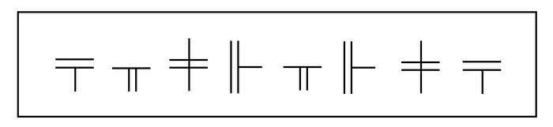

A. 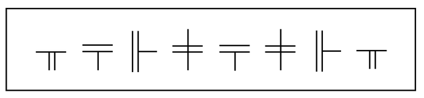

B. 

C. 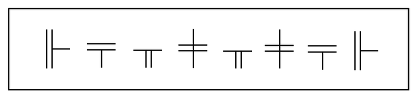

D. 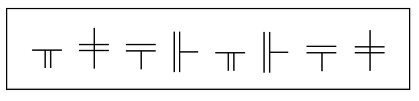

第 48 题 · 答案与解析

**参考答案（粉笔题库参考内容）**

A

**解析**

题干中第一个图形与第八个图形相同，第二个图形与第五个图形相同，第三个图形与第七个图形相同，第四个图形与第六个图形相同。

A项与题干一致；B项第三个图形与第七个图形不相同；C项第二个图形与第五个图形不相同；D项第一个图形与第八个图形不相同。

故正确答案为A。

**来源**：2014年江苏省公务员录用考试《行测》题（A类）第48题

### 第 49 题

A. 

B. 

C. 

D. 

第 49 题 · 答案与解析

**参考答案（粉笔题库参考内容）**

C

**解析**

题干中第一个符号与第九个符号相同，第二个符号与第八个符号相同，第三个符号与第七个符号相同，第四个符号与第六个符号相同，第五个符号与第十个符号相同。

A项第一个符号与第九个符号不相同。B项第二个符号与第八个符号不相同。C项与题干关系一致。D项第二个符号与第八个符号不相同。

故正确答案为C。

**来源**：2014年江苏省公务员录用考试《行测》题（A类）第49题

### 第 50 题

FOLWSJWFSJLO

A. ETMUJCUEJCMT

B. KLTMJCTKJCML

C. IVXUJWUIJVXW

D. RHTMUQUMRHQT

第 50 题 · 答案与解析

**参考答案（粉笔题库参考内容）**

A

**解析**

本题属于字符类比，主要考查相同符号对应。题干第二个字母与最后一个字母相同，第三个与倒数第二个相同，符合此规律的只有A项。

故正确答案为A。

**来源**：2014年江苏省公务员录用考试《行测》题（A类）第50题

### 第 51 题

下面给出的一套图形，其中有四个图，从中选出唯一的一项作为保持上面五个图形规律的第六个图是：

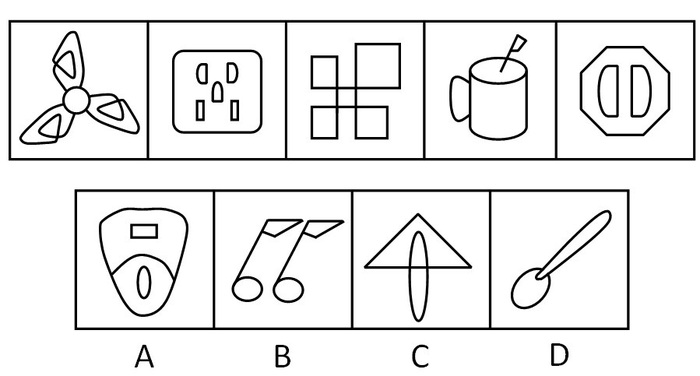

A. A

B. B

C. C

D. D

第 51 题 · 答案与解析

**参考答案（粉笔题库参考内容）**

D

**解析**

题干图形组成凌乱，各图形构成不同，但出现多个封闭区域，考虑封闭区域个数。题干中各图形封闭区域的个数分别为7，6，5，4，3，（    ），应选择含有2个封闭区域的D项。

故正确答案为D。

**考点**：数量规律-面

**来源**：2014年江苏省公务员录用考试《行测》题（C类）第47题

### 第 52 题

在下面给出的一套图形，其中有四个图，从中选出唯一的一项作为保持上面五个图形规律的第六个图：

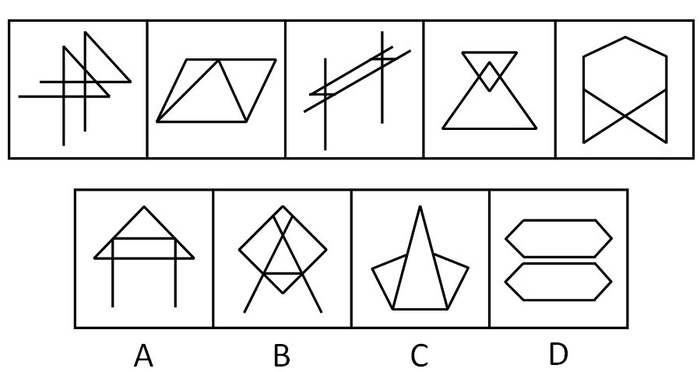

A. A

B. B

C. C

D. D

第 52 题 · 答案与解析

**参考答案（粉笔题库参考内容）**

A

**解析**

题干图形组成凌乱，各个图形构成不同，且全部由直线组成，因此优先考虑数数——数直线。题干中每一幅图的直线线条数目均为6，故应在选项中找出直线线条数目为6 的选项，A、B、C、D 四项的直线线条数目依次为6，7，7，12。

故正确答案为A。

**考点**：数量规律-线

**来源**：2014年江苏省公务员录用考试《行测》题（A类）第52题

### 第 53 题

下面给出的一套图形，其中有四个图，从中选出唯一的一项作为保持上面五个图形规律的第六个图是：

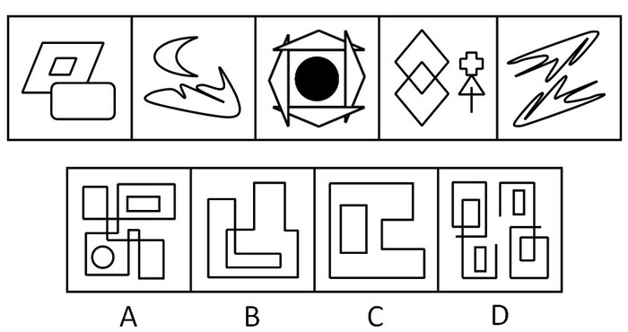

A. A

B. B

C. C

D. D

第 53 题 · 答案与解析

**参考答案（粉笔题库参考内容）**

C

**解析**

元素组成不同，优先考虑属性规律（对称、曲直、开闭），属性无明显规律。考虑数数，在第三个图中出现了非线条图形，优先考虑图形的部分数。题干中5个图形均由两部分组成，观察选项，A、B、C、D四项的部分数依次为3、1、2、4。

故正确答案为C。

**考点**：数量规律-素

**来源**：2014年江苏省公务员录用考试《行测》题（A类）第53题

### 第 54 题

下面四个图形中，只有一个是由上面的四个图形拼合而成（只能通过上下左右平移），请把它找出来：

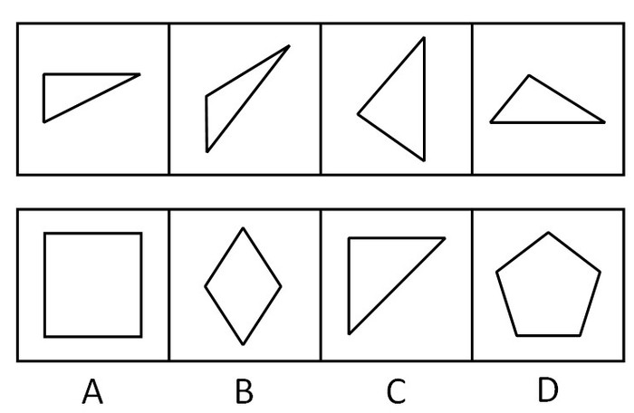

A. A

B. B

C. C

D. D

第 54 题 · 答案与解析

**参考答案（粉笔题库参考内容）**

A

**解析**

方法一：本题考查的是平面拼合，可以采用平行等长消去的方式。消去平等长的线段后进行组合得到轮廓图，即为A项。平行等长消去方式如下图所示。

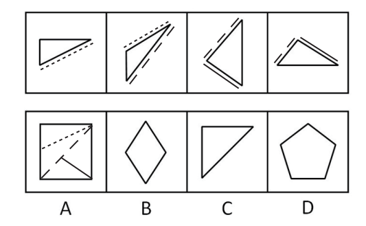

方法二：观察题干图形可发现有三个直角，因此，拼合后的图形可分割出三个直角，排除B、C、D三项。
故正确答案为 A。

**来源**：2014年江苏省公务员录用考试《行测》题（A类）第54题

### 第 55 题

下面四个图形中，只有一个是由上面的四个图形拼合而成（只能通过上下左右平移），请把它找出来：

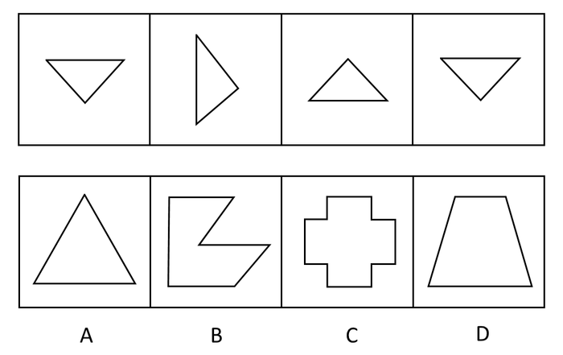

A. A

B. B

C. C

D. D

第 55 题 · 答案与解析

**参考答案（粉笔题库参考内容）**

B

**解析**

方法一：本题考查的是平面拼合，可以采用平行等长消去的方式。消去平行等长的线段后进行组合得到轮廓图，即为B项。平行等长消去方式如下图所示：

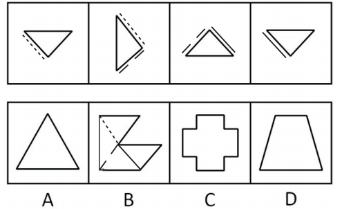

方法二：题干图形全为三角形，直接排除C项；观察A项，可切割成四个相同的三角形，与题干不符，排除；D项可切割成两组相同的三角形，与题干不符，排除。

故正确答案为B。

**来源**：2014年江苏省公务员录用考试《行测》题（A类）第55题

### 第 56 题

左边给定的是纸盒外表面的展开图，右边哪一项能由它折叠而成？请把它找出来：

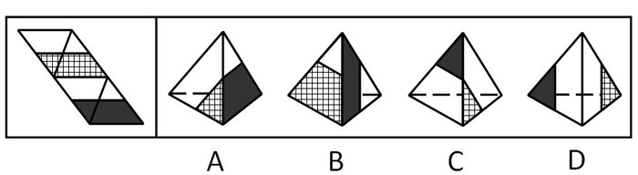

A. A

B. B

C. C

D. D

第 56 题 · 答案与解析

**参考答案（粉笔题库参考内容）**

C

**解析**

本题为空间重构，将各个面标号。

A项：该项中出现的面是面d和面a，展开图中面d和和面a的公共边与面a的阴影不挨着，而选项中面a和面d的公共边和面a的阴影部分挨着，选项与题干不一致，排除；

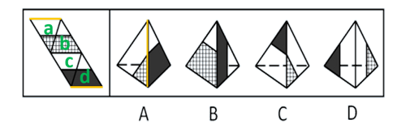

B项：该项出现的是面d和面b，展开图中面d和面b的公共边与面d的短阴影边挨着，而选项中二者的公共边与面d的长阴影边挨着，选项与题干不一致，排除；

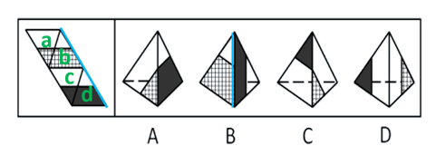

C项：与展开图一致，当选；

D项：该项出现面a和面c，展开图中面a和面c的公共边与面c的阴影部分挨着，而选项中二者的公共边没有与面c的阴影挨着，选项与题干不一致，排除。

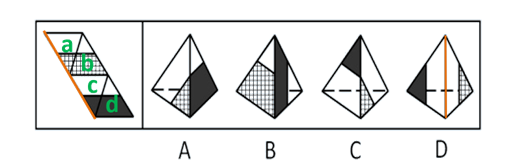

故正确答案为C。

**来源**：2014年江苏省公务员录用考试《行测》题（A类）第56题

### 第 57 题

左边给定的是纸盒外表面的展开图，右边哪一项能由它折叠而成？请把它找出来：

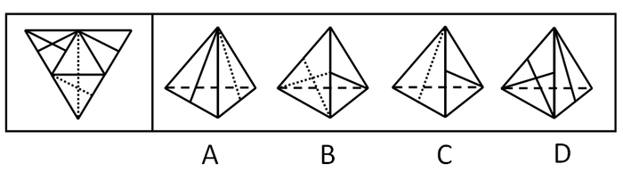

A. A

B. B

C. C

D. D

第 57 题 · 答案与解析

**参考答案（粉笔题库参考内容）**

B

**解析**

本题考查空间重构能力。将原有平面展开图进行标面，即：

观察选项，发现选项中均存在面③，且面③是唯一面，将面③作为参考面。将面③由底面至顶点的垂线画一个箭头，如平面图所示（相同样式的线为同一条线）；①②④三面相对面③的位置关系为：面①位于面③的右方，面②位于面③的左边，面④位于面③下方。

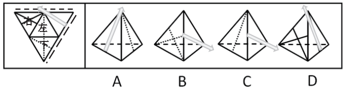

A项：箭头的右方为面①，而非面②，排除；

B项：箭头的下方为面④，与题干平面图对应，当选；

C项：箭头的下方应为面④，而非面②，排除。

D项：箭头的左方应为②，而非面①，排除。

故正确答案为B。

**来源**：2014年江苏省公务员录用考试《行测》题（A类）第57题

### 第 58 题

左边给定的是纸盒外表面的展开图，右边哪一项能由它折叠而成？请把它找出来：

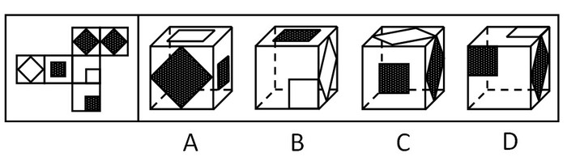

A. A

B. B

C. C

D. D

第 58 题 · 答案与解析

**参考答案（粉笔题库参考内容）**

C

**解析**

本题属于空间重构类，主要考查六面体。

A项：A项的最上方的面在平面展开图中未找到，排除；

B项：正面和右侧面是相对面，相对面必然出现且只出现其中一个面，相对面不能同时出现，排除；

C项：与题干一致，当选；

D项：该项中黑色正方形的面和白色正方形的面的公共边与黑色正方形挨着，而展开图中二者的公共边与白色正方形挨着，选项与题干不一致，排除。

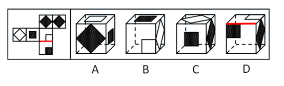

故正确答案为C。

**考点**：空间类-空间重构-六面体

**来源**：2014年江苏省公务员录用考试《行测》题（A类）第58题

### 第 59 题

左边给定的是纸盒外表面的展开图，右边哪一项能由它折叠而成？请把它找出来：

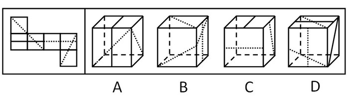

A. A

B. B

C. C

D. D

第 59 题 · 答案与解析

**参考答案（粉笔题库参考内容）**

A

**解析**

本题属于空间重构类，主要考查六面体。

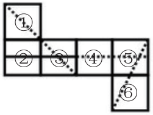

在平面展开图中标示出三组相对面，即①和⑥相对、②和④相对、③和⑤相对。根据相对面必然出现且只出现一次，相对面不相邻，排除B、C、D三项。

故正确答案为A。

**考点**：空间类-空间重构-六面体

**来源**：2014年江苏省公务员录用考试《行测》题（A类）第59题

### 第 60 题

左边给定的是纸盒外表面的展开图，右边哪一项能由它折叠而成？请把它找出来：

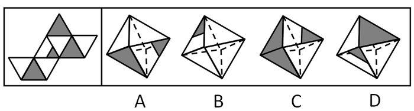

A. A

B. B

C. C

D. D

第 60 题 · 答案与解析

**参考答案（粉笔题库参考内容）**

D

**解析**

本题考查空间重构能力，通常采用排除的思想。

将此八面体的公共边用相同样式线条标示，发现所有含有阴影三角形的相邻面均为空白面。

即平面展开图中，空白面和空白面之间互不相邻，阴影面和阴影面互不相邻，因此折叠后不可能出现相邻的情况，排除A、B、C三项。

故正确答案为D。

**来源**：2014年江苏省公务员录用考试《行测》题（A类）第60题

### 第 61 题

党要管党，首先是要管好干部；从严治党，关键是从严治吏。干部作风存在问题，就易成为腐败的温床。唯有紧抓干部的清廉从政，坚决扫除作风之弊、行为之垢，我们的党才能永葆纯洁，才能永葆与人民群众的血肉联系。

根据以上信息，可以得出以下哪项：

A. 如果从严治吏，就要从严治党

B. 如果干部作风没有问题，腐败就找不到滋生的温床

C. 如果不紧抓干部的清廉从政，我们的党就不能永葆与人民群众的血肉联系

D. 如果坚决扫除作风之弊、行为之垢，我们的党就能永葆纯洁

第 61 题 · 答案与解析

**参考答案（粉笔题库参考内容）**

C

**解析**

第一步：翻译题干，利用充分必要条件。

“从严治党，关键是从严治吏”：前→后，翻译为：治党→治吏①；“干部作风存在问题，就易成为腐败的温床”：前→后，翻译为：干部作风有问题→成为腐败的温床②；“唯有紧抓干部的清廉从政，坚决扫除作风之弊、行为之垢，我们的党才能永葆纯洁，才能永葆与人民群众的血肉联系”：后→前，翻译为：党能永葆纯洁、永葆与人民的联系→紧抓干部清廉，扫除作风之弊、行为之垢③。

第二步：逐一翻译选项并判断正确答案。

A项：如果······就······前→后，翻译为：治吏→治党，是对①的肯后，肯后无必然，排除；

B项：如果······就······前→后，翻译为：干部作风没问题→腐败就找不到温床，是对②的否前，否前无必然，排除；

C项：如果······就······前→后，翻译为：不紧抓干部清廉从政→党就不能永葆与人民的联系，是对③应用逆否规则所得，当选；

D项：如果······就······前→后，翻译为：扫除作风之弊、行为之垢→党能永葆纯洁，是对③的肯后，肯后无必然，排除。

故正确答案为C。

**考点**：常规翻译

**来源**：2014年江苏省公务员录用考试《行测》题（C类）第57题

### 第 62 题

快递来了不敢开门，查水表的不让进屋，买肉时总要用手按按看肉里有没有注水，去超市买牛奶面包看不清保质期绝不轻易买单······怀疑一切似乎成了当今社会很多人的心理公识，老百姓成了“老不信”，这导致政府、专家及媒体等公信力严重受损。一项权威调查表明，中国社会的总体信任度下降，只有不到一半的被调查者认为社会上大多数人可信。

根据上述调查的结论，可以得出以下哪项：

A. 社会上多数人认为社会上少数人可信

B. 社会上少数人认为社会上多数人不可信

C. 社会上有人不认为社会上少数人可信

D. 社会上有人不认为社会上多数人可信

第 62 题 · 答案与解析

**参考答案（粉笔题库参考内容）**

D

**解析**

第一步：抓住题干主要信息。

最后一句是题干的主要信息点，只有不到一半的被调查者认为社会上大多数人可信。

第二步：逐一分析比较选项。

A、B两项：均涉及“社会上多数人或者少数人认为······”而这项权威调查结果只是针对被选取的调查人员而言，因此无法推出社会上多数人或者少数人的情况或者看法，排除。

C项：涉及的是关于少数人可信的问题，题干只谈及了大多数人可信问题，与题干主要信息不符，无法推出，排除。

D项：由“只有不到一半的被调查者认为社会上大多数人可信”可知，其他被调查者并不认为如此，故至少可以推出，即“有人不认为社会上大多数人可信”，当选。

故正确答案为D。

**考点**：日常结论

**来源**：2014年江苏省公务员录用考试《行测》题（A类）第62题

### 第 63 题

如果某地公共政策制定是正确的并且执行有力，则不会出现大规模上访。只有相关决策人不关心群众，才会出现大规模上访。某地公共政策制定是正确的，相关决策人也心系群众，深入实际搞调查研究，当地群众对此是满意的。

根据以上信息，得不出以下哪项：

A. 如果某地出现大规模上访，则该地相关决策人不关心群众

B. 如果某地出现大规模上访，则该地公共政策并非执行有力

C. 如果某地没有出现大规模上访，则该地公共政策执行有力

D. 如果某地没有出现大规模上访，则该地公共政策制定正确

第 63 题 · 答案与解析

**参考答案（粉笔题库参考内容）**

C

**解析**

第一步：利用充分必要条件，翻译题干。

①公共政策正确∧执行有力→上访；

②上访→不关心群众；

③公共政策正确 且 决策人心系群众。

第二步：逐一翻译选项并判断正确答案。

A项：上访→不关心群众，与②表述一致，因此正确，排除。

B项：上访→政策执行有力。①的逆否为：上访→（公共政策正确 且 执行有力），根据摩根定律推理为：上访→公共政策正确 或 -执行有力，由于公共政策正确，则有上访→政策执行有力，因此正确，排除。

C项：该项翻译为：-上访→政策执行有力，由于A→B等价于-A 或 B，所以该项等价于上访或执行有力，根据题干无法推知该项是否一定正确，故该项根据题干无法推知，当选。

D项：该项翻译为：-上访→公共政策正确。由于A→B等价于-A 或 B，所以该项等价于上访或正确，由条件③知公共政策正确，即D项根据题干可以推出，排除。

本题为选非题，故正确答案为C。

**考点**：常规翻译

**来源**：2014年江苏省公务员录用考试《行测》题（C类）第58题

### 第 64 题

随处可见的榨菜，在中国经济舞台上正扮演越来越重要的角色。从2007年到2011年，涪陵榨菜在华南地区的市场份额从49%一路跌破30%，与此对应的是珠三角地区劳动密集型企业的转移。2012年，在中西部地区务工的农民工数量增长较快，与此同时，该地区涪陵榨菜销售额创造了接近50%的增长。有专家就此指出，榨菜销售量与农民工的流动趋势存在巨大的相关性，政府可根据“榨菜指数”变化情况提前制定政策，从容应对人口骤增后带来的就业、治安、教育、社保等公共服务问题。

以下哪项如果为真，最能支持上述专家的言论：

A. 榨菜是大众喜爱的食品，四川、重庆人也喜欢榨菜，而四川、重庆两地又都是农民工输出地

B. 榨菜美味可口、价格低廉，购买、携带均很方便，在外地务工的农民工是榨菜的主要消费群体

C. 据传，国家某权威部门根据“榨菜指数”变化情况将全国分为“人口流入区”和“人口流出区”，但近期该部门对此传闻予以明确否认

D. 浙江、福建等地生产的榨菜可能与涪陵榨菜销量情况相似，其销量的区域变化也能体现农民工的流动趋势

第 64 题 · 答案与解析

**参考答案（粉笔题库参考内容）**

B

**解析**

第一步：找到论点论据。

论点：榨菜销售量与农民工的流动趋势存在巨大的相关性，政府可根据“榨菜指数”变化情况提前制定政策，从容应对人口骤增后带来的就业、治安、教育、社保等公共服务问题。

论据：有数据证明榨菜销售量与农民工流动趋势相关。

第二步：逐一判断选项的作用。

题干由榨菜的销量与农民的流动趋势有很大相关性，得出政府可以根据“榨菜指数”变化情况来制定相关政策。

B项：“外地务工的农民工是榨菜的主要消费群体”是榨菜能体现农民工流动趋势的前提条件，说明了榨菜销量的改变与农民工转移之间的内在联系，加强了论据，可以支持专家的言论，当选。

A项“四川、重庆”和D项“浙江、福建”都是枚举小样本的论据，支持力度弱于B项近乎整体性样本，排除。

C项：“明确否认”削弱了专家言论，排除。

故正确答案为B。

**考点**：补充论据

**来源**：2014年江苏省公务员录用考试《行测》题（A类）第64题

### 第 65 题

六朝时的清谈名家刘惔话很多，但他也欣赏不说话的人。他见江权不常开口，非常欢喜，说：“江权不会说话，而能够不说，真叫人佩服。”江权知道自己不善言谈，但他懂得藏拙。不是每个人都知道自己的缺点在什么地方，好为人师夸夸其谈者不计其数。能说话而爱说，情有可原；很多人明明不大会说话，偏偏说个不停，自曝其短，往往令人生厌。因此可以说，江权这样做，其实是一种极难得的聪明。

以下哪项如果为真，最能支持上述结论：

A. 能言而能不言是一种极难得的聪明

B. 不能言而能不言是一种自知的聪明

C. 不能言而言其实是一种浮夸之举

D. 不能言而不言其实是一种无奈之举

第 65 题 · 答案与解析

**参考答案（粉笔题库参考内容）**

B

**解析**

第一步：找到论点论据。

论点：江权不会说话，能够不说，是一种极难得的聪明。

论据：无。

第二步：逐一判断选项的作用。

A项：论点讨论的是不能言而不言，而该项讨论的是能言而能不言，二者话题不一致，排除。

B项：“不能言”和“能不言”均与论点相符，补充了新论据，加强了论点，当选。

C项：论点讨论的是不能言而不言，而该项讨论的是不能言而言，二者话题不一致，排除。

D项：论点讨论的是聪明之举，而该项讨论的是无奈之举，二者话题不一致，排除。

故正确答案为B。

**考点**：补充论据

**来源**：2014年江苏省公务员录用考试《行测》题（A类）第65题

### 第 66 题

一个人只有努力奋斗拼搏，才能获得事业的成功；只有获得事业的成功，才能获得人生的幸福。但是，如果努力奋斗拼搏，就要勇于承受痛苦与艰难。遗憾的是，世上有些人十分畏惧痛苦与艰难，并不愿意承受它们。

根据以上信息，可以推出以下哪项：

A. 如果勇于承受痛苦与艰难，就能获得事业的成功

B. 如果勇于承受痛苦与艰难，就能获得人生的幸福

C. 世上有些人能够获得事业的成功和人生的幸福

D. 世上有些人不能获得事业的成功和人生的幸福

第 66 题 · 答案与解析

**参考答案（粉笔题库参考内容）**

D

**解析**

第一步：利用充分必要条件，翻译题干。

先翻译题干，“只有努力奋斗拼搏，才能获得事业的成功”：后→前，翻译为：获得事业的成功→努力奋斗①；“只有获得事业的成功，才能获得人生的幸福”：后→前，翻译为：获得人生幸福→获得事业成功②；“如果努力奋斗拼搏，就要勇于承受痛苦和艰难”：前→后，翻译为：努力奋斗→勇于承受痛苦③；根据传递规则，由②①③可得，获得人生幸福→获得事业成功→努力奋斗→勇于承受痛苦④；题干最后一句话为确定信息：有些人十分畏惧痛苦与艰难，并不愿意承受它们⑤。

第二步：逐一翻译选项，判断正确答案。

A项：如果······就······前→后，翻译为：勇于承受痛苦→获得事业成功，直接肯后，排除；

B项：如果······就······前→后，翻译为：勇于承受痛苦→获得人生幸福，直接肯后，排除；

C、D两项不需要翻译。由⑤“有人不愿意承受痛苦”可知，需对④应用逆否规则，可得：不勇于承受痛苦→不努力奋斗→不能获得事业成功→不能获得人生幸福⑥。由⑤⑥可得：有人不能获得事业的成功和人生的幸福。

故正确答案为D。

**考点**：常规翻译

**来源**：2014年江苏省公务员录用考试《行测》题（A类）第66题

### 第 67 题

购买彩票时，很多人往往愿意自己选号，不愿交由电脑随机选号。因为他们相信，中奖号码从长远看是随机产生的，但在短期内却有规律，比如前面连续多期出现的数字，这期出现的可能性就要小一些；或者某些数字对于自己意味深长，或者干脆就是自己的幸运数字，选择它们应该更可能中奖。

以下哪项如果为真，最能质疑上述这些人的想法：

A. 很多人研究彩票的中奖规律，但他们的中奖率并没有因此而显著提高

B. 每一期中奖号码都是独立随机产生的，彼此间没有任何内在的关联

C. 对于中奖号码的产生究竟有无规律，很多人持“信则有，不信则无”的观点

D. 电脑选号是随机的，而自己选号有特定的意向，在这一点上人比电脑更聪明

第 67 题 · 答案与解析

**参考答案（粉笔题库参考内容）**

B

**解析**

第一步：找出论点和论据。

论点：中奖号码从长远看是随机产生的，但在短期内却有规律，比如前面连续多期出现的数字，这期出现的可能性就要小一些；或者某些数字对于自己意味深长，或者干脆就是自己的幸运数字，选择他们应该更有可能中奖。

无明显论据。

第二步：逐一分析选项。

A项，研究中奖规律也没有提高中奖概率，不能证明中奖号码是否有规律，且没有显著提高不代表没有提高，只要有所提高就说明可能是有规律的，不能削弱，排除；

B项，号码独立产生，彼此间没有关联，说明短期内也是没有任何规律的，直接削弱论点，当选；

C项，说明人们如何看待中奖号码是否有规律这件事，属无关选项，无法削弱，排除；

D项，说明人比电脑选号有优势，属于补充论据支持结论，不能削弱，排除。

故正确答案为B。

**考点**：削弱论点

**来源**：2014年江苏省公务员录用考试《行测》题（C类）第59题

### 第 68 题

在以下5×5矩阵中，每个小方格中可填入一个汉字，要求每行每列均含有金、木、水、火、土5个汉字，不能重复也不能遗漏，根据已经给到的条件，矩阵中①所在方格中应填入的汉字是：

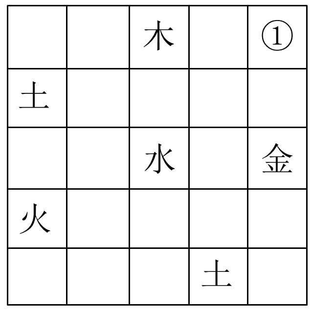

A. 金

B. 火

C. 水

D. 土

第 68 题 · 答案与解析

**参考答案（粉笔题库参考内容）**

D

**解析**

本题属于数独型分析推理，利用信息量最大优先去考虑。

（1）信息量最大的空格为第三行第一列的空格，横行不能填入水、金，纵列不能填入土、火，因此该空格内只能填入木。

（2）再次寻找信息量最大的空格，为第三行第四列的空格，横行不能填入金、木、水，纵列不能填入土，因此只能填入火，如此，第三行第二列只能填入土。

（3）由此，第二行第一列、第三行第二列、第五行第四列中均有土，而第一行第三列中填入了木，在第一行五列中，第一列到第四列均不能填入土，因此第一行第五列中填入土，即①中填入土。

故正确答案为D。

**考点**：从最大信息开始推

**来源**：2014年江苏省公务员录用考试《行测》题（A类）第68题

## 材料 2

某医院的外科病区有甲、乙、丙、丁、戊5位护士，她们负责病区1、2、3、4、5、6、7号7间病房的日常护理工作，每间病房只由一位护士来护理，每位护士至少护理一间病房。在多年的护理过程中，她们已经形成特定的护理习惯和经验。已知：

（1）甲护理1、2号两间病房，不护理其他病房；

（2）乙和丙都不护理6号病房；

（3）如果丁护理6号病房，则乙护理3号病房；

（4）如果丙护理4号病房，则乙护理6号病房；

（5）戊只护理7号病房。

### 第 69 题

根据以上信息，可以得出以下哪项：

A. 乙护理3号病房

B. 丙护理4号病房

C. 丁护理5号病房

D. 乙护理4号病房

第 69 题 · 答案与解析

**参考答案（粉笔题库参考内容）**

A

**解析**

列出题干条件：①甲1、2号；②乙、丙不护理6号；③丁6号→乙3号；④丙4号→乙6号；⑤戊7号。根据条件①②⑤可知，甲、乙、丙、戊都不护理6号病房，故6号病房只能由丁护理；再结合条件③可知，乙护理3号病房。

故正确答案为A。

**来源**：2014年江苏省公务员录用考试《行测》题（A类）第69题

### 第 70 题

如果丁只护理一间病房，则得不出以下哪项：

A. 乙护理4号病房

B. 丙护理5号病房

C. 丁护理6号病房

D. 乙护理5号病房

第 70 题 · 答案与解析

**参考答案（粉笔题库参考内容）**

D

**解析**

题干已知条件整理：甲1、2号，乙3号，丁6号，戊7号。接续上题，因为丁只护理一间病房，剩余4号或5号病房由丙护理。又根据乙护理3号而丁护理6号，每间病房只能由一位护士来护理，因此根据条件④，-（乙6）→（丙4），这样丙护理5号病房。最终：甲1、2号，乙3、4号，丙5号，丁6号，戊7号。对照选项即可得到正确答案。

本题为选非题，故正确答案为D。

**来源**：2014年江苏省公务员录用考试《行测》题（A类）第70题

### 第 71 题

微问政：指相关政府部门通过微博与网民互动，讨论社会公共话题，征询意见。

下列属于微问政的是：

A. 某市国土房管局在官方微博上推出系列活动，邀请市民就所关心的问题参与讨论

B. 某企业建立了网络互动平台，对员工关心的问题进行解答，受到员工的热捧

C. 某市工商局在社区设立一名指导员，负责开展消费维权知识讲座，帮助解决纠纷

D. 某大学广播站面向全体师生开通微信群，社会焦点问题成了大家的热门话题

第 71 题 · 答案与解析

**参考答案（粉笔题库参考内容）**

A

**解析**

第一步：查找关键词。

定义的关键词信息为“微问政”，定义的主体是“政府部门”，方式是“通过微博与网民互动”。

第二步：逐一判断选项。

A项：国土房管局在官方微博上推出系列活动，符合定义，当选。B、D两项：主体分别是企业和大学广播站，不符合定义，排除；C项：在社区设立指导员而不是通过微博与网民互动，不符合定义，排除。

故正确答案为A。

**考点**：方式目的

**来源**：2014年江苏省公务员录用考试《行测》题（A类）第71题

### 第 72 题

禁果心理：指基于对某种禁令的逆反心理而产生的强烈的探求欲望。

下列不属于禁果心理的是：

A. 许多寺院的入口处都有“禁止拍摄”的牌子，仍有少数游客趁工作人员不备偷偷拍摄

B. 宙斯派侍女潘多拉传递魔盒，特地交代她千万不能打开，潘多拉却经不住诱惑打开了盒子，结果里面的罪恶跑到了人间

C. 某部书是官方禁书，但很多人不明白为什么要禁，千方百计地找这部书来读，还出现了许多手抄本

D. 某商场在“双十一”当日推出20台特价平板电脑，先到先得，结果出现了数百人抢购的场面

第 72 题 · 答案与解析

**参考答案（粉笔题库参考内容）**

D

**解析**

第一步：查找关键词。

定义的关键词信息为“基于对某种禁令的逆反心理”。

第二步：逐一判断选项。

A、B、C三项中的“禁止拍摄”“特地交代她千万不能打开”“官方禁书”对应关键词“禁令”，符合定义，排除。D项：没有涉及“禁令”，不符合定义，当选。

本题为选非题，故正确答案为D。

**考点**：单定义-其他句式

**来源**：2014年江苏省公务员录用考试《行测》题（C类）第65题

### 第 73 题

换城消费：指由于两个城市之间交通便捷，物价高低不一，市民经常到对方城市购物的消费方式。

下列属于换城消费的是：

A. 北京市民小汪告诉记者：在北京6块钱一斤的红富士苹果，天津10元能买4个；北京80元一桶的食用油，天津才65元

B. 每次听到珠海有商场搞促销，深圳的李女士都会兴高采烈地赶去血拼，半天时间，家里就满是她的战利品

C. 赵女士每次从韩国回来，都在机场免税店买一大堆化妆品，这比在国内购买同一韩国品牌省不少钱

D. 黄先生在南方某市工作了七八年，眼见物价一路狂飙，准备卖掉自家房子，和妻子一块回北方老家养老

第 73 题 · 答案与解析

**参考答案（粉笔题库参考内容）**

B

**解析**

第一步：找出定义关键词。

“两个城市之间交通便捷”“物价高低不一”“市民经常到对方城市购物的消费方式”。

第二步：逐一判断选项。

A项：北京苹果6元一斤，而天津10元买4个，北京一桶食用油80元，而天津65元，符合“物价高低不一”，但没有提及市民是否经常到对方城市购物，和B项相比较而言，没有B项明确，排除。

B项：珠海和深圳交通便捷，深圳的李女士到珠海的商场血拼符合“经常到对方城市购物”，符合定义，当选。

C项：赵女士从韩国购买的化妆品比国内便宜，这是两个国家并非是两个城市，不符合“两个城市之间交通便捷”，排除。

D项：黄先生准备卖掉房子回老家养老不符合“市民经常到对方城市购物”，不符合定义，排除。

故正确答案为B。

**考点**：拆词

**来源**：2014年江苏省公务员录用考试《行测》题（B类）第73题

### 第 74 题

倒逼：指某些消极因素在特定条件下推动事物朝着积极方向发展的过程。

下列不属于倒逼的是：

A. 网络谣言不断刺激公众神经，某地政府痛下决心，采取一系列措施加大信息公开的力度，逐渐掌握了网络话语主动权

B. 某地民间非法融资活动屡禁不止，影响极为恶劣，政府有关部门终于再次启动了搁置半年之久的金融改革方案

C. 针对部分地区小产权房越来越多的现象，有专家撰文指出，小产权房在一定程度上解决了中低收入群体的安居问题。政府正在对这个问题进行调研

D. 1980年代，某地农民违规搞集体土地承包，当年粮食产量大幅提高，引起高层高度重视，催生了土地使用制度的全面改革

第 74 题 · 答案与解析

**参考答案（粉笔题库参考内容）**

C

**解析**

第一步：查找关键词。

定义的关键词信息为“某些消极因素”、“推动事物朝着积极方向发展”。

第二步：逐一判断选项。

A项：消极因素是“网络谣言”，积极的发展是“掌握了网络话语主动权”，符合定义，排除；

B项：消极因素是“非法融资活动屡禁不止”，积极的发展是“启动了金融改革方案”，符合定义，排除；

C项：与A项的“谣言”、B项的“非法”以及D项的“违规”相比，C项没有明确体现“消极因素”，且政府“正在”进行调研，并没有给出具体的措施，不符合“推动事物朝着积极方向发展”，不符合定义，当选；

D项：消极因素是“违规搞集体土地承包”，积极的发展是“土地使用制度的全面改革”，符合定义，排除。

本题为选非题，故正确答案为C。

**考点**：单定义-其他句式

**来源**：2014年江苏省公务员录用考试《行测》题（A类）第74题

### 第 75 题

协议制决策：指具有同等权限的单位或部门就共同面临的问题，通过协商作出决定的决策方法。

下列属于协议制决策的是：

A. 某林业局提出的项目申请，经过上级主管部门领导签字后，已正式立项

B. 在厅办公会上，经过协商、讨论，大家一致通过了某下属部门提交的方案

C. 某县环保局、城管局和卫生局多次会商环境问题，就环保局的方案讨论后形成了决议

D. 某科室购买办公用品的方案经正副主任签字同意后交由秘书小赵办理

第 75 题 · 答案与解析

**参考答案（粉笔题库参考内容）**

C

**解析**

第一步：查找关键词。

定义的关键词信息为“具有同等权限”、“通过协商作出决定”。

第二步：逐一判断选项。

A 项：林业局和上级主管部门没有同等权限，也没有进行协商，不符合定义，排除；

B 项：通过下属部门提交的方案不属于具有同等权限的部门，不符合定义，排除；

C 项：“县环保局、城管局和卫生局”属于具有同等权限的部门，“环保局的方案讨论后形成了决议”是通过协商作出决定的决策方法，符合定义，当选；

D 项：没有体现出具有同等权限的单位或部门面临的共同问题，也没有体现出协商，不符合定义，排除。

故正确答案为C。

**考点**：方式目的

**来源**：2014年江苏省公务员录用考试《行测》题（A类）第75题

### 第 76 题

隐性歧视：指存在于人的思想中、未公开显现出来的对特定群体的歧视性认识。

下列属于隐性歧视的是：

A. 戴着墨镜进居民小区的中年男子更容易被保安拦住盘问

B. 满脸大胡子、装束怪异的人往往被看成艺术家

C. 西装笔挺、皮鞋锃亮的人常常被认为是成功人士

D. 打扮成失学少年的乞丐往往能讨到更多的钱

第 76 题 · 答案与解析

**参考答案（粉笔题库参考内容）**

A

**解析**

第一步：查找关键词。

定义的关键词信息为“歧视性认识”。

第二步：逐一判断选项。

A项：“戴着墨镜进居民小区的中年男子”被保安拦住盘问，体现了保安对这类特定群体的歧视，符合定义，当选。

B、C、D三项均未涉及歧视性认识，不符合定义，排除。

故正确答案为A。

**考点**：拆词

**来源**：2014年江苏省公务员录用考试《行测》题（C类）第66题

### 第 77 题

财务自由是不需要为钱而努力工作的收入状态，一般需要满足两方面条件，保持财产性收入现金流入；保有一定量的净资产。

下列属于财务自由的是：

A. 李先生有总价三百多万的两套房产，每月的租金正好抵平银行按揭，家庭日常开支由自己的薪水维持

B. 某公司老总张先生准备负债经营、扩大公司的生产规模，已经用自家房产向银行申请了抵押贷款

C. 刘先生辞去工作后，长年在国内各地旅游，饱览名胜古迹，用自己的银行存款利息轻松地支付了一切开销

D. 股迷王先生用自家两百多万现金都用于炒股，随时关注股票走势，每一个涨停板、跌停板从不放过

第 77 题 · 答案与解析

**参考答案（粉笔题库参考内容）**

C

**解析**

第一步，找出定义关键词。

“不需要为钱而努力工作的收入状态”、“财产性收入现金流入”、“一定量的净资产”。

第二步，逐一判断选项。

A项：李先生的房产需要按揭还款，说明房产不属于李先生的“净资产”，并且薪水需要维持家庭日常开支，并不是“不需要为钱而努力工作”，不符合定义，排除；

B项：负债经营不能保持“财产性收入现金流入”，不符合定义，排除；

C项：存款利息为“财产性收入”，存款为“净资产”，符合定义，当选；

D项：王先生随时关注股票走势，没有体现出他是否“不需要为钱而努力工作”，与C项相比，没有C项明确，排除。

故正确答案为C。

**考点**：单定义-其他句式

**来源**：2014年江苏省公务员录用考试《行测》题（A类）第77题

### 第 78 题

二次留守，指农村留守儿童被父母接到城市后，由于父母每天忙于工作，孩子周围都是陌生人，没有朋友和玩伴。

下列属于二次留守的是：

A. 某城市农民工公寓聚居着大量外来工友，很多人都把孩子接到城里过暑假，天天有操各地口音的小孩在附近的小卖部、广场上一起玩耍

B. 在某小区街道菜场里，被父母接进城的小英每天帮着卖菜的奶奶收钱，没有客人的时候，她就蹲在地上翻看连环画

C. 暑假期间，某教育部门组织大批留守儿童进城参加夏令营活动，有的孩子还能与久别重逢的父母短暂相聚，由父母带他们游玩城市景点

D. 进城打工的小陈夫妇把智障儿子小明带到身边，民政部门得知后把他安排到残疾人康复中心，小陈夫妇每周只能见小明一次

第 78 题 · 答案与解析

**参考答案（粉笔题库参考内容）**

B

**解析**

第一步，查找关键词。

定义的关键词信息是二次留守；二次留守的主体是被父母接到城市的留守儿童，原因是“父母每天忙于工作”，结果是“没有朋友和玩伴”。

第二步，逐一判断选项。

A项：很多小孩一起玩耍不符合“没有朋友和玩伴”，不符合定义，排除；

B项：小英被父母接进城且没有人玩，符合定义，当选；

C项：留守儿童不是由父母接进城，不符合定义，排除；

D项：原因是民政部门把是智障的小明安排到残疾人康复中心，不是由于父母忙，不符合定义，排除。

故正确答案为B。

**考点**：大前提

**来源**：2014年江苏省公务员录用考试《行测》题（B类）第74题

### 第 79 题

防御型公共关系：指组织与外部环境发生协调困难，与公众的关系出现摩擦苗头时，通过及时调整组织结构、产品、方针政策或经营方式等，以适应环境变动和公众要求而开展的关系活动。

下列属于防御型公共关系的是：

A. 某公司的高层成员多次探访每一个拆迁家庭，进行真诚、细致的沟通，顺利完成了拆迁工作

B. 某公司针对其副总不当言论造成的不良影响，及时通过媒体公开道歉，取得了公众的谅解

C. 某上市公司通过相关媒体定期发布公司的生产和财务等信息，员工对这种透明做法非常满意

D. 某蛋糕生产企业接到个别客户的投诉电话后，及时收回了2个批次生产的100多斤蛋糕

第 79 题 · 答案与解析

**参考答案（粉笔题库参考内容）**

D

**解析**

第一步：抓住定义中的关键词。

防御型公关出现的时间是“与公众的关系出现摩擦苗头时”。

第二步：逐一判断选项。

A项没有涉及摩擦，不符合定义；

B项已经造成了不良影响，不符合定义；

C项没有涉及摩擦，不符合定义；

D项个别客户投诉意味着产品问题刚刚出现苗头，符合定义，当选。

故正确答案为D。

**考点**：大前提

**来源**：2014年江苏省公务员录用考试《行测》题（A类）第79题

### 第 80 题

π型人才，指至少拥有两种专业技能，并能将多门知识融会贯通的复合型人才。π下面的两竖指两种专业技能，上面的一横指多门知识的融会贯通。

下列属于π型人才的是：

A. 庄先生拥有物理学、管理学两个博士学位，现在是一家高新技术企业的老总，个人拥有多项专利，业余时间喜欢自行车运动

B. 张女士是一位远近闻名的理发师，每天为20多位顾客理发，一天下来尽管十分疲惫，回家后还要陪着女儿弹钢琴

C. 曹先生是服装界达人，对各类服装的款式、面料、做工、产地及市场行情了如指掌，他几次进军餐饮业都铩羽而归

D. 老赵是某酒店的大厨，川菜、粤菜、淮扬菜样样拿手，平时还苦练书法，歌唱得也好，是朋友圈里有名的麦霸

第 80 题 · 答案与解析

**参考答案（粉笔题库参考内容）**

A

**解析**

第一步，找出定义关键词。

“至少拥有两种专业技能”、“融会贯通”。

第二步，逐一判断选项。

A项：庄先生拥有物理学和管理学两种专业技能，符合定义，当选；

B项：张女士只有理发一种专业技能，不符合定义，排除；

C项：曹先生只有了解服装一种专业技能，“铩羽而归”恰好说明不能同时拥有多种专业技能，不符合定义，排除；

D项：老赵只有厨师这一种专业技能，不符合定义，排除。

故正确答案为A。

**考点**：单定义-其他句式

**来源**：2014年江苏省公务员录用考试《行测》题（A类）第80题

## 材料 3

2013年1-9月，苏南、苏中、苏北地区生产总值分别为26273.1亿元、8426.8亿元、9784.8亿元，同比分别增长10.2%、11.9%、12.2%；规模以上工业增加值分别为11762.9亿元、4900.9亿元、4829.0亿元，同比分别增长9.2%、13.1%、14.5%，苏北增幅比全省平均高3.0个百分点；沿海地区规模以上工业增加值3652.9亿元，同比增长14.2%，增幅比全省平均高2.7个百分点。

        2013年1-9月，苏南、苏中、苏北工业用电量分别为1683.1亿千瓦时、400.7亿千瓦时、539.6亿千瓦时，同比分别增长5.4%、5.3%、10.8%，苏北增幅比全省平均高4.8个百分点；沿海地区工业用电量384.4亿千瓦时，同比增长13.8%，增幅比全省平均高7.8个百分点。

        2013年1-9月，苏南、苏中、苏北完成固定资产投资分别为14299.4亿元、4988.8亿元、6222.7亿元，同比分别增长19.0%、20.1%、22.4%，苏北增幅比全省平均高2.4个百分点；沿海地区完成固定资产投资4787.0亿元，同比增长21.4%，增幅比全省平均高1.4个百分点。

        2013年1-9月，苏南、苏中进出口总额分别为3503.2亿美元、357.8亿美元，同比增长0.4%、4.8%；苏北进出口总额191.4亿美元，同比下降10.8%，增速比全省平均低11.0个百分点，沿海地区进出口总额306.8亿美元，增速比全省平均高8.7个百分点。

### 第 81 题

2013年1-9月，江苏省规模以上工业增加值同比增加量最多的地区是：

A. 苏南地区

B. 苏中地区

C. 苏北地区

D. 沿海地区

第 81 题 · 答案与解析

**参考答案（粉笔题库参考内容）**

A

**解析**

由“规模以上工业增加值”可定位到第一段，对比苏中、苏南、苏北、沿海数据，因增长率比较接近，而苏南现期量较大，可对比得出苏南增长量最多。

故正确答案为A。

**来源**：2014年江苏省公务员录用考试《行测》题（A类）第81题

### 第 82 题

2013年1-9月，苏中、苏北工业用电量占江苏省工业用电总量的比重同比分别：

A. 提高、提高

B. 提高、降低

C. 降低、提高

D. 降低、降低

第 82 题 · 答案与解析

**参考答案（粉笔题库参考内容）**

C

**解析**

从第二段中苏南、苏中、苏北工业用电量“同比分别增长5.4%、5.3%、10.8%，苏北增幅比全省平均高4.8个百分点”得出全省用电量同比增长为10.8%－4.8%=6%，则2013年1—9月，苏中工业用电量增长率小于江苏省工业用电总量增长率，故占比重降低，苏北工业用电量增长率大于江苏省工业用电总量增长率，故占比重增加。（注：本题通过计算也能得出相同答案。）

故正确答案为C。

**来源**：2014年江苏省公务员录用考试《行测》题（A类）第82题

### 第 83 题

2013年1-9月，江苏省规模以上工业增加值，工业用电量和完成固定资产投资同比增速分别用V_1、V_2、V_3表示，下列表示正确的是：

A. V1＜V2＜V3

B. V2＜V1＜V3

C. V1＜V3＜V2

D. V3＜V2＜V1

第 83 题 · 答案与解析

**参考答案（粉笔题库参考内容）**

B

**解析**

定位材料第一段：江苏省规模以上工业增加值增长率。

第二段：江苏省工业用电量增长率。

第三段：江苏省完成固定资产投资增长率。

因此V2＜V1＜V3。

故正确答案为B。

**来源**：2014年江苏省公务员录用考试《行测》题（A类）第83题

### 第 84 题

2013年1-9月，江苏省沿海地区进出口总额同比增速是：

A. 4.8%

B. 8.7%

C. 8.9%

D. 11.2%

第 84 题 · 答案与解析

**参考答案（粉笔题库参考内容）**

C

**解析**

由“进出口总额”定位到最后一段，苏北“同比下降10.8%，增速比全省平均低11.0个百分点”，得出全省平均值为-10.8%+11.0%=0.2%；由“沿海地区增速比全省平均高8.7个百分点”，得出沿海地区为0.2%+8.7%=8.9%。

故正确答案为C。

**来源**：2014年江苏省公务员录用考试《行测》题（A类）第84题

### 第 85 题

下列判断正确的有：
（1）2012年1-9月，苏中地区生产总值不足苏南地区的1/3；
（2）2013年1-9月，江苏省沿海地区工业用电量同比增量大于苏北地区；
（3）2013年1-9月，苏南、苏中、苏北的地区生产总值、规模以上工业增加值、工业用电量、完成固定资产投资和货物进出口总额同比均有所增长。

A. 0个

B. 1个

C. 2个

D. 3个

第 85 题 · 答案与解析

**参考答案（粉笔题库参考内容）**

B

**解析**

（1）正确。查材料可知2013年1—9月苏南生产总值为26273.1亿元，苏中为8426.8亿元，同比分别增长10.2%、11.9%，则2012年1—9月苏南生产总值为，苏中为，得苏中/苏南\=8426.8/26273.1×，其中8426.8×3&lt;26273.1，且&lt;1，所以苏中地区生产总值不足苏南地区的1/3。

（2）错误。2013年1-9月苏北工业用电量为539.6亿千瓦时，增幅为10.8%，增长量约为亿千瓦时；沿海地区工业用电量384.4亿千瓦时，同比增长13.8%，增长量约为亿千瓦时，苏北较大。

（3）错误。2013年1—9月苏北进出口总额同比下降10.8%。

因此，判断正确的有1个。

故正确答案为B。

**来源**：2014年江苏省公务员录用考试《行测》题（A类）第85题

## 材料 4

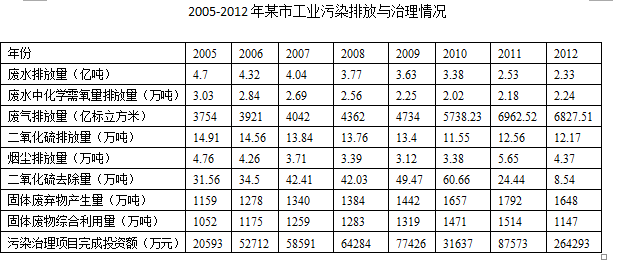

### 第 86 题

2006-2012年，该市工业废水排放量比上年减排最少的年份是：

A. 2006年

B. 2009年

C. 2010年

D. 2012年

第 86 题 · 答案与解析

**参考答案（粉笔题库参考内容）**

B

**解析**

直接看选项，选项中有哪些年份就去表格中找对应数据，如计算2006年，则应该用2006年排放量减去2005年排放量，负号代表减少，或者用2005年排放量减去2006年排放量。

2006年工业废水排放量比2005年少4.7-4.32=0.38亿吨；

2009年工业废水排放量比2008年少3.77-3.63=0.14亿吨；

2010年工业废水排放量比2009年少3.63-3.38=0.25亿吨；

2012年工业废水排放量比2011年少2.53-2.33=0.2亿吨。

因此2009年该市工业废水排放量比上年减排最少。

故正确答案为B。

**来源**：2014年江苏省公务员录用考试《行测》题（A类）第86题

### 第 87 题

2006-2012年，上表中指标数值逐年减小的指标有：

A. 0个

B. 1个

C. 2个

D. 3个

第 87 题 · 答案与解析

**参考答案（粉笔题库参考内容）**

B

**解析**

观察表中数据，2006-2012年指标数值逐年减小的指标仅有“废水排放量”一个。

故正确答案为B。

**来源**：2014年江苏省公务员录用考试《行测》题（A类）第87题

### 第 88 题

2005-2010年，该市每标立方米工业废气排放中二氧化硫含量最少的年份是：

A. 2005年

B. 2007年

C. 2009年

D. 2010年

第 88 题 · 答案与解析

**参考答案（粉笔题库参考内容）**

D

**解析**

根据题干“2005-2010年，该市每······中······含量最少的年份是”，可判定本题为现期平均数比较问题。定位统计表可得2005-2010年该市废气排放量及二氧化硫排放量。则选项中各年份每标立方米废气排放中二氧化硫含量分别为：2005年：14.91/3754；2007年：13.84/4042；2009年：13.4/4734；2010年：11.55/5738.23。观察发现，2010年分子最小，分母最大，即该分数最小。因此，2005-2010年，该市每标立方米工业废气排放中二氧化硫含量最少的年份为2010年。

故正确答案为D。

**来源**：2014年江苏省公务员录用考试《行测》题（A类）第88题

### 第 89 题

如果2013-2015年该市工业废水排放量与2010-2012年保持相同的年平均增长速度，则2015年该市工业废水排放量预计达到：

A. 1.15亿吨

B. 1.29亿吨

C. 1.50亿吨

D. 1.92亿吨

第 89 题 · 答案与解析

**参考答案（粉笔题库参考内容）**

C

**解析**

根据假设，2010-2012年保持相同的年平均增长速度可以表示为，则2015年该值为=2.33×2.33/3.63≈21/3×21/3÷32/3=7/3×7/3÷11/3=49/33=1+16/33≈1.5亿吨，因此2015年该市工业废水排放量预计达到1.5亿吨。

故正确答案为C。

**来源**：2014年江苏省公务员录用考试《行测》题（A类）第89题

### 第 90 题

下列判断正确的有：

（1）上表中有三个指标数值连续六年逐年递增；

（2）2012年该市污染排放与治理各项指标数值同比均有所减少；

（3）2005-2012年，该市工业“三废”（废水、废气、固体废物）减排效果最好的是工业废水。

A. 0个

B. 1个

C. 2个

D. 3个

第 90 题 · 答案与解析

**参考答案（粉笔题库参考内容）**

C

**解析**

（1）正确。直接根据表格数据可知，废气排放量、固体废弃物产生量和固体废物综合利用量三个指标数值连续六年逐年递增。

（2）错误。根据表格最后两列数据，废水中化学需氧量排放量和污染治理项目完成投资额是同比上升的。

（3）正确。根据表格数据，只有工业废水排放量是逐年减少的，故减排效果最好。

因此，判断正确的有两个。

故正确答案为C。

**来源**：2014年江苏省公务员录用考试《行测》题（A类）第90题

## 材料 5

### 第 91 题

2013年10月，江苏省民间固定资产投资完成额比4月多：

A. 297亿元

B. 308亿元

C. 335亿元

D. 368亿元

第 91 题 · 答案与解析

**参考答案（粉笔题库参考内容）**

A

**解析**

2013年10月江苏民间固定资产投资额为1-10月的投资量减去1-9月的投资额，即19727 – 17288 = 2439 亿元；4月江苏民间固定资产投资额为1-4月的投资额减去1-3月的投资额，即7560 – 5418 = 2142 亿元。二者差值为2439 – 2142 = 297 亿元。

故正确答案为A。

**来源**：2014年江苏省公务员录用考试《行测》题（C类）第81题

### 第 92 题

2013年3-12月，江苏省第一产业固定资产投资完成额超过19亿元的月份有：

A. 2个

B. 3个

C. 4个

D. 5个

第 92 题 · 答案与解析

**参考答案（粉笔题库参考内容）**

B

**解析**

定位至表中“第一产业”一行，数据逐一相减得：

3月：54 – 34 = 20；4月：76 – 54 = 22；

5月：95 – 76 = 19；6月：94 – 95 = – 1；

7月：112 – 94 = 18；8月：130 – 112 = 18；

9月：150 – 130 = 20；10月：168 – 150 = 18；

11月：185 – 168 = 17；12月：199 – 185 = 14。

其中3月、4月、9月共三个月超过19亿元。

故正确答案为B。

**来源**：2014年江苏省公务员录用考试《行测》题（C类）第82题

### 第 93 题

2012年江苏省第三产业固定资产投资完成额是：

A. 13150亿元

B. 13947亿元

C. 14193亿元

D. 15076亿元

第 93 题 · 答案与解析

**参考答案（粉笔题库参考内容）**

C

**解析**

2013年江苏省第三产业固定资产投资完成额为17358亿元，同比增长率为22.3%，所以2012年为，用直除法，结果前两位为14。

故正确答案为C。

**来源**：2014年江苏省公务员录用考试《行测》题（C类）第85题

### 第 94 题

2013年港澳台及外商固定资产季度投资完成额最少的季度是：

A. 第一季度

B. 第二季度

C. 第三季度

D. 第四季度

第 94 题 · 答案与解析

**参考答案（粉笔题库参考内容）**

A

**解析**

定位至表中“港澳台及外资”一行，每季度结束数据减去开始数据，即为该季度完成额。

第一季度：927 亿元；

第二季度：1902 － 927 ＝ 975 亿元；

第三季度：2897 － 1902 ＝ 995 亿元；

第四季度：3911 － 2897 ＝ 1014 亿元。

所以投资完成额最少的季度为第一季度。

故正确答案为A。

**来源**：2014年江苏省公务员录用考试《行测》题（C类）第83题

### 第 95 题

下列判断正确的有：

（1）2013年第一季度，江苏省第一产业固定资产投资完成额逐月减少

（2）2012年江苏省第二产业固定资产投资完成额多于第三产业

（3）2013年下半年，江苏省国有及国有控股固定资产投资完成额比上半年多866亿元

A. 0个

B. 1个

C. 2个

D. 3个

第 95 题 · 答案与解析

**参考答案（粉笔题库参考内容）**

B

**解析**

（1）错误。因1—2月第一产业固定资产投资完成额之和为34亿元，3月为54-34=20亿元，若逐月减少，则2月大于20亿元，1月大于2月，1—2月之和大于40亿元，与表中数据34亿元不符。

（2）正确。2012年江苏省第二产业固定资产投资额为，2012年江苏省第三产业固定资产投资额为，前项分子大于后项，前项分母小于后项，故2012年江苏省第二产业固定资产投资额多于第三产业。

（3）错误。2013年下半年，江苏省国有及国有控股固定资产投资完成额为7456-3340=4116亿元。2013年上半年江苏省国有及国有控股固定资产投资完成额为3340亿元，则下半年比上半年多4116-3340=776亿元。

因此，判断正确的有一个。

故正确答案为B。

**来源**：2014年江苏省公务员录用考试《行测》题（C类）第84题

## 材料 6

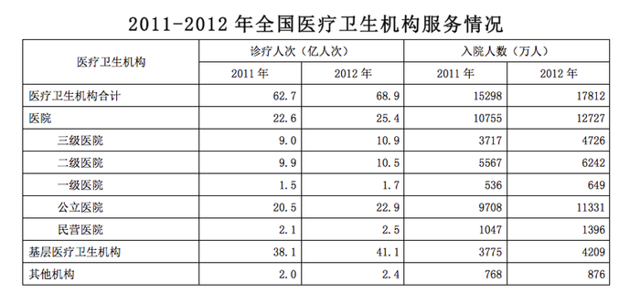

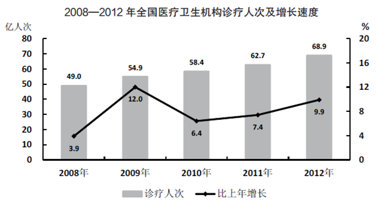

### 第 96 题

2011年公立医院诊疗人次占全国医疗卫生机构诊疗人次的比重是：

A. 30.9%

B. 32.7%

C. 33.9%

D. 38.5%

第 96 题 · 答案与解析

**参考答案（粉笔题库参考内容）**

B

**解析**

由表格第二列可知，2011年公立医院诊疗人次为20.5亿人次，全国医疗卫生机构诊疗人次为62.7亿人次，则公立医院诊疗人次占全国医疗卫生机构诊疗人次的比重为20.5/62.7，选项差距较小，采用直除，结果前两位为32，与B项最接近。

故正确答案为B。

**来源**：2014年江苏省公务员录用考试《行测》题（A类）第96题

### 第 97 题

2012年全国公立医院入院人数是民营医院入院人数的：

A. 7.6倍

B. 8.1倍

C. 8.5倍

D. 9.2倍

第 97 题 · 答案与解析

**参考答案（粉笔题库参考内容）**

B

**解析**

由表格第五列可得，2012年全国公立医院的入院人数为11331万，民营医院的入院人次为1396万，则所求倍数为，且1400x8=11200，故正确数值应略大于8，只有B项符合。

故正确答案为B。

**来源**：2014年江苏省公务员录用考试《行测》题（A类）第97题

### 第 98 题

2009年全国医疗卫生机构诊疗人次的增加量比2008年多：

A. 1.8亿人次

B. 3.2亿人次

C. 4.1亿人次

D. 5.9亿人次

第 98 题 · 答案与解析

**参考答案（粉笔题库参考内容）**

C

**解析**

由柱状图可得，2009年全国医疗卫生机构诊疗人次增加量为54.9-49.0=5.9亿人次；2008年诊疗人次为49.0亿人次，增长速度为3.9%，则2008年全国医疗机构诊疗人次增加量为亿人次，则2009年比2008年多5.9 – 1.88 = 4.02亿人次，与C项最接近。

故正确答案为C。

**来源**：2014年江苏省公务员录用考试《行测》题（A类）第98题

### 第 99 题

2009-2012年四年，全国医疗卫生机构诊疗人次的年平均增加量是：

A. 3.5亿人次

B. 4.0亿人次

C. 4.7亿人次

D. 5.0亿人次

第 99 题 · 答案与解析

**参考答案（粉笔题库参考内容）**

D

**解析**

由条形图可得，2009-2012年共四年，2009年的增量是相对于2008年而言的，故应该用2012年的诊疗人数减去2008年的求出四年总的增长量，则2009-2012年四年，全国医疗机构诊疗人次年均增长亿人次。

故正确答案为D。

**来源**：2014年江苏省公务员录用考试《行测》题（A类）第99题

### 第 100 题

下列判断正确的有：

（1）2010-2012年三年，全国医疗卫生机构年平均诊疗人次为63.3万；

（2）与2011年相比，2012年全国各类医疗卫生机构入院人数均有所增加；

（3）2011-2012年，全国二级医院入院人数均大于一、三级医院入院人数之和。

A. 0个

B. 1个

C. 2个

D. 3个

第 100 题 · 答案与解析

**参考答案（粉笔题库参考内容）**

C

**解析**

（1）错误。2010-2012年三年，全国医疗卫生机构年平均诊疗人次为亿人次，单位错误。

（2）正确。问的是入院人数，定位表格第四列和第五列，与2011年相比，2012年全国各类医疗卫生机构的入院人数确实是均有所增加。

（3）正确。由表格第四列和第五列可知，2011年全国二级医院入院人数为5567万，大于3717+536=4253万；2012年全国二级医院入院人数为6242万，大于4726+649=5375万。

因此，判断正确的有2个。

故正确答案为C。

**来源**：2014年江苏省公务员录用考试《行测》题（A类）第100题

## 材料 7

2012年，全国光缆线路长度净增268.6万公里，达到1480.6万公里；局用交换机容量净增478.1万门，达到43906.4万门；移动电话交换机容量净增11233.8万户，达到182869.8万户；全国互联网国际出口带宽达到1899792.0Mbps，同比增长36.7%。

       2013年6月，全国互联网普及率为44.1%，同比增长2.0%；手机网民规模达46400万人，同比增加4379万人，网民中使用手机上网的人数占78.63%；农村网民占27.9%，规模达16500万人，同比增加908万人。韩国、日本互联网普及率分别为83.0%、79.0%。

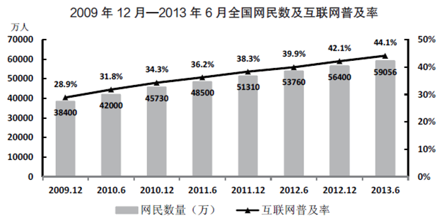

### 第 101 题

2009年12月-2013年6月，全国网民增加最多的时期是：

A. 2009年12月-2010年6月

B. 2011年6月-2011年12月

C. 2012年12月-2013年6月

D. 2010年6月-2010年12月

第 101 题 · 答案与解析

**参考答案（粉笔题库参考内容）**

D

**解析**

选项给出四个时间段，结合图形找出这四个时间段的增量：

2009年12月-2010年6月：42000–38400=3600万人；

2011年6月-2011年12月：51310–48500=2810万人；

2012年12月-2013年6月：59056–56400=2656万人；

2010年6月-2010年12月：45730–42000=3730万人；

因此得出2010年6月—2010年12月增加人数最多。

故正确答案为D。

**来源**：2014年江苏省公务员录用考试《行测》题（A类）第101题

### 第 102 题

2012年6月-2013年6月，全国网民及手机网民分别增加：

A. 5296万人、3641万人

B. 2656万人、4379万人

C. 5296万人、4379万人

D. 2656万人、3641万人

第 102 题 · 答案与解析

**参考答案（粉笔题库参考内容）**

C

**解析**

定位到材料第二段“手机网民规模达46400万人，同比增加4379万人”，再根据统计图可知全国网民2012年6月-2013年6月增加量为59056-53760=5296万人。

故正确答案为C。

**来源**：2014年江苏省公务员录用考试《行测》题（A类）第102题

### 第 103 题

用V_1、V_2、V_3分别表示2012年全国光缆线路长度、移动电话交换机容量和互联网国际出口带宽的增长率，下列表示正确的是：

A. V3>V1>V2

B. V3>V2>V1

C. V1>V3>V2

D. V1>V2>V3

第 103 题 · 答案与解析

**参考答案（粉笔题库参考内容）**

A

**解析**

V_1、V_2、V_3分别表示2012年全国光缆线路长度、移动电话交换机容量和互联网国际出口宽带的增长率。

全国光缆线路长度增长率V_1=；移动电话交换机容量增长率V_2=；互联网国际出口带宽的增长率，对比得。

故正确答案为A。

**来源**：2014年江苏省公务员录用考试《行测》题（A类）第103题

### 第 104 题

2012年6月，全国网民中农村网民占比是：

A. 44.1%

B. 29.0%

C. 27.6%

D. 78.6%

第 104 题 · 答案与解析

**参考答案（粉笔题库参考内容）**

B

**解析**

查图得知2012年6月全国网民53760万人，定位文字材料第二段可知2012年6月农村网民为16500-908=15592万人，约占比为.

故正确答案为B。

**来源**：2014年江苏省公务员录用考试《行测》题（A类）第104题

### 第 105 题

下列判断正确的有：

（1）2013年6月，全国城镇网民比农村网民多42556万人

（2）2013年6月，全国互联网普及率比2010年6月提高了12.3个百分点

（3）2010年6月--2013年6月，我国互联网普及率每半年较前期都有所提高

A. 0

B. 1

C. 2

D. 3

第 105 题 · 答案与解析

**参考答案（粉笔题库参考内容）**

C

**解析**

（1）错误。2013年6月，全国网民为59056万人，农村网民为16500万人，则全国城镇网民为59056–16500=42556万人，与题中表述“全国城镇网民比农村网民多42556万”不相符合。

（2）正确。查图可知2013年6月全国互联网普及率为44.1%，2010年6月全国互联网普及率为31.8%，高44.1–31.8=12.3个百分点。

（3）正确。观察图可发现2010年6月—2013年6月互联网普及率都呈现递增趋势。

因此，判断正确的有2个。

故正确答案为C。

**来源**：2014年江苏省公务员录用考试《行测》题（A类）第105题

