# 2014年江苏省公务员录用考试《行测》题（B类）

<!-- gwy:overview:start -->
> **江苏 · 2014 · 行测 · B类** ｜ 105 题 · 图片 26 处 · 答案随题折叠

| 题型模块 | 题量 | 题号 |
| --- | ---: | ---: |
| 言语理解与表达 | 25 | 1–25 |
| 数量关系 | 15 | 26–40 |
| 判断推理 | 40 | 41–80 |
| 资料分析 | 25 | 81–105 |
| **合计** | **105** | |

导航：[题型与作答说明](#题型与作答说明) · [题目](#题目) · [材料 1](#材料-1)
<!-- gwy:overview:end -->

> 候选采集稿。参考答案及解析来自粉笔页面，不代表官方答案或真实高分答卷；来源使用许可与原卷对应关系仍需人工核实。

## 题型与作答说明

言语理解与表达

（25题）

本部分包括片段阅读、文章阅读与选词填空三种类型的试题。

数量关系

（15题）

本部分包括数字推理与数学运算两种类型的试题。

判断推理

（40题）

本部分包括类比推理、图形推理、逻辑判断与定义判断四种类型的试题。

资料分析

（25题）

下列给出的文字、表格、图形资料均有5个问题要你回答，你应根据资料提供的信息进行分析、计算、处理，然后从备选答案中选择一个最恰当的答案。

## 题目

### 第 1 题

凡是符合立案条件，并已办理立案手续的所有案件，除涉及国家机密或个人隐私等不宜公开的理由外，均应当在人民法院决定立案的7日内在网上公示，同时告知合议庭组成人员和案件审理期限，便于当事人和社会监督，防止拖延案件审理期限，提高司法效率。

这段文字主要说明的是：

A. 怎样提高司法工作效率

B. 加强立案公开制度的措施

C. 案件审理期限告知方式

D. 司法工作怎样接受社会监督

第 1 题 · 答案与解析

**参考答案（粉笔题库参考内容）**

B

**解析**

本题为中心理解题。文段首先由“凡是······均······”提出立案应在7日内进行网上公示，又提出了要同时告知合议庭组成人员和案件审理期限，都是加强立案公开制度的措施。因此，结合选项应该选择B项。文段最后说到这些措施可以“便于当事人和社会监督，防止拖延案件审理期限，提高司法效率”，A项“提高司法工作效率”、D项“司法工作怎样接受社会监督”均只讲到其中一条，过于片面，排除；C项“告知方式”只涉及“在网上公示”，过于片面，排除。

故正确答案为B。

**考点**：关联词-对策、关联词-并列

**来源**：2014年江苏省公务员录用考试《行测》题（C类）第2题

### 第 2 题

目前，各种新的技术还在测试中，填埋也不是废物处理的唯一方式。垃圾的焚烧和循环利用也在许多国家的废物处理中占较大比例，而且这两种方式正在经历技术变革并日趋完善。传统意义上的循环利用，如金属、塑料及纸张的回收利用，仍然发挥较大作用。但是最快的废物循环方式往往是最简单的方法：垃圾堆肥。

从这段文字中不能得出的结论是：

A. 垃圾焚烧正在经历技术变革并日趋完善

B. 填埋、焚烧、循环利用是常用的废物处理方式

C. 传统的循环利用方式包括可再生物资的回收

D. 垃圾堆肥不久将取代其他废物循环利用方式

第 2 题 · 答案与解析

**参考答案（粉笔题库参考内容）**

D

**解析**

A项正确，由文段第二句“垃圾的焚烧和循环利用也在许多国家的废物处理中占较大比例，而且这两种方式正在经历技术变革并日趋完善”可以推出；

B项正确，由文段第一二句“填埋也不是废物处理的唯一方式。垃圾的焚烧和循环利用也在许多国家的废物处理中占较大比例”可以推出；

C项正确，由文段“传统意义上的循环利用，如金属、塑料及纸张的回收利用，仍然发挥较大作用”，可知传统的循环利用包括可再生物资的回收；

D项不能推出，文段指出“最快的废物循环方式往往是最简单的方法：垃圾堆肥”，但并未说明垃圾堆肥不久将取代其他废物循环利用方式，“不久将取代”属于无中生有。

本题为选非题，故正确答案为D。

**考点**：细节判断题

**来源**：2014年江苏省公务员录用考试《行测》题（B类）第2题

### 第 3 题

语言的国际影响力，首先表现在多边外交等国际交往中，其次是有多少外国人把它作为外语来学习。近年来，“汉语热”的话题常现报端，孔子学院在世界各地建立，汉语国际教育有了前所未有的发展。但是就实际统计数据来看，世界上将汉语作为第二语言学习的远赶不上以英语、德语、法语为第二语言学习的人数。

这段文字意在强调：

A. 倡导在国际交往中尽可能使用汉语

B. 优化汉语教学方法，做大做强孔子学院

C. 充分利用“汉语热”，推进汉语国际教育

D. 汉语的国际影响力尚有待进一步提升

第 3 题 · 答案与解析

**参考答案（粉笔题库参考内容）**

D

**解析**

文段首先指出“汉语”在国际教育中有了前所未有的发展，随后通过转折关联词“但”强调学习汉语的人数依旧赶不上学习英语、德语、法语的人数，故文段主要说明汉语的国际影响力还有待进一步提升。

A项“在国际交往中尽可能使用汉语”、B项“孔子学院”、C项“汉语热”均为转折之前非重点内容，排除。

故正确答案为D。

**考点**：关联词-转折

**来源**：2014年江苏省公务员录用考试《行测》题（B类）第3题

### 第 4 题

中国的传统廉政文化源远流长，它对历代执政者的操守要求与为政规则不外乎五个方面：重民生而知根本，畏法度而能自律，明廉耻而守气节，崇节俭而重情操，知恩惠而思报国。

下列对传统廉政文化特点的概括与文意不符的一项是：

A. 执法如山，遵章守纪

B. 注重民生，情操高尚

C. 学识渊博，乐善好施

D. 生活简朴，严于律己

第 4 题 · 答案与解析

**参考答案（粉笔题库参考内容）**

C

**解析**

由提问方式可知，本题为细节判断题。逐项判断：A项正确，“执法如山，遵章守纪”对应文中“畏法度而能自律”；B项正确，“注重民生，情操高尚”对应文中“重民生”“明廉耻而守气节”；C项错误，“学识渊博，乐善好施”在文中没有体现；D项正确，“生活简朴，严于律己”对应文中“崇节俭”及“能自律”。

本题为选非题，故正确答案为C。

**考点**：细节判断题

**来源**：2014年江苏省公务员录用考试《行测》题（C类）第3题

### 第 5 题

“以房养老”的前提是手里有房，一般来说，手头有两套以上房产的人可能更会考虑“以房养老”，而从观念上看，中青年人更易接受，他们应该是未来“以房养老”的潜在群体。但近年来房价非理性上涨已经大大超出多数人的承受能力，有些甚至到60岁都还不完房贷。养房都成问题，更别说“以房养老”了。

这段文字意在强调：

A. 仅有一套房的人不会考虑“以房养老”

B. 60岁以下的人不会考虑“以房养老”

C. “以房养老”在现阶段适用人群较少

D. 推迟退休年龄或可推动“以房养老”

第 5 题 · 答案与解析

**参考答案（粉笔题库参考内容）**

C

**解析**

文段首先指出中青年人是“以房养老”的潜在群体，随后转折指出目前房价的非理性上涨，使多数人养房都成为问题，“以房养老”实施遇到难题。转折后指出问题为文段所要说明的重点，意在说明“以房养老”在现阶段实施适用人群较少，故C选项符合题意。

A项并非文段重点；B、D两项属于无中生有，文中并未提及。

故正确答案为C。

**考点**：关联词-转折

**来源**：2014年江苏省公务员录用考试《行测》题（B类）第5题

### 第 6 题

汽车产业是一个长期性产业，作为产业革命带来的核心产品，它形成了相当长的产业链，不仅产业自身的发展会对经济增长具有一定的扩展或成倍的乘数效应，而且会带动金属、电器设备、橡胶等一系列相关产业的发展，极大地解决了就业问题，提升了社会福利，这反过来又会促进汽车工业的进一步发展。

这段文字主要说明的是：

A. 汽车产业与其他相关产业的关系

B. 汽车产业与社会就业问题的关系

C. 汽车产业与产业革命进程的关系

D. 汽车产业与经济社会发展的关系

第 6 题 · 答案与解析

**参考答案（粉笔题库参考内容）**

D

**解析**

本题为中心理解题。文段指出汽车产业“带动了其他产业的发展，极大地解决了就业问题”“提升了社会福利”，当中既有经济效益，还有社会效益，即本段内容可概括为汽车产业及经济社会发展的关系。因此，结合选项应该选择D项。A、B、C选项均为文段的部分内容，不全面，排除。

故正确答案为D。

**考点**：关联词-并列、关联词-转折

**来源**：2014年江苏省公务员录用考试《行测》题（B类）第6题

### 第 7 题

这是一种痛苦的状态，不能回到过去却又对过去恋恋不舍；这也正是法律人重构中国秩序方案的焦灼所在，西方法治文明与传统内发秩序之间，依然横亘着“一湾浅浅的海峡”。

“一湾浅浅的海峡”比喻的是西方法治文明与传统内发秩序之间：

A. 一条无法跨越的鸿沟

B. 一层不可穿越的隔膜

C. 一段不可逾越的距离

D. 一道无法破解的难题

第 7 题 · 答案与解析

**参考答案（粉笔题库参考内容）**

B

**解析**

A项错误，“鸿沟”是指事物之间的界限，而“浅浅的海峡”显然并不是指界限；

B项正确，“隔膜”是指事物之间缺少牵连，“横亘着海峡”喻指两岸之间无法牵连，与之喻意相符，故B项最为贴切；

C项“距离”、D项“难题”与“海峡”的喻意也完全不符。

故正确答案为B。

**考点**：句子

**来源**：2014年江苏省公务员录用考试《行测》题（B类）第7题

### 第 8 题

许许多多的临床实验都表明抗氧化物质实际上并不能对我们的心血管系统起到改善作用。关于抗氧化物质与癌症关系的数据没那么多，但最近一次大规模的检验维生素E能否抑制癌症的实验中途就被停止了——因为维生素E不仅没有显示出益处，反倒略微增加了前列腺癌的发病率。

这段文字预设的信息是：

A. 心血管系统的改善与抗氧化物质无关

B. 人们认为抗氧化物质对身体健康是有利的

C. 目前关于抗氧化物质的研究仍然不足

D. 可以通过增加维生素E可以防止前列腺癌

第 8 题 · 答案与解析

**参考答案（粉笔题库参考内容）**

B

**解析**

预设信息是指在文段之前所应设定的信息。

根据段首，文段首句所讲述的为“抗氧化物并不能对我们的心血管系统起到改善作用”，在这里作者要去声明抗氧化物“实际上并不能”对我们的心血管系统起到改善作用，故文段前所应预设的信息应为“人们普遍认为抗氧化物对我们的身体健康是有利的”，然后作者去更正这一观点，A、C、D均非需预设的信息。

故正确答案为B。

**考点**：特殊问法

**来源**：2014年江苏省公务员录用考试《行测》题（B类）第8题

### 第 9 题

过去一段时间，随着粮食价格的暴涨，某些国家的公司开始悄然在世界各地投资农场，收购农田。表面上，这些购买行为是为了土地，其深层目的是为了水。因为土地是与用水权联系在一起的。在大多数国家，水基本上是所属土地的一个“免费赠品”，但随着水资源的日益稀缺，水却越来越有可能成为土地交易中最有价值的一部分。

这段文字意在说明：

A. 水是所属土地的“免费赠品”

B. 抢购土地的实质是对水资源的争夺

C. 粮价暴涨引发土地产权的投资热

D. 用水权与土地权相分离成为趋势

第 9 题 · 答案与解析

**参考答案（粉笔题库参考内容）**

B

**解析**

文段通篇都在说明，“收购农田的实际目的是为了水”，最后转折指出“水可能会成为土地交易中最有价值的一部分”，为文段重点。故作者意在说明“抢购农田收购土地实质是对水的争夺”，B项与之最为接近。

故正确答案为B。

**考点**：关联词-转折

**来源**：2014年江苏省公务员录用考试《行测》题（B类）第9题

### 第 10 题

高等教育进入大众化阶段之后，大学毕业生就业的一些规律逐渐显现出来，认识不到的话则会误导舆论和政策。劳动经济学研究表明，受教育程度越高，特别是接受过大学本科以上教育之后，求职者实现与劳动力市场的匹配所需要的时间就越长。因此，单纯的大学毕业几个月之后的就业率并不能完全说明问题。

这段文字意在说明：

A. 大学毕业生就业率的统计可靠性不高

B. 目前有关大学生就业难的舆论有待商榷

C. 大学毕业生找到合适工作需要一定时间

D. 求职时间长短与工作匹配程度成正比

第 10 题 · 答案与解析

**参考答案（粉笔题库参考内容）**

A

**解析**

文段大部分在说明“大学毕业生与劳动力市场相匹配的情况变化”，最后得出结论“大学毕业后几个月的就业率并不能说明问题”，意在表明“大学毕业生的就业率统计可靠性并不高”，A项符合题意。

B、C、D三项表述均与“就业率”毫无关联，直接排除。

故正确答案为A。

**考点**：关联词-因果

**来源**：2014年江苏省公务员录用考试《行测》题（B类）第10题

## 材料 1

2013年诺贝尔文学奖授予加拿大女作家爱丽丝·门罗。

        爱丽丝·门罗出生于加拿大安大略省的温格姆镇。父亲酷爱写作，母亲身为教师。生活在这样的书香门第，少女时代的门罗就萌生了成为小说家的梦想。

        19岁那年，门罗还在安大略大学攻读新闻学学士学位时，这位天赋异禀的姑娘就发表了自己的第一篇短篇小说《影子的维度》，从此她的创作热情便一发不可收，直到婚后数年，门罗为人妻、为人母之后，仍时时沉浸于自己的文学世界之中。人们很难想象，一位少妇如何以柔弱的身躯，在小说、孩子、书店和琐碎的家务事之间繁忙地周旋。

        每当门罗回忆起这段艰涩的时光，总忍不住叹息“真是绝望的赛跑”。万幸的是“良马终遇伯乐”，在加拿大广播公司文学节目制作人罗伯特·韦佛的推荐下，门罗的作品终于有机会被更多读者关注。而立之年，门罗的文学事业逐渐走向辉煌。1968年，她的第一部短篇小说集《快乐影子舞》获得了加拿大文学界的最高荣誉——总督奖。评委会给她的评价是“每每读到爱丽丝·门罗的小说，便知生命中未曾想到之事”。为了完成这部集子，门罗用了整整20年。

         门罗将目光流连于平凡人的生活，她笔下的人物性格如同大海一样——忧郁、冷漠、孤傲。无论是自叙还是他叙，叙述者总是形而上的、忧郁的，带着远离自己生活的讽刺态度，来描述人生的重大“坍塌时刻”。门罗擅长“打岔”，擅长用旁敲侧击的回旋笔法，为小说中的人物，也为读者留下思考的空隙。“有呼吸的空隙，这是门罗短篇小说里最优美的一手。”

        这种“空隙”不是逃避，也不是故弄玄虚。只要读过门罗的人生经历，便会体会到空隙中流露的恻隐之情。在经历了少女、人妻、人母，走向老年的过程中，门罗已经纯熟于这种处变不惊的节奏，以贴近女性心理的笔触叙述生命的无常，以及由此而来的身心重负。

### 第 11 题

有关门罗第一篇短篇小说，下列说法正确的是：

A. 由罗伯特·韦佛的介绍才得以公开出版

B. 为门罗赢得了加拿大文学界的最高荣誉

C. 是在自己家乡读大学本科时写作和发表的

D. 小说以预知生命中即将发生的事件而著称

第 11 题 · 答案与解析

**参考答案（粉笔题库参考内容）**

C

**解析**

根据第四段可知，A项错误，应为“被更多读者关注”而不是“得以公开出版”，排除。

根据第四段可知，是第一部短篇小说集《快乐影子舞》赢得了加拿大文学界的最高荣誉，而不是第一篇短篇小说，B项错误，排除。

根据第四段评委会给门罗的评价，“知生命中未曾想到之事”，而非“预知生命中即将发生的事”，D项错误，排除。

故正确答案为C。

**来源**：2014年江苏省公务员录用考试《行测》题（B类）第11题

### 第 12 题

文中“真是绝望的赛跑”是指：

A. 经历了少女、人妻、人母阶段的重重磨难

B. 20年含辛茹苦不停歇写完《快乐影子舞》

C. 常常在生命无常的感觉中挣扎

D. 在小说写作和家庭主妇事务之间争分夺秒

第 12 题 · 答案与解析

**参考答案（粉笔题库参考内容）**

D

**解析**

定位原文第四段，“真是绝望的赛跑”指代的是上文提到的“在小说、孩子、书店和琐碎的家务事之间繁忙地周旋”。

故正确答案为D。

**来源**：2014年江苏省公务员录用考试《行测》题（B类）第12题

### 第 13 题

从文中可以知道，爱丽丝·门罗出生于：

A. 20世纪30年代

B. 20世纪40年代

C. 20世纪50年代

D. 20世纪60年代

第 13 题 · 答案与解析

**参考答案（粉笔题库参考内容）**

A

**解析**

由第四段“而立之年，门罗的文学事业逐渐走向辉煌。1968年，她的第一部短篇小说集《快乐影子舞》获得了加拿大文学界的最高荣誉——总督奖”。而立之年为30岁，故可推知在1968年门罗应在30岁或稍大于30岁，则门罗应出生于二十世纪三十年代。

故正确答案为A。

**来源**：2014年江苏省公务员录用考试《行测》题（B类）第13题

### 第 14 题

下列说法不符合文意的是：

A. 门罗的父亲酷爱写作，母亲从事教育工作

B. “伯乐”的推荐为门罗带来加拿大最高文学奖

C. 门罗处变不惊的叙事节奏源于她的生活阅历

D. 门罗擅长以旁观者的视角表现人生的变故

第 14 题 · 答案与解析

**参考答案（粉笔题库参考内容）**

B

**解析**

A项表述正确：第二段“父亲酷爱写作，母亲身为教师”，排除；

B项表述错误：伯乐的推荐使门罗的作品得到更多关注，但并非是由伯乐推荐得到的最高文学奖，属于偷换概念，B项表述不够准确，当选；

C项表述正确：文章最后一句“在经历了少女、人妻、人母，走向老年的过程中，门罗已经纯熟于这种处变不惊的节奏”，排除；

D项表述正确：第五段整段可知，门罗善于以旁观者的视角表现人生变故，D项表述正确，排除。

本题为选非题，故正确答案为B。

**来源**：2014年江苏省公务员录用考试《行测》题（B类）第14题

### 第 15 题

根据文意，门罗小说中的“空隙”所流露的主要是：

A. 超越现实的梦想

B. 高深莫测的玄思

C. 悲天悯人的情怀

D. 虚怀若谷的胸襟

第 15 题 · 答案与解析

**参考答案（粉笔题库参考内容）**

C

**解析**

文章最后一段解释了“空隙”一词的含义，通过“只要读过门罗的人生经历，便会体会到空隙中流露的恻隐之情”可得到C项，“恻隐”即同情。

故正确答案为C。

**来源**：2014年江苏省公务员录用考试《行测》题（B类）第15题

### 第 16 题

要因地制宜、\_\_\_\_\_\_，不搞“一刀切”，不追求一步到位，允许采取差异性、过渡性的制度和政策安排。

填入画横线处最恰当的一项是：

A. 量体裁衣

B. 因时制宜

C. 循序渐进

D. 对症下药

第 16 题 · 答案与解析

**参考答案（粉笔题库参考内容）**

C

**解析**

根据文段可知，“因地制宜”与“不搞‘一刀切’”、“差异性”语义对应，横线部分词语与“不追求一步到位”、“过渡性”语义对应，A项“量体裁衣”比喻按实际情况办事；B项“因时制宜”可以理解为按照不同时期的具体情况规定适宜的办法；C项“循序渐进”指学习、工作按照一定的步骤逐渐深入或提高；D项“对症下药”比喻针对具体情况决定解决问题的办法，故“循序渐进”一词填入更恰当，与“不追求一步到位”、“过渡性”语义对应恰当。

故正确答案为C。

【文段出处】《关于全面深化农村改革加快推进农业现代化的若干意见》

**考点**：对应关系-前后呼应、成语填空

**来源**：2014年江苏省公务员录用考试《行测》题（B类）第16题

### 第 17 题

文字是人们现实生活的一部分，是人类思维方式、生活方式等最生动的＿＿＿＿。一种文字发明、演变过程越是漫长，它所反映的这些方面的内容就越深刻。

填入画横线部分最恰当的一项是：

A. 工具

B. 形式

C. 载体

D. 记录

第 17 题 · 答案与解析

**参考答案（粉笔题库参考内容）**

C

**解析**

所填词语所在句子主干为“文字是······”且词语应和“最生动的”搭配。C项“载体”泛指能够承载其他事物（多为抽象概念）的事物，用在此处符合语境，当选。A 项“工具”比喻用以达到目的的事物，与“生动的”搭配不当，排除；B 项“形式”指事物的形状、结构等，用在此处不合语境，排除；D 项“记录”多指当场记录下来的材料，从后文可以看出这里的“文字”指的不是文字记录的内容含义，而是其发明、演变过程中所反映的文化，用在此处搭配不当，排除。

故正确答案为C。

【文段出处】《汉字魅力的历史与现实》

**考点**：实词填空、对应关系-前后呼应、词的辨析-搭配对象

**来源**：2014年江苏省公务员录用考试《行测》题（C类）第12题

### 第 18 题

从法官的精英化到法官的专业化，无不\_\_\_\_\_\_着人们对法官资格和法官职位的憧憬和理想。当前，应当建立以职业品德、专业知识、实践经验三位一体的法官培养\_\_\_\_\_\_标准。

依次填入画横线处最恰当的一项是：

A. 承载 遴选

B. 寄托 挑选

C. 肩负 选取

D. 承担 入选

第 18 题 · 答案与解析

**参考答案（粉笔题库参考内容）**

A

**解析**

第一空：填入画线部分词语应与“憧憬和理想”搭配，A项“承载”指承受装载，可搭配抽象概念，符合语境，保留；B项“寄托”指把理想、希望、感情等放在（某人身上或某种事物上），也符合语境，保留；C项“肩负”、D项“承担”都有担负的意思，指承当（责任、工作、费用），主语多为实际的人或集体，用在此处不合语境，排除。

第二空：A项“遴选”多指选拔人才，用法较正式，符合语境，当选；B项“挑选”指从若干人或事物中找出适合要求的，与“标准”搭配不妥，排除。

故正确答案为A。

【文段出处】《法官专业化——法官制度改革的新路径》

**考点**：实词填空、对应关系-前后呼应、词的辨析-搭配对象

**来源**：2014年江苏省公务员录用考试《行测》题（C类）第16题

### 第 19 题

最大程度地＿＿＿＿网络谣言，一方面要依赖法治力量，另一方面也需要网民尤其是所谓“网络大V”＿＿＿＿高度理性和负责的精神。

依次填入划横线处最恰当的一项是：

A. 消除 秉持

B. 去除 把持

C. 根除 维持

D. 清除 操持

第 19 题 · 答案与解析

**参考答案（粉笔题库参考内容）**

A

**解析**

本题可从第二空入手，把持意为控制，例如把持住内心的激动；操持意为料理、操办，例如操持家务。二词与“精神”均不搭配，排除B、D两项；

第一空，根除意为彻底消除，而网络谣言从根本并不能彻底“根除”，只能在最大程度上“消除”，故A项更为合理，秉持理性和负责的精神，搭配合理，A项当选。

故正确答案为A。

**考点**：实词填空、词的辨析-搭配对象、词的辨析-词义侧重

**来源**：2014年江苏省公务员录用考试《行测》题（B类）第19题

### 第 20 题

信息技术的发展及广泛应用是一个重大的系统工程，其日新月异的发展与\_\_\_\_\_\_的应用令人\_\_\_\_\_\_，或者有些始料未及。

依次填入画横线处最恰当的一项是：

A. 五花八门 瞠目结舌

B. 无孔不入 无法招架

C. 无所不在 目不暇接

D. 形形色色 猝不及防

第 20 题 · 答案与解析

**参考答案（粉笔题库参考内容）**

C

**解析**

第一空：“与”表并列，填入成语应与“日新月异”相对应，体现出信息技术发展迅猛的语义。B项“无孔不入”比喻利用一切机会，多指做坏事，含贬义，与语境不符，排除B项；C项“无所不在”指到处都有，到处都存在，与前文“广泛应用”对应，保留；A项“五花八门”比喻花样繁多或变化多端；D项“形形色色”指各种各样，这两个词都指花样繁多，用在此处也说得通。

第一空无论选择A、C、D哪一个选项，都能够体现“多”的意思，故第二空所填的词语也应该和“多”相对应，C项“目不暇接”形容东西多，来不及观看或看不过来，符合文意，当选；D项“猝不及防”指事情突然发生，来不及防备，A项“瞠目结舌”形容人窘迫或惊呆的样子，也形容人害怕的表情，两项均无法体现“多”的含义，排除。

故正确答案为C。

**考点**：关联关系-并列关系、对应关系-前后呼应、成语填空

**来源**：2014年江苏省公务员录用考试《行测》题（B类）第20题

### 第 21 题

人们享受着科学给生活带来新奇和益处的同时，也开始关注科学存在的风险及其对社会的影响。未来，投入市场的纳米技术创新将在清洁能源、纳米医学等领域有所建树，而这一全新领域的＿＿＿＿风险和二次影响也不可忽视，科学家们正在进行纳米技术前景分析并将设计更好的评估方法，以＿＿＿＿的态度展望未来。

依次填入画横线处最恰当的一项是：

A. 潜在 审慎

B. 潜藏 慎重

C. 隐含 克制

D. 既有 谨慎

第 21 题 · 答案与解析

**参考答案（粉笔题库参考内容）**

A

**解析**

第一空，文段所述纳米技术在未来的影响，这些影响尚未发生，“既有”一词不合文意，D项排除。

第二空，纳米技术在多个领域有所建树，有着积极的影响，故“克制”一词语义较重且不合语境，C项排除；纳米技术可能存在风险，应该用谨慎的态度面对纳米技术的前景，“审慎”包含“慎重”的含义，且“审”字更能突出科学家们对纳米技术认真周密的分析评估，与文段搭配更为贴切，A项当选。

故正确答案为A。

**考点**：实词填空、对应关系-前后呼应、词的辨析-感情色彩、词的辨析-词义侧重

**来源**：2014年江苏省公务员录用考试《行测》题（B类）第21题

### 第 22 题

那时在我们家里，主人和客人均彬彬有礼，但常因观点相异而激烈争论，＿＿＿＿，互不相让。不但洋溢着自由争论的热烈气氛，也体现出“＿＿＿＿”的传统精神。

依次填入划横线处最恰当的一项是：

A. 各抒己见 君子和而不同

B. 各执一词 君子喻于义

C. 各抒己见 君子成人之美

D. 各抒己见 君子之交淡如水

第 22 题 · 答案与解析

**参考答案（粉笔题库参考内容）**

A

**解析**

本题可从第二空着手，通过文段表述“主人和客人均彬彬有礼，但常因观点相异而激烈争论”，与“君子和而不同”的含义完全相符，A项正确，当选。

“君子喻于义”指君子重道义；“君子成人之美”指君子当促成他人的好事；“君子之交淡如水”指君子之间的友谊，平淡如水，不尚虚华，与“激烈争论、自由争论的热烈气氛”均不相符，排除。

故正确答案为A。

**考点**：对应关系-前后呼应、混搭填空

**来源**：2014年江苏省公务员录用考试《行测》题（B类）第22题

### 第 23 题

真正的批评，总是建立在对等的基础之上的。只有修养与＿＿＿＿对等的人的批评，才值得＿＿＿＿和理会。至于无边无际的谩骂，除了＿＿＿＿之外，没有任何意义。

依次填入画横线处最恰当的一项是：

A. 才华 关心 气急败坏

B. 学识 关注 自我贬低

C. 才情 注目 贻笑大方

D. 知识 关注 自娱自乐

第 23 题 · 答案与解析

**参考答案（粉笔题库参考内容）**

B

**解析**

从第二空入手，对于批评，是不能“关心”和“注目”的，只能“关注”，故A、C两项排除。

与修养相对应的“学识”更为贴切，且“无边无际”的谩骂是对自身“修养”的自我贬低，B项词语填入三个空白处，表述均恰当。

故正确答案为B。

**考点**：混搭填空、词的辨析-搭配对象

**来源**：2014年江苏省公务员录用考试《行测》题（B类）第23题

### 第 24 题

随着劳动年龄人口进入负增长，人口红利终究要消失，经济增长从过去的高速转为相对较低增速的常态也是不可避免的。生育政策的调整也不可能在短期内＿＿＿＿人口红利。不过，＿＿＿＿地调整生育政策，对于未来中国人口均衡发展＿＿＿＿长期潜在增长率，仍然可以产生积极的效果。

依次填入画横线处最恰当的一项是：

A. 带来 高瞻远瞩 甚至

B. 增加 恰如其分 以及

C. 逆转 未雨绸缪 乃至

D. 恢复 不失时机 抑或

第 24 题 · 答案与解析

**参考答案（粉笔题库参考内容）**

C

**解析**

本题可从第三空着手，“未来中国人口均衡发展”与“长期潜在增长率”之间应为递进关系，排除并列关系的B项“以及”、D项“抑或”；第一空，“带来”指直接带来，“逆转”指向相反的方向转化，由“经济增长从过去的高速转为相对较低增速”可知，这是向相反的方向转化，故“逆转”更为切合语意，排除A项“带来”。

故正确答案为C。

**考点**：对应关系-前后呼应、混搭填空

**来源**：2014年江苏省公务员录用考试《行测》题（B类）第24题

### 第 25 题

当然，这并不是说政府必须\_\_\_\_\_\_，也不是所有社会责任都得\_\_\_\_\_\_。比如助弱扶贫，政府可以自己出手，也可以让企业相助。典型的例子就是养老，早年的养老院皆为政府投资，而今天私人投资的养老院则\_\_\_\_\_\_。

依次填入画横线处最恰当的一项是：

A. 大包大揽 事必躬亲 比比皆是

B. 一包到底 责无旁贷 遍地开花

C. 恪尽职守 出手相助 随处可见

D. 鼎力相助 亲力亲为 纷至沓来

第 25 题 · 答案与解析

**参考答案（粉笔题库参考内容）**

A

**解析**

第一空：从文段含义来看，空格所在句子是指政府没有必要包揽全部工作。“大包大揽”指把工作或事情全部兜揽、承担起来，“一包到底”指一切都包括进去，均可用在此处；“恪尽职守”指谨慎认真地做好本职工作，政府必须恪尽职守，排除C项；“鼎力相助”指大力帮助，与文意无关，排除D项。

第二空：由“政府可以自己出手，也可以让企业相助”一句可知，这里是说不是所有的社会责任都由政府直接承担。“事必躬亲”指不管什么事情一定亲自去做，可用在此处；“责无旁贷”指自己的责任不能推卸给别人，与语境不符，排除B项。

故正确答案为A。

【文段出处】《王东京：政府的社会责任》

**考点**：对应关系-前后呼应、成语填空

**来源**：2014年江苏省公务员录用考试《行测》题（B类）第25题

### 第 26 题

2，17，29，38，44，(  )

A. 45

B. 46

C. 47

D. 48

第 26 题 · 答案与解析

**参考答案（粉笔题库参考内容）**

C

**解析**

观察数字特性，递增幅度渐缓，考虑后项与前项差，所得公差为-3的等差数列15、12、9、6，得知最后一空为44+3=47。

故正确答案为C。

**来源**：2014年江苏省公务员录用考试《行测》题（B类）第26题

### 第 27 题

1/2，1，3，15，120，(  )

A. 240

B. 360

C. 144

D. 1440

第 27 题 · 答案与解析

**参考答案（粉笔题库参考内容）**

D

**解析**

观察数字特性，增长较快，有明显倍数关系，后项除以前项，得2、3、5、8，再对此项作差得公差为1的等差数列1、2、3。则最后一空为120 × (8 + 4) = 1440。

故正确答案为D。

**来源**：2014年江苏省公务员录用考试《行测》题（B类）第27题

### 第 28 题

1，121，441，961，1681，(    )

A. 2401

B. 2601

C. 3721

D. 4961

第 28 题 · 答案与解析

**参考答案（粉笔题库参考内容）**

B

**解析**

数列起伏较大，且存在特征数字，考虑幂次规律。观察发现，题干数列分别为：1²，11²，21²，31²、41²，( )，则下一项应为51^2。

故正确答案为B。

**来源**：2014年江苏省公务员录用考试《行测》题（B类）第28题

### 第 29 题

3，19，43，79，133，(  )

A. 169

B. 205

C. 214

D. 229

第 29 题 · 答案与解析

**参考答案（粉笔题库参考内容）**

C

**解析**

数据增长较平缓，考虑作差得16、24、36、54，是公比为1.5的等比数列，故推出答案为133+81=214。

故正确答案为C。

**来源**：2014年江苏省公务员录用考试《行测》题（B类）第29题

### 第 30 题

1，1，8/7，16/11，2，(  )

A. 36/23

B. 9/7

C. 32/11

D. 35/22

第 30 题 · 答案与解析

**参考答案（粉笔题库参考内容）**

C

**解析**

观察题目发现是分数数列。8/7，16/11两个数分母均为最简，且分子为二倍关系，将第二项1化为4/4，第五项2化为32/16，发现分子是个以2为公比的等比数列2、4、8、16、32，分母是个二级等差数列2、4、7、11、16，推出最后一项为64/22=32/11。

故正确答案为C。

**来源**：2014年江苏省公务员录用考试《行测》题（B类）第30题

### 第 31 题

甲、乙两种商品，其成本价共200元。如甲、乙商品分别按20%和30%的利润定价，并按定价的90%出售，全部售出后共获得利润27.7元，则乙种商品的成本价是：

A. 120元

B. 125元

C. 130元

D. 150元

第 31 题 · 答案与解析

**参考答案（粉笔题库参考内容）**

C

**解析**

根据题意，设甲成本x，乙成本y，则x+y=200；(1.2x+1.3y)×0.9=227.7，经过计算解得y=130。

故正确答案为C。

**考点**：经济利润问题

**来源**：2014年江苏省公务员录用考试《行测》题（B类）第31题

### 第 32 题

在数列a_n (n = 1,2,···)中，a_1 = 1959，a_2 = 1995，且从第三项起，每项是它前两项平均数的整数部分，则lim(n→+∞)a_n=

A. 1980

B. 1981

C. 1983

D. 1982

第 32 题 · 答案与解析

**参考答案（粉笔题库参考内容）**

D

**解析**

由所给定义可知，a_1 = 1959，a_2 = 1995，则从第三项起，每项是前两项平均数的整数部分：a_3=1977，a_4=1986，a_5=1981，a6 = 1983，a_7 = 1982，a8=1982，······故lim(n→∞) a_n = 1982。

故正确答案为D。

**考点**：数列问题

**来源**：2014年江苏省公务员录用考试《行测》题（B类）第32题

### 第 33 题

如图、在长方形跑道上，甲乙两人分别从A、C处同时出发，按顺时针方向沿跑道匀速奔跑，已知甲乙两人的速度分别是5m/s、4.5m/s。则当甲第一次追上乙时，甲沿长方形跑道跑过的圈数是：

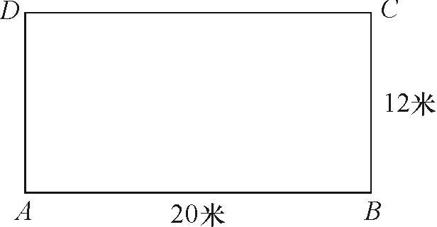

A. 4

B. 4.5

C. 5

D. 5.5

第 33 题 · 答案与解析

**参考答案（粉笔题库参考内容）**

C

**解析**

如图，甲距离乙32米，甲比乙快0.5m/s，则需64秒追上乙，由图可知每圈64米，所以甲跑了64s×5m/s÷64m/圈=5圈。

故正确答案为C。

**考点**：相遇追及

**来源**：2014年江苏省公务员录用考试《行测》题（B类）第33题

### 第 34 题

有甲、乙两瓶盐水，其浓度分别为16%和25%；质量分别为600克和240克，若向这两瓶溶液中加入等量的水，使他们的浓度相同，则需要向这两瓶盐水中分别加入的水量为：

A. 320克

B. 360克

C. 370克

D. 377克

第 34 题 · 答案与解析

**参考答案（粉笔题库参考内容）**

B

**解析**

有甲、乙两瓶盐水，其浓度分别为16%和25%；质量分别为600g和240g，得甲中溶质有96g，乙中有溶质60g，根据题意列方程：96/(600+x)=60/(240+x)，解得x=360g。

故正确答案为B。

**来源**：2014年江苏省公务员录用考试《行测》题（B类）第34题

### 第 35 题

一次校友聚会共有50人参加，在参加聚会的同学中，每个男生认识的女生的人数各不相同，而且恰好构成一串连续的自然数，已知认识女生最少的一个男生认识15名女生，并有一名男生认识所有的女生，则参加这次聚会的男生一共有：

A. 16名

B. 17名

C. 18名

D. 19名

第 35 题 · 答案与解析

**参考答案（粉笔题库参考内容）**

C

**解析**

根据“每个男生认识的女生的人数各不相同，而且恰好构成一串连续的自然数，已知认识女生最少的一个男生认识15名女生”，可知男生认识的女生人数为15、16、17、18······

列方程得设有x名女生，50-x=1+x-15，得女生有32名，男生则为18名。

故正确答案为C。

**来源**：2014年江苏省公务员录用考试《行测》题（B类）第35题

### 第 36 题

恰有两位数字相同的三位数一共有（  ）个。

A. 243个

B. 234个

C. 225个

D. 216个

第 36 题 · 答案与解析

**参考答案（粉笔题库参考内容）**

A

**解析**

从100到999三位数一共900个，三位数字都相同的有9个，一个数字相同（即三个数字都不同）的有9×9×8=648个（百位不能为0），所以恰有两位数字相同的三位数一共有900–648–9=243个。

故正确答案为A。

**来源**：2014年江苏省公务员录用考试《行测》题（B类）第36题

### 第 37 题

如图，在梯形ABCD中，AB∥CD，O为AC与BD的交点，CO=2AO，则梯形ABCD与△AOB的面积之比为：

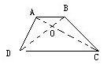

A. 6:1

B. 7:1

C. 8:1

D. 9:1

第 37 题 · 答案与解析

**参考答案（粉笔题库参考内容）**

D

**解析**

由题意可知。△AOB和△COD为相似三角形，相似比为1:2，设△AOB的底边AB为x，AB边上的高为h，梯形面积为1/2 × (x + 2x) × 3h = 9/2 x·h，△AOB面积为(1/2)x·h，为9:1关系。

故正确答案为D。

**考点**：几何公式类-平面图形、几何结论类-三角形相关、几何结论类-相似图形

**来源**：2014年江苏省公务员录用考试《行测》题（B类）第37题

### 第 38 题

小张的手表每天快30分钟，小李的手表每天慢20分钟，某天中午12点两人同时把表调到标准时间，则两人的手表再次同时显示标准时间最少需要的天数为：

A. 24

B. 36

C. 72

D. 114

第 38 题 · 答案与解析

**参考答案（粉笔题库参考内容）**

C

**解析**

小张的手表每天快30分钟，则2天快1小时。小李的手表每天慢20分钟，则3天慢1小时。手表再次显示标准时间12∶00，即与标准时间相差12个小时。对于小张，快12小时需要24天。小李慢12小时需要36天。同时显示12∶00最少需要的天数为24和36的最小公倍数，即72天。

故正确答案为C。

**来源**：2014年江苏省公务员录用考试《行测》题（B类）第38题

### 第 39 题

76^2013 + 25^2014的最后两位数字是：

A. 01

B. 91

C. 21

D. 51

第 39 题 · 答案与解析

**参考答案（粉笔题库参考内容）**

A

**解析**

试算可知，76的任意次方的尾数仍为76，25的任意次方尾数仍为25，故相加尾数最后两位数字为01。

故正确答案为A。

**来源**：2014年江苏省公务员录用考试《行测》题（B类）第39题

### 第 40 题

有一项工程，甲，乙，丙分别用10天，15天，12天可独自完成。现三人合作，在工作过程中，乙休息了5天，丙休息了2天，甲一直坚持到工程结束，则最后完成的天数是：

A. 6

B. 9

C. 7

D. 8

第 40 题 · 答案与解析

**参考答案（粉笔题库参考内容）**

A

**解析**

题干只给出完工时间，赋值工程总量为60，则甲、乙、丙的效率分别为60/10=6、60/15=4、60/12=5。设三人合作最后完成的天数为t，则乙的实际工作时间为t-5，丙的实际工作时间为t-2。根据工作总量为三人工作量之和有：6t+4(t-5)+5(t-2)=60，解方程可得t=6。

故正确答案为A。

**考点**：给完工时间型

**来源**：2014年江苏省公务员录用考试《行测》题（B类）第40题

### 第 41 题

木雕：木材

A. 硅藻：海水

B. 果盘：水果

C. 香椿：春天

D. 米线：大米

第 41 题 · 答案与解析

**参考答案（粉笔题库参考内容）**

D

**解析**

第一步：判断题干词语间逻辑关系。

木材是制作木雕的原材料，二者是原材料与成品的对应关系，且木材一定要经过加工才能成为木雕。

第二步：判断选项词语间逻辑关系。

A项：硅藻可以生长在海水里，二者是场所的对应关系，与题干逻辑关系不一致，排除；

B项：水果是制作果盘的原材料，二者是原材料与成品的对应关系，但水果不经过加工也能成为果盘，与题干逻辑关系不一致，排除；

C项：春天是食用香椿的季节，二者不是原材料与成品的对应关系，与题干逻辑关系不一致，排除；

D项：大米是制作米线的原材料，二者是原材料与成品的对应关系，且大米一定要经过加工才能成为米线，与题干逻辑关系一致，当选。

故正确答案为D。

**考点**：逻辑关系-对应关系

**来源**：2014年江苏省公务员录用考试《行测》题（B类）第41题

### 第 42 题

湖水：荡漾

A. 春雨：连绵

B. 蝴蝶：花丛

C. 水草：小溪

D. 闪耀：群星

第 42 题 · 答案与解析

**参考答案（粉笔题库参考内容）**

A

**解析**

第一步：判断题干词语间逻辑关系。

湖水是名词，荡漾是动词，湖水与荡漾形成主谓关系。

第二步：判断选项词语间逻辑关系。

A项：春雨是名词，连绵是动词，春雨与连绵形成主谓关系，与题干逻辑关系一致，当选；

B项：蝴蝶与花丛都是名词，为并列关系，与题干逻辑关系不一致，排除；

C项：水草与小溪都是名词，为并列关系，与题干逻辑关系不一致，排除；

D项：闪耀是动词，群星是名词，群星与闪耀形成主谓关系，但前后关系反了，与题干逻辑关系不一致，排除。

故正确答案为A。

**考点**：语法关系

**来源**：2014年江苏省公务员录用考试《行测》题（B类）第42题

### 第 43 题

种子：经得住埋没的考验

A. 蔬菜：一种草本植物

B. 萝卜：叶子羽状分裂

C. 青苗：未来希望所在

D. 木薯：可用来制作淀粉

第 43 题 · 答案与解析

**参考答案（粉笔题库参考内容）**

C

**解析**

第一步：判断题干词语间逻辑关系。

种子象征着经得住埋没的考验，二者为前项与后项的象征关系。

第二步：判断选项词语间逻辑关系。

符合题干逻辑的只有C项，青苗象征着未来希望的所在。

A、B、D三项均为后项对前项的本质描述，缺乏象征意义，故排除。

故正确答案为C。

**考点**：语义关系-比喻象征义

**来源**：2014年江苏省公务员录用考试《行测》题（B类）第43题

### 第 44 题

（ ） 之于 钢琴 相当于 棒球 之于 （ ）

A. 钢材 草坪

B. 口琴 篮球

C. 音乐 运动

D. 琴声 喝彩

第 44 题 · 答案与解析

**参考答案（粉笔题库参考内容）**

B

**解析**

逐一代入选项。

A项，钢琴和钢材是原材料的对应关系，棒球和草坪是地点的对应关系，前后逻辑关系不一致，排除；

B项，口琴与钢琴为并列关系，都是一种乐器，棒球与篮球为并列关系，都是一种体育项目，前后逻辑关系一致，当选；

C项，音乐与钢琴不存在对应关系，钢琴是一种乐器，不是一种音乐，棒球与运动为种属关系，棒球是一种运动，前后逻辑关系不一致，排除；

D项，琴声与钢琴为对应关系，钢琴可以演奏出琴声，棒球与喝彩没有明显的逻辑关系，前后逻辑关系不一致，排除。

故正确答案为B。

**考点**：逻辑关系-并列关系

**来源**：2014年江苏省公务员录用考试《行测》题（B类）第44题

### 第 45 题

APDDPAQQ

A. PQDDPQAA

B. APQDDAQP

C. QAPPAQDD

D. QAPDDAPQ

第 45 题 · 答案与解析

**参考答案（粉笔题库参考内容）**

C

**解析**

第一步：分析题干字母间逻辑关系。

第一个字母和第六个字母相同，第二个字母和第五个字母相同，第三个字母和第四个字母相同，第七个字母和第八个字母相同。

第二步：逐一分析选项。

A项：第一个字母和第六个字母不同，与题干逻辑关系不一致，排除；

B项：第三个字母和第四个字母不同，与题干逻辑关系不一致，排除；

C项：所有字母与题干逻辑关系一致，当选；

D项：第一个字母和第六个字母不同，与题干逻辑关系不一致，排除。

故正确答案为C。

**来源**：2014年江苏省公务员录用考试《行测》题（B类）第45题

### 第 46 题

（    ）之于 民生 相当于 惩治 之于 （    ）

A. 民众 法律

B. 诉求 治理

C. 关注 腐败

D. 提高 环境

第 46 题 · 答案与解析

**参考答案（粉笔题库参考内容）**

C

**解析**

首先观察前面一对类比项，（    ）：民生。民生为名词词性，故后一对类比项的后项也应选择一个名词词汇，故排除B项；

其次观察后面一对类比项，惩治：（    ）。惩治为动词词性，故前一对类比项的前项也应选择一个动词词汇，故排除A项；

对比C、D两项，提高民生，惩治环境，显然不符合正常表达逻辑，直接排除D项；关注民生，惩治腐败，表述规范，词性对应，C项当选。

故正确答案为C。

**考点**：语法关系

**来源**：2014年江苏省公务员录用考试《行测》题（B类）第46题

### 第 47 题

自信 之于 （    ） 相当于 谨慎 之于 （    ）

A. 自我--小心

B. 自卑--粗俗

C. 信心--束缚

D. 自大--怯懦

第 47 题 · 答案与解析

**参考答案（粉笔题库参考内容）**

D

**解析**

逐一代入选项。

A项：自信是指自己相信自己，自我是指自己，二者没有明显的逻辑关系；谨慎和小心为近义关系，前后逻辑关系不一致，排除；

B项：自信和自卑为反义关系，粗俗指（谈吐、举止等）粗野庸俗，谨慎和粗俗不是反义关系，前后逻辑关系不一致，排除；

C项：自信和信心为近义关系，谨慎指对外界事物或自己的言行密切注意，以免发生不利或不幸的事情，束缚指缠绕捆绑、限制，二者不是近义关系，前后逻辑关系不一致，排除；

D项：自信与自大含义相近，都有对自身能力认可的含义，谨慎与怯懦含义相近，都有做事不轻易决定的含义，且自信与谨慎都为褒义词，自大与怯懦都为贬义词，前后逻辑关系一致，当选。

故正确答案为D。

**考点**：语义-其他

**来源**：2014年江苏省公务员录用考试《行测》题（B类）第47题

### 第 48 题

Q2Y3Q4R5Y6R（    ）。

A. D5F6D7J8F9J

B. L4A5A6M7L8M

C. P3G1P4K5G6K

D. U7M6U1N4M6N

第 48 题 · 答案与解析

**参考答案（粉笔题库参考内容）**

A

**解析**

第一步：判断题干符号间逻辑关系。

题干是由字母和数字间隔构成，且第一个字母和第三个字母相同，相隔数字是相邻递增关系。

第二步：判断选项符号间逻辑关系。

A项， 第一个字母和第三个字母相同，相隔数字是相邻递增关系，符合题意。

B项，第一个字母和第三个字母不同，不符合题意。

C项，相隔数字不是相邻递增关系，不符合题意。

D项，相隔数字不是相邻递增关系，不符合题意。

故正确答案为A。

**来源**：2014年江苏省公务员录用考试《行测》题（B类）第48题

### 第 49 题

KU1T66T1UK

A. LK9E33E9LK

B. GD4B33B4DG

C. FV5B85B8VF

D. DG3B43D4BG

第 49 题 · 答案与解析

**参考答案（粉笔题库参考内容）**

B

**解析**

第一步，分析题干字母间逻辑关系。

第一个字母和第十个字母相同，第二个字母和第九个字母相同，第三个字母和第八个字母相同，第四个字母和第七个字母相同，第五个字母和第六个字母相同。

第二步，逐一分析选项。

A项：第一个字母与第十个字母不同，与题干逻辑关系不一致，排除；

B项：所有字母与题干逻辑关系一致，当选；

C项：第三个字母与第八个字母不同，与题干逻辑关系不一致，排除；

D项：第一个字母与第十个字母不同，与题干逻辑关系不一致，排除。

故正确答案为B。

**来源**：2014年江苏省公务员录用考试《行测》题（B类）第49题

### 第 50 题

A. 

B. 

C. 

D. 

第 50 题 · 答案与解析

**参考答案（粉笔题库参考内容）**

C

**解析**

题干符号顺序为：ABCABAC，符合要求的只有C项。

故正确答案为C。

**来源**：2014年江苏省公务员录用考试《行测》题（B类）第50题

### 第 51 题

每道题的题干中给出一套图形，其中有五个图，这五个图呈现一定的规律性。选项给出一套图形，其中有四个图，从中选出唯一的一项作为保持题干五个图规律性的第六个图。

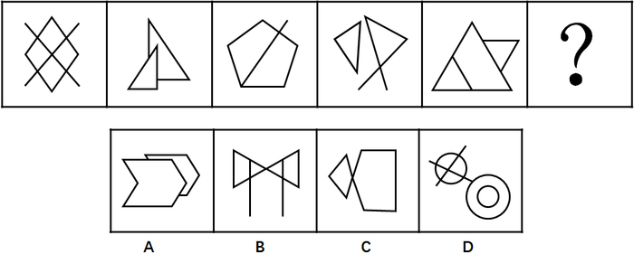

A. A

B. B

C. C

D. D

第 51 题 · 答案与解析

**参考答案（粉笔题库参考内容）**

B

**解析**

图形组成不同，且没有明显的属性规律，考虑数数。图3由一个五边形和一条直线构成，优先考虑数线，发现题干所有图形都由6条直线组成。A项11条直线，B项6条直线，C项7条直线，D项2条直线。

故正确答案为B。

**考点**：数量规律-线

**来源**：2014年江苏省公务员录用考试《行测》题（C类）第48题

### 第 52 题

每道题的题干中给出一套图形，其中有五个图，这五个图呈现一定的规律性。选项给出一套图形，其中有四个图，从中选出唯一的一项作为保持题干五个图规律性的第六个图。

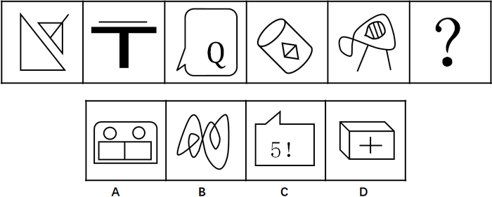

A. A

B. B

C. C

D. D

第 52 题 · 答案与解析

**参考答案（粉笔题库参考内容）**

D

**解析**

图形组成不同，且没有明显的属性规律，考虑数数。题干数量关系明显，每个图形都由2个部分构成，A项4个部分，B项1个部分，C项4个部分，D项2个部分。

故正确答案为D。

**考点**：数量规律-素

**来源**：2014年江苏省公务员录用考试《行测》题（B类）第52题

### 第 53 题

右边给出的一套图形，其中有四个图，从中选出唯一的一项作为保持左边五个图形规律的第六个图是：

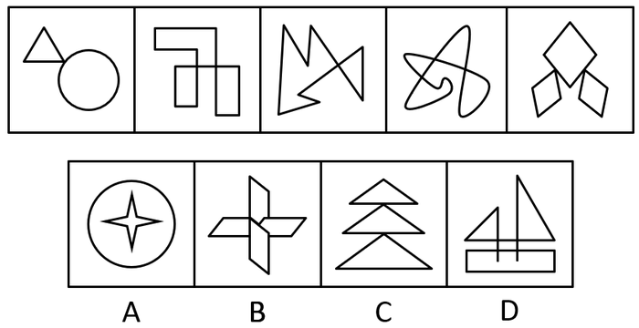

A. A

B. B

C. C

D. D

第 53 题 · 答案与解析

**参考答案（粉笔题库参考内容）**

C

**解析**

元素组成凌乱，观察图形，面与面之间均由点相连，且面与面之间并不相容或相交，符合条件的只有C项。

故正确答案为C。

**考点**：特殊规律-图形间关系

**来源**：2014年江苏省公务员录用考试《行测》题（B类）第53题

### 第 54 题

右边四个图形中，只有一个是由左边的四个图形拼合而成（只能通过上、下、左、右进行移动），请把它找出来：

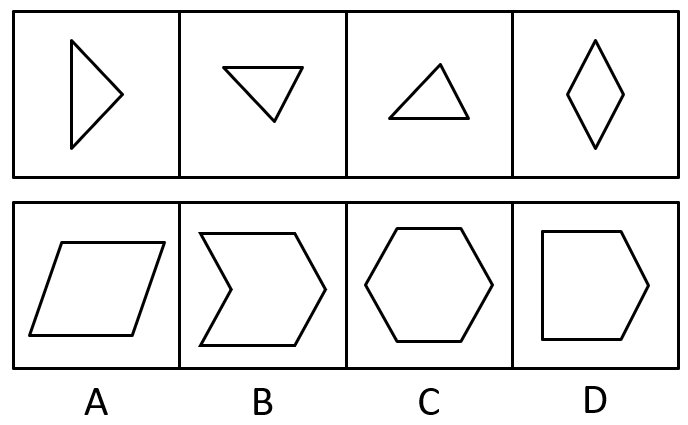

A. A

B. B

C. C

D. D

第 54 题 · 答案与解析

**参考答案（粉笔题库参考内容）**

D

**解析**

题干第一幅图中的竖直线与其他几幅图形中的直线并不能融合抵消，且第四幅图菱形的两个钝角部分只能抵消其一，必然会留下一个钝角部分，包含竖直线与钝角的图形只有D项。

故正确答案为D。

**来源**：2014年江苏省公务员录用考试《行测》题（B类）第54题

### 第 55 题

右边四个图形中，只有一个是由左边的四个图形拼合而成（只能通过上、下、左、右进行移动），请把它找出来：

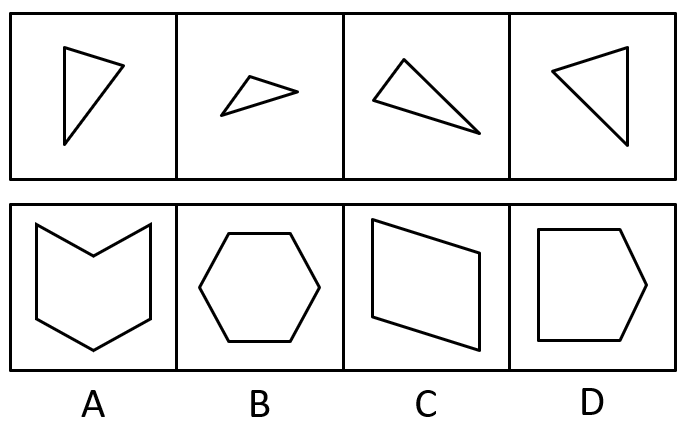

A. A

B. B

C. C

D. D

第 55 题 · 答案与解析

**参考答案（粉笔题库参考内容）**

C

**解析**

如图所示，C项通过组合后能够形成，A、B、D项均不符合题意。

故正确答案为C。

**来源**：2014年江苏省公务员录用考试《行测》题（B类）第55题

### 第 56 题

左边给定的是纸盒外表面的展开图，右边哪一项能由它折叠而成？请把它找出来：

A. A

B. B

C. C

D. D

第 56 题 · 答案与解析

**参考答案（粉笔题库参考内容）**

A

**解析**

本题考查四面体的空间重构。对平面展开图中的面进行标记，用排除法解题。

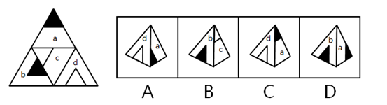

A项：选项由面a与面d构成，选项与展开图一致，当选；

B项：选项由面b与面c构成，展开图中两面的公共边与面b中黑三角的一条边重合，而选项中没有重合，选项与展开图不一致，排除；

C项：选项由面a与面d构成，展开图中面a黑色小三角形的右边是面d，而选项中面a黑色小三角形的左边是面d，选项与展开图不一致，排除；

D项：选项由面a和面b构成，展开图中面a白色梯形的长边挨着面c，而选项中面a白色梯形的长边挨着面b，选项与展开图不一致，排除。

故正确答案为A。

**来源**：2014年江苏省公务员录用考试《行测》题（B类）第56题

### 第 57 题

左边给定的是纸盒外表面的展开图，右边哪一项能由它折叠而成？请把它找出来：

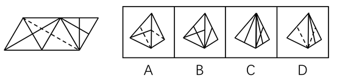

A. A

B. B

C. C

D. D

第 57 题 · 答案与解析

**参考答案（粉笔题库参考内容）**

B

**解析**

将原展开图标上序号如下图，逐一进行分析。

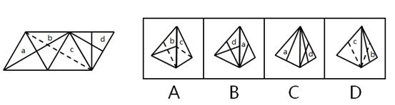

A项：选项由面b与面c构成，展开图中面b与面c内的虚线相交于公共边上，而选项中面b内实线与面c内虚线相交于公共边上，选项与展开图不一致，排除；

B项：选项由面a与面d构成，与展开图一致，当选；

C项：选项由面a与面d构成，展开图中面d大白三角挨着面c，而选项中面d的大白三角挨着面a，选项与展开图不一致，排除；

D项：选项由面b和面c构成，展开图中面b与面c内的虚线相交于公共边的中点，而选项中没有相交于公共边的中点，选项与展开图不一致，排除。

故正确答案为B。

**来源**：2014年江苏省公务员录用考试《行测》题（B类）第57题

### 第 58 题

左边给定的是纸盒外表面的展开图，右边哪一项能由它折叠而成？请把它找出来：

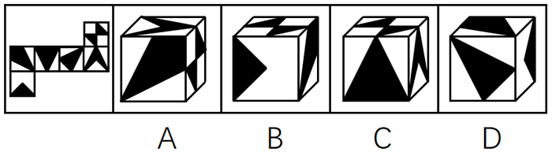

A. A

B. B

C. C

D. D

第 58 题 · 答案与解析

**参考答案（粉笔题库参考内容）**

A

**解析**

A项：组合正确；

B项：直角三角形面与漏斗形面为相对面，不能同时出现，故排除；

C项：大三角形面与“A”字形面为相对面，不能同时出现，故排除；

D项：斜三角形面与D项最顶面的面为相对面，不能同时出现，故排除。

故正确答案为A。

**考点**：空间类-空间重构-六面体

**来源**：2014年江苏省公务员录用考试《行测》题（B类）第58题

### 第 59 题

左边给定的是纸盒外表面的展开图，右边哪一项能由它折叠而成？请把它找出来：

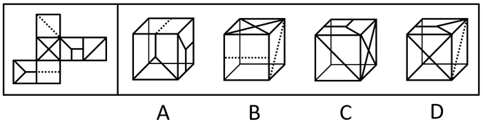

A. A

B. B

C. C

D. D

第 59 题 · 答案与解析

**参考答案（粉笔题库参考内容）**

D

**解析**

A项：两个“Y”字形面为相对面，不能同时出现，故排除；

B项：两个虚线面为相对面，不能同时出现，故排除；

C项：斜线面与“X”字形面为相对面，不能同时出现，故排除；

D项：组合正确。

故正确答案为D。

**考点**：空间类-空间重构-六面体

**来源**：2014年江苏省公务员录用考试《行测》题（B类）第59题

### 第 60 题

左边给定的是纸盒外表面的展开图，右边哪一项能由它折叠而成？请把它找出来：

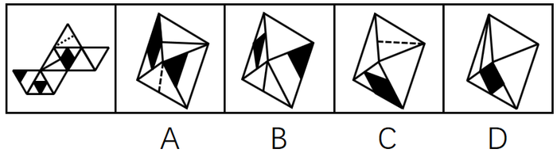

A. A

B. B

C. C

D. D

第 60 题 · 答案与解析

**参考答案（粉笔题库参考内容）**

A

**解析**

A项：组合正确，当选；

B项：两个黑色三角面应该相邻而不是相对，排除；

C项：题干中黑色菱形面的顶角所指的为虚线面，而C项指向了空白面，指向错误，排除；

D项：如图，

在黑色菱形面画边，平面图中的1边对应的面与D项1边对应的面不一致，排除。

故正确答案为A。

**来源**：2014年江苏省公务员录用考试《行测》题（B类）第60题

### 第 61 题

党要管党，首先是要管好干部；从严治党，关键是从严治吏。干部作风存在问题，就易成为腐败的温床。唯有紧抓干部的清廉从政，坚决扫除作风之弊、行为之垢，我们的党才能永葆纯洁，才能永葆与人民群众的血肉联系。

根据以上信息，可以得出以下哪项：

A. 如果从严治吏，就要从严治党

B. 如果干部作风没有问题，腐败就找不到滋生的温床

C. 如果不紧抓干部的清廉从政，我们的党就不能永葆与人民群众的血肉联系

D. 如果坚决扫除作风之弊、行为之垢，我们的党就能永葆纯洁

第 61 题 · 答案与解析

**参考答案（粉笔题库参考内容）**

C

**解析**

第一步：翻译题干，利用充分必要条件。

“从严治党，关键是从严治吏”：前→后，翻译为：治党→治吏①；“干部作风存在问题，就易成为腐败的温床”：前→后，翻译为：干部作风有问题→成为腐败的温床②；“唯有紧抓干部的清廉从政，坚决扫除作风之弊、行为之垢，我们的党才能永葆纯洁，才能永葆与人民群众的血肉联系”：后→前，翻译为：党能永葆纯洁、永葆与人民的联系→紧抓干部清廉，扫除作风之弊、行为之垢③。

第二步：逐一翻译选项并判断正确答案。

A项：如果······就······前→后，翻译为：治吏→治党，是对①的肯后，肯后无必然，排除；

B项：如果······就······前→后，翻译为：干部作风没问题→腐败就找不到温床，是对②的否前，否前无必然，排除；

C项：如果······就······前→后，翻译为：不紧抓干部清廉从政→党就不能永葆与人民的联系，是对③应用逆否规则所得，当选；

D项：如果······就······前→后，翻译为：扫除作风之弊、行为之垢→党能永葆纯洁，是对③的肯后，肯后无必然，排除。

故正确答案为C。

**考点**：常规翻译

**来源**：2014年江苏省公务员录用考试《行测》题（C类）第57题

### 第 62 题

最有希望的成功者，并不是那些才干出众的人，而是那些善于抓住每一次机遇努力去开拓奋斗的人。

根据以上信息，得不出以下哪项？

A. 有的最有希望的成功者不是那些才干出众的人

B. 有的才干出众的人并不是最有希望的成功者

C. 有些才干出众的人是那些善于把握机遇的人

D. 有些善于把握机遇的人是最有希望的成功者

第 62 题 · 答案与解析

**参考答案（粉笔题库参考内容）**

C

**解析**

题干的逻辑关系为：

成功者→不出众，成功者→善于抓住机遇。

A项：所有可以推出有的，故“有的最有希望的成功者不是那些才干出众的人”正确；

B项：题干的逆否命题为：出众→不成功者，而B项的逻辑关系为：有的出众→不成功者，同样所有可以推出有的，正确；

C项：逻辑关系为：有些出众→善于抓住机遇。通过题干的逻辑关系并不能推出C项，错误；

D项：成功者→善于抓住机遇，故有的善于抓住机遇的→成功者，正确。

本题为选非题，故正确答案为C。

**考点**：集合推理

**来源**：2014年江苏省公务员录用考试《行测》题（B类）第62题

### 第 63 题

为什么地球、太阳等亿万个星球，亿万年来能在宇宙间相安无事地运行而不发生冲撞呢？为什么人与人之间，经常会发生磕磕碰碰的事呢？人文专家告诉我们，地球、太阳等亿万个星球都运行在自己的轨迹上，都走在自己的路上，而我们人类却非如此。有的人见别人的路好走，就想去走别人的路；见别人的路近，就要去抄别人的近路。放着自己的路不走而去挤别人的路，怎么会不发生磕碰和碰撞呢？

以下哪项如果为真，最能质疑上述人文专家的言论（    ）。

A. 每个人的路都应该是独特的，不应该交叉重叠

B. 每个人的路都是独特的，但总有交叉重叠的部分

C. 人生不如意事十之八九，磕碰和冲撞再平常不过

D. 人与星球并不相同，何况星球也有磕碰和冲撞的时候

第 63 题 · 答案与解析

**参考答案（粉笔题库参考内容）**

D

**解析**

第一步：找出论点论据。

论点：地球、太阳等亿万个星球都运行在自己的轨迹上，都走在自己的路上，而我们人类却非如此，有的人见别人的路好走，就想去走别人的路；见别人的路近，就要去抄别人的近路。放着自己的路不走而去挤别人的路，怎么会不发生磕碰和碰撞呢？

论据：无。

本题的论证以地球、太阳等星球来类比各种不同的人，各星球有自己的轨迹所以各自相安无事，人类却总有占别人的路，挤别人的路的情况。要质疑论点，可以从类比的可比性上入手。

第二步：逐一分析选项。

A项，只是指出必要性，“不应该”是一种理想状态，不能有力质疑现实的情况，排除；

B项，人和人之间有重叠，就意味着人和人之间必然有冲突，加强了论点，而非质疑，排除；

C项，同B项，排除；

D项，人和星球并不相同，两者没有关联性，可以质疑，当选。

故正确答案为D。

**考点**：削弱论点

**来源**：2014年江苏省公务员录用考试《行测》题（B类）第63题

### 第 64 题

目前，中国10个省区市设置了25个“弃婴安全岛”，广州市的“弃婴安全岛”在开放两周内就收到弃婴51名，南京市的“弃婴安全岛”一经启用2周内收到26名弃婴。统计数字显示，全国“弃婴安全岛”接收的婴儿基本男女各一半，但是几乎所有的弃婴都有残疾或重病。有专家就此批评指出，“弃婴安全岛”的设置助长了父母遗弃婴儿的行为。

以下哪项如果为真，最能质疑上述专家提出的批评？

A. 设置“弃婴安全岛”是对我国儿童医疗保障制度的一种有益补充

B. 患有残疾或重病的弃婴由于“弃婴安全岛”的设置而能得到社会及时救助

C. 弃婴对于家长来说实属无奈之举，忍痛遗弃孩子是希望他们得到更好救治

D. “弃婴安全岛”刚刚设置不久，其对婴儿父母行为的影响还有待进一步观察

第 64 题 · 答案与解析

**参考答案（粉笔题库参考内容）**

C

**解析**

第一步：找到论点和论据。

题干中专家的观点为“弃婴安全岛的设置助长了父母遗弃婴儿的行为”，要质疑专家的观点就要指出“弃婴安全岛并没有助长父母遗弃婴儿的行为”。

第二步：逐一分析选项。

A、B两项：均不能质疑专家的观点，为无关项，与家长的遗弃行为并无关联，排除；

C项：说明弃婴行为对家长来说是无奈之举，说明无论是否设置“弃婴安全岛”，家长都会遗弃婴儿，削弱了论点，当选；

D项：弃婴安全岛设置的时间不长，其对婴儿父母行为的影响还有待进一步观察， 说明弃婴安全岛对婴儿父母行为的影响还不清楚，属于不明确选项，排除。

故正确答案为C。

**考点**：削弱论点

**来源**：2014年江苏省公务员录用考试《行测》题（B类）第64题

### 第 65 题

购买彩票时，很多人往往愿意自己选号，不愿交由电脑随机选号。因为他们相信，中奖号码从长远看是随机产生的，但在短期内却有规律，比如前面连续多期出现的数字，这期出现的可能性就要小一些；或者某些数字对于自己意味深长，或者干脆就是自己的幸运数字，选择它们应该更可能中奖。

以下哪项如果为真，最能质疑上述这些人的想法：

A. 很多人研究彩票的中奖规律，但他们的中奖率并没有因此而显著提高

B. 每一期中奖号码都是独立随机产生的，彼此间没有任何内在的关联

C. 对于中奖号码的产生究竟有无规律，很多人持“信则有，不信则无”的观点

D. 电脑选号是随机的，而自己选号有特定的意向，在这一点上人比电脑更聪明

第 65 题 · 答案与解析

**参考答案（粉笔题库参考内容）**

B

**解析**

第一步：找出论点和论据。

论点：中奖号码从长远看是随机产生的，但在短期内却有规律，比如前面连续多期出现的数字，这期出现的可能性就要小一些；或者某些数字对于自己意味深长，或者干脆就是自己的幸运数字，选择他们应该更有可能中奖。

无明显论据。

第二步：逐一分析选项。

A项，研究中奖规律也没有提高中奖概率，不能证明中奖号码是否有规律，且没有显著提高不代表没有提高，只要有所提高就说明可能是有规律的，不能削弱，排除；

B项，号码独立产生，彼此间没有关联，说明短期内也是没有任何规律的，直接削弱论点，当选；

C项，说明人们如何看待中奖号码是否有规律这件事，属无关选项，无法削弱，排除；

D项，说明人比电脑选号有优势，属于补充论据支持结论，不能削弱，排除。

故正确答案为B。

**考点**：削弱论点

**来源**：2014年江苏省公务员录用考试《行测》题（C类）第59题

### 第 66 题

小芳与小莲是一对好朋友，大刚与大勇也是，但这四人彼此间却不太熟悉。在一次机关联谊会上，小芳、小莲和大刚、大勇相遇，小芳能叫出大刚的名字，但大刚却叫不出小芳的名字。凡能叫出大刚名字的人都能叫出大刚朋友的名字，凡叫不出小芳名字的人都叫不出小芳朋友的名字。根据以上信息，可以得出以下哪项？

A. 小莲能叫出大刚的名字

B. 大刚能叫出小莲的名字

C. 小芳能叫出大勇的名字

D. 大勇能叫出小芳的名字

第 66 题 · 答案与解析

**参考答案（粉笔题库参考内容）**

C

**解析**

第一步：分析题干条件。

根据已知信息，“小芳能叫出大刚的名字”和“凡能叫出大刚名字的人都能叫出大刚朋友的名字（大刚与大勇是一对好朋友）”，可以得出：小芳能叫出大刚和大勇的名字。

根据已知信息，“大刚却叫不出小芳的名字”和“凡叫不出小芳名字的人都叫不出小芳朋友的名字（小芳与小莲是一对好朋友）”，可以得出：大刚不能叫出小芳和小莲的名字。

第二步：逐一判断选项。

A项，根据题干信息，小莲能否叫出大刚名字不确定，排除；

B项，根据题干信息，大刚不能叫出小莲的名字，排除；

C项，根据已知信息，“小芳能叫出大刚的名字”和“凡能叫出大刚名字的人都能叫出大刚朋友的名字（大刚与大勇是一对好朋友）”，可以得出：小芳能叫出大勇的名字，当选；

D项，根据题干信息，大勇能否叫出小芳的名字不确定，排除。

故正确答案为C。

**考点**：日常结论

**来源**：2014年江苏省公务员录用考试《行测》题（B类）第66题

### 第 67 题

某企业有甲、乙、丙、丁、戊、己、庚7位董事，他们执行集体决策制度。制度规定，如果赞成票数达与会人数的一半以上，一项决策就能通过，否则不能通过；每位董事必须对所有决策提案行使表决权，要么赞成，要么反对，不得弃权。在一次决策会议上，董事悉数到齐，需要对1号、2号、3号3项提案进行决策表决。已知：

（1）对这3项提案，每位董事都至少赞成一项，至少反对一项；

（2）甲赞成1号提案，但反对2号提案；

（3）乙赞成1号和3号提案；

（4）戊只赞成1号提案；

（5）庚反对1号和2号提案。

如果丁的选择与庚正好相反，可以得出以下哪项？

A. 1号提案能通过

B. 2号提案能通过

C. 3号提案能通过

D. 3号提案不能通过

第 67 题 · 答案与解析

**参考答案（粉笔题库参考内容）**

A

**解析**

第一步：总结题干条件。

甲：赞1 且 反2；

乙：赞1和3；

戊：赞1；

庚：反1和2；

丁：与庚相反，则为赞1和2。

第二步：分析题干条件，进行推理。

因为赞成票数达与会人数的一半以上，一项决策就能通过，而甲乙丁戊均赞同1号方案，即在7位董事中有4位赞同1号方案，即赞成票数超过与会人数的一半，则1号方案能够通过。

故正确答案为A。

**考点**：从最大信息开始推

**来源**：2014年江苏省公务员录用考试《行测》题（B类）第67题

### 第 68 题

在以下5×5矩阵中，每个小方格中可填入一个汉字，要求每行每列均含有金、木、水、火、土5个汉字，不能重复也不能遗漏。根据已经给定的条件，矩阵中①所在方格中应填入的汉字是：

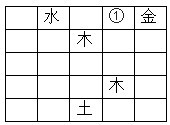

A. 火

B. 水

C. 木

D. 土

第 68 题 · 答案与解析

**参考答案（粉笔题库参考内容）**

D

**解析**

根据表格第一行和第三列的分布可知，第一行第三格内不能为“金、木、水、土”，则只能为“火”；再根据表格第一行和第四列的分布可知，①格内不能为“金、木、水、火”，则只能为“土”。

故正确答案为D。

**考点**：从最大信息开始推

**来源**：2014年江苏省公务员录用考试《行测》题（C类）第63题

## 材料 2

某大学辩论协会和围棋协会两个学生社团各自对外招聘3名干事。报名的人有甲、乙、丙、丁、戊、己六人。事后得知：

（1）每个社团均各招到3名干事；

（2）至少有1位报名者被两个社团同时录用；

（3）甲、丁两人分别被不同的社团录用；

（4）乙、丙两人均没有被两个社团同时录用；

（5）如果丁被录用，则戊一定会被录用，且两人都只在围棋协会。

### 第 69 题

根据以上信息，可以得知：

A. 甲被围棋协会录用

B. 乙被辩论协会录用

C. 丙被辩论协会录用

D. 戊被围棋协会录用

第 69 题 · 答案与解析

**参考答案（粉笔题库参考内容）**

D

**解析**

由条件（3）可知，被两个社团同时录用的不是甲也不是丁（若甲或丁同时被两个社团录用的话，那么甲丁应归属于同一个社团）；

由条件（4）可知，乙、丙也没有被两个社团同时录用；

由条件（5）可知，丁、戊也没有被两个社团同时录用；

故只有己被两个社团同时录用。

由条件（3）可知丁被录用，则由条件（5）推知，戊也被录用，且二人同时加入围棋协会。则围棋协会的人有：丁、戊、己。

故正确答案为D。

**来源**：2014年江苏省公务员录用考试《行测》题（B类）第69题

### 第 70 题

如果乙没有被两社团录用，可以得出以下哪个选项？

A. 甲被围棋协会录用

B. 丙被围棋协会录用

C. 戊被辩论协会录用

D. 己被辩论协会录用

第 70 题 · 答案与解析

**参考答案（粉笔题库参考内容）**

D

**解析**

加入围棋协会的人有：丁、戊、己，则加入辩论协会的人有：甲、己、（乙或丙）。假设乙未被两个协会录取，则加入辩论协会的人可确定为：甲、己、丙。

符合条件的只有D项，己被辩论协会录用。

故正确答案为D。

**来源**：2014年江苏省公务员录用考试《行测》题（B类）第70题

### 第 71 题

析词：只为了表达特殊的需要，临时把某个词拆开使用的修辞手法。

下列属于析词的是：

A. 谈笑有鸿儒，往来无白丁

B. 上下四方曰宇，古往今来曰宙

C. 教学要避免疏而不导，启而不发

D. 不爱家何以爱国，不孝父母何以爱人

第 71 题 · 答案与解析

**参考答案（粉笔题库参考内容）**

C

**解析**

第一步：关键词查找。

析词的定义要点为：临时将某个词拆开使用。

第二步：逐一分析选项。

A、D两项并未出现拆分使用词语的现象，排除；

B项只是表达“宇”与“宙”的本质含义，也并非拆分使用，排除；

C项为了要表达清楚教学方法的内涵，将“疏导”与“启发”分别拆开使用，符合析词特征，当选。

故正确答案为C。

**考点**：方式目的

**来源**：2014年江苏省公务员录用考试《行测》题（B类）第71题

### 第 72 题

文献老化指科学文献随着时间的推移，有效性或有益性逐渐降低，甚至失去作为科学情报源存在的价值。

下列属于文献老化的是：

A. 某资料室近几年陆续购买了大量图书，由于管理不善，很多已经破损不堪

B. 某科技辞典已经出版到第6版，图书馆的1978年第1版几乎无人查阅

C. 某科技杂志1950年第1期上的一篇论文，今天看来，其测量数据误差很大

D. 《1965年××统计年鉴》的许多数据资料，至今仍然受到研究者的高度重视

第 72 题 · 答案与解析

**参考答案（粉笔题库参考内容）**

C

**解析**

第一步：找出定义关键词。

“科学文献”、“时间的推移”、“有效性或有益性逐渐降低”、“失去作为科学情报源存在的价值”。

第二步：逐一分析选项。

A项：大量图书不符合“科学文献”，“管理不善”不符合“时间的推移”，“破损不堪”不符合“有效性或有益性逐渐降低”，不符合定义，排除；

B项：科技辞典是工具书不符合“科学文献”，其第1版几乎无人查阅也不能说明其“有效性或有益性逐渐降低”，不符合定义，排除；

C项：科技论文符合“科学文献”，1950年至今符合“时间的推移”，其测量数据误差很大符合“有效性或有益性逐渐降低”、“失去作为科学情报源存在的价值”，符合定义，当选；

D项：《1965年××统计年鉴》符合“科学文献”，但是其数据资料至今仍然受到研究者的高度重视不符合“有效性或有益性逐渐降低”、“失去作为科学情报源存在的价值”，不符合定义，排除。

故正确答案为C。

**考点**：原因结果

**来源**：2014年江苏省公务员录用考试《行测》题（B类）第72题

### 第 73 题

换城消费：指由于两个城市之间交通便捷，物价高低不一，市民经常到对方城市购物的消费方式。

下列属于换城消费的是：

A. 北京市民小汪告诉记者：在北京6块钱一斤的红富士苹果，天津10元能买4个；北京80元一桶的食用油，天津才65元

B. 每次听到珠海有商场搞促销，深圳的李女士都会兴高采烈地赶去血拼，半天时间，家里就满是她的战利品

C. 赵女士每次从韩国回来，都在机场免税店买一大堆化妆品，这比在国内购买同一韩国品牌省不少钱

D. 黄先生在南方某市工作了七八年，眼见物价一路狂飙，准备卖掉自家房子，和妻子一块回北方老家养老

第 73 题 · 答案与解析

**参考答案（粉笔题库参考内容）**

B

**解析**

第一步：找出定义关键词。

“两个城市之间交通便捷”“物价高低不一”“市民经常到对方城市购物的消费方式”。

第二步：逐一判断选项。

A项：北京苹果6元一斤，而天津10元买4个，北京一桶食用油80元，而天津65元，符合“物价高低不一”，但没有提及市民是否经常到对方城市购物，和B项相比较而言，没有B项明确，排除。

B项：珠海和深圳交通便捷，深圳的李女士到珠海的商场血拼符合“经常到对方城市购物”，符合定义，当选。

C项：赵女士从韩国购买的化妆品比国内便宜，这是两个国家并非是两个城市，不符合“两个城市之间交通便捷”，排除。

D项：黄先生准备卖掉房子回老家养老不符合“市民经常到对方城市购物”，不符合定义，排除。

故正确答案为B。

**考点**：拆词

**来源**：2014年江苏省公务员录用考试《行测》题（B类）第73题

### 第 74 题

二次留守，指农村留守儿童被父母接到城市后，由于父母每天忙于工作，孩子周围都是陌生人，没有朋友和玩伴。

下列属于二次留守的是：

A. 某城市农民工公寓聚居着大量外来工友，很多人都把孩子接到城里过暑假，天天有操各地口音的小孩在附近的小卖部、广场上一起玩耍

B. 在某小区街道菜场里，被父母接进城的小英每天帮着卖菜的奶奶收钱，没有客人的时候，她就蹲在地上翻看连环画

C. 暑假期间，某教育部门组织大批留守儿童进城参加夏令营活动，有的孩子还能与久别重逢的父母短暂相聚，由父母带他们游玩城市景点

D. 进城打工的小陈夫妇把智障儿子小明带到身边，民政部门得知后把他安排到残疾人康复中心，小陈夫妇每周只能见小明一次

第 74 题 · 答案与解析

**参考答案（粉笔题库参考内容）**

B

**解析**

第一步，查找关键词。

定义的关键词信息是二次留守；二次留守的主体是被父母接到城市的留守儿童，原因是“父母每天忙于工作”，结果是“没有朋友和玩伴”。

第二步，逐一判断选项。

A项：很多小孩一起玩耍不符合“没有朋友和玩伴”，不符合定义，排除；

B项：小英被父母接进城且没有人玩，符合定义，当选；

C项：留守儿童不是由父母接进城，不符合定义，排除；

D项：原因是民政部门把是智障的小明安排到残疾人康复中心，不是由于父母忙，不符合定义，排除。

故正确答案为B。

**考点**：大前提

**来源**：2014年江苏省公务员录用考试《行测》题（B类）第74题

### 第 75 题

次生丑闻：指某地或某人曝出某个丑闻后，又连续牵出的其他丑闻。

下列不属于次生丑闻的是：

A. 某市一官员的“艳照门”传得沸沸扬扬，记者在其政府网站上核查该官员履历时，意外发现网上其他领导的视察照片居然有不少是PS的

B. 在会场上抽天价香烟的某官员被曝光停职后，网民们继续搜索，很快发现他名下有多套来源不明的房产

C. 新华社一篇题为《看似有隐情，其实真忽悠——盘点那些曾经的“官谣”》的文章，梳理了近年来各地出现的“官谣”案例

D. 故宫失窃案见诸报端后，由于故宫方面应对不当，“失窃门”又牵出了“错字门”“会所门”“瞒报门”

第 75 题 · 答案与解析

**参考答案（粉笔题库参考内容）**

C

**解析**

第一步：找出定义关键词。

“某地或某人曝出某个丑闻”、“连续牵出的其他丑闻”。

第二步：逐一分析选项。

A项：“某市一官员的‘艳照门’”，符合“某地或某人曝出某个丑闻”，接着牵出该市的其他领导视察照片造假的事件，符合“连续牵出的其他丑闻”，虽然两个丑闻事件的主体不是同一人，但是都属于某地的丑闻，符合定义，排除；

B项：某官员抽天价烟事件，符合“某地或某人曝出某个丑闻”，接着牵出多套来源不明的房产，符合“连续牵出的其他丑闻”，符合定义，排除；

C项：新华社梳理了近年来各地出现的“官谣”案例，不符合“某地或某人曝出某个丑闻”，也没有体现出“连续牵出的其他丑闻”，不符合定义，当选；

D项：故宫“失窃门”被曝光，符合“某地或某人曝出某个丑闻”，又牵出了“错字门”“会所门”“瞒报门”，符合“连续牵出的其他丑闻”，符合定义，排除。

本题为选非题，故正确答案为C。

**考点**：大前提

**来源**：2014年江苏省公务员录用考试《行测》题（B类）第75题

### 第 76 题

隐性歧视：指存在于人的思想中、未公开显现出来的对特定群体的歧视性认识。

下列属于隐性歧视的是：

A. 戴着墨镜进居民小区的中年男子更容易被保安拦住盘问

B. 满脸大胡子、装束怪异的人往往被看成艺术家

C. 西装笔挺、皮鞋锃亮的人常常被认为是成功人士

D. 打扮成失学少年的乞丐往往能讨到更多的钱

第 76 题 · 答案与解析

**参考答案（粉笔题库参考内容）**

A

**解析**

第一步：查找关键词。

定义的关键词信息为“歧视性认识”。

第二步：逐一判断选项。

A项：“戴着墨镜进居民小区的中年男子”被保安拦住盘问，体现了保安对这类特定群体的歧视，符合定义，当选。

B、C、D三项均未涉及歧视性认识，不符合定义，排除。

故正确答案为A。

**考点**：拆词

**来源**：2014年江苏省公务员录用考试《行测》题（C类）第66题

### 第 77 题

邻避效应：指居民针对将要建在自家附近、可能造成环境污染的公共设施所产生的嫌恶心理。出于对健康安全的担心，居民有时会出现高度情绪化的集体抵制甚至抗争行为。

下列不属于邻避效应的是：

A. 某市建委召开110千伏变电站建设座谈会，当地居民拒绝参加并多次到市规划局、市环保局等单位上访，强烈反对将变电站建在自家门口

B. 半年以来，每到城管委接访日，某村居民就会成群结队赶来上访，要求取消在该村附近建立大型垃圾中转站的计划

C. 某地准备建设一个大型的污水处理厂，计划刚一披露就遭到了当地居民的强烈反对

D. 某酒店准备扩建自己的停车场，与周围居民进行了多次协商，始终没能达成一致，最终放弃了扩建计划

第 77 题 · 答案与解析

**参考答案（粉笔题库参考内容）**

D

**解析**

第一步：找出定义关键词。

“公共设施”、“将要建在居民附近、可能造成环境污染”、“居民出于对健康安全的担心”、“嫌恶心理”、“高度情绪化的集体抵制甚至抗争行为”。

第二步：逐一分析选项。

A项：110千伏变电站符合“公共设施”，可能会对居民安全带来危险，当地居民拒绝参加建设座谈会并且多次上访符合“嫌恶心理”以及“高度情绪化的集体抵制甚至抗争行为”，符合定义，排除；

B项：大型垃圾中转站符合“公共设施”以及“可能造成环境污染”，某村居民上访符合“嫌恶心理”以及“高度情绪化的集体抵制甚至抗争行为”，符合定义，排除；

C项：大型的污水处理厂符合“公共设施”以及“可能造成环境污染”，当地居民的强烈反对符合“嫌恶心理”，符合定义，排除；

D项：某酒店准备扩建自己的停车场不符合“公共设施”，与周围居民进行了多次协商不符合“高度情绪化的集体抵制甚至抗争行为”，不符合定义，当选。

本题为选非题，故正确答案为D。

**考点**：单定义-其他句式

**来源**：2014年江苏省公务员录用考试《行测》题（B类）第77题

### 第 78 题

保险储备：指企业为防备原材料运达误期或计划外增加需要量而建立的原材料储备。

下列属于保险储备的是：

A. 张大妈平时习惯多买些粮油盐放在家里，以备万一有什么事抽不开身去买

B. 李厂长望着满仓库的滞销产品，愁容满面，心里盘算着大力扩展销售渠道的办法

C. 洪水肆虐，道路交通受到严重威胁，刘厂长并不慌忙，因为度过汛期的原料早已备足

D. 王经理年前到处追债收款，给员工发放了年终奖金，也准备好了来年开工的各项资金

第 78 题 · 答案与解析

**参考答案（粉笔题库参考内容）**

C

**解析**

第一步：找出定义关键词。

保险储备的定义要点为：①企业；②为应对计划外情况所做的原材料储备。

第二步：逐一分析选项。

A项：张大妈并不属于企业，主体不一致，排除；

B项：盘算扩展销售渠道的办法，并不是做原材料储备，不满足条件②，排除；

C项：因洪水施虐道路交通受到威胁，而刘厂长并不慌忙，因为企业已将度过汛期的原料备足。满足定义要点，当选；

D项：准备好开工的各项资金，“资金”与“原材料”相悖，不满足条件②，排除。

故正确答案为C。

**考点**：方式目的

**来源**：2014年江苏省公务员录用考试《行测》题（C类）第67题

### 第 79 题

服务性公关：指为获取社会公众的了解和好评，树立组织的良好形象，向消费者提供各种实惠服务的公共关系活动。

下列属于服务性公关的是：

A. 某冰箱生产企业定期向客户发送食品贮存、保鲜新信息

B. 某公司借助墙报和公司网站定期公布产品研发销售情况

C. 某帐篷生产企业及时向某地震灾区捐助了数百顶帐篷

D. 某著名品牌的消费者自建一个交流使用体验的QQ群

第 79 题 · 答案与解析

**参考答案（粉笔题库参考内容）**

A

**解析**

第一步：关键词查找。

服务性公关的定义要点为：①为了获取社会的了解和好评，树立良好形象；②向消费者提供各种实惠服务。

第二步：逐一分析选项。

A项：向客户发送食品贮存、保鲜信息。定义要点①②均满足，当选；

B项：公司公布销售情况的对象并非消费者，不满足条件②，排除；

C项：企业捐助帐篷的对象为灾区受灾群众而非消费者，不满足条件②，排除；

D项：消费者自建QQ群，是消费者自建而非向消费者提供，不满足条件②，排除。

故正确答案为A。

**考点**：方式目的

**来源**：2014年江苏省公务员录用考试《行测》题（B类）第79题

### 第 80 题

禁果心理：指基于对某种禁令的逆反心理而产生的强烈的探求欲望。

下列不属于禁果心理的是：

A. 许多寺院的入口处都有“禁止拍摄”的牌子，仍有少数游客趁工作人员不备偷偷拍摄

B. 宙斯派侍女潘多拉传递魔盒，特地交代她千万不能打开，潘多拉却经不住诱惑打开了盒子，结果里面的罪恶跑到了人间

C. 某部书是官方禁书，但很多人不明白为什么要禁，千方百计地找这部书来读，还出现了许多手抄本

D. 某商场在“双十一”当日推出20台特价平板电脑，先到先得，结果出现了数百人抢购的场面

第 80 题 · 答案与解析

**参考答案（粉笔题库参考内容）**

D

**解析**

第一步：查找关键词。

定义的关键词信息为“基于对某种禁令的逆反心理”。

第二步：逐一判断选项。

A、B、C三项中的“禁止拍摄”“特地交代她千万不能打开”“官方禁书”对应关键词“禁令”，符合定义，排除。D项：没有涉及“禁令”，不符合定义，当选。

本题为选非题，故正确答案为D。

**考点**：单定义-其他句式

**来源**：2014年江苏省公务员录用考试《行测》题（C类）第65题

## 材料 3

### 第 81 题

2013年10月，江苏省民间固定资产投资完成额比4月多：

A. 297亿元

B. 308亿元

C. 335亿元

D. 368亿元

第 81 题 · 答案与解析

**参考答案（粉笔题库参考内容）**

A

**解析**

2013年10月江苏民间固定资产投资额为1-10月的投资量减去1-9月的投资额，即19727 – 17288 = 2439 亿元；4月江苏民间固定资产投资额为1-4月的投资额减去1-3月的投资额，即7560 – 5418 = 2142 亿元。二者差值为2439 – 2142 = 297 亿元。

故正确答案为A。

**来源**：2014年江苏省公务员录用考试《行测》题（C类）第81题

### 第 82 题

2013年3-12月，江苏省第一产业固定资产投资完成额超过19亿元的月份有：

A. 2个

B. 3个

C. 4个

D. 5个

第 82 题 · 答案与解析

**参考答案（粉笔题库参考内容）**

B

**解析**

定位至表中“第一产业”一行，数据逐一相减得：

3月：54 – 34 = 20；4月：76 – 54 = 22；

5月：95 – 76 = 19；6月：94 – 95 = – 1；

7月：112 – 94 = 18；8月：130 – 112 = 18；

9月：150 – 130 = 20；10月：168 – 150 = 18；

11月：185 – 168 = 17；12月：199 – 185 = 14。

其中3月、4月、9月共三个月超过19亿元。

故正确答案为B。

**来源**：2014年江苏省公务员录用考试《行测》题（C类）第82题

### 第 83 题

2012年江苏省第三产业固定资产投资完成额是：

A. 13150亿元

B. 13947亿元

C. 14193亿元

D. 15076亿元

第 83 题 · 答案与解析

**参考答案（粉笔题库参考内容）**

C

**解析**

2013年江苏省第三产业固定资产投资完成额为17358亿元，同比增长率为22.3%，所以2012年为17358/(1 + 22.3%) = 17358/1.223，用直除法，结果前两位为14。

故正确答案为C。

**来源**：2014年江苏省公务员录用考试《行测》题（C类）第85题

### 第 84 题

2013年港澳台及外商固定资产季度投资完成额最少的季度是：

A. 第一季度

B. 第二季度

C. 第三季度

D. 第四季度

第 84 题 · 答案与解析

**参考答案（粉笔题库参考内容）**

A

**解析**

定位至表中“港澳台及外资”一行，每季度结束数据减去开始数据，即为该季度完成额。

第一季度：927 亿元；

第二季度：1902 － 927 ＝ 975 亿元；

第三季度：2897 － 1902 ＝ 995 亿元；

第四季度：3911 － 2897 ＝ 1014 亿元。

所以投资完成额最少的季度为第一季度。

故正确答案为A。

**来源**：2014年江苏省公务员录用考试《行测》题（C类）第83题

### 第 85 题

下列判断正确的有：

（1）2013年第一季度，江苏省第一产业固定资产投资完成额逐月减少

（2）2012年江苏省第二产业固定资产投资完成额多于第三产业

（3）2013年下半年，江苏省国有及国有控股固定资产投资完成额比上半年多866亿元

A. 0个

B. 1个

C. 2个

D. 3个

第 85 题 · 答案与解析

**参考答案（粉笔题库参考内容）**

B

**解析**

（1）错误。因1—2月第一产业固定资产投资完成额之和为34亿元，3月为54-34=20亿元，若逐月减少，则2月大于20亿元，1月大于2月，1—2月之和大于40亿元，与表中数据34亿元不符。

（2）正确。2012年江苏省第二产业固定资产投资额为18426/(1+17.2%)，2012年江苏省第三产业固定资产投资额为17358/(1 + 22.3%)，前项分子大于后项，前项分母小于后项，故2012年江苏省第二产业固定资产投资额多于第三产业。

（3）错误。2013年下半年，江苏省国有及国有控股固定资产投资完成额为7456-3340=4116亿元。2013年上半年江苏省国有及国有控股固定资产投资完成额为3340亿元，则下半年比上半年多4116-3340=776亿元。

因此，判断正确的有一个。

故正确答案为B。

**来源**：2014年江苏省公务员录用考试《行测》题（C类）第84题

## 材料 4

2013年上半年，全国入出境2.19亿人次，同比增长5.07%。其中，内地居民9091.83万人次，港澳台居民1.03亿人次，外国人2538.42万人次。

        内地居民出境4564.43万人次，同比增长18.36%。内地居民出境前往国家或地区居前五位的分别是中国香港、中国澳门、泰国、韩国、中国台湾。

        港澳台居民入出境1.03亿人次，同比下降2.15%。其中，香港居民7697.27万人次，同比下降1.25%；澳门居民2069.99万人次，同比下降4.38%；台湾居民486.82万人次，同比下降6.36%。

        外国人入出境2538.42万人次，同比下降5.22%。其中，入境1277.07万人次，同比下降5.15%。外国人来华居前五位的国家分别是韩国、日本、美国、俄罗斯、越南。

        来华外国人中，观光休闲494.01万人次，访问248.35万人次，交通运输服务员工153.92万人次，会议商务63.89万人次，其他入境目的为316.90万人次。外国人入境居前三位的口岸为上海浦东机场口岸（230.28万人次，占总数的18.03%）、北京首都机场口岸（202.80万人次，占总数的15.88%）和广州白云机场口岸（117.33万人次，占总数的9.19%）。

### 第 86 题

2013年上半年，港澳台居民入出境人次占全国入出境人次的比重是：

A. 45.16%

B. 47.03%

C. 49.75%

D. 50.02%

第 86 题 · 答案与解析

**参考答案（粉笔题库参考内容）**

B

**解析**

由题目定位到第一段“全国入出境2.19亿人次”“港澳台居民1.03亿人次”，直除可得1.03/2.19 ≈ 47%。

故正确答案为B。

**来源**：2014年江苏省公务员录用考试《行测》题（B类）第86题

### 第 87 题

2013年上半年，内地居民出、入境人次相差：

A. 32.59万人次

B. 48.51万人次

C. 37.03万人次

D. 35.82万人次

第 87 题 · 答案与解析

**参考答案（粉笔题库参考内容）**

C

**解析**

由题目定位到第一段“内地居民入出境9091.83万人次”，第二段“内地居民出境4564.43万人次”，简单相减得4564.43-(9091.83-4564.43)=37.03万人次。

故正确答案为C。

**来源**：2014年江苏省公务员录用考试《行测》题（B类）第87题

### 第 88 题

2013年上半年，既在内地居民出境前往国家或地区居前五位，又在外国人来华居前五位的国家是：

A. 泰国

B. 韩国

C. 日本

D. 美国

第 88 题 · 答案与解析

**参考答案（粉笔题库参考内容）**

B

**解析**

直接在题目中定位第二段“中国香港、中国澳门、泰国、韩国、中国台湾”，第四段“韩国、日本、美国、俄罗斯、越南”，得出答案为韩国。

故正确答案为B。

**来源**：2014年江苏省公务员录用考试《行测》题（B类）第88题

### 第 89 题

2013年上半年，港、澳、台居民入出境人次占全国入出境人次之比为：

A. 74.4:20.6:5.9

B. 77.0:20.7:4.9

C. 76.9:21.3:4.8

D. 78.1:20.6:5.3

第 89 题 · 答案与解析

**参考答案（粉笔题库参考内容）**

B

**解析**

由题目定位到第三段“香港居民7697.27万人次，澳门居民2069.99万人次，台湾居民486.82万人次”。分析题目选项，四舍五入后易得77.0：20.7：4.9正确。

故正确答案为B。

**来源**：2014年江苏省公务员录用考试《行测》题（B类）第89题

### 第 90 题

下列说法正确的是：

A. 2013年上半年，外国人来华观光休闲与访问的人次相差254.66万

B. 2013年上半年，港、澳、台居民入出境人次中台湾居民同比减少最多

C. 2013年上半年，外国人入境人次同比下降速度高于出境人次同比下降速度

D. 2013年上半年，上海浦东机场口岸外国人月平均入境人次是38.38万

第 90 题 · 答案与解析

**参考答案（粉笔题库参考内容）**

D

**解析**

A选项：2013年上半年，外国人来华观光休闲与访问的人次相差应为494.01－248.35＝245.66万，A选项错误。

B选项：根据公式下降量= (现期×下降率)/(1-下降率)，结合材料第三段数据可得：香港居民同比下降(7697.27 × 1.25%)/(1 − 1.25%) =(7697.27 × 1/80)/(1 - 1/80)= 7697.27/79 ≈ 90^+；澳门居民同比下降(2069.99 × 4.38%)/(1 − 4.38%) ≈(2069.99×1/25)/(1-1/25)=2069.99/24 ≈ 80^+；台湾居民同比下降= (486.82 × 6.36%)/(1 − 6.36%) = (486.82 × 1/16)/(1 − 1/16)=486.82/15≈30^+；香港和澳门的减少量均比台湾多，B选项错误；

C选项：根据选项定位到第四段“外国人入出境2538.42万人次，同比下降5.22%。其中，入境1277.07万人次，同比下降5.15%”，入境下降比率小于出入境平均下降比例，则出境比率应大于出入境平均比例，得出出境人次同比下降速度高于入境人次同比下降速度，C选项错误。

D选项：根据选项定位到第五段“上海浦东机场口岸，230.28万人次”，230.28/6＝38.38，D选项正确。

故正确答案为D。

**来源**：2014年江苏省公务员录用考试《行测》题（B类）第90题

## 材料 5

2013年中国货物进出口总额41600亿美元，比上年增长7.6%，成为世界第一贸易大国。其中，出口22096亿美元，增长7.9%；进口19504亿美元，增长7.3%；贸易顺差2592亿美元。2012年中国货物进口18178亿美元，比上年增长4.3%。

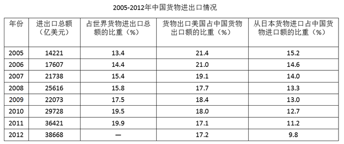

### 第 91 题

2013年中国货物出口增长速度比进口增长速度提高：

A. 0.3个百分点

B. 0.6个百分点

C. 7.3个百分点

D. 7.6个百分点

第 91 题 · 答案与解析

**参考答案（粉笔题库参考内容）**

B

**解析**

由题干定位到材料“出口增长7.9%，进口增长7.3%”相减得0.6%。

故正确答案为B。

**来源**：2014年江苏省公务员录用考试《行测》题（B类）第91题

### 第 92 题

2013年中国货物进出口总额比2005年增加了：

A. 24447亿美元

B. 25619亿美元

C. 26939亿美元

D. 27379亿美元

第 92 题 · 答案与解析

**参考答案（粉笔题库参考内容）**

D

**解析**

由题干定位至材料“2013年中国货物进出口总额41600亿美元”，查表得，2005年进出口总额为14221亿美元，相减得27379亿美元。

故正确答案为D。

**来源**：2014年江苏省公务员录用考试《行测》题（B类）第92题

### 第 93 题

2012年中国货物出口占货物进出口总额的比重是：

A. 47.0%

B. 48.3%

C. 53.0%

D. 57.7%

第 93 题 · 答案与解析

**参考答案（粉笔题库参考内容）**

C

**解析**

由题干定位到材料，2013年出口22096亿美元，增加7.9%，2012年进出口总额38668亿美元，相除得22096/(1+7.9%) ÷ 38668 ≈ 53.0%。

故正确答案为C。

**来源**：2014年江苏省公务员录用考试《行测》题（B类）第93题

### 第 94 题

2006-2011年六年里，中国货物进出口总额年增长速度超过世界年增长速度的年份有：

A. 3年

B. 4年

C. 5年

D. 6年

第 94 题 · 答案与解析

**参考答案（粉笔题库参考内容）**

D

**解析**

中国进出口总额占世界进出口总额增大，则表示中国进出口总额增长率高于世界总额。直接查表，2006-2011年中，6年都是增长的。

故正确答案为D。

**来源**：2014年江苏省公务员录用考试《行测》题（B类）第94题

### 第 95 题

下列判断不正确的有：

（1）2006-2012年七年，中国从日本货物进口额占货物进口总额的比重呈逐年递减的态势

（2）2011年中国对美国的货物出口额占货物出口总额的比重比2005年降低了4.3%

（3）2009-2013年五年，中国货物进出口总额年平均增长速度小于“十一五”时期年平均增长速度

A. 0个

B. 1个

C. 2个

D. 3个

第 95 题 · 答案与解析

**参考答案（粉笔题库参考内容）**

A

**解析**

第（1）项：查表比较得：2006-2012年七年，中国从日本货物进口额占货物进口总额的比重呈逐年递减的态势，正确。

第（2）项：查表得2005年数据和2011年数据，相减得21.4%-17.1%=4.3%，正确。

第（3）项：相同年份的年均增长率比较，只需要比较现期/基期即可。2009-2013年这五年的年均增长，是以2008年为基期，2013年为现期的；“十一五”时期的年均增长，是以2005年为基期，2010年为现期的。两者均为五年期，所以只需要比较2013年/2008年与2010年/2005年的大小即可。

代入材料数据，分别为41600/25616、29728/14221。直除看首位，显然前者＜2，后者＞2，所以2009-2013年这五年的年均增长慢于“十一五”时期，正确。

注意：江苏省考题中，提到2009-2013年这五年时，基期必须提前一年，即2008年。

本题为选非题，故正确答案为A。

**来源**：2014年江苏省公务员录用考试《行测》题（B类）第95题

## 材料 6

2013年江苏省全年完成港口货物吞吐量21.4亿吨，比上年增长9.7%。其中，外贸货物吞吐量3.5亿吨，增长12.9%。公路里程15.6万公里，新增1976公里。其中，高速公路里程4443.0公里，新增71.5公里。民用汽车保有量954.4万辆，净增141.3万辆，分别增长17.4%和13.3%。私人汽车保有量790.1万辆，净增132.9万辆，分别增长20.2%和15.0%。其中，私人轿车保有量554.6万辆，净增98.7万辆，分别增长21.6%和14.4%。

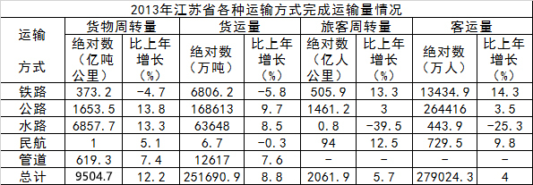

### 第 96 题

2013年江苏省铁路客运量增速比旅客周转量增速高：

A. 3.0%

B. 1.0%

C. 0.5%

D. 2.7%

第 96 题 · 答案与解析

**参考答案（粉笔题库参考内容）**

B

**解析**

由题干定位表格数据，铁路客运量增速14.3%，旅客周转量增速13.3%，相差1%。

故正确答案为B。

**来源**：2014年江苏省公务员录用考试《行测》题（B类）第96题

### 第 97 题

2013年江苏省公路旅客周转量占总旅客周转量的比重比上年：

A. 下降了1.8个百分点

B. 上升了1.8个百分点

C. 下降了5.7个百分点

D. 上升了5.7个百分点

第 97 题 · 答案与解析

**参考答案（粉笔题库参考内容）**

A

**解析**

由题干可判定本题为两期比重问题。定位表格材料可得，2013年公路旅客周转量为1461.2亿人公里，同比增长3.0%，总旅客周转量为2061.9亿人公里，同比增长5.7%。两期比重公式A/B×(a−b)/(1+a)，由于3%&lt;5.7%，故为下降，排除B、D两项。代入公式可得1461.2/2061.9×(3%-5.7%)/(1+3%)＜abs(3%-5.7%)=2.7%，只有A项满足条件。

故正确答案为A。

**来源**：2014年江苏省公务员录用考试《行测》题（B类）第97题

### 第 98 题

下列运输方式中，2012年江苏省货运量占货运总量比重最大的运输方式是：

A. 民航

B. 水路

C. 管道

D. 铁路

第 98 题 · 答案与解析

**参考答案（粉笔题库参考内容）**

B

**解析**

由题干可知本题为基期比重比较问题。由于分母都为2012年货运总量，故只需要比较2012年几种运输方式的货运量。民航和铁路增长率为负，且现期量太小，先排除A、D两项。而水路和管道，增长率相差不大，看现期，现期水路约是管道的5倍，故水路的货运量最大。

故正确答案为B。

**来源**：2014年江苏省公务员录用考试《行测》题（B类）第98题

### 第 99 题

2012年江苏省完成港口货物吞吐量及外贸货物吞吐量分别为：

A. 20.5亿吨，4.5亿吨

B. 20.5亿吨，3.1亿吨

C. 19.5亿吨，4.5亿吨

D. 19.5亿吨，3.1亿吨

第 99 题 · 答案与解析

**参考答案（粉笔题库参考内容）**

D

**解析**

由题目定位到材料第一行，“2013年江苏省全年完成港口货物吞吐量21.4亿吨，比上年增长9.7%，外贸3.5亿吨，增长12.9%”，由于外贸是增长的，不是下降的，排除A、C两项。代入数值进行计算，20.5 × 1.097 ＞ 21.8，所以B项错误。

故正确答案为D。

**来源**：2014年江苏省公务员录用考试《行测》题（B类）第99题

### 第 100 题

下列说法正确的是：

A. 2013年江苏省私人汽车净增量增速低于私人轿车净增量增速

B. 2013年江苏省民用汽车保有量增速高于私人汽车保有量增速

C. 2013年江苏省公路里程增速低于高速公路里程增速

D. 2013年江苏省货运量增速低于客运量增速

第 100 题 · 答案与解析

**参考答案（粉笔题库参考内容）**

C

**解析**

A项，定位到文字材料最后两句话，2013年江苏省私人汽车净增量增速为15%，明显高于私人轿车净增量增速14.4%，错误；

B项，2013年江苏省民用汽车保有量增速为17.4%，明显低于私人汽车保有量增速20.2%，错误；

C项，2013年江苏省公路里程增速0.1976/(15.6-0.1976) ≈ 0.2/15.4 = 2/154，明显低于高速公路里程增速71.5/(4443.0 − 71.5) ≈ 70/4370 = 7/437，前者低于后者，正确；

D项，2013年江苏省货运量增速为8.8%，明显高于客运量增速4.0%，错误。

故正确答案为C。

**来源**：2014年江苏省公务员录用考试《行测》题（B类）第100题

## 材料 7

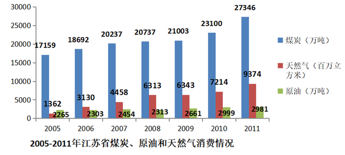

### 第 101 题

2011年江苏省天然气消费量比2005年增长了：

A. 4.88倍

B. 5.88倍

C. 6.88倍

D. 7.88倍

第 101 题 · 答案与解析

**参考答案（粉笔题库参考内容）**

B

**解析**

查表得数据，2011年天然气消费量9374百万立方米，2005年天然气消费量1362百万立方米，约为七倍关系。注意题干中“增加了”三个字，即近似增加了6倍。

故正确答案为B。

**来源**：2014年江苏省公务员录用考试《行测》题（B类）第101题

### 第 102 题

2006-2011年六年，江苏省煤炭消费增长量最小的年份是：

A. 2007年

B. 2008年

C. 2009年

D. 2010年

第 102 题 · 答案与解析

**参考答案（粉笔题库参考内容）**

C

**解析**

增长量在图形中表现为柱状图的长度之差，2009年与2008年的长度明显比其他年份更接近，因此增长量也小于其他年份。

故正确答案为C。

**来源**：2014年江苏省公务员录用考试《行测》题（B类）第102题

### 第 103 题

2006-2011年六年，江苏省原油消费年平均增长量是：

A. 102万吨

B. 113万吨

C. 119万吨

D. 137万吨

第 103 题 · 答案与解析

**参考答案（粉笔题库参考内容）**

C

**解析**

查图得2011年原油消费2981万吨，2005年原油消费2265万吨。则江苏省原油消费年平均增长量是(2981 − 2265) ÷ 6 = 119万吨。

故正确答案为C。

**来源**：2014年江苏省公务员录用考试《行测》题（B类）第103题

### 第 104 题

下列说法正确的是：

A. 2006-2011年六年，江苏省天然气消费年平均增长速度大于煤炭消费

B. 2006-2011年六年，江苏省原油消费年平均增长速度大于煤炭消费

C. 2006-2011年六年，江苏省原油消费年平均增长速度大于天然气消费

D. 2006-2011年六年，江苏省煤炭消费年平均增长速度分别大于天然气消费、原油消费

第 104 题 · 答案与解析

**参考答案（粉笔题库参考内容）**

A

**解析**

A项正确，2006-2011年六年，江苏省天然气消费年平均增长速度9374/1362明显大于煤炭消费27346/17159；

B项错误，2006-2011年六年，江苏省原油消费年平均增长速度2981/2265明显小于煤炭消费27346/17159；

C项错误，2006-2011年六年，江苏省原油消费年平均增长速度2981/2265明显小于天然气消费9374/1362；

D项错误，参照A项。

故正确答案为A。

**来源**：2014年江苏省公务员录用考试《行测》题（B类）第104题

### 第 105 题

下列判断不正确的有：

（1）2011年江苏省天然气消费量比2007年翻了一番多

（2）2011年江苏省煤炭消费增长量大于前四年煤炭消费增长量的总和

（3）2006-2011年，江苏省煤炭、原油和天然气消费量均呈逐年增加的态势

A. 0个

B. 1个

C. 2个

D. 3个

第 105 题 · 答案与解析

**参考答案（粉笔题库参考内容）**

C

**解析**

第一项：查表得2011天然气消费量为9374，2007年消费量为4458，翻了一番多，正确。

第二项：2011年煤炭消费增长量为27346-23100≈4200，2007～2010年煤炭消费增长量的总和为23100－18692≈4400，前者小于后者，错误。

第三项：查表可发现，原油在2008年下降，错误。

本题为选非题，故正确答案为C。

**来源**：2014年江苏省公务员录用考试《行测》题（B类）第105题

