# 2014年江苏省公务员录用考试《行测》题（C类）

<!-- gwy:overview:start -->
> **江苏 · 2014 · 行测 · C类** ｜ 100 题 · 图片 212 处 · 答案随题折叠

| 题型模块 | 题量 | 题号 |
| --- | ---: | ---: |
| 言语理解与表达 | 20 | 1–20 |
| 数量关系 | 15 | 21–35 |
| 判断推理 | 40 | 36–75 |
| 资料分析 | 25 | 76–100 |
| **合计** | **100** | |

导航：[题型与作答说明](#题型与作答说明) · [题目](#题目) · [材料 1](#材料-1)
<!-- gwy:overview:end -->

> 候选采集稿。参考答案及解析来自粉笔页面，不代表官方答案或真实高分答卷；来源使用许可与原卷对应关系仍需人工核实。

## 题型与作答说明

言语理解与表达

（20题）

本部分包括片段阅读、文章阅读与选词填空三种类型的试题。

数量关系

（15题）

数量关系

判断推理

（40题）

判断推理

资料分析

（25题）

资料分析

## 题目

### 第 1 题

当前，劳动密集型产业从沿海地区向中西部转移，说明劳动力成本因素起的作用越来越大，配套性和规模经济所起的作用相对变小。虽然中西部地区暂时还没有这种产业配套的聚焦效应，但国内的中部省份和沿海地区，往往只有一河一山之隔，所以配套中心在国内范围的转移，比起向其他国家转移的可能性高得多，效率也高得多。
下面列举的中西部所具有的优势在文段中没有涉及的一项是：

A. 土地价格相对便宜

B. 工资水平较沿海低

C. 劳动力相当丰富

D. 与沿海地区距离不遥远

第 1 题 · 答案与解析

**参考答案（粉笔题库参考内容）**

A

**解析**

本题考查细节判断。文段对劳动密集型产业从沿海地区向中西部转移的原因进行了阐述。对选项逐项进行判断，A项“土地价格相对便宜”在文中没有体现，当选。B项“工资水平较沿海低”、C项“劳动力相当丰富”对应文段中“劳动力成本因素起的作用越来越大”、“劳动密集型产业从沿海地区向中西部转移”，均体现了产业转移的原因，排除；D项“与沿海地区距离不遥远”对应文段中“国内的中部省份和沿海地区，往往只有一河一山之隔”，体现了产业转移的原因，排除。

本题为选非题，故正确答案为A。

**考点**：细节判断题

**来源**：2014年江苏省公务员录用考试《行测》题（C类）第1题

### 第 2 题

凡是符合立案条件，并已办理立案手续的所有案件，除涉及国家机密或个人隐私等不宜公开的理由外，均应当在人民法院决定立案的7日内在网上公示，同时告知合议庭组成人员和案件审理期限，便于当事人和社会监督，防止拖延案件审理期限，提高司法效率。

这段文字主要说明的是：

A. 怎样提高司法工作效率

B. 加强立案公开制度的措施

C. 案件审理期限告知方式

D. 司法工作怎样接受社会监督

第 2 题 · 答案与解析

**参考答案（粉笔题库参考内容）**

B

**解析**

本题为中心理解题。文段首先由“凡是······均······”提出立案应在7日内进行网上公示，又提出了要同时告知合议庭组成人员和案件审理期限，都是加强立案公开制度的措施。因此，结合选项应该选择B项。文段最后说到这些措施可以“便于当事人和社会监督，防止拖延案件审理期限，提高司法效率”，A项“提高司法工作效率”、D项“司法工作怎样接受社会监督”均只讲到其中一条，过于片面，排除；C项“告知方式”只涉及“在网上公示”，过于片面，排除。

故正确答案为B。

**考点**：关联词-对策、关联词-并列

**来源**：2014年江苏省公务员录用考试《行测》题（C类）第2题

### 第 3 题

中国的传统廉政文化源远流长，它对历代执政者的操守要求与为政规则不外乎五个方面：重民生而知根本，畏法度而能自律，明廉耻而守气节，崇节俭而重情操，知恩惠而思报国。

下列对传统廉政文化特点的概括与文意不符的一项是：

A. 执法如山，遵章守纪

B. 注重民生，情操高尚

C. 学识渊博，乐善好施

D. 生活简朴，严于律己

第 3 题 · 答案与解析

**参考答案（粉笔题库参考内容）**

C

**解析**

由提问方式可知，本题为细节判断题。逐项判断：A项正确，“执法如山，遵章守纪”对应文中“畏法度而能自律”；B项正确，“注重民生，情操高尚”对应文中“重民生”“明廉耻而守气节”；C项错误，“学识渊博，乐善好施”在文中没有体现；D项正确，“生活简朴，严于律己”对应文中“崇节俭”及“能自律”。

本题为选非题，故正确答案为C。

**考点**：细节判断题

**来源**：2014年江苏省公务员录用考试《行测》题（C类）第3题

### 第 4 题

一位学者提出了“社区词”的概念，其立论基础是“使用汉语的人群，并非生活在一致的社会形态内。如果划分一下，中国内地是最大的社区，还有台湾地区、香港特别行政区、澳门特别行政区；中国以外的，还有在世界各地的不同华人地区。由于社会背景不同，就会有一些社区词在不同的社区使用。”

“社区词”不能反映的是：

A. 社会制度

B. 地理条件

C. 经济体制

D. 文化背景

第 4 题 · 答案与解析

**参考答案（粉笔题库参考内容）**

B

**解析**

根据文段“由于社会背景不同”可知，“社区词”与社会背景相关，A项“社会制度”、C项“经济体制”与D项“文化背景”均与社会背景相关，排除；B项“地理条件”指人文地理条件与自然地理条件，与社会背景无关，当选。

本题为选非题，故正确答案为B。

【文段出处】《语言科学》

**考点**：细节判断题

**来源**：2014年江苏省公务员录用考试《行测》题（C类）第4题

### 第 5 题

过去20年中，全球有10亿人口脱贫，其主要原因是发展中国家经济的增长出现加速；相比之下，未来20年再要让20亿人脱贫便要困难得多。因为作为未来脱贫目标的相关国家，当地政府在管理上的低效，使得他们无法有效复制中国等国的脱贫经验。简而言之，减少贫困最有效的措施便是开放市场，即国际上推行自由贸易，国内则推动有效竞争。

下列说法与文意不符的是：

A. 能否复制其他国家的脱贫经验对脱贫至关重要

B. 相关国家政府的管理效率影响脱贫目标的实现

C. 脱贫成功必须依靠发展中国家经济的快速增长

D. 对外开放与推动竞争是减少贫困最有效的法宝

第 5 题 · 答案与解析

**参考答案（粉笔题库参考内容）**

A

**解析**

根据文中前三句话可知，影响脱贫的因素有两个，一是发展中国家经济增长速度，二是当地政府管理效率，以上两个方面对脱贫至关重要，而A项“能否复制其他国家的脱贫经验”表述错误，当选。

由“因为作为未来脱贫目标的相关国家，当地政府在管理上的低效”可知，政府的管理效率影响脱贫，B项符合文意，排除；

由“全球有10亿人口脱贫，其主要原因是发展中国家经济的增长出现加速”可知，要想脱贫发展中国家的经济增长需要出现加速，C项符合文意，排除；

由“减少贫困最有效的措施便是开放市场，即国际上推行自由贸易，国内则推动有效竞争”可知，D项符合文意，排除。

本题为选非题，故正确答案为A。

【文段出处】《走向贫困的终结》

**考点**：细节判断题

**来源**：2014年江苏省公务员录用考试《行测》题（C类）第5题

## 材料 1

中国称城市化过程为“城镇化”，并提出要走出一条城乡协调、工农互补的“新型城镇化”道路。但与其他国家相比，中国正在发生着人类历史上规模最大、速度最快的城市化过程，人口向城市快速转移。据统计，从1979年到2012年，中国城市化率从17.9%提高到52.6%，平均每年提高1个百分点以上；城镇常住人口增加了5.3亿人以上。

        我国的城市化基本上是沿着两条路径同步前进。一条是扩大县城、中心镇的规模，吸引和驱动县域内农村人口向这些地点集中。这种路径或可称为“农村城镇化”，即农村的城市化，这直接体现为镇的数量增加以及居住人口的增多。2002年，我国建制镇数量第一次超过了乡的数量，小城镇发展出现\_\_\_\_\_\_\_\_；2005年，全国建制镇数量占全部乡镇数量的比重达到53.7%。另一条路径是将大中城市向外扩张，把周围农村郊区化，这一路径或可称为“城市郊区化”。根据统计，全国市辖区的数量从1998年的737个增加到2011年的857个。国家发改委2013年在辽宁、湖南等12个省进行调研时发现，近几年一些地方纷纷着手打造新城。调查显示，12个省会城市平均一个城市要建4.6个新城新区；144个地级城市中，有133个要造新城，城市郊区化无疑在其中发挥了很大的作用。

        农村城镇化与城市郊区化虽然在城市化目标上是一致的，但是过程和内容存在着明显的差异。农村城镇化主要表现为城市空间的生长过程，因为无论是县城还是中心镇的城市化水平都较低，将周围农村纳入其范围之内，都需要按照新的标准来全方位地提升整个区域的城市化水平。在这些新兴城市中，空间的城市化、人的城市化以及治理的城市化需要同步进行，但城市化的各个主体自身积累的经验和知识都很有限。相比之下，城市郊区化主要表现为原有城市空间及其治理框架的扩展。由于大中城市已经形成了较为成熟的治理模式，可以利用现成的经验和知识来应对新的问题，然而尽管有经验可循，这些城市也面临着如何将现有的治理框架扩展到更大区域、更多居民的问题。

### 第 6 题

填入文章中划横线处最恰当的一项是：

A. 关键性变化

B. 革命性转变

C. 全局性发展

D. 历史性拐点

第 6 题 · 答案与解析

**参考答案（粉笔题库参考内容）**

D

**解析**

根据前文可知，建制镇的数量第一次超过了乡的数量，但并不等同于小城镇发展出现“关键性变化”，排除A项。B项，“革命性转变”通常指发生了巨大的改变，语义过重，排除。C项，“全局性发展”与“小城镇”搭配不当，排除。D项，“历史性拐点”与“2002年我国建制镇数量第一次超过了乡的数量”相对应，当选。

故正确答案为D。

【文段出处】《空间、城镇化与治理变革》

**来源**：2014年江苏省公务员录用考试《行测》题（C类）第6题

### 第 7 题

根据文章提供的数据，以下说法正确的一项是：

A. 1980年代以前我国的城市化率不足20%

B. 目前中国的城镇常住人口已达到5.3亿

C. 1998至2011年全国市辖区的数量年均增加10个以上

D. 被调查的12个省会城市将要打造超过60个新城新区

第 7 题 · 答案与解析

**参考答案（粉笔题库参考内容）**

A

**解析**

A项，由“从1979年到2012年，中国城市化率从17.9%提高到52.6%”可知，1980年以前我国的城市化率不足20%，故表述正确，当选；

B项，文段表述为“城镇常住人口增加了5.3亿人以上”，故偷换概念，排除；

C项，1998-2011年总共历时13年，增加了120个市辖区，故平均每年增加低于10个，故表述错误，排除；

D项，文段表述为“12个省会城市平均一个城市要建4.6个新城新区”，那么总共将打造55.2个新城新区，低于60个，表述错误，排除。

故正确答案为A。

【文段出处】《空间、城镇化与治理变革》

**来源**：2014年江苏省公务员录用考试《行测》题（C类）第7题

### 第 8 题

根据文意，下列选项中不属于城市化明显标志的是：

A. 建制镇数量的增加

B. 农民工人数的增加

C. 市辖区数量的增加

D. 城镇常住人口的增加

第 8 题 · 答案与解析

**参考答案（粉笔题库参考内容）**

B

**解析**

通过阅读全文可知，城市化的标志有建制镇数量的增加、城镇常住人口的增加以及全国市辖区数量的增加，而农民工人数的增加从文段中无法得知，无中生有。

本题为选非题，故正确答案为B。

【文段出处】《空间、城镇化与治理变革》

**来源**：2014年江苏省公务员录用考试《行测》题（C类）第8题

### 第 9 题

下列说法符合文意的一项是：

A. 城市郊区化路径相较农村城镇化更易于实施

B. 农村城镇化路径贴近我国国情可以优先考虑

C. 城市郊区化和农村城镇化均面临复杂问题

D. 目前应着力探讨其他更适宜更稳妥的城市化路径

第 9 题 · 答案与解析

**参考答案（粉笔题库参考内容）**

C

**解析**

文段先说明“农村城镇化”和“城市郊区化”的目标是一致的，但是过程和内容存在明显差异。之后分别介绍了“农村城镇化”和“城市郊区化”存在的局限性和问题。文段并没有说明哪一种路径更加易于实施或者更贴近国情，也没有探讨其他的城市化路径，排除A、B、D三项。

故正确答案为C。

【文段出处】《空间、城镇化与治理变革》

**来源**：2014年江苏省公务员录用考试《行测》题（C类）第9题

### 第 10 题

根据文意，作者认为推进城市化进程中的难点在于：

A. 寻求城乡协调工农互补的城市化道路

B. 发现更多不同种类的城市化实施路径

C. 各级政府必须加大城市化建设的投入

D. 要在空间、人及治理方面均实现城市化

第 10 题 · 答案与解析

**参考答案（粉笔题库参考内容）**

D

**解析**

根据最后一段可知，“农村城镇化”的问题为空间的城市化、人的城市化以及治理的城市化需要同步进行，但城市化的各个主体自身积累的经验和知识有限；“城市郊区化”的问题为这些城市面临着如何将现有的治理框架扩展到更大区域、更多居民的问题。通过以上信息可以看出作者认为城市化进程的难点在于要在空间、人及治理方面均实现城市化，D项正确。A、B、C三项均不是难点所在，排除。

故正确答案为D。

【文段出处】《空间、城镇化与治理变革》

**来源**：2014年江苏省公务员录用考试《行测》题（C类）第10题

### 第 11 题

要因地制宜、循序渐进，不搞“一刀切”、不追求一步到位，允许采取差异性、＿＿＿＿＿的制度和政策安排。

填入画横线部分最恰当的一项是：

A. 过渡性

B. 地域性

C. 权宜性

D. 临时性

第 11 题 · 答案与解析

**参考答案（粉笔题库参考内容）**

A

**解析**

根据文段可知，“因地制宜”与“不搞‘一刀切’”“差异性”语义对应，而“循序渐进”“不追求一步到位”与横线处词语语义对应，“循序渐进”指学习、工作按照一定的步骤逐渐深入或提高，对应A项“过渡性”。其他几项中的“地域性”“权宜性”“临时性”均不符合文意，排除。

故正确答案为A。

【文段出处】《关于全面深化农村改革加快推进农业现代化的若干意见》

**考点**：实词填空、对应关系-前后呼应

**来源**：2014年江苏省公务员录用考试《行测》题（C类）第11题

### 第 12 题

文字是人们现实生活的一部分，是人类思维方式、生活方式等最生动的＿＿＿＿。一种文字发明、演变过程越是漫长，它所反映的这些方面的内容就越深刻。

填入画横线部分最恰当的一项是：

A. 工具

B. 形式

C. 载体

D. 记录

第 12 题 · 答案与解析

**参考答案（粉笔题库参考内容）**

C

**解析**

所填词语所在句子主干为“文字是······”且词语应和“最生动的”搭配。C项“载体”泛指能够承载其他事物（多为抽象概念）的事物，用在此处符合语境，当选。A 项“工具”比喻用以达到目的的事物，与“生动的”搭配不当，排除；B 项“形式”指事物的形状、结构等，用在此处不合语境，排除；D 项“记录”多指当场记录下来的材料，从后文可以看出这里的“文字”指的不是文字记录的内容含义，而是其发明、演变过程中所反映的文化，用在此处搭配不当，排除。

故正确答案为C。

【文段出处】《汉字魅力的历史与现实》

**考点**：实词填空、对应关系-前后呼应、词的辨析-搭配对象

**来源**：2014年江苏省公务员录用考试《行测》题（C类）第12题

### 第 13 题

数学作为一种文化，对全社会的成员起着＿＿＿＿＿＿的作用。一个民族数学＿＿＿＿的高低，与这个民族的文明程度有很大的关系。

依次填入画横线部分最恰当的一项是：

A. 耳濡目染 能力

B. 润物无声 水平

C. 循序渐进 素质

D. 潜移默化 修养

第 13 题 · 答案与解析

**参考答案（粉笔题库参考内容）**

D

**解析**

第一空，形容数学的作用，D项“潜移默化”是指人的思想，品性或习惯受到影响、感染而无形中发生变化，与文意相符，保留。A项“耳濡目染”指耳朵经常听到，眼睛经常看到，主语通常是人，无法形容数学的作用，排除；B项“润物无声”本意指初春的毛毛小雨落下无声无息，比喻默默奉献不张扬，填入文段用法不当，正确用法为“数学的作用润物无声”，故“物”与横线前“全社会的成员”语义重复，排除；C项“循序渐进”指学习、工作按照一定的步骤逐渐深入或提高，文段并未体现步骤，排除。

验证第二空，“修养”是指人的综合素质，填入文段语义合适。

故正确答案为D。

【文段出处】《数学与文化》

**考点**：对应关系-前后呼应、混搭填空、词的辨析-搭配对象

**来源**：2014年江苏省公务员录用考试《行测》题（C类）第13题

### 第 14 题

从认识论来讲，一个理论的产生与发展，需要从人类社会方方面面的火热实践中去＿＿＿＿去升华；一个理论对实践的指导，也需要循环往复地到实际中去检验去\_\_\_\_。
依次填入画横线处最恰当的一项是：

A. 锤炼 矫正

B. 提炼 补正

C. 锻炼 修正

D. 凝练 校正

第 14 题 · 答案与解析

**参考答案（粉笔题库参考内容）**

D

**解析**

第一空：填入画线部分词语应与“理论”搭配。C项“锻炼”主体多为具体的人或集体，不符合语境，排除。A项“锤炼”搭配恰当，保留；B项“提炼”与“升华”有相似的抽象含义，“提炼理论”为常见的搭配，保留；D项“凝练”一词为形容词，形容紧凑简练，也可分作两个动词理解，指凝结提炼，“凝练理论”亦可用在此处，保留。

第二空：填入画线部分词语应与“检验”同义。“检验”为发现问题，D项“校正”指予以校对，符合语境，当选。A项“矫正”多指更正错误，与文意不符，排除。B项“补正”指补充和改正文字上的疏漏和错误，用在此处不妥，排除B。

故正确答案为D。

【文段出处】《“快餐理论”令人忧虑》

**考点**：关联关系-并列关系、实词填空、词的辨析-搭配对象

**来源**：2014年江苏省公务员录用考试《行测》题（C类）第14题

### 第 15 题

理论研究和实践经验都表明，一个国家劳动者的受教育年限和经济增长绩效密切相关，劳动者人力资本与他们在劳动力市场上的表现密切相关。用＿＿＿＿高等教育发展的思路解决大学生就业难的问题，无异于＿＿＿＿＿＿。

依次填入画横线部分最恰当的一项是：

A. 限制 缘木求鱼

B. 抑制 因噎废食

C. 控制 刻舟求剑

D. 管制 削足适履

第 15 题 · 答案与解析

**参考答案（粉笔题库参考内容）**

B

**解析**

第一空，与“高等教育发展”搭配，D项“管制”与发展搭配不当，排除；A项“限制”、B项“抑制”与C项“控制”填入文段语义均合适。

第二空，“无异于”提示横线处与前文形成对应，前文提到通过约束教育发展来解决就业难问题，B项“因噎废食”比喻要做的事情由于出了点小毛病或怕出问题就索性不去干，填入文段语义合适，当选。A项“缘木求鱼”比喻方向或办法不对，不可能达到目的，填入文段与文意不符，排除；C项“刻舟求剑”指用静止的眼光看问题，填入文段与文意不符，排除。

故正确答案为B。

【文段出处】《破除大学毕业生就业难的误读》

**考点**：对应关系-前后呼应、混搭填空、词的辨析-搭配对象

**来源**：2014年江苏省公务员录用考试《行测》题（C类）第15题

### 第 16 题

从法官的精英化到法官的专业化，无不\_\_\_\_\_\_着人们对法官资格和法官职位的憧憬和理想。当前，应当建立以职业品德、专业知识、实践经验三位一体的法官培养\_\_\_\_\_\_标准。

依次填入画横线处最恰当的一项是：

A. 承载 遴选

B. 寄托 挑选

C. 肩负 选取

D. 承担 入选

第 16 题 · 答案与解析

**参考答案（粉笔题库参考内容）**

A

**解析**

第一空：填入画线部分词语应与“憧憬和理想”搭配，A项“承载”指承受装载，可搭配抽象概念，符合语境，保留；B项“寄托”指把理想、希望、感情等放在（某人身上或某种事物上），也符合语境，保留；C项“肩负”、D项“承担”都有担负的意思，指承当（责任、工作、费用），主语多为实际的人或集体，用在此处不合语境，排除。

第二空：A项“遴选”多指选拔人才，用法较正式，符合语境，当选；B项“挑选”指从若干人或事物中找出适合要求的，与“标准”搭配不妥，排除。

故正确答案为A。

【文段出处】《法官专业化——法官制度改革的新路径》

**考点**：实词填空、对应关系-前后呼应、词的辨析-搭配对象

**来源**：2014年江苏省公务员录用考试《行测》题（C类）第16题

### 第 17 题

公共艺术比之传统的博物馆、美术馆的艺术，其基本差异在于前者设立于＿＿＿＿的公共空间，面向不特定的社会公众，在＿＿＿＿＿＿的情境中与不同的观众会面，以多元的文化态度、审美经验与公众对话或互动，实现其公益价值。

依次填入画横线部分最恰当的一项是：

A. 公开 不期而至

B. 宏大 意想不到

C. 开放 不期而遇

D. 露天 出乎意料

第 17 题 · 答案与解析

**参考答案（粉笔题库参考内容）**

C

**解析**

第一空，“公共空间”指那些供城市居民日常生活和社会生活公共使用的室外及室内空间。A项“公开”指面向大家或全球，不加隐蔽，或指把秘密公布出来，与“公共空间”表意重复，排除。B项“宏大”指事物的空间巨大；C项“开放”指解除限制；D项“露天”指在户外、上方无遮盖物的，搭配均合适，保留。

第二空，根据前文解释可知，这种公共空间，面向不特定的社会公众。C项“不期而遇”指没有约定而遇见，可对应面向不特定社会公众，任何人都可能来的语境，表意正确，当选。B项“意想不到”、D项“出乎意料”均指在意料之外的，而这个公共空间本为可能遇到任何人、任何情境而设计，故“在意料之外”和文段表意相悖，排除B、D两项。

故正确答案为C。

【文段出处】《局限与拓展》

**考点**：对应关系-前后呼应、混搭填空、词的辨析-搭配对象

**来源**：2014年江苏省公务员录用考试《行测》题（C类）第17题

### 第 18 题

能走多远，靠的不是双脚，而是＿＿＿＿＿＿，鸿鹄志在苍宇，燕雀心系檐下；能登多高，靠的不是体魄，而是＿＿＿＿＿＿，强者愈挫愈勇，弱者逢败弥伤；能看多远，靠的不是双眼，而是＿＿＿＿＿＿，你装得下世界，世界才会容下你。

依次填入画横线部分最恰当的一项是：

A. 意志强弱 胸怀宽窄 志向大小

B. 志向大小 意志强弱 胸怀宽窄

C. 胸怀宽窄 志向大小 意志强弱

D. 志向大小 胸怀宽窄 意志强弱

第 18 题 · 答案与解析

**参考答案（粉笔题库参考内容）**

B

**解析**

第一空，根据后文解释可知，“鸿鹄志在苍宇，燕雀心系檐下”指平凡的人哪里知道英雄人物的志向，故意在强调志向的大小，排除A、C两项。

第二空，根据后文解释可知，“强者愈挫愈勇，弱者逢败弥伤”指强者遇到挫折，愈战愈勇，而弱者遇到失败则会一蹶不振，故意在强调意志对人的影响，B项表述正确，排除D项，锁定答案为B。

验证第三空，根据后文解释可知，“你装得下世界，世界才会容下你”指胸怀宽广的人能包容万物，世界因此而接纳他，故意在强调一个人的气度和气量对人的影响，故B项“胸怀宽窄”符合文意。

故正确答案为B。

**考点**：实词填空、对应关系-前后呼应

**来源**：2014年江苏省公务员录用考试《行测》题（C类）第18题

### 第 19 题

后来，他把木工手艺传给了女婿。女婿不负岳父的＿＿＿＿，通过几年＿＿＿＿＿＿的努力，技艺日益精进，终于成为＿＿＿＿＿＿的能工巧匠。

依次填入画横线部分最恰当的一项是：

A. 希望 卧薪尝胆 大名鼎鼎

B. 厚望 锲而不舍 名扬一方

C. 愿望 不离不弃 闻名遐迩

D. 期望 日夜兼程 名噪一时

第 19 题 · 答案与解析

**参考答案（粉笔题库参考内容）**

B

**解析**

本题可从第二空入手，根据“几年”可知，意在强调时间之长。B项“锲而不舍”指有恒心，有毅力，符合时间长的语意，保留。A项“卧薪尝胆”指一个人忍辱负重，发愤图强，终能够苦尽甘来，文中没有关于“忍辱负重”的表述，程度过重，不符合文意，排除；C项“不离不弃”指永不分离，永不抛弃，一般搭配人，与“努力”搭配不当，排除；D项“日夜兼程”指不分白天黑夜拼命赶路，与文段语意无关，排除。锁定答案为B项。

验证第一空，“不负厚望”搭配合适。

验证第三空，“能工巧匠”指工艺技术高超的人，“名扬一方”指非常的出名，语意合适，搭配正确。

故正确答案为B。

**考点**：对应关系-前后呼应、混搭填空、词的辨析-搭配对象、词的辨析-程度轻重

**来源**：2014年江苏省公务员录用考试《行测》题（C类）第19题

### 第 20 题

1972年，随着案件调查的日益深入，一直对“水门事件”进行跟踪报道的媒体洗刷了自己的＿＿＿＿＿＿，采写报道的两位青年记者也＿＿＿＿＿＿，成为美国新闻界当之无愧的＿＿＿＿人物。

依次填入画横线部分最恰当的一项是：

A. 积年沉冤 崭露头角 头面

B. 不实之词 步步高升 领袖

C. 不白之冤 一举成名 标杆

D. 奇耻大辱 名声大振 标尺

第 20 题 · 答案与解析

**参考答案（粉笔题库参考内容）**

C

**解析**

第一空，搭配“洗刷”，可知媒体并没有做错事，外界对媒体是存在误解的。A项“积年沉冤”指已经过去多年的冤情，C项“不白之冤”指没有得到辩白或洗刷的冤屈，均符合文意，保留。B项“不实之词”指浮夸的言辞，与文意相悖，排除；D项“奇耻大辱”指极大的耻辱，语意程度过重，排除。

第二空，搭配“青年记者”，A项“崭露头角”指初显露优异的才能。由文段可知媒体一直在对事件进行跟踪报道，故“初显露才能”与文意不符，排除。C项“一举成名”指一下子就出了名，符合文意，保留。锁定答案为C项。

验证第三空，“标杆”指学习的榜样，搭配正确，符合文意，C项当选。

故正确答案为C。

**考点**：对应关系-前后呼应、混搭填空、词的辨析-搭配对象、词的辨析-程度轻重

**来源**：2014年江苏省公务员录用考试《行测》题（C类）第20题

### 第 21 题

4，6，12，30，84，（    ）

A. 96

B. 128

C. 192

D. 246

第 21 题 · 答案与解析

**参考答案（粉笔题库参考内容）**

D

**解析**

方法一：观察数列，无明显特征。考虑作差，得到数列2，6，18，54，是公比为3的等比数列。因此下一项应为84+3×54=246。

方法二：观察数列，6=3×4-6；12=3×6-6；30=3×12-6；84=3×30-6；则此数列的规律为后一项=3×前一项-6。因此下一项=3×84-6=246。

故正确答案为D。

**来源**：2014年江苏省公务员录用考试《行测》题（C类）第21题

### 第 22 题

，，1，4，32，（    ）

A. 512

B. 480

C. 320

D. 96

第 22 题 · 答案与解析

**参考答案（粉笔题库参考内容）**

A

**解析**

观察数列，数列各数字之间存在倍数关系，考虑作商。后一项除以前一项，得到新数列：1，2，4，8，（    ），是公比为2的等比数列。则所求项为32×2×8=512。

故正确答案为A。

**来源**：2014年江苏省公务员录用考试《行测》题（C类）第22题

### 第 23 题

1，2，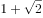，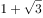，3，（    ）

A. 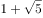

B. 4

C. 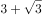

D. 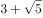

第 23 题 · 答案与解析

**参考答案（粉笔题库参考内容）**

A

**解析**

观察数列，数列有整数和无理数，将数列转换为同一形式，为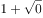，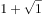，，，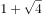，则下一项应为。

故正确答案为A。

**来源**：2014年江苏省公务员录用考试《行测》题（C类）第23题

### 第 24 题

11，23，46，80，125，（    ）

A. 149

B. 167

C. 181

D. 199

第 24 题 · 答案与解析

**参考答案（粉笔题库参考内容）**

C

**解析**

观察数列，数字无明显特征，考虑作差。后项减前项得到新数列：12，23，34，45，（    ），是公差为11的等差数列，下一项为45+11=56，故所求项为125+56=181。

故正确答案为C。

**来源**：2014年江苏省公务员录用考试《行测》题（C类）第24题

### 第 25 题

，，，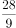，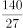，（    ）

A. 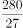

B. 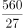

C. 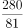

D. 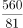

第 25 题 · 答案与解析

**参考答案（粉笔题库参考内容）**

D

**解析**

数列为分数数列，观察数列，分子分母之间分别出现倍数关系，考虑作商，后一项除以前一项，即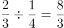，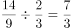，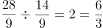，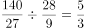。则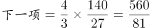。

故正确答案为D。

**来源**：2014年江苏省公务员录用考试《行测》题（C类）第25题

### 第 26 题

超市经理为某商品准备了两种促销方案，第一种是原价打7折；第二种是买二件赠一件同样商品。经计算，两种方案每件商品利润相差0.1元。若按照第一种促销方案，则100元可买该商品件数最大值是：

A. 33

B. 47

C. 49

D. 50

第 26 题 · 答案与解析

**参考答案（粉笔题库参考内容）**

B

**解析**

设商品原价为x元，则第一种促销方案价格为0.7x元，第二种促销方案价格为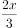元。两种方案利润相差0.1元，因为成本相同，价格=成本+利润，则售价也相差0.1元，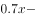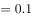。解得x=3。第一种促销价格为3×0.7=2.1元，可购买数量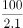件，则最多可购买47件商品。

故正确答案为B。

**考点**：经济利润问题、非典型最值问题

**来源**：2014年江苏省公务员录用考试《行测》题（C类）第26题

### 第 27 题

若任意正整数x和y，定义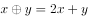，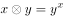，则

A. 10

B. 11

C. 64

D. 81

第 27 题 · 答案与解析

**参考答案（粉笔题库参考内容）**

B

**解析**

根据xy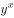，则23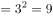。根据\=2x+y，则。

故正确答案为B。

**来源**：2014年江苏省公务员录用考试《行测》题（C类）第27题

### 第 28 题

某人欲将自己的手机密码设为3位数字，要求第一位是偶数，后两位中至少有一个是6，则他可选择的密码个数为：

A. 68

B. 72

C. 95

D. 100

第 28 题 · 答案与解析

**参考答案（粉笔题库参考内容）**

C

**解析**

密码可选取的数字范围为0~9。因为第一位是偶数，则共有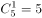种情况。后两位至少有一个是6，分三种情况：①当第二位是6第三位不是6时，有9种情况；②当第三位是6第二位不是6的时候，有9种情况；③当第二位和第三位都是6，有1种情况。则后两位共有9+9+1=19种情况。则总共可选择的密码个数有5×19=95个。

故正确答案为C。

**考点**：基础排列组合

**来源**：2014年江苏省公务员录用考试《行测》题（C类）第28题

### 第 29 题

有两瓶质量为1千克的酒精溶液，浓度分别为70%和45%，先从两瓶中各取部分混合成1千克的酒精溶液，测得浓度恰好为50%，再将这两瓶中剩下的溶液混合，则所得酒精浓度是：

A. 50%

B. 55%

C. 60%

D. 65%

第 29 题 · 答案与解析

**参考答案（粉笔题库参考内容）**

D

**解析**

设70%的溶液为A，45%的溶液为B，剩余部分混合的浓度为x。因为从A、B中取出部分溶液混合成了1千克浓度为50%的溶液。根据浓度比与量的比成反比，有（70%-50%）：（50%-45%）=4：1，取出量的比为1：4，则从A中取出了0.2千克，从B中取出了0.8千克。A、B剩余溶液量之比为4：1。则有4：1=（x-45%）：（70%-x），解得x=65%。

故正确答案为D。

**来源**：2014年江苏省公务员录用考试《行测》题（C类）第29题

### 第 30 题

某年的3月份共有5个星期三，并且第一天不是星期一，最后一天不是星期五，则该年的3月15日是：

A. 星期二

B. 星期三

C. 星期四

D. 星期五

第 30 题 · 答案与解析

**参考答案（粉笔题库参考内容）**

A

**解析**

3月份共有31天，共有4个整星期多3天。因为有5个星期三，则29号、30号、31号这三天必定有一天为星期三，有（一二三）、（二三四）、（三四五）三种可能性。若第一天为星期一，则28天即四周后依然为星期一，即29号为星期一，30号为星期二，31号为星期三。根据题目条件，1号不是星期一，即31号不是星期三。又因为31号不是星期五，则只有29号为星期二，30号为星期三，31号为星期四这一种情况。29号和15号相差14天即两周，因此3月15号是星期二。

故正确答案为A。

**考点**：星期日期问题

**来源**：2014年江苏省公务员录用考试《行测》题（C类）第30题

### 第 31 题

小王、小李和小周一共收藏了121本图画书，小王给小李和小周每人6本后，小王图画书的本数是小周的3倍、小李的2倍，则小周原有图画书的本数是：

A. 14

B. 15

C. 16

D. 22

第 31 题 · 答案与解析

**参考答案（粉笔题库参考内容）**

C

**解析**

设小王给出12本之后，小王的本数为6x本，此时小周的本数为2x本，小李的本数为3x本。三人共有121本，则6x+3x+2x=121。解得x=11。则小周得到6本之后的图画书数量为2×11=22本。原来有22-6=16本。

故正确答案为C。

**考点**：和差倍比问题

**来源**：2014年江苏省公务员录用考试《行测》题（C类）第31题

### 第 32 题

设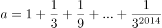，则100a的整数部分是：

A. 148

B. 149

C. 150

D. 100

第 32 题 · 答案与解析

**参考答案（粉笔题库参考内容）**

B

**解析**

方法一：a是由首项为1，公比为的等比数列加和而成，根据等比数列求和公式：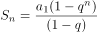，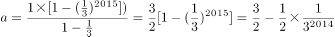。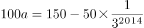。因为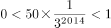，所以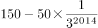的整数部分是149。

方法二：由题目可知，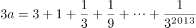。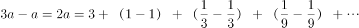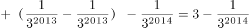。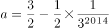。则。因为，所以的整数部分是149。

故正确答案为B。

**来源**：2014年江苏省公务员录用考试《行测》题（C类）第32题

### 第 33 题

甲乙丙三人共同完成一项工程，他们工作5天后完成工程的一半，接着丙退出，甲乙继续工作3天后又完成剩下工程的一半，然后乙也退出，甲独自工作5天后完成全部工程。若乙单独完成该工程，则需要的天数为：

A. 20

B. 30

C. 40

D. 60

第 33 题 · 答案与解析

**参考答案（粉笔题库参考内容）**

B

**解析**

方法一：设工程总量为120。甲乙合作3天完成工程总量的剩余一半的一半，即，有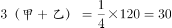，则甲+乙=10。甲独自工作5天完成工程总量的，有5甲=30，甲=6，则乙=4。因此。

方法二：甲乙两人工作3天完成工程总量的剩余一半的一半，即，则总量。又因为甲独自工作5天完成总量的，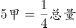，则甲完成工程总量需要20天。又因为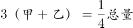，得2甲=3乙，甲乙的效率比是3：2，因此完成工程总量的时间比是2：3。乙单独完成工程需要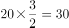天。

故正确答案为B。

**考点**：给效率比例型

**来源**：2014年江苏省公务员录用考试《行测》题（C类）第33题

### 第 34 题

甲乙两船分别从上游和下游同时出发，甲顺流而下，乙逆流而上，相遇时甲乙走过的路程之比为3∶1，两船相遇后各自立即掉头沿原路返回，甲、乙各自返回到出发点所用时间之比为5∶1。设船速和水流速度均不变，则甲船速度与乙船速度的比值是：

A. 

B. 

C. 

D. 

第 34 题 · 答案与解析

**参考答案（粉笔题库参考内容）**

C

**解析**

甲、乙相遇时走过的路程比是3：1，因为二人的时间相同，则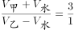，得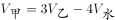…①。返回时所用时间比是5：1，且路程比是3：1，则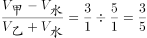，得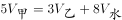…②。综合①②，解得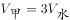，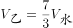。则甲、乙的速度比是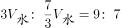。

故正确答案为C。

**考点**：流水行船、相遇追及

**来源**：2014年江苏省公务员录用考试《行测》题（C类）第34题

### 第 35 题

如图，正方体的棱长为1cm，则三棱锥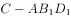的体积是：

A. 

B. 

C. 

D. 

第 35 题 · 答案与解析

**参考答案（粉笔题库参考内容）**

A

**解析**

如图所示，，因为四个小三棱锥都是棱长为的正三棱锥，它们的体积相等，所以。

故正确答案为A。

**考点**：几何公式类-立体图形

**来源**：2014年江苏省公务员录用考试《行测》题（C类）第35题

### 第 36 题

油菜花：海棠花

A. 水稻田：小米粥

B. 玉米油：橄榄油

C. 农家院：农家乐

D. 青菜园：竹栏杆

第 36 题 · 答案与解析

**参考答案（粉笔题库参考内容）**

B

**解析**

第一步：判断题干词语间逻辑关系。

油菜花和海棠花都是花的一种，二者为并列关系。

第二步：判断选项词语间逻辑关系。

A项，水稻田产出的是大米，与小米粥没有直接关系，与题干逻辑关系不一致，排除；

B项，玉米油和橄榄油都是食用油的一种，二者为并列关系，与题干逻辑关系一致，当选；

C项，农家乐是以农家院为地点的一种旅游休闲形式，二者为地点对应关系，与题干逻辑关系不一致，排除；

D项，有的青菜园以竹栏杆为围墙，与题干逻辑关系不一致，排除。

故正确答案为B。

**考点**：逻辑关系-并列关系

**来源**：2014年江苏省公务员录用考试《行测》题（C类）第36题

### 第 37 题

动车：飞驰

A. 蝴蝶：起舞

B. 骏马：奔跑

C. 蚂蚁：搬家

D. 苍鹰：盘旋

第 37 题 · 答案与解析

**参考答案（粉笔题库参考内容）**

B

**解析**

第一步：判断题干词语间逻辑关系。

动车在轨道上飞驰，飞驰即以高速运动，形容动车的运行速度快。

第二步：判断选项词语间逻辑关系。

A项：蝴蝶是在空中起舞，起舞并未体现速度，与题干逻辑关系不一致，排除；

B项：骏马在陆地上奔跑，奔跑即快速地跑，形容骏马的速度快，与题干逻辑关系一致，当选；

C项：蚂蚁在陆地上搬家，搬家并未体现出速度，与题干逻辑关系不一致，排除；

D项：苍鹰在天空中盘旋，盘旋并未体现出速度，与题干逻辑关系不一致，排除。

故正确答案为B。

**考点**：语法关系

**来源**：2014年江苏省公务员录用考试《行测》题（C类）第37题

### 第 38 题

计划：规划

A. 成绩：成就

B. 制度：气度

C. 特长：特别

D. 专著：论文

第 38 题 · 答案与解析

**参考答案（粉笔题库参考内容）**

A

**解析**

第一步：判断题干词语间逻辑关系。

计划和规划是近义词。计划指工作或行动以前预先拟定的具体内容和步骤。规划是个人或组织制定的比较全面长远的发展计划，具有长远性、全局性、战略性、方向性、概括性和鼓动性。

第二步：判断选项词语间逻辑关系。

A项：成绩和成就都可以指成功的业绩、成效或是工作或学习所取得的成就，二者为近义词，与题干逻辑关系一致，当选；

B项：制度是要求大家共同遵守的办事规程或行动准则；气度是一个人心理素质的表现形式，二者不是近义关系，与题干逻辑关系不一致，排除；

C项：特长是指擅长的专门的技艺或兴趣、研究领域，从字面理解，即特别的长处；特别是十分、非常、特地的意思，二者不是近义词，与题干逻辑关系不一致，排除；

D项：专著是指对某一学科或某一专门课题进行全面系统论述的著作；论文常用来指进行各个学术领域的研究和描述学术研究成果的文章，两者不是近义词，与题干逻辑关系不一致，排除。

故正确答案为A。

**考点**：语义关系-近义关系

**来源**：2014年江苏省公务员录用考试《行测》题（C类）第38题

### 第 39 题

沐浴 之于 （    ） 相当于 观赏 之于 （    ）

A. 方案 负担

B. 阳光 梅花

C. 游泳 欣赏

D. 洗澡 挑剔

第 39 题 · 答案与解析

**参考答案（粉笔题库参考内容）**

B

**解析**

逐一代入验证选项。

A项：沐浴和方案没有必然的关系，负担和观赏没有必然的关系，前后逻辑关系不一致，排除；

B项：“沐浴阳光”和“观赏梅花”都是动宾关系，前后逻辑关系一致，当选；

C项：沐浴是洗澡，游泳是一种运动，二者没有必然的关系，欣赏和观赏是近义关系，欣赏一般指大体浏览，属于宏观层面；观赏不仅有欣赏另有把玩的意思，较之欣赏更为深入，更为具体，有微观层面的研究，前后逻辑关系不一致，排除；

D项：沐浴和洗澡是全同关系，观赏和挑剔没有必然的关系，前后逻辑关系不一致，排除。

故正确答案为B。

**考点**：语法关系

**来源**：2014年江苏省公务员录用考试《行测》题（C类）第39题

### 第 40 题

（    ） 之于 收入 相当于 削减 之于 （    ）

A. 劳动 节俭

B. 丰厚 幅度

C. 收获 截断

D. 增加 开支

第 40 题 · 答案与解析

**参考答案（粉笔题库参考内容）**

D

**解析**

逐一代入验证选项。

A项：通过劳动可以获得收入，但通过削减不能获得节俭，前后逻辑关系不一致，排除；

B项：丰厚可以用来形容收入，但削减不能用来形容幅度，前后逻辑关系不一致，排除；

C项：收入是一种收获，截断不是削减的一种，前后逻辑关系不一致，排除；

D项：增加收入和削减开支都是动宾关系，前后逻辑关系一致，当选。

故正确答案为D。

**考点**：语法关系

**来源**：2014年江苏省公务员录用考试《行测》题（C类）第40题

### 第 41 题

衣领 之于 （    ） 相当于 车座 之于（    ）

A. 衣服 汽车

B. 手工 驾驶

C. 服装 座位

D. 袖口 车辆

第 41 题 · 答案与解析

**参考答案（粉笔题库参考内容）**

A

**解析**

逐一代入选项。

A项：衣领是衣服的组成部分，车座是汽车的组成部分，二者均为包容关系中的组成关系，前后逻辑关系一致，当选；

B项：衣领可以是手工缝制的，车座和驾驶没有必然的关系，前后逻辑关系不一致，排除；

C项：服装指的是衣服、鞋包、玩具、饰品等的总称，多指衣服。所以有的服装有衣领，是组成关系；车座是座位的一种，是种属关系，前后逻辑关系不一致，排除；

D项：衣领和袖口是并列关系，都是衣服的组成部分；车座是车的组成部分，不是车辆的组成部分，前后逻辑关系不一致，排除。

故正确答案为A。

**考点**：逻辑关系-包容关系

**来源**：2014年江苏省公务员录用考试《行测》题（C类）第41题

### 第 42 题

玉石：雕琢：玉器

A. 蚕丝：织造：丝绸

B. 粮食：酿造：美酒

C. 生铁：冶炼：钢材

D. 蚊香：点燃：烟雾

第 42 题 · 答案与解析

**参考答案（粉笔题库参考内容）**

A

**解析**

第一步：分析题干词语的逻辑关系。

玉石指未经雕琢的玉，玉石经过雕琢成为玉器，且发生的是物理变化，题干三词为原材料、工艺和成品之间的对应。

第二步：逐一分析选项。

A选项：蚕丝经过织造成为丝绸，且发生的是物理变化，为原材料、工艺和成品之间的对应，与题干逻辑关系一致，当选；

B选项：粮食经过酿造成为美酒，为原材料、工艺和成品之间的对应，但是在这个过程中发生了化学变化，酿酒经过了发酵的过程，通过化学变化生成乙醇，与题干逻辑关系不一致，排除；

C选项：生铁通过冶炼成为钢材，为原材料、工艺和成品之间的对应，但中间存在化学变化，与题干逻辑关系不一致，排除；

D选项：点燃蚊香产生烟雾，烟雾不是一种成品，与题干逻辑关系不一致，排除。

故正确答案为A。

**考点**：逻辑关系-对应关系

**来源**：2015年上海市公务员录用考试《行测》题（B类）第63题

### 第 43 题

KSMEEMSK

A. AQQDDPQA

B. WSDAAGSV

C. SWAOOAWS

D. IPDAIPAD

第 43 题 · 答案与解析

**参考答案（粉笔题库参考内容）**

C

**解析**

第一步：分析题干字符间逻辑关系。

优先找相同符号，位置1、8相同，位置2、7相同，位置3、6相同，位置4、5相同。

第二步：逐一分析选项。

A项：位置1、8相同，位置2、3相同，与题干字符关系不一致，排除；

B项：位置1、8不相同，与题干逻辑关系不一致，排除；

C项：位置1、8相同，位置2、7相同，位置3、6相同，位置4、5相同，与题干逻辑关系一致，当选；

D项：位置1、8不相同，与题干逻辑关系不一致，排除。

故正确答案为C。

**来源**：2014年江苏省公务员录用考试《行测》题（C类）第43题

### 第 44 题

35464536

A. 36525632

B. 38583656

C. 52662959

D. 42162146

第 44 题 · 答案与解析

**参考答案（粉笔题库参考内容）**

A

**解析**

第一步：分析题干字符间逻辑关系。

优先找相同符号，位置1、7相同，位置2、6相同，位置3、5相同，位置4、8相同。

第二步：逐一分析选项。

A项：位置1、7相同，位置2、6相同，位置3、5相同，位置4、8相同，与题干逻辑关系一致，当选；

B项：位置1、5相同，与题干逻辑关系不一致，排除；

C项：位置1、7相同，位置2、5相同，与题干逻辑关系不一致，排除；

D项：位置1、7相同，位置2、5相同，位置3、6相同，与题干逻辑关系不一致，排除。

故正确答案为A。

**来源**：2014年江苏省公务员录用考试《行测》题（C类）第44题

### 第 45 题

A. 

B. 

C. 

D. 

第 45 题 · 答案与解析

**参考答案（粉笔题库参考内容）**

A

**解析**

第一步：分析题干字符间逻辑关系。

优先找相同符号，位置1、7相同，位置2、8相同，位置3、5相同，位置4、6相同。

第二步：逐一分析选项。

A项：位置1、7相同，位置2、8相同，位置3、5相同，位置4、6相同，与题干逻辑关系一致，当选；

B项：位置1、8相同，与题干字符关系不一致，排除；

C项：位置1、7相同，位置2、8相同，位置3、6相同，与题干逻辑关系不一致，排除；

D项：位置1、8相同，与题干逻辑关系不一致，排除。

故正确答案为A。

**来源**：2014年江苏省公务员录用考试《行测》题（C类）第45题

### 第 46 题

A. 

B. 

C. 

D. 

第 46 题 · 答案与解析

**参考答案（粉笔题库参考内容）**

C

**解析**

第一步，分析题干字符间逻辑关系。

第1、2个字符相同，第3、7个字符相同，第4、5个字符相同，第8、10个字符相同，第6、9个字符相同。

第二步，逐一分析选项。

A项：第3个与第5个字符相同，与第7个字符不同，与题干字符关系不一致，排除；

B项：第3个与第4个字符相同，与第7个字符不同，与题干字符关系不一致，排除；

C项：第1、2个字符相同，第3、7个字符相同，第4、5个字符相同，第8、10个字符相同，第6、9个字符相同，与题干字符间逻辑关系一致，当选；

D项：第3个与第6个字符相同，与第7个字符不同，与题干字符关系不一致，排除。

故正确答案为C。

**来源**：2014年江苏省公务员录用考试《行测》题（C类）第46题

### 第 47 题

下面给出的一套图形，其中有四个图，从中选出唯一的一项作为保持上面五个图形规律的第六个图是：

A. A

B. B

C. C

D. D

第 47 题 · 答案与解析

**参考答案（粉笔题库参考内容）**

D

**解析**

题干图形组成凌乱，各图形构成不同，但出现多个封闭区域，考虑封闭区域个数。题干中各图形封闭区域的个数分别为7，6，5，4，3，（    ），应选择含有2个封闭区域的D项。

故正确答案为D。

**考点**：数量规律-面

**来源**：2014年江苏省公务员录用考试《行测》题（C类）第47题

### 第 48 题

每道题的题干中给出一套图形，其中有五个图，这五个图呈现一定的规律性。选项给出一套图形，其中有四个图，从中选出唯一的一项作为保持题干五个图规律性的第六个图。

A. A

B. B

C. C

D. D

第 48 题 · 答案与解析

**参考答案（粉笔题库参考内容）**

B

**解析**

图形组成不同，且没有明显的属性规律，考虑数数。图3由一个五边形和一条直线构成，优先考虑数线，发现题干所有图形都由6条直线组成。A项11条直线，B项6条直线，C项7条直线，D项2条直线。

故正确答案为B。

**考点**：数量规律-线

**来源**：2014年江苏省公务员录用考试《行测》题（C类）第48题

### 第 49 题

在上边的题干中给出一套图形，其中有五个图，这五个图呈现一定的规律性。在下边给出一套图形，其中有四个图，从中选出唯一的一项作为保持上边五个图规律的第六个图是：

A. A

B. B

C. C

D. D

第 49 题 · 答案与解析

**参考答案（粉笔题库参考内容）**

C

**解析**

元素组成不同，优先考虑属性规律，题干每个图形都是中心对称图形，则？处也应该为中心对称图形。选项中A不是中心对称图形，B不是中心对称图形，C为中心对称图形，D不是中心对称图形。

故正确答案为C。

**考点**：属性规律-对称性

**来源**：2014年江苏省公务员录用考试《行测》题（C类）第49题

### 第 50 题

下边四个图形中，只有一个是由上边的四个图形拼合而成（只能通过上、下、左、右进行移动），请把它找出来：

A. A

B. B

C. C

D. D

第 50 题 · 答案与解析

**参考答案（粉笔题库参考内容）**

B

**解析**

本题考查的是平面拼合，可以采用平行且等长相消的方式。消去平行且等长的线段（相同颜色标注）后进行组合得到轮廓图，即为B项。

故正确答案为B。

**来源**：2014年江苏省公务员录用考试《行测》题（C类）第50题

### 第 51 题

下边四个图形中，只有一个是由上边的四个图形拼合而成（只能通过上、下、左、右进行移动），请把它找出来：

A. A

B. B

C. C

D. D

第 51 题 · 答案与解析

**参考答案（粉笔题库参考内容）**

C

**解析**

本题考查的是平面拼合，可以采用平行且等长消去的方式。消去平行且等长的线段（相同颜色标注）后进行组合得到轮廓图，即为C项。

故正确答案为C。

**来源**：2014年江苏省公务员录用考试《行测》题（C类）第51题

### 第 52 题

左边给定的是纸盒外表面的展开图，右边哪一项能由它折叠而成？请把它找出来：

A. A

B. B

C. C

D. D

第 52 题 · 答案与解析

**参考答案（粉笔题库参考内容）**

C

**解析**

空间重构题，先对展开图的面进行编号，如图所示：

A项：选项面2在面1箭头的左侧，而在展开图中面2在面1箭头的右侧，排除；

B项：选项面3的白色部分紧邻面4的箭头左侧，而在展开图中面3的黑色部分紧邻面4的箭头左侧，排除；

C项：与展开图一致，当选；

D项：选项面3位于面1箭头的左侧，而在展开图中面3位于面1箭头的下面，排除。

故正确答案为C。

**来源**：2014年江苏省公务员录用考试《行测》题（C类）第52题

### 第 53 题

左边给定的是纸盒外表面的展开图，右边哪一项能由它折叠而成？请把它找出来：

A. A

B. B

C. C

D. D

第 53 题 · 答案与解析

**参考答案（粉笔题库参考内容）**

C

**解析**

空间重构题，先对展开图的面进行编号，如图所示：

A项：选项面3在面1箭头的右侧，而在展开图中面3在面1箭头的左侧，排除；

B项：选项面2在面1箭头的左侧，在展开图中面2在面1箭头的右侧，排除；

C项：选项面3在面1箭头的左侧，与展开图保持一致，当选；

D项：选项面3在面2箭头的左侧，在展开图中面3在面2箭头的右侧，排除。

故正确答案为C。

**来源**：2014年江苏省公务员录用考试《行测》题（C类）第53题

### 第 54 题

左边给定的是纸盒外表面的展开图，右边哪一项能由它折叠而成？请把它找出来：

A. A

B. B

C. C

D. D

第 54 题 · 答案与解析

**参考答案（粉笔题库参考内容）**

D

**解析**

对展开图进行编号，如图所示：

A项：选项由面1、2、4构成，在展开图中面2和面4同行相间排列，为相对面，不可能同时出现，排除；

B项：选项由面3、5、6构成，在展开图中面3和面5同行相间排列，为相对面，不可能同时出现，排除；

C项：选项由面2、3、4构成，在展开图中面2和面4同行相间排列，为相对面，不可能同时出现，排除；

D项：无法排除，当选。

故正确答案为D。

**考点**：空间类-空间重构-六面体

**来源**：2014年江苏省公务员录用考试《行测》题（C类）第54题

### 第 55 题

左边给定的是纸盒外表面的展开图，右边哪一项能由它折叠而成？请把它找出来：

A. A

B. B

C. C

D. D

第 55 题 · 答案与解析

**参考答案（粉笔题库参考内容）**

A

**解析**

对展开图进行编号，如图所示：

A项：选项由面1、2、3构成，没有发现明显错误，当选；

B项：选项由面1、4、6构成，在展开图中面1和面6同列相间排列，为相对面，不可能同时出现，排除；

C项：选项由面2、3、5构成，在展开图中面3和面5同行相间排列，为相对面，不可能同时出现，排除；

D项：选项由面1、2、4构成，在展开图中面2和面4同行相间排列，为相对面，不可能同时出现，排除。

故正确答案为A。

**考点**：空间类-空间重构-六面体

**来源**：2014年江苏省公务员录用考试《行测》题（C类）第55题

### 第 56 题

左边给定的是纸盒外表面的展开图，右边哪一项能由它折叠而成？请把它找出来：

A. A

B. B

C. C

D. D

第 56 题 · 答案与解析

**参考答案（粉笔题库参考内容）**

B

**解析**

对展开图进行编号，如图所示。

A项：由面2、4、3或6构成，在展开图中面2和面4同行相间排列，为相对面，不可能同时出现，排除；

B项：由面1，3，4三个面构成，与展开图一致，当选；

C项：由面1、4、5构成，在展开图中面1和面5同列相间排列，为相对面，不可能同时出现，排除；

D项：由面2、3、6构成，在展开图中面3和面6在紧邻Z字型的两端，为相对面，不可能同时出现，排除。

故正确答案为B。

**考点**：空间类-空间重构-六面体

**来源**：2014年江苏省公务员录用考试《行测》题（C类）第56题

### 第 57 题

党要管党，首先是要管好干部；从严治党，关键是从严治吏。干部作风存在问题，就易成为腐败的温床。唯有紧抓干部的清廉从政，坚决扫除作风之弊、行为之垢，我们的党才能永葆纯洁，才能永葆与人民群众的血肉联系。

根据以上信息，可以得出以下哪项：

A. 如果从严治吏，就要从严治党

B. 如果干部作风没有问题，腐败就找不到滋生的温床

C. 如果不紧抓干部的清廉从政，我们的党就不能永葆与人民群众的血肉联系

D. 如果坚决扫除作风之弊、行为之垢，我们的党就能永葆纯洁

第 57 题 · 答案与解析

**参考答案（粉笔题库参考内容）**

C

**解析**

第一步：翻译题干，利用充分必要条件。

“从严治党，关键是从严治吏”：前后，翻译为：治党治吏①；“干部作风存在问题，就易成为腐败的温床”：前后，翻译为：干部作风有问题成为腐败的温床②；“唯有紧抓干部的清廉从政，坚决扫除作风之弊、行为之垢，我们的党才能永葆纯洁，才能永葆与人民群众的血肉联系”：后前，翻译为：党能永葆纯洁、永葆与人民的联系紧抓干部清廉，扫除作风之弊、行为之垢③。

第二步：逐一翻译选项并判断正确答案。

A项：如果······就······前后，翻译为：治吏治党，是对①的肯后，肯后无必然，排除；

B项：如果······就······前后，翻译为：干部作风没问题腐败就找不到温床，是对②的否前，否前无必然，排除；

C项：如果······就······前后，翻译为：不紧抓干部清廉从政党就不能永葆与人民的联系，是对③应用逆否规则所得，当选；

D项：如果······就······前后，翻译为：扫除作风之弊、行为之垢党能永葆纯洁，是对③的肯后，肯后无必然，排除。

故正确答案为C。

**考点**：常规翻译

**来源**：2014年江苏省公务员录用考试《行测》题（C类）第57题

### 第 58 题

如果某地公共政策制定是正确的并且执行有力，则不会出现大规模上访。只有相关决策人不关心群众，才会出现大规模上访。某地公共政策制定是正确的，相关决策人也心系群众，深入实际搞调查研究，当地群众对此是满意的。

根据以上信息，得不出以下哪项：

A. 如果某地出现大规模上访，则该地相关决策人不关心群众

B. 如果某地出现大规模上访，则该地公共政策并非执行有力

C. 如果某地没有出现大规模上访，则该地公共政策执行有力

D. 如果某地没有出现大规模上访，则该地公共政策制定正确

第 58 题 · 答案与解析

**参考答案（粉笔题库参考内容）**

C

**解析**

第一步：利用充分必要条件，翻译题干。

①公共政策正确∧执行有力上访；

②上访不关心群众；

③公共政策正确 且 决策人心系群众。

第二步：逐一翻译选项并判断正确答案。

A项：上访不关心群众，与②表述一致，因此正确，排除。

B项：上访政策执行有力。①的逆否为：上访（公共政策正确 且 执行有力），根据摩根定律推理为：上访公共政策正确 或 -执行有力，由于公共政策正确，则有上访政策执行有力，因此正确，排除。

C项：该项翻译为：-上访政策执行有力，由于AB等价于-A 或 B，所以该项等价于上访或执行有力，根据题干无法推知该项是否一定正确，故该项根据题干无法推知，当选。

D项：该项翻译为：-上访公共政策正确。由于AB等价于-A 或 B，所以该项等价于上访或正确，由条件③知公共政策正确，即D项根据题干可以推出，排除。

本题为选非题，故正确答案为C。

**考点**：常规翻译

**来源**：2014年江苏省公务员录用考试《行测》题（C类）第58题

### 第 59 题

购买彩票时，很多人往往愿意自己选号，不愿交由电脑随机选号。因为他们相信，中奖号码从长远看是随机产生的，但在短期内却有规律，比如前面连续多期出现的数字，这期出现的可能性就要小一些；或者某些数字对于自己意味深长，或者干脆就是自己的幸运数字，选择它们应该更可能中奖。

以下哪项如果为真，最能质疑上述这些人的想法：

A. 很多人研究彩票的中奖规律，但他们的中奖率并没有因此而显著提高

B. 每一期中奖号码都是独立随机产生的，彼此间没有任何内在的关联

C. 对于中奖号码的产生究竟有无规律，很多人持“信则有，不信则无”的观点

D. 电脑选号是随机的，而自己选号有特定的意向，在这一点上人比电脑更聪明

第 59 题 · 答案与解析

**参考答案（粉笔题库参考内容）**

B

**解析**

第一步：找出论点和论据。

论点：中奖号码从长远看是随机产生的，但在短期内却有规律，比如前面连续多期出现的数字，这期出现的可能性就要小一些；或者某些数字对于自己意味深长，或者干脆就是自己的幸运数字，选择他们应该更有可能中奖。

无明显论据。

第二步：逐一分析选项。

A项，研究中奖规律也没有提高中奖概率，不能证明中奖号码是否有规律，且没有显著提高不代表没有提高，只要有所提高就说明可能是有规律的，不能削弱，排除；

B项，号码独立产生，彼此间没有关联，说明短期内也是没有任何规律的，直接削弱论点，当选；

C项，说明人们如何看待中奖号码是否有规律这件事，属无关选项，无法削弱，排除；

D项，说明人比电脑选号有优势，属于补充论据支持结论，不能削弱，排除。

故正确答案为B。

**考点**：削弱论点

**来源**：2014年江苏省公务员录用考试《行测》题（C类）第59题

### 第 60 题

不知从何时开始，“剩女”成了人人皆知的专有名词，专指那些受过良好教育、面临巨大求偶压力的大龄城市单身女性。中国女性结婚的平均年龄的确在升高。在上海，这一数字已经从2007年的29岁增加到2012年的30.3岁。女性一过30岁，结婚率就会急剧下降。但到了35岁，90%以上的中国女性都结婚了，真正的剩女并不多，中国的“剩女”现象并不像想象中的那样严重。

以下各项如果为真，除了哪项均可能是中国“剩女”现象存在的原因？

A. 女性应嫁给比自己更优秀的男性，这种观念对最优秀的女性产生了一定影响

B. 很多大龄女性并不认为婚姻是男女简单的凑合，她们坚持有了爱情再结婚

C. 男性普遍不愿找与自己年龄相当或比自己大的女性

D. 女性的价值并不在于一场婚姻，而在于她们长期奋斗所做出的社会贡献

第 60 题 · 答案与解析

**参考答案（粉笔题库参考内容）**

D

**解析**

第一步：抓住题干主要信息。

题干需要解释的内容：中国“剩女”现象存在的原因。

第二步：逐一分析选项。

A项：女性应该嫁给更优秀的男性的观念，观念影响求偶观，可能是女性成为“剩女”的原因之一，排除；

B项：很多大龄女性坚持有了爱情再结婚，这也是一种对婚姻、对爱情的看法，可能是女性成为“剩女”的原因之一，排除；

C项：男性普遍的择偶观，使得女性被选择的面变得狭窄，被选择的机会减少，可能是女性成为“剩女”的原因之一，排除；

D项：客观陈述了女性的价值不在于婚姻而在于对社会的贡献，并未阐明这是否是女性持有的观念或者看法，所以并不能对女性的择偶观、爱情观、婚姻观产生影响，因此不能解释中国“剩女”现象的存在，当选。

本题为选非题，故正确答案为D。

**考点**：原因解释

**来源**：2014年江苏省公务员录用考试《行测》题（C类）第60题

### 第 61 题

近年来，雾霾经常笼罩中国大片地区。雾霾天气里，天气预报反复提醒人们要加强防范，尽量避免户外活动，即使户外活动也要采取必要的防护措施，但是，总有很多“勇敢”的人，他们完全不把这类提醒当回事，在雾霾严重的天气里从事各种户外活动，根本就不戴口罩。

以下哪项不可能是这些“勇敢者”雾霾天不戴口罩的原因？

A. 现在国内外有些对雾霾危害的宣传总有点夸张，不能太当真

B. 自己身体好，能够抗得住，何况周围很多人也不戴口罩

C. 雾霾不会造成人的猝死，但对人的危害是长期的、严重的

D. 戴口罩对于防霾没有实际效果，而且既不方便又不舒服

第 61 题 · 答案与解析

**参考答案（粉笔题库参考内容）**

C

**解析**

第一步：抓住题干主要信息。

题干需要解释的内容：“勇敢者”雾霾天不戴口罩的原因。

第二步：逐一分析选项。

A项，指出雾霾宣传夸张，说明雾霾可能并没有宣传中那样对人的影响那么大，能够解释为什么“勇敢者”雾霾天不戴口罩，排除；

B项，身体好，能抗住雾霾对身体的影响，因此在雾霾天不戴口罩，能够解释为什么“勇敢者”雾霾天不戴口罩，排除；

C项，雾霾对人的危害是长期的、严重的，肯定了雾霾会对人的身体健康造成危害，不能解释为什么“勇敢者”雾霾天不戴口罩，当选；

D项，戴口罩没有实际效果，说明戴不戴口罩没有区别，同时戴口罩不方便也不舒适，能够解释为什么“勇敢者”雾霾天不戴口罩，排除。

本题为选非题，故正确答案为C。

**考点**：原因解释

**来源**：2014年江苏省公务员录用考试《行测》题（C类）第61题

### 第 62 题

某企业董事会有甲、乙、丙、丁、戊、己、庚等7位董事，他们执行集体决策制度。制度规定，如果赞成票数达与会人数的一半以上，一项决策就能通过，否则不能通过；每位董事必须对所有决策提案行使表决权，要么赞成，要么反对，不得弃权。在一次决策会议上，董事悉数到齐，需要对1号、2号、3号共3项提案进行决策表决。已知：

（1）对这3项提案，每位董事都至少赞成一项，至少反对一项；

（2）甲赞成1号提案，但反对2号提案；

（3）乙赞成1号和3号提案；

（4）戊只赞成1号提案；

（5）庚反对1号和2号提案。

根据以上信息，可以得出以下哪项？

A. 1号提案不能通过

B. 2号提案能通过

C. 2号提案不能通过

D. 3号提案不能通过

第 62 题 · 答案与解析

**参考答案（粉笔题库参考内容）**

C

**解析**

本题属于组合排列。根据题干信息，可用列表法进行解题。

根据（1）（3）可知：乙反对2号提案；

根据（1）（5）可知：庚赞成3号提案。

根据已知条件具体信息表格如下：

根据上表可知，2号提案已经有4人反对，超过半数，一定不能通过。

故正确答案为C。

**考点**：从确定信息开始推

**来源**：2014年江苏省公务员录用考试《行测》题（C类）第62题

### 第 63 题

在以下5×5矩阵中，每个小方格中可填入一个汉字，要求每行每列均含有金、木、水、火、土5个汉字，不能重复也不能遗漏。根据已经给定的条件，矩阵中①所在方格中应填入的汉字是：

A. 火

B. 水

C. 木

D. 土

第 63 题 · 答案与解析

**参考答案（粉笔题库参考内容）**

D

**解析**

根据表格第一行和第三列的分布可知，第一行第三格内不能为“金、木、水、土”，则只能为“火”；再根据表格第一行和第四列的分布可知，①格内不能为“金、木、水、火”，则只能为“土”。

故正确答案为D。

**考点**：从最大信息开始推

**来源**：2014年江苏省公务员录用考试《行测》题（C类）第63题

### 第 64 题

当前人们越来越热爱旅游，许多游客会到一些著名的城市旅游，常常有这样一种现象：在前往游览风景名胜的路上，导游小姐总会在几个工艺品加工厂前停车，劝大家去厂里参观，说产品便宜，而且买不买都没有关系，为此，一些游客常有怨言，然而此种行为仍在继续，甚至愈演愈烈。

以下最不可能成为造成上述现象原因的是：

A. 虽然有的人不满意，但许多游客是愿意的，她们从厂里出来时的笑容就是证据

B. 绝大多数游客经济上都是富裕的，她们只想省时间，不在意商品的价格

C. 有些游客来旅游的一项重要任务就是购物，若是空手回家，家里人会不高兴的

D. 厂家产品直销，质量有保证，价格也确实便宜，何乐而不为

第 64 题 · 答案与解析

**参考答案（粉笔题库参考内容）**

B

**解析**

此题属于原因解释类题目，主要解释的现象为“旅游购物的现象愈演愈烈”。

A项：从游客的角度解释为什么这种现象持续存在，因为很多的游客还是很喜欢旅游购物的，可以解释；

B项：大多数游客想省时间而不在意商品价格，则说明工艺品加工厂产品便宜对游客没有吸引力，因此不能作为解释旅游购物持续存在的原因，当选；

C项：游客来旅游的一项重要任务就是购物，因此从游客的角度解释为什么这种现象持续存在，可以解释；

D项：产品物美价廉，肯定是受绝大多数游客的喜爱，因此可以从游客的角度解释旅游购物持续存在的原因，可以解释。

本题为选非题，故正确答案为B。

**考点**：原因解释

**来源**：2016年深圳市公务员录用考试《行测》题第36题

### 第 65 题

禁果心理：指基于对某种禁令的逆反心理而产生的强烈的探求欲望。

下列不属于禁果心理的是：

A. 许多寺院的入口处都有“禁止拍摄”的牌子，仍有少数游客趁工作人员不备偷偷拍摄

B. 宙斯派侍女潘多拉传递魔盒，特地交代她千万不能打开，潘多拉却经不住诱惑打开了盒子，结果里面的罪恶跑到了人间

C. 某部书是官方禁书，但很多人不明白为什么要禁，千方百计地找这部书来读，还出现了许多手抄本

D. 某商场在“双十一”当日推出20台特价平板电脑，先到先得，结果出现了数百人抢购的场面

第 65 题 · 答案与解析

**参考答案（粉笔题库参考内容）**

D

**解析**

第一步：查找关键词。

定义的关键词信息为“基于对某种禁令的逆反心理”。

第二步：逐一判断选项。

A、B、C三项中的“禁止拍摄”“特地交代她千万不能打开”“官方禁书”对应关键词“禁令”，符合定义，排除。D项：没有涉及“禁令”，不符合定义，当选。

本题为选非题，故正确答案为D。

**考点**：单定义-其他句式

**来源**：2014年江苏省公务员录用考试《行测》题（C类）第65题

### 第 66 题

隐性歧视：指存在于人的思想中、未公开显现出来的对特定群体的歧视性认识。

下列属于隐性歧视的是：

A. 戴着墨镜进居民小区的中年男子更容易被保安拦住盘问

B. 满脸大胡子、装束怪异的人往往被看成艺术家

C. 西装笔挺、皮鞋锃亮的人常常被认为是成功人士

D. 打扮成失学少年的乞丐往往能讨到更多的钱

第 66 题 · 答案与解析

**参考答案（粉笔题库参考内容）**

A

**解析**

第一步：查找关键词。

定义的关键词信息为“歧视性认识”。

第二步：逐一判断选项。

A项：“戴着墨镜进居民小区的中年男子”被保安拦住盘问，体现了保安对这类特定群体的歧视，符合定义，当选。

B、C、D三项均未涉及歧视性认识，不符合定义，排除。

故正确答案为A。

**考点**：拆词

**来源**：2014年江苏省公务员录用考试《行测》题（C类）第66题

### 第 67 题

保险储备：指企业为防备原材料运达误期或计划外增加需要量而建立的原材料储备。

下列属于保险储备的是：

A. 张大妈平时习惯多买些粮油盐放在家里，以备万一有什么事抽不开身去买

B. 李厂长望着满仓库的滞销产品，愁容满面，心里盘算着大力扩展销售渠道的办法

C. 洪水肆虐，道路交通受到严重威胁，刘厂长并不慌忙，因为度过汛期的原料早已备足

D. 王经理年前到处追债收款，给员工发放了年终奖金，也准备好了来年开工的各项资金

第 67 题 · 答案与解析

**参考答案（粉笔题库参考内容）**

C

**解析**

第一步：找出定义关键词。

保险储备的定义要点为：①企业；②为应对计划外情况所做的原材料储备。

第二步：逐一分析选项。

A项：张大妈并不属于企业，主体不一致，排除；

B项：盘算扩展销售渠道的办法，并不是做原材料储备，不满足条件②，排除；

C项：因洪水施虐道路交通受到威胁，而刘厂长并不慌忙，因为企业已将度过汛期的原料备足。满足定义要点，当选；

D项：准备好开工的各项资金，“资金”与“原材料”相悖，不满足条件②，排除。

故正确答案为C。

**考点**：方式目的

**来源**：2014年江苏省公务员录用考试《行测》题（C类）第67题

### 第 68 题

代购，特指帮助中国内地消费者从海外购回商品。近年来，在电子商务助推下代购生意在我国迅速红火起来，一些人专门从事代购业务，代购市场规模迅速扩大。据称，代购市场规模在2008年到2012年间增长了19倍，2012年达480亿元，2013年达740亿元。6年来，我国购买奢侈品的消费者中，大约60%的人曾使用过代购。对此，某法律专家指出，只要代购商缴纳关税，代购就不违法；但如果代购商缴纳关税，商品境内外的价格差就会大幅缩小，代购商没有钱赚了，代购对他们就失去了意义。

根据该法律专家的看法，可以得出以下哪项？

A. 要让代购不违法，代购商就必须缴纳关税

B. 只有代购商不缴纳关税，代购对他们来说才有意义

C. 6年来，大多数使用过代购的消费者只是购买了生活必需品

D. 6年来，大多数使用过代购的消费者都购买了奢侈品

第 68 题 · 答案与解析

**参考答案（粉笔题库参考内容）**

B

**解析**

本题属于翻译推理。

第一步：翻译题干。

题干翻译：结合选项关键词与题干关键词，提取有效信息为：①缴纳关税→不违法；②缴纳关税→失去意义。

第二步：逐一分析选项。

A项：不违法→缴纳关税，根据①，肯定后件推不出必然结论，不能从题干中推出，排除；

B项：只有······才······，后推前，即有意义→不缴关税，是对②缴纳关税→失去意义的逆否，B选项能够推出，当选；

C项：题干中只说明购买奢侈品的消费者中，大约60%的人曾使用过代购，但是并未说明使用代购的消费者购买了什么，不能从题干中推出，排除；

D项：题干中只说明购买奢侈品的消费者中，大约60%的人曾使用过代购，但是并未说明使用代购的消费者购买了什么，不能从题干中推出，排除。

故正确答案为B。

**考点**：常规翻译

**来源**：2014年江苏省公务员录用考试《行测》题（C类）第68题

### 第 69 题

绿客：指热爱生活，崇尚健康，酷爱户外运动，既善待自己又善待环境的人。

下列属于绿客的是：

A. 周某刚到中年就大腹便便，虽然最近开始节食，但因工作太忙，总抽不开空来锻炼，为此他苦恼不已

B. 小吴与她的同学平时经常在周末跳舞、唱歌、登山、划船，临近期末考试的时候就熬夜复习，甚至通宵达旦

C. 王某从不将单位事情带回家做，每到周末就外出摄影采风，随身总带着几个塑料袋用于捡垃圾

D. 李老板平时很忙，节假日也难得约朋友打高尔夫球，他很希望儿子早日接班，让自己能亲近自然，享受生活

第 69 题 · 答案与解析

**参考答案（粉笔题库参考内容）**

C

**解析**

第一步：找到题干定义关键词。

关键词为“热爱生活，崇尚健康”“酷爱户外运动”“既善待自己又善待环境的人”。

第二步：逐一判断选项。

A项：“抽不开空来锻炼”不能体现崇尚健康，酷爱户外运动，不符合定义，排除；

B项：“熬夜复习，通宵达旦”不符合善待自己，不符合定义，排除；

C项：“摄影采风”说明“酷爱户外运动”，“捡垃圾”说明“善待环境”，符合定义，当选；

D项：“希望儿子早日接班，让自己能亲近自然，享受生活”说明目前李老板并没有亲近自然，享受生活，没有体现出题干中的定义关键词，不符合定义，排除。

故正确答案为C。

**考点**：单定义-其他句式

**来源**：2014年江苏省公务员录用考试《行测》题（C类）第69题

### 第 70 题

共同危险行为：指两个以上的行为人共同实施了危及他人安全的行为，并造成了损害后果，但不能确定实际加害行为人。

下列属于共同危险行为的是：

A. 张某夫妇和朋友李某外出旅游，三人轮换开车。途中发生车祸，李某身负重伤，所幸张某与妻子并无大碍

B. 小明、小军和小刚一起玩掷石子游戏，看谁掷得更远，一枚掷出的小石子砸中了在远处玩耍的小红，致使小红头破血流

C. 老李出差到外地，多年未见的老同学设宴欢迎，大家推杯换盏，老李喝得酩酊大醉，第二天早晨才清醒过来

D. 王某和赵某合伙盗窃杀人，负案在逃。警察通过细致侦查，精心布控，耐心蹲守，终于将他俩一举抓获

第 70 题 · 答案与解析

**参考答案（粉笔题库参考内容）**

B

**解析**

第一步：找到定义关键词。

“指两个以上的行为人”、“危及他人安全的行为”、“造成了损害后果”、“不能确定实际加害行为人”。

第二步：逐一分析选项。

A项：三人轮换开车，不是三人共同开车，并没有共同实施危及他人的行为，因此不符合定义，排除；

B项：三人一起玩掷石子游戏，且掷出的石子砸中了小红致使小红头破血流，是一种危及他人安全的行为，造成了损害后果，且根据选项不能确定实际扔出石子的人是谁，符合定义，当选；

C项：老李和同学聚餐喝酒不是一种危及他人安全的行为，且老李喝醉不属于造成了损害后果，不符合定义，排除；

D项：王某和赵某合伙盗窃杀人，可以确定两人都是实际加害行为人，不符合定义，排除。

故正确答案为B。

**考点**：原因结果

**来源**：2014年江苏省公务员录用考试《行测》题（C类）第70题

### 第 71 题

丁克老人：指婚后未生育子女，也没有领养过子女的老人。

下列属于丁克老人的是：

A. 丁大爷一生未娶，一直住在姐姐家，姐姐和姐夫相继去世后，他才找了一个老伴，不料老伴又先他而去

B. 65岁的赵大爷，唯一的孩子10年前在车祸中身亡，去年老伴又离他而去，他倍感寂寞

C. 蔡某婚后一直未育，也不愿意领养小孩，年近不惑的她，每天最大的乐趣就是抱着自己的宠物狗看电视剧

D. 李某一生未婚，有一个干女儿，不住在一起，因身有残疾生活只能半自理，社区经常派志愿者照料她的生活起居

第 71 题 · 答案与解析

**参考答案（粉笔题库参考内容）**

A

**解析**

第一步：找到定义关键词。

“婚后未生育子女”、“没有领养过子女的老人”

第二步：逐一分析选项。

A项：丁大爷后来找了一个老伴，结婚后没有生育子女也没有领养子女，符合定义，当选；

B项：赵大爷有孩子，不符合“婚后未生育子女”，不符合定义，排除；

C项：年近不惑说明年近四十岁。不符合“老人”这个范畴，不符合定义，排除；

D项：李某一生未婚，不符合“婚后”条件，不符合定义，排除。

故正确答案为A。

**考点**：单定义-其他句式

**来源**：2014年江苏省公务员录用考试《行测》题（C类）第71题

### 第 72 题

阿尔法女孩：指许多方面的能力和表现都在同龄男性之上的年轻女性。

下列不属于阿尔法女孩的是：

A. 小乐文笔优美，写得一手好字，还擅长组织各种活动，老师多次号召班上全体同学向她学习

B. 王女士是单位秘书，有10余年专业经验，她的办事能力和文字功底明显在许多年轻人之上

C. 小红从小成绩优异，总是班级的第一名，上大学后，她依然是佼佼者，这让班里许多男生汗颜

D. 中学生小梅唱歌跳舞全校知名，每次校艺术节她都担任校合唱队和舞蹈队的专业指导

第 72 题 · 答案与解析

**参考答案（粉笔题库参考内容）**

B

**解析**

第一步：找到定义关键词。

“能力和表现都在同龄男性之上”、“年轻女性”。

第二步：逐一分析选项。

A项：小乐是年轻女性，且全体同学要向她学习，说明她在文笔和组织活动方面优于同龄男性，符合定义，排除；

B项：王女士的办事能力和文字功底明显在许多年轻人之上，并未体现出“能力和表现都在同龄男性之上”，且王女士有10余年的专业经验，说明王女士未必是年轻女性，不符合定义，当选；

C项：小红成绩优异，这让班里许多男生汗颜，满足定义关键词，符合定义，排除；

D项：小梅唱歌跳舞全校知名，可以体现出她的能力和表现在同龄男性之上，符合定义，排除。

本题为选非题，故正确答案为B。

**考点**：单定义-其他句式

**来源**：2014年江苏省公务员录用考试《行测》题（C类）第72题

### 第 73 题

环境效应：指由自然过程或人类活动过程所引起的环境系统结构和功能的相应变化。

下列不属于环境效应的是：

A. 大量的工业废水排入江河湖泊，使水生生物受到严重危害

B. 某省沿海滩涂面积每年都在“长”，动植物品种也有所变化

C. 某地大量使用化石燃料，所在区域的气温明显高于周边地区

D. 某沿海城市填海造岛，在岛上建成可容纳十万人的小城镇

第 73 题 · 答案与解析

**参考答案（粉笔题库参考内容）**

D

**解析**

第一步：找到定义关键词。

“由自然过程或人类活动过程、引起的环境系统结构和功能的相应变化”。

第二步：逐一分析选项。

A项：工业废水是人类活动过程产生的，使水生生物受到危害属于引起了环境系统结构和功能的变化，符合定义，排除；

B项：沿海滩涂面积每年都在“长”，是一种自然过程，动植物品种也有所变化属于引起了环境系统结构和功能的变化，符合定义，排除；

C项：大量使用化石燃料是人类的活动过程，所在区域的气温明显高于周边地区属于引起了环境系统结构和功能的变化，符合定义，排除；

D项：填海造岛是人类活动，但并没有体现引起了环境系统结构和功能的变化，不符合定义，当选。

本题为选非题，故正确答案为D。

**考点**：原因结果

**来源**：2014年江苏省公务员录用考试《行测》题（C类）第73题

### 第 74 题

初老症：指由于承受巨大的生活、工作压力，年轻人心理年龄提前老化，心态消极、体力明显下降的未老先衰现象。

下列属于初老症的是：

A. 小袁还不到35岁，由于长期喜欢跷二郎腿，引起了弯腰驼背，造成腰椎与胸椎压迫脊椎神经，看起来就像50多岁

B. 80后的小陈是公司副总，虽然在外面风光无限，在家里却常说泄气话。电脑旁、枕头边都堆满了提神药品

C. 小武刚满40岁，三年前患上了便秘症，随之而来的除了肤色晦暗、斑痘丛生外，腹部脂肪也一天天增加，腰围越来越大

D. 吴先生得知皮下组织开始萎缩的情况后，遵医嘱每天坚持用温水洗脸，并趁皮肤微湿时涂上润肤品

第 74 题 · 答案与解析

**参考答案（粉笔题库参考内容）**

B

**解析**

第一步：找到定义关键词。

“由于承受巨大的生活、工作压力”、“年轻人心理年龄提前老化”、“心态消极、体力明显下降”。

第二步：逐一分析选项。

A项：小袁由于长期喜欢跷二郎腿，引起了弯腰驼背，并不是承受了巨大的生活、工作压力，不符合定义，排除；

B项：小陈是公司副总，工作和生活压力大，且在家里常说泄气话，电脑旁、枕头边都堆满了提神药品说明其心态消极，体力下降，符合定义，当选；

C项：小武刚满40岁，三年前患上了便秘症，没有说明是由于工作和生活压力引起的且便秘症不是未老先衰的症状，不符合定义，排除；

D项：吴先生皮下组织开始萎缩，并没有说明是生活和工作压力引起的，且不知道吴先生是否年轻，不能判断是不是未老先衰，不符合定义，排除。

故正确答案为B。

**考点**：原因结果

**来源**：2014年江苏省公务员录用考试《行测》题（C类）第74题

### 第 75 题

三段论推理是演绎推理中的一种简单推理判断，它包含：一个一般性的原则（大前提），一个附属于前面大前提的特殊化陈述（小前提），以及由此引申出的特殊化陈述符合一般性原则的结论。

根据以上定义，下列推理过程正确的是：

A. 骄兵必败，我们胜利，所以我们不是骄兵

B. 勇者无畏，我无畏，所以我是勇者

C. 英雄难过美人关，我是英雄，所以我难过美人关

D. 狭路相逢勇者胜，我们胜利，所以勇者胜

第 75 题 · 答案与解析

**参考答案（粉笔题库参考内容）**

C

**解析**

题干的逻辑关系可表示为：A→B，C是附属于A的小前提，则C→B。

各选项逻辑关系分别为：

A项：骄兵→必败，胜利与骄兵和必败都没有关系，因此就不能推出相应的结论。与题干逻辑关系不同，排除；

B项：勇者→无畏，我无畏是附属于B而不是A。与题干逻辑关系不同，排除；

C项：英雄→难过美人关，我是英雄是附属于A的一个小前提，因此可以推出B。与题干逻辑关系相同，当选；

D项：狭路相逢→勇者胜，我们胜利是附属于B而不是A。与题干逻辑关系不同，排除。

故正确答案为C。

**考点**：推理形式

**来源**：2016年黑龙江省公务员录用考试《行测》题（县乡卷）第100题

## 材料 2

2013年江苏省贸易进出口总额5508.4亿美元，比上年增长0.5%。其中，出口3288.5亿美元，增长0.1%；进口2219.9亿美元，增长1.1%。

       一般贸易出口额1455.3亿美元，比上年增长4.3%；加工贸易出口额1500.6亿美元，下降6.4%。机电产品、高新技术产品出口额分别为2142.6亿美元和1279.7亿美元，占出口总额比重分别为65.2%和38.9%。其中，计算机与通信技术产品出口693.2亿美元，占高新技术产品出口额的54.2%。外商投资企业出口额1942.2亿美元，比上年下降5.1%，占出口总额的59.1%；私营企业出口额996.8亿美元，增长11.9%，占出口总额的30.3%，比重较上年提高3.2个百分点。对欧盟、美国、日本、中国香港出口额分别为571.2亿美元、654.3亿美元、312.4亿美元和368.3亿美元，比上年分别增长-9.7%、2.6%、1.3%和9.2%；对东盟、韩国、中国台湾出口额分别为334.4亿美元、167.5亿美元和119.7亿美元，分别增长9.0%、2.1%和13.2%；对拉丁美洲、非洲、俄罗斯出口额分别为198.2亿美元、93.0亿美元和49.3亿美元，分别下降9.6%、6.0%和9.9%。

### 第 76 题

2012年江苏省对欧盟、美国、日本、中国香港出口额由大到小排序正确的是：

A. 美国、欧盟、中国香港、日本

B. 美国、欧盟、日本、中国香港

C. 欧盟、美国、中国香港、日本

D. 欧盟、美国、日本、中国香港

第 76 题 · 答案与解析

**参考答案（粉笔题库参考内容）**

A

**解析**

根据题干所求“2012年······出口额”，材料为2013年数据，可判定此题为基期比较问题。定位材料第二段可得，2013年“对欧盟、美国、日本、中国香港出口额分别为571.2亿美元、654.3亿美元、312.4亿美元和368.3亿美元，比上年分别增长-9.7%、2.6%、1.3%和9.2%。”代入公式：，则2012年出口额分别为：、美国、日本、中国香港，因此，美国＞欧盟＞中国香港＞日本。

故正确答案为A。

**来源**：2014年江苏省公务员录用考试《行测》题（C类）第76题

### 第 77 题

2013年江苏省贸易出口与进口的差额是：

A. 872.5亿美元

B. 1068.6亿美元

C. 1288.6亿美元

D. 1089.5亿美元

第 77 题 · 答案与解析

**参考答案（粉笔题库参考内容）**

B

**解析**

定位材料第一段可得，“2013年······出口3288.5亿美元······进口2219.9亿美元”。则出口与进口的差额为3288.5-2219.9=1068.6亿美元。

故正确答案为B。

**来源**：2014年江苏省公务员录用考试《行测》题（C类）第77题

### 第 78 题

2012年江苏省一般贸易与加工贸易出口额分别是：

A. 1505.3亿美元，1500.6亿美元

B. 1395.3亿美元，1603.2亿美元

C. 1455.3亿美元，1503.2亿美元

D. 1395.3亿美元，1460.6亿美元

第 78 题 · 答案与解析

**参考答案（粉笔题库参考内容）**

B

**解析**

根据题干所求“2012年······出口额”，材料为2013年数据，可判定此题为基期计算问题。定位材料第二段可得，“一般贸易出口额1455.3亿美元，比上年增长4.3%；加工贸易出口额1500.6亿美元，下降6.4%。”代入公式：，则2012年一般贸易出口额为亿美元，排除A、C两项；加工贸易出口额为亿美元，排除D项。

故正确答案为B。

**来源**：2014年江苏省公务员录用考试《行测》题（C类）第78题

### 第 79 题

2012年江苏省私营企业出口额占出口总额的：

A. 30.3%

B. 28.1%

C. 27.1%

D. 33.5%

第 79 题 · 答案与解析

**参考答案（粉笔题库参考内容）**

C

**解析**

根据题干所求“2012年······占······”，选项为百分数，材料为2013年数据，可判定此题为基期比重问题。定位材料第二段可得，“私营企业出口额······占出口总额的30.3%，比重较上年提高3.2个百分点。”则2012年私营企业出口额占出口总额的比重为30.3%-3.2%=27.1%。

故正确答案为C。

**来源**：2014年江苏省公务员录用考试《行测》题（C类）第79题

### 第 80 题

2013年江苏省对东盟、非洲、俄罗斯出口额总和同比增长：

A. 9.0%

B. \-2.3%

C. 3.5%

D. \-9.9%

第 80 题 · 答案与解析

**参考答案（粉笔题库参考内容）**

C

**解析**

根据题干所求2013年江苏省对三个地区出口额总和的同比增长，选项为百分数，可判定此题为混合增长率问题。定位材料第二段可得，对东盟、非洲、俄罗斯出口额分别为334.4亿美元、93.0亿美元和49.3亿美元，比上年分别增长9.0%、下降6.0%、下降9.9%。根据混合增长率居中原则，出口额总和的增长率应介于-9.9%与9.0%之间，排除A、D两项；又因混合增长率居中但偏向基数较大的，东盟出口额现期量明显大于非洲与俄罗斯出口额现期量之和，因此混合增长率应更接近9.0%，排除B项。

故正确答案为C。

**来源**：2014年江苏省公务员录用考试《行测》题（C类）第80题

## 材料 3

### 第 81 题

2013年10月，江苏省民间固定资产投资完成额比4月多：

A. 297亿元

B. 308亿元

C. 335亿元

D. 368亿元

第 81 题 · 答案与解析

**参考答案（粉笔题库参考内容）**

A

**解析**

2013年10月江苏民间固定资产投资额为1-10月的投资量减去1-9月的投资额，即19727 – 17288 = 2439 亿元；4月江苏民间固定资产投资额为1-4月的投资额减去1-3月的投资额，即7560 – 5418 = 2142 亿元。二者差值为2439 – 2142 = 297 亿元。

故正确答案为A。

**来源**：2014年江苏省公务员录用考试《行测》题（C类）第81题

### 第 82 题

2013年3-12月，江苏省第一产业固定资产投资完成额超过19亿元的月份有：

A. 2个

B. 3个

C. 4个

D. 5个

第 82 题 · 答案与解析

**参考答案（粉笔题库参考内容）**

B

**解析**

定位至表中“第一产业”一行，数据逐一相减得：

3月：54 – 34 = 20；4月：76 – 54 = 22；

5月：95 – 76 = 19；6月：94 – 95 = – 1；

7月：112 – 94 = 18；8月：130 – 112 = 18；

9月：150 – 130 = 20；10月：168 – 150 = 18；

11月：185 – 168 = 17；12月：199 – 185 = 14。

其中3月、4月、9月共三个月超过19亿元。

故正确答案为B。

**来源**：2014年江苏省公务员录用考试《行测》题（C类）第82题

### 第 83 题

2013年港澳台及外商固定资产季度投资完成额最少的季度是：

A. 第一季度

B. 第二季度

C. 第三季度

D. 第四季度

第 83 题 · 答案与解析

**参考答案（粉笔题库参考内容）**

A

**解析**

定位至表中“港澳台及外资”一行，每季度结束数据减去开始数据，即为该季度完成额。

第一季度：927 亿元；

第二季度：1902 － 927 ＝ 975 亿元；

第三季度：2897 － 1902 ＝ 995 亿元；

第四季度：3911 － 2897 ＝ 1014 亿元。

所以投资完成额最少的季度为第一季度。

故正确答案为A。

**来源**：2014年江苏省公务员录用考试《行测》题（C类）第83题

### 第 84 题

下列判断正确的有：

（1）2013年第一季度，江苏省第一产业固定资产投资完成额逐月减少

（2）2012年江苏省第二产业固定资产投资完成额多于第三产业

（3）2013年下半年，江苏省国有及国有控股固定资产投资完成额比上半年多866亿元

A. 0个

B. 1个

C. 2个

D. 3个

第 84 题 · 答案与解析

**参考答案（粉笔题库参考内容）**

B

**解析**

（1）错误。因1—2月第一产业固定资产投资完成额之和为34亿元，3月为54-34=20亿元，若逐月减少，则2月大于20亿元，1月大于2月，1—2月之和大于40亿元，与表中数据34亿元不符。

（2）正确。2012年江苏省第二产业固定资产投资额为，2012年江苏省第三产业固定资产投资额为，前项分子大于后项，前项分母小于后项，故2012年江苏省第二产业固定资产投资额多于第三产业。

（3）错误。2013年下半年，江苏省国有及国有控股固定资产投资完成额为7456-3340=4116亿元。2013年上半年江苏省国有及国有控股固定资产投资完成额为3340亿元，则下半年比上半年多4116-3340=776亿元。

因此，判断正确的有一个。

故正确答案为B。

**来源**：2014年江苏省公务员录用考试《行测》题（C类）第84题

### 第 85 题

2012年江苏省第三产业固定资产投资完成额是：

A. 13150亿元

B. 13947亿元

C. 14193亿元

D. 15076亿元

第 85 题 · 答案与解析

**参考答案（粉笔题库参考内容）**

C

**解析**

2013年江苏省第三产业固定资产投资完成额为17358亿元，同比增长率为22.3%，所以2012年为，用直除法，结果前两位为14。

故正确答案为C。

**来源**：2014年江苏省公务员录用考试《行测》题（C类）第85题

## 材料 4

### 第 86 题

2000年到2012年十三年，全国城镇居民每百户拥有计算机数量的年平均增长量是：

A. 14.6台

B. 6.2台

C. 5.0台

D. 6.8台

第 86 题 · 答案与解析

**参考答案（粉笔题库参考内容）**

B

**解析**

根据题干所求“2000年到2012年十三年，······的年平均增长量”，可判定此题为年均增长量问题。定位统计图可得，1999年全国城镇居民每百户拥有计算机为5.9台、2012年为87.0台。则2000年到2012年十三年，年平均增长量为

故正确答案为B。

**来源**：2014年江苏省公务员录用考试《行测》题（C类）第86题

### 第 87 题

用、、分别表示1982年到2012年三十一年，全国城镇居民每百户拥有彩电、洗衣机、电冰箱的年平均增长速度，则下列表示正确的是：

A. 

B. 

C. 

D. 

第 87 题 · 答案与解析

**参考答案（粉笔题库参考内容）**

D

**解析**

根据题干所求“年平均增长速度”，可判定此题为年均增长率问题。比较年均增长率，只需比较的大小。定位统计图可得，分别为：彩电、洗衣机、电冰箱，排序为电冰箱＞彩电＞洗衣机，则年均增速为。

故正确答案为D。

**来源**：2014年江苏省公务员录用考试《行测》题（C类）第87题

### 第 88 题

在下列选项中，2012年全国城镇居民每百户拥有最多的耐用消费品是：

A. 彩电

B. 洗衣机

C. 空调

D. 电冰箱

第 88 题 · 答案与解析

**参考答案（粉笔题库参考内容）**

A

**解析**

定位统计图可得，2012年全国城镇居民每百户拥有彩电136.1台、洗衣机98.0台、电冰箱98.5台、空调126.8台，最多的是彩电。

故正确答案为A。

**来源**：2014年江苏省公务员录用考试《行测》题（C类）第88题

### 第 89 题

根据资料可以得到的结论是：

A. 与2000年相比，2012年全国城镇居民每百户拥有移动电话数量增长了10倍多

B. 与1981年相比，2012年全国城镇居民每百户拥有彩电、洗衣机与电冰箱数量均增长了20多倍

C. 与1999年相比，2012年全国城镇居民每百户拥有家用汽车数量增长了70.7倍

D. 1985年到2012年，全国城镇居民每百户拥有空调数量前期增长速度大于后期

第 89 题 · 答案与解析

**参考答案（粉笔题库参考内容）**

C

**解析**

A项：2012年与2000年全国城镇居民每百户拥有移动电话数量分别为212.6、19.5，增长，错误；

B项：定位统计图可得，2012年与1981年全国城镇居民每百户拥有洗衣机数量分别为98.0、6.3，增长，因此洗衣机增长了不到20倍，错误；

C项：2012年与1999年全国城镇居民每百户拥有家用汽车数量分别为21.5、0.3，增长，正确；

D项：材料中没有给出反映1985-2012年之间全国城镇居民每百户拥有空调数量前期、后期增长速度的相关数据，无法判定前期与后期的增速大小，错误。

故正确答案为C。

**来源**：2014年江苏省公务员录用考试《行测》题（C类）第89题

### 第 90 题

下列判断正确的是：

（1）2012年全国城镇居民每百户拥有的移动电话数是彩电的两倍

（2）1981年全国城镇居民每百户拥有最少的耐用消费品是电冰箱

（3）2000年到2012年，全国城镇居民每百户拥有计算机、家用汽车数量呈增长趋势

A. 0个

B. 1个

C. 2个

D. 3个

第 90 题 · 答案与解析

**参考答案（粉笔题库参考内容）**

B

**解析**

（1）2012年全国城镇居民每百户拥有的移动电话数为212.6，彩电数为136.1，，错误；

（2）定位柱状图，空调、计算机、家用汽车、移动电话等并未给出1981年的具体数据，故无法判断，错误；

（3）1999年与2012年，全国城镇居民每百户拥有计算机数量分别为5.9、87.0，家用汽车数量分别为0.3、21.5，二者在2012年数量均多于1999年，呈增长趋势，正确。

只有（3）判断正确。

故正确答案为B。

**来源**：2014年江苏省公务员录用考试《行测》题（C类）第90题

## 材料 5

### 第 91 题

2006~2012年七年，全国福利彩票销售额比上年增加最多的年份是：

A. 2007年

B. 2010年

C. 2011年

D. 2012年

第 91 题 · 答案与解析

**参考答案（粉笔题库参考内容）**

C

**解析**

根据题干所求“销售额比上年增加最多的年份”，可判定此题为增长量比较问题。定位柱状图，将各年销售额代入公式：增长量=现期量-基期量，则增长量分别为：2007年632-496=136亿元、2010年968-756=212亿元、2011年1278-968=310亿元、2012年1410-1278=132亿元，故增加最多的是2011年。

故正确答案为C。

**来源**：2014年江苏省公务员录用考试《行测》题（C类）第91题

### 第 92 题

2010年全国福利彩票销售额增长率是：

A. 26.3%

B. 27.0%

C. 27.5%

D. 28.0%

第 92 题 · 答案与解析

**参考答案（粉笔题库参考内容）**

D

**解析**

根据题干所求“2010年全国福利彩票销售额增长率”，可判定此题为增长率计算问题。定位柱状图可得，2010和2009年销售额分别为968、756亿元。代入公式：，2010年增长率为。

故正确答案为D。

**来源**：2014年江苏省公务员录用考试《行测》题（C类）第92题

### 第 93 题

2005~2012年八年，全国福利彩票销售额年最大增长率与最小增长率相差：

A. 36.4个百分点

B. 27.6个百分点

C. 77.2个百分点

D. 86.0个百分点

第 93 题 · 答案与解析

**参考答案（粉笔题库参考内容）**

D

**解析**

定位折线图可得，全国福利彩票销售额增长率最大的为2005年81.6%，最小的为2008年-4.4%，81.6%-（-4.4%）=86%，即相差86个百分点。

故正确答案为D。

**来源**：2014年江苏省公务员录用考试《行测》题（C类）第93题

### 第 94 题

2005年全国福利彩票销售额比2004年增加：

A. 185亿元

B. 207亿元

C. 226亿元

D. 335亿元

第 94 题 · 答案与解析

**参考答案（粉笔题库参考内容）**

A

**解析**

根据题干所求“ 2005年······销售额比2004年增加”，选项带单位，可判定此题为增长量计算问题。定位统计图可得，2005年销售额为411亿元，同比增长81.6%。亿元，与A项最接近。

故正确答案为A。

**来源**：2014年江苏省公务员录用考试《行测》题（C类）第94题

### 第 95 题

下列判断不正确的是：

（1）2006~2012年七年，全国福利彩票的销售额是逐年增加的态势

（2）2006~2012年七年，全国福利彩票销售额年平均增加131亿元

（3）2008~2012年五年，全国福利彩票销售额年平均增速快于“十一五”时期全国福利彩票销售额年平均增速

A. （1）（2）

B. （1）（3）

C. （2）（3）

D. （1）（2）（3）

第 95 题 · 答案与解析

**参考答案（粉笔题库参考内容）**

D

**解析**

（1）定位柱状图可得，2008年的销售额为604亿元，低于2007年的销售额632亿元，故2006~2012年，销售额不是逐年增加的，错误；

（2）定位柱状图可得，2005年销售额为411亿元，2012年为1410亿元，2006~2012七年的年平均增量为，错误；

（3）年均增长率比较，只需比较的大小。定位柱状图数据，分别为：“十一五”即2006~2010五年、2008~2012五年，后者小于前者，错误。

不正确的为（1）（2）（3）。

本题为选非题，故正确答案为D。

**来源**：2014年江苏省公务员录用考试《行测》题（C类）第95题

## 材料 6

### 第 96 题

2013年1~8月，全国医疗卫生机构总诊疗人次是：

A. 174472.5万人次

B. 449756.3万人次

C. 463824.4万人次

D. 481027.4万人次

第 96 题 · 答案与解析

**参考答案（粉笔题库参考内容）**

C

**解析**

定位表格可得，2013年1~8月医院、基层医疗卫生机构、其他机构的诊疗人次分别为174472.5、274098.1、15253.8万人次。总诊疗人次为此3类医疗卫生机构诊疗人次之和，174472.5+274098.1+15253.8=463824.4万人次。

故正确答案为C。

**来源**：2014年江苏省公务员录用考试《行测》题（C类）第96题

### 第 97 题

2013年1~8月，全国诊疗人次同比增加最多的等级医院是：

A. 三级医院

B. 二级医院

C. 一级医院

D. 未定级医院

第 97 题 · 答案与解析

**参考答案（粉笔题库参考内容）**

A

**解析**

根据题干所求“2013年18月，······同比增加最多的”，可判定此题为增长量比较问题。定位表格，将诊疗人次代入增长量公式：增长量=现期量-基期量，则增长量分别为：三级医院万人次、二级医院万人次、一级医院万人次、未定级医院万人次，故增加最多的为三级医院。

故正确答案为A。

**来源**：2014年江苏省公务员录用考试《行测》题（C类）第97题

### 第 98 题

2013年1~8月，全国村卫生室诊疗人次同比增加：

A. 8840万人次

B. 9140万人次

C. 10140万人次

D. 11940万人次

第 98 题 · 答案与解析

**参考答案（粉笔题库参考内容）**

B

**解析**

根据题干所求“2013年18月，······同比增加”，选项带单位，可判定此题为增长量计算问题。定位表格可得，2013年18月，村卫生室诊疗人次128960.1万人次，2012年18月为119820.0万人次。增长量=现期量-基期量=128960.1-119820.0=9140.1万人次，与B项最接近。

故正确答案为B。

**来源**：2014年江苏省公务员录用考试《行测》题（C类）第98题

### 第 99 题

2013年1~8月，全国民营医院出院人数同比增速比公立医院高：

A. 9.2%

B. 10.5%

C. 12.7%

D. 14.3%

第 99 题 · 答案与解析

**参考答案（粉笔题库参考内容）**

D

**解析**

根据题干所求“······同比增速比······高”，可判定此题为增长率问题。定位表格可得，2013年18月，全国民营医院、公立医院出院人数分别为985.6、7876.8万人，2012年18月为782.8、7060.0万人。代入公式：，民营医院出院人数增长率为，公立医院出院人数增长率为，前者比后者约高26%-11.6%=14.4%， D项与之最接近。

故正确答案为D。

**来源**：2014年江苏省公务员录用考试《行测》题（C类）第99题

### 第 100 题

下列判断正确的有：

（1）2013年1~8月，全国各类医疗卫生机构诊疗人次均超过上年同期

（2）2013年1~8月，全国乡镇卫生院诊疗人次不足基层医疗卫生机构诊疗人次的25%

（3）2012年1~8月与2013年1~8月，全国二级与三级医院诊疗人次之和均超过同期医院诊疗人次的80%

A. 0个

B. 1个

C. 2个

D. 3个

第 100 题 · 答案与解析

**参考答案（粉笔题库参考内容）**

C

**解析**

（1）定位表格，第二列数据即各类医疗卫生机构2013年18月的诊疗人次，均超过第一列数据即2012年18月的诊疗人次，正确；

（2）定位表格可得，2013年18月，乡镇卫生院、基层医疗卫生机构诊疗人次分别为92970.4万人次、274098.1万人次，，故乡镇卫生院诊疗人次超过基层医疗卫生机构诊疗人次的25%，错误；

（3）2012年18月，二级医院、三级医院、医院的诊疗人次分别为70296.5、64521.5、159816.2万人次，70296.5+64521.5>130000，，前者较大；2013年18月，二级医院、三级医院、医院的诊疗人次分别为71952.5、76550.8、174472.5万人次，71952.5+76550.8>140000，，前者较大，正确。

（1）（3）判断正确，共2个。

故正确答案为C。

**来源**：2014年江苏省公务员录用考试《行测》题（C类）第100题

