# 2015年江苏省公务员录用考试《行测》题（A类）

<!-- gwy:overview:start -->
> **江苏 · 2015 · 行测 · A类** ｜ 100 题 · 图片 78 处 · 答案随题折叠

| 题型模块 | 题量 | 题号 |
| --- | ---: | ---: |
| 言语理解与表达 | 25 | 1–25 |
| 数量关系 | 15 | 26–40 |
| 判断推理 | 40 | 41–80 |
| 资料分析 | 20 | 81–100 |
| **合计** | **100** | |

导航：[题型与作答说明](#题型与作答说明) · [题目](#题目) · [材料 1](#材料-1)
<!-- gwy:overview:end -->

> 候选采集稿。参考答案及解析来自粉笔页面，不代表官方答案或真实高分答卷；来源使用许可与原卷对应关系仍需人工核实。

## 题型与作答说明

言语理解与表达

（25题）

本部分包括片段阅读、文章阅读与选词填空三种类型的试题。

数量关系

（15题）

本部分包括数字推理与数学运算两种类型的试题。

判断推理

（40题）

本部分包括类比推理、图形推理、逻辑判断与定义判断四种类型的试题。

资料分析

（20题）

下列给出的文字、表格、图形资料均有5个问题要你回答，你应根据资料提供的信息进行分析、计算、处理，然后从备选答案中选择一个最恰当的答案。

## 题目

### 第 1 题

财税体制改革，可谓牵一发而动全身。最关注财税体制改革，最明白其重要含义的无疑是各级地方政府。因为财税改革将撬动地方财政“钱袋子”，使之在收入、支出、监督等各方面均发生显著变化。对于目前地方财政面临的诸多深层次问题，如财权与事权不统一、土地财权过度膨胀、预算不够公开透明等，都将拿起“手术刀”，直剖病灶予以解决。

对这段文字概括最准确的是：

A. 财税体制改革主要针对各级地方政府

B. 财税改革将促使地方政府直面各种财税问题

C. 财税改革是解决地方财政问题的良方妙药

D. 财税改革目的在于收紧地方财政的“钱袋子”

第 1 题 · 答案与解析

**参考答案（粉笔题库参考内容）**

C

**解析**

文段首先论述了地方各级政府对财税体制改革的关注，“因为”解释原因，接下来提出目前地方财政存在问题，尾句通过“拿起‘手术刀’，直剖病灶予以解决”提出对策，即财税体制改革能解决地方财政面临的问题，对应C项。A项文段是说地方政府关注财税改革，财税改革能解决地方政府问题，“主要针对地方政府”得不出来，表述有误 ，排除；B项文段重点强调的是财税体制改革能解决地方财政问题，而不是让地方财政直面问题，排除；D项“钱袋子”对应“因为”解释之后内容，非重点，排除。

故正确答案为C。

**考点**：关联词-对策

**来源**：2015年江苏省公务员录用考试《行测》题（A类）第1题

### 第 2 题

朱光潜生平最景仰两个人，一个是陶潜，一个是和他只有一面之缘的弘一法师。他一生奉行的座右铭是“以出世的精神，做入世的事业”，因做“入世”的事业，他有儒家兼济天下、学以致用的热肠，有“天行健，君子以自强不息”的意志；因有“出世”的精神，他深得道家超然物表、虚静无为的精髓，足具淡泊明志、宁静致远的神采。不管是风平浪静之时，还是黑云压城之日，他始终锲而不舍，孜孜以求。

下列词语与文段中对朱光潜描述无关的是：

A. 无为而治

B. 不求名利

C. 意志坚强

D. 胸怀天下

第 2 题 · 答案与解析

**参考答案（粉笔题库参考内容）**

A

**解析**

根据文段“足具淡泊明志、宁静致远的神采”可得出B项“不求名利”；根据“有‘天行健，君子以自强不息’的意志”和“不管是风平浪静之时，还是黑云压城之日，他始终锲而不舍，孜孜以求”可得出C项“意志坚强”；根据“他有儒家兼济天下、学以致用的热肠”可得出D项“胸怀天下”，故B、C、D三项均可排除。A项“无为而治”是道家的治国理念，而朱光潜本身所具有的“超然物表、虚静无为”是“出世”、超脱世俗的体现，不是政治主张。

本题为选非题，故正确答案为A。

**考点**：细节判断题

**来源**：2015年江苏省公务员录用考试《行测》题（A类）第2题

### 第 3 题

中国人均实际可利用水资源量为900立方米，且分布极不均衡。全国每年缺水量为500多亿立方米。2010年，北京人均水资源降至107立方米，同期巴黎为490立方米，东京为398立方米。北方资源性缺水程度加剧，而南方水质型缺水现象突出，地下水污染状况严重。在200个城市的地下水监测中，水质较差的有40.3％，极差的有14.7％，珠三角等区域内主要城市及近郊地下水中普遍监测出有毒微量有机污染指标。

这段文字意在强调：

A. 中国水资源的问题主要在于分布不均匀

B. 中国当前全国范围水资源面临严重问题

C. 中国北方缺水情况与南方缺水情况不同

D. 中国一些经济发达城市地下水污染严重

第 3 题 · 答案与解析

**参考答案（粉笔题库参考内容）**

B

**解析**

本题为中心理解题。文段为并列结构，作者通过列举数据和实例的方式揭示了我国目前存在的人均水资源不足、水资源分布不均、资源性缺水和水质型缺水并存等一系列水资源相关问题，故总结文段大意对应B项。A、C、D三项：均为文段中提到的片面信息，不够全面，排除。

故正确答案为B。

**考点**：关联词-并列

**来源**：2015年江苏省公务员录用考试《行测》题（A类）第3题

### 第 4 题

由于现今大学对自身职能以及职能履行的认识存在一定的偏差，大学内部制度中缺乏教学的价值体现，教师在教学方面的努力、贡献难以得到应有的承认，这样就桎梏了教师的教育热情，直接影响教学质量与大学的社会公信力。另外，大学及教师群体对“学术”内涵的窄化理解使得教学与科研相对立，未将教学上升到学术的层面加以理解。在大学中广泛存在着对专业科研的学术认同，而作为知识传播的教学则难以进入学术之列。

这段文字主要强调的是：

A. 大学应提高对自身职能的认识

B. 大学教学质量有待进一步提高

C. 大学必须提高对教学价值的认识

D. 大学内部应对教学与科研一视同仁

第 4 题 · 答案与解析

**参考答案（粉笔题库参考内容）**

C

**解析**

本题为中心理解题。文段为以“另外”衔接的并列结构，首先论述了大学内部制度缺乏教学的价值体现，即强调应对教学予以认可和重视；“另外”后论述了轻视教学导致教学与科研相对立的尴尬局面，故总结两个并列句子内容可知，文段主旨应为呼吁大学提高对于教学的重视，即C项。A项“自身职能”为第一个并列分句中的原因部分，表述片面；B项“教学质量”是轻视教学后产生的影响，为次要信息，故排除A、B两项；D项，讨论的是科研与教学之间的关系，为第二个并列分句内容，表述片面，排除。

故正确答案为C。

**考点**：关联词-并列

**来源**：2015年江苏省公务员录用考试《行测》题（A类）第4题

### 第 5 题

睡眠有个神奇的特点，就是我们大多数人总是在每天晚上相同的时间感受到睡魔的召唤。之所以如此，是因为睡眠的启动部分依赖于大脑内的一个“时钟”，这个“时钟”能够追踪记录地球的昼夜更替，以及季节性节律，而这个星球上的其他生物，从细菌和植物，到鱼类、昆虫和哺乳动物，都具有这样的能力，“生物钟”在自然界无处不在。

根据文意，下列现象与“生物钟”无关的是：

A. 腊梅花香寒冬来到

B. 公鸡每天清晨打鸣

C. 旅美归来要“倒时差”

D. 夏季来临昼长夜短

第 5 题 · 答案与解析

**参考答案（粉笔题库参考内容）**

D

**解析**

根据文段，人类和“这个星球上的其他生物，从细菌和植物，到鱼类、昆虫和哺乳动物，都具有这样的能力”，即是体内都有一个生物钟。A项腊梅、B项公鸡、C项旅美归来的人都属于上述提到的生物范畴，都与“生物钟”有关，而D项只是地球转动导致的自然规律，与“生物钟”无关。

本题为选非题，故正确答案为D。

**考点**：细节判断题

**来源**：2015年江苏省公务员录用考试《行测》题（C类）第2题

### 第 6 题

20世纪90年代起，我国实施允许国内民间资本和外资参与国有企业改革改组的政策。截至2012年底，银行业中股份制商业银行总股本中民间资本占比达到45％，城市商业银行总股本中民间资本占比则超过半数，农村中小金融机构股本中民间资本超过90％。到2012年，中国已有2494家境内上市公司，股票市值达23万亿元，占当年GDP的43％，股票有效账户数14046万户。

以下概括与文意不符的一项是：

A. 至2012年底城商银行民间资本参股占比超过50％

B. 2012年我国GDP超过60万亿元

C. 2012年我国股票有效账户数已经过亿

D. 2012年我国境内上市公司已接近2500家

第 6 题 · 答案与解析

**参考答案（粉笔题库参考内容）**

B

**解析**

本题为细节判断题。文段通过列举一系列数据，主要论述了国内民间资本和外资参与国有企业改革改组的情况。由“城市商业银行总股本中民间资本占比则超过半数”可知A项正确；由“股票有效账户数14046万户”可知C项正确；由“中国已有2494家境内上市公司”可知，D项正确。由“到2012年，中国已有2494家境内上市公司，股票市值达23万亿元，占当年GDP的43％”可知，当年我国GDP约为53万亿元，B项错误。

本题为选非题，故正确答案为B。

**考点**：细节判断题

**来源**：2015年江苏省公务员录用考试《行测》题（A类）第6题

### 第 7 题

民以食为天，人多地少是不少国家面临的共同问题。在全球化时代，国际粮价的波动往往对国内粮食生产影响巨大。据介绍，日本已在海外开发农田1200万公顷，相当于其国内耕地面积的3倍；韩国在海外购买和租赁农田243万公顷，相当于其国内耕地面积的1.3倍，日韩农业“走出去”，借助多元化的规模经营，获得了强大的国际竞争力，对保证其粮食安全起到了积极作用。

这段文字讨论的重点是：

A. 日本韩国本世纪的耕地面积规模

B. 日韩“走出去”的海外屯田战略

C. 人多地少粮价波动是世界性问题

D. 国际粮价与国内粮食生产的联动

第 7 题 · 答案与解析

**参考答案（粉笔题库参考内容）**

B

**解析**

文段首先指出“人多地少”以及“国际粮价波动”是许多国家面临的共性难题，继而介绍日本、韩国采取海外屯田缓解粮食安全问题的对策，从而提升粮食安全保障能力。故文段重点强调日韩应对粮食安全挑战所采取的海外屯田战略，对应B项。

A项，“耕地面积规模”仅能对应文段的一部分，表述片面且非重点，文段重在强调日韩应对粮食安全挑战所采取的海外屯田战略，排除；

C、D两项，均对应文段提出问题的部分，非重点，排除。

故正确答案为B。

**考点**：关联词-对策

**来源**：2015年江苏省公务员录用考试《行测》题（C类）第3题

### 第 8 题

夏商及周早期，中国并无商税。这一时期，由于生产力低下，手工业和商业较为落后，且必须在官府作坊内从事生产和贸易，史称“工商食官”。这种体制决定自己对自己征税并无必要。目前也尚无史料记载这一时期曾开征商税。

夏商及周早期中国没有商税的主要原因在于：

A. 当时整个社会的生产力水平太低

B. 这个时期手工业和商业比较落后

C. 当时的统治者还没有征收商税的意识

D. 从事生产和贸易的作坊全都属于官府

第 8 题 · 答案与解析

**参考答案（粉笔题库参考内容）**

D

**解析**

根据文段“这种体制决定自己对自己征税并无必要”可知，“这种体制”指代“工商食官”，即手工业和商业必须在官府作坊内从事生产和贸易，D项为同义替换。

A、B两项与D项相比均不是主要原因，排除；C项，无中生有，排除。

故正确答案为D。

**考点**：细节判断题

**来源**：2015年江苏省公务员录用考试《行测》题（B类）第9题

### 第 9 题

新型城镇化最大的障碍是旧的体制和旧的利益格局，突破旧体制的束缚，打破旧利益格局的掣肘，就需要政府淡化经济运营角色，从全能政府转变为有限政府，改变公共权力运行方式。诚然，在重视市场机制的同时，对于城镇化的进程、城市人口、城市布局、城市规模，政府要实行必要的宏观调控，但与此同时，政府也应该从以行政手段为主管理城镇发展，转变为采用经济和法律手段为主管理城镇发展。

下列说法不符合文意的一项是：

A. 推动新型城镇化工作的关键是转变政府职能

B. 新型城镇化发展的总体规划应该交由市场进行调控

C. 推动新型城镇化稳步发展必须坚持并强化依法行政

D. 新型城镇化过程中政府对人口等问题仍需实施管控

第 9 题 · 答案与解析

**参考答案（粉笔题库参考内容）**

B

**解析**

由第一句“新型城镇化最大的障碍是······改变公共权力运行方式”可知A项正确；

由“但与此同时······管理城镇发展”可知，C项正确；

由“诚然······宏观调控”可知，D项正确；

由“诚然······宏观调控”可知，新型城镇化过程中政府依然有必要进行宏观调控，而非完全交由市场，故B项错误。

本题为选非题，故正确答案为B。

**考点**：细节判断题

**来源**：2015年江苏省公务员录用考试《行测》题（C类）第5题

### 第 10 题

律师以维护当事人的合法权益，维护法律的正确实施，维护社会公平和正义为己任。正确认识和评价律师在诉讼活动中的地位，为律师发挥积极作用营造良好的环境，有利于更好地查清案件事实，准确适用法律，提高案件审理的质量和效率，能够更好地引导人服判息诉，自觉履行生效判决，提升司法公信力。相反，忽视甚至否认律师在诉讼活动中的作用，必然影响诉讼活动的运行质量，削弱司法过程和裁判结果的社会认同，降低司法公信力。

这段文字主要强调的是：

A. 律师在维护当事人合法权益方面无疑具有积极作用

B. 律师参与诉讼活动将更加有利于维护社会公平正义

C. 忽视律师在司法活动中所起作用将影响司法公信力

D. 必须正确认识和评价律师在诉讼活动中的积极作用

第 10 题 · 答案与解析

**参考答案（粉笔题库参考内容）**

D

**解析**

本题是中心理解题。文段首先引入律师的概念，再从正面和反面分别介绍了正确认识和评价律师在诉讼活动中地位的意义，故文章的主旨在于强调应当正确认识和评价律师在诉讼中的积极作用，即D项。A、B两项均为首句的次要信息，排除；C与D相比表述不够明确。

故正确答案为D。

**考点**：关联词-对策

**来源**：2015年江苏省公务员录用考试《行测》题（A类）第10题

## 材料 1

我国最早的地理学著作《禹贡》，实际上产生于战国后期，但对历史地理现象的注意和记录在更早的著作中已可找到例证。成书于公元1世纪的《汉书·地理志》既是一篇内容丰富的当代地理著作，也堪称中国第一篇历史地理著作，因为它所记述的对象不限于西汉一朝，而是“采获旧闻，考迹《诗》《书》，推表山川，以缀《禹贡》《周官》《春秋》，下及战国、秦、汉”，对见于历史典籍记载的重要山川地名作了考订注释。此后，从郦道元的《水经注》至唐宋以来传世的地理著作，几乎都是由当世上溯到往古，注重历史地理现象的记载和研究的。

        在中国漫长的历史时期内，皇朝的更迭、政权的兴衰、疆域的盈缩、政区的分合和地名的更改不断发生，黄河下游的频繁决溢改道又经常引起有关地区地貌及水系的变迁，给社会生活带来相当大的影响。中国古代发达的文化使这些变化大多得到了及时而详尽的记载，但由于在如此巨大的空间和时间中所发生的变化是如此复杂，已不是一般学者所能随意涉足，因而产生了一门专门学问——舆地之学（沿革地理）。到清代，沿革地理学的成就达到了高峰，是乾嘉学派学术成就的重要组成部分。

        毫无疑问，沿革地理是历史地理学的一个分支，因此我们可以说中国的历史地理研究\_\_\_\_\_\_\_\_于1900余年前的《汉书·地理志》，并可以\_\_\_\_\_\_\_\_更长的历史；但是沿革地理不等于历史地理学，二者不仅有量的不同，而且有质的区别。就研究内容而言，前者主要是政区和疆域、地名、水道的变迁，后者却包括地理学的各个分支。就研究的性质而言，前者一般只是现象的描述和复原，很少涉及变化的原因，后者则不仅要复原各种以往的地理现象，而且要寻求它们变化发展的原因，探索它们的规律。中国沿革地理虽然是一门专门的学问，却一直没有形成一门学科，所以数百年来除了有少数几位专治沿革地理的学者之外，大多只是历史学家、经学家、训诂学家、文学家、金石家的副业，它的成果主要也是作为历史学和其他学科的注释检索之用；历史地理学则有自己独立的学科体系和理论，是现代地理学的一部分，一般说来需要有专门的研究人员，它的研究成果既可用于解释自然发展规律，也可用于解释人类活动与自然的关系，以及在特定自然条件下的人类社会的发展规律。

        显然，历史地理学形成和发展的一个决定因素是现代地理学的建立。在中国，这是在20世纪初叶才具备的条件，所以中国沿革地理向历史地理学的发展是30年代以后才开始的。

### 第 11 题

根据文意，下列对《汉书·地理志》描述不正确的一项是：

A. 可以看作中国最早的历史地理著作

B. 首次详细记录了汉代当时的地理情况

C. 收录了汉代以前战国及秦的地理情况

D. 战国前的地理情况因资料缺乏尚未记载

第 11 题 · 答案与解析

**参考答案（粉笔题库参考内容）**

D

**解析**

本题为细节判断题。由第一段“成书于公元1世纪的······堪称中国第一篇历史地理著作，因为它所记述的对象不限于西汉一朝”可知，A、B两项正确。由第一段中提到的《汉书·地理志》“采获旧闻，考迹《诗》《书》，推表山川，以缀《禹贡》《周官》《春秋》，下及战国、秦、汉”可知，该书涉及到了战国及其之前以及秦的地理情况，故C项正确，D项错误。

本题为选非题，故正确答案为D。

**来源**：2015年江苏省公务员录用考试《行测》题（A类）第11题

### 第 12 题

沿革地理产生的根本原因在于：

A. 漫长历史中地理情况的复杂变化需作专门研究

B. 中国古代政区的分合和地名的更改不断发生

C. 古代发达的文化记载了大量历史地理相关资料

D. 清代乾嘉学派学术研究领域已经有了很大扩展

第 12 题 · 答案与解析

**参考答案（粉笔题库参考内容）**

A

**解析**

本题为中心理解题。根据第二段的表述“但由于在如此巨大的空间和时间······因而产生了一门专门学问——舆地之学（沿革地理）”可知，沿革地理学是由于政权更替过程中地貌、水系等地理情况变化十分复杂，一般学者难以涉足，需要专门学问而产生的，A项正确。B、C两项不是沿革地理产生的根本原因，只是一些时代背景和客观状况，均排除。D项阐述的是沿革地理学的发展情况而非产生的原因，排除。

故正确答案为A。

**来源**：2015年江苏省公务员录用考试《行测》题（A类）第12题

### 第 13 题

依次填入文中横线处最恰当的一项是：

A. 肇始 溯源

B. 起源 回溯

C. 创立 上溯

D. 发轫 追溯

第 13 题 · 答案与解析

**参考答案（粉笔题库参考内容）**

D

**解析**

第一空，搭配的主语为“中国的历史地理研究”，根据文意可知该空应填入带有“开始、始于”之意的词，“创立”指首先建立、开始建立，一般搭配具体组织，无法与“历史地理研究”搭配，排除C项。“肇始”“发轫”“起源”均有开始之意。

第二空，“溯源”后一般不加宾语，常表述为“对······进行溯源”，排除A项。“回溯”指回忆，与文意不符；“追溯”指探寻本质或源泉，与文段内容相符。

故正确答案为D。

**来源**：2015年江苏省公务员录用考试《行测》题（A类）第13题

### 第 14 题

下列说法与文中论述“沿革地理不等于历史地理学”的理由不符的一项是：

A. 称为学科必须有自己独立的学科体系和理论

B. 沿革地理的成果主要为其他学科注释检索之用

C. 历史地理学注重寻求地理现象变化发展的原因

D. 历代从事沿革地理研究的人并非专职研究人员

第 14 题 · 答案与解析

**参考答案（粉笔题库参考内容）**

D

**解析**

本题为细节判断题。

根据文段，第三段“但是沿革地理不等于历史地理学，二者不仅有量的不同，而且有质的区别”后均为解释“沿革地理不等于历史地理学”的理由，由“历史地理学则有自己独立的学科体系和理论”可知A项正确；

由“中国沿革地理虽然是一门专门的学问······注释检索之用”可知B项正确；由“后者则不仅要复原······探索它们的规律”可知C项正确；

由“数百年来除了有少数几位专治沿革地理的学者······的副业”可知沿革地理也有专职研究人员，故D项错误。

本题为选非题，故正确答案为D。

**来源**：2015年江苏省公务员录用考试《行测》题（A类）第14题

### 第 15 题

下列对文章的内容概括最恰当的是：

A. 历史地理学在我国的发展源远流长

B. 历史地理学形成发展的主要原因

C. 历史地理学在我国发展形成的过程

D. 历史地理学形成发展必须具备的条件

第 15 题 · 答案与解析

**参考答案（粉笔题库参考内容）**

C

**解析**

本题为中心理解题。作者首先由地理学著作《禹贡》引出首部历史地理学著作《汉书·地理志》，接着讲述了历史地理学的分支——沿革地理的产生和发展高峰，随后谈到了沿革地理与历史地理学的区别，最后谈到中国沿革地理向历史地理学发展。故整个文段介绍了历史地理学形成、发展的历程，C项为同义替换。由最后一段“中国沿革地理向历史地理学的发展是30年代以后才开始的”可知A项错误。B、D两项均为文段表述意思的一部分，不能完整地概括文章大意，排除。

故正确答案为C。

**来源**：2015年江苏省公务员录用考试《行测》题（A类）第15题

### 第 16 题

辞书是工具书，帮助人们对字词加以正确＿＿＿＿与运用，人们认为它有＿＿＿＿＿＿的作用。

依次填入横线处最恰当的一项是：

A. 理解 无师自通

B. 解释 有教无类

C. 解析 润物无声

D. 识别 不可或缺

第 16 题 · 答案与解析

**参考答案（粉笔题库参考内容）**

A

**解析**

先看第二空，“有教无类”指不管什么人都可以受到教育，是一种教育理念的体现，不能用来形容辞书的作用，排除B项；“润物无声”指有大胸怀者做了贡献而不张扬，默默奉献，显然和文意不符，排除C项；“不可或缺”指非常重要，无法替代或缺少的，稍微缺少一点点都不可以，用来形容辞书程度过重，排除D项；“无师自通”指没有经过老师或者其他人的传授和指点帮助就能理解、摸透或者通晓某种东西，与前文辞书帮助人们掌握字词可以对应，故A项当选。将“理解”代入第一空，语句通顺、符合文意。

故正确答案为A。

**考点**：对应关系-前后呼应、混搭填空、词的辨析-搭配对象

**来源**：2015年江苏省公务员录用考试《行测》题（B类）第24题

### 第 17 题

＿＿＿＿＿＿的数字技术正在引发一系列革命，作者的革命、读者的革命、书籍的革命、出版的革命，这些数字技术点燃的一堆堆篝火，已让传统出版人感受到了＿＿＿＿＿＿。

依次填入画横线处最恰当的一项是：

A. 如火如荼 切肤之痛

B. 轰轰烈烈 危在旦夕

C. 铺天盖地 痛彻心扉

D. 席卷全球 灭顶之灾

第 17 题 · 答案与解析

**参考答案（粉笔题库参考内容）**

A

**解析**

第一空通过后文“一系列”，“一堆堆”可知强调“数字技术”发展好，势头旺盛，规模大，A项“如火如荼”表示气势旺盛或强烈，与文意匹配，且和后文一堆堆篝火可以形成对应；B、C两项也可表示发展旺盛之意，保留；D项“席卷全球”，全球范围文段并未表述，程度过重，如不可确定也可暂时保留。

第二空，搭配“感受到了”，体现新兴产业发展好，传统的感受到了什么，A项“切肤之痛”，感到了痛，搭配恰当，当选；B、C两项“危在旦夕”“痛彻心扉”，一般表述为“······危在旦夕”“令人痛彻心扉”，不能说感受到了“危在旦夕”、感受到了“痛彻心扉”，搭配不当，故排除B、C 两项；D项“灭顶之灾”比喻毁灭性的灾难，用在此处程度过重，排除。

故正确答案为A。

**考点**：对应关系-前后呼应、成语填空、词的辨析-程度轻重

**来源**：2015年江苏省公务员录用考试《行测》题（A类）第17题

### 第 18 题

不论是反腐败还是监督执法，公众的万万千千双眼睛都是最有力的后援。依靠公众监督，既表明了执法部门不护短的决心，也有利于调动公众的热情。只有\_\_\_\_\_\_的打击与\_\_\_\_\_\_的公众监督密切配合，才能最大程度\_\_\_\_\_\_不规矩的“执法之手”乱伸，最终还法治以\_\_\_\_\_\_。

依次填入横线处最恰当的一项是：

A. 大张旗鼓 不偏不倚 防止 清正

B. 声势浩大 不徇私情 阻止 光明

C. 排山倒海 一丝不苟 压制 公正

D. 雷厉风行 无处不在 遏制 清明

第 18 题 · 答案与解析

**参考答案（粉笔题库参考内容）**

D

**解析**

本题从第二空入手，根据文段“公众的万万千千双眼睛都是最有力的后援”可知，第二空形容公众监督随时随地都有，对应D项“无处不在”，A项“不偏不倚”、B项“不徇私情”指公正公平，C项“一丝不苟”指认真，均不能在文段中找到对应，均可排除。

第一空代入验证，搭配“打击”，D项“雷厉风行”比喻执行政策法令严厉迅速，对应执法部门的决心，符合文意；

第三、四空填入“遏制”“清明”语句通顺，符合文意。

故正确答案为D。

**考点**：对应关系-前后呼应、混搭填空、词的辨析-搭配对象

**来源**：2015年江苏省公务员录用考试《行测》题（A类）第18题

### 第 19 题

夜色渐浓，江风徐徐，在灯火通明的街道上，叫卖声＿＿＿＿＿＿，人们抛开白日里水泥森林的高压与冷漠，＿＿＿＿在人流摩肩接踵的繁华小巷，百年老城的夜生活，就在＿＿＿＿＿＿的夜晚中拉开了序幕。

依次填入横线处最恰当的一项是：

A. 不绝于耳 徘徊 欢声笑语

B. 此起彼落 穿梭 杂乱无序

C. 此起彼伏 流连 熙熙攘攘

D. 声声入耳 漫步 喧嚣不已

第 19 题 · 答案与解析

**参考答案（粉笔题库参考内容）**

C

**解析**

本题从第二空入手，文段表达的感情色彩都是正面积极的，A项“徘徊”强调犹豫不决的，偏消极，排除。

第三空，作者对于夜生活的态度依然是积极的，B项“杂乱无序”、D项“喧嚣不已”均含贬义，排除。C项“熙熙攘攘”形容人多、热闹，符合文意，保留。

第一空代入验证，“叫卖声此起彼伏”符合文意，当选。

故正确答案为C。

**考点**：对应关系-前后呼应、混搭填空、词的辨析-感情色彩

**来源**：2015年江苏省公务员录用考试《行测》题（A类）第19题

### 第 20 题

改革总是会＿＿＿＿先易后难的做法，养老保险的统一同样也应该＿＿＿＿这种规律，一步一步逐渐推行。第一步实现城乡居民养老制度统一，而后是企业单位职工与城乡居民养老制度的统一，公务员的聘用制也在逐步实施，各项工作坚持不懈地往前推进，全国养老制度的改革与完善终究会＿＿＿＿＿＿。

依次填入画横线处最恰当的一项是：

A. 采用 遵守 迎刃而解

B. 沿袭 遵循 水到渠成

C. 承袭 服从 瓜熟蒂落

D. 采取 纳入 如期而至

第 20 题 · 答案与解析

**参考答案（粉笔题库参考内容）**

B

**解析**

先看第二空，空白处搭配的词是“规律”，“纳入”“服从”不能搭配“规律”，排除C、D两项。第三空，文段强调的是随着各项工作往前推进，即随着各项事情的落实、条件的成熟，养老制度的改革将会自然而然的取得成功，故“水到渠成”符合文意，保留B项，“迎刃而解”比喻主要问题解决了，其它的问题就很容易解决，常与问题、困难搭配，不符合文意，故排除A项。将“沿袭”代入第一空验证，语句通顺，符合文意 ，B项当选。

故正确答案为B。

**考点**：对应关系-前后呼应、混搭填空、词的辨析-搭配对象

**来源**：2015年江苏省公务员录用考试《行测》题（A类）第20题

### 第 21 题

文风源于内心，你表面上可以做到不动声色，但作为情感的\_\_\_\_\_，文字通常会将你内心的感受直接表现出来，一个人的文风并不是\_\_\_\_\_\_的，它会随着人的年龄、心态、思想内涵及\_\_\_\_\_\_\_的变化而改变。

依次填入横线处最恰当的一项是：

A. 宣泄 一成不变 阅历

B. 抒发 一以贯之 经历

C. 爆发 一蹴而就 资历

D. 表露 持之以恒 历练

第 21 题 · 答案与解析

**参考答案（粉笔题库参考内容）**

A

**解析**

先看第二空，根据后文语义可知，本空填入的词要表达文风不会改变的意思，故排除强调轻而易举的“一蹴而就”和强调坚持的“持之以恒”，而“一以贯之”虽然强调的是不变，但意思为用一个根本性的事理贯通事情的始末或全部的道理，用来形容文风不恰当；故选A项；代入第一空，“宣泄”更能对应后文的“将你内心的感受直接表现出来”，“阅历”一词搭配也得体。

故正确答案为A。

**考点**：对应关系-前后呼应、混搭填空、词的辨析-搭配对象

**来源**：2015年江苏省公务员录用考试《行测》题（C类）第20题

### 第 22 题

农业转型过程中，市场发挥决定性作用，切忌＿＿＿＿＿＿、揠苗助长，以行政力量＿＿＿＿甚至强推农业规模化。

依次填入横线处最恰当的一项是：

A. 李代桃僵 指导

B. 大包大揽 引导

C. 越俎代庖 主导

D. 鞭打快牛 倡导

第 22 题 · 答案与解析

**参考答案（粉笔题库参考内容）**

C

**解析**

第一空，根据文意可知填入的词应当表达行政力量对于农业转型不应过分的干预之意，“李代桃僵”指的是以此代彼或代人受过，“鞭打快牛”指越是走得快的牛，越是用鞭子打它，让它走得更快。比喻赏罚不明，奖懒罚勤。与枪打出头鸟相似，均不符合文意，排除A、D两项。

第二空，B项“引导”含褒义，不符合文段消极的感情色彩，排除，C项“主导”一词符合文意，且与后面的“强推”一词能构成递进关系。

故正确答案为C。

**考点**：对应关系-前后呼应、混搭填空、词的辨析-感情色彩、词的辨析-程度轻重

**来源**：2015年江苏省公务员录用考试《行测》题（C类）第19题

### 第 23 题

客家是汉民族的一支，在一千多年历史＿＿＿＿中，在融合各地域民族文化的同时，不断地传播和＿＿＿＿，使得客家文化＿＿＿＿＿＿，源远流长。

依次填入横线处最恰当的一项是：

A. 演变 扩变 波澜壮阔

B. 演化 扩张 不绝如缕

C. 演绎 扩大 流光溢彩

D. 演进 扩散 生生不息

第 23 题 · 答案与解析

**参考答案（粉笔题库参考内容）**

D

**解析**

先看第三空，根据文中“一千多年历史”“不断地传播”“源远流长”可知作者主要强调的是客家文化的悠久、连续发展、不中断，故“生生不息”符合文意。“波澜壮阔”比喻声势雄壮或规模巨大，多与“历史”搭配。“流光溢彩”形容光芒耀眼，色彩明亮。“不绝如缕”形容局势危急或声音细微悠长，故排除A、B、C三项。“生生不息”能够表明客家文化的生命力，代入D项其他词验证，均语句通顺，符合文意。

故正确答案为D。

**考点**：对应关系-前后呼应、混搭填空、词的辨析-搭配对象、词的辨析-词义侧重

**来源**：2015年江苏省公务员录用考试《行测》题（A类）第23题

### 第 24 题

随着人们环保意识的加强，在选购家具时人们更＿＿＿＿于选择带有环保标识的产品，本来有这样的意识是件好事，但我国并没有强制家具认证规定，国内也尚未＿＿＿＿环保家具认证标准，现在国内市面上的认证机构＿＿＿＿＿＿，环保标识＿＿＿＿＿＿。

依次填入横线处最恰当的一项是：

A. 趋向 公布 鱼目混珠 不一而足

B. 倾向 颁布 鱼龙混杂 五花八门

C. 热衷 确定 各自为政 良莠不齐

D. 垂青 制定 形形色色 千奇百怪

第 24 题 · 答案与解析

**参考答案（粉笔题库参考内容）**

B

**解析**

本题从第三空入手，根据转折关联词“但”及“没有强制家具认证规定”可知，横线处表示现在市面上部分认证机构不好，B项“鱼龙混杂”形容好坏都有，符合文意。A项“鱼目混珠”比喻用假的冒充真的，不符合文意，排除；C项“各自为政”比喻不考虑全局，各搞一套，不符合文意，排除；D项“形形色色”形容种类很多，体现不出文段中强调的不好，排除。B项代入验证“倾向于选择带有环保标识的产品”、“颁布标准”、“环保标识五花八门”均符合文意，当选。

故正确答案为B。

**考点**：对应关系-前后呼应、混搭填空、词的辨析-搭配对象

**来源**：2015年江苏省公务员录用考试《行测》题（A类）第24题

### 第 25 题

我们置身于一个媒体异常发达的时代，现实的生活又充满着各种各样的焦虑与诱惑，想沉下心来，静心坐在书桌之前，沉浸于一本＿＿＿＿已久的好书，似乎是一种＿＿＿＿，有些勉为其难，即使有读书的“形态”，＿＿＿＿缺乏读书的“心态”。

依次填入横线处最恰当的一项是：

A. 期盼 幻想 总是

B. 倾心 超脱 毕竟

C. 心仪 奢望 依然

D. 仰慕 妄想 终究

第 25 题 · 答案与解析

**参考答案（粉笔题库参考内容）**

C

**解析**

第一空，“仰慕”指敬仰思慕，后跟的宾语一般为人，“期盼”是指盼望、期待，文段中没有盼望、期待之意，排除A、D两项。第二空，“超脱”指一个人不受传统的约束，敢于追求自我价值，不符合文意，排除B项。“奢望”指因要求过高而难以实现的希望，与后文“勉为其难”对应，故“奢望”用在此处符合文意。代入C项其他词验证，语句通顺，符合文意。

故正确答案为C。

**考点**：实词填空、对应关系-前后呼应、词的辨析-程度轻重

**来源**：2015年江苏省公务员录用考试《行测》题（A类）第25题

### 第 26 题

\-7，-5，-1，5，（  ），23

A. 10

B. 11

C. 13

D. 20

第 26 题 · 答案与解析

**参考答案（粉笔题库参考内容）**

C

**解析**

数列从负到正逐渐增大，且变化幅度较小，优先考虑作差。作差后得到新数列：2、4、6、（8）、（10），为连续偶数列。代入C项后，满足条件。

故正确答案为C。

**来源**：2015年江苏省公务员录用考试《行测》题（A类）第26题

### 第 27 题

21， 30， 40， 52， 68，（  ）。

A. 112

B. 113

C. 95

D. 92

第 27 题 · 答案与解析

**参考答案（粉笔题库参考内容）**

D

**解析**

数列起伏较小，优先考虑作差。作差后得到新数列：9、10、12、16、（），新数列无规律考虑二级作差，作差后得：1、2、4、（8），为公比是2的等比数列，则题干所求项应为8+16+68=92。

故正确答案为D。

**来源**：2015年江苏省公务员录用考试《行测》题（A类）第27题

### 第 28 题

2.3，4.8，8.24，16.51，32.89，（    ）。

A. 64.138

B. 64.136

C. 128.138

D. 128.136

第 28 题 · 答案与解析

**参考答案（粉笔题库参考内容）**

A

**解析**

题干为小数数列，且整数部分存在明显的倍数关系，考虑机械划分。整数部分为公比是2的等比数列，则所求项整数部分为64，排除C、D两项；小数部分无规律，考虑作差，作差后得到新数列为：5、16、27、38、（49），为公差是11的等差数列，则所求项小数部分为49+89=138。

故正确答案为A。

**来源**：2015年江苏省公务员录用考试《行测》题（B类）第30题

### 第 29 题

3，√11，4，2√6，√35，（    ）。

A. √51

B. 7

C. 6

D. 3√2

第 29 题 · 答案与解析

**参考答案（粉笔题库参考内容）**

B

**解析**

将题干统一转化为根数列，则为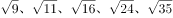，（    ）。观察发现相邻两项根号内数字的差分别为：2、5、8、11、（14），为公差是3的等差数列，则题干所求项应为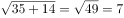。

故正确答案为B。

**来源**：2015年江苏省公务员录用考试《行测》题（A类）第29题

### 第 30 题

4，2，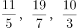，（    ）。

A. 37/11

B. 4

C. 21/13

D. 5

第 30 题 · 答案与解析

**参考答案（粉笔题库参考内容）**

B

**解析**

数列包含分数，且第三项与第四项的分母分别为5和7，则考虑将题干数列转化成分母为连续奇数列的形式，转化后为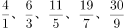，（    ）。分数列中，分母部分为连续奇数列，则下一项为11；分子部分相邻两项作差后得：2、5、8、11、（    ），为公差是3的等差数列，所求项分子部分应为30+14=44。故原数列下一项为44/11 = 4。

故正确答案为B。

**来源**：2015年江苏省公务员录用考试《行测》题（A类）第30题

### 第 31 题

已知一等差数列a_1，21，，31，······，a_n，······，若a_n=516，则该数列前n项的平均数是：

A. 266

B. 258

C. 255

D. 212

第 31 题 · 答案与解析

**参考答案（粉笔题库参考内容）**

A

**解析**

因该数列为等差数列，且a_2=21，a_4=31，则可得公差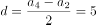，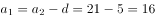。又已知a_n=516，要求得前n项的平均数，可以根据等差数列的性质得该数列的平均数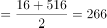，也可以采用尾数法直接得到结果。

故正确答案为A。

**考点**：数列问题

**来源**：2015年江苏省公务员录用考试《行测》题（A类）第31题

### 第 32 题

设a、b均为正整数，且有等式11a+7b＝132成立，则a的值为：

A. 6

B. 4

C. 3

D. 5

第 32 题 · 答案与解析

**参考答案（粉笔题库参考内容）**

D

**解析**

方法一：已知等式11a+7b=132，需求解a值，可以直接采用代入排除法来计算出a、b的数值。A、B、C三项代入式子中解得b均不为正整数，代入D项验证求得：b=11，a=5，符合题意。

方法二：a、b均为正整数，且，因为11a为11的倍数，那么7b必为11的倍数，则b=11。两边进行同时除以11，可得a+7=12，故a=5。

故正确答案为D。

**来源**：2015年江苏省公务员录用考试《行测》题（B类）第36题

### 第 33 题

甲、乙工程队需要在规定的工期内完成某项工程，若甲队单独做，则要超工期9天完成，若乙队单独做，则要超工期16天才能完成，若两队合做，则恰好按期完成。那么，该项工程规定的工期是：

A. 8天

B. 6天

C. 12天

D. 5天

第 33 题 · 答案与解析

**参考答案（粉笔题库参考内容）**

C

**解析**

方法一：假设该项工程规定的工期为x天，并且将该工程的总工作量为1。根据工作总量=时间×效率，则甲队每天效率为1/(x+9)，乙队每天效率为1/(x+16)，可列方程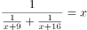，进一步化简得到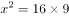，解得x=12。

方法二：假设规定的工期为x天，已知两队合作恰好如期完成，那么甲队超出9天的任务量=乙队x天的任务量，乙队超出16天的任务量=甲队x天的任务量，所以9甲=x乙，x甲=16乙，化简可得，解得x=12。

方法三：已知乙队做完的时间比甲队要久，那么可得甲队的效率大于乙队。假设规定的工期为x天，甲队多做9天的任务量乙队需x天完成，则x>9。

故正确答案为C。

**考点**：工程问题-其他

**来源**：2015年江苏省公务员录用考试《行测》题（A类）第33题

### 第 34 题

一群大学生进行分组活动，要求每组人数相同，若每组22人，则多出一人未被分进组；若少分一组，则恰好每组人数一样多。已知每组人数最多只能32人，则该群学生总人数是：

A. 441

B. 529

C. 536

D. 528

第 34 题 · 答案与解析

**参考答案（粉笔题库参考内容）**

B

**解析**

将大学生进行分组，每组有22人，并且多一人未进组，那么总数-1就是22的倍数，说明总人数-1=22n，排除C、D两项。代入A项，第一次分了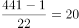组，那么第二次分了19组，441/19不是整数，排除A项，选B项。

故正确答案为B。

**考点**：和差倍比问题

**来源**：2015年江苏省公务员录用考试《行测》题（A类）第34题

### 第 35 题

有A、B、C三种浓度不同的盐溶液。若取等量的A、B两种盐溶液混合，则得浓度为17％的盐溶液；若取等量的B、C两种盐溶液混合，则得浓度为23％的盐溶液；若取等量的A、B、C三种盐溶液混合，得到浓度为18％的盐溶液。则B种盐溶液的浓度是：

A. 21％

B. 22％

C. 26％

D. 37％

第 35 题 · 答案与解析

**参考答案（粉笔题库参考内容）**

C

**解析**

已知A、B、C三种溶液均为等量混合，故将三种溶液每次放入的质量均设为1。假设A、B、C三种溶液的浓度分别为a、b、c，列式可得①，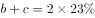②，③，①+②-③=b=26%，得出B溶液的浓度为26%。

故正确答案为C。

**来源**：2015年江苏省公务员录用考试《行测》题（A类）第35题

### 第 36 题

假设空气质量可按良好、轻度污染和重度污染三类划分。一环境监测单位在某段时间对63个城市的空气质量进行了监测，结果表明：空气质量良好城市数是重度污染城市数的3倍还多3个，轻度污染城市数是重度污染城市数的2倍。那么空气质量良好的城市个数是：

A. 33

B. 31

C. 23

D. 27

第 36 题 · 答案与解析

**参考答案（粉笔题库参考内容）**

A

**解析**

方法一：假设重度污染城市数为x个，则轻度污染城市数为2x个、良好城市数为（3x+3）个，那么6x+3=63，解得x=10，所以良好城市数为个。

方法二：空气质量良好城市数为重度污染城市数的3倍多3个，那么良好城市数一定为3的倍数，排除B、C两项。假设良好城市数是重度污染城市数的3倍，可得良好：轻度：重度=3：2：1，共6份对应63，所以良好城市的3份对应31.5，但实际数量要比31.5略大。

故正确答案为A。

**考点**：和差倍比问题

**来源**：2015年江苏省公务员录用考试《行测》题（A类）第36题

### 第 37 题

同样价格的某商品在4个商场销售时都进行了两次价格调整。甲商场第一次提价的百分率为a，第二次提价的百分率为b（a>0，b>0，且a≠b）；乙商场两次提价的百分率均为(a+b)/2；丙商场第一次提价的百分率为(a+b)/3，第二次提价的百分率为2(a+b)/3；丁商场第一次提价的百分率为b，第二次提价的百分率为a。那么，两次提价后该商品售价最高的商场是：

A. 甲商场

B. 乙商场

C. 丙商场

D. 丁商场

第 37 题 · 答案与解析

**参考答案（粉笔题库参考内容）**

B

**解析**

方法一：已知甲和丁提价后售价相同，其售价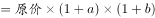，排除A、D两项；对于乙、丙而言，乙售价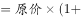(a+b)/2)×(1+(a+b)/2)，丙售价(a+b)/3)×(1+2(a+b)/3)，化简可以得到乙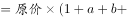(a+b)^2/4)，丙2(a+b)^2/9)，直接比较系数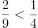，所以乙售价更高。

方法二：赋值法。设商品原价为100，第一次提价的百分率a=10%，第二次提价的百分率b=20%。则甲商场的售价为100×1.1×1.2=132；乙商场的售价为100×1.15×1.15=132.25；丙商场的售价为100×1.1×1.2=132；丁商场的售价为100×1.2×1.1=132。显然乙的售价更高。

故正确答案为B。

**考点**：经济利润问题

**来源**：2015年江苏省公务员录用考试《行测》题（A类）第37题

### 第 38 题

黑白两个盒子中共有棋子193颗。若从白盒子中取出15颗棋子放入黑盒子中，则黑盒子中的棋子数是白盒子中棋子数的m（m为正整数）倍还多6颗。那么，黑盒子中原来的棋子至少有：

A. 121颗

B. 140颗

C. 161颗

D. 167颗

第 38 题 · 答案与解析

**参考答案（粉笔题库参考内容）**

C

**解析**

由题意得移放后两盒中棋子数满足：黑+白=193 ①，黑=m×白+6 ②，将②式代入①式可得，193=白+m×白+6，推出（m+1）×白=187，且187=11×17。要使得黑盒中棋子尽量少，那么就令白盒子中棋子最大为17颗，则进行移放后黑盒中棋子数为193-17=176颗，那么移放前黑盒中的棋子就为176-15=161颗。

故正确答案为C。

**考点**：和差倍比问题、非典型最值问题

**来源**：2015年江苏省公务员录用考试《行测》题（A类）第38题

### 第 39 题

一实心圆锥体的底面半径为r，母线长为2r。若截圆锥体得到两个同样的锥体（如图），则所得两个锥体的表面积之和与原圆锥体表面积的比值是：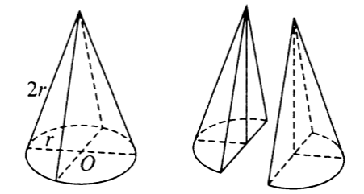

A. 1/2

B. (π+4√3)/6

C. (3π+2√3)/(3π)

D. (3π+4)/(6π)

第 39 题 · 答案与解析

**参考答案（粉笔题库参考内容）**

C

**解析**

已知圆锥体的底面半径为r，母线长为2r，可得圆锥体的表面积为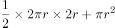=3πr^2。所截得的两个锥体的表面积之和要比原圆锥体的表面积多两个等边三角形截面的面积，等边三角形的边长为2r，其面积为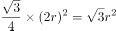，那么两个锥体的表面积之和为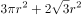。则两个锥体的表面积之和与原圆锥体表面积的比值是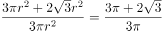。

故正确答案为C。

**考点**：几何公式类-平面图形、几何公式类-立体图形

**来源**：2015年江苏省公务员录用考试《行测》题（A类）第39题

### 第 40 题

甲、乙、丙三辆汽车分别从A地开往千里之外的B地。若乙比甲晚出发30分钟，则乙出发后2小时追上甲；若丙比乙晚出发20分钟，则丙出发后5小时追上乙。若甲出发10分钟后乙出发，当乙追上甲时，丙才出发，则丙追上甲所需时间是：

A. 110分钟

B. 150分钟

C. 127分钟

D. 128分钟

第 40 题 · 答案与解析

**参考答案（粉笔题库参考内容）**

B

**解析**

设甲车速度为x，乙车速度为y，丙车速度为z，由题意可得，（y-x）120=30x，（z-y）300=20y，（y-x）t=10x，化简得（y-x）：x=1：4，（z-y）：y=1：15，令y=15、x=12、z=16，则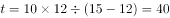分钟，说明丙出发时甲已经出发了50分钟，所以追上甲的时间为分钟。

故正确答案为B。

**考点**：相遇追及

**来源**：2015年江苏省公务员录用考试《行测》题（A类）第40题

### 第 41 题

白羊：黑羊

A. 高价：价格

B. 蓝天：春天

C. 周刊：月刊

D. 苏州：徐州

第 41 题 · 答案与解析

**参考答案（粉笔题库参考内容）**

C

**解析**

第一步，判断题干词语间逻辑关系。

“黑羊”和“白羊”都是羊的一种，二者为并列关系。

第二步，判断选项词语间逻辑关系。

A项：“高价”是比基准水平大幅高出的价格，即“高价”是“价格”的一种，二者之间为种属关系，与题干逻辑关系不一致，排除；

B项：二者之间无明显的逻辑关系，排除；

C项：“周刊”和“月刊”都是期刊的一种，二者为并列关系，与题干逻辑关系一致，保留；

D项：“苏州”和“徐州”两个城市，二者为并列关系，与题干逻辑关系一致，保留。

对比C、D两项，题干当中白羊和黑羊没有明确说明是具体的哪一头羊，是泛指羊的一种，周刊与月刊也没有明确说明是哪一家杂志社的期刊，是泛指期刊；苏州和徐州明确地说明是江苏的两个城市，是特指，所以选择C项。

故正确答案为C。

**考点**：逻辑关系-并列关系

**来源**：2015年江苏省公务员录用考试《行测》题（A类）第41题

### 第 42 题

自拍：拍照

A. 铁矿：金属

B. 茶馆：场所

C. 微信：博客

D. 船舱：飞船

第 42 题 · 答案与解析

**参考答案（粉笔题库参考内容）**

B

**解析**

第一步：判断题干词语间逻辑关系。

“自拍”是一种“拍照”的方式，二者之间为种属关系。

第二步：判断选项词语间逻辑关系。

A项：“铁矿”是一种“矿产”，而“铁”才是一种“金属”，与题干逻辑关系不一致，排除；

B项：“茶馆”是一种“场所”，二者之间为种属关系，与题干逻辑关系一致，当选；

C项：“微信”和“博客”二者之间为并列关系，与题干逻辑关系不一致，排除；

D项：“船舱”是“飞船”的一个组成部分，二者之间为组成关系，与题干逻辑关系不一致，排除。

故正确答案为B。

**考点**：逻辑关系-包容关系

**来源**：2015年江苏省公务员录用考试《行测》题（A类）第42题

### 第 43 题

教师：教师法：尊重教师

A. 企业：劳动法：招聘童工

B. 会计：会计法：虚报账目

C. 司机：交通法：肇事逃逸

D. 夫妻：婚姻法：婚姻自主

第 43 题 · 答案与解析

**参考答案（粉笔题库参考内容）**

D

**解析**

第一步：判断题干词语间逻辑关系。

教师法是针对教师的法律，教师法规定要尊重教师。

第二步：判断选项间词语逻辑关系。

A项：劳动法的针对对象之一是企业，劳动法规定不得招聘童工，与题干逻辑关系不一致，排除；

B项：会计法是针对会计的法律，会计法规定不得虚报账目，与题干逻辑关系不一致，排除；

C项：交通法的针对对象之一是司机，交通法规定不得肇事逃逸，与题干逻辑关系不一致，排除；

D项：婚姻法是针对夫妻的法律，婚姻法规定要婚姻自主，与题干逻辑关系一致，当选。

故正确答案为D。

**考点**：逻辑关系-对应关系

**来源**：2015年江苏省公务员录用考试《行测》题（B类）第44题

### 第 44 题

人民币：美元：欧元

A. 海鲜：海鸥：海滩

B. 贵州：杭州：常州

C. 兰花：牡丹：菊花

D. 宽恕：品性：诚信

第 44 题 · 答案与解析

**参考答案（粉笔题库参考内容）**

C

**解析**

第一步：判断题干词语间逻辑关系。

人民币、美元、欧元是三种不同的现行流通货币，三者之间为并列关系。

第二步：判断选项词语间逻辑关系。

A项：海鲜、海鸥和海滩三者之间不能构成并列关系，与题干逻辑关系不一致，排除；

B项：贵州是省级行政区，而杭州和常州是市级行政区，不能构成并列关系，与题干逻辑关系不一致，排除；

C项：兰花、牡丹、菊花为三种不同的花，三者之间构成并列关系，与题干逻辑关系一致，当选；

D项：宽恕和品性之间不能构成并列关系，与题干逻辑关系不一致，排除。

故正确答案为C。

**考点**：逻辑关系-并列关系

**来源**：2015年江苏省公务员录用考试《行测》题（A类）第44题

### 第 45 题

七天 之于 一星期 相当于 （    ） 之于 （    ）。

A. 一米——十分米

B. 十元——一百元

C. 直线——几何学

D. 一吨——十公斤

第 45 题 · 答案与解析

**参考答案（粉笔题库参考内容）**

A

**解析**

第一步：判断题干词语间逻辑关系。

“七天”和“一星期”二者之间是全同关系，七天即一星期。

第二步：判断选项词语间逻辑关系。

A项：“一米”和“十分米”二者之间是全同关系，一米即十分米，与题干逻辑关系一致，当选；

B项：“十元”和“一百元”二者之间不是全同关系，与题干逻辑关系不一致，排除；

C项：“直线”是“几何学”的基本概念，是元素与集合的关系，与题干逻辑关系不一致，排除；

D项：“一吨”和“十公斤”二者之间不是全同关系，一吨等于一千千克，与题干逻辑关系不一致，排除。

故正确答案为A。

**考点**：逻辑关系-全同关系

**来源**：2015年江苏省公务员录用考试《行测》题（A类）第45题

### 第 46 题

扎小羊灯 之于 （    ） 相当于 剪福字窗花 之于 （    ）。

A. 灯笼——桃花

B. 喜乐——过年

C. 小羊——窗户

D. 细绳——剪刀

第 46 题 · 答案与解析

**参考答案（粉笔题库参考内容）**

D

**解析**

将选项逐一代入，判断各选项前后部分的逻辑关系。

A项：小羊灯是花灯的一种，即扎小羊灯是制作灯笼（花灯）的过程；剪福字窗花和桃花之间无明显的逻辑关系，两组词前后逻辑关系不一致，排除；

B项：过年的时候剪福字窗花，而扎小羊灯则表示喜乐，两组词前后逻辑关系不一致，排除；

C项：小羊灯的样子类似羊，而福字窗花则贴在窗户上，两组词前后逻辑关系不一致，排除；

D项：扎小羊灯的过程中需要使用细绳，而剪福字窗花的过程中需要使用剪刀，两组词前后逻辑关系一致，当选。

故正确答案为D。

**考点**：逻辑关系-对应关系

**来源**：2015年江苏省公务员录用考试《行测》题（C类）第41题

### 第 47 题

海盐 之于 （    ） 相当于 供暖器 之于 （    ）。

A. 咸味——供暖

B. 盐场——取暖

C. 味觉——电流

D. 调味剂——电器

第 47 题 · 答案与解析

**参考答案（粉笔题库参考内容）**

D

**解析**

将选项逐一代入，判断各选项前后部分的逻辑关系。

A项：海盐本身具有咸味，咸味是海盐的一种本质属性，且咸味为名词；供暖器本身不具有供暖的本质属性，供暖还需要借助外物，且供暖为动词，两组词前后逻辑关系不一致，排除；

B项：盐场是海盐的生产场所，而取暖和供暖器之间无法构成事物与其生产场所的对应，两组词前后逻辑关系不一致，排除；

C项：海盐可以提供咸的味觉，但是供暖器和电流之间无明显的逻辑关系，两组词前后逻辑关系不一致，排除；

D项：海盐是调味剂的一种，供暖器是电器的一种，两组词均构成种属关系，逻辑关系一致，当选。

故正确答案为D。

**考点**：逻辑关系-包容关系

**来源**：2015年江苏省公务员录用考试《行测》题（C类）第40题

### 第 48 题

A. 

B. 

C. 

D. 

第 48 题 · 答案与解析

**参考答案（粉笔题库参考内容）**

B

**解析**

本题考查字符类比，注意数字、符号、字母（大小写）的对应。

第二位和第三位的数字相同，据此排除C项；第七位和第八位的字母一样且均为小写，据此排除D项；再根据第九位和第十位字母均为大写排除A项。

故正确答案为B。

**来源**：2015年江苏省公务员录用考试《行测》题（A类）第48题

### 第 49 题

A. 

B. 

C. 

D. 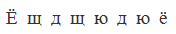

第 49 题 · 答案与解析

**参考答案（粉笔题库参考内容）**

C

**解析**

本题考查字符类比，注意相同符号的对应。

第一位和第八位是同一字符，第二位和第七位的字符均是单独存在，第三位和第五位的字符相同，第四位和第六位的字符相同，排除A、B、D三项。

故正确答案为C。

**来源**：2015年江苏省公务员录用考试《行测》题（A类）第49题

### 第 50 题

A. 

B. 

C. 

D. 

第 50 题 · 答案与解析

**参考答案（粉笔题库参考内容）**

A

**解析**

本题考查字符类比，注意相同符号的对应。

第一位和第七位的符号相同，第二位和第三位的符号相同，第四位和第五位的符号相同，第六位和第八位的符号相同，符合此规律的为只有A项；也可以将题干的形式看做：ABBCCDAD，只有A项符合。

故本题正确答案为A。

**来源**：2015年江苏省公务员录用考试《行测》题（C类）第45题

### 第 51 题

每道题在上边的题干中给出一套图形，其中包括五个图，这五个图呈现一定的规律性。在下边给出一套图形，其中有四个图，从中选出唯一的一项作为保持上边五个图规律性的第六个图。

A. A

B. B

C. C

D. D

第 51 题 · 答案与解析

**参考答案（粉笔题库参考内容）**

B

**解析**

观察题干图形，寻找最大共同点。题干5幅图中，所有动物均为鸟类，同时所有动物的头朝向左边。符合此规律的只有B选项。

故正确答案为B。

**来源**：2015年江苏省公务员录用考试《行测》题（B类）第51题

### 第 52 题

请从所给的四个选项中，选择唯一的一个答案，使之呈现一定的规律性：

A. A

B. B

C. C

D. D

第 52 题 · 答案与解析

**参考答案（粉笔题库参考内容）**

D

**解析**

各图形构成不同，元素组成凌乱，且无明显的属性规律，考虑数量规律。

观察发现题干中图形的交点个数分别为4、5、6、7、8、？，在选项中寻找交点数为9的选项。A、B、C、D四项的交点数分别为7、10、7、9。

故正确答案为D。

**考点**：数量规律-点

**来源**：2015年江苏省公务员录用考试《行测》题（C类）第46题

### 第 53 题

请从所给的四个选项中，选择唯一的一个答案，使之呈现一定的规律性：

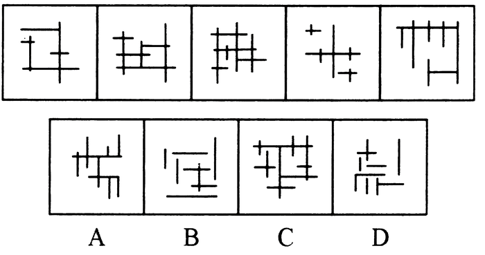

A. A

B. B

C. C

D. D

第 53 题 · 答案与解析

**参考答案（粉笔题库参考内容）**

A

**解析**

各图形构成不同，均由长短不一的水平线和竖直线构成，且无明显的属性规律，考虑数量规律。观察发现，题干中各图形的竖直直线的数量依次递增，分别为2、3、4、5、6，在选项中寻找含有7条竖直直线的选项，A、B、C、D四项竖直直线段的数目分别为7、4、5、6。

故正确答案为A。

**考点**：数量规律-线

**来源**：2015年江苏省公务员录用考试《行测》题（A类）第53题

### 第 54 题

请从所给的四个选项中，选择唯一的一个答案，使之呈现一定的规律性：

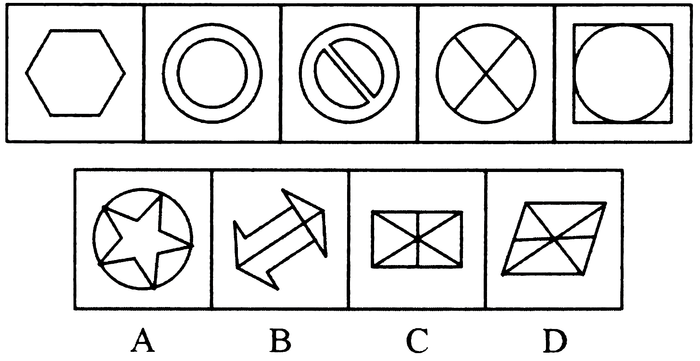

A. A

B. B

C. C

D. D

第 54 题 · 答案与解析

**参考答案（粉笔题库参考内容）**

C

**解析**

元素组成不同，优先考虑属性规律。题干图形均既是轴对称又是中心对称图形，排除A、B、D三项。

故正确答案为C。

**考点**：属性规律-对称性

**来源**：2015年江苏省公务员录用考试《行测》题（A类）第54题

### 第 55 题

选项的四个图形中，只有一个是由上边的四个图形拼合（只能通过上、下、左、右平移）而成的，请把它找出来。

A. A

B. B

C. C

D. D

第 55 题 · 答案与解析

**参考答案（粉笔题库参考内容）**

D

**解析**

本题考查的是平面拼合，可以采用平行等长消去的方式。消去平行等长的线段（相同颜色标注）后进行组合得到轮廓图，即为D选项。平行等长消去方式如下图所示：

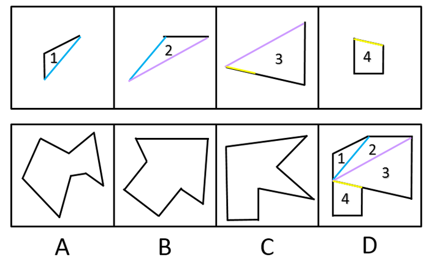

故正确答案为D。

**来源**：2015年江苏省公务员录用考试《行测》题（B类）第55题

### 第 56 题

右边四个图形中，只有一个是由左边的四个图形拼合（只能通过上、下、左、右平移）而成的，请把它找出来。

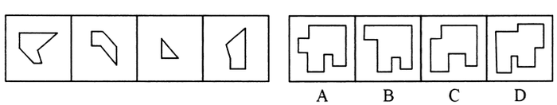

A. A

B. B

C. C

D. D

第 56 题 · 答案与解析

**参考答案（粉笔题库参考内容）**

A

**解析**

本题考查的是平面拼合，可以采用平行等长消去的方式。消去平行等长的线段（相同颜色标注）后进行组合得到轮廓图，即为A选项。平行等长消去方式如下图所示：

故正确答案为A。

**来源**：2015年江苏省公务员录用考试《行测》题（A类）第56题

### 第 57 题

左边给定的是纸盒外表面的展开图，右边哪一项能由它折叠而成?请把它找出来。

A. A

B. B

C. C

D. D

第 57 题 · 答案与解析

**参考答案（粉笔题库参考内容）**

A

**解析**

本题考查四面体的空间重构能力。

将平面展开图中的面进行标记，并用相同样式线条标注相同边，用排除法解题。观察选项，B、C、D三项中均存在面④，选取此面为参考面。

标记如图所示的箭头，则面①在面④的左方，面②在面④的右方，面③在面④的下方。

B项：立体图中面④的下方图形是面①，而平面图中面④的下方图形是面③，平面图与立体图不对应，排除。

C项：立体图中面④的右方图形是面②，平面图中面④的右方图形也是面②，但是平面图中面②的阴影三角形与面④的底边有公共点，而立体图中面②的阴影三角形与面④的底边没有公共点，平面图与立体图不对应，排除。

D项：立体图中面④的右方图形是面①，平面图中面④的右方图形是面②，平面图与立体图不对应，排除。

故正确答案为A。

**来源**：2015年江苏省公务员录用考试《行测》题（B类）第57题

### 第 58 题

左边给定的是纸盒外表面的展开图，右边哪一项能由它折叠而成?请把它找出来。

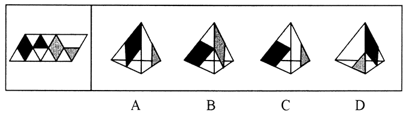

A. A

B. B

C. C

D. D

第 58 题 · 答案与解析

**参考答案（粉笔题库参考内容）**

D

**解析**

本题考查四面体的空间重构能力。

将平面展开图中的面进行标记，并用相同颜色线条标注相同边。用排除法解题。观察选项，A、B、C、D选项中均存在面①，选取此面为参考面。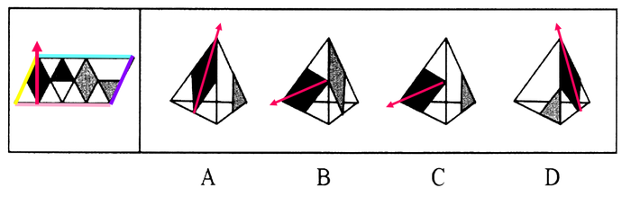

A项：立体图中面①的右方是面④，而平面图中面①的右方是面②，平面图与立体图不对应，排除；

B项：立体图中面①的下方是③，平面图中面①的下方也是面③，再观察公共线，发现公共线与黑色还有灰色阴影部分仅有一个交点，而立体图中公共线与灰色阴影面相交部分不是点连接，排除；

C项：立体图中面①的下方是面④，而平面图中面①的下方是面③，平面图与立体图不对应，排除；

D项：立体图与平面图中面①的左方均是面④，且公共边相连情况正确。

故正确答案为D。

**来源**：2015年江苏省公务员录用考试《行测》题（A类）第58题

### 第 59 题

左边给定的是纸盒外表面的展开图，右边哪一项能由它折叠而成?请把它找出来。

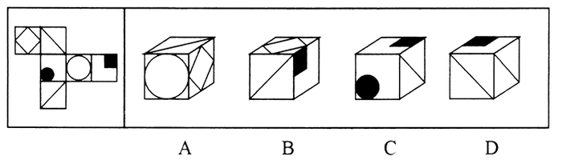

A. A

B. B

C. C

D. D

第 59 题 · 答案与解析

**参考答案（粉笔题库参考内容）**

B

**解析**

本题考查六面体的空间重构。

将平面图中的各面进行标号，如下图所示。

观察发现，平面展开图中相对面关系为①⑤相对，②④相对，③⑥相对。

A项：平面图中面①与面⑤为相对关系，根据相对面必然出现且出现其中一面，相对面不相邻，A项错误；

B项：三面相对位置正确；

C项：平面图中面③与面⑥为相对关系，根据相对面必然出现且出现其中一面，相对面不相邻，C项错误；

D项：平面图中面②与面④为相对关系，根据相对面必然出现且出现其中一面，相对面不相邻，D项错误。

故正确答案为B。

**考点**：空间类-空间重构-六面体

**来源**：2015年江苏省公务员录用考试《行测》题（A类）第59题

### 第 60 题

左边给定的是纸盒外表面的展开图，右边哪一项能由它折叠而成？请把它找出来。

A. A

B. B

C. C

D. D

第 60 题 · 答案与解析

**参考答案（粉笔题库参考内容）**

A

**解析**

本题为空间重构，将题干展开图中的面标上序号。

A 项：与题干展开图一致，当选；

B 项：该项中必然存在面c和面e，在展开图中面c和面e是相对面，相对面不能同时出现，排除；

C 项：该项中必然存在面c，且面c存在唯一边，可以针对面c进行画边，展开图中边4对应的是面b,且边4与面b存在交点，而选项中，边4和面b不存在交点，故与题干不一致，排除；

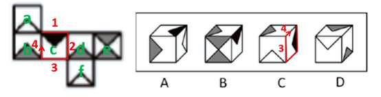

D 项：两个灰色面为相对面，相对面必然出现且只出现其中一面，相对面不能同时出现，排除。

故正确答案为A。

**考点**：空间类-空间重构-六面体

**来源**：2015年江苏省公务员录用考试《行测》题（A类）第60题

### 第 61 题

只有加大查处、惩罚力度，对贪污官员绝不姑息手软，才能让官员“不敢腐”；只有在权力运作的每个环节建立和完善相关制度，才能让官员“不能腐”。但是，如果官员缺乏必要的廉耻之心，单纯依靠制度，那么，他们一定会找到制度的漏洞；相反，如果官员有一定的廉耻之心，那么，即便存在一些制度漏洞，他们也不会有意利用，而是会克制自己，甚至会修补这些漏洞，真正做到“不想腐”。

根据以上陈述，可以推出的是：

A. 如果官员有一定的廉耻之心，一般不会发现制度的漏洞；即使发现了，也不会利用，只会去修补它们

B. 如果官员有一定的廉耻之心，就会加强自我约束，不会有意利用制度的漏洞，从心里消除腐败的念头

C. 如果官员缺乏必要的廉耻之心，只要加大查处、惩罚力度，绝不姑息手软，他们就“不敢腐”

D. 如果官员缺乏必要的廉耻之心，只要建立和完善权力运作各个环节的相关制度，他们就“不能腐”

第 61 题 · 答案与解析

**参考答案（粉笔题库参考内容）**

B

**解析**

第一步：翻译题干。

①不敢腐→加大查处、惩罚力度，对贪污官员绝不姑息手软；

②不能腐→在权力运作的每个环节建立和完善相关制度；

③官员缺乏必要的廉耻之心→找到制度的漏洞；

④官员有一定的廉耻之心→不会有意利用漏洞，会克制自己。

第二步：分析选项。

A项：选项对应④，“一般不会发现制度漏洞”与“廉耻之心”不构成逻辑关系，与题干表述不符，排除；

B项：是对④的等价表述，肯定前件可推出肯定后件，当选；

C项：加大查处、惩罚力度→官员不敢腐，是对①的肯后，肯定后件不能肯定前件，排除；

D项：建立和完善权力运作各个环节的相关制度→官员不能腐，是对②的肯后，肯定后件不能肯定前件，排除。

故正确答案为B。

**考点**：常规翻译

**来源**：2015年江苏省公务员录用考试《行测》题（A类）第61题

### 第 62 题

中国人大多是在批评与训斥中长大的，父母、老师、长辈、领导……看你哪一点不顺眼，都能给出指教。话多半不好听，可听者听了多半心悦诚服，心生感激，因为大家想的是良药苦口、忠言逆耳的道理。但是，逆耳的未必都是忠言。有种电话诈骗就是以很凶的方式出现的。电话里的他们就是要批评你、威胁你、吓唬你，一旦你心里打怵了，你就听他们的了；而你听了他们的，你也就上当了。

根据以上陈述，可以推出的是：

A. 有的逆耳之言可能不是忠言

B. 有的忠言并不逆耳

C. 有的电话诈骗的声音并不是很凶

D. 如果你听到逆耳的电话心里不打怵，你就不会上当

第 62 题 · 答案与解析

**参考答案（粉笔题库参考内容）**

A

**解析**

题干关键信息：“逆耳的未必都是忠言”等价于“逆耳的可能不是忠言”。

A项：题干“逆耳的可能不是忠言”，再根据“所有的S都是P→有的S是P”，能够推出“有的逆耳之言可能不是忠言”，当选；

B项：“有的S是P”不能推出“有的S不是P”，因此不能推出“有的忠言并不逆耳”，排除；

C项：题干提及“有种电话诈骗就是以很凶的方式出现的”，只能推出有的电话诈骗的声音很凶，有的是不能推出有的不是，排除；

D项：题干“一旦你心里打怵了，你就听他们的了”，即“一旦你心里打怵，你就上当了”，充分条件假言命题否前不能否后，排除。

故正确答案为A。

**考点**：集合推理

**来源**：2015年江苏省公务员录用考试《行测》题（B类）第62题

### 第 63 题

某单位寻求对外合作，准备在甲、乙、丙、丁四家单位中确定一个或几个合作对象。单位管理层经过认真调研和讨论，最终形成了以下三种意见：

（1）对于甲和乙两单位，至多选一个；

（2）对于甲和丁两单位，至少选一个；

（3）如果选择丙或丁单位，就不能选择乙单位。

在最终决定时，单位领导只采纳了上述一种意见。

根据以上陈述，以下哪项最符合单位领导的最终决定?

A. 选择乙、丙、丁

B. 选择乙，但不选择丙和丁

C. 选择甲、乙、丁

D. 选择丙，但不选择乙和丁

第 63 题 · 答案与解析

**参考答案（粉笔题库参考内容）**

C

**解析**

题干重要信息：单位领导只采纳了（1）（2）（3）中的一种意见。

此题采用代入法，代入后：

A项：条件（1）（2）同时满足，排除；

B项：条件（1）（3）同时满足，排除；

C项：只满足条件（2），当选；

D项：条件（1）（3）同时满足，排除。

故正确答案为C。

**考点**：代入法

**来源**：2015年江苏省公务员录用考试《行测》题（C类）第59题

### 第 64 题

甲：为富不仁，为官皆不义。

乙：你说的两句都不对。

以下哪项与乙的说法最为相近或相似？

A. 为富皆仁，为官皆义

B. 有的为富仁，有的为官义

C. 有的为富不仁，有的为官不义

D. 仁者不为富，义者不为官

第 64 题 · 答案与解析

**参考答案（粉笔题库参考内容）**

B

**解析**

甲的话为两个直言命题：①所有为富都不仁；②所有为官都不义。“所有的S都不是P”的矛盾命题是“有的S是P”。即乙的说法是：有的为富仁，有的为官义。

故正确答案为B。

**考点**：真假推理-其他

**来源**：2015年江苏省公务员录用考试《行测》题（C类）第58题

### 第 65 题

五对夫妻结伴自驾游。从出发点到目的地，正好有三个服务区，将他们的行程分为四段路，他们在每个服务区都休息了一会儿，有的夫妻也刚好可以换人驾车走下一段路。车队行进过程中，每对夫妻均在自家车中，一人驾车，一人休息。小孙因头晚喝了不少酒，所以今天一直未敢碰方向盘，只是与驾车的妻子说着闲话。已知：

第一段路驾车的是：张、王、李、赵、周；

第二段路驾车的是：吴、王、张、赵、郑；

第三段路驾车的是：李、钱、张、刘、吴；

第四段路驾车的是：郑、张、王、钱、周。

根据以上信息，可以推出这五对夫妻分别是：

A. 李吴、周郑、赵钱、孙张、刘王

B. 刘赵、钱王、孙李、郑张、周吴

C. 孙张、李郑、吴周、刘王、赵钱

D. 孙张、周郑、李吴、刘赵、王钱

第 65 题 · 答案与解析

**参考答案（粉笔题库参考内容）**

C

**解析**

题干信息确定，选项信息充分，可以用排除法做题。

A项：每对夫妻均是一人驾车，一人休息，由第三段路可知李吴同时驾车，因此李吴不是夫妻关系，排除；

B项：由第四段路可知钱王同时驾车，因此钱王不是夫妻关系，排除；

C项：未出现矛盾，当选；

D项：由第四段路可知周郑同时驾车，因此周郑不是夫妻关系，排除。

故正确答案为C。

**考点**：排除法

**来源**：2015年江苏省公务员录用考试《行测》题（A类）第65题

### 第 66 题

顾客：老板，你这盘鱼香肉丝里怎么没有鱼啊？

老板：这有什么奇怪的!难道老婆饼里有老婆吗？

以下哪项的对话方式与上述最为相似或相同？

A. 老师：小明，你为什么没有做我昨天布置的家庭作业啊?

小明：对不起，老师！难道我没有回家也要做家庭作业吗?

B. 妻：亲，你的钱包里怎么没有钱啊？

夫：这没什么不正常！难道茶叶罐里总是有茶叶吗？

C. 孩子：妈妈，棉花糖里怎么没有棉花啊？

妈妈：这很正常！难道你用的英雄墨水里藏了一个英雄吗？

D. 顾客：小妹，你卖的珍珠奶茶里怎么没有珍珠？

售货员：这有什么稀奇！夫妻肺片里也没有夫妻啊！

第 66 题 · 答案与解析

**参考答案（粉笔题库参考内容）**

D

**解析**

题干的论证方式为：

“鱼香肉丝”这道菜的由来是因为菜的味道像鱼香味，而不是有真正的“鱼”；“老婆饼”的由来是老婆做的饼，而并非是饼里有“老婆”这个人。

第二步：分析选项

A项：老师和小明所说的都是家庭作业，与题干逻辑关系不一致，排除；

B项：钱包和没有钱二者中的“钱”都指的是人民币，“茶叶罐”中的“茶叶”指的就是茶叶，与题干逻辑关系不一致，排除；

C项：“棉花糖”的命名是因为像棉花的形状，而不是有真正的棉花，“英雄墨水”是墨水的一个品牌，它的命名由来不是“因为是英雄做出来的墨水所以称为英雄墨水”，命名方式与题干不一致，与题干逻辑关系不一致，排除；

D项：“珍珠奶茶”的命名是因为像珍珠形状，而不是有真正的“珍珠”，“夫妻肺片”这道菜的由来是夫妻两个人一起做的菜，并非是指这道菜里有夫妻，与题干逻辑关系一致，当选。

故正确答案为D。

**考点**：日常结论

**来源**：2015年江苏省公务员录用考试《行测》题（B类）第64题

### 第 67 题

近年来，在全国除港澳台以外的31个省区市书法家协会中，许多名誉主席、主席、副主席已为官员或退休官员担任。几乎在每个省市书法家协会领导名单中，都能看到同等级政府官员的名字。有专家指出，党政官员热衷于担任各级艺术类人民团体领导，官员与艺术家在身份和职务上相互交叠，会让艺术成为腐败的掮客，使各种肮脏的行贿受贿行为在艺术的光环笼罩下大行其事。

以下哪项不能支持上述专家的论断?（  ）

A. 某下属向其领导请求墨宝，再付之以一笔可观的“润笔费”

B. 某些官员高价出售自己的作品，并坦然视之为“公平交易”

C. 某些官员书法功底颇为深厚，对别人请求题字一般并不推托

D. 在多项艺术活动中，具有行政职务的官员总能获得特别的优待

第 67 题 · 答案与解析

**参考答案（粉笔题库参考内容）**

C

**解析**

第一步，找到论点和论据。

论点：党政官员热衷于担任各级艺术类人民团体领导，官员与艺术家在身份和职务上相互交叠，会让艺术成为腐败的掮客，使各种肮脏的行贿受贿行为在艺术的光环笼罩下大行其事。

论据：无。

第二步，分析各个选项。

A选项中的“润笔费”，B选项中的“高价”，D选项中的“优待”均是通过举例子，增加新论据的方式从不同角度体现了因领导身份而在各类艺术活动中获得特别利益，支持了题干论断。

C项对别人请求题字一般不推托，仅为书法交流，是一种客观陈述，并未涉及腐败行贿受贿等，为无关选项，不能支持题干论断。

本题为选非题，故正确答案为C。

**考点**：加强选非题

**来源**：2015年江苏省公务员录用考试《行测》题（B类）第65题

### 第 68 题

在以下5×5矩形阵中，每个小方格可填入一个汉字，要求每行、每列及每个由粗线条围成的小区域内均含有松、菊、梅、兰、竹5个汉字，不能重复也不能遗漏。

根据已经给定的条件，可以推出矩阵中①②③④⑤方格中依次填入的汉字是：

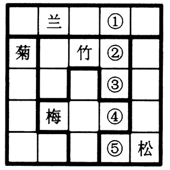

A. 松兰梅竹菊

B. 菊梅松竹兰

C. 松兰菊竹梅

D. 梅菊竹兰松

第 68 题 · 答案与解析

**参考答案（粉笔题库参考内容）**

A

**解析**

本题属于数独型分析推理，信息量最大优先并结合选项快速做题。

（1）信息量最大的空格为第二行第二列，横行不能填入菊、竹，纵列不能填入兰、梅，所以第二行第二列填入“松”。

（2）根据（1）可知，第二行第二列中填入“松”，在由②和③组成的“倒凹形”中，②和③处均不可能填入“竹”和“松”，据此排除B、D两项。

（3）根据（2）可知，正确答案在A、C中，即①处为“松”，②处为“兰”，④处为“竹”，判断出③即可得到正确答案，③处和第三行第二列中填入“梅”和“菊”之一，但是根据第二列，第三行第二列不能填入“梅”，因此只能填入“菊”，可知③处应填入“梅”。

故正确答案为A。

**考点**：从最大信息开始推

**来源**：2015年江苏省公务员录用考试《行测》题（A类）第68题

## 材料 2

王刚、赵虎与李亮是某机关新进员工。他们三人中，有两人单身，两人爱好打乒乓球，两人是北方人，两人是公共管理专业硕士。如果王刚与李亮是公共管理专业硕士，则他们都是北方人；如果赵虎与李亮爱好打乒乓球，则他们都单身。已知他们每人最多只拥有3个上述特征。

### 第 69 题

加上“如果王刚是北方人，则他单身”这一条件，可以得出以下哪项(    )？

A. 王刚单身

B. 赵虎是公共管理专业硕士

C. 李亮爱好打乒乓球

D. 王刚是北方人

第 69 题 · 答案与解析

**参考答案（粉笔题库参考内容）**

B

**解析**

分析题干，王刚、赵虎与李亮三人分8个特征，即两人单身、两人爱好打乒乓球、两人是北方人、两人是公共管理专业硕士；又因为他们每人最多只拥有3个上述特征，据此可知其中一个人有2个特征，两个人有3个特征。

寻找信息量最大的员工，为王刚。假设王刚与李亮是公共管理专业硕士，则他们都是北方人；王刚为北方人，由“如果王刚是北方人，则他单身”推知王刚单身，则赵虎与李亮不都单身，据此可知赵虎和李亮不都爱打乒乓球，由三人中两人爱好打乒乓球推知王刚爱好打乒乓球。归纳上述推导信息，王刚是公共管理专业硕士，是北方人，单身，爱好打乒乓球，这与每人最多拥有3个特征相矛盾，假设不成立。

由上述可知：赵虎必然是公共管理硕士。

故正确答案为B。

**来源**：2015年江苏省公务员录用考试《行测》题（A类）第69题

### 第 70 题

加上“如果赵虎单身，则王刚也单身”这一条件，得不出以下哪项?

A. 王刚单身

B. 王刚爱好打乒乓球

C. 赵虎是公共管理专业硕士

D. 李亮是北方人

第 70 题 · 答案与解析

**参考答案（粉笔题库参考内容）**

D

**解析**

分析题干，王刚、赵虎与李亮三人分8个特征，即两人单身、两人爱好打乒乓球、两人是北方人、两人是公共管理专业硕士；又因为他们每人最多只拥有3个上述特征，据此可知其中一个人有2个特征，两个人有3个特征。

（1）由题干“如果赵虎单身，则王刚也单身”可知，如果王刚不单身，则赵虎也不单身，与只有一人不单身矛盾，故王刚单身，即A项能够推出。

（2）由王刚单身可知，赵虎与李亮不都单身，再根据“如果赵虎与李亮爱好打乒乓球，则他们都单身”推知，赵虎与李亮不都爱打乒乓球，而题干中有两人爱好打乒乓球，因此王刚必然爱好打乒乓球，即B项能够推出。

（3）假设“王刚与李亮是公共管理专业硕士”为真，根据题干条件“如果王刚与李亮是公共管理专业硕士，则他们都是北方人”，王刚此时的身份特征为公共管理专业硕士、北方人、单身、爱好打乒乓球，与题干要求的“每人最多只拥有3个上述特征”相矛盾，因此王刚和李亮不都是公共管理专业硕士，则赵虎必然是公共管理专业硕士，即C项能够推出。

本题为选非题，故正确答案为D。

**来源**：2015年江苏省公务员录用考试《行测》题（A类）第70题

### 第 71 题

认知地图效应：指通过对特定事物多次探索之后，头脑中形成一张包含各种相关信息的地图，根据这张地图采取行动，往往能够取得事半功倍的效果。

下列不属于认知地图效应的是：

A. 庖丁解牛

B. 胸有成竹

C. 老马识途

D. 管中窥豹

第 71 题 · 答案与解析

**参考答案（粉笔题库参考内容）**

D

**解析**

第一步：查找关键词。定义的关键词信息为“对特定事物多次探索”“形成相关信息的地图”“事半功倍”。

第二步：逐一判断选项。

A项：庖丁解牛，比喻经过反复实践，掌握了事物的客观规律，做事得心应手，运用自如；符合定义，排除；

B项：胸有成竹，比喻熟练有把握，事前对问题已有全面的考虑和解决办法；符合定义，排除。

C项：老马识途，比喻有经验的人对事情比较熟悉；符合定义，排除。

D项：管中窥豹，比喻只见到事物的一小部分，指所见不全面或略有所得，其意与定义完全不同，不符合定义，当选。

本题为选非题，故正确答案为D。

**考点**：单定义-其他句式

**来源**：2015年江苏省公务员录用考试《行测》题（C类）第67题

### 第 72 题

精神赡养：是指在家庭生活中，子女理解、尊重、关心、体贴父母，尽力满足其精神生活方面的需要。

下列不属于精神赡养的是：

A. 老孙最近专门买了1台液晶电视安装在父母房间，让二老看自己喜欢的节目，还为他们买了许多京剧光盘

B. 尽管老吴没和父母住在一起，但他多年来已经养成了每天都去看望的习惯，无微不至地照顾好他们的生活，老人感到很欣慰

C. 春节临近，“夕阳红”敬老院的李院长请来朝阳小学的“小红花”乐团，孩子们的欢声笑语和精彩节目，为老人们带来了无尽的快乐

D. 老姜的母亲已70多岁，但仍不服老，报名参加了交谊舞培训班，为避免老人生气并确保安全，每次母亲去上课时，老姜都悄悄跟在后面

第 72 题 · 答案与解析

**参考答案（粉笔题库参考内容）**

C

**解析**

第一步：查找关键词。

定义的关键词信息为“在家庭生活中”、“子女理解、尊重、关心、体贴父母”、“满足其精神生活方面的需要”。

第二步：逐一判断选项。

A、B、D三项均符合定义关键词，C项“敬老院”不是在家庭生活中，因此不属于精神赡养。

本题为选非题，故正确答案为C。

**考点**：拆词

**来源**：2015年江苏省公务员录用考试《行测》题（C类）第71题

### 第 73 题

密码焦虑症：指现代人在日常生活中被银行卡、手机、登录网站、进入小区等密码包围、困扰而引起的心理焦虑症状。

下列属于密码焦虑症的是：

A. 张先生酷爱上网，平日购物、看电影、看书及与朋友通信聊天都通过网络来实现，好多密码都设成了自己的生日，因而也就没有感到特别的不方便

B. 王厂长为保障工厂安全，给厂门加装了密码锁，要求员工输密码进厂，但又担心员工将密码泄露给外人，为此他经常提醒保安，要认识本厂所有员工，不要让外人进来

C. 金女士从来不用网银，总担心网银虽然有密码保障，但还是不安全，说不定哪天就被黑客盗取了密码，自己的银行存款就可能不翼而飞，惹来一身的麻烦

D. 从乡下来到儿子家养老的李大爷，几年来最烦心的事就是不敢外出，因为小区大门、所住的大楼单元门及自家大门都有不同的密码，生怕自己记不清，一出门就回不了家

第 73 题 · 答案与解析

**参考答案（粉笔题库参考内容）**

D

**解析**

第一步：查找关键词。

定义的关键词信息为“银行卡、手机、登录网站、进入小区等密码”、“被密码包围、困扰而引起的心理焦虑症状”。

第二步：逐一判断选项。

A项：张先生密码设置没有感到特别的不方便，未体现出心理焦虑症状，不符合定义，排除；

B项：未体现出“被密码包围、困扰而引起的心理焦虑症状”，这里只涉及了一种密码，即厂门密码，不符合定义，排除；

C项：未体现出“被密码包围、困扰而引起的心理焦虑症状”，也只涉及了一种密码，即网银密码，不符合定义，排除；

D项：“小区大门、所住的大楼单元门及自家大门都有不同的密码”对应“被各种密码包围”，几年来最烦心的事就是不敢外出，对应由密码而引起的“心理焦虑症状”，符合定义，当选。

故正确答案为D。

**考点**：原因结果

**来源**：2015年江苏省公务员录用考试《行测》题（C类）第68题

### 第 74 题

幻想性错觉：指人们即使对于一个客观中立、并无任何暗示性意义的事物，也往往试图从中寻找出某种特殊意义的心理现象。

下列不属于幻想性错觉的是：

A. 夜晚，有时候有人会把高空的灯看成星星

B. 人们常常会在云朵中发现一个个动物形象

C. 古人认为月亮上有桂树、兔子、嫦娥、吴刚

D. 天柱山周围的三座山峰绵延相连很像卧佛

第 74 题 · 答案与解析

**参考答案（粉笔题库参考内容）**

A

**解析**

第一步：查找关键词。

定义的关键词信息为“客观中立、并无任何暗示性意义的事物”、“试图从中寻找出某种特殊意义的心理现象”。

第二步：逐一判断选项。

A项：“把高空的灯看成星星”仅是看错，误把灯看做了星星，不带有某种主观赋予其特殊意义的色彩，不符合定义关键词“寻找出某种特殊意义的心理现象”，不符合定义，当选；

B项：将云朵看做动物对应定义关键词“试图从中寻找出某种特殊意义的心理现象”，符合定义，排除；

C项：认为月亮上有桂树、兔子、嫦娥、吴刚，即赋予了一个客观中立的事物以某种意义，符合定义，排除；

D项：将天柱山周围的三座山峰看做卧佛，即赋予了一个客观中立的事物以某种意义，符合定义，排除。

本题为选非题，故正确答案为A。

**考点**：单定义-其他句式

**来源**：2015年江苏省公务员录用考试《行测》题（B类）第76题

### 第 75 题

标杆效应：指在某一区域内，由于消费者对某种品牌认知度较高，导致其价格往往比同一区域其他同类商品高出一大截，并影响到整个区域同类商品的价格走势。

下列属于标杆效应的是：

A. 在某市，某大品牌电器企业每到节假日就大搞特价促销活动，其他商家纷纷效仿，也出奇招来招揽顾客

B. 某知名品牌推出的新款智能手表受到热捧，虽然价格偏高，却一再脱销，其他品牌的智能手表纷纷调低价格，争抢市场份额

C. 市一中即将搬往高新区的消息一传开，高新区的房价就一路飙升，连紧邻的湾树区房价也跟着涨了三四成

D. 老徐的网店短短半年内就赢利数万，朋友们纷纷前来取经，采用同样的经营方式创办了自己的网店，一个个赚得盆满钵满

第 75 题 · 答案与解析

**参考答案（粉笔题库参考内容）**

B

**解析**

第一步：查找关键词。

定义的关键词信息为“对某种品牌认知度较高”“其价格往往比同一区域其他同类商品高出一大截”“影响整个区域同类商品价格走势”。

第二步：逐一判断选项。

A项：未体现出“其价格往往比同一区域其他同类商品高出一大截”，不符合定义，排除；

B项：受到热捧对应关键词“对某种品牌认知度较高”，价格偏高对应关键词“其价格往往比同一区域其他同类商品高出一大截”，其他品牌的智能手表纷纷调低价格对应关键词“影响整个区域同类商品价格走势”，符合定义，当选；

C项：房价飙升并不是消费者对品牌认知度较高导致的，而是消费者获得其他信息后而导致的结果，同时选项中并没有体现出同类商品，不符合定义，排除；

D项：未体现出“对某种品牌认知度较高”，不符合定义，排除。

故正确答案为B。

**考点**：原因结果

**来源**：2015年江苏省公务员录用考试《行测》题（C类）第75题

### 第 76 题

帐篷理论：指在一定范围内，帐篷的容量不仅仅取决于篷布的面积，也取决于支撑篷布的竹竿的高度。竹竿越高，帐篷容量就越大，比喻利用核心竞争力带动其他各方面要素，最终取得竞争优势。

下列不符合帐篷理论的是：

A. 在某市直机关举办的足球赛上，实力均衡的机关二队出人意料地击败了拥有两名前省队球员的机关一队，夺得冠军

B. 某公司凭借其在发动机和传动系统上的技术优势，由原先的摩托车陆续进入汽车、割草机、水下引擎和发电机等市场，均取得巨大成功

C. 小李的高考成绩虽然一般，社会实践经历也不出众，却凭借全国高中物理奥林匹克竞赛一等奖的优异成绩进入了重点大学

D. 某款手机整体设计并不前卫，配置相当大众化，定价也相对偏高，本来不被业内专家看好，上市以后，却凭借超大屏幕受到广大用户青睐，销量连续数周排行第一

第 76 题 · 答案与解析

**参考答案（粉笔题库参考内容）**

A

**解析**

第一步：查找关键词。

定义的关键词信息为“利用核心竞争力带动其他各方面要素，最终取得竞争优势”。

第二步：逐一判断选项。

A项：实力均衡的机关二队击败一队，夺得冠军，并不是凭借其在某方面的核心竞争力，不符合定义，当选；

B项：凭借其在发动机和传动系统上的技术优势扩大市场并取得成功，符合“利用核心竞争力带动其他各方面要素，最终取得竞争优势”，符合定义，排除；

C项：凭借全国高中物理奥林匹克竞赛一等奖的优异成绩进入了重点大学，符合“利用核心竞争力带动其他各方面要素，最终取得竞争优势”，符合定义，排除；

D项：凭借超大屏幕受到广大用户青睐，销量连续数周排行第一，符合“利用核心竞争力带动其他各方面要素，最终取得竞争优势”，符合定义，排除。

本题为选非题，故正确答案为A。

**考点**：故事类

**来源**：2015年江苏省公务员录用考试《行测》题（A类）第76题

### 第 77 题

协同治理：指政府部门为了达成公共利益的目标，通过与非政府的、非盈利的社会组织和普通公众合作开展社会管理活动的工作模式。

下列属于协同治理的是：

A. 某市辖区内有多个街道办，每个街道办管辖一片区域，有的街道服务中心专门设立了为老年人和残疾人提供公益服务的绿色通道

B. 某高校学生会多次组织大学生深入社区，开展心理咨询、消防安全讲座、帮助孤寡老人等公益活动

C. 为创建卫生城市，某市卫生局、环保局、城管局通力合作，卫生防疫人员、环境监测人员、环卫工人和城管人员各司其职，积极工作

D. 某市为确保城市公交畅通安全，每个公交站台都配有治安巡查员，这些人员中既有各职能部门人员，也有志愿者协会成员，还有退休者

第 77 题 · 答案与解析

**参考答案（粉笔题库参考内容）**

D

**解析**

第一步：查找关键词。定义的关键词信息为“政府部门为了达成公共利益的目标”“通过与非政府的、非盈利的社会组织和普通公众合作开展”。

第二步：逐一判断选项。

A项：街道服务中心仍归属政府，未体现“通过与非政府的、非盈利的社会组织和普通公众合作开展”，不符合定义，排除；

B项：“高校学生会”不是“政府部门”，不符合定义，排除；

C项：选项中涉及的“某市卫生局、环保局、城管局通力合作，卫生防疫人员、环境监测人员、环卫工人和城管人员”均不是“与非政府的、非盈利的社会组织和普通公众合作开展”，不符合定义，排除；

D项：“某市为确保城市公交畅通安全”对应“政府部门为了达成公共利益的目标”，“志愿者协会成员，还有退休者”体现了定义关键词“通过与非政府的、非盈利的社会组织和普通公众合作开展”，符合定义，当选。

故正确答案为D。

**考点**：主客体

**来源**：2015年江苏省公务员录用考试《行测》题（C类）第74题

### 第 78 题

O2O的营销方式：即Online To Offline，指以互联网为前台，用线上营销带动线下消费的商业营销模式。通常包括商家网上提供商品信息、折扣信息、服务预订、消费者在线预付、线下消费等环节完成商品交易。

下列不属于O2O营销方式的是：

A. 某公司推出线上、线下同价促销活动，旗下的网上商城和实体店所有商品价格相同，一时间网上商城订单量剧增，到实体店提货的人也摩肩接踵

B. 小兰在时装杂志上看到了一款心仪的长裙，通过某比价网站发现单位附近一家商场同款长裙正在打折促销，于是趁中午休息时间买了回来

C. 女朋友生日临近，小袁从网上团购了某酒店的自助餐消费券，邀请多名好友为女朋友开了一个难忘的生日派对

D. 某家电厂商利用微信平台向订阅用户定期推送新品上市、促销信息，用户用手机扫描推送消息中商品下方的二维码即可完成支付，等待附近门店的配送

第 78 题 · 答案与解析

**参考答案（粉笔题库参考内容）**

B

**解析**

第一步：查找关键词。

定义的关键词信息为“消费者在线预付、线下消费”。

第二步：逐一判断选项。

A选项，网上商城订单剧增，实体店提货的人摩肩接踵。符合定义中的消费者在线预付，线下消费，是O2O营销，符合定义；

B选项，比价网站发布的折扣信息并不是这个商场这个商家做出的行为，因此主体不符，不符合题干的定义；

C、D两项都涉及到了在线上支付线下消费的定义。

本题为选非题，故正确答案为B。

**考点**：主客体

**来源**：2015年江苏省公务员录用考试《行测》题（B类）第80题

### 第 79 题

趋同进化：指不同生物物种在进化过程中由于适应相似的环境而呈现出外形上的相似性。

下列属于趋同进化的是：

A. 海豚和鲨鱼，一个是哺乳动物，一个是鱼类，只是为了更好地在海洋中生存，它们就变得越来越相像了

B. 随着共同生活时间的增加，夫妻二人的价值观念、生活习惯，甚至连五官都变得越来越相近了

C. 无脊椎动物中，腔肠动物门的珊瑚、甲壳类的藤壶、棘皮动物门的海百合，都有相似的辐射对称躯体构型

D. 蚂蚁从金合欢的刺中取食蛋白质、脂肪和蜜，也在金合欢枝叶间巡逻缠绕金合欢的其他植物，进攻来此觅食的食草动物

第 79 题 · 答案与解析

**参考答案（粉笔题库参考内容）**

A

**解析**

第一步：查找关键词。

定义的关键词信息为“不同生物物种”“适应相似的环境”“外形上的相似性”。

第二步：逐一判断选项。

A项：海豚和鲨鱼为“不同生物物种”，为了更好地在海洋中生存即为了“适应相似的环境”，变得越来越相像了即呈现出了“外形上的相似性”，符合定义，当选；

B项：夫妻为同一物种，不符合定义，排除；

C项：未体现出为了“适应相似的环境”，不符合定义，排除；

D项：未体现呈现出了“外形上的相似性”，不符合定义，排除。

故正确答案为A。

**考点**：原因结果

**来源**：2015年江苏省公务员录用考试《行测》题（C类）第73题

### 第 80 题

星期一综合症：是指由于在双休日过分消耗精力处理工作之外的事情，导致周一上班时出现头晕、胸闷、腹胀、食欲不振、周身酸痛、注意力不集中等症状。

下列属于星期一综合症的是：

A. 五一小长假，小李和同事们计划已久的黄山之旅终于成行了。3天下来，爬山、聚餐、照相、乘车，一点也不比上班轻松。这不，长假结束刚一上班，个个都像霜打的茄子——蔫了吧唧的

B. 终于又到周末了，小王将下载好的一部40集连续剧不分白天黑夜地看完了，两天里除了上厕所，就没下过床，饭都是舍友帮忙从食堂带的。周一起床整个人都昏昏沉沉的，干脆向辅导员请假不去上课了

C. 周六上午陪小孩参加绘画兴趣班，下午学钢琴，晚上带着去品尝风味小吃；周日上午带着小孩去游乐场，下午去奶奶家。整个周末，王女士的时间表都被小孩填满了，周一上班脑袋里还是这些，根本没法工作

D. 已经连续工作了5天，也计划好周末陪女友上街购物，但公司临时通知周末加班，小许只好向女友“请假”，回到办公室和同事们通宵达旦地又干了两天。星期一上班，个个都成了“熊猫眼”

第 80 题 · 答案与解析

**参考答案（粉笔题库参考内容）**

C

**解析**

解析：

第一步：查找关键词。

定义的关键词信息为“双休日过分消耗精力处理工作之外的事情”、“上班时”。

第二步：逐一判断选项。

A项：“五一小长假”不符合关键词“双休日”，不符合定义，排除；

B项：干脆向辅导员请假不去上课了不符合“上班时”，不符合定义，排除；

C项：整个周末，王女士的时间表都被小孩填满了，符合“双休日过分消耗精力处理工作之外的事情”，周一上班脑袋里还是这些，根本没法工作，对应“周一上班时出现头晕、胸闷、腹胀、食欲不振、周身酸痛、注意力不集中等症状”，符合定义，当选；

D项：“周末加班”不符合“双休日过分消耗精力处理工作之外的事情”，不符合定义，排除。

故正确答案为C。

**考点**：原因结果

**来源**：2015年江苏省公务员录用考试《行测》题（B类）第77题

## 材料 3

S市统计局在该市范围内，抽取3000名18一70周岁且在2013年有过网购经历的居民，以入户方式进行问卷调查。

       调查数据显示，受访者2013年人均网购次数为19.4次。从分组情况看，有三类人群使用网购相对频繁：一是年轻群体。35岁以下的受访者人均网购次数为25.5次；二是较高学历的群体，文化程度为大学本科及以上学历和大专学历的受访者人均网购次数分别是27.3次和21.8次；三是中高收入群体，个人月收入为10000元以上和5000—10000元的受访者人均网购次数分别是31.0次和26.0次。此外，女性受访者人均网购次数为21.1次，比男性受访者高出3.8次。2013年该市网购10类主要商品和服务的受访者占比情况如下图。

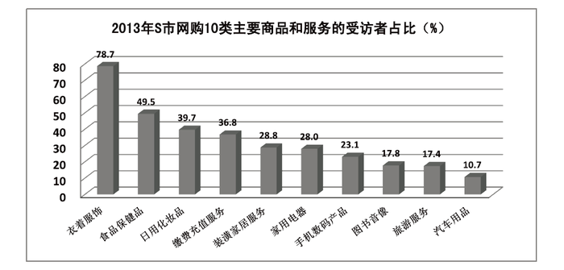

### 第 81 题

2013年，在该市有超过40％的受访者网购的商品和服务项目是：

A. 衣着服饰、食品保健品

B. 食品保健品、汽车用品

C. 衣着服饰、缴费充值服务

D. 日用化妆品、装潢家居服务

第 81 题 · 答案与解析

**参考答案（粉笔题库参考内容）**

A

**解析**

由图可知，各选项的受访者占比分别为：

A：衣着服饰78.7％，食品保健品49.5％，正确。

B：食品保健品49.5％，汽车用品10.7％，错误。

C：衣着服饰78.7％，缴费充值服务36.8％，错误。

D：日用化妆品39.7％，装潢家居服务28.8％，错误。

故正确答案为A。

**来源**：2015年江苏省公务员录用考试《行测》题（A类）第81题

### 第 82 题

受访者中女性所占的比例约为：

A. 71.2％

B. 65.7％

C. 55.3％

D. 44.7％

第 82 题 · 答案与解析

**参考答案（粉笔题库参考内容）**

C

**解析**

根据材料中信息“受访者2013年人均网购次数为19.4次”“女性受访者人均网购次数为21.1次，比男性受访者高出3.8次”，得到男性受访者的人均网购次数为21.1-3.8=17.3次；

由于人均网购次数是由女性受访者人均网购次数与男性受访者人均网购次数混合而成，利用混合平均数的思想与线段法，男性受访者17.3距离19.4是2.1，女性受访者21.1距离19.4是1.7，距离比是人数的反比，所以女性受访者所占比是2.1/(2.1+1.7)≈55.3%。

故正确答案为C。

**来源**：2015年江苏省公务员录用考试《行测》题（A类）第82题

### 第 83 题

下列群体中，2013年人均网购次数最多的是：

A. 35岁以下的受访者

B. 个人月收入为10000元以上的受访者

C. 大专学历的受访者

D. 大学本科及以上学历的受访者

第 83 题 · 答案与解析

**参考答案（粉笔题库参考内容）**

B

**解析**

由材料第二段可知，四个选项对应的群体中，2013年人均网购次数分别为:

A项：35岁以下的受访者为25.5次。

B项：个人月收入为10000元以上的受访者为31.0次。

C项：大专学历的受访者为21.8次。

D项：大学本科及以上学历的受访者为27.3次。

因此，网购次数最多的是个人月收入为10000元以上的受访者。

故正确答案为B。

**来源**：2015年江苏省公务员录用考试《行测》题（A类）第83题

### 第 84 题

受访者中，在2013年网购了缴费充值服务的人数为网购图书音像人数的：

A. 1.6倍

B. 2.1倍

C. 2.5倍

D. 3.0倍

第 84 题 · 答案与解析

**参考答案（粉笔题库参考内容）**

B

**解析**

由图可知，2013年网购缴费充值服务的受访者占比为36.8％，网购图书音像的受访者占比为17.8％，所以，网购缴费充值服务的人数为网购图书音像人数的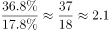倍。

故正确答案为B。

**来源**：2015年江苏省公务员录用考试《行测》题（A类）第84题

### 第 85 题

不能从上述资料推出的一项是：

A. 受访者中在2013年网购了日用化妆品的人数是1191人

B. 2013年该市个人月收入为5000—10000元的受访者人均网购次数是26.0次

C. 2013年该市网购家用电器、图书音像的受访者占比之差是10.2％

D. 2013年该市大专及以上学历受访者的人均网购次数是24.6次

第 85 题 · 答案与解析

**参考答案（粉笔题库参考内容）**

D

**解析**

A项：由图可知，2013年网购了日用化妆品的受访者占比为39.7%，而受访者共3000名，故网购了日用化妆品的人数是3000×39.7%=3000×(40%-0.3%)=1200-9=1191人，正确；

B项：由材料第二段中“个人月收入为10000元以上和5000—10000元的受访者人均网购次数分别是31.0次和26.0次”可知，正确；

C项：由图可知，2013年网购家用电器、图书音像的受访者占比分别为28.0％和17.8％，两者相差28.0％-17.8％＝10.2％，正确；

D项：由材料第二段“文化程度为大学本科及以上学历和大专学历的受访者人均网购次数分别是27.3次和21.8次”可知，在不知道各学历受访者人数的情况下，不能将二者的平均数当成是大专及以上学历受访者的人均网购次数，错误。

本题为选非题，故正确答案为D。

**来源**：2015年江苏省公务员录用考试《行测》题（A类）第85题

## 材料 4

2014年全国居民人均可支配收入20167元，比上年增长10.1％，收入来源如下图所示。按常住地分，城镇居民人均可支配收入28844元，比上年增长9.0％；城镇居民按户人均可支配收入的中位数为26635元，增长10.3％。农村居民人均可支配收入10489元，比上年增长11.2％，农村居民按户人均可支配收入的中位数为9497元，增长12.7％。全国居民人均消费支出14491元，比上年增长9.6％。按常住地分，城镇居民人均消费支出19968元，增长8.0％；农村居民人均消费支出8383元，增长12.0％。

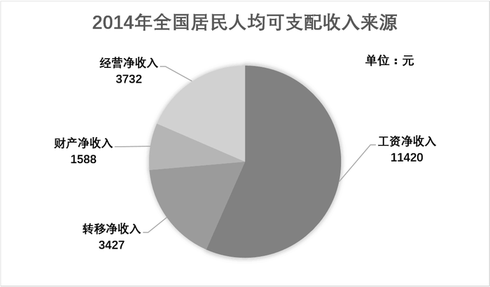

### 第 86 题

2014年城镇居民人均消费支出增长比农村居民人均消费支出增长：

A. 低2.2个百分点

B. 高4.0个百分点

C. 高2.2个百分点

D. 低4.0个百分点

第 86 题 · 答案与解析

**参考答案（粉笔题库参考内容）**

D

**解析**

从材料的最后一句得，“城镇居民人均消费支出19968元，增长8.0％；农村居民人均消费支出8383元，增长12.0％”，则2014年，城镇居民人均消费支出增长比农村居民人均消费支出增长低12.0-8.0=4.0个百分点。

故正确答案为D。

**来源**：2015年江苏省公务员录用考试《行测》题（B类）第81题

### 第 87 题

2014年全国居民人均可支配收入中，经营净收入占比为：

A. 27.0％

B. 18.5％

C. 56.6％

D. 7.9％

第 87 题 · 答案与解析

**参考答案（粉笔题库参考内容）**

B

**解析**

由材料的第一句可知2014年全国居民人均可支配收入为20167元，由图可得经营净收入为3732元，则全国居民人均可支配收入中，经营净收入占比为3732/20167，由于四个选项首位不同，差距较大，分母取前两位计算，首位商1。

故正确答案为B。

**来源**：2015年江苏省公务员录用考试《行测》题（B类）第82题

### 第 88 题

2013年城镇居民人均可支配收入比农村居民人均可支配收入多（    ）元。

A. 17030

B. 18355

C. 16138

D. 22090

第 88 题 · 答案与解析

**参考答案（粉笔题库参考内容）**

A

**解析**

问题时间为2013年，与材料时间2014年相比，是基期。求“······比······多（    ）元”是两个基期量的差值，所以属于基期和差问题。由材料可知“2014年城镇居民人均可支配收入28844元，比上年增长9.0％；农村居民人均可支配收入10489元，比上年增长11.2％”，则2013年城镇居民人均可支配收入比农村居民人均可支配收入多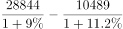=17000元。A项最接近。

故正确答案为A。

**来源**：2015年江苏省公务员录用考试《行测》题（B类）第83题

### 第 89 题

2013年全国居民人均可支配收入与人均消费支出分别为：

A. 22177元、17222元

B. 18317元、13222元

C. 16367元、11491元

D. 20167元、14491元

第 89 题 · 答案与解析

**参考答案（粉笔题库参考内容）**

B

**解析**

由材料中“2014年全国居民人均可支配收入20167元，比上年增长10.1％；全国居民人均消费支出14491元，比上年增长9.6％”。可以得出2013年的全国居民人均可支配收入与人均消费支出一定会比2014年的少，由此排除A、D两项。

2013年全国居民人均可支配收入为，利用直除法可得商的前两位为18，锁定B项。

此外，可以利用代入法，基期+基期×10%=20167，只有B项满足。

故正确答案为B。

**来源**：2015年江苏省公务员录用考试《行测》题（B类）第84题

### 第 90 题

2014年全国城镇居民人数占全国居民人数的比重是：

A. 36.4％

B. 42.1％

C. 52.7％

D. 69.9％

第 90 题 · 答案与解析

**参考答案（粉笔题库参考内容）**

C

**解析**

材料中给出“全国居民人均消费支出14491元，比上年增长9.6％。按常住地分，城镇居民人均消费支出19968元，增长8.0％；农村居民人均消费支出8383元，增长12.0％”，可利用线段法：

城镇与全国相距19968-14491=5477，农村与全国相距14491-8383=6108，根据距离比是人数的反比，则全国城镇居民人数占全国居民人数的比重是

，

各选项差距比较大，分母取前两位，首位商5，锁定C项。

故正确答案为C。

**来源**：2015年江苏省公务员录用考试《行测》题（B类）第85题

## 材料 5

2014年1—9月我国入境外国人共有1922万人，其中来自亚洲、美洲、欧洲、大洋洲、非洲的外国人分别为1184万人、229万人、408万人、58万人和43万人。分不同目的的入境外国人数见下表。

### 第 91 题

2014年1—9月来自欧洲的入境外国人数占外国人总数的比重是：

A. 11.9％

B. 21.2％

C. 28.1％

D. 30.2％

第 91 题 · 答案与解析

**参考答案（粉笔题库参考内容）**

B

**解析**

由材料可知2014年1—9月，我国入境外国人共有1922万人，其中来自欧洲的外国人为408万人，则2014年1—9月来自欧洲的入境外国人数占外国人总数的比重是。

故正确答案为B。

**来源**：2015年江苏省公务员录用考试《行测》题（C类）第81题

### 第 92 题

2014年1—9月不同目的入境外国人中人数最多的是：

A. 观光休闲

B. 会议（商务）

C. 探亲访友

D. 其他

第 92 题 · 答案与解析

**参考答案（粉笔题库参考内容）**

A

**解析**

观察表格，2014年1-9月不同目的的入境外国人数是将表中各列进行求和。

进行比较可知，来自亚洲的观光休闲（388万）和其他（389万）的人数是最多的，还有来自欧洲的观光休闲（147万）比其他（99万）多了接近50万，那么可以锁定，不同目的入境外国人中人数最多的是观光休闲。

故正确答案为A。

**来源**：2015年江苏省公务员录用考试《行测》题（C类）第82题

### 第 93 题

2014年1-9月以会议（商务）为目的的入境外国人数为：

A. 243万

B. 590万

C. 394万

D. 651万

第 93 题 · 答案与解析

**参考答案（粉笔题库参考内容）**

C

**解析**

从表中可得，2014年1-9月以会议（商务）为目的的入境外国人数为219+41+109+10+15＝394万。且选项尾数不同，所以可以采用尾数法。

故正确答案为C。

**来源**：2015年江苏省公务员录用考试《行测》题（C类）第83题

### 第 94 题

2014年1—9月来自大洋洲以不同目的入境的人数占其入境总人数的比重超过15%的有：

A. 会议（商务）、探亲访友、服务员工

B. 观光休闲、探亲访友、其他

C. 会议（商务）、观光休闲、其他

D. 观光休闲、探亲访友、服务员工

第 94 题 · 答案与解析

**参考答案（粉笔题库参考内容）**

C

**解析**

将来自大洋洲各不同目的入境的人数除以大洋洲入境总人数，算出超过15%即可。此外，观察四个选项，均是三种目的的入境人数，其比重超过15%，那么排名前三的必定都是超过15%的。所以，可以根据大洋洲以不同目的入境的人数，从大到小取前三位，分别是观光休闲（20）、其他（19）、会议（10）。

故正确答案为C。

**来源**：2015年江苏省公务员录用考试《行测》题（C类）第84题

### 第 95 题

下列判断正确的是：

A. 2014年1—9月来自亚洲以会议（商务）为目的入境人数不到表中其他各洲以会议（商务）为目的入境总人数的一半

B. 2014年1—9月来自表中各洲探亲访友的人数占各洲入境总人数的比重均最小

C. 2014年1—9月来自美洲服务员工的人数不到其会议（商务）人数的三分之一

D. 2014年1—9月来自表中各洲会议（商务）人数占各洲入境总人数的比重最大的是非洲

第 95 题 · 答案与解析

**参考答案（粉笔题库参考内容）**

D

**解析**

A项：来自亚洲以会议（商务）为目的的入境人数为219万，而其他各州以会议（商务）为目的的入境的总人数不足200万，所以亚洲的人数大于其他各州以会议（商务）为目的的人数，错误。

B项：来自大洋洲的服务员工所占大洋洲入境总人数的比重是最小的，所以各洲探亲访友的人数占各洲入境总人数的比重并非所有都最小，错误。

C项：来自美洲服务员工的人数为14万人，而会议（商务）人数为41万人，14超过41的三分之一，错误；

D项：来自会议（商务）的非洲人数是15万人，是非洲入境人数中最大的，而其他各洲来自会议（商务）的人数均不是其最大的，所以来自非洲以会议（商务）为目的的比重最大，正确。

故正确答案为D。

**来源**：2015年江苏省公务员录用考试《行测》题（C类）第85题

## 材料 6

某市统计局在针对噪音扰民的一次调查中，当问及受访市民对哪一类噪音反感时，选择社区广场舞活动噪音的占8.6%，比选择居民社区宠物狗叫声的低2.9个百分点。当问及是否支持广场舞活动时，12.8%的受访市民表示无所谓或者不知道，12.0%的受访者回答表示反对，其他为支持者。在支持的市民中，当被问及支持的主要原因（多选）时，不同年龄段受访者的回答如下图所示。

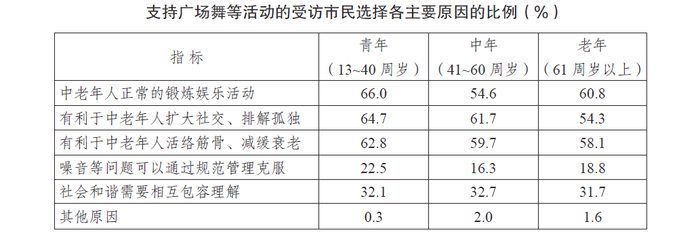

       在反对的市民中，被问及反对的主要原因（多选）时，不同区域受访者回答如下。

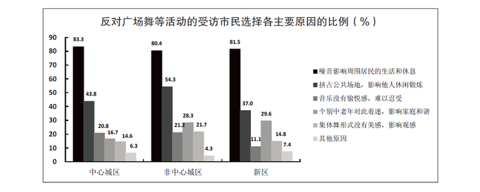

### 第 96 题

此次调查中，对居民社区宠物狗叫声反感的市民占受访市民的比重是：

A. 12\. 5％

B. 11\. 5％

C. 10\. 5％

D. 9\. 5％

第 96 题 · 答案与解析

**参考答案（粉笔题库参考内容）**

B

**解析**

从材料的第一句“当问及受访市民对哪一类噪音反感时，选择社区广场舞活动噪音的占8.6％，比选择居民社区宠物狗叫声的低2.9个百分点”，可得，对居民社区宠物的叫声反感的市民占受访市民的比重为8.6％+2.9％＝11.5％。

故正确答案为B。

**来源**：2015年江苏省公务员录用考试《行测》题（C类）第91题

### 第 97 题

如果此次调查的受访者数量为1000名，则支持广场舞等活动的人数为：

A. 634

B. 752

C. 798

D. 914

第 97 题 · 答案与解析

**参考答案（粉笔题库参考内容）**

B

**解析**

从材料的第二句“当问及是否支持广场舞活动时，12.8％的受访市民表示无所谓或者不知道，12.0％的受访者回答表示反对，其他为支持者”，则支持者所占的比重为1-12.8％-12.0％=75.2%，所以支持广场舞等活动的人数为1000×75.2%=752名。

故正确答案为B。

**来源**：2015年江苏省公务员录用考试《行测》题（C类）第92题

### 第 98 题

此次调查中，在支持广场舞等活动的受访青年市民中，同时选择“中老年人正常的锻炼娱乐活动”和“有利于中老年人扩大社交、排解孤独”的至少有：

A. 64\. 7％

B. 35\. 3％

C. 30\. 7％

D. 28\. 6％

第 98 题 · 答案与解析

**参考答案（粉笔题库参考内容）**

C

**解析**

从表格中可得，青年选择“中老年人正常的锻炼娱乐活动”的比例是66%，选择“有利于中老年人扩大社交、排解孤独”的比例是64.7%。所问的是“同时选择······至少”，那么就让两者重合的尽可能的少。利用两容斥公式：A∩B=A+B-A∪B，则同时选择“中老年人正常的锻炼娱乐活动”和“有利于中老年人扩大社交、排解孤独”的至少有66％+64.7％-100％＝30.7％。

故正确答案为C。

**来源**：2015年江苏省公务员录用考试《行测》题（C类）第93题

### 第 99 题

根据此次调查，市民反对广场舞等活动的主要原因是：

A. 噪音影响周围市民的生活和休息

B. 挤占公共场地，影响他人休闲锻炼

C. 音乐没有愉悦感，难以忍受

D. 集体舞形式没有美感，影响观感

第 99 题 · 答案与解析

**参考答案（粉笔题库参考内容）**

A

**解析**

从第二个表格可得，每个区域的市民反对广场舞的原因中“噪音影响周围市民的生活和休息”都占了80%以上，也比另外的原因所占比例多，所以市民反对广场舞等活动的主要原因是噪音影响周围市民的生活和休息。

故正确答案为A。

**来源**：2015年江苏省公务员录用考试《行测》题（C类）第94题

### 第 100 题

下列判断正确的是：

A. 此次调查中的16.3％的中年受访者认为广场舞等活动可以通过规范管理克服

B. 此次调查的受访者中，青年所占比例高于中年和老年

C. 和中心城区的老年人相比，非中心城区的中年人对广场舞更着迷

D. 在反对广场舞等活动的非中心城区受访者中，选择“音乐没有愉悦感，难以忍受”的比例高于其他区域

第 100 题 · 答案与解析

**参考答案（粉笔题库参考内容）**

D

**解析**

A项：支持广场舞等活动的受访市民中，有16.3％的中年受访者认为广场舞等活动可以通过规范管理克服，而不是调查中的16.3%的中年受访者，错误；

B项：表格中由于涉及到多选，无法得知青年、中年、老年所占比例（例如原因是中老年人的正常锻炼娱乐活动的青年可以是33人，青年总数是50人，中年人支持该原因的有54.6人，中年总数是100人），所以不能说青年所占的比例高，况且数据也只有支持受访者对应数据，更不能得出此次调查所有受访者中青年所占比例与中年和老年关系，错误；

C项：在表格中，无法得出非中心城区的中年人比中心城区的老年人对广场舞更着迷，错误；

D项：从图中可知，在反对广场舞等活动的非中心城区受访者中选择“音乐没有愉悦感，难以忍受”的比例为21.2％，中心城区比例是20.8%，新区比例是11.1%，故非中心城区受访者的比例选择“音乐没有愉悦感”的比例高于其他区域，正确。

故正确答案为D。

**来源**：2015年江苏省公务员录用考试《行测》题（C类）第95题

