# 2015年江苏省公务员录用考试《行测》题（B类）

<!-- gwy:overview:start -->
> **江苏 · 2015 · 行测 · B类** ｜ 100 题 · 图片 99 处 · 答案随题折叠

| 题型模块 | 题量 | 题号 |
| --- | ---: | ---: |
| 言语理解与表达 | 25 | 1–25 |
| 数量关系 | 15 | 26–40 |
| 判断推理 | 40 | 41–80 |
| 资料分析 | 20 | 81–100 |
| **合计** | **100** | |

导航：[题型与作答说明](#题型与作答说明) · [题目](#题目) · [材料 1](#材料-1)
<!-- gwy:overview:end -->

> 候选采集稿。参考答案及解析来自粉笔页面，不代表官方答案或真实高分答卷；来源使用许可与原卷对应关系仍需人工核实。

## 题型与作答说明

言语理解与表达

（25题）

本部分包括片段阅读、文章阅读与选词填空三种类型的试题。

数量关系

（15题）

本部分包括数字推理与数学运算两种类型的试题。

判断推理

（40题）

本部分包括类比推理、图形推理、逻辑判断与定义判断四种类型的试题。

资料分析

（20题）

下列给出的文字、表格、图形资料均有5个问题要你回答，你应根据资料提供的信息进行分析、计算、处理，然后从备选答案中选择一个最恰当的答案。

## 题目

### 第 1 题

法治的规范性与权威性，可以有效规范与约束政府行为，防止出现违法行使权力、以言代法、以权压法、徇私枉法，使全社会养成遵纪守法的良好社会风气，维护市场秩序与社会秩序。法治保护权利与自由的基本价值，与市场经济自由交换的内在要求高度契合，两者相互促进。法治不但可以弥补市场失灵的缺陷，也可以为市场经济的发展起到规范、保障、引领、推动等不同作用。

这段文字主要讨论的是（    ）。

A. 建立法治规范和权威的重要性

B. 市场经济可以强化法治的权威

C. 如何有效规范与约束政府行为

D. 法治建设有利于经济社会发展

第 1 题 · 答案与解析

**参考答案（粉笔题库参考内容）**

D

**解析**

文段开篇引出话题，指出因规范性和权威性，法治可以有效规范政府行为，使得全社会养成良好风气，维护市场秩序和社会秩序。接下来指出法治与市场经济互相促进。最后通过“不但······也”指出法治对市场经济的发展起到了诸多作用。文段为并列结构，主要围绕“法治”与“市场经济”两个话题展开，从不同方面强调法治对经济社会的促进作用，对应D项。

A项，“法治规范性和权威性”对应文段开头，非重点，排除；

B项，文段强调的是“法治”对“市场经济”的作用，偷换逻辑，排除；

C项，偏离“法治”和“市场经济”两个核心话题，排除。

故正确答案为D。

【文段出处】《张占斌：完善社会主义市场经济还是法治靠得住》

**考点**：关联词-并列

**来源**：2015年江苏省公务员录用考试《行测》题（B类）第1题

### 第 2 题

民以食为天，人多地少是不少国家面临的共同问题。在全球化时代，国际粮价的波动往往对国内粮食生产影响巨大。据介绍，日本已在海外开发农田1200万公顷，相当于其国内耕地面积的3倍；韩国在海外购买和租赁农田243万公顷，相当于其国内耕地面积的1.3倍，日韩农业“走出去”，借助多元化的规模经营，获得了强大的国际竞争力，对保证其粮食安全起到了积极作用。

这段文字讨论的重点是：

A. 日本韩国本世纪的耕地面积规模

B. 日韩“走出去”的海外屯田战略

C. 人多地少粮价波动是世界性问题

D. 国际粮价与国内粮食生产的联动

第 2 题 · 答案与解析

**参考答案（粉笔题库参考内容）**

B

**解析**

文段首先指出“人多地少”以及“国际粮价波动”是许多国家面临的共性难题，继而介绍日本、韩国采取海外屯田缓解粮食安全问题的对策，从而提升粮食安全保障能力。故文段重点强调日韩应对粮食安全挑战所采取的海外屯田战略，对应B项。

A项，“耕地面积规模”仅能对应文段的一部分，表述片面且非重点，文段重在强调日韩应对粮食安全挑战所采取的海外屯田战略，排除；

C、D两项，均对应文段提出问题的部分，非重点，排除。

故正确答案为B。

**考点**：关联词-对策

**来源**：2015年江苏省公务员录用考试《行测》题（C类）第3题

### 第 3 题

如果告诉你，你日常喝的水也许比太阳还要古老，恐怕除了惊讶之外，都有点喝不下去了。话说回来，科学家花费大量精力来论证地球上的水可能是太阳系的长辈，无疑具有极大的科学价值。众所周知，水是生命之源，这一发现意味着宇宙中，或许有类似地球生命的存在。不过对于普通老百姓而言，在水资源日益匮乏的当下，知道地球上水的年龄远不如如何治理地球上被污染的水域来得迫切。

下列说法与文意不符的一项是（    ）。

A. 地球上大部分水源地已经受到严重污染

B. 宇宙中可能存在类似人类的智慧生命体

C. 水污染的治理是老百姓迫切关心的问题

D. 地球上水的年龄远远超出我们的想象力

第 3 题 · 答案与解析

**参考答案（粉笔题库参考内容）**

A

**解析**

A项，文段并未提及大部分水源地已经受到严重污染，无中生有，当选；

B项，根据“这一发现意味着宇宙中，或许有类似地球生命的存在”可知，该项表述正确，排除；

C项，根据“不过对于普通老百姓而言，在水资源日益匮乏的当下，知道地球上水的年龄远不如如何治理地球上被污染的水域来得迫切”可知，该项表述正确，排除；

D项，根据“如果告诉你，你日常喝的水也许比太阳还要古老，恐怕除了惊讶之外，都有点喝不下去了。话说回来，科学家花费大量精力来论证地球上的水可能是太阳系的长辈”可知，该项表述正确，排除。

本题为选非题，故正确答案为A。

**考点**：细节判断题

**来源**：2015年江苏省公务员录用考试《行测》题（B类）第3题

### 第 4 题

儒学的存在不等于儒家哲学家或儒家哲学体系的存在，不能认为有了儒家哲学家才有儒学，<u>这</u>是一种片面的看法。儒学在最基础的层面上，不仅仅是经典的解说，同时也是中国人的文化心理结构。

文中画横线处的“这”指的是（    ）。

A. 儒学是儒家哲学家的经典解说

B. 儒学是中国人的文化心理结构

C. 有儒家哲学家才有儒学的存在

D. 儒学和儒家哲学体系是两回事

第 4 题 · 答案与解析

**参考答案（粉笔题库参考内容）**

C

**解析**

文段中的“这”位于第一句句末，根据文意，“这”显然指代的是前一个分句中“有了儒家哲学家才有儒学”，即是文中说到的片面的看法。

故正确答案为C。

**考点**：代词

**来源**：2015年江苏省公务员录用考试《行测》题（B类）第4题

### 第 5 题

睡眠有个神奇的特点，就是我们大多数人总是在每天晚上相同的时间感受到睡魔的召唤。之所以如此，是因为睡眠的启动部分依赖于大脑内的一个“时钟”，这个“时钟”能够追踪记录地球的昼夜更替，以及季节性节律，而这个星球上的其他生物，从细菌和植物，到鱼类、昆虫和哺乳动物，都具有这样的能力，“生物钟”在自然界无处不在。

根据文意，下列现象与“生物钟”无关的是：

A. 腊梅花香寒冬来到

B. 公鸡每天清晨打鸣

C. 旅美归来要“倒时差”

D. 夏季来临昼长夜短

第 5 题 · 答案与解析

**参考答案（粉笔题库参考内容）**

D

**解析**

根据文段，人类和“这个星球上的其他生物，从细菌和植物，到鱼类、昆虫和哺乳动物，都具有这样的能力”，即是体内都有一个生物钟。A项腊梅、B项公鸡、C项旅美归来的人都属于上述提到的生物范畴，都与“生物钟”有关，而D项只是地球转动导致的自然规律，与“生物钟”无关。

本题为选非题，故正确答案为D。

**考点**：细节判断题

**来源**：2015年江苏省公务员录用考试《行测》题（C类）第2题

### 第 6 题

针对各种社会事件或现象，常常都可以有也会有许多而不是单一的规则。但对某一具体事件、情境，究竟适用哪一规则才合情合理，并非也不可能由规则自身明确规定，这需要适用者本人通过对事件、情境的了解，对适用不同规则可能引发的不同后果来预测和判断。

对文意概括最恰当的一项是（    ）。

A. 运用相同规则也会引起不同后果

B. 规则掌握在不同人手中后果不同

C. 规则的运用必须考虑情境与后果

D. 不同的事件需要适用不同的规则

第 6 题 · 答案与解析

**参考答案（粉笔题库参考内容）**

C

**解析**

由于转折之后论述的内容更重要，故文段的重点在第二句“但”后，第二句重点论述了应当根据事件情境和可能引发的后果选择不同的规则，显然此对策才是文段的中心，C项为同义替换。A、B两项侧重于讨论运用规则后的后果，与文段要强调的如何运用规则，即提出对策的意思不符，排除；D项为转折前的次要信息，排除。

故正确答案为C。

**考点**：关联词-对策

**来源**：2015年江苏省公务员录用考试《行测》题（B类）第6题

### 第 7 题

在现代社会中，虽然以有经济保障和物质享受为前提的婚姻数量迅速减少，但是“金钱决定一切”、“拜金论”仍然在一些人心中根深蒂固。在恋爱婚姻自由的现代社会里，依然存在家长极力干涉子女婚姻的情形，家庭背景、教育背景和工作条件仍然是主要的参考因素。我们不禁思考：金钱能决定一切吗？当然不是。

通过这段文字最有可能作出的结论是：

A. 纯粹建立在美貌和激情基础上的婚姻将会是失败和不幸的婚姻

B. 婚姻中感情是最重要的因素，经济保障和物质享受均无需考虑

C. 现代社会中女性需要通过婚姻中的财富和地位提高自身的身份

D. 为了美好的婚姻，我们要有正确的婚姻观和对待婚姻的态度

第 7 题 · 答案与解析

**参考答案（粉笔题库参考内容）**

D

**解析**

本题考查接语衔接，重点关注文段的最后一句。前文介绍了现代社会中“金钱决定一切”“金钱决定婚姻”的大背景，尾句以设问句的形式出现，可知作者的观点是完全否定“金钱决定一切”，接下来最可能作出的结论应与此紧密衔接，D项符合作者态度，当选。

A项的“美貌与激情”为无中生有，排除；B项感情最重要，经济保障无需考虑的表述过于绝对，排除；C项重点仍在财富和地位，与文段矛盾，排除。

故正确答案为D。

**考点**：接语选择题

**来源**：2015年江苏省公务员录用考试《行测》题（B类）第7题

### 第 8 题

老师肩负着培养下一代的重要责任。正确的理想信念是教书育人、播种未来的指路明灯。不能想象一个没有正确理想信念的人能够成为好老师。唐代韩愈说：“师者，所以传道授业解惑也。”“传道”是第一位的。一个老师，如果只知道“授业”、“解惑”而不“传道”，不能说这个老师是完全称职的，充其量只能是“经师”、“句读之师”，而非“人师”了。古人云：“经师易求，人师难得。”一个优秀的老师，应该是“经师”和“人师”的统一，既要精于“授业”、“解惑”，更要以“传道”为责任和使命。好老师心中要有国家和民族，要明确意识到肩负的国家使命和社会责任。

这段文字的主旨是（    ）。

A. 做好老师，要有理想信念

B. 做好老师，要有道德情操

C. 做好老师，要有扎实学识

D. 做好老师，要有引路意识

第 8 题 · 答案与解析

**参考答案（粉笔题库参考内容）**

A

**解析**

文段首先指出老师的重要作用，接着通过正反两种表达方式点明正确的理想信念是当好老师的指路明灯，后文通过引用古人名言进行论证，末句再次强调好老师应当“明确意识到肩负的国家使命和社会责任”，A项为同义替换。B项“道德情操”、C项“扎实学识”均为无中生有；D项的“有引路意识”是对文段“传道”一词的错误理解，不能等同于理想信念，排除。

故正确答案为A。

**考点**：分述句特征-多角度论述、分述句特征-引入铺垫

**来源**：2015年江苏省公务员录用考试《行测》题（B类）第8题

### 第 9 题

夏商及周早期，中国并无商税。这一时期，由于生产力低下，手工业和商业较为落后，且必须在官府作坊内从事生产和贸易，史称“工商食官”。这种体制决定自己对自己征税并无必要。目前也尚无史料记载这一时期曾开征商税。

夏商及周早期中国没有商税的主要原因在于：

A. 当时整个社会的生产力水平太低

B. 这个时期手工业和商业比较落后

C. 当时的统治者还没有征收商税的意识

D. 从事生产和贸易的作坊全都属于官府

第 9 题 · 答案与解析

**参考答案（粉笔题库参考内容）**

D

**解析**

根据文段“这种体制决定自己对自己征税并无必要”可知，“这种体制”指代“工商食官”，即手工业和商业必须在官府作坊内从事生产和贸易，D项为同义替换。

A、B两项与D项相比均不是主要原因，排除；C项，无中生有，排除。

故正确答案为D。

**考点**：细节判断题

**来源**：2015年江苏省公务员录用考试《行测》题（B类）第9题

### 第 10 题

①如果贾珠还在世，他是当然的嫡长子。

②贾宝玉不得不担负起继承贾府家族事业的责任，这是他绝对不愿意承担的责任。

③在一个家庭里，只有嫡长子才是合法的继承人。

④中国古代的宗法制度是“嫡长子制度”。

⑤在小说里，贾宝玉的恐惧与厌倦有着文化的、社会的根源。

⑥但是贾珠早早去世了，腾出位置给贾宝玉。

将以上6个句子重新排列，语序正确的是（    ）。

A. ④③①⑥⑤②

B. ⑤④③①⑥②

C. ②⑤④③①⑥

D. ②④③①⑥⑤

第 10 题 · 答案与解析

**参考答案（粉笔题库参考内容）**

B

**解析**

本题为排序题，首先观察选项，首句的选择有②、④、⑤，②句中提到“贾宝玉不得不……”，由“不得不”可知前文必然首先给出一定的条件铺垫，故②不能作首句，排除C、D。④句中的“嫡长子制度”是对于⑤句中“文化的、社会的根源”的具体解释，故⑤在④前，且①⑥句中的贾珠过世正是贾宝玉不得不担负起责任的前提，故②紧跟①⑥。

故正确答案为B。

**考点**：确定顺序、确定首句-非首句特征

**来源**：2015年江苏省公务员录用考试《行测》题（B类）第10题

## 材料 1

2014年3月，几内亚爆发了扎伊尔埃博拉病毒疫情，这种类型的埃博拉病毒具有高达60%-90%的致死率，因此成了全世界关注的焦点。

        埃博拉是一种神秘的病毒，这种病毒的长相令人生畏。典型的病毒呈现圆球形，而埃博拉病毒在电子显微镜下呈现出纤丝状，这些纤丝会出现弯曲或者缠绕的状态，仿佛蠕虫一般。

        埃博拉病毒首次爆发是在1976年的非洲。当时扎伊尔（现刚果民主共和国）和苏丹几乎同时爆发了一种神秘的传染病。发病之后，病情会在几天内迅速恶化，稍晚期一些的病人开始浑身出血，鼻子、牙床、眼结膜处会往外渗血，有些人表面看起来没有明显的出血，但内脏已经开始“溶解”，严重的出血会引起低血压和休克，等待他们的将是死亡。

        导致这种疾病的病原体很快就被确定了，这是一种新型病毒，研究者们用当地一条小河的名字将这种病毒命名为埃博拉。自从第一次爆发以来，科学家一共发现了五种不同类型的埃博拉病毒，并以首发地点进行了命名。这五种埃博拉病毒对人类的致病能力不甚相同，其中扎伊尔埃博拉病毒的致死率最高，可达60%-90%，而苏丹埃博拉病毒的致死率为50%左右，这两种埃博拉病毒也是历年爆发最为频繁的两种亚型。

        非洲是世界上面积第二的大洲，人口超过10亿。非洲的热带雨林里孕育着大量的生命，人类的祖先也是起源于这里。人类的近亲黑猩猩，今天仍旧居住在非洲的热带雨林中。由于遗传背景过于接近，灵长类动物身上保存的危险病原体很多都能够直接感染人类，它们因此成为了人类病原体巨大的自然储存库。

        埃博拉是一种神秘的病毒。科学家已在黑猩猩和猴子等灵长类动物以及蝙蝠体内发现了它们的踪迹，并大致上判断出蝙蝠是埃博拉病毒自然条件下的储存库。埃博拉病毒的传播方式也基本被厘清，它们一般是通过直接接触途径在动物间、动物与人类间或者人类间传播。埃博拉病毒的结构组成甚至基因组序列也已经在科学家的掌握之中。不过，这还是没有揭开这种病毒神秘的面纱。

        非洲居民有捕猎黑猩猩、猴子和蝙蝠等野生动物当食物的习俗，科学家估计，如HIV等一些威胁人类的病原体就是通过这个途径从野生动物跳到人类身上的。但是，捕猎每天都有，埃博拉病毒疫情却没有连续发生。1980年后，埃博拉病毒在非洲丛林沉寂了15年，一直没有向人类发起进攻。直到1995年扎伊尔型卷土而来，一下子在刚果民主共和国杀死了254个人。没有人知道为什么埃博拉病毒给了人类15年的“休战期”。

        埃博拉病毒是通过直接接触传播的，这种传播途径很容易阻断。远离传染源、戴上手套和穿上防护服，就能大大减少被传染的可能。但非洲当地的殡葬习俗，无意中成了埃博拉的帮凶。当地人去世后，遗体必须经过亲人处理后才能下葬。而在处理病亡者尸体的过程中，所有操作者不佩戴任何防护装备，这就可能造成病亡者亲友的大面积感染和死亡。

### 第 11 题

埃博拉病毒之所以“神秘”，主要因为（    ）。

A. 它的爆发尚无规律可循

B. 它的形状异于其他病毒

C. 它在动物与人类间传播

D. 它有高得惊人的致死率

第 11 题 · 答案与解析

**参考答案（粉笔题库参考内容）**

A

**解析**

由第七段“但是，捕猎每天都有······没有人知道为什么埃博拉病毒给了人类15年的‘休战期’”可知，埃博拉病毒的神秘来自于人类找不到其爆发的规律，即A项；B项，根据第二段可知，其形状是人类已经了解的内容，排除；根据第六段“它们一般是通过直接接触途径在动物间、动物—人类间或者人类间传播”可知，C项与“神秘”无关；根据第一段，埃博拉的高致死率是人类已知的内容，并非“神秘”所在，排除。

故正确答案为A。

**来源**：2015年江苏省公务员录用考试《行测》题（C类）第6题

### 第 12 题

人类发现埃博拉病毒距今（    ）。

A. 近二十年

B. 近三十年

C. 近四十年

D. 近五十年

第 12 题 · 答案与解析

**参考答案（粉笔题库参考内容）**

C

**解析**

根据第三段“埃博拉病毒首次爆发是在1976年的非洲”可知，埃博拉病毒在距今约40年前被首次发现。

故正确答案为C。

**来源**：2015年江苏省公务员录用考试《行测》题（C类）第7题

### 第 13 题

埃博拉病毒命名源自（    ）。

A. 防控疫情的代号

B. 扎伊尔名胜古迹

C. 非洲的神话传说

D. 发病地天然水道

第 13 题 · 答案与解析

**参考答案（粉笔题库参考内容）**

D

**解析**

根据第四段“研究者们用当地一条小河的名字将这种病毒命名为埃博拉”可知，埃博拉为河流名称。

故正确答案为D。

**来源**：2015年江苏省公务员录用考试《行测》题（C类）第8题

### 第 14 题

埃博拉屡次在非洲爆发的主要原因是（    ）。

A. 非洲人口众多且面积广袤

B. 非洲村民沿袭的生活习俗

C. 非洲有大面积的热带雨林

D. 非洲丰富的野生动物物种

第 14 题 · 答案与解析

**参考答案（粉笔题库参考内容）**

B

**解析**

根据第七段，“非洲居民有捕猎黑猩猩、猴子和蝙蝠等野生动物当食物的习俗”，以及第八段“非洲当地的殡葬习俗，无意中成了埃博拉的帮凶”，可知，以上两个非洲习俗，使埃博拉屡次在非洲爆发。

故正确答案为B。

**来源**：2015年江苏省公务员录用考试《行测》题（C类）第9题

### 第 15 题

文章带给读者的主要启示是（    ）。

A. 埃博拉自上世纪七十年代以来已数次在非洲暴发

B. 埃博拉主要是由非洲灵长类野生动物传给人类的

C. 埃博拉的致病机理已经被医务工作者所破解

D. 埃博拉病势凶险，但仍是可预防、可控制的疾病

第 15 题 · 答案与解析

**参考答案（粉笔题库参考内容）**

D

**解析**

文段首先介绍了埃博拉病毒的一些基本状况，如形态、发病病征、名称由来、致死率等，又探讨了埃博拉屡次侵扰非洲的原因，最后点出埃博拉的传染途径“很容易被阻断”，只要“远离传染源、戴上手套和穿上防护服，就能大大减少被传染的可能”。故作者意在向读者启示埃博拉病毒虽然可怕，但是可以通过一些途径避免传染，D项为同义替换。而A、B、C三项均为文段部分内容的表述，并非文段重点，排除。

故正确答案为D。

**来源**：2015年江苏省公务员录用考试《行测》题（C类）第10题

### 第 16 题

加大简政放权、放管结合改革力度。今年再取消和＿＿＿＿一批行政审批事项，全部取消非行政许可审批，建立＿＿＿＿行政审批的管理制度。

依次填入画横线处最恰当的一项是（    ）。

A. 下发 规制

B. 下放 规范

C. 下行 规定

D. 下调 规避

第 16 题 · 答案与解析

**参考答案（粉笔题库参考内容）**

B

**解析**

第一空，“下发”指发放一些物资，不符合文意；“下行”指的是文字书写形式或公文由上级下发到下级的过程，不符合文意；“下调”指的是向低调整，可与电价、利率等搭配，不符合文意，故排除A、C、D三项。第二空，“规范”指按照既定标准、规范的要求进行操作，与“行政审批”搭配，更符合文意，对应B项。

故正确答案为B。

**考点**：实词填空、词的辨析-搭配对象

**来源**：2015年江苏省公务员录用考试《行测》题（B类）第16题

### 第 17 题

党员干部要始终严于律己，做到慎独、慎微、慎交友，才能经受住各种\_\_\_\_\_\_与考验；清廉、清明、清正，既是对领导干部自律的要求，也是他律的\_\_\_\_\_\_方向。

依次填入画横线处最恰当的一项是（    ）。

A. 诱惑 着力

B. 挫折 着手

C. 奉承 着眼

D. 攻讦 着意

第 17 题 · 答案与解析

**参考答案（粉笔题库参考内容）**

A

**解析**

第一空，根据文意，应填入和考验意思相近的词，“攻讦”指的是揭发、攻击别人的隐私﹑缺点，不符合文意，排除D项。

第二空，“着手”指开始做，显然不符合文意，排除B项；“着眼”一般表述为着眼点、着眼于······，不符合文意，排除C项；“着力”意为努力、尽力，填入文段表明了他律侧重的方向，语义通顺。

故正确答案为A。

**考点**：关联关系-并列关系、实词填空、词的辨析-词义侧重

**来源**：2015年江苏省公务员录用考试《行测》题（B类）第17题

### 第 18 题

农业转型过程中，市场发挥决定性作用，切忌＿＿＿＿＿＿、揠苗助长，以行政力量＿＿＿＿甚至强推农业规模化。

依次填入横线处最恰当的一项是：

A. 李代桃僵 指导

B. 大包大揽 引导

C. 越俎代庖 主导

D. 鞭打快牛 倡导

第 18 题 · 答案与解析

**参考答案（粉笔题库参考内容）**

C

**解析**

第一空，根据文意可知填入的词应当表达行政力量对于农业转型不应过分的干预之意，“李代桃僵”指的是以此代彼或代人受过，“鞭打快牛”指越是走得快的牛，越是用鞭子打它，让它走得更快。比喻赏罚不明，奖懒罚勤。与枪打出头鸟相似，均不符合文意，排除A、D两项。

第二空，B项“引导”含褒义，不符合文段消极的感情色彩，排除，C项“主导”一词符合文意，且与后面的“强推”一词能构成递进关系。

故正确答案为C。

**考点**：对应关系-前后呼应、混搭填空、词的辨析-感情色彩、词的辨析-程度轻重

**来源**：2015年江苏省公务员录用考试《行测》题（C类）第19题

### 第 19 题

书店应当设法降低书价或改善服务，让读者\_\_\_\_\_\_地掏钱，而不是\_\_\_\_\_\_，指责消费者说，我们费了这么大心思，你怎么还是跑去网上买书，太不道德了!

依次填入画横线处最恰当的一项是（    ）。

A. 真心诚意 悲天悯人

B. 心悦诚服 自怨自艾

C. 心甘情愿 怨天尤人

D. 慷慨解囊 自说自话

第 19 题 · 答案与解析

**参考答案（粉笔题库参考内容）**

C

**解析**

第一空，“心悦诚服”指真心地服气或服从，而读者买书并不需要服从，“慷慨解囊”与后文的掏钱一词重复，排除B、D两项。第二空，由横线后的内容可知应填入和“指责”语义相近的词，“悲天悯人”指哀叹时世的艰难，怜惜人民的痛苦，显然不符合文意，排除A项。

故正确答案为C。

**考点**：关联关系-并列关系、成语填空

**来源**：2015年江苏省公务员录用考试《行测》题（C类）第16题

### 第 20 题

外交问题的最终决策不能过于追随网络民意。\_\_\_\_\_\_关注网上反映出来的“民意”，\_\_\_\_\_\_重视互联网反映不出来的“沉默的大多数”的“民意”，\_\_\_\_\_\_兼顾国内、国际局势，以外交大局为重。

依次填入画横线处最恰当的一项是（    ）。

A. 既要 也要 更要

B. 只要 就要 还要

C. 既要 还要 又要

D. 只要 只要 就要

第 20 题 · 答案与解析

**参考答案（粉笔题库参考内容）**

A

**解析**

第一空和第二空，根据横线前后可知，“关注网上反映出来的‘民意’”和“重视互联网反映不出来的‘沉默的大多数’的‘民意’”二者为并列关系，A项“既要······也要”、C项“既要······还要”均表示并列关系，保留；B项“只要······就要”表示条件关系，D项“只要”表示充分条件关系，二者均不符合逻辑关系，排除。

第三空，根据“兼顾国内、国际局势，以外交大局为重”可知，横线前后形成语义上的递进，程度加重。A项“更要”符合文意，当选；C项“又要”仅表示并列，无法体现出“以外交大局为重”这一最高层次的强调，排除。

故正确答案为A。

**来源**：2015年江苏省公务员录用考试《行测》题（B类）第20题

### 第 21 题

文风源于内心，你表面上可以做到不动声色，但作为情感的\_\_\_\_\_，文字通常会将你内心的感受直接表现出来，一个人的文风并不是\_\_\_\_\_\_的，它会随着人的年龄、心态、思想内涵及\_\_\_\_\_\_\_的变化而改变。

依次填入横线处最恰当的一项是：

A. 宣泄 一成不变 阅历

B. 抒发 一以贯之 经历

C. 爆发 一蹴而就 资历

D. 表露 持之以恒 历练

第 21 题 · 答案与解析

**参考答案（粉笔题库参考内容）**

A

**解析**

先看第二空，根据后文语义可知，本空填入的词要表达文风不会改变的意思，故排除强调轻而易举的“一蹴而就”和强调坚持的“持之以恒”，而“一以贯之”虽然强调的是不变，但意思为用一个根本性的事理贯通事情的始末或全部的道理，用来形容文风不恰当；故选A项；代入第一空，“宣泄”更能对应后文的“将你内心的感受直接表现出来”，“阅历”一词搭配也得体。

故正确答案为A。

**考点**：对应关系-前后呼应、混搭填空、词的辨析-搭配对象

**来源**：2015年江苏省公务员录用考试《行测》题（C类）第20题

### 第 22 题

作品通过引入时间\_\_\_\_\_\_，采用纵贯或历时分析法，对乡镇演变的各个子系统进行了全面的\_\_\_\_\_\_，为读者\_\_\_\_\_\_了一幅关于乡镇结构性变迁的立体画卷，具有厚重的历史质感和丰富的空间内涵。

依次填入画横线处最恰当的一项是（    ）。

A. 尺度 解析 绘制

B. 角度 分析 提供

C. 维度 剖析 展现

D. 梯度 论析 描摹

第 22 题 · 答案与解析

**参考答案（粉笔题库参考内容）**

C

**解析**

本题从第三空入手，所填词语搭配“立体画卷”，“展现”最为合适，即为呈现在大家眼前，A项，“绘制”多搭配平面的“画卷”，“展现”则更为立体全面，故相较“绘制”，C项“展现”更为恰当，排除。而B项“提供”鲜与画卷搭配，D项“描摹”是指画画的一种手法，文段描述的是一篇文章，不是真实的画卷。故选C项。

代入其他词验证，“时间维度”“全面的剖析”均为常见的固定搭配。

故正确答案为C。

**考点**：实词填空、词的辨析-搭配对象

**来源**：2015年江苏省公务员录用考试《行测》题（B类）第22题

### 第 23 题

法治意味着对合法权利的保护，对公平正义的\_\_\_\_\_\_，对可预期未来的\_\_\_\_\_\_。它不是一个宏大抽象的概念，而确确实实关乎每个人的\_\_\_\_\_\_。

A. 坚持 保卫 福音

B. 坚信 守望 福利

C. 坚守 庇佑 福祉

D. 坚称 维护 福分

第 23 题 · 答案与解析

**参考答案（粉笔题库参考内容）**

C

**解析**

第一空，搭配的主语为“法治”，宾语为“公平正义”，“法治”显然不能“坚称”、“坚信”“公平正义”，故排除B、D两项；

第三空，“福音”指有益于众人的好消息，“福祉”指幸福、利益，“法治”不是关乎每个人的“好消息”，而是关乎每个人的幸福，故排除A项。

C项代入第二空验证，语句通顺、符合逻辑。

故正确答案为C。

**考点**：实词填空、词的辨析-搭配对象、词的辨析-词义侧重

**来源**：2015年江苏省公务员录用考试《行测》题（B类）第23题

### 第 24 题

辞书是工具书，帮助人们对字词加以正确＿＿＿＿与运用，人们认为它有＿＿＿＿＿＿的作用。

依次填入横线处最恰当的一项是：

A. 理解 无师自通

B. 解释 有教无类

C. 解析 润物无声

D. 识别 不可或缺

第 24 题 · 答案与解析

**参考答案（粉笔题库参考内容）**

A

**解析**

先看第二空，“有教无类”指不管什么人都可以受到教育，是一种教育理念的体现，不能用来形容辞书的作用，排除B项；“润物无声”指有大胸怀者做了贡献而不张扬，默默奉献，显然和文意不符，排除C项；“不可或缺”指非常重要，无法替代或缺少的，稍微缺少一点点都不可以，用来形容辞书程度过重，排除D项；“无师自通”指没有经过老师或者其他人的传授和指点帮助就能理解、摸透或者通晓某种东西，与前文辞书帮助人们掌握字词可以对应，故A项当选。将“理解”代入第一空，语句通顺、符合文意。

故正确答案为A。

**考点**：对应关系-前后呼应、混搭填空、词的辨析-搭配对象

**来源**：2015年江苏省公务员录用考试《行测》题（B类）第24题

### 第 25 题

在微信朋友圈这个编织细密的关系网里，你是一个可以被\_\_\_\_\_\_\_却又无法逃脱的小红点，它以不断闪烁的方式，显示自己的存在。你是主动的，也是被动的，一旦创建微信号，就进入了这个令人\_\_\_\_\_\_\_的圈子。

依次填入画横线处最恰当的一项是（    ）。

A. 鄙视 亢奋

B. 忽视 纠结

C. 轻视 沮丧

D. 藐视 兴奋

第 25 题 · 答案与解析

**参考答案（粉笔题库参考内容）**

B

**解析**

第一空，“鄙视”和“藐视”都有看不起，瞧不起的意思，文段语境并没有表达瞧不起的意思，排除A、D两项。

第二空，根据前文“你是主动的，也是被动的”可知朋友圈给人的感觉并非仅仅令人“沮丧”，作者强调的是其两面性，故填入“纠结”最符合文意，对应B项。

故正确答案为B。

**考点**：实词填空、对应关系-前后呼应、词的辨析-程度轻重

**来源**：2015年江苏省公务员录用考试《行测》题（B类）第25题

### 第 26 题

1，7，17，31，49，（  ）。

A. 57

B. 67

C. 71

D. 73

第 26 题 · 答案与解析

**参考答案（粉笔题库参考内容）**

C

**解析**

数列起伏较小，优先考虑作差。作差后得到新数列为：6、10、14、18、（22），为公差是4的等差数列，则所求项应=22+49=71。

故正确答案为C。

**来源**：2015年江苏省公务员录用考试《行测》题（B类）第26题

### 第 27 题

，，，6，30，（  ）。

A. 90

B. 180

C. 150

D. 210

第 27 题 · 答案与解析

**参考答案（粉笔题库参考内容）**

B

**解析**

题干大部分为分数，转化为分母同为4的形式观察规律。转化后为：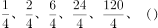。分母部分同为4；分子部分相邻两项存在明显的倍数关系，作商后为：2、3、4、5、（6），为连续自然数列。则所求项分子部分应为120×6=720。则原数列所求项应为：720÷4=180。

故正确答案为B。

**来源**：2015年江苏省公务员录用考试《行测》题（B类）第27题

### 第 28 题

21，30，40，53，71，（  ）。

A. 112

B. 113

C. 95

D. 96

第 28 题 · 答案与解析

**参考答案（粉笔题库参考内容）**

D

**解析**

数列起伏较小，优先考虑作差。作差后得到新数列：9、10、13、18、（），再次作差后：1、3、5、（7），为连续奇数列。故题干所求项应为：7+18+71=96。

故正确答案为D。

**来源**：2015年江苏省公务员录用考试《行测》题（B类）第28题

### 第 29 题

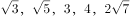，（  ）。

A. 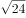

B. 5

C. 7

D. 

第 29 题 · 答案与解析

**参考答案（粉笔题库参考内容）**

C

**解析**

将题干统一转化为根号形式，则为，观察根号内数字的规律，在作差无规律的基础上，考虑相邻两项的递推关系。观察发现：3×2-1=5；5×2-1=9；9×2-2=16；16×2-4=28。所减项分别为1、1、2、4、（7），作差后得0、1、2、（3），为连续自然数列，故下一项应为4+3=7。故题干所求应为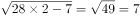。

故正确答案为C。

**来源**：2015年江苏省公务员录用考试《行测》题（B类）第29题

### 第 30 题

2.3，4.8，8.24，16.51，32.89，（    ）。

A. 64.138

B. 64.136

C. 128.138

D. 128.136

第 30 题 · 答案与解析

**参考答案（粉笔题库参考内容）**

A

**解析**

题干为小数数列，且整数部分存在明显的倍数关系，考虑机械划分。整数部分为公比是2的等比数列，则所求项整数部分为64，排除C、D两项；小数部分无规律，考虑作差，作差后得到新数列为：5、16、27、38、（49），为公差是11的等差数列，则所求项小数部分为49+89=138。

故正确答案为A。

**来源**：2015年江苏省公务员录用考试《行测》题（B类）第30题

### 第 31 题

某商品今年的成本比去年减少15％，由于售价不变，利润率比去年增加了24个百分点，则该商品去年的利润率为（  ）。

A. 24％

B. 30％

C. 36％

D. 42％

第 31 题 · 答案与解析

**参考答案（粉笔题库参考内容）**

C

**解析**

方法一：设去年成本为100，利润为x，那么今年成本为85，已知利润率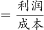，两年利润率比较差值为24个百分点，可得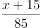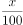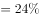，解得x=36。

方法二：因，故（x+15）应可被85除尽，则（x+15）一定为17的倍数。代入选项只有36满足。

故正确答案为C。

**考点**：经济利润问题

**来源**：2015年江苏省公务员录用考试《行测》题（B类）第31题

### 第 32 题

一列火车途经两个隧道和一座桥梁，第一个隧道长600米，火车通过用时18秒；第二个隧道长480米，火车通过用时15秒；桥梁长800米，火车通过时速度为原来的一半，则火车通过桥梁所需的时间为（  ）。

A. 20秒

B. 25秒

C. 40秒

D. 46秒

第 32 题 · 答案与解析

**参考答案（粉笔题库参考内容）**

D

**解析**

方法一：火车过桥问题公式为（车长+桥长）=速度×时间。假设火车车长为xm，原来的速度为vm/s，根据题意可列方程组600+x=18v,480+x=15v，解得x=120,v=40。火车过桥时速度为原来的一半，即为20m/s，则火车通过桥梁所需的时间为（800+120）÷20＝46s。

方法二：利用盈亏思想，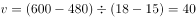m/s，那么车长=4018-600=120m，通过桥梁的时间为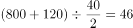s。

故正确答案为D。

**考点**：火车过桥

**来源**：2015年江苏省公务员录用考试《行测》题（B类）第32题

### 第 33 题

某单位扩建周长为44米的长方形草坪，计划扩建后的草坪仍为长方形，其长和宽分别比原来增加5米和3米，面积比原来增加95平方米，则扩建前草坪的面积为（  ）。

A. 85平方米

B. 105平方米

C. 117平方米

D. 121平方米

第 33 题 · 答案与解析

**参考答案（粉笔题库参考内容）**

B

**解析**

方法一：假设扩建前长方形的长为a，宽为b，可得a+b=22①。扩建后增加的面积=3a+5b+15=95，化简得3a+5b=80②，联立①和②，解得a=15，b=7，则扩建前面积为15×7=105平方米。

方法二：扩建后增加的面积=3a+5b+15=95，化简得3a+5b=80（a>b），已知80是5的倍数，5b也是5的倍数，那么3a一定为5的倍数，所以a必为5的倍数。代入方程，由于a＞b，只有三组解，a=25、b=1，面积=25； a=20、b=4，面积=80；a=15、b=7，面积=105。只有B项满足。

故正确答案为B。

**考点**：几何公式类-平面图形

**来源**：2015年江苏省公务员录用考试《行测》题（C类）第27题

### 第 34 题

瓶子原有浓度为15％的酒精溶液1000克，分别加入A、B两种酒精溶液100克和400克（假设溶液不会溢出），测得瓶子里的酒精浓度为14％，若A种酒精溶液的浓度是B种的2倍，则A种酒精溶液的浓度为（    ）。

A. 20％

B. 24％

C. 30％

D. 36％

第 34 题 · 答案与解析

**参考答案（粉笔题库参考内容）**

A

**解析**

方法一：设B种酒精溶液的浓度为x，则A种酒精溶液的浓度为2x，根据题意可列方程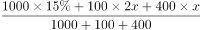\=14%,解得x=10%，那么A种酒精溶液的浓度为20%。

方法二：利用线段法：设A、B混合溶液的浓度为x。混合后溶液的浓度为14%写中间，混合前的溶液x、15%写两边，溶液的量与线段的距离成反比，溶液的量之比为1:2，那么距离之比为2:1，解得x=12，则B溶液浓度小于12%，那么A溶液一定小于24%。

故正确答案为A。

**来源**：2015年江苏省公务员录用考试《行测》题（B类）第34题

### 第 35 题

甲、乙、丙三位同学参加某单位的招聘面试，面试合格者可正式签约，甲只要面试合格就签约。乙、丙二人约定：只有两人面试都合格才一同签约，否则都不签约。若他们三人面试合格的概率都是，且面试是否合格互不影响，则他们三人都没有签约的概率为（  ）。

A. 

B. 

C. 

D. 

第 35 题 · 答案与解析

**参考答案（粉笔题库参考内容）**

B

**解析**

分析题意，乙、丙只要有一个不合格就不签约，那么求解三人都没有签约的概率分成两步算，先求甲不签约的概率，再求乙、丙同时不签约的概率。甲不签约的概率为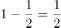，乙、丙同时不签约的概率为，所以P=甲不合格的概率×（乙或丙不合格的概率）=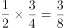。

故正确答案为B。

**考点**：给概率求概率

**来源**：2015年江苏省公务员录用考试《行测》题（C类）第34题

### 第 36 题

设a、b均为正整数，且有等式11a+7b＝132成立，则a的值为：

A. 6

B. 4

C. 3

D. 5

第 36 题 · 答案与解析

**参考答案（粉笔题库参考内容）**

D

**解析**

方法一：已知等式11a+7b=132，需求解a值，可以直接采用代入排除法来计算出a、b的数值。A、B、C三项代入式子中解得b均不为正整数，代入D项验证求得：b=11，a=5，符合题意。

方法二：a、b均为正整数，且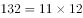，因为11a为11的倍数，那么7b必为11的倍数，则b=11。两边进行同时除以11，可得a+7=12，故a=5。

故正确答案为D。

**来源**：2015年江苏省公务员录用考试《行测》题（B类）第36题

### 第 37 题

某单位欲将甲、乙、丙、丁4名大学生分配到3个不同的岗位实习，若每个岗位至少分到1名大学生，且甲、乙两人被分在不同岗位，则不同的分配方法共有（  ）。

A. 30种

B. 36种

C. 60种

D. 72种

第 37 题 · 答案与解析

**参考答案（粉笔题库参考内容）**

A

**解析**

已知要将4人分到3个岗位，且每个岗位至少有一人，那么必定有两人会在一起实习，可以采用捆绑法将两人捆在一起，那么是将4人分配成三组，但是由于甲、乙两人不能在一起，那么共有种分配方式。再将分好的三组分配，分步用乘法，且三组排列方式任意，所以共有分配方法种。

故正确答案为A。

**考点**：基础排列组合

**来源**：2015年江苏省公务员录用考试《行测》题（C类）第29题

### 第 38 题

甲、乙两个工程队需要在规定的工期内完成某项工程。若甲、乙两队合作，则恰好能按期完成；若甲的效率提高1/3，乙的效率提高1/2，则用原定工期5/7即可完成；若乙的效率降低1/4，则需要推迟2天才能完成。那么，该工程原定的工期为（    ）。

A. 10天

B. 12天

C. 16天

D. 18天

第 38 题 · 答案与解析

**参考答案（粉笔题库参考内容）**

D

**解析**

设甲队原来的效率为3a，乙队原来的效率为4b，原定的工期为x天，则根据题意可得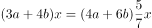，化简得a=2b，代入(3a+4b)x=(3a+3b)(x+2)，解得x=18。

方法二：假设甲乙原来的效率分别是a和b，已知提速前后时间比为7:5，那么效率比为5:7，a+b=5，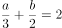可得a=3、b=2；减速前后效率之比=\=10:9，时间比9:10，差1份对应2天，则原来的时间9份对应18天。

故正确答案为D。

**考点**：给效率比例型

**来源**：2015年江苏省公务员录用考试《行测》题（B类）第38题

### 第 39 题

某年的3月有5个星期一和4个星期二，则该年的国庆节是（    ）。

A. 星期二

B. 星期三

C. 星期四

D. 星期五

第 39 题 · 答案与解析

**参考答案（粉笔题库参考内容）**

B

**解析**

一个月一定会有完整的4个星期。某年的3月有5个星期一和4个星期二，即剩余的三天里一定有周一且没有周二，那么3月的最后一天一定是多出来的第5个星期一。从4月1日到9月30日共有183天，183÷7＝26······1，则9月30日是星期二，所以这年的国庆节是星期三。

故正确答案为B。

**考点**：星期日期问题

**来源**：2015年江苏省公务员录用考试《行测》题（B类）第39题

### 第 40 题

如图，在△ABC中，已知BD＝2DC，EC＝2AE，则△BFD与△AEF面积的比值为（    ）。

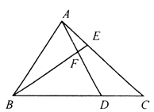

A. 4

B. 6

C. 8

D. 9

第 40 题 · 答案与解析

**参考答案（粉笔题库参考内容）**

C

**解析**

连接C、F两个点。已知BD＝2DC，EC＝2AE，假设S△CDF=a，S△AEF=b，则S△BFD=2a，S△CEF＝2b。结合图形可得3a+2b=S△BCE=S△ABC，a+3b=S△ACD=S△ABC，两式相除可解得a＝4b。所以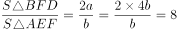。

故正确答案为C。

**考点**：几何其他题型

**来源**：2015年江苏省公务员录用考试《行测》题（C类）第35题

### 第 41 题

专家：官员

A. 菜农：农民

B. 朝阳：落日

C. 少年：歌手

D. 青山：绿水

第 41 题 · 答案与解析

**参考答案（粉笔题库参考内容）**

C

**解析**

第一步，判断题干词语间逻辑关系。

有的“专家”是“官员”，有的“官员”是“专家”，二者之间为交叉关系。

第二步，逐一判断选项间词语的逻辑关系。

A项：“菜农”是“农民”的一种，前者包含于后者，二者之间为种属关系，与题干逻辑关系不一致，排除；

B项：“朝阳”即早晨初升的太阳，“落日”指夕阳，即傍晚的太阳，二者是对太阳不同时刻的形容，二者之间为并列关系，与题干逻辑关系不一致，排除；

C项：有的“少年”是“歌手”，有的“歌手”是“少年”，二者之间为交叉关系，与题干逻辑关系一致，当选；

D项：青山和绿水是两种风景，二者之间为并列关系，排除。

故正确答案为C。

**考点**：逻辑关系-交叉关系

**来源**：2015年江苏省公务员录用考试《行测》题（B类）第41题

### 第 42 题

熊：熊胆

A. 鱼：鱼鳔

B. 蜂：蜜蜂

C. 虫：虫鸣

D. 虾：虾须

第 42 题 · 答案与解析

**参考答案（粉笔题库参考内容）**

A

**解析**

第一步，判断题干词语间逻辑关系。

“熊胆”是“熊”的组成部分，二者之间为组成关系，且“熊胆”是“熊”的器官，“熊胆”具有药用价值。

第二步，逐一判断选项间词语的逻辑关系。

A项：“鱼鳔”是“鱼”的组成部分，二者之间为组成关系，且“鱼鳔”是“鱼”的器官，“鱼鳔”具有药用价值，与题干逻辑关系一致；

B项：“蜂”通常指所有蜜蜂总科的昆虫，“蜜蜂”只是其中一科，“蜜蜂”是一种“蜂”，二者之间为种属关系，与题干逻辑关系不一致；

C项：“虫鸣”是“虫”的叫声，二者之间为对应关系，与题干逻辑关系不一致；

D项：虾须是虾的组成部分，二者之间为组成关系，但是“虾须”不是“虾”的器官，与题干逻辑关系不一致。

故正确答案为A。

**考点**：逻辑关系-包容关系

**来源**：2015年江苏省公务员录用考试《行测》题（B类）第42题

### 第 43 题

屏幕：手机：精巧

A. 枣核：红枣：酸甜

B. 荷花：荷塘：垂钓

C. 刊号：刊物：刊登

D. 扉页：书本：阅览

第 43 题 · 答案与解析

**参考答案（粉笔题库参考内容）**

A

**解析**

第一步，判断题干词语间逻辑关系。

“屏幕”是“手机”的组成部分，前二者之间为组成关系；有的“手机”具有“精巧”的特征，后两者为或然属性对应关系。

第二步，逐一判断选项间词语的逻辑关系。

A项：“枣核”是“红枣”的组成部分，前二者之间为组成关系；有的“红枣”具有“酸甜”的特征，后两者为或然属性对应关系。与题干逻辑关系一致。

B项：“荷花”是“荷塘”的组成部分，前二者之间为组成关系；“垂钓”是垂竿钓鱼的简称，俗称“钓鱼”，不能说“垂钓”是荷塘的特征。与题干逻辑关系不一致。

C项：“刊号”是“刊物”的组成部分，前二者之间为组成关系；可以在“刊物”上“刊登”信息，“刊登”不是“刊物”的特征。与题干逻辑关系不一致。

D项：“扉页”是“书本”的组成部分，前二者之间为组成关系；“书本”是可以“阅览”的，“阅览”不是“书本”的特征。与题干逻辑关系不一致。

故正确答案为A。

**考点**：逻辑关系-包容关系、逻辑关系-对应关系

**来源**：2015年江苏省公务员录用考试《行测》题（B类）第43题

### 第 44 题

教师：教师法：尊重教师

A. 企业：劳动法：招聘童工

B. 会计：会计法：虚报账目

C. 司机：交通法：肇事逃逸

D. 夫妻：婚姻法：婚姻自主

第 44 题 · 答案与解析

**参考答案（粉笔题库参考内容）**

D

**解析**

第一步：判断题干词语间逻辑关系。

教师法是针对教师的法律，教师法规定要尊重教师。

第二步：判断选项间词语逻辑关系。

A项：劳动法的针对对象之一是企业，劳动法规定不得招聘童工，与题干逻辑关系不一致，排除；

B项：会计法是针对会计的法律，会计法规定不得虚报账目，与题干逻辑关系不一致，排除；

C项：交通法的针对对象之一是司机，交通法规定不得肇事逃逸，与题干逻辑关系不一致，排除；

D项：婚姻法是针对夫妻的法律，婚姻法规定要婚姻自主，与题干逻辑关系一致，当选。

故正确答案为D。

**考点**：逻辑关系-对应关系

**来源**：2015年江苏省公务员录用考试《行测》题（B类）第44题

### 第 45 题

天平 之于 （    ） 相当于 （    ） 之于 爱情

A. 杆秤一感情

B. 男女一法律

C. 公正一玫瑰

D. 平等一幸福

第 45 题 · 答案与解析

**参考答案（粉笔题库参考内容）**

C

**解析**

将选项逐一代入，判断各选项前后部分的逻辑关系。

A项：“天平”和“杆秤”都可以用来称量，二者之间为并列关系；“爱情”是“感情”的一种，二者之间为种属关系。两组词前后逻辑关系不一致，排除。

B项：“天平”和“男女”之间无法构建明显的逻辑关系；“法律”和“爱情”之间无法构建明显的逻辑关系。两组词前后逻辑关系不一致，排除。

C项：天平象征公正，玫瑰象征爱情，两组词的后者均为前者的象征义。两组词前后逻辑关系一致，当选。

D项：“天平”和“平等”之间无法构建明显的逻辑关系；“爱情”可能是“幸福”的，二者之间为或然属性对应。两组词前后逻辑关系不一致，排除。

故正确答案为C。

**考点**：语义关系-比喻象征义

**来源**：2015年江苏省公务员录用考试《行测》题（B类）第45题

### 第 46 题

三月 之于 （    ） 相当于 月亮 之于 （    ）

A. 月初——希望

B. 四月——月色

C. 月份——卫星

D. 春季——月球

第 46 题 · 答案与解析

**参考答案（粉笔题库参考内容）**

C

**解析**

将选项逐一代入，判断各选项前后部分的逻辑关系。

A项：“三月”由月初月中月末组成，二者之间为组成关系；“月亮”和“希望”无明显的逻辑关系。两组词前后逻辑关系不一致。

B项：“三月”和“四月”是并列关系；“月亮”和“月色”之间不是并列关系。两组词前后逻辑关系不一致。

C项：“三月”是一个“月份”，“月亮”是一颗“卫星”，两组词均为种属关系，前后逻辑关系一致。

D项：“三月”可能是“春季”中的一个月份，二者之间为或然对应关系；月亮就是月球，二者之间为全同关系。两组词前后逻辑关系不一致。

故正确答案为C。

**考点**：逻辑关系-包容关系

**来源**：2015年江苏省公务员录用考试《行测》题（B类）第46题

### 第 47 题

扎小羊灯 之于 （    ） 相当于 剪福字窗花 之于 （    ）。

A. 灯笼——桃花

B. 喜乐——过年

C. 小羊——窗户

D. 细绳——剪刀

第 47 题 · 答案与解析

**参考答案（粉笔题库参考内容）**

D

**解析**

将选项逐一代入，判断各选项前后部分的逻辑关系。

A项：小羊灯是花灯的一种，即扎小羊灯是制作灯笼（花灯）的过程；剪福字窗花和桃花之间无明显的逻辑关系，两组词前后逻辑关系不一致，排除；

B项：过年的时候剪福字窗花，而扎小羊灯则表示喜乐，两组词前后逻辑关系不一致，排除；

C项：小羊灯的样子类似羊，而福字窗花则贴在窗户上，两组词前后逻辑关系不一致，排除；

D项：扎小羊灯的过程中需要使用细绳，而剪福字窗花的过程中需要使用剪刀，两组词前后逻辑关系一致，当选。

故正确答案为D。

**考点**：逻辑关系-对应关系

**来源**：2015年江苏省公务员录用考试《行测》题（C类）第41题

### 第 48 题

ddad7757KKLK

A. ssds2332LLJL

B. pppe9919QQEQ

C. zzvz9929GGHG

D. kksk2282PPPG

第 48 题 · 答案与解析

**参考答案（粉笔题库参考内容）**

C

**解析**

本题属于字符类比，主要考查相同字母（大小写）、数字的对应。

第一位、第二位和第四位（小写）的字母一样，第三位、第七位和第十一位的字母单独存在，第五位、第六位和第八位的数字一样，第九位、第十位和第十二位的字母（大写）一样，即题干的对应形式为：AABACCDCEEFE。符合此规律的只有C选项。

故正确答案为C。

**来源**：2015年江苏省公务员录用考试《行测》题（B类）第48题

### 第 49 题

A. 

B. 

C. 

D. 

第 49 题 · 答案与解析

**参考答案（粉笔题库参考内容）**

D

**解析**

本题属于字符类比，主要考查相同符号的对应。

第一位和第五位的图形一样，第二位和第六位的图形一样，第三位和第八位的图形一样，第四位和第七位的图形一样，题干的对应形式为：ABCDABDC，符合此规律的只有D选项。

故正确答案为D。

**来源**：2015年江苏省公务员录用考试《行测》题（B类）第49题

### 第 50 题

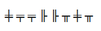

A. 

B. 

C. 

D. 

第 50 题 · 答案与解析

**参考答案（粉笔题库参考内容）**

A

**解析**

本题考查字符类比，注意相同符号的对应。

第一位和第七位的符号相同，第二位和第三位的符号相同，第四位和第五位的符号相同，第六位和第八位的符号相同，符合此规律的为只有A项；也可以将题干的形式看做：ABBCCDAD，只有A项符合。

故本题正确答案为A。

**来源**：2015年江苏省公务员录用考试《行测》题（C类）第45题

### 第 51 题

每道题在上边的题干中给出一套图形，其中包括五个图，这五个图呈现一定的规律性。在下边给出一套图形，其中有四个图，从中选出唯一的一项作为保持上边五个图规律性的第六个图。

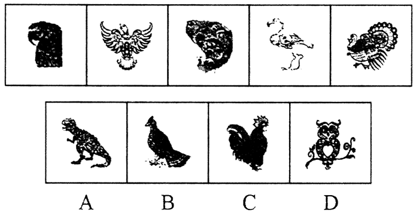

A. A

B. B

C. C

D. D

第 51 题 · 答案与解析

**参考答案（粉笔题库参考内容）**

B

**解析**

观察题干图形，寻找最大共同点。题干5幅图中，所有动物均为鸟类，同时所有动物的头朝向左边。符合此规律的只有B选项。

故正确答案为B。

**来源**：2015年江苏省公务员录用考试《行测》题（B类）第51题

### 第 52 题

请从所给的四个选项中，选择唯一的一个答案，使之呈现一定的规律性：

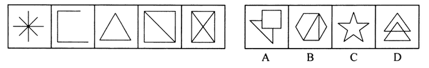

A. A

B. B

C. C

D. D

第 52 题 · 答案与解析

**参考答案（粉笔题库参考内容）**

B

**解析**

各图形构成不同，元素组成凌乱，且无明显的属性规律，考虑数量规律。

观察发现题干中图形的交点个数分别1、2、3、4、5，成等差数列，4个选项的交点数量分别为8、6、10、8。

故正确答案为B。

**考点**：数量规律-点

**来源**：2015年江苏省公务员录用考试《行测》题（C类）第47题

### 第 53 题

请从所给的四个选项中，选择唯一的一个答案，使之呈现一定的规律性：

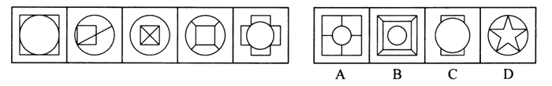

A. A

B. B

C. C

D. D

第 53 题 · 答案与解析

**参考答案（粉笔题库参考内容）**

A

**解析**

各图形构成不同，“窟窿”多，优先数面。

题干中五个图形的封闭空间数，即面的数量均为5，4个选项的面的数量分别为：5、6、3、6。

故正确答案为A。

**考点**：数量规律-面

**来源**：2015年江苏省公务员录用考试《行测》题（B类）第53题

### 第 54 题

右边四个图形中，只有一个是由左边的四个图形拼合（只能通过上、下、左、右平移）而成的，请把它找出来。

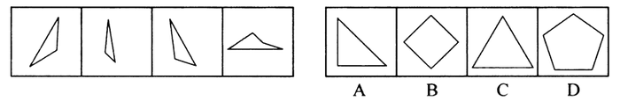

A. A

B. B

C. C

D. D

第 54 题 · 答案与解析

**参考答案（粉笔题库参考内容）**

C

**解析**

本题考查的是平面拼合，可以采用平行等长消去的方式。消去平行等长的线段（相同颜色标注）后进行组合得到轮廓图，即为C选项。平行等长消去方式如下图所示：

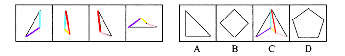

故正确答案为C。

**来源**：2015年江苏省公务员录用考试《行测》题（B类）第54题

### 第 55 题

选项的四个图形中，只有一个是由上边的四个图形拼合（只能通过上、下、左、右平移）而成的，请把它找出来。

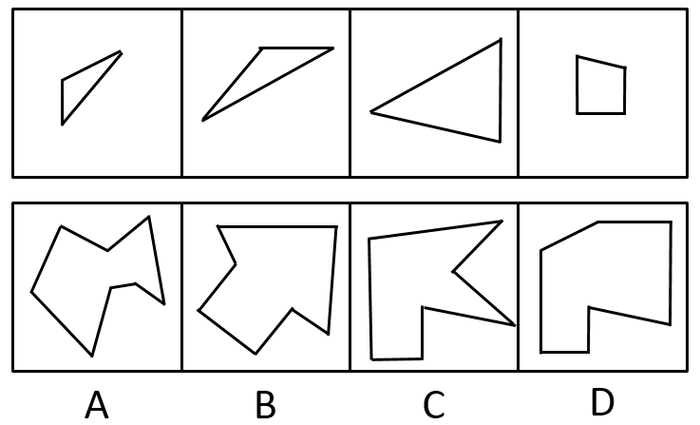

A. A

B. B

C. C

D. D

第 55 题 · 答案与解析

**参考答案（粉笔题库参考内容）**

D

**解析**

本题考查的是平面拼合，可以采用平行等长消去的方式。消去平行等长的线段（相同颜色标注）后进行组合得到轮廓图，即为D选项。平行等长消去方式如下图所示：

故正确答案为D。

**来源**：2015年江苏省公务员录用考试《行测》题（B类）第55题

### 第 56 题

右边四个图形中，只有一个是由左边的四个图形拼合（只能通过上、下、左、右平移）而成的，请把它找出来。

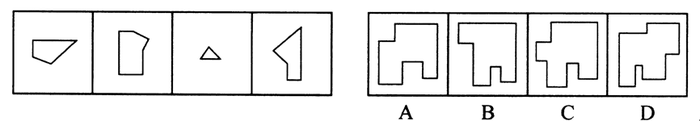

A. A

B. B

C. C

D. D

第 56 题 · 答案与解析

**参考答案（粉笔题库参考内容）**

A

**解析**

本题考查的是平面拼合，可以采用平行等长消去的方式。消去平行等长的线段（相同颜色标注）后进行组合得到轮廓图，即为A选项。平行等长消去方式如下图所示：

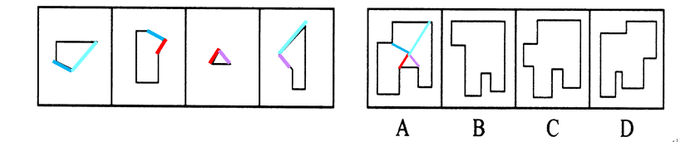

故正确答案为A。

**来源**：2015年江苏省公务员录用考试《行测》题（B类）第56题

### 第 57 题

左边给定的是纸盒外表面的展开图，右边哪一项能由它折叠而成?请把它找出来。

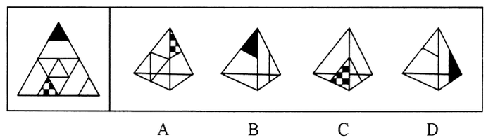

A. A

B. B

C. C

D. D

第 57 题 · 答案与解析

**参考答案（粉笔题库参考内容）**

A

**解析**

本题考查四面体的空间重构能力。

将平面展开图中的面进行标记，并用相同样式线条标注相同边，用排除法解题。观察选项，B、C、D三项中均存在面④，选取此面为参考面。

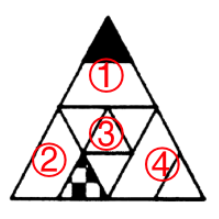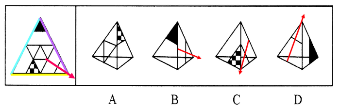

标记如图所示的箭头，则面①在面④的左方，面②在面④的右方，面③在面④的下方。

B项：立体图中面④的下方图形是面①，而平面图中面④的下方图形是面③，平面图与立体图不对应，排除。

C项：立体图中面④的右方图形是面②，平面图中面④的右方图形也是面②，但是平面图中面②的阴影三角形与面④的底边有公共点，而立体图中面②的阴影三角形与面④的底边没有公共点，平面图与立体图不对应，排除。

D项：立体图中面④的右方图形是面①，平面图中面④的右方图形是面②，平面图与立体图不对应，排除。

故正确答案为A。

**来源**：2015年江苏省公务员录用考试《行测》题（B类）第57题

### 第 58 题

左边给定的是纸盒外表面的展开图，右边哪一项能由它折叠而成？请把它找出来。

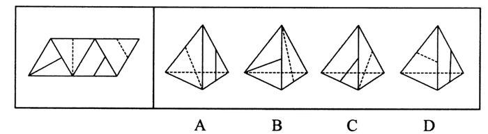

A. A

B. B

C. C

D. D

第 58 题 · 答案与解析

**参考答案（粉笔题库参考内容）**

A

**解析**

本题考查四面体的空间重构能力。

将平面进行标面：

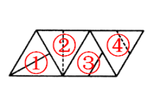

观察A、B、C三个选项，发现选项中均存在②面，选取②面为参考面，并用箭头标示，同时公共边用相同颜色标记。

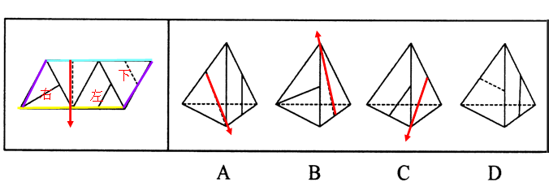

①面在②面的右面，③面在②面的左面，④面在②面的下面。

A项：平面图与立体图对应，相对位置、公共边均正确，当选；

B项：立体图中②面的左面是面①，而平面图中②面的左面是面③，立体图与平面图不对应，排除；

C项：立体图中②面的右面是面③，而平面图中②面的右面是面①，立体图与平面图不对应，排除；

D项：观察平面图中面③与面④公共边，二者的公共边连接的是实线，而立体图中公共边连接的是虚线，立体图与平面图不对应，排除。

故正确答案为A。

**来源**：2015年江苏省公务员录用考试《行测》题（B类）第58题

### 第 59 题

左边给定的是纸盒外表面的展开图，右边哪一项能由它折叠而成？请把它找出来。

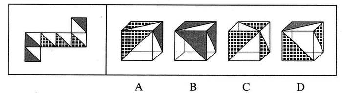

A. A

B. B

C. C

D. D

第 59 题 · 答案与解析

**参考答案（粉笔题库参考内容）**

A

**解析**

本题考查六面体的空间重构。

将平面展开图中的六面体进行标面，即：

三组相对面为：①③；②④；⑤⑥，可知三个相同阴影面或者三个相同点状面中必然存在一组相对面，根据相对面不相邻，排除B、C两项。

平面展开图中，相邻的两个点状面与点状面之间存在公共点，而D选项中，相邻的两个点状面之间并不存在公共点，因此排除D选项。

故正确答案为A。

**考点**：空间类-空间重构-六面体

**来源**：2015年江苏省公务员录用考试《行测》题（C类）第53题

### 第 60 题

左边给定的是正方体的外表面展开图，右边哪一项能由它折叠而成？

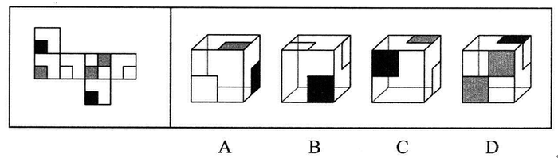

A. A

B. B

C. C

D. D

第 60 题 · 答案与解析

**参考答案（粉笔题库参考内容）**

D

**解析**

将原展开图标上序号如下图，逐一进行分析。

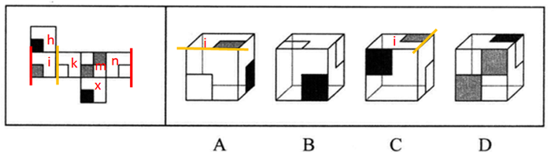

A项：如图所示，面i与两个空白矩形面都存在公共边，如果该项中的空白矩形面为面k，那么面i与面k公共边为黄色边，在展开图中，面i部分灰色矩形没有与公共边相连，而选项中灰色矩形与公共边相连，相对位置错误；如果该项中的空白矩形面为面n，那么面i与面n公共边为红色边，在展开图中，面n部分空白矩形与公共边相连，而选项中空白矩形没有与公共边相连，相对位置错误，不论空白矩形是哪个面，该项都不正确，选项与题干不一致，排除；

B项：如图所示，空白矩形面在展开图中为相对面，相对面不能同时出现在选项的立体图形中，选项与题干不一致，排除；

C项：如图所示，面i与两个空白矩形面都存在公共边，如果该项中的空白矩形面为面k，那么面i与面k公共边为黄色边，在展开图中，面i部分灰色矩形没有与公共边相连，而选项中灰色矩形与公共边相连，相对位置错误；如果该项中的空白矩形面为面n，那么面i与面n公共边为红色边，在展开图中，面n部分空白矩形与公共边相连，而选项中空白矩形没有与公共边相连，相对位置错误，不论空白矩形是哪个面，该项都不正确，选项与题干不一致，排除；

D项：选项与题干一致，当选。

故正确答案为D。

**考点**：空间类-空间重构-六面体

**来源**：2015年江苏省公务员录用考试《行测》题（B类）第60题

### 第 61 题

只有实行依法治国，才能从根本上杜绝腐败；如果不能从根本上杜绝腐败，我们终将失去人民的信任和支持。只有赢得人民的信任和支持，我们的事业才能拥有牢固的政治基础。

根据以上陈述，可以推出的是：

A. 如果实行依法治国，我们就能赢得人民的信任和支持

B. 如果从根本上杜绝腐败，我们的事业就能拥有牢固的政治基础

C. 如果不实行依法治国，我们终将失去人民的信任和支持

D. 如果不能从根本上杜绝腐败，就不能实行依法治国

第 61 题 · 答案与解析

**参考答案（粉笔题库参考内容）**

C

**解析**

题干和选项中出现多组典型“逻辑关联词”，先翻译后推理。

翻译题干：

①从根本上杜绝腐败→实行依法治国；

②不能从根本上杜绝腐败→失去人民的信任和支持；

③我们的事业拥有牢固的政治基础→赢得人民的信任和支持；

根据逆否等价定理和递推规则，可知：我们的事业拥有牢固的政治基础→赢得人民的信任和支持→从根本上杜绝腐败→实行依法治国。

A项：实行依法治国→赢得人民的信任和支持；肯定后件无法推知确定性结论，故A项错误；

B项：从根本上杜绝腐败→我们的事业拥有牢固的政治基础；推导方向错误，题干为：我们的事业拥有牢固的政治基础→从根本上杜绝腐败，故B项错误；

C项：不实行依法治国→失去人民的信任和支持，是对“赢得人民的信任和支持→实行依法治国”的逆否，能够推出；

D项：实行依法治国→从根本上杜绝腐败，推导关系错误，题干为：从根本上杜绝腐败→实行依法治国，故D项错误。

故正确答案为C。

**考点**：常规翻译

**来源**：2015年江苏省公务员录用考试《行测》题（C类）第56题

### 第 62 题

中国人大多是在批评与训斥中长大的，父母、老师、长辈、领导……看你哪一点不顺眼，都能给出指教。话多半不好听，可听者听了多半心悦诚服，心生感激，因为大家想的是良药苦口、忠言逆耳的道理。但是，逆耳的未必都是忠言。有种电话诈骗就是以很凶的方式出现的。电话里的他们就是要批评你、威胁你、吓唬你，一旦你心里打怵了，你就听他们的了；而你听了他们的，你也就上当了。

根据以上陈述，可以推出的是：

A. 有的逆耳之言可能不是忠言

B. 有的忠言并不逆耳

C. 有的电话诈骗的声音并不是很凶

D. 如果你听到逆耳的电话心里不打怵，你就不会上当

第 62 题 · 答案与解析

**参考答案（粉笔题库参考内容）**

A

**解析**

题干关键信息：“逆耳的未必都是忠言”等价于“逆耳的可能不是忠言”。

A项：题干“逆耳的可能不是忠言”，再根据“所有的S都是P→有的S是P”，能够推出“有的逆耳之言可能不是忠言”，当选；

B项：“有的S是P”不能推出“有的S不是P”，因此不能推出“有的忠言并不逆耳”，排除；

C项：题干提及“有种电话诈骗就是以很凶的方式出现的”，只能推出有的电话诈骗的声音很凶，有的是不能推出有的不是，排除；

D项：题干“一旦你心里打怵了，你就听他们的了”，即“一旦你心里打怵，你就上当了”，充分条件假言命题否前不能否后，排除。

故正确答案为A。

**考点**：集合推理

**来源**：2015年江苏省公务员录用考试《行测》题（B类）第62题

### 第 63 题

甲、乙、丙、丁、戊5支球队进行小组单循环赛，每两个队之间互赛一场。循环赛结束后，各队胜负情况如下表所示：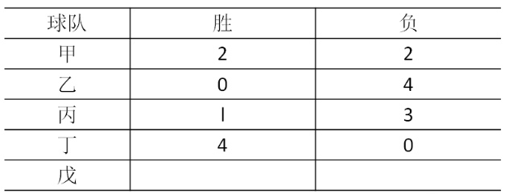

根据以上信息，可以推出的是（    ）。

A. 甲队战胜了丙队和戊队

B. 甲队负于丙队和戊队

C. 甲队战胜了戊队，但负于丙队

D. 甲队战胜了丙队，但负于戊队

第 63 题 · 答案与解析

**参考答案（粉笔题库参考内容）**

D

**解析**

循环赛：N支队伍进行循环赛，每支队伍和其他任意队伍进行一场比赛，所以每支队伍需要进行N-1场比赛；由于每场比赛都是2个队伍共同进行，所以总场次应该是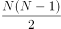场。即甲乙丙丁戊5支球队每支队伍要进行4场比赛，总场次是10场，即10胜10负，每队胜负场次相加为4场，由此可知，戊胜3负1；

由于戊3胜1负，丁队4胜，可知戊队战胜了甲乙丙三支队伍，据此排除A、C两项；

由乙队4负，丙队1胜3负可知，丙队只战胜了乙队，观察选项BD，均涉及甲，甲2胜2负，由此可得甲战胜了乙队和丙队。

故正确答案为D。

**考点**：从确定信息开始推

**来源**：2015年江苏省公务员录用考试《行测》题（B类）第63题

### 第 64 题

顾客：老板，你这盘鱼香肉丝里怎么没有鱼啊？

老板：这有什么奇怪的!难道老婆饼里有老婆吗？

以下哪项的对话方式与上述最为相似或相同？

A. 老师：小明，你为什么没有做我昨天布置的家庭作业啊?

小明：对不起，老师！难道我没有回家也要做家庭作业吗?

B. 妻：亲，你的钱包里怎么没有钱啊？

夫：这没什么不正常！难道茶叶罐里总是有茶叶吗？

C. 孩子：妈妈，棉花糖里怎么没有棉花啊？

妈妈：这很正常！难道你用的英雄墨水里藏了一个英雄吗？

D. 顾客：小妹，你卖的珍珠奶茶里怎么没有珍珠？

售货员：这有什么稀奇！夫妻肺片里也没有夫妻啊！

第 64 题 · 答案与解析

**参考答案（粉笔题库参考内容）**

D

**解析**

题干的论证方式为：

“鱼香肉丝”这道菜的由来是因为菜的味道像鱼香味，而不是有真正的“鱼”；“老婆饼”的由来是老婆做的饼，而并非是饼里有“老婆”这个人。

第二步：分析选项

A项：老师和小明所说的都是家庭作业，与题干逻辑关系不一致，排除；

B项：钱包和没有钱二者中的“钱”都指的是人民币，“茶叶罐”中的“茶叶”指的就是茶叶，与题干逻辑关系不一致，排除；

C项：“棉花糖”的命名是因为像棉花的形状，而不是有真正的棉花，“英雄墨水”是墨水的一个品牌，它的命名由来不是“因为是英雄做出来的墨水所以称为英雄墨水”，命名方式与题干不一致，与题干逻辑关系不一致，排除；

D项：“珍珠奶茶”的命名是因为像珍珠形状，而不是有真正的“珍珠”，“夫妻肺片”这道菜的由来是夫妻两个人一起做的菜，并非是指这道菜里有夫妻，与题干逻辑关系一致，当选。

故正确答案为D。

**考点**：日常结论

**来源**：2015年江苏省公务员录用考试《行测》题（B类）第64题

### 第 65 题

近年来，在全国除港澳台以外的31个省区市书法家协会中，许多名誉主席、主席、副主席已为官员或退休官员担任。几乎在每个省市书法家协会领导名单中，都能看到同等级政府官员的名字。有专家指出，党政官员热衷于担任各级艺术类人民团体领导，官员与艺术家在身份和职务上相互交叠，会让艺术成为腐败的掮客，使各种肮脏的行贿受贿行为在艺术的光环笼罩下大行其事。

以下哪项不能支持上述专家的论断?（  ）

A. 某下属向其领导请求墨宝，再付之以一笔可观的“润笔费”

B. 某些官员高价出售自己的作品，并坦然视之为“公平交易”

C. 某些官员书法功底颇为深厚，对别人请求题字一般并不推托

D. 在多项艺术活动中，具有行政职务的官员总能获得特别的优待

第 65 题 · 答案与解析

**参考答案（粉笔题库参考内容）**

C

**解析**

第一步，找到论点和论据。

论点：党政官员热衷于担任各级艺术类人民团体领导，官员与艺术家在身份和职务上相互交叠，会让艺术成为腐败的掮客，使各种肮脏的行贿受贿行为在艺术的光环笼罩下大行其事。

论据：无。

第二步，分析各个选项。

A选项中的“润笔费”，B选项中的“高价”，D选项中的“优待”均是通过举例子，增加新论据的方式从不同角度体现了因领导身份而在各类艺术活动中获得特别利益，支持了题干论断。

C项对别人请求题字一般不推托，仅为书法交流，是一种客观陈述，并未涉及腐败行贿受贿等，为无关选项，不能支持题干论断。

本题为选非题，故正确答案为C。

**考点**：加强选非题

**来源**：2015年江苏省公务员录用考试《行测》题（B类）第65题

### 第 66 题

某单位寻求对外合作，准备在甲、乙、丙、丁四家单位中确定一个或几个合作对象。单位管理层经过认真调研和讨论，最终形成了以下三种意见：

（1）对于甲和乙两单位，至多选一个；

（2）对于甲和丁两单位，至少选一个；

（3）如果选择丙或丁单位，就不能选择乙单位。

在最终决定时，单位领导只采纳了上述一种意见。

根据以上陈述，以下哪项最符合单位领导的最终决定?

A. 选择乙、丙、丁

B. 选择乙，但不选择丙和丁

C. 选择甲、乙、丁

D. 选择丙，但不选择乙和丁

第 66 题 · 答案与解析

**参考答案（粉笔题库参考内容）**

C

**解析**

题干重要信息：单位领导只采纳了（1）（2）（3）中的一种意见。

此题采用代入法，代入后：

A项：条件（1）（2）同时满足，排除；

B项：条件（1）（3）同时满足，排除；

C项：只满足条件（2），当选；

D项：条件（1）（3）同时满足，排除。

故正确答案为C。

**考点**：代入法

**来源**：2015年江苏省公务员录用考试《行测》题（C类）第59题

### 第 67 题

在许多人看来，从一而终的就是好婚姻。其实，这种看法并不正确。婚姻不仅意味着身体的忠诚，而且还包含了情感的相互扶持。所以不能说只要没有第三者，婚姻就没有问题。当下中国有许多婚姻是这样一种模式：夫妻并没有出轨，但双方都无法从婚姻中获得抚慰、滋养和治愈。实际上，没有单方面“犯错”的人，每个人都需要为自己的婚姻付出更多的努力。

根据以上论述，可以推出的是（    ）。

A. 从一而终的并不就是好婚姻

B. 没有第三者的婚姻也会有问题

C. 只有出现了第三者，婚姻才会有问题

D. 当下中国大多数婚姻已经出了问题

第 67 题 · 答案与解析

**参考答案（粉笔题库参考内容）**

B

**解析**

分析题干：

（1）“在许多人看来，从一而终的就是好婚姻。其实，这种看法并不正确。”

（2）“不能说只要没有第三者，婚姻就没有问题。”即不能说（只要没有第三者，婚姻就没有问题），即“没有第三者且婚姻有问题”。

分析选项：

A项：题干只说明“在许多人看来从一而终的就是好婚姻，这种看法不正确”，但是并未说明正确的看法，且这种看法是“许多人”的看法，并不是所有人的看法，因此A项无法推出，排除；

B项：即上述（2）所阐明的观点，当选；

C项：与原文观点相反，无法推出，排除；

D项：原文是当下中国有许多婚姻是这样一种模式：夫妻并没有出轨，但双方都无法从婚姻中获得抚慰、滋养和治愈。据此无法推出出了问题，属于无中生有，排除。

故正确答案为B。

**考点**：日常结论

**来源**：2015年江苏省公务员录用考试《行测》题（C类）第61题

### 第 68 题

在以下5×5矩阵中，每个小方格中可填入一个汉字，要求每行、每列及每个由粗线条围成的小区域内均含有松、菊、梅、兰、竹5个汉字，不能重复也不能遗漏。

根据已经给定的条件，可以推出矩阵中①、②、③、④方格中依次填入的汉字是（    ）。

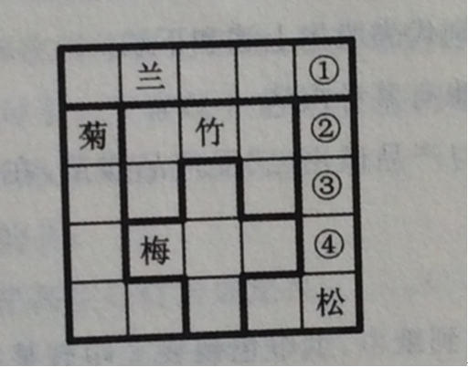

A. 菊兰梅竹

B. 兰菊竹梅

C. 梅兰菊竹

D. 菊梅竹兰

第 68 题 · 答案与解析

**参考答案（粉笔题库参考内容）**

D

**解析**

本题属于数独型分析推理，信息量最大优先并结合选项快速做题。

（1）信息量最大的空格为第二行第二列，横行不能填入菊、竹，纵列不能填入兰、梅，所以第二行第二列填入松；

（2）根据（1）可知，②处不能填入菊竹松，据此排除B选项；

（3）再寻找最大信息量所在的空格，为第四行第四列的空格，第三列均不能填入竹，且梅所在的粗线条区域必须含有竹，因此第四行第四列只能填入竹，即④处不能是竹，据此排除A、C选项。

故正确答案为D。

**考点**：从最大信息开始推

**来源**：2015年江苏省公务员录用考试《行测》题（B类）第68题

## 材料 2

王刚、赵虎与李亮是某机关新进的员工。他们三人中，有两人单身，两人爱好打乒乓球，两人是北方人，两人是公共管理专业硕士。如果王刚与李亮是公共管理专业硕士，则他们都是北方人；如果赵虎与李亮爱好打乒乓球，则他们也都是北方人；如果王刚是北方人，则他单身。已知他们每人最多只有3个上述特征。

### 第 69 题

根据以上陈述，可以得出以下哪项?（    ）

A. 王刚单身

B. 赵虎是公共管理专业硕士

C. 李亮是北方人

D. 王刚爱好打乒乓球

第 69 题 · 答案与解析

**参考答案（粉笔题库参考内容）**

B

**解析**

分析题干，王刚、赵虎与李亮3人分8个特征，即两人单身，两人爱好打乒乓球，两人是北方人，两人是公共管理专业硕士；又因为他们每人最多只拥有3个上述特征，据此可知，其中1个人有2个特征，2个人有3个特征。

寻找信息量最大的员工，为王刚。假设王刚与李亮是公共管理专业硕士，则他们都是北方人；由如果王刚是北方人，则他单身，推知王刚单身，则赵虎与李亮不都是单身的，据此可知，赵虎和李亮不都爱好打乒乓球，由3人中2人爱好打乒乓球推知王刚爱好打乒乓球。归纳上述推导信息可知，王刚是公共管理专业硕士，是北方人，单身，爱好打乒乓球，与每人最多拥有3个特征矛盾，假设不成立。

因此并非王刚和李亮是公共管理专业硕士，则赵虎必然是公共管理硕士。

故正确答案为B。

**来源**：2015年江苏省公务员录用考试《行测》题（B类）第69题

### 第 70 题

如果王刚是北方人，则可以得出以下哪项?（    ）

A. 王刚不是公共管理专业硕士

B. 赵虎不爱好打乒乓球

C. 李亮不是单身

D. 赵虎不是北方人

第 70 题 · 答案与解析

**参考答案（粉笔题库参考内容）**

A

**解析**

分析题干，王刚、赵虎与李亮3人分8个特征，即两人单身，两人爱好打乒乓球，两人是北方人，两人是公共管理专业硕士；又因为他们每人最多只拥有3个上述特征，据此可知其中1个人有2个特征，2个人有3个特征。

（1）如果王刚是北方人，则赵虎和李亮不可能都是北方人，由题干“如果赵虎与李亮爱好打乒乓球，则他们也都是北方人”的逆否命题推知，赵虎和李亮不都爱好打乒乓球，据此可知王刚喜欢打乒乓球。

（2）归纳王刚现有特征：北方人、单身、爱好打乒乓球，又因为每人最多只拥有3个特征，则王刚必然不是公共管理专业硕士。

故正确答案为A。

**来源**：2015年江苏省公务员录用考试《行测》题（B类）第70题

### 第 71 题

认知地图效应：指通过对特定事物多次探索之后，头脑中形成一张包含各种相关信息的地图，根据这张地图采取行动，往往能够取得事半功倍的效果。

下列不属于认知地图效应的是：

A. 庖丁解牛

B. 胸有成竹

C. 老马识途

D. 管中窥豹

第 71 题 · 答案与解析

**参考答案（粉笔题库参考内容）**

D

**解析**

第一步：查找关键词。定义的关键词信息为“对特定事物多次探索”“形成相关信息的地图”“事半功倍”。

第二步：逐一判断选项。

A项：庖丁解牛，比喻经过反复实践，掌握了事物的客观规律，做事得心应手，运用自如；符合定义，排除；

B项：胸有成竹，比喻熟练有把握，事前对问题已有全面的考虑和解决办法；符合定义，排除。

C项：老马识途，比喻有经验的人对事情比较熟悉；符合定义，排除。

D项：管中窥豹，比喻只见到事物的一小部分，指所见不全面或略有所得，其意与定义完全不同，不符合定义，当选。

本题为选非题，故正确答案为D。

**考点**：单定义-其他句式

**来源**：2015年江苏省公务员录用考试《行测》题（C类）第67题

### 第 72 题

社会约定：某个形式与其所代表的意义之间的关系是由社会成员共同认定并遵守的，两者之间没有必然的联系。

下列属于社会约定的是（    ）。

A. 朝霞不出门，晚霞行千里

B. 高速路上散落的汽车碎片意味着发生过车祸

C. 红色和绿色在国内股市中分别代表股指上涨和下跌

D. 人的脸色蜡黄表明可能身体患有某种疾病

第 72 题 · 答案与解析

**参考答案（粉笔题库参考内容）**

C

**解析**

第一步：提取定义关键词。

“由社会成员共同认定并遵守的”、“两者之间没有必然的联系”。

第二步：逐一判断选项。

A选项，并不是人们共同认定并遵守的，只不过是一个劝解，排除；

B选项，散落的汽车碎片和车祸之间是有必然联系的，而且也没提到共同认定遵守，排除；

C项中的“红色和绿色”和股市涨跌二者之间没有必然的联系，“在国内股市中分别代表股指上涨和下跌”为社会成员共同认定并遵守的，C项满足定义关键词，当选；

D选项，人的脸色蜡黄与某种疾病是有必然的联系的，排除。

故正确答案为C。

**考点**：单定义-其他句式

**来源**：2015年江苏省公务员录用考试《行测》题（C类）第72题

### 第 73 题

体验式广告：让消费者亲身参与产品试用、感受产品质量，在不知不觉中接受、信任产品的广告方式。

下列不属于体验式广告的是（    ）。

A. 某地铁入口处，路人会免费拿到纸巾，纸巾包装袋上印有某新开发楼盘的广告信息

B. 某大型超市内，推销员正在将某果汁企业新开发的一款橙汁饮料分给顾客免费品尝

C. 只要添加某化妆品公司微信号并发送“我要试用”，即可免费获得其新款面膜试用装

D. 某知名家具连锁企业在市区繁华地段新开了家体验馆的消息传开后，一时人满为患

第 73 题 · 答案与解析

**参考答案（粉笔题库参考内容）**

A

**解析**

第一步：提取定义关键词。

“消费者亲身参与产品试用、感受产品质量” 。

第二步：逐一判断选项。

A项，“纸巾包装袋上印有某新开发楼盘的广告信息”，只是了解包装袋上的广告，未参与产品试用，不符合定义，当选；

B、C、D三项均涉及到“亲身参与产品试用、感受产品质量”，符合定义，排除。

本题为选非题，故正确答案为A。

**考点**：拆词

**来源**：2015年江苏省公务员录用考试《行测》题（C类）第69题

### 第 74 题

趋同进化：指不同生物物种在进化过程中由于适应相似的环境而呈现出外形上的相似性。

下列属于趋同进化的是：

A. 海豚和鲨鱼，一个是哺乳动物，一个是鱼类，只是为了更好地在海洋中生存，它们就变得越来越相像了

B. 随着共同生活时间的增加，夫妻二人的价值观念、生活习惯，甚至连五官都变得越来越相近了

C. 无脊椎动物中，腔肠动物门的珊瑚、甲壳类的藤壶、棘皮动物门的海百合，都有相似的辐射对称躯体构型

D. 蚂蚁从金合欢的刺中取食蛋白质、脂肪和蜜，也在金合欢枝叶间巡逻缠绕金合欢的其他植物，进攻来此觅食的食草动物

第 74 题 · 答案与解析

**参考答案（粉笔题库参考内容）**

A

**解析**

第一步：查找关键词。

定义的关键词信息为“不同生物物种”“适应相似的环境”“外形上的相似性”。

第二步：逐一判断选项。

A项：海豚和鲨鱼为“不同生物物种”，为了更好地在海洋中生存即为了“适应相似的环境”，变得越来越相像了即呈现出了“外形上的相似性”，符合定义，当选；

B项：夫妻为同一物种，不符合定义，排除；

C项：未体现出为了“适应相似的环境”，不符合定义，排除；

D项：未体现呈现出了“外形上的相似性”，不符合定义，排除。

故正确答案为A。

**考点**：原因结果

**来源**：2015年江苏省公务员录用考试《行测》题（C类）第73题

### 第 75 题

精神赡养：是指在家庭生活中，子女理解、尊重、关心、体贴父母，尽力满足其精神生活方面的需要。

下列不属于精神赡养的是：

A. 老孙最近专门买了1台液晶电视安装在父母房间，让二老看自己喜欢的节目，还为他们买了许多京剧光盘

B. 尽管老吴没和父母住在一起，但他多年来已经养成了每天都去看望的习惯，无微不至地照顾好他们的生活，老人感到很欣慰

C. 春节临近，“夕阳红”敬老院的李院长请来朝阳小学的“小红花”乐团，孩子们的欢声笑语和精彩节目，为老人们带来了无尽的快乐

D. 老姜的母亲已70多岁，但仍不服老，报名参加了交谊舞培训班，为避免老人生气并确保安全，每次母亲去上课时，老姜都悄悄跟在后面

第 75 题 · 答案与解析

**参考答案（粉笔题库参考内容）**

C

**解析**

第一步：查找关键词。

定义的关键词信息为“在家庭生活中”、“子女理解、尊重、关心、体贴父母”、“满足其精神生活方面的需要”。

第二步：逐一判断选项。

A、B、D三项均符合定义关键词，C项“敬老院”不是在家庭生活中，因此不属于精神赡养。

本题为选非题，故正确答案为C。

**考点**：拆词

**来源**：2015年江苏省公务员录用考试《行测》题（C类）第71题

### 第 76 题

幻想性错觉：指人们即使对于一个客观中立、并无任何暗示性意义的事物，也往往试图从中寻找出某种特殊意义的心理现象。

下列不属于幻想性错觉的是：

A. 夜晚，有时候有人会把高空的灯看成星星

B. 人们常常会在云朵中发现一个个动物形象

C. 古人认为月亮上有桂树、兔子、嫦娥、吴刚

D. 天柱山周围的三座山峰绵延相连很像卧佛

第 76 题 · 答案与解析

**参考答案（粉笔题库参考内容）**

A

**解析**

第一步：查找关键词。

定义的关键词信息为“客观中立、并无任何暗示性意义的事物”、“试图从中寻找出某种特殊意义的心理现象”。

第二步：逐一判断选项。

A项：“把高空的灯看成星星”仅是看错，误把灯看做了星星，不带有某种主观赋予其特殊意义的色彩，不符合定义关键词“寻找出某种特殊意义的心理现象”，不符合定义，当选；

B项：将云朵看做动物对应定义关键词“试图从中寻找出某种特殊意义的心理现象”，符合定义，排除；

C项：认为月亮上有桂树、兔子、嫦娥、吴刚，即赋予了一个客观中立的事物以某种意义，符合定义，排除；

D项：将天柱山周围的三座山峰看做卧佛，即赋予了一个客观中立的事物以某种意义，符合定义，排除。

本题为选非题，故正确答案为A。

**考点**：单定义-其他句式

**来源**：2015年江苏省公务员录用考试《行测》题（B类）第76题

### 第 77 题

星期一综合症：是指由于在双休日过分消耗精力处理工作之外的事情，导致周一上班时出现头晕、胸闷、腹胀、食欲不振、周身酸痛、注意力不集中等症状。

下列属于星期一综合症的是：

A. 五一小长假，小李和同事们计划已久的黄山之旅终于成行了。3天下来，爬山、聚餐、照相、乘车，一点也不比上班轻松。这不，长假结束刚一上班，个个都像霜打的茄子——蔫了吧唧的

B. 终于又到周末了，小王将下载好的一部40集连续剧不分白天黑夜地看完了，两天里除了上厕所，就没下过床，饭都是舍友帮忙从食堂带的。周一起床整个人都昏昏沉沉的，干脆向辅导员请假不去上课了

C. 周六上午陪小孩参加绘画兴趣班，下午学钢琴，晚上带着去品尝风味小吃；周日上午带着小孩去游乐场，下午去奶奶家。整个周末，王女士的时间表都被小孩填满了，周一上班脑袋里还是这些，根本没法工作

D. 已经连续工作了5天，也计划好周末陪女友上街购物，但公司临时通知周末加班，小许只好向女友“请假”，回到办公室和同事们通宵达旦地又干了两天。星期一上班，个个都成了“熊猫眼”

第 77 题 · 答案与解析

**参考答案（粉笔题库参考内容）**

C

**解析**

解析：

第一步：查找关键词。

定义的关键词信息为“双休日过分消耗精力处理工作之外的事情”、“上班时”。

第二步：逐一判断选项。

A项：“五一小长假”不符合关键词“双休日”，不符合定义，排除；

B项：干脆向辅导员请假不去上课了不符合“上班时”，不符合定义，排除；

C项：整个周末，王女士的时间表都被小孩填满了，符合“双休日过分消耗精力处理工作之外的事情”，周一上班脑袋里还是这些，根本没法工作，对应“周一上班时出现头晕、胸闷、腹胀、食欲不振、周身酸痛、注意力不集中等症状”，符合定义，当选；

D项：“周末加班”不符合“双休日过分消耗精力处理工作之外的事情”，不符合定义，排除。

故正确答案为C。

**考点**：原因结果

**来源**：2015年江苏省公务员录用考试《行测》题（B类）第77题

### 第 78 题

标杆效应：指在某一区域内，由于消费者对某种品牌认知度较高，导致其价格往往比同一区域其他同类商品高出一大截，并影响到整个区域同类商品的价格走势。

下列属于标杆效应的是：

A. 在某市，某大品牌电器企业每到节假日就大搞特价促销活动，其他商家纷纷效仿，也出奇招来招揽顾客

B. 某知名品牌推出的新款智能手表受到热捧，虽然价格偏高，却一再脱销，其他品牌的智能手表纷纷调低价格，争抢市场份额

C. 市一中即将搬往高新区的消息一传开，高新区的房价就一路飙升，连紧邻的湾树区房价也跟着涨了三四成

D. 老徐的网店短短半年内就赢利数万，朋友们纷纷前来取经，采用同样的经营方式创办了自己的网店，一个个赚得盆满钵满

第 78 题 · 答案与解析

**参考答案（粉笔题库参考内容）**

B

**解析**

第一步：查找关键词。

定义的关键词信息为“对某种品牌认知度较高”“其价格往往比同一区域其他同类商品高出一大截”“影响整个区域同类商品价格走势”。

第二步：逐一判断选项。

A项：未体现出“其价格往往比同一区域其他同类商品高出一大截”，不符合定义，排除；

B项：受到热捧对应关键词“对某种品牌认知度较高”，价格偏高对应关键词“其价格往往比同一区域其他同类商品高出一大截”，其他品牌的智能手表纷纷调低价格对应关键词“影响整个区域同类商品价格走势”，符合定义，当选；

C项：房价飙升并不是消费者对品牌认知度较高导致的，而是消费者获得其他信息后而导致的结果，同时选项中并没有体现出同类商品，不符合定义，排除；

D项：未体现出“对某种品牌认知度较高”，不符合定义，排除。

故正确答案为B。

**考点**：原因结果

**来源**：2015年江苏省公务员录用考试《行测》题（C类）第75题

### 第 79 题

协同治理：指政府部门为了达成公共利益的目标，通过与非政府的、非盈利的社会组织和普通公众合作开展社会管理活动的工作模式。

下列属于协同治理的是：

A. 某市辖区内有多个街道办，每个街道办管辖一片区域，有的街道服务中心专门设立了为老年人和残疾人提供公益服务的绿色通道

B. 某高校学生会多次组织大学生深入社区，开展心理咨询、消防安全讲座、帮助孤寡老人等公益活动

C. 为创建卫生城市，某市卫生局、环保局、城管局通力合作，卫生防疫人员、环境监测人员、环卫工人和城管人员各司其职，积极工作

D. 某市为确保城市公交畅通安全，每个公交站台都配有治安巡查员，这些人员中既有各职能部门人员，也有志愿者协会成员，还有退休者

第 79 题 · 答案与解析

**参考答案（粉笔题库参考内容）**

D

**解析**

第一步：查找关键词。定义的关键词信息为“政府部门为了达成公共利益的目标”“通过与非政府的、非盈利的社会组织和普通公众合作开展”。

第二步：逐一判断选项。

A项：街道服务中心仍归属政府，未体现“通过与非政府的、非盈利的社会组织和普通公众合作开展”，不符合定义，排除；

B项：“高校学生会”不是“政府部门”，不符合定义，排除；

C项：选项中涉及的“某市卫生局、环保局、城管局通力合作，卫生防疫人员、环境监测人员、环卫工人和城管人员”均不是“与非政府的、非盈利的社会组织和普通公众合作开展”，不符合定义，排除；

D项：“某市为确保城市公交畅通安全”对应“政府部门为了达成公共利益的目标”，“志愿者协会成员，还有退休者”体现了定义关键词“通过与非政府的、非盈利的社会组织和普通公众合作开展”，符合定义，当选。

故正确答案为D。

**考点**：主客体

**来源**：2015年江苏省公务员录用考试《行测》题（C类）第74题

### 第 80 题

O2O的营销方式：即Online To Offline，指以互联网为前台，用线上营销带动线下消费的商业营销模式。通常包括商家网上提供商品信息、折扣信息、服务预订、消费者在线预付、线下消费等环节完成商品交易。

下列不属于O2O营销方式的是：

A. 某公司推出线上、线下同价促销活动，旗下的网上商城和实体店所有商品价格相同，一时间网上商城订单量剧增，到实体店提货的人也摩肩接踵

B. 小兰在时装杂志上看到了一款心仪的长裙，通过某比价网站发现单位附近一家商场同款长裙正在打折促销，于是趁中午休息时间买了回来

C. 女朋友生日临近，小袁从网上团购了某酒店的自助餐消费券，邀请多名好友为女朋友开了一个难忘的生日派对

D. 某家电厂商利用微信平台向订阅用户定期推送新品上市、促销信息，用户用手机扫描推送消息中商品下方的二维码即可完成支付，等待附近门店的配送

第 80 题 · 答案与解析

**参考答案（粉笔题库参考内容）**

B

**解析**

第一步：查找关键词。

定义的关键词信息为“消费者在线预付、线下消费”。

第二步：逐一判断选项。

A选项，网上商城订单剧增，实体店提货的人摩肩接踵。符合定义中的消费者在线预付，线下消费，是O2O营销，符合定义；

B选项，比价网站发布的折扣信息并不是这个商场这个商家做出的行为，因此主体不符，不符合题干的定义；

C、D两项都涉及到了在线上支付线下消费的定义。

本题为选非题，故正确答案为B。

**考点**：主客体

**来源**：2015年江苏省公务员录用考试《行测》题（B类）第80题

## 材料 3

2014年全国居民人均可支配收入20167元，比上年增长10.1％，收入来源如下图所示。按常住地分，城镇居民人均可支配收入28844元，比上年增长9.0％；城镇居民按户人均可支配收入的中位数为26635元，增长10.3％。农村居民人均可支配收入10489元，比上年增长11.2％，农村居民按户人均可支配收入的中位数为9497元，增长12.7％。全国居民人均消费支出14491元，比上年增长9.6％。按常住地分，城镇居民人均消费支出19968元，增长8.0％；农村居民人均消费支出8383元，增长12.0％。

### 第 81 题

2014年城镇居民人均消费支出增长比农村居民人均消费支出增长：

A. 低2.2个百分点

B. 高4.0个百分点

C. 高2.2个百分点

D. 低4.0个百分点

第 81 题 · 答案与解析

**参考答案（粉笔题库参考内容）**

D

**解析**

从材料的最后一句得，“城镇居民人均消费支出19968元，增长8.0％；农村居民人均消费支出8383元，增长12.0％”，则2014年，城镇居民人均消费支出增长比农村居民人均消费支出增长低12.0-8.0=4.0个百分点。

故正确答案为D。

**来源**：2015年江苏省公务员录用考试《行测》题（B类）第81题

### 第 82 题

2014年全国居民人均可支配收入中，经营净收入占比为：

A. 27.0％

B. 18.5％

C. 56.6％

D. 7.9％

第 82 题 · 答案与解析

**参考答案（粉笔题库参考内容）**

B

**解析**

由材料的第一句可知2014年全国居民人均可支配收入为20167元，由图可得经营净收入为3732元，则全国居民人均可支配收入中，经营净收入占比为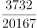，由于四个选项首位不同，差距较大，分母取前两位计算，首位商1。

故正确答案为B。

**来源**：2015年江苏省公务员录用考试《行测》题（B类）第82题

### 第 83 题

2013年城镇居民人均可支配收入比农村居民人均可支配收入多（    ）元。

A. 17030

B. 18355

C. 16138

D. 22090

第 83 题 · 答案与解析

**参考答案（粉笔题库参考内容）**

A

**解析**

问题时间为2013年，与材料时间2014年相比，是基期。求“······比······多（    ）元”是两个基期量的差值，所以属于基期和差问题。由材料可知“2014年城镇居民人均可支配收入28844元，比上年增长9.0％；农村居民人均可支配收入10489元，比上年增长11.2％”，则2013年城镇居民人均可支配收入比农村居民人均可支配收入多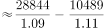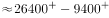元。A项最接近。

故正确答案为A。

**来源**：2015年江苏省公务员录用考试《行测》题（B类）第83题

### 第 84 题

2013年全国居民人均可支配收入与人均消费支出分别为：

A. 22177元、17222元

B. 18317元、13222元

C. 16367元、11491元

D. 20167元、14491元

第 84 题 · 答案与解析

**参考答案（粉笔题库参考内容）**

B

**解析**

由材料中“2014年全国居民人均可支配收入20167元，比上年增长10.1％；全国居民人均消费支出14491元，比上年增长9.6％”。可以得出2013年的全国居民人均可支配收入与人均消费支出一定会比2014年的少，由此排除A、D两项。

2013年全国居民人均可支配收入为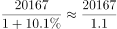，利用直除法可得商的前两位为18，锁定B项。

此外，可以利用代入法，基期+基期×10%=20167，只有B项满足。

故正确答案为B。

**来源**：2015年江苏省公务员录用考试《行测》题（B类）第84题

### 第 85 题

2014年全国城镇居民人数占全国居民人数的比重是：

A. 36.4％

B. 42.1％

C. 52.7％

D. 69.9％

第 85 题 · 答案与解析

**参考答案（粉笔题库参考内容）**

C

**解析**

材料中给出“全国居民人均消费支出14491元，比上年增长9.6％。按常住地分，城镇居民人均消费支出19968元，增长8.0％；农村居民人均消费支出8383元，增长12.0％”，可利用线段法：

城镇与全国相距19968-14491=5477，农村与全国相距14491-8383=6108，根据距离比是人数的反比，则全国城镇居民人数占全国居民人数的比重是

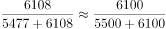，

各选项差距比较大，分母取前两位，首位商5，锁定C项。

故正确答案为C。

**来源**：2015年江苏省公务员录用考试《行测》题（B类）第85题

## 材料 4

2014年1—9月我国入境外国游客中，来自亚洲1182.9万人，其中男性785.9万人，女性397.0万人；日本、韩国男性分别为160.5万人、191.3万人，女性分别为38.7万人、116.4万人。来自美洲227.8万人，其中男性142.3万人，女性85.5万人；美国、加拿大男性分别为98.3万人、27.6万人，女性分别为55.7万人、20.9万人。来自欧洲408.7万人，其中男性247.2万人，女性161.5万人；英国、德国、法国、俄罗斯男性分别30.8万人、35.3万人、24.8万人、13.9万人，女性分别为13.4万人，12.7万人、13.0万人、4.4万人。来自大洋洲58.3万人，其中男性35.6万人，女性22.7万人；澳大利亚男性为29.5万人，女性为18.8万人。分年龄段的来自部分国家的入境人数见下表。

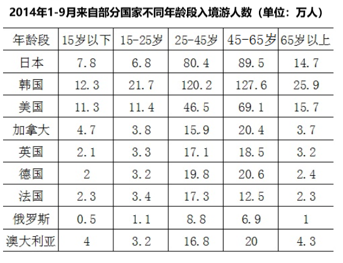

### 第 86 题

2014年1—9月来自加拿大、英国、法国、俄罗斯的入境游人数由多到少排序正确的是（  ）。

A. 加拿大、英国、法国、俄罗斯

B. 英国、加拿大、法国、俄罗斯

C. 加拿大、英国、俄罗斯、法国

D. 英国、加拿大、俄罗斯、法国

第 86 题 · 答案与解析

**参考答案（粉笔题库参考内容）**

A

**解析**

从文字材料可知，各国入境人数=男性人数+女性人数，则2014年1-9月，加拿大的入境游人数为：27.6+20.9＝48.5（万人）；

英国的入境游人数为：30.8+13.4=44.2（万人）；

法国的入境游人数为：24.8+13.0＝37.8（万人）；

俄罗斯的入境游人数为：13.9+4.4=18.3（万人）。

所以，这四个国家入境游人数由多到少排列分别是加拿大>英国>法国>俄罗斯。

故正确答案为A。

**来源**：2015年江苏省公务员录用考试《行测》题（B类）第86题

### 第 87 题

2014年1—9月来自韩国的入境游人数比日本多（  ）。

A. 134.8％

B. 34.8％

C. 54.5％

D. 154.5％

第 87 题 · 答案与解析

**参考答案（粉笔题库参考内容）**

C

**解析**

从文字材料“2014年1—9月，日本、韩国男性分别为160.5万人、191.3万人，女性分别为38.7万人、116.4万人”可知，韩国入境游人数=191.3+116.4=307.7万人，日本入境游人数=160.5+38.7=199.2万人。则来自韩国的入境游人数比日本多，与C项最接近。

故正确答案为C。

**来源**：2015年江苏省公务员录用考试《行测》题（B类）第87题

### 第 88 题

2014年1—9月来自下列国家的入境游女性人数占该国入境游人数比重最小的国家是（  ）。

A. 日本

B. 法国

C. 英国

D. 加拿大

第 88 题 · 答案与解析

**参考答案（粉笔题库参考内容）**

A

**解析**

从文字材料可得：

日本入境游女性人数占该国入境游人数比重为：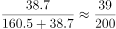；

法国入境游女性人数占该国入境游人数比重为：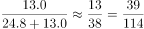；

英国入境游女性人数占该国入境游人数比重为：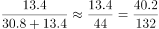；

加拿大入境游女性人数占该国入境游人数比重为：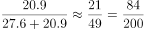；

比较日本、法国：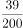&lt;，日本的分母大，则分数小，排除B项；

比较日本、英国：&lt;，日本的分子小分母大，则分数小，排除C项；

比较日本、加拿大：&lt;，日本的分子小，则分数小，排除D项。

故正确答案为A。

**来源**：2015年江苏省公务员录用考试《行测》题（B类）第88题

### 第 89 题

2014年1—9月来自德国的入境游客中，25—45岁的游客人数是15岁以下游客人数的（  ）。

A. 10.3倍

B. 9.3倍

C. 9.9倍

D. 8.9倍

第 89 题 · 答案与解析

**参考答案（粉笔题库参考内容）**

C

**解析**

从表格可知来自德国的入境游客中，15岁以下游客人数为2.0万人，25—45岁的游客人数为19.8万人，则25—45岁的游客人数是15岁以下游客人数的\=9.9倍。

故正确答案为C。

**来源**：2015年江苏省公务员录用考试《行测》题（B类）第89题

### 第 90 题

下列判断正确的是（  ）。

A. 2014年1—9月来自美国的入境游人数为119.2万人

B. 2014年1—9月来自澳大利亚的入境游人数占来自大洋洲入境游人数的82.8％

C. 2014年1—9月来自俄罗斯的入境游客中，45—65岁的游客人数多于其他年龄段

D. 2014年1—9月来自日本入境游人数大于来自韩国入境游人数

第 90 题 · 答案与解析

**参考答案（粉笔题库参考内容）**

B

**解析**

A项：从文字材料得，来自美国的入境人数=来自美国的男性+来自美国的女性=98.3+55.7＝154（万人），A项错误；

B项：来自澳大利亚的入境游人数占来自大洋洲入境游人数的82.8%，B项正确；

C项：来自俄罗斯的入境游客中，45—65岁的游客人数为6.9万人，而25—45岁的游客人数为8.8万人，则45—65岁的游客人数不是最多的，C项错误；

D项：从文字材料得，来自日本入境游人数为160.5+38.7=199.2万人，来自韩国的入境游的人数为191.3+116.4=307.7万人，故韩国入境游人数比较多，D项错误。

故正确答案为B。

**来源**：2015年江苏省公务员录用考试《行测》题（B类）第90题

## 材料 5

2014年前9个月江苏钢材产量稳步增长，其中1—2月产量为1932万吨，累计同比增长10.0％；3月产量为1127万吨，1—3月累计同比增长8.5％；4月产量为1013万吨，1—4月累计同比增长7.3％；5月产量为1156万吨，1—5月累计同比增长6.1％；6月产量为1236万吨，1—6月累计同比增长6.3％；7月产量为1094万吨，1—7月累计同比增长4.9％；8月产量为1050万吨，1—8月累计同比增长3.8％；9月产量为1149万吨，1—9月累计同比增长3.7％。1—9月江苏生铁、粗钢产量及其同比增长情况如下图：

2014年1—9月江苏生铁、粗钢产量及同比增长率

### 第 91 题

2014年9月江苏的粗钢产量比上月增加了（  ）。

A. 56万吨

B. 48万吨

C. 43万吨

D. 40万吨

第 91 题 · 答案与解析

**参考答案（粉笔题库参考内容）**

B

**解析**

由图表可得，2014年9月粗钢生产量=(1-9月粗钢生产量)-(1-8月粗钢生产量)=7160–6348=812万吨，2014年8月粗钢生产量=(1-8月粗钢生产量)-(1-7月粗钢生产量)=6348–5584=764万吨，则9月江苏的粗钢产量比上月增加了812-764=48万吨。

此外，由于题干数据的精度与选项的精度一致，也可以将式子列出来后，使用尾数法简化计算过程。

故正确答案为B。

**来源**：2015年江苏省公务员录用考试《行测》题（C类）第86题

### 第 92 题

2014年第二、三季度江苏生铁月产量超过600万吨的月份个数有（  ）。

A. 1个

B. 2个

C. 3个

D. 4个

第 92 题 · 答案与解析

**参考答案（粉笔题库参考内容）**

A

**解析**

第二、第三季度，需要去对应4—9月份的生铁产量，可以利用前面月份的累计值加上600万吨观察是否超过现在的累计值，如果超过，则证明当月产量没有达到600万吨，

1-3月份生铁的产量1744+600>1-4月份生铁的产量2314万吨，故4月份没有超过600万吨，

1-4月份生铁的产量2314+600>1-5月份生铁的产量2905万吨，故5月份没有超过600万吨，

1-5月份生铁的产量2905+600&lt;1-6月份生铁的产量3526万吨，故6月份超过600万吨，

1-6月份生铁的产量3526+600>1-7月份生铁的产量4111万吨，故7月份没有超过600万吨，

1-7月份生铁的产量4111+600>1-8月份生铁的产量4672万吨，故8月份没有超过600万吨，

1-8月份生铁的产量4672+600>1-9月份生铁的产量5263万吨，故9月份没有超过600万吨，

则第二、三季度生铁月产量超过600万吨的月份是6月份。

故正确答案为A。

**来源**：2015年江苏省公务员录用考试《行测》题（C类）第87题

### 第 93 题

2014年9月江苏钢材产量约是生铁产量的（  ）。

A. 1.5倍

B. 1.9倍

C. 2.2倍

D. 2.4倍

第 93 题 · 答案与解析

**参考答案（粉笔题库参考内容）**

B

**解析**

由文字材料得，2014年9月钢材产量为1149万吨，

由图表可得，9月生铁产量为5263-4672=591万吨，

则钢材产量约是生铁产量的倍。

故正确答案为B。

**来源**：2015年江苏省公务员录用考试《行测》题（C类）第88题

### 第 94 题

2014年6—9月江苏粗钢产量同比增长率最低的月份是（  ）。

A. 6月

B. 7月

C. 8月

D. 9月

第 94 题 · 答案与解析

**参考答案（粉笔题库参考内容）**

C

**解析**

由图表可得，1-5月粗钢产量同比增长率为8.2％，1—6月粗钢产量同比增长率为9.3％，利用混合增长率，可知6月份的粗钢同比增长率>9.3%。

同理，得到7月份的粗钢同比增长率>9.5％；8月份的粗钢同比增长率&lt;9.3％；9月份的粗钢同比增长率＝9.3％，所以2014年6—9月江苏粗钢产量同比增长率最低的月份是8月份。

故正确答案为C。

**来源**：2015年江苏省公务员录用考试《行测》题（C类）第89题

### 第 95 题

下列说法不正确的是（  ）。

A. 2014年第三季度江苏的生铁产量为1737万吨

B. 2014年1—9月江苏钢材产量同比增速呈下降趋势

C. 2014年2—9月江苏粗钢产量的年内累计同比增速一直高于钢材和生铁

D. 2014年前三季度江苏钢材的月产量都高于1000万吨

第 95 题 · 答案与解析

**参考答案（粉笔题库参考内容）**

D

**解析**

A项：2014年第三季度江苏的生铁产量=1-9月生铁产量-1-6月生铁产量=5263-3526＝1737万吨，A项正确；

B项：从题干材料可知，除了2014年1-6月份江苏钢材产量的累计增速比2014年1-5月份的累计增速略高，其他月份的累计增速都是下降的，故1-9月江苏钢材产量同比增速呈下降趋势（这里重在理解“下降趋势”，所谓下降趋势指的是整体呈下降的趋势，中间个别月份即使有上升也并不影响，注意和“逐月下降”进行区分），B项正确；

C项：从文字材料和图表可以得知，粗钢的年内累计同比增速一直比钢材和生铁高，故2014年2-9月江苏粗钢产量的年内累计同比增速一直高于钢材和生铁，C项正确；

D项：从文字材料“2014年1—2月产量为1932万吨”，可得1月和2月的钢材月产量不可能都高于1000万吨，D错误。

本题为选非题，故正确答案为D。

**来源**：2015年江苏省公务员录用考试《行测》题（C类）第90题

## 材料 6

某市统计局在针对噪音扰民的一次调查中，当问及受访市民对哪一类噪音反感时，选择社区广场舞活动噪音的占8.6%，比选择居民社区宠物狗叫声的低2.9个百分点。当问及是否支持广场舞活动时，12.8%的受访市民表示无所谓或者不知道，12.0%的受访者回答表示反对，其他为支持者。在支持的市民中，当被问及支持的主要原因（多选）时，不同年龄段受访者的回答如下图所示。

       在反对的市民中，被问及反对的主要原因（多选）时，不同区域受访者回答如下。

### 第 96 题

此次调查中，对居民社区宠物狗叫声反感的市民占受访市民的比重是：

A. 12\. 5％

B. 11\. 5％

C. 10\. 5％

D. 9\. 5％

第 96 题 · 答案与解析

**参考答案（粉笔题库参考内容）**

B

**解析**

从材料的第一句“当问及受访市民对哪一类噪音反感时，选择社区广场舞活动噪音的占8.6％，比选择居民社区宠物狗叫声的低2.9个百分点”，可得，对居民社区宠物的叫声反感的市民占受访市民的比重为8.6％+2.9％＝11.5％。

故正确答案为B。

**来源**：2015年江苏省公务员录用考试《行测》题（C类）第91题

### 第 97 题

如果此次调查的受访者数量为1000名，则支持广场舞等活动的人数为：

A. 634

B. 752

C. 798

D. 914

第 97 题 · 答案与解析

**参考答案（粉笔题库参考内容）**

B

**解析**

从材料的第二句“当问及是否支持广场舞活动时，12.8％的受访市民表示无所谓或者不知道，12.0％的受访者回答表示反对，其他为支持者”，则支持者所占的比重为1-12.8％-12.0％=75.2%，所以支持广场舞等活动的人数为1000×75.2%=752名。

故正确答案为B。

**来源**：2015年江苏省公务员录用考试《行测》题（C类）第92题

### 第 98 题

此次调查中，在支持广场舞等活动的受访青年市民中，同时选择“中老年人正常的锻炼娱乐活动”和“有利于中老年人扩大社交、排解孤独”的至少有：

A. 64\. 7％

B. 35\. 3％

C. 30\. 7％

D. 28\. 6％

第 98 题 · 答案与解析

**参考答案（粉笔题库参考内容）**

C

**解析**

从表格中可得，青年选择“中老年人正常的锻炼娱乐活动”的比例是66%，选择“有利于中老年人扩大社交、排解孤独”的比例是64.7%。所问的是“同时选择······至少”，那么就让两者重合的尽可能的少。利用两容斥公式：A∩B=A+B-A∪B，则同时选择“中老年人正常的锻炼娱乐活动”和“有利于中老年人扩大社交、排解孤独”的至少有66％+64.7％-100％＝30.7％。

故正确答案为C。

**来源**：2015年江苏省公务员录用考试《行测》题（C类）第93题

### 第 99 题

根据此次调查，市民反对广场舞等活动的主要原因是：

A. 噪音影响周围市民的生活和休息

B. 挤占公共场地，影响他人休闲锻炼

C. 音乐没有愉悦感，难以忍受

D. 集体舞形式没有美感，影响观感

第 99 题 · 答案与解析

**参考答案（粉笔题库参考内容）**

A

**解析**

从第二个表格可得，每个区域的市民反对广场舞的原因中“噪音影响周围市民的生活和休息”都占了80%以上，也比另外的原因所占比例多，所以市民反对广场舞等活动的主要原因是噪音影响周围市民的生活和休息。

故正确答案为A。

**来源**：2015年江苏省公务员录用考试《行测》题（C类）第94题

### 第 100 题

下列判断正确的是：

A. 此次调查中的16.3％的中年受访者认为广场舞等活动可以通过规范管理克服

B. 此次调查的受访者中，青年所占比例高于中年和老年

C. 和中心城区的老年人相比，非中心城区的中年人对广场舞更着迷

D. 在反对广场舞等活动的非中心城区受访者中，选择“音乐没有愉悦感，难以忍受”的比例高于其他区域

第 100 题 · 答案与解析

**参考答案（粉笔题库参考内容）**

D

**解析**

A项：支持广场舞等活动的受访市民中，有16.3％的中年受访者认为广场舞等活动可以通过规范管理克服，而不是调查中的16.3%的中年受访者，错误；

B项：表格中由于涉及到多选，无法得知青年、中年、老年所占比例（例如原因是中老年人的正常锻炼娱乐活动的青年可以是33人，青年总数是50人，中年人支持该原因的有54.6人，中年总数是100人），所以不能说青年所占的比例高，况且数据也只有支持受访者对应数据，更不能得出此次调查所有受访者中青年所占比例与中年和老年关系，错误；

C项：在表格中，无法得出非中心城区的中年人比中心城区的老年人对广场舞更着迷，错误；

D项：从图中可知，在反对广场舞等活动的非中心城区受访者中选择“音乐没有愉悦感，难以忍受”的比例为21.2％，中心城区比例是20.8%，新区比例是11.1%，故非中心城区受访者的比例选择“音乐没有愉悦感”的比例高于其他区域，正确。

故正确答案为D。

**来源**：2015年江苏省公务员录用考试《行测》题（C类）第95题

