# 2015年江苏省公务员录用考试《行测》题（C类）

<!-- gwy:overview:start -->
> **江苏 · 2015 · 行测 · C类** ｜ 95 题 · 图片 90 处 · 答案随题折叠

| 题型模块 | 题量 | 题号 |
| --- | ---: | ---: |
| 言语理解与表达 | 20 | 1–20 |
| 数量关系 | 15 | 21–35 |
| 判断推理 | 40 | 36–75 |
| 资料分析 | 20 | 76–95 |
| **合计** | **95** | |

导航：[题型与作答说明](#题型与作答说明) · [题目](#题目) · [材料 1](#材料-1)
<!-- gwy:overview:end -->

> 候选采集稿。参考答案及解析来自粉笔页面，不代表官方答案或真实高分答卷；来源使用许可与原卷对应关系仍需人工核实。

## 题型与作答说明

言语理解与表达

（20题）

本部分包括片段阅读、文章阅读与选词填空三种类型的试题。

数量关系

（15题）

本部分包括数字推理与数学运算两种类型的试题。

判断推理

（40题）

本部分包括类比推理、图形推理、逻辑判断与定义判断四种类型的试题。

资料分析

（20题）

下列给出的文字、表格、图形资料均有5个问题要你回答，你应根据资料提供的信息进行分析、计算、处理，然后从备选答案中选择一个最恰当的答案。

## 题目

### 第 1 题

中国近百年来的法律制度变革总体而言是以推动社会现代化为导向的，这反映了中国政治经济社会文化精英对现代中国前途的判断和追求，更多自觉不自觉地反映并适应了现代城市和都市经济社会生活的需要。但由此带来主导整个中国的法律制度和法治实践与农村生活现实需要不仅有差距，有时还相差甚远。

上文作为文章的开头部分，接下来文章最有可能讨论的问题是（    ）。

A. 法律制度与现代中国

B. 法律制度与农村生活

C. 法律制度与都市经济

D. 法律制度和法治实践

第 1 题 · 答案与解析

**参考答案（粉笔题库参考内容）**

B

**解析**

本题为接语选择题，需通读全文，重点关注文段最后讨论的核心话题。前文论述了中国法律制度变革以推动社会现代化为导向，中国法律制度适应了现代城市和都市经济社会生活的需要。文段尾句通过转折关联词“但”强调，法律制度和法治实践与农村生活现实需要相差甚远。故下文需要与文段最后讨论的核心话题保持一致，围绕法律制度与农村生活展开论述，对应B项。

A项“现代中国 ”、C项“都市经济 ”、D项“法治实践” ，均与文段最后讨论的核心话题“农村生活”不一致，排除。

故正确答案为B。

### 第 2 题

睡眠有个神奇的特点，就是我们大多数人总是在每天晚上相同的时间感受到睡魔的召唤。之所以如此，是因为睡眠的启动部分依赖于大脑内的一个“时钟”，这个“时钟”能够追踪记录地球的昼夜更替，以及季节性节律，而这个星球上的其他生物，从细菌和植物，到鱼类、昆虫和哺乳动物，都具有这样的能力，“生物钟”在自然界无处不在。

根据文意，下列现象与“生物钟”无关的是：

A. 腊梅花香寒冬来到

B. 公鸡每天清晨打鸣

C. 旅美归来要“倒时差”

D. 夏季来临昼长夜短

第 2 题 · 答案与解析

**参考答案（粉笔题库参考内容）**

D

**解析**

根据文段，人类和“这个星球上的其他生物，从细菌和植物，到鱼类、昆虫和哺乳动物，都具有这样的能力”，即是体内都有一个生物钟。A项腊梅、B项公鸡、C项旅美归来的人都属于上述提到的生物范畴，都与“生物钟”有关，而D项只是地球转动导致的自然规律，与“生物钟”无关。

本题为选非题，故正确答案为D。

### 第 3 题

民以食为天，人多地少是不少国家面临的共同问题。在全球化时代，国际粮价的波动往往对国内粮食生产影响巨大。据介绍，日本已在海外开发农田1200万公顷，相当于其国内耕地面积的3倍；韩国在海外购买和租赁农田243万公顷，相当于其国内耕地面积的1.3倍，日韩农业“走出去”，借助多元化的规模经营，获得了强大的国际竞争力，对保证其粮食安全起到了积极作用。

这段文字讨论的重点是：

A. 日本韩国本世纪的耕地面积规模

B. 日韩“走出去”的海外屯田战略

C. 人多地少粮价波动是世界性问题

D. 国际粮价与国内粮食生产的联动

第 3 题 · 答案与解析

**参考答案（粉笔题库参考内容）**

B

**解析**

文段首先指出“人多地少”以及“国际粮价波动”是许多国家面临的共性难题，继而介绍日本、韩国采取海外屯田缓解粮食安全问题的对策，从而提升粮食安全保障能力。故文段重点强调日韩应对粮食安全挑战所采取的海外屯田战略，对应B项。

A项，“耕地面积规模”仅能对应文段的一部分，表述片面且非重点，文段重在强调日韩应对粮食安全挑战所采取的海外屯田战略，排除；

C、D两项，均对应文段提出问题的部分，非重点，排除。

故正确答案为B。

### 第 4 题

当人们告别了茹毛饮血，告别了原始的狩猎采集而过渡到农耕时，烹饪便随着人们味蕾的刺激而兴起，以致一发不可收拾。然而，古代的中国人真可谓是活在了舌尖上，生产力的低下，徭役的频繁，让中国的老百姓不得不为了生存而疲于奔命。因此，《左传》中有“肉食者鄙”一说。可见在那个时期，中国的老百姓是吃不上肉的。

文中“古代的中国人真可谓是活在了舌尖上”指的是（    ）。

A. 古代的中国人味蕾已经相当灵敏

B. 古代中国老百姓同样享受美食生活

C. 古代中国老百姓食物仅够勉强糊口

D. 古代中国人已经很重视烹饪艺术

第 4 题 · 答案与解析

**参考答案（粉笔题库参考内容）**

C

**解析**

文段末句的“可见······”是对前文的总结，该句谈到老百姓吃不上肉，且前文中“生产力的低下，徭役的频繁，让中国的老百姓不得不为了生存而疲于奔命”是对“活在了舌尖上”进行解释，说明了当时老百姓生活水平低下，难以温饱，故C项符合文意，B、D两项有悖文意，A项无中生有。

故正确答案为C。

### 第 5 题

新型城镇化最大的障碍是旧的体制和旧的利益格局，突破旧体制的束缚，打破旧利益格局的掣肘，就需要政府淡化经济运营角色，从全能政府转变为有限政府，改变公共权力运行方式。诚然，在重视市场机制的同时，对于城镇化的进程、城市人口、城市布局、城市规模，政府要实行必要的宏观调控，但与此同时，政府也应该从以行政手段为主管理城镇发展，转变为采用经济和法律手段为主管理城镇发展。

下列说法不符合文意的一项是：

A. 推动新型城镇化工作的关键是转变政府职能

B. 新型城镇化发展的总体规划应该交由市场进行调控

C. 推动新型城镇化稳步发展必须坚持并强化依法行政

D. 新型城镇化过程中政府对人口等问题仍需实施管控

第 5 题 · 答案与解析

**参考答案（粉笔题库参考内容）**

B

**解析**

由第一句“新型城镇化最大的障碍是······改变公共权力运行方式”可知A项正确；

由“但与此同时······管理城镇发展”可知，C项正确；

由“诚然······宏观调控”可知，D项正确；

由“诚然······宏观调控”可知，新型城镇化过程中政府依然有必要进行宏观调控，而非完全交由市场，故B项错误。

本题为选非题，故正确答案为B。

## 材料 1

2014年3月，几内亚爆发了扎伊尔埃博拉病毒疫情，这种类型的埃博拉病毒具有高达60%-90%的致死率，因此成了全世界关注的焦点。

        埃博拉是一种神秘的病毒，这种病毒的长相令人生畏。典型的病毒呈现圆球形，而埃博拉病毒在电子显微镜下呈现出纤丝状，这些纤丝会出现弯曲或者缠绕的状态，仿佛蠕虫一般。

        埃博拉病毒首次爆发是在1976年的非洲。当时扎伊尔（现刚果民主共和国）和苏丹几乎同时爆发了一种神秘的传染病。发病之后，病情会在几天内迅速恶化，稍晚期一些的病人开始浑身出血，鼻子、牙床、眼结膜处会往外渗血，有些人表面看起来没有明显的出血，但内脏已经开始“溶解”，严重的出血会引起低血压和休克，等待他们的将是死亡。

        导致这种疾病的病原体很快就被确定了，这是一种新型病毒，研究者们用当地一条小河的名字将这种病毒命名为埃博拉。自从第一次爆发以来，科学家一共发现了五种不同类型的埃博拉病毒，并以首发地点进行了命名。这五种埃博拉病毒对人类的致病能力不甚相同，其中扎伊尔埃博拉病毒的致死率最高，可达60%-90%，而苏丹埃博拉病毒的致死率为50%左右，这两种埃博拉病毒也是历年爆发最为频繁的两种亚型。

        非洲是世界上面积第二的大洲，人口超过10亿。非洲的热带雨林里孕育着大量的生命，人类的祖先也是起源于这里。人类的近亲黑猩猩，今天仍旧居住在非洲的热带雨林中。由于遗传背景过于接近，灵长类动物身上保存的危险病原体很多都能够直接感染人类，它们因此成为了人类病原体巨大的自然储存库。

        埃博拉是一种神秘的病毒。科学家已在黑猩猩和猴子等灵长类动物以及蝙蝠体内发现了它们的踪迹，并大致上判断出蝙蝠是埃博拉病毒自然条件下的储存库。埃博拉病毒的传播方式也基本被厘清，它们一般是通过直接接触途径在动物间、动物与人类间或者人类间传播。埃博拉病毒的结构组成甚至基因组序列也已经在科学家的掌握之中。不过，这还是没有揭开这种病毒神秘的面纱。

        非洲居民有捕猎黑猩猩、猴子和蝙蝠等野生动物当食物的习俗，科学家估计，如HIV等一些威胁人类的病原体就是通过这个途径从野生动物跳到人类身上的。但是，捕猎每天都有，埃博拉病毒疫情却没有连续发生。1980年后，埃博拉病毒在非洲丛林沉寂了15年，一直没有向人类发起进攻。直到1995年扎伊尔型卷土而来，一下子在刚果民主共和国杀死了254个人。没有人知道为什么埃博拉病毒给了人类15年的“休战期”。

        埃博拉病毒是通过直接接触传播的，这种传播途径很容易阻断。远离传染源、戴上手套和穿上防护服，就能大大减少被传染的可能。但非洲当地的殡葬习俗，无意中成了埃博拉的帮凶。当地人去世后，遗体必须经过亲人处理后才能下葬。而在处理病亡者尸体的过程中，所有操作者不佩戴任何防护装备，这就可能造成病亡者亲友的大面积感染和死亡。

### 第 6 题

埃博拉病毒之所以“神秘”，主要因为（    ）。

A. 它的爆发尚无规律可循

B. 它的形状异于其他病毒

C. 它在动物与人类间传播

D. 它有高得惊人的致死率

第 6 题 · 答案与解析

**参考答案（粉笔题库参考内容）**

A

**解析**

由第七段“但是，捕猎每天都有······没有人知道为什么埃博拉病毒给了人类15年的‘休战期’”可知，埃博拉病毒的神秘来自于人类找不到其爆发的规律，即A项；B项，根据第二段可知，其形状是人类已经了解的内容，排除；根据第六段“它们一般是通过直接接触途径在动物间、动物—人类间或者人类间传播”可知，C项与“神秘”无关；根据第一段，埃博拉的高致死率是人类已知的内容，并非“神秘”所在，排除。

故正确答案为A。

### 第 7 题

人类发现埃博拉病毒距今（    ）。

A. 近二十年

B. 近三十年

C. 近四十年

D. 近五十年

第 7 题 · 答案与解析

**参考答案（粉笔题库参考内容）**

C

**解析**

根据第三段“埃博拉病毒首次爆发是在1976年的非洲”可知，埃博拉病毒在距今约40年前被首次发现。

故正确答案为C。

### 第 8 题

埃博拉病毒命名源自（    ）。

A. 防控疫情的代号

B. 扎伊尔名胜古迹

C. 非洲的神话传说

D. 发病地天然水道

第 8 题 · 答案与解析

**参考答案（粉笔题库参考内容）**

D

**解析**

根据第四段“研究者们用当地一条小河的名字将这种病毒命名为埃博拉”可知，埃博拉为河流名称。

故正确答案为D。

### 第 9 题

埃博拉屡次在非洲爆发的主要原因是（    ）。

A. 非洲人口众多且面积广袤

B. 非洲村民沿袭的生活习俗

C. 非洲有大面积的热带雨林

D. 非洲丰富的野生动物物种

第 9 题 · 答案与解析

**参考答案（粉笔题库参考内容）**

B

**解析**

根据第七段，“非洲居民有捕猎黑猩猩、猴子和蝙蝠等野生动物当食物的习俗”，以及第八段“非洲当地的殡葬习俗，无意中成了埃博拉的帮凶”，可知，以上两个非洲习俗，使埃博拉屡次在非洲爆发。

故正确答案为B。

### 第 10 题

文章带给读者的主要启示是（    ）。

A. 埃博拉自上世纪七十年代以来已数次在非洲暴发

B. 埃博拉主要是由非洲灵长类野生动物传给人类的

C. 埃博拉的致病机理已经被医务工作者所破解

D. 埃博拉病势凶险，但仍是可预防、可控制的疾病

第 10 题 · 答案与解析

**参考答案（粉笔题库参考内容）**

D

**解析**

文段首先介绍了埃博拉病毒的一些基本状况，如形态、发病病征、名称由来、致死率等，又探讨了埃博拉屡次侵扰非洲的原因，最后点出埃博拉的传染途径“很容易被阻断”，只要“远离传染源、戴上手套和穿上防护服，就能大大减少被传染的可能”。故作者意在向读者启示埃博拉病毒虽然可怕，但是可以通过一些途径避免传染，D项为同义替换。而A、B、C三项均为文段部分内容的表述，并非文段重点，排除。

故正确答案为D。

### 第 11 题

所有行政审批事项都要\_\_\_\_\_\_程序，明确\_\_\_\_\_\_，用政府权力的“减法”，换取市场活力的“乘法”。

依次填入画横线部分最恰当的一项是：

A. 简略 时效

B. 简缩 时间

C. 简化 时限

D. 简便 时长

第 11 题 · 答案与解析

**参考答案（粉笔题库参考内容）**

C

**解析**

根据文意，第一空应当填入一个动词，故排除只能作形容词的“简略”、“简便”；第二空，“明确”搭配“时限”指完成某事所限定的时间，填入第二空即为行政审批事项精简的限定时间，语句通顺，符合文意。

故正确答案为C。

### 第 12 题

任何一个领域的改革都会牵动其他领域，同时也需要其他领域密切配合，\_\_\_\_\_\_各领域改革不配套，各方面改革措施之间互相牵扯，甚至互相抵触，改革就很难推进下去，\_\_\_\_\_\_勉强推进，效果也会打折扣。

A. 即使 如果

B. 如果 即使

C. 虽然 如果

D. 即使 虽然

第 12 题 · 答案与解析

**参考答案（粉笔题库参考内容）**

B

**解析**

第一空，前文点明改革需要各领域的密切配合，第一空后意在通过提出假设进行反证，且根据假设的文意，可知第二空也应填入一假设关联词，即选B项。

故正确答案为B。

### 第 13 题

我国历史文化和民族文化中的生态文化元素＿＿＿＿，挖掘并＿＿＿＿我国历史文化和民族文化中的生态文化元素，会给我们带来许多直观的、可资借鉴的＿＿＿＿。

依次填入画横线处最恰当的一项是：

A. 不胜枚举 吸取 启蒙

B. 不计其数 提取 启动

C. 俯拾皆是 汲取 启迪

D. 多如牛毛 记取 启示

第 13 题 · 答案与解析

**参考答案（粉笔题库参考内容）**

C

**解析**

第二空，“记取”指记住，往往搭配“教训”、“叮嘱”，和“生态文化元素”搭配不当，排除D项；第三空，根据文意应填入名词，“启动”为动词，故排除B项；“启蒙”指传授基础知识或入门知识，不符合文意，且启蒙一般不与“许多”搭配，排除A项，故选C项，俯拾皆是形容多，“汲取”指吸取，常和“知识”、“经验”等搭配，放在此处符合语境和文意，当选。

故正确答案为C。

### 第 14 题

孟子说：“生于忧患，死于安乐”。就是说，艰苦的生活环境能够＿＿＿＿一个人的坚强意志，激励他不断地进取；而安逸的生活则很容易＿＿＿＿一个人，使他＿＿＿＿其中，走向颓废乃至于最后的灭亡。

依次填入画横线处最恰当的一项是：

A. 锤炼 锈蚀 沉潜

B. 历练 侵蚀 沉滞

C. 锻炼 腐蚀 沉溺

D. 磨练 销蚀 沉浮

第 14 题 · 答案与解析

**参考答案（粉笔题库参考内容）**

C

**解析**

第一空，“历练”鲜与意志搭配，再看第三空，根据文段感情色彩，本空应填入一个贬义词，“沉潜”指集中精神或潜心之意，带有褒义，排除；“沉浮”指盛衰、消长，也指随波逐流，不符合文意，排除；“沉溺”指陷入不良境地，难以自拔，符合文意，且“沉溺其中”为固定用法，故选C项。代入C项验证，均能与文意契合，且语句通顺。

故正确答案为C。

### 第 15 题

推进法治政府建设，是各级政府的基础性和\_\_\_\_\_\_工作，具有长期性、系统性和艰巨性，必须\_\_\_\_\_\_，常抓不懈。

依次填入画横线处最恰当的一项是：

A. 全面性 不离不弃

B. 全程性 锲而不舍

C. 全员性 夜以继日

D. 全局性 持之以恒

第 15 题 · 答案与解析

**参考答案（粉笔题库参考内容）**

D

**解析**

先看第二空，根据文意，第二空所填内容应与逗号后的“常抓不懈”意思相近，“不离不弃”意为永远在身边，永不分离，常用来形容男女之间的关系，排除；“夜以继日”形容加紧工作或学习，与文段长期坚持的语义不符，排除；第一空，“全程性”强调的是贯穿整个过程，在文中无此体现，“全局性”强调的是整个局面，与后文的“系统性”对应，说明推进法治政府建设是关乎全局工作的。

故正确答案为D。

### 第 16 题

书店应当设法降低书价或改善服务，让读者\_\_\_\_\_\_地掏钱，而不是\_\_\_\_\_\_，指责消费者说，我们费了这么大心思，你怎么还是跑去网上买书，太不道德了!

依次填入画横线处最恰当的一项是（    ）。

A. 真心诚意 悲天悯人

B. 心悦诚服 自怨自艾

C. 心甘情愿 怨天尤人

D. 慷慨解囊 自说自话

第 16 题 · 答案与解析

**参考答案（粉笔题库参考内容）**

C

**解析**

第一空，“心悦诚服”指真心地服气或服从，而读者买书并不需要服从，“慷慨解囊”与后文的掏钱一词重复，排除B、D两项。第二空，由横线后的内容可知应填入和“指责”语义相近的词，“悲天悯人”指哀叹时世的艰难，怜惜人民的痛苦，显然不符合文意，排除A项。

故正确答案为C。

### 第 17 题

我们面临的机遇，不再是简单＿＿＿＿全球分工体系、扩大出口、加快投资的传统机遇，而是＿＿＿＿我们扩大内需、提高创新能力、促进经济发展方式转变的新机遇。

依次填入画横线处最恰当的一项是：

A. 准入 引领

B. 纳入 倒逼

C. 导入 推举

D. 加入 导致

第 17 题 · 答案与解析

**参考答案（粉笔题库参考内容）**

B

**解析**

第一空，所搭配的宾语是“体系”，“准入”、“导入”都不能与体系搭配，排除；第二空，“导致”后一般跟不好的结果，而后文的内容都是积极的，排除。

故正确答案为B。

### 第 18 题

世界上的树＿＿＿＿＿＿，有的像白杨一样＿＿＿＿，有的像垂柳一样飘逸，有的像油松一样坚韧。

依次填入画横线处最恰当的一项是：

A. 千变万化 挺立

B. 千差万别 挺括

C. 千奇百怪 挺进

D. 千姿百态 挺拔

第 18 题 · 答案与解析

**参考答案（粉笔题库参考内容）**

D

**解析**

先看第二空，根据语义和后文的相同句式，该空应填入一个修饰白杨的形容词，“挺进”为动词，排除C项。“挺括”指平整，不容易皱，一般形容衣服面料，不能形容白杨，排除B项。

第一空，根据文意，是形容各种树各有不同，而“千变万化”形容变化大，不符合文意，排除A项。“千姿百态”能对应后文不同的树不同的特征，对应D项。

故正确答案为D。

### 第 19 题

农业转型过程中，市场发挥决定性作用，切忌＿＿＿＿＿＿、揠苗助长，以行政力量＿＿＿＿甚至强推农业规模化。

依次填入横线处最恰当的一项是：

A. 李代桃僵 指导

B. 大包大揽 引导

C. 越俎代庖 主导

D. 鞭打快牛 倡导

第 19 题 · 答案与解析

**参考答案（粉笔题库参考内容）**

C

**解析**

第一空，根据文意可知填入的词应当表达行政力量对于农业转型不应过分的干预之意，“李代桃僵”指的是以此代彼或代人受过，“鞭打快牛”指越是走得快的牛，越是用鞭子打它，让它走得更快。比喻赏罚不明，奖懒罚勤。与枪打出头鸟相似，均不符合文意，排除A、D两项。

第二空，B项“引导”含褒义，不符合文段消极的感情色彩，排除，C项“主导”一词符合文意，且与后面的“强推”一词能构成递进关系。

故正确答案为C。

### 第 20 题

文风源于内心，你表面上可以做到不动声色，但作为情感的\_\_\_\_\_，文字通常会将你内心的感受直接表现出来，一个人的文风并不是\_\_\_\_\_\_的，它会随着人的年龄、心态、思想内涵及\_\_\_\_\_\_\_的变化而改变。

依次填入横线处最恰当的一项是：

A. 宣泄 一成不变 阅历

B. 抒发 一以贯之 经历

C. 爆发 一蹴而就 资历

D. 表露 持之以恒 历练

第 20 题 · 答案与解析

**参考答案（粉笔题库参考内容）**

A

**解析**

先看第二空，根据后文语义可知，本空填入的词要表达文风不会改变的意思，故排除强调轻而易举的“一蹴而就”和强调坚持的“持之以恒”，而“一以贯之”虽然强调的是不变，但意思为用一个根本性的事理贯通事情的始末或全部的道理，用来形容文风不恰当；故选A项；代入第一空，“宣泄”更能对应后文的“将你内心的感受直接表现出来”，“阅历”一词搭配也得体。

故正确答案为A。

### 第 21 题

\-5，-1，5，13，（  ），35。

A. 20

B. 21

C. 23

D. 25

第 21 题 · 答案与解析

**参考答案（粉笔题库参考内容）**

C

**解析**

数列从负到正逐渐增大，且变化幅度较小，优先考虑作差。作差后得到新数列：4、6、8、（10）、（12），为连续偶数列，代入C项后满足。

故正确答案为C。

### 第 22 题

99，  143，  195，  255，  323，（  ）。

A. 353

B. 366

C. 398

D. 399

第 22 题 · 答案与解析

**参考答案（粉笔题库参考内容）**

D

**解析**

方法一：数列起伏较小，优先考虑作差。作差后得到新数列：44、52、60、68、（76），为公差是8的等差数列，则下一项应为68+8=76，所求项应为323+76=399。

方法二：数列各项均含有临近的平方数，考虑平方数列。观察发现，99=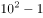；143=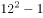；195=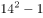；255=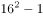；323=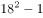。为连续偶数列的平方数减1，故下一项应为：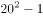\=399。

故正确答案为D。

### 第 23 题

1，    2，    3，    6，    21，（  ）。

A. 126

B. 114

C. 105

D. 91

第 23 题 · 答案与解析

**参考答案（粉笔题库参考内容）**

A

**解析**

观察数列无明显特征，变化趋势平缓，考虑作差。作差之后可得新数列：1，1，3，15 。新数列相邻两项之间倍数关系明显，考虑作商，相邻两项之间作商可得：1，3，5，故下一项应为7。则题干所求项为：21+15×7=126。

故正确答案为A。

### 第 24 题

  ,   ,   ,   ,    ,（  ）。

A. 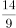

B. 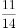

C. 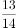

D. 

第 24 题 · 答案与解析

**参考答案（粉笔题库参考内容）**

B

**解析**

观察发现，可将分母转化为逐步递增的偶数列，转化后数列为：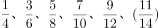，分母部分为连续偶数列，分子部分为连续奇数列。

故正确答案为B。

### 第 25 题

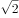 ，2 ，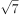 ， 2 ， ，（  ）。

A. 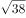

B. 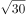

C. 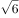

D. 5

第 25 题 · 答案与解析

**参考答案（粉笔题库参考内容）**

A

**解析**

将题干统一转化为根数列，则为。相邻两项根号内数字作差后得：2、3、5、9、（），二级作差后得：1、2、4、（8），为公比是2的等比数列，则所求项应为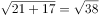。

故正确答案为A。

### 第 26 题

甲、乙、丙三村共建一项水利工程，原计划三村派出的劳动力之比为8：5：7，因丙村劳动力紧张，经协调，丙村少出的劳动力由甲、乙两村分担，相应的工钱由丙村承担。若甲、乙、丙三村派出的实际人数分别为84、52、24，丙村付给甲、乙两村的工钱共5.6万元，则丙村给甲村的工钱为（  ）。

A. 2\. 1万元

B. 2\. 8万元

C. 3\. 5万元

D. 4\. 2万元

第 26 题 · 答案与解析

**参考答案（粉笔题库参考内容）**

C

**解析**

甲、乙、丙三村实际派出的人数比为84:52:24=21:13:6（共40份），计划派出的人数比8:5:7=16:10:14（共40份）。所以甲村多出了21-16=5份，乙村多出了13-10=3份，甲、乙两村多派出劳动力的费用共8份由丙村来承担，一共对应5.6万元，每份为0.7万元。那么丙村需给甲村的工钱是5份共3.5万元。

故正确答案为C。

### 第 27 题

某单位扩建周长为44米的长方形草坪，计划扩建后的草坪仍为长方形，其长和宽分别比原来增加5米和3米，面积比原来增加95平方米，则扩建前草坪的面积为（  ）。

A. 85平方米

B. 105平方米

C. 117平方米

D. 121平方米

第 27 题 · 答案与解析

**参考答案（粉笔题库参考内容）**

B

**解析**

方法一：假设扩建前长方形的长为a，宽为b，可得a+b=22①。扩建后增加的面积=3a+5b+15=95，化简得3a+5b=80②，联立①和②，解得a=15，b=7，则扩建前面积为15×7=105平方米。

方法二：扩建后增加的面积=3a+5b+15=95，化简得3a+5b=80（a>b），已知80是5的倍数，5b也是5的倍数，那么3a一定为5的倍数，所以a必为5的倍数。代入方程，由于a＞b，只有三组解，a=25、b=1，面积=25； a=20、b=4，面积=80；a=15、b=7，面积=105。只有B项满足。

故正确答案为B。

### 第 28 题

参加某运动会的全体运动员在开幕式上恰好排成一个正方形，有两行两列的运动员离场后，运动员人数减少64人，则参加该运动会的运动员人数为（  ）。

A. 225

B. 256

C. 289

D. 324

第 28 题 · 答案与解析

**参考答案（粉笔题库参考内容）**

C

**解析**

参加运动会的全体运动员恰好排成正方形，故总人数一定为平方数，设每行站x个人。后有两行两列的运动员离场，运动员人数减少64人，可得到方程2x+2(x-2)=64，解得x=17。参加该运动会的运动员人数为17×17=289人。

故正确答案为C。

### 第 29 题

某单位欲将甲、乙、丙、丁4名大学生分配到3个不同的岗位实习，若每个岗位至少分到1名大学生，且甲、乙两人被分在不同岗位，则不同的分配方法共有（  ）。

A. 30种

B. 36种

C. 60种

D. 72种

第 29 题 · 答案与解析

**参考答案（粉笔题库参考内容）**

A

**解析**

已知要将4人分到3个岗位，且每个岗位至少有一人，那么必定有两人会在一起实习，可以采用捆绑法将两人捆在一起，那么是将4人分配成三组，但是由于甲、乙两人不能在一起，那么共有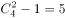种分配方式。再将分好的三组分配，分步用乘法，且三组排列方式任意，所以共有分配方法种。

故正确答案为A。

### 第 30 题

用A、B、C三种不同型号的挖掘机完成一项土方工程，A型5台和B型4台一起挖2天正好完成；A型10台和C型12台一起挖1天正好完成；B型2台和C型3台一起挖4天正好完成。若先用A型1台工作5天，再用B型2台工作2天，最后用C型3台完成剩下的工程，则完成该项工程共需的天数为（  ）。

A. 8

B. 9

C. 10

D. 11

第 30 题 · 答案与解析

**参考答案（粉笔题库参考内容）**

D

**解析**

设A、B、C三种不同型号的挖掘机每天工作效率为a、b、c。根据题意（5a+4b）×2=（10a+12c）×1=（2b+3c）×4，化解可得5a=4b=6c。将工程总量设为24c，则完成该项工程剩余所需天数为（24c-5a×1-2b×2）÷3c=（24c-6c-6c）÷3c=4天，所以总需为4+5+2=11天。

故正确答案为D。

### 第 31 题

A、B两地分别有10台和6台型号相同的机器，准备配送到E、F两地，其中E地11台，F地5台。若每台机器从A到E和F的物流费用分别为350元和550元，从B到E和F的物流费用分别为600元和900元，则配送这16台机器的总物流费用最少为（  ）。

A. 7850元

B. 8100元

C. 8400元

D. 8700元

第 31 题 · 答案与解析

**参考答案（粉笔题库参考内容）**

B

**解析**

由题意可得，A→F比A→E单价高了200元、B→F比B→E单价高了300元，所以优先选择由A地配送5台机器到F地，则费用为。由A地配送5台机器到E地，剩下的6台由B地配送，则费用为。总费用为2750+5350=8100元。

故正确答案为B。

### 第 32 题

某列车通过1200米长的隧道要用时33秒，与另一列长150米、速度为50米／秒的列车错车而过需要3秒，则该列车减速一半后，通过一座600米的桥梁所需的时间为（  ）。

A. 18秒

B. 20秒

C. 30秒

D. 36秒

第 32 题 · 答案与解析

**参考答案（粉笔题库参考内容）**

D

**解析**

列车过桥问题常用公式：桥长+车长=速度×时间。已知列车A与另一列车B发生错车的时候，总共走过的路程为A+B的车长。B列车走过的路程为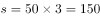m，相当于B列车的自身车长，那么列车A用3秒钟同样是走过了自身车长的距离。由题目可得列车A速度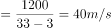，那么列车A的车长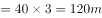。已知列车A减速一半后，速度变为20m/s，故通过一座600米的桥梁所需的时间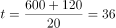s。

故正确答案为D。

### 第 33 题

设a，b均为正整数，若11a+7b＝84，则a的值为（  ）。

A. 4

B. 5

C. 7

D. 8

第 33 题 · 答案与解析

**参考答案（粉笔题库参考内容）**

C

**解析**

方法一：已知等式11a+7b=84求解a值，直接采用代入排除法来求解。将A、B、D三项代入求得b均不为整数，代入C项验证求得b=1，a=7符合题意。

方法二：a，b均为正整数，且84=7×12。84为7的倍数，7b也为7的倍数，那么11a必为7的倍数，所以a=7。

故正确答案为C。

### 第 34 题

甲、乙、丙三位同学参加某单位的招聘面试，面试合格者可正式签约，甲只要面试合格就签约。乙、丙二人约定：只有两人面试都合格才一同签约，否则都不签约。若他们三人面试合格的概率都是，且面试是否合格互不影响，则他们三人都没有签约的概率为（  ）。

A. 

B. 

C. 

D. 

第 34 题 · 答案与解析

**参考答案（粉笔题库参考内容）**

B

**解析**

分析题意，乙、丙只要有一个不合格就不签约，那么求解三人都没有签约的概率分成两步算，先求甲不签约的概率，再求乙、丙同时不签约的概率。甲不签约的概率为，乙、丙同时不签约的概率为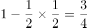，所以P=甲不合格的概率×（乙或丙不合格的概率）=。

故正确答案为B。

### 第 35 题

如图，在△ABC中，已知BD＝2DC，EC＝2AE，则△BFD与△AEF面积的比值为（    ）。

A. 4

B. 6

C. 8

D. 9

第 35 题 · 答案与解析

**参考答案（粉笔题库参考内容）**

C

**解析**

连接C、F两个点。已知BD＝2DC，EC＝2AE，假设S△CDF=a，S△AEF=b，则S△BFD=2a，S△CEF＝2b。结合图形可得3a+2b=S△BCE=S△ABC，a+3b=S△ACD=S△ABC，两式相除可解得a＝4b。所以。

故正确答案为C。

### 第 36 题

亚洲：非洲

A. 金星：火星

B. 城市：街市

C. 紫色：色彩

D. 南极：北方

第 36 题 · 答案与解析

**参考答案（粉笔题库参考内容）**

A

**解析**

第一步，判断题干词语间逻辑关系。

“亚洲”和“非洲”都属于七大洲，二者为并列关系。

第二步，判断选项词语间逻辑关系。

A项：“金星”和“火星”都属于太阳系的八大行星，二者为并列关系，与题干逻辑关系一致，当选；

B项：“街市”是“城市”的一部分，二者为组成关系，与题干逻辑关系不一致，排除；

C项：“紫色”是“色彩”的一种，二者为种属关系，与题干逻辑关系不一致，排除；

D项：“南极”和“北方”没有明确的逻辑关系，排除。

故正确答案为A。

### 第 37 题

海鱼：鱼子

A. 山羊：羊角

B. 骏马：马蹄

C. 河蟹：蟹黄

D. 野兔：兔毛

第 37 题 · 答案与解析

**参考答案（粉笔题库参考内容）**

C

**解析**

第一步：判断题干词语间逻辑关系。

“鱼子”是“海鱼”的组成部分，只有雌性海鱼才有鱼子，所以二者为或然组成关系，且鱼子存在于海鱼的体内。

第二步：判断选项词语间逻辑关系。

A项：“羊角”是“山羊”的组成部分，二者为必然组成关系，且羊角不是存在于山羊的体内，与题干逻辑关系不一致，排除；

B项：“马蹄”是“骏马”的组成部分，二者为必然组成关系，且马蹄不是存在于骏马的体内，与题干逻辑关系不一致，排除；

C项：“蟹黄”是“河蟹”的组成部分，只有母蟹才有蟹黄，二者为或然组成关系，且蟹黄存在于河蟹的体内，与题干逻辑关系一致，当选；

D项：兔毛是野兔的组成部分，二者为必然组成关系，且兔毛不是存在于野兔的体内，与题干逻辑关系不一致，排除。

故正确答案为C。

### 第 38 题

竹：高洁：品质

A. 灯：信号：禁行

B. 火：激情：态度

C. 鸽：和平：神州

D. 饼：团圆：家庭

第 38 题 · 答案与解析

**参考答案（粉笔题库参考内容）**

B

**解析**

第一步，判断题干词语间逻辑关系。

“竹”象征“高洁”，“高洁”是一种“品质”，前面两词为实物与其象征意义的对应，后面两词为种属关系对应。

第二步，判断选项词语间逻辑关系。

A项：“灯”和“信号”不是实物与其象征意义的对应，且“信号”与“禁止”之间不是种属关系，与题干逻辑关系不一致，排除；

B项：“火”象征“激情”，“激情”是一种“态度”，前面两词为实物与其象征意义的对应，后面两词为种属关系对应，与题干逻辑关系一致，当选；

C项：“鸽”象征“和平”，但是“和平”不是“神州”的一种，与题干逻辑关系不一致，排除；

D项：“月饼”象征“团圆”，但是“饼”并无明确的象征意义，且“团圆”和“家庭”之间可构成主谓关系，而非种属关系，与题干逻辑关系不一致，排除。

故正确答案为B。

### 第 39 题

光：激光：光柱

A. 水：流水：河流

B. 枣：红枣：枣树

C. 人：好人：人心

D. 词：词汇：汉语

第 39 题 · 答案与解析

**参考答案（粉笔题库参考内容）**

A

**解析**

第一步，判断题干词语间逻辑关系。

“激光”是“光”的一种，“光柱”是“激光”的一种表现形式，前面两词为种属关系对应，后面两词为对应关系。

第二步，逐一判断选项间词语的逻辑关系。

A项：“流水”是“水”的一种，“河流”是“流水”的一种表现形式，前面两词为种属关系对应，后面两词为对应关系；与题干逻辑关系一致，当选。

B项：“红枣”是“枣”的一种，前面两词构成种属关系；“枣树”并不是“红枣”的一种表现形式；与题干逻辑关系不一致，排除。

C项：“好人”是“人”的一种，前面两词构成种属关系；“人心”与“好人”属于不同的范畴，“人心”不是“好人”的一种表现形式；与题干逻辑关系不一致，排除。

D项：词汇是一种语言里所有的（或特定范围的）词和固定短语的总和，因此“词”是“词汇”的一部分，二者之间为组成关系而非种属关系；与题干逻辑关系不一致，排除。

故正确答案为A。

### 第 40 题

海盐 之于 （    ） 相当于 供暖器 之于 （    ）。

A. 咸味——供暖

B. 盐场——取暖

C. 味觉——电流

D. 调味剂——电器

第 40 题 · 答案与解析

**参考答案（粉笔题库参考内容）**

D

**解析**

将选项逐一代入，判断各选项前后部分的逻辑关系。

A项：海盐本身具有咸味，咸味是海盐的一种本质属性，且咸味为名词；供暖器本身不具有供暖的本质属性，供暖还需要借助外物，且供暖为动词，两组词前后逻辑关系不一致，排除；

B项：盐场是海盐的生产场所，而取暖和供暖器之间无法构成事物与其生产场所的对应，两组词前后逻辑关系不一致，排除；

C项：海盐可以提供咸的味觉，但是供暖器和电流之间无明显的逻辑关系，两组词前后逻辑关系不一致，排除；

D项：海盐是调味剂的一种，供暖器是电器的一种，两组词均构成种属关系，逻辑关系一致，当选。

故正确答案为D。

### 第 41 题

扎小羊灯 之于 （    ） 相当于 剪福字窗花 之于 （    ）。

A. 灯笼——桃花

B. 喜乐——过年

C. 小羊——窗户

D. 细绳——剪刀

第 41 题 · 答案与解析

**参考答案（粉笔题库参考内容）**

D

**解析**

将选项逐一代入，判断各选项前后部分的逻辑关系。

A项：小羊灯是花灯的一种，即扎小羊灯是制作灯笼（花灯）的过程；剪福字窗花和桃花之间无明显的逻辑关系，两组词前后逻辑关系不一致，排除；

B项：过年的时候剪福字窗花，而扎小羊灯则表示喜乐，两组词前后逻辑关系不一致，排除；

C项：小羊灯的样子类似羊，而福字窗花则贴在窗户上，两组词前后逻辑关系不一致，排除；

D项：扎小羊灯的过程中需要使用细绳，而剪福字窗花的过程中需要使用剪刀，两组词前后逻辑关系一致，当选。

故正确答案为D。

### 第 42 题

财政局之于  （    ）  相当于税务局之于  （    ）。

A. 拨款——收税

B. 机关——政府

C. 职员——局长

D. 预算——服务

第 42 题 · 答案与解析

**参考答案（粉笔题库参考内容）**

A

**解析**

将选项逐一代入，判断各选项前后部分的逻辑关系。

A项：“财政局”的职能之一是“拨款”，“税务局”的职能之一是“收税”，两组词前后逻辑关系一致，当选；

B项：“财政局”是一种“机关”，前面两词为种属关系对应，“税务局”与“政府”之间不是种属关系，两组词前后逻辑关系不一致，排除；

C项：“财政局”里有“职员”，而“税务局”中有“局长”，职员是非领导人员，而局长是领导人员，两组词前后逻辑关系不一致，排除；

D项：“财政局”的职能之一是“预算”，但是“服务”不是“税务局”的职能之一，两组词前后逻辑关系不一致，排除。

故正确答案为A。

### 第 43 题

pKpK2bb33s

A. SLSL6ff88g

B. dYdR81155r

C. fMfM7cc88d

D. 9H9H6xx55n

第 43 题 · 答案与解析

**参考答案（粉笔题库参考内容）**

C

**解析**

本题考查字符类比，注意字母（大小写）和数字的对应。

题干中第一位和第三位字母相同，且均为小写字母，第二位和第四位字母相同，且均为大写字母。只有C项符合此规律。

故正确答案为C。

### 第 44 题

A. 

B. 

C. 

D. 

第 44 题 · 答案与解析

**参考答案（粉笔题库参考内容）**

A

**解析**

本题考查字符类比，注意符号的对应。

题干中第一位和第四位符号一样，第二位和第五位符号一样，第三位和第七位符号一样，第六位和第八位符号一样，只有A项符合此规律。

故正确答案为A。

### 第 45 题

A. 

B. 

C. 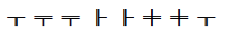

D. 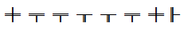

第 45 题 · 答案与解析

**参考答案（粉笔题库参考内容）**

A

**解析**

本题考查字符类比，注意相同符号的对应。

第一位和第七位的符号相同，第二位和第三位的符号相同，第四位和第五位的符号相同，第六位和第八位的符号相同，符合此规律的为只有A项；也可以将题干的形式看做：ABBCCDAD，只有A项符合。

故本题正确答案为A。

### 第 46 题

请从所给的四个选项中，选择唯一的一个答案，使之呈现一定的规律性：

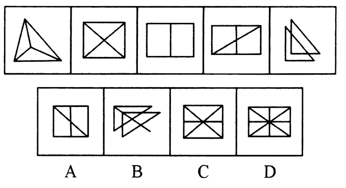

A. A

B. B

C. C

D. D

第 46 题 · 答案与解析

**参考答案（粉笔题库参考内容）**

D

**解析**

各图形构成不同，元素组成凌乱，且无明显的属性规律，考虑数量规律。

观察发现题干中图形的交点个数分别为4、5、6、7、8、？，在选项中寻找交点数为9的选项。A、B、C、D四项的交点数分别为7、10、7、9。

故正确答案为D。

### 第 47 题

请从所给的四个选项中，选择唯一的一个答案，使之呈现一定的规律性：

A. A

B. B

C. C

D. D

第 47 题 · 答案与解析

**参考答案（粉笔题库参考内容）**

B

**解析**

各图形构成不同，元素组成凌乱，且无明显的属性规律，考虑数量规律。

观察发现题干中图形的交点个数分别1、2、3、4、5，成等差数列，4个选项的交点数量分别为8、6、10、8。

故正确答案为B。

### 第 48 题

请从四个选项中选出正确的一项，其特征或规律与题干给出的一串符号的特征或规律最为相似。

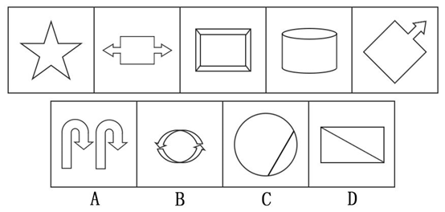

A. A

B. B

C. C

D. D

第 48 题 · 答案与解析

**参考答案（粉笔题库参考内容）**

C

**解析**

图形组成凌乱，且没有明显的数量规律，优先考虑对称性。题干中所有图形均为轴对称图形，因此在选项中寻找轴对称图形，只有C项符合。

故正确答案为C。

### 第 49 题

请从四个选项中选出正确的一项，其特征或规律与题干给出的一串符号的特征或规律最为相似。

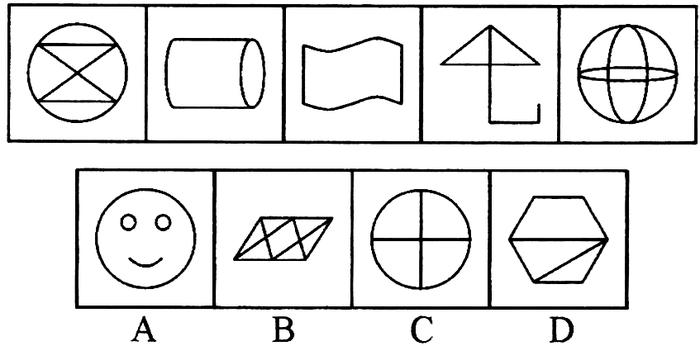

A. A

B. B

C. C

D. D

第 49 题 · 答案与解析

**参考答案（粉笔题库参考内容）**

D

**解析**

元素组成凌乱，且无明显的属性规律，考虑数量。

题干中的第二个图是“日”字的变形，C项是“田”字的变形，故考虑笔画数。题干中五个图形均为一笔画图形，在选项中寻找一笔画图形，选项笔画数依次为：4、2、2、1。

故正确答案为D。

### 第 50 题

右边四个图形中，只有一个是由左边的四个图形拼合（只能通过上、下、左、右平移）而成的，请把它找出来。

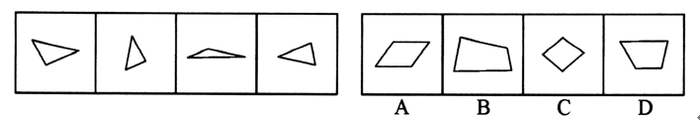

A. A

B. B

C. C

D. D

第 50 题 · 答案与解析

**参考答案（粉笔题库参考内容）**

B

**解析**

本题考查的是平面拼合，可以采用平行且等长相消的方式。消去平行且等长的线段（相同颜色标注）后进行组合即可得到轮廓图，即为B项。平行且等长相消的方式如下图所示：

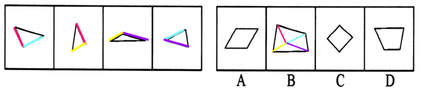

故正确答案为B。

### 第 51 题

选项的四个图形中，只有一个是由下边的四个图形拼合（只能通过上、下、左、右平移）而成的，请把它找出来。

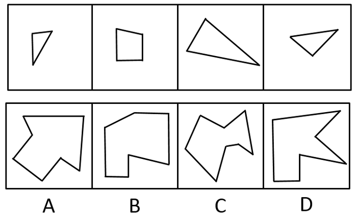

A. A

B. B

C. C

D. D

第 51 题 · 答案与解析

**参考答案（粉笔题库参考内容）**

D

**解析**

本题考查的是平面拼合，可以采用平行且等长相消的方式。消去平行且等长的线段（相同颜色标注）后进行组合即可得到轮廓图，即为D项。平行且等长相消的方式如下图所示：

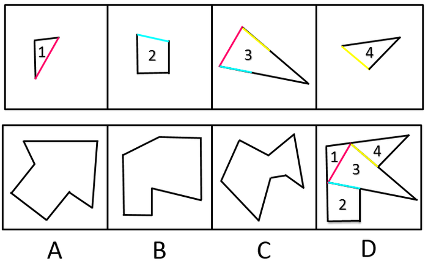

故正确答案为D。

### 第 52 题

右边四个图形中，只有一个是由左边的四个图形拼合（只能通过上、下、左、右平移）而成的，请把它找出来。

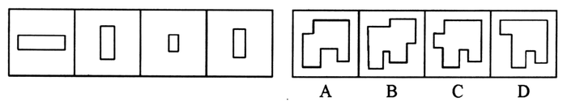

A. A

B. B

C. C

D. D

第 52 题 · 答案与解析

**参考答案（粉笔题库参考内容）**

D

**解析**

左边四个图可以按照如下方式进行拼合：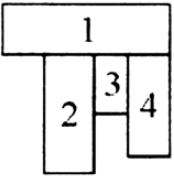

故正确答案为D。

### 第 53 题

左边给定的是纸盒外表面的展开图，右边哪一项能由它折叠而成？请把它找出来。

A. A

B. B

C. C

D. D

第 53 题 · 答案与解析

**参考答案（粉笔题库参考内容）**

A

**解析**

本题考查六面体的空间重构。

将平面展开图中的六面体进行标面，即：

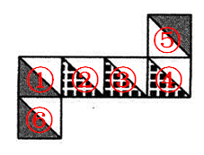

三组相对面为：①③；②④；⑤⑥，可知三个相同阴影面或者三个相同点状面中必然存在一组相对面，根据相对面不相邻，排除B、C两项。

平面展开图中，相邻的两个点状面与点状面之间存在公共点，而D选项中，相邻的两个点状面之间并不存在公共点，因此排除D选项。

故正确答案为A。

### 第 54 题

左边给定的是纸盒外表面的展开图，右边哪一项能由它折叠而成?请把它找出来。

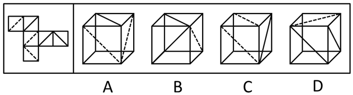

A. A

B. B

C. C

D. D

第 54 题 · 答案与解析

**参考答案（粉笔题库参考内容）**

A

**解析**

如图所示：

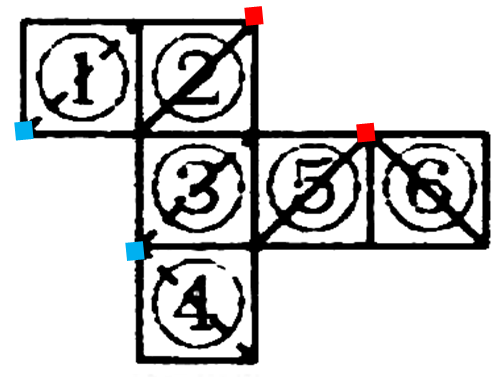

②、④为相对面，③、⑥为相对面，①、⑤为相对面，即三条虚线和三条实线分别为相对面。

A项：由于3条虚线交于一点，故底面应为虚线，而虚线的相对面为实线，顶面为实线，正确；

从展开图可以看出3条虚线交于一点，3条实线交于一点，由于3条实线交于一点，且一个点连接三个面，故B、C、D三项均错误。

故正确答案为A。

### 第 55 题

左边给定的是纸盒外表面的展开图，右边哪一项能由它折叠而成？请把它找出来。

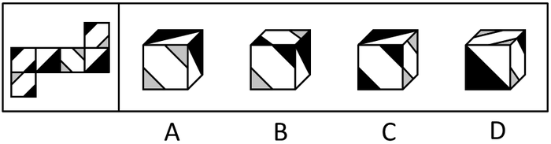

A. A

B. B

C. C

D. D

第 55 题 · 答案与解析

**参考答案（粉笔题库参考内容）**

D

**解析**

本题考查六面体的空间重构。

在平面展开图中标示出所有面，即：

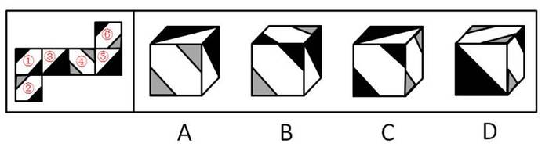

观察平面展开图，由图可知，面①面④为相对面，面③面⑤为相对面，面②面⑥为相对面。

A、B、C三项中均出现相对面关系，根据相对面不相邻，必然出现且只出现其中一个，A、B、C三项均错误。

故正确答案为D。

### 第 56 题

只有实行依法治国，才能从根本上杜绝腐败；如果不能从根本上杜绝腐败，我们终将失去人民的信任和支持。只有赢得人民的信任和支持，我们的事业才能拥有牢固的政治基础。

根据以上陈述，可以推出的是：

A. 如果实行依法治国，我们就能赢得人民的信任和支持

B. 如果从根本上杜绝腐败，我们的事业就能拥有牢固的政治基础

C. 如果不实行依法治国，我们终将失去人民的信任和支持

D. 如果不能从根本上杜绝腐败，就不能实行依法治国

第 56 题 · 答案与解析

**参考答案（粉笔题库参考内容）**

C

**解析**

题干和选项中出现多组典型“逻辑关联词”，先翻译后推理。

翻译题干：

①从根本上杜绝腐败→实行依法治国；

②不能从根本上杜绝腐败→失去人民的信任和支持；

③我们的事业拥有牢固的政治基础→赢得人民的信任和支持；

根据逆否等价定理和递推规则，可知：我们的事业拥有牢固的政治基础→赢得人民的信任和支持→从根本上杜绝腐败→实行依法治国。

A项：实行依法治国→赢得人民的信任和支持；肯定后件无法推知确定性结论，故A项错误；

B项：从根本上杜绝腐败→我们的事业拥有牢固的政治基础；推导方向错误，题干为：我们的事业拥有牢固的政治基础→从根本上杜绝腐败，故B项错误；

C项：不实行依法治国→失去人民的信任和支持，是对“赢得人民的信任和支持→实行依法治国”的逆否，能够推出；

D项：实行依法治国→从根本上杜绝腐败，推导关系错误，题干为：从根本上杜绝腐败→实行依法治国，故D项错误。

故正确答案为C。

### 第 57 题

法国历史上一位著名的美食家有一个有趣的观点：天生的美食家一般是中等身材、方圆脸、眼睛明亮、额头小、鼻子低、嘴唇丰满、四方下巴；而天生没有口福的人一般是瘦长脸型，眼睛和鼻子都较大，不管他身高如何，他总是给人一种瘦长的感觉。这一关于“美食面相”的观点也是如今大多数人对“美食家”的直观印象。可是，贪食与肥胖虽然有着密不可分的关联，却不是必然的因果关系，懂吃又善吃的瘦子比比皆是。

根据以上的陈述，可以推出的是（    ）。

A. 美食家一般都很肥胖

B. 肥胖的人一般都很贪食

C. 有的瘦子既不懂吃又不善吃

D. 有些瘦子既懂吃又善吃

第 57 题 · 答案与解析

**参考答案（粉笔题库参考内容）**

D

**解析**

逐一分析比较选项。

A项：由题干“天生的美食家一般是中等身材”以及“贪食与肥胖虽然有着密不可分的关联，却不是必然的因果关系”可知，题干中并未提及美食家一般都很肥胖，故A项无法推出，排除；

B项：由题干“贪食与肥胖虽然有着密不可分的关联，却不是必然的因果关系”可知肥胖与贪食之间无必然因果关系，故B选项无法推出，排除；

C项：由最后一句“懂吃又善吃的瘦子比比皆是”，推知有些瘦子既懂吃又善吃，无法推出C选项，排除；

D项：由最后一句“懂吃又善吃的瘦子比比皆是”可推之D选项正确，当选。

故正确答案为D。

### 第 58 题

甲：为富不仁，为官皆不义。

乙：你说的两句都不对。

以下哪项与乙的说法最为相近或相似？

A. 为富皆仁，为官皆义

B. 有的为富仁，有的为官义

C. 有的为富不仁，有的为官不义

D. 仁者不为富，义者不为官

第 58 题 · 答案与解析

**参考答案（粉笔题库参考内容）**

B

**解析**

甲的话为两个直言命题：①所有为富都不仁；②所有为官都不义。“所有的S都不是P”的矛盾命题是“有的S是P”。即乙的说法是：有的为富仁，有的为官义。

故正确答案为B。

### 第 59 题

某单位寻求对外合作，准备在甲、乙、丙、丁四家单位中确定一个或几个合作对象。单位管理层经过认真调研和讨论，最终形成了以下三种意见：

（1）对于甲和乙两单位，至多选一个；

（2）对于甲和丁两单位，至少选一个；

（3）如果选择丙或丁单位，就不能选择乙单位。

在最终决定时，单位领导只采纳了上述一种意见。

根据以上陈述，以下哪项最符合单位领导的最终决定?

A. 选择乙、丙、丁

B. 选择乙，但不选择丙和丁

C. 选择甲、乙、丁

D. 选择丙，但不选择乙和丁

第 59 题 · 答案与解析

**参考答案（粉笔题库参考内容）**

C

**解析**

题干重要信息：单位领导只采纳了（1）（2）（3）中的一种意见。

此题采用代入法，代入后：

A项：条件（1）（2）同时满足，排除；

B项：条件（1）（3）同时满足，排除；

C项：只满足条件（2），当选；

D项：条件（1）（3）同时满足，排除。

故正确答案为C。

### 第 60 题

唐朝诗人王建曾经有诗描写新嫁娘。诗云：“三日入厨下，洗手作羹汤。未谙姑食性，先遣小姑尝。”在诗中，新嫁娘因事先不知道婆婆（“姑”）的饮食喜好，就先请小姑尝一尝自己亲手做的羹汤。

以下各项如果为真，则哪项能够最合理地解释新嫁娘的这一行为？

A. 新嫁娘的饮食喜好与婆婆的饮食喜好是完全不同的

B. 新嫁娘的饮食喜好与小姑的饮食喜好是比较相似的

C. 小姑的饮食喜好与新嫁娘的饮食喜好是完全不同的

D. 小姑的饮食喜好与婆婆的饮食喜好是比较相似的

第 60 题 · 答案与解析

**参考答案（粉笔题库参考内容）**

D

**解析**

题干中新嫁娘让小姑尝自己亲手做的羹汤，其目的是为了了解婆婆的饮食喜好，因此要想解释这一行为，必须假设小姑和婆婆的饮食喜好相似，即D选项。

故正确答案为D。

### 第 61 题

在许多人看来，从一而终的就是好婚姻。其实，这种看法并不正确。婚姻不仅意味着身体的忠诚，而且还包含了情感的相互扶持。所以不能说只要没有第三者，婚姻就没有问题。当下中国有许多婚姻是这样一种模式：夫妻并没有出轨，但双方都无法从婚姻中获得抚慰、滋养和治愈。实际上，没有单方面“犯错”的人，每个人都需要为自己的婚姻付出更多的努力。

根据以上论述，可以推出的是（    ）。

A. 从一而终的并不就是好婚姻

B. 没有第三者的婚姻也会有问题

C. 只有出现了第三者，婚姻才会有问题

D. 当下中国大多数婚姻已经出了问题

第 61 题 · 答案与解析

**参考答案（粉笔题库参考内容）**

B

**解析**

分析题干：

（1）“在许多人看来，从一而终的就是好婚姻。其实，这种看法并不正确。”

（2）“不能说只要没有第三者，婚姻就没有问题。”即不能说（只要没有第三者，婚姻就没有问题），即“没有第三者且婚姻有问题”。

分析选项：

A项：题干只说明“在许多人看来从一而终的就是好婚姻，这种看法不正确”，但是并未说明正确的看法，且这种看法是“许多人”的看法，并不是所有人的看法，因此A项无法推出，排除；

B项：即上述（2）所阐明的观点，当选；

C项：与原文观点相反，无法推出，排除；

D项：原文是当下中国有许多婚姻是这样一种模式：夫妻并没有出轨，但双方都无法从婚姻中获得抚慰、滋养和治愈。据此无法推出出了问题，属于无中生有，排除。

故正确答案为B。

### 第 62 题

田忌、田婴、田辟彊各有一匹良马。这三匹马拥有响亮的名号：骕骦、松风和闪电，也长有不同的毛色：白色、黑色和褐色。齐威王对他们三人拥有良马的情况并不完全清楚，但他知道：

（1）田忌的良马不叫闪电

（2）田婴的良马叫松风

（3）白色的良马叫闪电

根据以上陈述，可以推出（    ）。

A. 褐色的良马叫松风

B. 田忌的良马叫骕骦

C. 田婴的良马是黑色的

D. 田辟彊的良马是褐色的

第 62 题 · 答案与解析

**参考答案（粉笔题库参考内容）**

B

**解析**

由（1）可知，田忌的马叫骕骦或者松风，又由（2）田婴的良马叫松风可知，田忌的良马叫骕骦；至于毛色，题目中只告知了田辟彊的马闪电的颜色为白色，其余两匹马的颜色未知。

故正确答案为B。

### 第 63 题

在以下5×5矩形阵中，每个小方格可填入一个汉字，要求每行、每列及每个由粗线条围成的小区域内均含有松、菊、梅、兰、竹5个汉字，不能重复也不能遗漏。

根据已经给定的条件，可以推出矩阵中①②③④方格中依次填入的汉字是（    ）。

         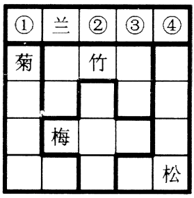

A. 竹梅松菊

B. 松菊竹梅

C. 竹松菊梅

D. 梅菊竹松

第 63 题 · 答案与解析

**参考答案（粉笔题库参考内容）**

A

**解析**

本题属于数独型分析推理，信息量最大优先并结合选项快速做题。

（1）信息量最大的空格为第二行第二列，横行不能填入菊、竹，纵列不能填入兰、梅，所以第二行第二列填入松。

（2）观察图形中梅所在的十字区域，第三列均不能填入竹，因此只能在第四行第四列内填入竹，因此③处不可能填入竹，据此排除选项B、D两项。

（3） 因此答案在A、C两项中，且①处为竹，同时观察菊所在的粗线条区域内第一列已经不能填入竹，只能在第五行第二列内填入竹，据此可知第三行第二列内应该填入菊。

（4） 如此，在竹所在区域的粗线条区域内第二行第四列和第三行第四列内是梅和兰，又因为第五行第四列内不能填入松，因此只能在③处填入松，排除选项C。

故正确答案为A。

## 材料 2

某县召开人大会议。办公室的刘秘书接到一项会务安排任务，要求他在为期4天的会期中将7个专题会议（“环境”“经济”“文化”“社会”“教育”“政法”“交通”）安排好顺序和日程。具体要求是：

（1）每天安排1-3个专题会议，每天的会议也需明确前后顺序

（2）“社会”专题的会议安排在第二天

（3）“环境”和“教育”专题的会议安排在同一天

（4）“社会”专题会议安排在“经济”专题之后，在“文化”专题之前

（5）“文化”专题会议安排在“环境”专题之前，在“政法”专题之后

### 第 64 题

若“文化”和“教育”专题会议安排在第四天，则可能得出以下哪项?（  ）

A. “政法”和“交通”专题会议安排在第一天

B. “交通”和“经济”专题会议安排在第二天

C. “经济”和“政法”专题会议安排在第三天

D. “政法”和“交通”专题会议安排在第三天

第 64 题 · 答案与解析

**参考答案（粉笔题库参考内容）**

D

**解析**

“文化”和“教育”安排在第四天，结合（3）“环境”和“教育”同一天，可知第四天为：文化、教育、环境；根据（2）可知“社会”在第二天。列表如下：

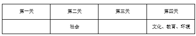

第四天已经有3个专题，所以“政法”、“交通”、“经济”只能在前三天。此时无法继续推理，考虑代入法。

A项：“政法”和“交通”在第一天，则剩下的“经济”只能在第三天，此时与（4）“社会”在“经济”之后矛盾，排除；

B项：“交通”和“经济”在第二天，此时只剩下“政法”，说明第一天和第三天必然有一天没有专题，与题干（1）每天安排1-3个专题会议矛盾，排除；

C项：“经济”和“政法”在第三天，此时与（4）“社会”在“经济”之后矛盾，排除；

D项：“政法”和“交通”在第三天，则经济在第一天，与题干不矛盾，当选。

故正确答案为D。

### 第 65 题

若“环境”专题会议安排在第三天，则可以得出以下哪项？

A. “政法”专题会议安排在第一天

B. “文化”专题会议安排在第二天

C. “经济”专题会议安排在第三天

D. “交通”专题会议安排在第四天

第 65 题 · 答案与解析

**参考答案（粉笔题库参考内容）**

D

**解析**

“环境”在第三天，结合（3）“环境”和“教育”同一天，可知第三天为：教育、环境；根据（2）可知“社会”在第二天。列表如下：

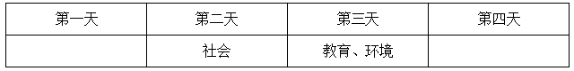

此时，还剩“经济”“文化”“政法”“交通”，根据（4）“社会”在“经济”专题之后，可知“经济”只能在第一天或者第二天，不可能在第三天或第四天；根据（5）和（4）“文化”在“环境”之前，在“政法”之后并且在“社会”之后，可知“文化”可能在第二天或第三天，“政法”可能在第一天或第二天或第三天，不可能在第四天；根据以上信息，可知“经济”“文化”“政法”都不可能在第四天，所以只能是“交通”在第四天。

故正确答案为D。

### 第 66 题

水榭：建在水边平台之上供人游玩和休息的园林建筑。水榭的平台一部分在岸上，一部分伸入水中；平台跨水部分以梁、柱凌空架设在水面之上。

下列建筑属于水榭的是（  ）。

A. 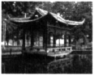

B. 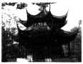

C. 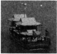

D. 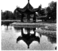

第 66 题 · 答案与解析

**参考答案（粉笔题库参考内容）**

A

**解析**

第一步：找出定义关键词。

“一部分在岸上，一部分伸入水中”、“以梁、柱凌空架设在水面之上”。

第二步：逐一分析选项。

A项：符合定义关键词，当选；

B项：不在水上，是一个地上的亭子，不符合定义关键词，排除；

C项：是直接架设在船上的建筑，是画舫，不符合定义关键词，排除；

D项：不在水上，是一个地上的亭子，不符合定义关键词，排除。

故正确答案为A。

### 第 67 题

认知地图效应：指通过对特定事物多次探索之后，头脑中形成一张包含各种相关信息的地图，根据这张地图采取行动，往往能够取得事半功倍的效果。

下列不属于认知地图效应的是：

A. 庖丁解牛

B. 胸有成竹

C. 老马识途

D. 管中窥豹

第 67 题 · 答案与解析

**参考答案（粉笔题库参考内容）**

D

**解析**

第一步：查找关键词。定义的关键词信息为“对特定事物多次探索”“形成相关信息的地图”“事半功倍”。

第二步：逐一判断选项。

A项：庖丁解牛，比喻经过反复实践，掌握了事物的客观规律，做事得心应手，运用自如；符合定义，排除；

B项：胸有成竹，比喻熟练有把握，事前对问题已有全面的考虑和解决办法；符合定义，排除。

C项：老马识途，比喻有经验的人对事情比较熟悉；符合定义，排除。

D项：管中窥豹，比喻只见到事物的一小部分，指所见不全面或略有所得，其意与定义完全不同，不符合定义，当选。

本题为选非题，故正确答案为D。

### 第 68 题

密码焦虑症：指现代人在日常生活中被银行卡、手机、登录网站、进入小区等密码包围、困扰而引起的心理焦虑症状。

下列属于密码焦虑症的是：

A. 张先生酷爱上网，平日购物、看电影、看书及与朋友通信聊天都通过网络来实现，好多密码都设成了自己的生日，因而也就没有感到特别的不方便

B. 王厂长为保障工厂安全，给厂门加装了密码锁，要求员工输密码进厂，但又担心员工将密码泄露给外人，为此他经常提醒保安，要认识本厂所有员工，不要让外人进来

C. 金女士从来不用网银，总担心网银虽然有密码保障，但还是不安全，说不定哪天就被黑客盗取了密码，自己的银行存款就可能不翼而飞，惹来一身的麻烦

D. 从乡下来到儿子家养老的李大爷，几年来最烦心的事就是不敢外出，因为小区大门、所住的大楼单元门及自家大门都有不同的密码，生怕自己记不清，一出门就回不了家

第 68 题 · 答案与解析

**参考答案（粉笔题库参考内容）**

D

**解析**

第一步：查找关键词。

定义的关键词信息为“银行卡、手机、登录网站、进入小区等密码”、“被密码包围、困扰而引起的心理焦虑症状”。

第二步：逐一判断选项。

A项：张先生密码设置没有感到特别的不方便，未体现出心理焦虑症状，不符合定义，排除；

B项：未体现出“被密码包围、困扰而引起的心理焦虑症状”，这里只涉及了一种密码，即厂门密码，不符合定义，排除；

C项：未体现出“被密码包围、困扰而引起的心理焦虑症状”，也只涉及了一种密码，即网银密码，不符合定义，排除；

D项：“小区大门、所住的大楼单元门及自家大门都有不同的密码”对应“被各种密码包围”，几年来最烦心的事就是不敢外出，对应由密码而引起的“心理焦虑症状”，符合定义，当选。

故正确答案为D。

### 第 69 题

体验式广告：让消费者亲身参与产品试用、感受产品质量，在不知不觉中接受、信任产品的广告方式。

下列不属于体验式广告的是（    ）。

A. 某地铁入口处，路人会免费拿到纸巾，纸巾包装袋上印有某新开发楼盘的广告信息

B. 某大型超市内，推销员正在将某果汁企业新开发的一款橙汁饮料分给顾客免费品尝

C. 只要添加某化妆品公司微信号并发送“我要试用”，即可免费获得其新款面膜试用装

D. 某知名家具连锁企业在市区繁华地段新开了家体验馆的消息传开后，一时人满为患

第 69 题 · 答案与解析

**参考答案（粉笔题库参考内容）**

A

**解析**

第一步：提取定义关键词。

“消费者亲身参与产品试用、感受产品质量” 。

第二步：逐一判断选项。

A项，“纸巾包装袋上印有某新开发楼盘的广告信息”，只是了解包装袋上的广告，未参与产品试用，不符合定义，当选；

B、C、D三项均涉及到“亲身参与产品试用、感受产品质量”，符合定义，排除。

本题为选非题，故正确答案为A。

### 第 70 题

形成性评价：在教学或者项目进行过程中由教师或主管部门对学生或项目实施方达到预定目标形成的程度所进行的评价。

下列属于形成性评价的是（  ）。

A. 主管部门聘请专业机构对工程质量进行验收鉴定

B. 科研机关邀请专家对申请者的项目申请书进行评审

C. 教师根据课堂答问情况给出学生的平时成绩

D. 求职人员参加人才招聘单位组织的笔试和面试

第 70 题 · 答案与解析

**参考答案（粉笔题库参考内容）**

C

**解析**

第一步：提取定义关键词。

“教学或者项目进行过程中”、“教师或主管部门”、“学生或项目实施方达到预定目标形成的程度”。

第二步：逐一判断选项。

A项：进行验收鉴定不符合定义关键词“教学或者项目进行过程中”，排除；

B项：邀请的专家不是“教师或主管部门”，不符合定义关键词，排除；

C项：符合定义关键词，当选；

D项：不符合所有定义关键词，排除。

故正确答案为C。

### 第 71 题

精神赡养：是指在家庭生活中，子女理解、尊重、关心、体贴父母，尽力满足其精神生活方面的需要。

下列不属于精神赡养的是：

A. 老孙最近专门买了1台液晶电视安装在父母房间，让二老看自己喜欢的节目，还为他们买了许多京剧光盘

B. 尽管老吴没和父母住在一起，但他多年来已经养成了每天都去看望的习惯，无微不至地照顾好他们的生活，老人感到很欣慰

C. 春节临近，“夕阳红”敬老院的李院长请来朝阳小学的“小红花”乐团，孩子们的欢声笑语和精彩节目，为老人们带来了无尽的快乐

D. 老姜的母亲已70多岁，但仍不服老，报名参加了交谊舞培训班，为避免老人生气并确保安全，每次母亲去上课时，老姜都悄悄跟在后面

第 71 题 · 答案与解析

**参考答案（粉笔题库参考内容）**

C

**解析**

第一步：查找关键词。

定义的关键词信息为“在家庭生活中”、“子女理解、尊重、关心、体贴父母”、“满足其精神生活方面的需要”。

第二步：逐一判断选项。

A、B、D三项均符合定义关键词，C项“敬老院”不是在家庭生活中，因此不属于精神赡养。

本题为选非题，故正确答案为C。

### 第 72 题

社会约定：某个形式与其所代表的意义之间的关系是由社会成员共同认定并遵守的，两者之间没有必然的联系。

下列属于社会约定的是（    ）。

A. 朝霞不出门，晚霞行千里

B. 高速路上散落的汽车碎片意味着发生过车祸

C. 红色和绿色在国内股市中分别代表股指上涨和下跌

D. 人的脸色蜡黄表明可能身体患有某种疾病

第 72 题 · 答案与解析

**参考答案（粉笔题库参考内容）**

C

**解析**

第一步：提取定义关键词。

“由社会成员共同认定并遵守的”、“两者之间没有必然的联系”。

第二步：逐一判断选项。

A选项，并不是人们共同认定并遵守的，只不过是一个劝解，排除；

B选项，散落的汽车碎片和车祸之间是有必然联系的，而且也没提到共同认定遵守，排除；

C项中的“红色和绿色”和股市涨跌二者之间没有必然的联系，“在国内股市中分别代表股指上涨和下跌”为社会成员共同认定并遵守的，C项满足定义关键词，当选；

D选项，人的脸色蜡黄与某种疾病是有必然的联系的，排除。

故正确答案为C。

### 第 73 题

趋同进化：指不同生物物种在进化过程中由于适应相似的环境而呈现出外形上的相似性。

下列属于趋同进化的是：

A. 海豚和鲨鱼，一个是哺乳动物，一个是鱼类，只是为了更好地在海洋中生存，它们就变得越来越相像了

B. 随着共同生活时间的增加，夫妻二人的价值观念、生活习惯，甚至连五官都变得越来越相近了

C. 无脊椎动物中，腔肠动物门的珊瑚、甲壳类的藤壶、棘皮动物门的海百合，都有相似的辐射对称躯体构型

D. 蚂蚁从金合欢的刺中取食蛋白质、脂肪和蜜，也在金合欢枝叶间巡逻缠绕金合欢的其他植物，进攻来此觅食的食草动物

第 73 题 · 答案与解析

**参考答案（粉笔题库参考内容）**

A

**解析**

第一步：查找关键词。

定义的关键词信息为“不同生物物种”“适应相似的环境”“外形上的相似性”。

第二步：逐一判断选项。

A项：海豚和鲨鱼为“不同生物物种”，为了更好地在海洋中生存即为了“适应相似的环境”，变得越来越相像了即呈现出了“外形上的相似性”，符合定义，当选；

B项：夫妻为同一物种，不符合定义，排除；

C项：未体现出为了“适应相似的环境”，不符合定义，排除；

D项：未体现呈现出了“外形上的相似性”，不符合定义，排除。

故正确答案为A。

### 第 74 题

协同治理：指政府部门为了达成公共利益的目标，通过与非政府的、非盈利的社会组织和普通公众合作开展社会管理活动的工作模式。

下列属于协同治理的是：

A. 某市辖区内有多个街道办，每个街道办管辖一片区域，有的街道服务中心专门设立了为老年人和残疾人提供公益服务的绿色通道

B. 某高校学生会多次组织大学生深入社区，开展心理咨询、消防安全讲座、帮助孤寡老人等公益活动

C. 为创建卫生城市，某市卫生局、环保局、城管局通力合作，卫生防疫人员、环境监测人员、环卫工人和城管人员各司其职，积极工作

D. 某市为确保城市公交畅通安全，每个公交站台都配有治安巡查员，这些人员中既有各职能部门人员，也有志愿者协会成员，还有退休者

第 74 题 · 答案与解析

**参考答案（粉笔题库参考内容）**

D

**解析**

第一步：查找关键词。定义的关键词信息为“政府部门为了达成公共利益的目标”“通过与非政府的、非盈利的社会组织和普通公众合作开展”。

第二步：逐一判断选项。

A项：街道服务中心仍归属政府，未体现“通过与非政府的、非盈利的社会组织和普通公众合作开展”，不符合定义，排除；

B项：“高校学生会”不是“政府部门”，不符合定义，排除；

C项：选项中涉及的“某市卫生局、环保局、城管局通力合作，卫生防疫人员、环境监测人员、环卫工人和城管人员”均不是“与非政府的、非盈利的社会组织和普通公众合作开展”，不符合定义，排除；

D项：“某市为确保城市公交畅通安全”对应“政府部门为了达成公共利益的目标”，“志愿者协会成员，还有退休者”体现了定义关键词“通过与非政府的、非盈利的社会组织和普通公众合作开展”，符合定义，当选。

故正确答案为D。

### 第 75 题

标杆效应：指在某一区域内，由于消费者对某种品牌认知度较高，导致其价格往往比同一区域其他同类商品高出一大截，并影响到整个区域同类商品的价格走势。

下列属于标杆效应的是：

A. 在某市，某大品牌电器企业每到节假日就大搞特价促销活动，其他商家纷纷效仿，也出奇招来招揽顾客

B. 某知名品牌推出的新款智能手表受到热捧，虽然价格偏高，却一再脱销，其他品牌的智能手表纷纷调低价格，争抢市场份额

C. 市一中即将搬往高新区的消息一传开，高新区的房价就一路飙升，连紧邻的湾树区房价也跟着涨了三四成

D. 老徐的网店短短半年内就赢利数万，朋友们纷纷前来取经，采用同样的经营方式创办了自己的网店，一个个赚得盆满钵满

第 75 题 · 答案与解析

**参考答案（粉笔题库参考内容）**

B

**解析**

第一步：查找关键词。

定义的关键词信息为“对某种品牌认知度较高”“其价格往往比同一区域其他同类商品高出一大截”“影响整个区域同类商品价格走势”。

第二步：逐一判断选项。

A项：未体现出“其价格往往比同一区域其他同类商品高出一大截”，不符合定义，排除；

B项：受到热捧对应关键词“对某种品牌认知度较高”，价格偏高对应关键词“其价格往往比同一区域其他同类商品高出一大截”，其他品牌的智能手表纷纷调低价格对应关键词“影响整个区域同类商品价格走势”，符合定义，当选；

C项：房价飙升并不是消费者对品牌认知度较高导致的，而是消费者获得其他信息后而导致的结果，同时选项中并没有体现出同类商品，不符合定义，排除；

D项：未体现出“对某种品牌认知度较高”，不符合定义，排除。

故正确答案为B。

## 材料 3

2014年我国经济在转型升级中步入中高速发展的“新常态”，战略性新兴产业和生产性服务业逆势上行，渐成拉动经济增长的两大“新引擎”。

        以发展速度论，新业态快速进入百姓生活，新型服务业攻城略地，势如破竹。2014年，金融业增加值增速较快，比第三产业增加值增速8.1％快2.1个百分点。电子商务全国网上零售额增长赢得最佳绩，比全社会消费品零售总额增速12.0％快37.7个百分点，并拉动快递业务量较上年增长61.6％之后再创51.9％的高增速。工业高技术产业超越传统产业，增加值同比增长12.3％，较规模以上工业增速快4.0个百分点。科技含量高、新兴产业比重大的制造业不少实现了两位数增长。新能源产业沐浴政策春风茁壮成长，涨势惊人：核电增长36.1％，并网风电增长25.6％，增速分别提升19.9个和1.1个百分点。并网太阳能发电在上年增长3.4倍的基础上，继续保持67.0％的高增长。

        以影响和贡献论，新产业、新业态助推经济增长功不可没。据对持续走强的服务业测算，2014年，金融业增加值占第三产业增加值的比重达到15.3％，金融业增加值占GDP的比重从上年的5.89％跃升至7.37％，一举突破十二五以来在5％左右徘徊的格局。考量新产业、新业态对经济增长的牵引力，经济大省可见一斑：广东规模以上租赁和商务服务业实现营业收入增长12.6％，对全省规模以上服务业营业收入增长的贡献率超过30％；山东高端装备制造业增加值增长12.1％，对全省工业增长的贡献率为34.4％；江苏仅快递业务收入就增长40.6％，拉动邮政业务收入增长24.9％，贡献率高达87.5％。

### 第 76 题

2014年我国金融业增加值增速为（  ）。

A. 12.0％

B. 10.2％

C. 9.6％

D. 8.1％

第 76 题 · 答案与解析

**参考答案（粉笔题库参考内容）**

B

**解析**

从材料第二段“2014年，金融业增加值增速较快，比第三产业增加值增速8.1％快2.1个百分点”，可知金融业增加值增速=8.1%+2.1%=10.2%。

故正确答案为B。

### 第 77 题

2014年我国的快递业务量约是2012年的（    ）。

A. 1.8倍

B. 2.1倍

C. 2.5倍

D. 3.3倍

第 77 题 · 答案与解析

**参考答案（粉笔题库参考内容）**

C

**解析**

从材料第二段“拉动快递业务量较上年增长61.6％之后再创51.9％的高增速”，由此可知，2013年快递业务量增长率为61.6%，2014年快递业务量增长率为51.9%，则2012年到2014年快递业务量的增长率为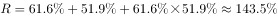，故2014年我国的快递业务量约是2012年的1+143.5%=2.435倍。

故正确答案为C。

### 第 78 题

2013年我国核电增速比并网风电增速（    ）。

A. 高10.5个百分点

B. 低10.5个百分点

C. 高8.3个百分点

D. 低8.3个百分点

第 78 题 · 答案与解析

**参考答案（粉笔题库参考内容）**

D

**解析**

定位文字材料第二段可知，2014年我国核电增长36.1％，并网风电增长25.6％，增速分别提升19.9个和1.1个百分点，故求2013年我国核电增速与并网风电增速之差，可判定此题为简单加减计算问题。2013年核电增速=36.1%-19.9%=16.2%；2013年并网风电增速=25.6%-1.1%=24.5%。故二者之差=16.2%-24.5%=-8.3%，即低8.3个百分点。

故正确答案为D。

### 第 79 题

2014年我国第三产业增加值占GDP的比重约为（    ）。

A. 48.2%

B. 46.8%

C. 45.3%

D. 44.1%

第 79 题 · 答案与解析

**参考答案（粉笔题库参考内容）**

A

**解析**

定位文字材料最后一段，2014年金融业增加值占第三产业增加值的比重达到15.3%，金融业增加值占GDP的比重跃升至7.37%，故求2014年我国第三产业增加值占GDP的比重，可判定本题为现期比重计算问题。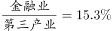，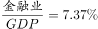，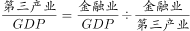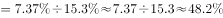，与A项最为接近。

故正确答案为A。

### 第 80 题

下列说法错误的是（    ）。

A. 2014年电子商务全国网上零售额增长49.7％

B. 2014年我国规模以上工业增加值增长8.3％

C. 2013年我国的并网太阳能发电比上年翻了两番还多

D. 2014年江苏快递业务收入增速比全国低21.0个百分点

第 80 题 · 答案与解析

**参考答案（粉笔题库参考内容）**

D

**解析**

A项：从文字材料第二段“电子商务全国网上零售额增长赢得最佳绩，比全社会消费品零售总额增速12.0％快37.7个百分点”，可得电子商务全国网上零售额的增长率=12.0％+37.7%=49.7%，正确；

B项：从文字材料第二段“工业高技术产业增加值同比增长12.3％，较规模以上工业增速快4.0个百分点”，可得规模以上工业增加值的增长率=12.3％-4.0%=8.3%，正确；

C项：从文字材料第二段末尾“并网太阳能发电在上年增长3.4倍的基础上”，可得，2013年并网太阳能发电的增长率是3.4倍，则2013年并网太阳能发电是2012年的4.4倍，故比上年翻了两番还多，正确；

D项：材料中只提到江苏快递业务收入，而没有提到全国快递业务的收入，无从得出，错误。

本题为选非题，故正确答案为D。

## 材料 4

2014年1—9月我国入境外国人共有1922万人，其中来自亚洲、美洲、欧洲、大洋洲、非洲的外国人分别为1184万人、229万人、408万人、58万人和43万人。分不同目的的入境外国人数见下表。

### 第 81 题

2014年1—9月来自欧洲的入境外国人数占外国人总数的比重是：

A. 11.9％

B. 21.2％

C. 28.1％

D. 30.2％

第 81 题 · 答案与解析

**参考答案（粉笔题库参考内容）**

B

**解析**

由材料可知2014年1—9月，我国入境外国人共有1922万人，其中来自欧洲的外国人为408万人，则2014年1—9月来自欧洲的入境外国人数占外国人总数的比重是。

故正确答案为B。

### 第 82 题

2014年1—9月不同目的入境外国人中人数最多的是：

A. 观光休闲

B. 会议（商务）

C. 探亲访友

D. 其他

第 82 题 · 答案与解析

**参考答案（粉笔题库参考内容）**

A

**解析**

观察表格，2014年1-9月不同目的的入境外国人数是将表中各列进行求和。

进行比较可知，来自亚洲的观光休闲（388万）和其他（389万）的人数是最多的，还有来自欧洲的观光休闲（147万）比其他（99万）多了接近50万，那么可以锁定，不同目的入境外国人中人数最多的是观光休闲。

故正确答案为A。

### 第 83 题

2014年1-9月以会议（商务）为目的的入境外国人数为：

A. 243万

B. 590万

C. 394万

D. 651万

第 83 题 · 答案与解析

**参考答案（粉笔题库参考内容）**

C

**解析**

从表中可得，2014年1-9月以会议（商务）为目的的入境外国人数为219+41+109+10+15＝394万。且选项尾数不同，所以可以采用尾数法。

故正确答案为C。

### 第 84 题

2014年1—9月来自大洋洲以不同目的入境的人数占其入境总人数的比重超过15%的有：

A. 会议（商务）、探亲访友、服务员工

B. 观光休闲、探亲访友、其他

C. 会议（商务）、观光休闲、其他

D. 观光休闲、探亲访友、服务员工

第 84 题 · 答案与解析

**参考答案（粉笔题库参考内容）**

C

**解析**

将来自大洋洲各不同目的入境的人数除以大洋洲入境总人数，算出超过15%即可。此外，观察四个选项，均是三种目的的入境人数，其比重超过15%，那么排名前三的必定都是超过15%的。所以，可以根据大洋洲以不同目的入境的人数，从大到小取前三位，分别是观光休闲（20）、其他（19）、会议（10）。

故正确答案为C。

### 第 85 题

下列判断正确的是：

A. 2014年1—9月来自亚洲以会议（商务）为目的入境人数不到表中其他各洲以会议（商务）为目的入境总人数的一半

B. 2014年1—9月来自表中各洲探亲访友的人数占各洲入境总人数的比重均最小

C. 2014年1—9月来自美洲服务员工的人数不到其会议（商务）人数的三分之一

D. 2014年1—9月来自表中各洲会议（商务）人数占各洲入境总人数的比重最大的是非洲

第 85 题 · 答案与解析

**参考答案（粉笔题库参考内容）**

D

**解析**

A项：来自亚洲以会议（商务）为目的的入境人数为219万，而其他各州以会议（商务）为目的的入境的总人数不足200万，所以亚洲的人数大于其他各州以会议（商务）为目的的人数，错误。

B项：来自大洋洲的服务员工所占大洋洲入境总人数的比重是最小的，所以各洲探亲访友的人数占各洲入境总人数的比重并非所有都最小，错误。

C项：来自美洲服务员工的人数为14万人，而会议（商务）人数为41万人，14超过41的三分之一，错误；

D项：来自会议（商务）的非洲人数是15万人，是非洲入境人数中最大的，而其他各洲来自会议（商务）的人数均不是其最大的，所以来自非洲以会议（商务）为目的的比重最大，正确。

故正确答案为D。

## 材料 5

2014年前9个月江苏钢材产量稳步增长，其中1—2月产量为1932万吨，累计同比增长10.0％；3月产量为1127万吨，1—3月累计同比增长8.5％；4月产量为1013万吨，1—4月累计同比增长7.3％；5月产量为1156万吨，1—5月累计同比增长6.1％；6月产量为1236万吨，1—6月累计同比增长6.3％；7月产量为1094万吨，1—7月累计同比增长4.9％；8月产量为1050万吨，1—8月累计同比增长3.8％；9月产量为1149万吨，1—9月累计同比增长3.7％。1—9月江苏生铁、粗钢产量及其同比增长情况如下图：

2014年1—9月江苏生铁、粗钢产量及同比增长率

### 第 86 题

2014年9月江苏的粗钢产量比上月增加了（  ）。

A. 56万吨

B. 48万吨

C. 43万吨

D. 40万吨

第 86 题 · 答案与解析

**参考答案（粉笔题库参考内容）**

B

**解析**

由图表可得，2014年9月粗钢生产量=(1-9月粗钢生产量)-(1-8月粗钢生产量)=7160–6348=812万吨，2014年8月粗钢生产量=(1-8月粗钢生产量)-(1-7月粗钢生产量)=6348–5584=764万吨，则9月江苏的粗钢产量比上月增加了812-764=48万吨。

此外，由于题干数据的精度与选项的精度一致，也可以将式子列出来后，使用尾数法简化计算过程。

故正确答案为B。

### 第 87 题

2014年第二、三季度江苏生铁月产量超过600万吨的月份个数有（  ）。

A. 1个

B. 2个

C. 3个

D. 4个

第 87 题 · 答案与解析

**参考答案（粉笔题库参考内容）**

A

**解析**

第二、第三季度，需要去对应4—9月份的生铁产量，可以利用前面月份的累计值加上600万吨观察是否超过现在的累计值，如果超过，则证明当月产量没有达到600万吨，

1-3月份生铁的产量1744+600>1-4月份生铁的产量2314万吨，故4月份没有超过600万吨，

1-4月份生铁的产量2314+600>1-5月份生铁的产量2905万吨，故5月份没有超过600万吨，

1-5月份生铁的产量2905+600&lt;1-6月份生铁的产量3526万吨，故6月份超过600万吨，

1-6月份生铁的产量3526+600>1-7月份生铁的产量4111万吨，故7月份没有超过600万吨，

1-7月份生铁的产量4111+600>1-8月份生铁的产量4672万吨，故8月份没有超过600万吨，

1-8月份生铁的产量4672+600>1-9月份生铁的产量5263万吨，故9月份没有超过600万吨，

则第二、三季度生铁月产量超过600万吨的月份是6月份。

故正确答案为A。

### 第 88 题

2014年9月江苏钢材产量约是生铁产量的（  ）。

A. 1.5倍

B. 1.9倍

C. 2.2倍

D. 2.4倍

第 88 题 · 答案与解析

**参考答案（粉笔题库参考内容）**

B

**解析**

由文字材料得，2014年9月钢材产量为1149万吨，

由图表可得，9月生铁产量为5263-4672=591万吨，

则钢材产量约是生铁产量的倍。

故正确答案为B。

### 第 89 题

2014年6—9月江苏粗钢产量同比增长率最低的月份是（  ）。

A. 6月

B. 7月

C. 8月

D. 9月

第 89 题 · 答案与解析

**参考答案（粉笔题库参考内容）**

C

**解析**

由图表可得，1-5月粗钢产量同比增长率为8.2％，1—6月粗钢产量同比增长率为9.3％，利用混合增长率，可知6月份的粗钢同比增长率>9.3%。

同理，得到7月份的粗钢同比增长率>9.5％；8月份的粗钢同比增长率&lt;9.3％；9月份的粗钢同比增长率＝9.3％，所以2014年6—9月江苏粗钢产量同比增长率最低的月份是8月份。

故正确答案为C。

### 第 90 题

下列说法不正确的是（  ）。

A. 2014年第三季度江苏的生铁产量为1737万吨

B. 2014年1—9月江苏钢材产量同比增速呈下降趋势

C. 2014年2—9月江苏粗钢产量的年内累计同比增速一直高于钢材和生铁

D. 2014年前三季度江苏钢材的月产量都高于1000万吨

第 90 题 · 答案与解析

**参考答案（粉笔题库参考内容）**

D

**解析**

A项：2014年第三季度江苏的生铁产量=1-9月生铁产量-1-6月生铁产量=5263-3526＝1737万吨，A项正确；

B项：从题干材料可知，除了2014年1-6月份江苏钢材产量的累计增速比2014年1-5月份的累计增速略高，其他月份的累计增速都是下降的，故1-9月江苏钢材产量同比增速呈下降趋势（这里重在理解“下降趋势”，所谓下降趋势指的是整体呈下降的趋势，中间个别月份即使有上升也并不影响，注意和“逐月下降”进行区分），B项正确；

C项：从文字材料和图表可以得知，粗钢的年内累计同比增速一直比钢材和生铁高，故2014年2-9月江苏粗钢产量的年内累计同比增速一直高于钢材和生铁，C项正确；

D项：从文字材料“2014年1—2月产量为1932万吨”，可得1月和2月的钢材月产量不可能都高于1000万吨，D错误。

本题为选非题，故正确答案为D。

## 材料 6

某市统计局在针对噪音扰民的一次调查中，当问及受访市民对哪一类噪音反感时，选择社区广场舞活动噪音的占8.6%，比选择居民社区宠物狗叫声的低2.9个百分点。当问及是否支持广场舞活动时，12.8%的受访市民表示无所谓或者不知道，12.0%的受访者回答表示反对，其他为支持者。在支持的市民中，当被问及支持的主要原因（多选）时，不同年龄段受访者的回答如下图所示。

       在反对的市民中，被问及反对的主要原因（多选）时，不同区域受访者回答如下。

### 第 91 题

此次调查中，对居民社区宠物狗叫声反感的市民占受访市民的比重是：

A. 12\. 5％

B. 11\. 5％

C. 10\. 5％

D. 9\. 5％

第 91 题 · 答案与解析

**参考答案（粉笔题库参考内容）**

B

**解析**

从材料的第一句“当问及受访市民对哪一类噪音反感时，选择社区广场舞活动噪音的占8.6％，比选择居民社区宠物狗叫声的低2.9个百分点”，可得，对居民社区宠物的叫声反感的市民占受访市民的比重为8.6％+2.9％＝11.5％。

故正确答案为B。

### 第 92 题

如果此次调查的受访者数量为1000名，则支持广场舞等活动的人数为：

A. 634

B. 752

C. 798

D. 914

第 92 题 · 答案与解析

**参考答案（粉笔题库参考内容）**

B

**解析**

从材料的第二句“当问及是否支持广场舞活动时，12.8％的受访市民表示无所谓或者不知道，12.0％的受访者回答表示反对，其他为支持者”，则支持者所占的比重为1-12.8％-12.0％=75.2%，所以支持广场舞等活动的人数为1000×75.2%=752名。

故正确答案为B。

### 第 93 题

此次调查中，在支持广场舞等活动的受访青年市民中，同时选择“中老年人正常的锻炼娱乐活动”和“有利于中老年人扩大社交、排解孤独”的至少有：

A. 64\. 7％

B. 35\. 3％

C. 30\. 7％

D. 28\. 6％

第 93 题 · 答案与解析

**参考答案（粉笔题库参考内容）**

C

**解析**

从表格中可得，青年选择“中老年人正常的锻炼娱乐活动”的比例是66%，选择“有利于中老年人扩大社交、排解孤独”的比例是64.7%。所问的是“同时选择······至少”，那么就让两者重合的尽可能的少。利用两容斥公式：A∩B=A+B-A∪B，则同时选择“中老年人正常的锻炼娱乐活动”和“有利于中老年人扩大社交、排解孤独”的至少有66％+64.7％-100％＝30.7％。

故正确答案为C。

### 第 94 题

根据此次调查，市民反对广场舞等活动的主要原因是：

A. 噪音影响周围市民的生活和休息

B. 挤占公共场地，影响他人休闲锻炼

C. 音乐没有愉悦感，难以忍受

D. 集体舞形式没有美感，影响观感

第 94 题 · 答案与解析

**参考答案（粉笔题库参考内容）**

A

**解析**

从第二个表格可得，每个区域的市民反对广场舞的原因中“噪音影响周围市民的生活和休息”都占了80%以上，也比另外的原因所占比例多，所以市民反对广场舞等活动的主要原因是噪音影响周围市民的生活和休息。

故正确答案为A。

### 第 95 题

下列判断正确的是：

A. 此次调查中的16.3％的中年受访者认为广场舞等活动可以通过规范管理克服

B. 此次调查的受访者中，青年所占比例高于中年和老年

C. 和中心城区的老年人相比，非中心城区的中年人对广场舞更着迷

D. 在反对广场舞等活动的非中心城区受访者中，选择“音乐没有愉悦感，难以忍受”的比例高于其他区域

第 95 题 · 答案与解析

**参考答案（粉笔题库参考内容）**

D

**解析**

A项：支持广场舞等活动的受访市民中，有16.3％的中年受访者认为广场舞等活动可以通过规范管理克服，而不是调查中的16.3%的中年受访者，错误；

B项：表格中由于涉及到多选，无法得知青年、中年、老年所占比例（例如原因是中老年人的正常锻炼娱乐活动的青年可以是33人，青年总数是50人，中年人支持该原因的有54.6人，中年总数是100人），所以不能说青年所占的比例高，况且数据也只有支持受访者对应数据，更不能得出此次调查所有受访者中青年所占比例与中年和老年关系，错误；

C项：在表格中，无法得出非中心城区的中年人比中心城区的老年人对广场舞更着迷，错误；

D项：从图中可知，在反对广场舞等活动的非中心城区受访者中选择“音乐没有愉悦感，难以忍受”的比例为21.2％，中心城区比例是20.8%，新区比例是11.1%，故非中心城区受访者的比例选择“音乐没有愉悦感”的比例高于其他区域，正确。

故正确答案为D。

