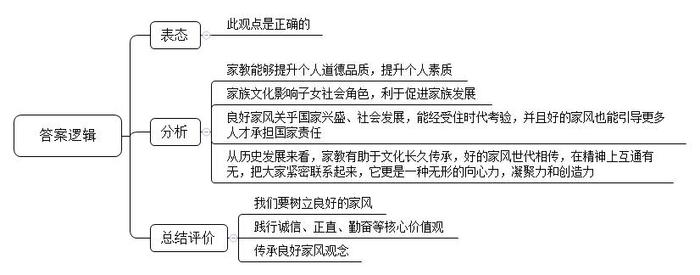
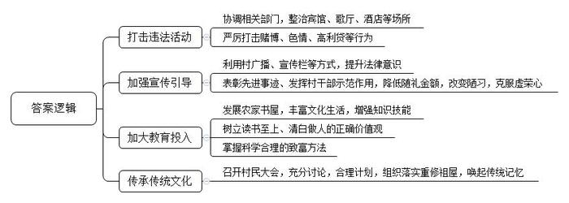
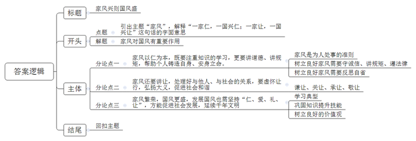

# 2016年江苏省公考《申论》题（C卷）

> 候选采集稿。参考答案及解析来自粉笔页面，不代表官方答案或真实高分答卷；来源使用许可与原卷对应关系仍需人工核实。

## 给定材料

### 材料 1

“一个好媳妇，三代好子孙”，媳妇好不好，上台夸夸就知道。每年春天，X市Y区各个乡镇社区都要举行“夸媳妇比赛”。小娟是张庄村的年轻媳妇。五年前，刚进婆家的家门，她就承担起操持家务、照顾卧病在床的婆婆的重任。一日三餐按时将可口的饭菜端到全家人面前，给婆婆梳头、洗衣、按摩，一有空就搀扶着婆婆到院子里锻炼，陪着聊天说笑。安顿好这些后，她还要到地里干农活儿。五年时间的精心照顾，婆婆终于能下床活动了，她逢人就说：“没有小娟，我早就不在人世了，小娟真比亲女儿还亲。”

2014年，身体一直很好的公公突发脑血栓，不能走路，不会说话，脾气还特别大，小娟像哄小孩一样，轻声细语地给老人宽心，给公公捏胳膊、揉腿按摩。公公的病情也渐渐好转。村里人说，小娟不简单，是年轻人实实在在的榜样。小娟憨厚地回应道：“一个人连父母的恩都报不了，还能善待谁呢？”

区里每年综合各乡镇社区“夸媳妇比赛”的结果和一年来的实际情况，评选出区“十大孝顺媳妇”，并在春天举办的“德孝文化节”上进行表彰。目前，该文化节已举办了5届。为形成长效激励机制，区人大常委会去年讨论通过了相关奖励扶持政策并有效实行。这些政策包括：“孝顺媳妇”本人享受医疗保险补助；“孝顺媳妇”本人持有关证件，可以在辖区内的旅游景点免费参观等。张庄村还有一个“德孝文化苑”。记者在现场看到，一排长长的石碑嵌入墙内，左首是“德政千秋”篇，刻着历任干部为群众办的好事、实事；右首是“孝行天下”篇，记录了该村历年评选出来的“孝顺媳妇”和“德孝模范”。村党支部书记说：“这是为了激励更多的人见贤思齐，争取早日把自己的名字也刻上墙。”据说，这样的“德孝文化苑”在该区域的每个村都有一个。

尊老的孝行吸引邻里仿效，老人的善举更让社会动容。2016年2月14日，中国人年度精神史诗——“感动中国”年度人物颁奖盛典在央视播出，第一个出场的是江苏省南通市家喻户晓的“磨刀老人”——吴锦泉。

88岁高龄的吴老退休后操起了磨刀旧手艺，一干就是26年。起初每磨一把收几毛钱，现在也不过三四块钱，吴老没有其他收入来源，每天仅能赚几十元。他个人生活十分俭朴，自己种菜，几乎没买过新衣服，每个月的生活费不超过300元，省吃俭用积攒下来的微薄收入，吴老统统捐了出去。孤残儿童需要帮助，他就把1000元政府慰问金和316元磨刀收入捐给了红十字会；玉树地震第二天，他就蹬着自行车到募捐点捐出1000元；舟曲泥石流，老人又捐出一大堆硬币，共1001元；南通中华慈善博物馆筹建，他捐款3000元；雅安地震，他又将两大罐硬币捐给了灾区，近2000元……哪里有困难，哪里总能看到吴老匆匆的脚步。近年来，吴老共向灾区、孤残儿童、贫困家庭捐款达4万多元。

4万多元对大慈善家来说，也许微不足道，但对于靠磨刀为生的老人来说，几乎是倾其所有。老人的善举，一次又一次感动着社会。他像一座灯塔，指引着无数胸怀善意的爱心人士。有吴老为榜样，老人所在的五星村成立了“锦泉一元爱心社”，吴老带头捐款3000元，他的儿子紧紧跟上，一些普通村民纷纷加入到爱心捐献中来。目前爱心社救助资金达到5万多元，已救助39人次，向伤残、重症、贫困家庭发放救助款1.4万余元。“更多的人不一定像吴老一样去捐款，但可以在自己的工作中做贡献，他给村里带来一种精神，可以感染每一个家庭。”五星村党支部书记说。

有感于吴老的感召力，“磨刀老人”被注册成为江苏省首个公益商标，南通市红十字会创建了“磨刀老人微公益基金”，吴老个人捐款3000元。截至目前，基金收到各界捐款1万余元，惠及60岁以上的特困老人、困难环卫工人、贫困学子等人群。“我是一个磨刀的，也是一名慈善大使。通过我，希望能让更多的人成为有爱心的人。”吴老说。如今，他是南通市年纪最长的红十字会志愿者。

### 材料 2

前不久，一位网友发布的“为让孩子上幼儿园，妈妈教孩子说谎”的微博引发热议。该网友在等待幼儿园报名时听到一对母子的对话，被当场“雷倒”。M妈妈：“待会儿老师问你，妈妈在哪上班？”孩子：“工商局。”M妈妈：“爸爸在哪儿上班呢？”孩子：“公安局。”M妈妈：“你给我记住了，否则报了名也没希望。”

以下是部分网友的议论：

网友A：非常理解这位妈妈，这样做无非是想让孩子能进个好一点的幼儿园，在这个拼爹拼妈的年代，实属无奈之举。

网友B：这位妈妈真是糊涂！这样冠冕堂皇的说谎，会对孩子的未来产生非常不好的影响。父母是孩子的榜样，一言一行都很重要。

网友C：上学要给老师送卡，看病要给医生送红包，打官司要给法官送礼……如果你不照做，你的孩子可能就要受到排挤，你的病可能看不好，你的官司可能打不赢……在这样的世风面前，只有傻子才会坚持做人的底线，除非你不想办成事。

网友D：我们教孩子不要闯红灯，但我们为了赶时间，经常闯红灯，因为大家都这么做；我们教孩子谦让、诚实，但现实社会总让老实人吃亏……让孩子不受伤害地成长是父母的责任，早点让孩子了解、适应这个社会未必是坏事，大道理有时不能解决现实问题。

### 材料 3

“一夜连双岁，五更分两年”，这两年除夕夜守岁的主题，有两个关键词，一个是看春晚，一个是抢红包。去年用“摇一摇”的方式抢，今年又多了“咻咻咻”。据有关方面统计，截至2016年2月8日零时，共有79.14万名支付宝用户共同分享了总值2.15亿元人民币的现金红包，平均下来，每人271.6元。对于口袋逐渐鼓起来的中国人来说，两三百元抵不上一顿饭钱，但是为何会有数以亿计的用户抢红包？有网友调侃道：“自从有了红包以后，抢红包已经完全摧毁了我的‘价值观’。以前地上掉一毛钱我连看都不看，现在抢到1元我就觉得是一笔巨款，超过5元我就窒息了，超过10元眼眶就湿了……”红包的风头俨然盖过了压岁钱。传统的压岁钱多是长辈给晚辈，而红包，平辈、晚辈、长辈之间都可以给，也不局限于春节期间。如此富有弹性，难怪会大受欢迎。

某大学的N教授是“红包热”中的“老古板”，从不参与微信圈中的抢红包。这主要源于2015年中秋节期间的一次教训，一个熟悉的学生家长定向给他发了一个红包，点开一看竟有1000元之多，这严重触及了N教授的师德底线，后来费了很多周折才退了回去。从此，他给自己定下了一个规矩：所有收到的红包一律不打开，任其自行退回；朋友圈中的红包只看不抢。但他的学生深受网络影响，“抢红包”已经成为他们生活方式的一部分。为了促进师生的良性互动，缩小教师与学生之间的距离感和隔阂感，N教授后来又对自己的规矩进行了调整，红包可以发，但绝不收。上学期期末复习备考期间，N教授给所在课堂上的学生发放了200元的“大红包”让学生抢，学生们纷纷表示“好”，就连曾受过他严厉批评的两个学生也留言道：“谢谢教授财神！一定好好努力！”

### 材料 4

田先生的故乡S村是某省一个有近千年历史的村庄。过去，淳朴、勤劳、与人为善、励志向上是这里民风的主要特征。辛勤耕作被视为本分，偷摸拐骗被视为耻辱，多数村民教育子女，最重要的一点就是“好好读书、清白做人”。田先生20多年前就是通过认真读书才考上大学的，许多家庭当年把他当作典型来教育孩子。

渐渐地，这里的风气悄然改变。村里越来越多的人外出打工，一小部分人被“花花世界”所迷惑，他们带回来关于发财的种种“财富故事”，冲击着村民读书至上、清白做人的价值观。一些村民在他们的影响下，让孩子不再读书，直接出去“挣快钱”。他们带回来的麻将机，也改变了村民勤劳耕作的习惯，部分未成年人染上了赌博恶习。像田先生那样读书成才的故事已渐渐被人遗忘。

2016年春节回乡过年的田先生发现故乡正面临着从未有过的凋敝，这种凋敝不仅仅在于青壮年大量外出所导致的萧条，更在于乡村道德滑坡所带来的精神危机。少数村民之间为了一点蝇头小利，竟然吵得不可开交。有知识、懂礼节的家庭，不再是村里关注的焦点，谁家的钱挣得多、谁家楼房盖得更高、谁家的轿车更高档，谁就成为一些孩子向往和学习的榜样。过年期间，平时在外打工的年轻人回来不少，但其中有些人很少在家陪老人，而是热衷于聚在一起玩一种叫做“诈金花”的赌博，一个晚上输赢金额竟达几万乃至十多万元之多。村里的年轻人中，会玩的往往对它乐此不疲，而不会玩的积极围观，然后很快也就学会了。事实上，于公于私，赌博都是不被允许的。为了避开家里的唠叨和有关部门的打击，一些年轻人就跑到乡镇街上或者县城的宾馆里偷偷赌博。在此期间，吃喝都在街上解决，累了就去卡拉OK厅唱歌，甚至还有些偷偷摸摸的色情活动。过年期间，县城各个酒店都是爆满的，而且酒店越大越豪华，就越是早早地客满了。有些酒店平时门可罗雀，亏本经营，全靠过年这几天，就把一整年的利润都赚到手了。这些钱大都是年轻人乃至他们全家在外打工挣来的。一夜之间便很有可能输得精光。正所谓“辛辛苦苦一整年，痛痛快快两三天”。痛快之后，便又不得不出去辛苦一整年。更有些头脑发热的、被某些有心人怂恿下不了台阶的，甚至还借上了高利贷，导致家庭分崩离析。每每听到这样的家庭悲剧，田先生都惋惜不已。

“舅舅家儿子结婚，上礼800元。表弟家添了二胎，送了600元，后天又要去吃酒席，还得出800元，”多年不见的远房阿婶对田先生诉苦道，“年前年后婚期周，这个月估计6000块也打不住。”阿婶说，这两年不知道怎么回事，农村的礼金蹭蹭往上涨，婚丧嫁娶、搬家上梁、小孩满月、升学入伍，哪一项也少不下来。“5年前撑死了也就100元，现在不到100元都不入礼单。”“送的这么累，何必硬撑呢？从自家的实际出发，减少点来往不行吗？”田先生困惑地问。“不行！不行！”阿婶连连说，“大家都住在一个村子里，低头不见抬头见的，如果现在不去、不给，将来自己家办事儿没人来，多丢人啊！”

村里有一处祠堂，是田姓的祖先所修，也是全村人的祖屋。可惜的是，祖屋年久失修，已经坍塌很久了。田先生要借着重修祖屋的机会唤起大家对传统的记忆，提议聚会商议此事，理由是“没有祖屋就没有现在每家每户自己的屋”。田先生为此事找村支书和几位老人商量，大家都觉得重修祖屋很重要。但如何组织、如何落实，都没有议出个头绪来。

### 材料 5

大槐树寻根祭祖是山西省洪洞县的一项民间活动，主要是移民后裔通过焚香、献供、跪拜等形式，表达自己对祖先和家乡的怀念之情。元末明初，频繁的战争和灾害使全国许多地方十室九空，而晋南地区经济繁荣，人口稠密。明朝政府在洪洞县大槐树下设局驻员，大规模迁民18次，总数达百万之众，移民遍布京、冀、豫、鲁、皖、苏、鄂等18个省市，是中国历史上由政府主导的规模最大、历时最长、范围最广的人口迁移之一。如今，大槐树移民后裔遍布世界各地。数百年来，数以亿计古槐后裔纷纷回归大槐树寻根祭祖。洪洞县政府从1991年开始，已持续举办了25届槐树寻根祭祖节。独具特色的大槐树祭祖习俗，于2008年10月被列入国家级非物质文化遗产名录。每年春节期间，海内外移民后裔便陆续而至，人们在这特别的日子里向先祖祈福还愿。35岁的陈先生是一位泰国籍华人，2016年春节，他带了妻儿一起来到山西大槐树寻根祭祖。他说，最喜欢的就是非物质文化遗产“大槐树祭祖习俗”的表演，儿子出生在泰国，希望他从小就可以了解中国传统文化。

2016年2月8日，正月初一一大早，家住Z市的李女士一家穿戴一新，匆匆忙忙地赶到位于自家小区附近的小礼堂。这天，有一场群众自发组织的集体祭祖仪式要在这里举行。“正月初一祭祖是我们这里的老习俗，但这样的祭祖仪式还是近几年才开始有的。我去年春节和清明期间参加过两次，觉得很好，这不今年又带着家人来了。”李女士对记者说。

上午9点30分，礼堂里一切布置妥当。两面墙上，挂着八幅分别写着孝、悌、忠、信、礼、义、廉、耻的挂轴。台上，一张长方形的供桌上依次放置着写有“中华大圣先师”“中华万姓先祖”的铜牌。台下，男女老少按照年龄长幼依序站立，整齐有序。随着悠扬舒缓的音乐响起，集体祭祖仪式的发起者，也是本次祭祖活动的主祭人任先生走到台上，用洪亮的嗓音朗读祭文，表达思念与感恩。祭文读毕，主祭人向祖先敬献鲜花和茶点，大家依次上台向祖先行礼。

整场仪式节俭又庄重，既没有看到放鞭炮、焚烧纸钱或扎制的“轿车豪宅”等“烟熏火燎”的老套路，也没有“男祭女不祭”“选风水时辰”等带有封建迷信色彩的内容。祭祖完毕，鲜花用来装点屋子，茶点贡品分给到场的小孩子，一点也不浪费。

仪式结束后，记者向任先生询问发起这一活动的初衷，任先生表示，追思祖先，悼念先人，本来是件好事，但是这么多年来，大家似乎忘了祭祖的真正意义，祭祖活动变了味。有的人家把祭祖搞成了封建迷信，有的把祭祖变成了和邻里攀比排场的方式。“这几年，党和政府提倡弘扬中华民族传统文化，传承良好家风。我觉得祭祖应当侧重于精神上的纪念，以提醒我们传承祖辈优秀传统，牢记先人教诲，进而在生活中懂得孝亲尊师，和睦家庭。所以用这种既包含传统元素又文明环保的形式更有意义。”任先生说。

记者在现场看到，不少参加者是带着自家孩子来的。一位妈妈说：“我觉得这样的集体祭祖仪式对孩子很有教育意义，不仅可以让孩子感受到我们中华民族重视传承的文化传统，还能让他学会尊敬、感恩和爱。”现场一位七十多岁的退休老党员感慨地说：“以前在老家祭祖，大家都到各家坟前烧纸、倒酒、供熟食，浪费不说，还容易引起火灾。村里每年都要组织人到墓地附近转悠，又费时又费力。我看今天这样的祭祖方式应该推广开来。”

慎终追远，民德归厚矣。一场简单的仪式，却承载了深厚的真情和深远的意义，更彰显了民间文化的新风气。

### 材料 6

中国有句古话，“富不过三代”，民间更有“一代创，二代守，三代耗，四代败”的说法。调查表明，世界范围内80%以上的企业属于家族企业，世界500强中有40%为家庭所有或经营，但全世界家族企业的平均寿命不到30年，30%能够生存到第二代，只有10%能够“活”过第三代。《胡润百富》杂志曾在上海发布了一个有意思的榜单——《胡润全球最古老的家族企业榜》。榜单显示，“富不过三代”并非中国特色，全球家族企业普遍面临“穷孙子”的问题。许多中国富裕家庭把子女送到海外最好的学校，期待能受到西方国家最先进的教育，但是让人失望的是，一些“富二代”在海外根本没有把学业当作自己的主要追求。整天沉醉于吃喝玩乐，开着大奔或风光十足的越野跑车到处兜风，旷课、逃学是他们的家常便饭。当然“富二代”并不是负面形象的指代，能够守业并继续开拓的“富二代”也不乏其人。优秀的“富二代”首先得益于“富一代”的严格要求，帮助他们建立起自立自强的人生观。因此，想要家产HOLD住，“富一代”对“富二代”的家教不可等闲视之。其实，在中国古代完整的表达是：“道德传家，十代以上；耕读传家，次之；诗书传家，又次之；富贵传家，不过三代。”其中的哲理与价值观十分发人深省。

### 材料 7

欧洲学者曾探讨，四大文明古国为何只有中国文明传承至今？结论是“可能中国人特别重视家教”。科甲连第、人才辈出、家业辉煌……中国历史上涌现的传统名门望族，大都有明显的家族文化特征和独树一帜的家风。《颜氏家训》是北齐颜之推的传世佳作，享有“古今家训，以此为祖”的美誉。颜之推认为，家庭教育和早期教育在一个人的一生中占据着至关重要的地位，直接决定其后天的发展，爱子须与教子相结合。曾国藩一生勤奋读书，推崇儒家学说，讲求经世致用，其家书在平淡中蕴含真知：“无论治世乱世，凡一家中能勤能敬，未有不兴。”

家风的形成和延续，关乎一个家庭乃至整个家族的发展，在很大程度上会影响子女的一生，更影响着他们在社会中扮演的角色。与一般家训相比，《钱氏家训》在篇章和结构上增加了“社会”和“国家”两篇。在“国家”篇中开篇就强调“执法如山，守身如玉，爱民如子，去蠹如仇”。从家族责任走向社会责任，成为钱氏家族人才辈出的深层文化基因。仅近现代以来，钱氏家族走出了上百位重量级的各界人物，许多属于父子档：钱穆、钱逊父子；钱玄同、钱三强父子；钱基博、钱钟书父子；钱学森、钱永刚父子等，就是其中杰出的代表。

老一辈革命家普遍有着优良的家风。周恩来曾定下“十条家规”；陈云、罗荣桓坚持不搞特殊化；张闻天从不允许子女“沾光”……革命先辈的家风故事，激励教育着一代又一代人。习近平主席在回忆自己的父亲习仲勋时，深情地说：“父亲的节俭几近苛刻。家教的严格，也是众所周知的。我们从小就是在父亲的这种教育下养成勤俭持家习惯的。这是一个堪称楷模的老布尔什维克的共产党人家风，这样的好家风应世代相传。”

名人名家有深厚的家风，平民百姓也有自己淳朴的家风。N市的退休工人老陈20年来一直坚持办一份家庭小报。这份独特的“家报”将8个生活在各地的陈姓小家庭紧紧凝聚在一起。在S市工作的大儿子陈先生说，每一期的“家报”每个家庭都有一份，不仅有纸质版的，还有电子版的。“家报”不仅是大家庭的“消息树”，更是家风传承的“根据地”。“我们的家风12个字：坚持和谐、追求卓越、崇尚奉献。孩子们都大了，又散在各地，有了‘家报’这个平台，大家互通有无，精神上连在一起。许多生活的道理，让他们通过阅读去体会、感悟。”老陈说。创办“家报”，丰富了晚年生活，最重要的是找到了一个适合他们这个大家庭家教的新方式，所以“家报”还将一直办下去。

家风实质上是一个家庭内在的精神动力，更是生长在其中的每个人立身处世的行为准则。不管社会如何变化，诚信、正直、勤奋等核心价值观念，应被长久坚守，因为这是我们安身立命的根本，家风的好坏不仅事关一个家庭的未来，还与社会风气的养成息息相关。

### 材料 8

在中国传统文化中，“家国天下”的情怀深入到每一个中国人的骨髓。《礼记》中说：“一家仁，一国兴仁；一家让，一国兴让。”十八大以来，习近平主席也曾多次在不同场合强调家风的作用。2015年2月17日，习近平主席在春节团拜会上说：“家庭是社会的基本细胞，是人生的第一所学校。不论时代发生多大变化，不论生活格局发生多大变化，我们都要重视家庭建设，注重家庭，注重家教，注重家风，使千千万万个家庭成为国家发展、民族进步、社会和谐的重要基点。”

2015年10月，中共中央印发了《中国共产党廉洁自律准则》（以下简称《准则》），自2016年1月1日起施行。《准则》首次将“廉洁齐家，自觉带头树立良好家风”列为党员领导干部廉洁自律规范的重要内容之一。家风入纪，意味着良好家风不只是党员领导干部的个人私事，也是关乎党内制度规矩的公事，为党员领导干部设立了经营家庭的“新标杆”。

## 题目

### 第 1 题

**“给定资料”列举了新形势下呈现出的一些社会现象，请归纳概括出这些社会现象对形成社会风气所产生的影响。（20分）**

关联材料：材料 1、材料 2、材料 3、材料 4、材料 5、材料 6、材料 7、材料 8

作答要求：

要求：紧扣“给定资料”，准确全面，条理清楚。篇幅不超过250字。

### 第 2 题

**“给定资料**7**”中提到，欧洲学者将重视家教看成是中华文明传承至今的重要原因。请结合“给定资料”，谈谈你对这一见解的看法。（15分）**

关联材料：材料 6、材料 7、材料 8

作答要求：

要求：分析透彻，观点正确。篇幅250字左右。

### 第 3 题

**假如你是“给定资料**4**”中S村所在镇政府派往S村的驻村干部，请就如何治理该村的社会风气提出具体对策。（25分）**

关联材料：材料 4

作答要求：

要求：措施具体，针对性强，条理清楚。篇幅250字左右。

### 第 4 题

**“给定资料**8**”中提到“一家仁，一国兴仁；一家让，一国兴让”。请根据对这句话的理解，结合社会现实和自己的感受，自拟标题，写一篇议论文。（40分）**

关联材料：材料 1、材料 2、材料 3、材料 4、材料 5、材料 6、材料 7、材料 8

作答要求：

要求：不必拘泥于“给定资料”，符合议论文写作要求。篇幅1000字左右。

## 答案与解析

第 1 题

**参考答案（粉笔题库参考内容）**

对家庭的积极影响有：1.德孝文化节树立榜样，传承孝道；2.抢红包促进互动交流；3.祭祖倡导孝亲尊师、家庭和睦；4.办家报传承良好家风，增强凝聚力。负面影响有：1.祖屋年久失修，祭祖铺张迷信，不重精神实质；2.随礼之风严重，亲情异化为利益交换；3.父母教孩子说谎，阻碍孩子道德养成；4.富二代学业荒废，不求上进。

对社会的积极影响有：1.磨刀老人助人为乐，无私奉献，带动行善风气；2.祭祖形式简洁，推动文明环保，传承文化传统。负面影响有：1.抢红包异化为贿赂工具，农村黄赌成风，加剧道德滑坡；2.祭祖烧纸引发火灾，破坏环境。

**参考答案说明：**答案按照对“家庭”和对“社会”的积极和消极影响分成两大条。并且“对家庭的积极影响”内部可以分成4条，“对家庭的消极影响”内部分成4条；“对社会的积极影响”内部可以分成2条，“对社会的消极影响”内部同样分成2条撰写。且每条要点之间内容上没有交叉。

**解析**

**考点**：影响类

**来源**：2016年江苏省公考《申论》题（C卷）

> 粉笔申论页面对本题只提供「解析视频」入口，该入口是会员推广位，页面无视频地址与文字解析。

第 2 题

**参考答案（粉笔题库参考内容）**

此观点是正确的，因为：

一、家教能够提升个人道德品质，提升个人素质。

二、家族文化影响子女社会角色，利于促进家族发展。

三、良好家风关乎国家兴盛、社会发展，能经受住时代考验，并且好的家风也能引导更多人才承担国家责任。

四、从历史发展来看，家教有助于文化长久传承，好的家风世代相传，在精神上互通有无，把大家紧密联系起来，它更是一种无形的向心力，凝聚力和创造力。

所以，我们要树立良好的家风，践行诚信、正直、勤奋等核心价值观，传承良好家风观念。

**参考答案说明**：思路方面，本参考答案按照观点现象分析题“表态+分析理由+总结评价”的一般答题思路展开。内容方面，本参考答案先对“欧洲学者将重视家教看成是中华文明传承至今的重要原因”进行了表态；“分析理由”部分分析了良好家风（家教）的意义；最后进行了总结评价。词句表达方面，本参考答案加上了“因为”“所以”等连接词来承接上下文。

**解析**

**考点**：观点现象分析类

**来源**：2016年江苏省公考《申论》题（C卷）

第 3 题

**参考答案（粉笔题库参考内容）**

一、打击违法活动。协调相关部门，整治宾馆、歌厅、酒店等场所，严厉打击赌博、色情、高利贷等行为。

二、加强宣传引导。利用村广播、宣传栏等方式，提升法律意识；同时表彰先进事迹，发挥村干部示范作用，降低随礼金额，改变陋习，克服虚荣心。

三、加大教育投入。发展农家书屋，丰富文化生活，增强知识技能；树立读书至上、清白做人的正确价值观；掌握科学合理的致富方法。

四、传承传统文化。召开村民大会，充分讨论，合理计划，组织落实重修祖屋，唤起传统记忆。

**参考答案说明**：本参考答案从“打击违法活动”“加强宣传引导”“加大教育投入”“传承传统文化”等不同的话题进行了分条撰写。各条要点之间在内容上相互并列，没有交叉。

**解析**

**考点**：提出对策类

**来源**：2016年江苏省公考《申论》题（C卷）

> 粉笔申论页面对本题只提供「解析视频」入口，该入口是会员推广位，页面无视频地址与文字解析。

第 4 题

**参考答案（粉笔题库参考内容）**

**家风兴则国风盛**

家风是个人立身处世的行为之基，我们既有“执法如山，守身如玉，爱民如子”的深厚家风，也有“坚持和谐，追求卓越，崇尚奉献”的淳朴家风。正如《礼记·大学》中说：“一家仁，一国兴仁；一家让，一国兴让。”意思是，每个家庭施行仁爱，一个国家就会出现仁爱之风；每个家庭施行礼让，一个国家就会形成礼让风气。

**这句话既道出了家风是国风的重要基点，举足轻重，还告诉我们家庭和国家建设的两个重要维度：仁和让。可以说，社会的和谐稳定、国家的全面发展离不开****“仁”“让”****优良家风的共建和传承。**

**家风****以仁为本，既要注重知识的学习，更要讲道德、讲规矩，帮助个人铸造自身、安身立命。**优良的家风包涵为人处世准则和是非标准，有助于我们在纷繁复杂的世界中不迷失方向：“钱氏家训”强调从家族责任走向社会责任，成为钱氏家族人才辈出的深层文化基因；梁启超一门三院士，与他言传身教的家风更是息息相关。良好家风内涵丰富，要求我们做事情守诚信，讲规矩，遵法律，不说假话，不坏礼仪，不参与打架斗殴等败坏社会风气之行；更要求我们时刻反思不足，勤学修能，以仁聚人，以能创世，以仁爱之行助推国家发展。

**家风****还要讲让，处理好与他人、与社会的关系，要虚怀让行，弘扬大义，促进****社会和谐****。**《孟子》有言：“天下之本在国，国之本在家，家之本在身。”传递良好家风，能促进社会和谐，让中华文明世代相传。这需要我们谦让、关让、承让、敬让：古有4岁稚子孔融让梨，让出兄弟仁爱，成就手足情义，今有新时代好媳妇关爱公婆，净化一方风气，成就一方传奇；古有名相蔺相如智让廉颇，传承民族大义，维护国家稳固，今有古槐后裔寻根祭祖，敬畏天地神灵，传承中华道义。以家风助国盛，需要我们保持空杯，谦让他人，时刻尊规，关让老幼，时刻大爱，承让大义，时刻自省，敬让先祖。

**家风繁荣，国风更盛，发展国风也需坚持****“仁、爱、礼、让”****，方能促进社会发展，延续千年文明。**国风建设需从“仁”与“让”两方面入手，施仁爱，行礼让：作为中华民族一份子，我们需学习“磨刀老人”吴锦泉兢兢业业传承传统文化，滴滴心血为民为国的美好品质；作为新时代大学生，我们要虚怀若谷时刻自省，巩固知识提升技能，开拓视野力求创新，时刻准备为社会主义建设奉献自己的一份力量；作为弘扬中国梦的新青年，我们更需坚持科学发展观，远离封建迷信，提升环保意识，践行社会文明，以良好价值观念感化人、凝聚人，促成良好社会文明。

家是一生的驿站，是休憩的港湾，国是立身的根本，是文明的起源。从家“仁”到国“仁”，体现的是民族文化的不断繁荣，从家“让”到国“让”，彰显的是社会文明的迅速腾飞。让我们以身作则，用优良家风滋养瑰丽国风，助力中华腾飞！

**文章分析：**

**家风兴则国风盛**

【**标题的优点：**首先，范文的标题“家风兴则国风盛”突出了“国风”这一主题。其次，形式上，文字简洁明快。】

（1）家风是个人立身处世的行为之基，我们既有“执法如山，守身如玉，爱民如子”的深厚家风，也有“坚持和谐，追求卓越，崇尚奉献”的淳朴家风。（2）正如《礼记·大学》中说：“一家仁，一国兴仁；一家让，一国兴让。”意思是，每个家庭施行仁爱，一个国家就会出现仁爱之风；每个家庭施行礼让，一个国家就会形成礼让风气。

【**开头的优点：**★内容方面：范文的开头是紧扣“家风”这一主题展开的。首先，开头第一句话点出主题，做到了主题明确。其次，对“家风”这一主题进行了分析阐述：（1）先举例说明“家风”；（2）接着解释了题目给定句子的含义。★文字表达方面：长短句配合使用，使语言表达有节奏感。】

（1）**这句话既道出了****家风是国风的重要基点****，举足轻重，**（2）**还告诉我们****家庭和国家建设的两个重要维度：仁和让****。可以说，**（3）**社会的和谐稳定、国家的全面发展离不开****“仁”“让”****优良家风的共建和传承****。**

【**过渡段的优点：**范文过渡段分析了“家风”的意义和对策等方面的内容，此外，还要注意过渡段末尾的“社会的和谐稳定、国家的全面发展离不开‘仁’‘让’优良家风的共建和传承”是用来引起下文的过渡句。】

**家风****以仁为本，既要注重知识的学习，更要讲道德、讲规矩，帮助个人铸造自身、安身立命。**（1）优良的家风包涵为人处世准则和是非标准，有助于我们在纷繁复杂的世界中不迷失方向：“钱氏家训”强调从家族责任走向社会责任，成为钱氏家族人才辈出的深层文化基因；梁启超一门三院士，与他言传身教的家风更是息息相关。（2）良好家风内涵丰富，要求我们做事情守诚信，讲规矩，遵法律，不说假话，不坏礼仪，不参与打架斗殴等败坏社会风气之行；（3）更要求我们时刻反思不足，勤学修能，以仁聚人，以能创世，以仁爱之行助推国家发展。

【**论述段****1的优点：**★观点句：范文的观点句是紧扣“家风”这一文章主题提出的。形式上，它在段首处直接写出，位置突出，容易发现。内容上，关键词突出，内容要点明确，可以明显看出它是从“以仁为本”入手，指出了“要注重知识的学习，更要讲道德、讲规矩”。★论述内容：（1）介绍了“家风对个人的意义”；（2）介绍了“树立良好家风需要守诚信、讲规矩、遵法律”；（3）介绍了“树立良好家风需要反思自省”。注意：以上三个方面的内容都是紧扣“家风以仁为本，既要注重知识的学习，更要讲道德、讲规矩，帮助个人铸造自身、安身立命”这个观点句进行分析论述的，论述的针对性强，内容层次丰富。最后，在论述方法和论据的选取上做到了讲道理、举例子相结合，做到了丰富多样。】

**家风****还要讲让，处理好与他人、与社会的关系，要虚怀让行，弘扬大义，促进****社会和谐****。**（1）《孟子》有言：“天下之本在国，国之本在家，家之本在身。”传递良好家风，能促进社会和谐，让中华文明世代相传。（2）这需要我们谦让、关让、承让、敬让：古有4岁稚子孔融让梨，让出兄弟仁爱，成就手足情义，今有新时代好媳妇关爱公婆，净化一方风气，成就一方传奇；古有名相蔺相如智让廉颇，传承民族大义，维护国家稳固，今有古槐后裔寻根祭祖，敬畏天地神灵，传承中华道义。（3）以家风助国盛，需要我们保持空杯，谦让他人，时刻尊规，关让老幼，时刻大爱，承让大义，时刻自省，敬让先祖。

【**论述段****2的优点：**★观点句：范文的观点句是紧扣“家风”这一文章主题提出的。形式上，它在段首处直接写出，位置突出，容易发现。内容上，关键词突出，内容要点明确，可以明显看出它是从“处理关系”入手，指出了“家风还要讲让，要虚怀让行，弘扬大义”。★论述内容：（1）介绍了“家风对社会的意义”；（2）介绍了“需要谦让、关让、承让、敬让”；（3）介绍了“需要我们保持空杯，时刻尊规，关让老幼，时刻大爱，承让大义”。注意：以上三个方面的内容都是紧扣“家风还要讲让，处理好与他人、与社会的关系，要虚怀让行，弘扬大义，促进社会和谐”这个观点句进行分析论述的，论述的针对性强，内容层次丰富。最后，在论述方法和论据的选取上做到了讲道理、举例子相结合，做到了丰富多样。】

**家风繁荣，国风更盛，发展国风也需坚持****“仁、爱、礼、让”****，方能促进社会发展，延续千年文明。**国风建设需从“仁”与“让”两方面入手，施仁爱，行礼让：（1）作为中华民族一份子，我们需学习“磨刀老人”吴锦泉兢兢业业传承传统文化，滴滴心血为民为国的美好品质；（2）作为新时代大学生，我们要虚怀若谷时刻自省，巩固知识提升技能，开拓视野力求创新，时刻准备为社会主义建设奉献自己的一份力量；（3）作为弘扬中国梦的新青年，我们更需坚持科学发展观，远离封建迷信，提升环保意识，践行社会文明，以良好价值观念感化人、凝聚人，促成良好社会文明。

【**论述段****3的优点：**★观点句：范文的观点句是紧扣“家风”这一文章主题提出的。形式上，它在段首处直接写出，位置突出，容易发现。内容上，关键词突出，内容要点明确，可以明显看出它是从“国风”入手，指出了“发展国风也需坚持‘仁、爱、礼、让’”。★论述内容：（1）介绍了“作为中华民族一份子的做法”；（2）介绍了“作为新时代大学生的做法”；（3）介绍了“作为新青年的做法”。注意：以上三个方面的内容都是紧扣“家风繁荣，国风更盛，发展国风也需坚持‘仁、爱、礼、让’，方能促进社会发展，延续千年文明”这个观点句进行分析论述的，论述的针对性强，内容层次丰富。最后，在论述方法和论据的选取上以讲道理为主，做到了鞭辟入里，层次清晰。】

【**论述段之间的关系**：★内容的内在逻辑：范文的论述段之间是依照“并列”的逻辑展开的。论述段1先写了“家风以仁为本”，论述段2再写了“家风还要讲让”，论述段3接着写了“国风也需坚持‘仁、爱、礼、让’”。★段与段的外在衔接：论述段1、2、3的段首句中，分别有“既要……更要”“还要”“此外”等关联词衔接，体现了三段之间的并列关系。】

家是一生的驿站，是休憩的港湾，国是立身的根本，是文明的起源。从家“仁”到国“仁”，体现的是民族文化的不断繁荣，从家“让”到国“让”，彰显的是社会文明的迅速腾飞。让我们以身作则，用优良家风滋养瑰丽国风，助力中华腾飞！

【**结尾的优点**：范文的结尾回扣了“家风”这一主题。（1）再次提到“家风”这一主题词；（2）阐述了“家风”的深远意义。】

**解析**

**考点**：文章写作题

**来源**：2016年江苏省公考《申论》题（C卷）

> 粉笔申论页面对本题只提供「解析视频」入口，该入口是会员推广位，页面无视频地址与文字解析。

