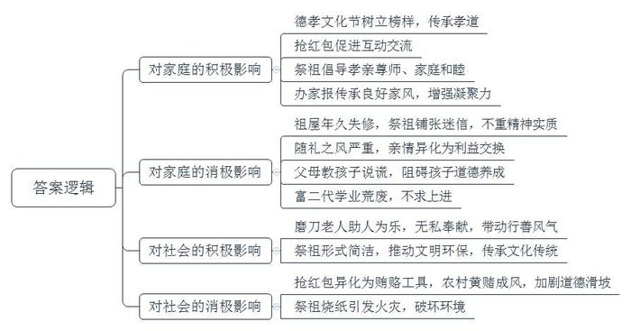
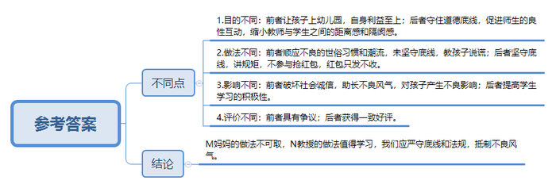
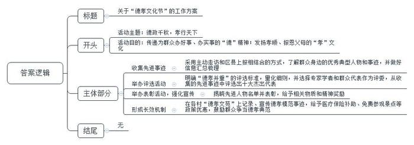
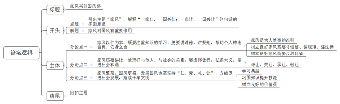

# 2016年江苏省公考《申论》题（A卷）

> 候选采集稿。参考答案及解析来自粉笔页面，不代表官方答案或真实高分答卷；来源使用许可与原卷对应关系仍需人工核实。

## 给定材料

### 材料 material-011acc233d977e9b

“一个好媳妇，三代好子孙”，媳妇好不好，上台夸夸就知道。每年春天，X市Y区各个乡镇社区都要举行“夸媳妇比赛”。小娟是张庄村的年轻媳妇。五年前，刚进婆家的家门，她就承担起操持家务、照顾卧病在床的婆婆的重任。一日三餐按时将可口的饭菜端到全家人面前，给婆婆梳头、洗衣、按摩，一有空就搀扶着婆婆到院子里锻炼，陪着聊天说笑。安顿好这些后，她还要到地里干农活儿。五年时间的精心照顾，婆婆终于能下床活动了，她逢人就说：“没有小娟，我早就不在人世了，小娟真比亲女儿还亲。”

2014年，身体一直很好的公公突发脑血栓，不能走路，不会说话，脾气还特别大，小娟像哄小孩一样，轻声细语地给老人宽心，给公公捏胳膊、揉腿按摩。公公的病情也渐渐好转。村里人说，小娟不简单，是年轻人实实在在的榜样。小娟憨厚地回应道：“一个人连父母的恩都报不了，还能善待谁呢？”

区里每年综合各乡镇社区“夸媳妇比赛”的结果和一年来的实际情况，评选出区“十大孝顺媳妇”，并在春天举办的“德孝文化节”上进行表彰。目前，该文化节已举办了5届。为形成长效激励机制，区人大常委会去年讨论通过了相关奖励扶持政策并有效实行。这些政策包括：“孝顺媳妇”本人享受医疗保险补助；“孝顺媳妇”本人持有关证件，可以在辖区内的旅游景点免费参观等。张庄村还有一个“德孝文化苑”。记者在现场看到，一排长长的石碑嵌入墙内，左首是“德政千秋”篇，刻着历任干部为群众办的好事、实事；右首是“孝行天下”篇，记录了该村历年评选出来的“孝顺媳妇”和“德孝模范”。村党支部书记说：“这是为了激励更多的人见贤思齐，争取早日把自己的名字也刻上墙。”据说，这样的“德孝文化苑”在该区域的每个村都有一个。

尊老的孝行吸引邻里仿效，老人的善举更让社会动容。2016年2月14日，中国人年度精神史诗——“感动中国”年度人物颁奖盛典在央视播出，第一个出场的是江苏省南通市家喻户晓的“磨刀老人”——吴锦泉。

88岁高龄的吴老退休后操起了磨刀旧手艺，一干就是26年。起初每磨一把收几毛钱，现在也不过三四块钱，吴老没有其他收入来源，每天仅能赚几十元。他个人生活十分俭朴，自己种菜，几乎没买过新衣服，每个月的生活费不超过300元，省吃俭用积攒下来的微薄收入，吴老统统捐了出去。孤残儿童需要帮助，他就把1000元政府慰问金和316元磨刀收入捐给了红十字会；玉树地震第二天，他就蹬着自行车到募捐点捐出1000元；舟曲泥石流，老人又捐出一大堆硬币，共1001元；南通中华慈善博物馆筹建，他捐款3000元；雅安地震，他又将两大罐硬币捐给了灾区，近2000元……哪里有困难，哪里总能看到吴老匆匆的脚步。近年来，吴老共向灾区、孤残儿童、贫困家庭捐款达4万多元。

4万多元对大慈善家来说，也许微不足道，但对于靠磨刀为生的老人来说，几乎是倾其所有。老人的善举，一次又一次感动着社会。他像一座灯塔，指引着无数胸怀善意的爱心人士。有吴老为榜样，老人所在的五星村成立了“锦泉一元爱心社”，吴老带头捐款3000元，他的儿子紧紧跟上，一些普通村民纷纷加入到爱心捐献中来。目前爱心社救助资金达到5万多元，已救助39人次，向伤残、重症、贫困家庭发放救助款1.4万余元。“更多的人不一定像吴老一样去捐款，但可以在自己的工作中做贡献，他给村里带来一种精神，可以感染每一个家庭。”五星村党支部书记说。

有感于吴老的感召力，“磨刀老人”被注册成为江苏省首个公益商标，南通市红十字会创建了“磨刀老人微公益基金”，吴老个人捐款3000元。截至目前，基金收到各界捐款1万余元，惠及60岁以上的特困老人、困难环卫工人、贫困学子等人群。“我是一个磨刀的，也是一名慈善大使。通过我，希望能让更多的人成为有爱心的人。”吴老说。如今，他是南通市年纪最长的红十字会志愿者。

### 材料 material-74338ae11ac216f7

前不久，一位网友发布的“为让孩子上幼儿园，妈妈教孩子说谎”的微博引发热议。该网友在等待幼儿园报名时听到一对母子的对话，被当场“雷倒”。M妈妈：“待会儿老师问你，妈妈在哪上班？”孩子：“工商局。”M妈妈：“爸爸在哪儿上班呢？”孩子：“公安局。”M妈妈：“你给我记住了，否则报了名也没希望。”

以下是部分网友的议论：

网友A：非常理解这位妈妈，这样做无非是想让孩子能进个好一点的幼儿园，在这个拼爹拼妈的年代，实属无奈之举。

网友B：这位妈妈真是糊涂！这样冠冕堂皇的说谎，会对孩子的未来产生非常不好的影响。父母是孩子的榜样，一言一行都很重要。

网友C：上学要给老师送卡，看病要给医生送红包，打官司要给法官送礼……如果你不照做，你的孩子可能就要受到排挤，你的病可能看不好，你的官司可能打不赢……在这样的世风面前，只有傻子才会坚持做人的底线，除非你不想办成事。

网友D：我们教孩子不要闯红灯，但我们为了赶时间，经常闯红灯，因为大家都这么做；我们教孩子谦让、诚实，但现实社会总让老实人吃亏……让孩子不受伤害地成长是父母的责任，早点让孩子了解、适应这个社会未必是坏事，大道理有时不能解决现实问题。

## 题目

### 第 1 题

**“给定资料”列举了新形势下呈现出的一些社会现象，请归纳概括出这些社会现象对形成社会风气所产生的影响。（20分）**

关联材料：material-011acc233d977e9b

作答要求：

要求：紧扣“给定资料”，准确全面，条理清楚。篇幅不超过250字。

### 第 2 题

**“给定材料**2**”中M妈妈与“给定材料**3**”中的N教授在面对世俗习惯与社会潮流时采取了不同的应对方法，请对此进行比较分析。（15分）**

关联材料：material-74338ae11ac216f7

作答要求：

要求：分析透彻，观点正确，篇幅250字左右。

### 第 3 题

**“给定材料**1**”中Y区第六届“德孝文化节”将在2016年4月举行。如果你是该区政府办公室的一名工作人员，拟定一份本届“德孝文化节”的工作方案。（25分）**

关联材料：material-011acc233d977e9b

作答要求：

要求：措施具体，针对性强，条理清楚，篇幅350字左右。

### 第 4 题

**“给定材料**8**”中提到“一家仁，一国兴仁；一家让，一国兴让”。请根据对这句话的理解，结合社会现实和自己的感受，自拟标题，写一篇议论文。（40分）**

关联材料：material-011acc233d977e9b

作答要求：

要求：不必拘泥于“给定材料”，符合议论文写作要求。篇幅1000字左右。

## 答案与解析

第 1 题

**参考答案（粉笔题库参考内容）**

对家庭的积极影响有：1.德孝文化节树立榜样，传承孝道；2.抢红包促进互动交流；3.祭祖倡导孝亲尊师、家庭和睦；4.办家报传承良好家风，增强凝聚力。负面影响有：1.祖屋年久失修，祭祖铺张迷信，不重精神实质；2.随礼之风严重，亲情异化为利益交换；3.父母教孩子说谎，阻碍孩子道德养成；4.富二代学业荒废，不求上进。

对社会的积极影响有：1.磨刀老人助人为乐，无私奉献，带动行善风气；2.祭祖形式简洁，推动文明环保，传承文化传统。负面影响有：1.抢红包异化为贿赂工具，农村黄赌成风，加剧道德滑坡；2.祭祖烧纸引发火灾，破坏环境。

**解析**

**参考答案说明：**答案按照对“家庭”和对“社会”的积极和消极影响分成两大条。并且“对家庭的积极影响”内部可以分成4条，“对家庭的消极影响”内部分成4条；“对社会的积极影响”内部可以分成2条，“对社会的消极影响”内部同样分成2条撰写。且每条要点之间内容上没有交叉。

  

**考点**：考点影响类

**来源**：来源2016年江苏省公考《申论》题（C卷）

粉笔申论页面对本题只提供「解析视频」入口，该入口是会员推广位，页面无视频地址与文字解析。

第 2 题

**参考答案（粉笔题库参考内容）**

M妈妈与N教授应对方法的不同之处在于：

一、目的不同：前者让孩子上幼儿园，自身利益至上；后者守住道德底线，促进师生的良性互动，缩小教师与学生之间的距离感和隔阂感。

二、做法不同：前者顺应不良的世俗习惯和潮流，未坚守底线，教孩子说谎；后者坚守底线，讲规矩，不参与抢红包，红包只发不收。

三、影响不同：前者破坏社会诚信，助长不良风气，对孩子产生不良影响；后者提高学生学习的积极性。

四、评价不同：前者具有争议；后者获得一致好评。

M妈妈的做法不可取，N教授的做法值得学习，我们应严守底线和法规，抵制不良风气。

**解析**

**参考答案说明：**答案分别从目的、做法、影响、评价等方面比较了不同点，最后得出结论。

**考点**：考点对比分析类

**来源**：来源2016年江苏省公考《申论》题（A卷）

粉笔申论页面对本题只提供「解析视频」入口，该入口是会员推广位，页面无视频地址与文字解析。

第 3 题

**参考答案（粉笔题库参考内容）**

关于“德孝文化节”的工作方案

一、活动主题：德政千秋，孝行天下

二、活动目的：传递为群众办好事、办实事的“德”精神；发扬孝顺、报恩父母的“孝”文化。

三、活动内容：（一）收集先进事迹。采用主动走访和区县上报相结合的方式，了解群众身边的优秀典型人物和事迹，并做好信息汇总梳理。（二）举办评选活动。明确“德孝并重”的评选标准，量化细则，并选择专家学者和群众代表作为评委，从收集的先进事迹中评选出十大杰出代表。（三）举办表彰活动，强化宣传。揭晓先进人物名单并表彰，给予相关物质和精神奖励。（四）形成长效机制。在各村“德孝文苑”上记录、宣传德孝模范事迹，给予医疗保险补助、免费参观景点等政策优惠，鼓励群众争当德孝典范。

**解析**

**参考答案说明**：（1）格式方面，本参考答案按照工作方案的一般写作格式写到了“标题”“正文”。（2）正文部分，一方面从内容来看，围绕着“德孝文化节”这一活动，本参考答案的开头部分介绍了“德孝文化节”的活动主题和目的；主体部分分别从“收集先进事迹”“举办评选活动”“举办表彰活动，强化宣传”“形成长效机制”四个方面介绍了活动内容。另一方面，形式上，本参考答案做到了分段、分条撰写，整体上条理较为清晰。

**考点**：考点方案类

**来源**：来源2016年江苏省公考《申论》题（A卷）

粉笔申论页面对本题只提供「解析视频」入口，该入口是会员推广位，页面无视频地址与文字解析。

第 4 题

**参考答案（粉笔题库参考内容）**

**家风兴则国风盛**

家风是个人立身处世的行为之基，我们既有“执法如山，守身如玉，爱民如子”的深厚家风，也有“坚持和谐，追求卓越，崇尚奉献”的淳朴家风。正如《礼记·大学》中说：“一家仁，一国兴仁；一家让，一国兴让。”意思是，每个家庭施行仁爱，一个国家就会出现仁爱之风；每个家庭施行礼让，一个国家就会形成礼让风气。

**这句话既道出了家风是国风的重要基点，举足轻重，还告诉我们家庭和国家建设的两个重要维度：仁和让。可以说，社会的和谐稳定、国家的全面发展离不开****“仁”“让”****优良家风的共建和传承。**

**家风****以仁为本，既要注重知识的学习，更要讲道德、讲规矩，帮助个人铸造自身、安身立命。**优良的家风包涵为人处世准则和是非标准，有助于我们在纷繁复杂的世界中不迷失方向：“钱氏家训”强调从家族责任走向社会责任，成为钱氏家族人才辈出的深层文化基因；梁启超一门三院士，与他言传身教的家风更是息息相关。良好家风内涵丰富，要求我们做事情守诚信，讲规矩，遵法律，不说假话，不坏礼仪，不参与打架斗殴等败坏社会风气之行；更要求我们时刻反思不足，勤学修能，以仁聚人，以能创世，以仁爱之行助推国家发展。

**家风****还要讲让，处理好与他人、与社会的关系，要虚怀让行，弘扬大义，促进****社会和谐****。**《孟子》有言：“天下之本在国，国之本在家，家之本在身。”传递良好家风，能促进社会和谐，让中华文明世代相传。这需要我们谦让、关让、承让、敬让：古有4岁稚子孔融让梨，让出兄弟仁爱，成就手足情义，今有新时代好媳妇关爱公婆，净化一方风气，成就一方传奇；古有名相蔺相如智让廉颇，传承民族大义，维护国家稳固，今有古槐后裔寻根祭祖，敬畏天地神灵，传承中华道义。以家风助国盛，需要我们保持空杯，谦让他人，时刻尊规，关让老幼，时刻大爱，承让大义，时刻自省，敬让先祖。

**家风繁荣，国风更盛，发展国风也需坚持****“仁、爱、礼、让”****，方能促进社会发展，延续千年文明。**国风建设需从“仁”与“让”两方面入手，施仁爱，行礼让：作为中华民族一份子，我们需学习“磨刀老人”吴锦泉兢兢业业传承传统文化，滴滴心血为民为国的美好品质；作为新时代大学生，我们要虚怀若谷时刻自省，巩固知识提升技能，开拓视野力求创新，时刻准备为社会主义建设奉献自己的一份力量；作为弘扬中国梦的新青年，我们更需坚持科学发展观，远离封建迷信，提升环保意识，践行社会文明，以良好价值观念感化人、凝聚人，促成良好社会文明。

家是一生的驿站，是休憩的港湾，国是立身的根本，是文明的起源。从家“仁”到国“仁”，体现的是民族文化的不断繁荣，从家“让”到国“让”，彰显的是社会文明的迅速腾飞。让我们以身作则，用优良家风滋养瑰丽国风，助力中华腾飞！

**解析**

**文章分析**

**家风兴则国风盛**

【**标题的优点：**首先，范文的标题“家风兴则国风盛”突出了“国风”这一主题。其次，形式上，文字简洁明快。】

（1）家风是个人立身处世的行为之基，我们既有“执法如山，守身如玉，爱民如子”的深厚家风，也有“坚持和谐，追求卓越，崇尚奉献”的淳朴家风。（2）正如《礼记·大学》中说：“一家仁，一国兴仁；一家让，一国兴让。”意思是，每个家庭施行仁爱，一个国家就会出现仁爱之风；每个家庭施行礼让，一个国家就会形成礼让风气。

【**开头的优点：**★内容方面：范文的开头是紧扣“家风”这一主题展开的。首先，开头第一句话点出主题，做到了主题明确。其次，对“家风”这一主题进行了分析阐述：（1）先举例说明“家风”；（2）接着解释了题目给定句子的含义。★文字表达方面：长短句配合使用，使语言表达有节奏感。】

（1）**这句话既道出了****家风是国风的重要基点****，举足轻重，**（2）**还告诉我们****家庭和国家建设的两个重要维度：仁和让****。可以说，**（3）**社会的和谐稳定、国家的全面发展离不开****“仁”“让”****优良家风的共建和传承****。**

【**过渡段的优点：**范文过渡段分析了“家风”的意义和对策等方面的内容，此外，还要注意过渡段末尾的“社会的和谐稳定、国家的全面发展离不开‘仁’‘让’优良家风的共建和传承”是用来引起下文的过渡句。】

**家风****以仁为本，既要注重知识的学习，更要讲道德、讲规矩，帮助个人铸造自身、安身立命。**（1）优良的家风包涵为人处世准则和是非标准，有助于我们在纷繁复杂的世界中不迷失方向：“钱氏家训”强调从家族责任走向社会责任，成为钱氏家族人才辈出的深层文化基因；梁启超一门三院士，与他言传身教的家风更是息息相关。（2）良好家风内涵丰富，要求我们做事情守诚信，讲规矩，遵法律，不说假话，不坏礼仪，不参与打架斗殴等败坏社会风气之行；（3）更要求我们时刻反思不足，勤学修能，以仁聚人，以能创世，以仁爱之行助推国家发展。

【**论述段****1的优点：**★观点句：范文的观点句是紧扣“家风”这一文章主题提出的。形式上，它在段首处直接写出，位置突出，容易发现。内容上，关键词突出，内容要点明确，可以明显看出它是从“以仁为本”入手，指出了“要注重知识的学习，更要讲道德、讲规矩”。★论述内容：（1）介绍了“家风对个人的意义”；（2）介绍了“树立良好家风需要守诚信、讲规矩、遵法律”；（3）介绍了“树立良好家风需要反思自省”。注意：以上三个方面的内容都是紧扣“家风以仁为本，既要注重知识的学习，更要讲道德、讲规矩，帮助个人铸造自身、安身立命”这个观点句进行分析论述的，论述的针对性强，内容层次丰富。最后，在论述方法和论据的选取上做到了讲道理、举例子相结合，做到了丰富多样。】

**家风****还要讲让，处理好与他人、与社会的关系，要虚怀让行，弘扬大义，促进****社会和谐****。**（1）《孟子》有言：“天下之本在国，国之本在家，家之本在身。”传递良好家风，能促进社会和谐，让中华文明世代相传。（2）这需要我们谦让、关让、承让、敬让：古有4岁稚子孔融让梨，让出兄弟仁爱，成就手足情义，今有新时代好媳妇关爱公婆，净化一方风气，成就一方传奇；古有名相蔺相如智让廉颇，传承民族大义，维护国家稳固，今有古槐后裔寻根祭祖，敬畏天地神灵，传承中华道义。（3）以家风助国盛，需要我们保持空杯，谦让他人，时刻尊规，关让老幼，时刻大爱，承让大义，时刻自省，敬让先祖。

【**论述段****2的优点：**★观点句：范文的观点句是紧扣“家风”这一文章主题提出的。形式上，它在段首处直接写出，位置突出，容易发现。内容上，关键词突出，内容要点明确，可以明显看出它是从“处理关系”入手，指出了“家风还要讲让，要虚怀让行，弘扬大义”。★论述内容：（1）介绍了“家风对社会的意义”；（2）介绍了“需要谦让、关让、承让、敬让”；（3）介绍了“需要我们保持空杯，时刻尊规，关让老幼，时刻大爱，承让大义”。注意：以上三个方面的内容都是紧扣“家风还要讲让，处理好与他人、与社会的关系，要虚怀让行，弘扬大义，促进社会和谐”这个观点句进行分析论述的，论述的针对性强，内容层次丰富。最后，在论述方法和论据的选取上做到了讲道理、举例子相结合，做到了丰富多样。】

**家风繁荣，国风更盛，发展国风也需坚持****“仁、爱、礼、让”****，方能促进社会发展，延续千年文明。**国风建设需从“仁”与“让”两方面入手，施仁爱，行礼让：（1）作为中华民族一份子，我们需学习“磨刀老人”吴锦泉兢兢业业传承传统文化，滴滴心血为民为国的美好品质；（2）作为新时代大学生，我们要虚怀若谷时刻自省，巩固知识提升技能，开拓视野力求创新，时刻准备为社会主义建设奉献自己的一份力量；（3）作为弘扬中国梦的新青年，我们更需坚持科学发展观，远离封建迷信，提升环保意识，践行社会文明，以良好价值观念感化人、凝聚人，促成良好社会文明。

【**论述段****3的优点：**★观点句：范文的观点句是紧扣“家风”这一文章主题提出的。形式上，它在段首处直接写出，位置突出，容易发现。内容上，关键词突出，内容要点明确，可以明显看出它是从“国风”入手，指出了“发展国风也需坚持‘仁、爱、礼、让’”。★论述内容：（1）介绍了“作为中华民族一份子的做法”；（2）介绍了“作为新时代大学生的做法”；（3）介绍了“作为新青年的做法”。注意：以上三个方面的内容都是紧扣“家风繁荣，国风更盛，发展国风也需坚持‘仁、爱、礼、让’，方能促进社会发展，延续千年文明”这个观点句进行分析论述的，论述的针对性强，内容层次丰富。最后，在论述方法和论据的选取上以讲道理为主，做到了鞭辟入里，层次清晰。】

【**论述段之间的关系**：★内容的内在逻辑：范文的论述段之间是依照“并列”的逻辑展开的。论述段1先写了“家风以仁为本”，论述段2再写了“家风还要讲让”，论述段3接着写了“国风也需坚持‘仁、爱、礼、让’”。★段与段的外在衔接：论述段1、2、3的段首句中，分别有“既要……更要”“还要”“此外”等关联词衔接，体现了三段之间的并列关系。】

家是一生的驿站，是休憩的港湾，国是立身的根本，是文明的起源。从家“仁”到国“仁”，体现的是民族文化的不断繁荣，从家“让”到国“让”，彰显的是社会文明的迅速腾飞。让我们以身作则，用优良家风滋养瑰丽国风，助力中华腾飞！

【**结尾的优点**：范文的结尾回扣了“家风”这一主题。（1）再次提到“家风”这一主题词；（2）阐述了“家风”的深远意义。】

**考点**：考点文章写作题

**来源**：来源2016年江苏省公考《申论》题（A卷）

粉笔申论页面对本题只提供「解析视频」入口，该入口是会员推广位，页面无视频地址与文字解析。

