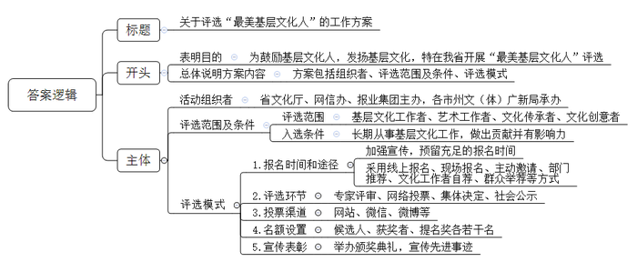
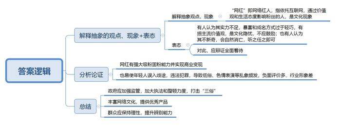
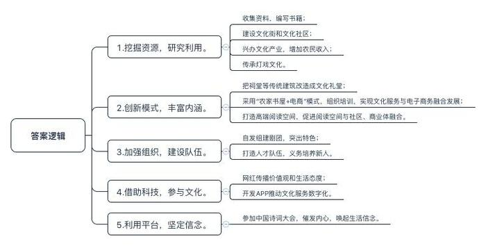
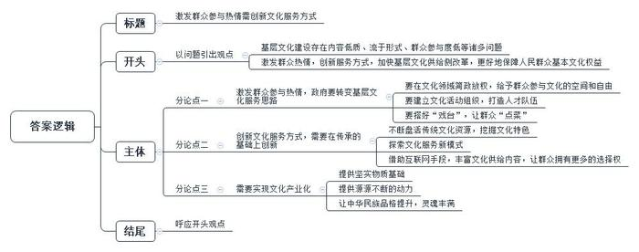

# 2017年江苏省公考《申论》题（A卷）

> 候选采集稿。参考答案及解析来自粉笔页面，不代表官方答案或真实高分答卷；来源使用许可与原卷对应关系仍需人工核实。

## 给定材料

### 材料 material-a31e0c417111d443

在祖国的山山水水间，有这么一群人。他们或俯首案前，呕心沥血研究民间文化；或献身舞台，孜孜以求编演老百姓喜闻乐见的精彩节目；或走村串寨，把精神文化食粮播撒在田间地头……他们有一个共同的名字——“基层文化人”。

2017年1月9日晚，“最美基层文化人”颁奖典礼在H省音乐厅举行，H省“最美基层文化人”名单正式出炉。以下是几位“最美基层文化人”的简要事迹。

欧阳老师是M县僻远山区一名普通的文化辅导员。2014年退休后，他走乡串户收集改编民谣，为留守儿童编写了一本《十里山童谣》，融文明礼仪、法治安全、良好习惯、环境保护与资源节约等内容于一体，易读易记易懂，深受孩子们的喜爱。为了留守儿童的教育和成长，欧阳老师捐出自己的全部藏书和住房公积金创建“十里山留守儿童文化街”和“十里山书香文化社区”，为留守儿童建造了一个精神“粮仓”。

D市文化馆的王先生只有小学学历，自学成才。数十年来，他利用节假日和工作之便，自费跑遍了该市100多个乡镇村组，收集地方文化遗产资料三百余万字。利用在当地流传的“孟姜女传说”“荆河戏”等资料撰写了五部学术专著，著作的出版在当地学术界和文艺界引起了不小的震动。

作为H省省级非遗项目永兴大布江拼布绣的传承人，小何现在最大的愿望是打造一个大布江拼布绣产业园，在传承这项濒临失传的技艺的同时，让更多农村留守妇女多一份收入。小何曾执着地穿行在大布江的大山中，向当地民间艺人讨教拼布绣技艺；她不断摸索，自创了“回旋针法”等新颖针法；她锐意创新，将古老的艺术融入时尚生活，实现了大布江拼布绣艺术价值与经济效益的有机结合。随着小何的拼布绣作品越来越多地参加展会、比赛并获奖，大布江拼布绣逐渐声名鹊起，有的单幅作品最高售价达5万元，普通作品单幅售价也有数百元。小何建立了3个固定传习所，设立了4个固定展厅，培养出300多位年轻的熟练绣娘，让她们在家就实现了就业。同时，她还免费向聋哑儿童传授拼布技艺，提高他们的谋生技能。

Y自治州85岁的田大爷是民间戏曲——灯戏最忠诚的守护者。他14岁开始走上灯戏舞台，70年来坚守传承灯戏文化，将古老的灯戏撒播在家乡秀美的山水间。唱戏成为他生活的一部分，即使褪了青丝，没了牙齿，他依然咿咿呀呀地唱着，颤颤巍巍地舞着……

为群众需求而奔走，为精神食粮而劳作，是基层文化工作者们的真实写照。本次“最美基层文化人”评选活动由H省文化厅、H省委网信办、H省报业集团主办，各市州文（体）广新局承办。活动自2016年3月31日启动以来，共有1568名基层文化人报名，产生了热烈的社会反响。在这些报名者中，既有80多岁默默坚守一线的老艺术家，也有20多岁走时尚路线的文艺新秀，涵盖了基层文化工作者、艺术工作者、文化传承者、文化创意者四大群体。

评选活动打破了以往传统的“自上而下”的单一评奖模式，通过全省各市州、区县文化部门推荐以及文化工作者自荐、群众举荐等途径，经过专家评审、网络投票、集体决定、社会公示等环节，寻找出“最美基层文化人”候选人50名，最终评选出H省“最美基层文化人”10名、“最美基层文化人”提名奖40名。2016年7月22日寻找“最美基层文化人”活动投票环节全面开始，主办方开通了H省文化厅官方网站、文化江湖微信、微博、华声在线等网络投票渠道，活动期间，共有两千多万人次参与了投票。H省“最美基层文化人”评选活动的成功举办，引起了广泛的社会反响，邻近的J省也计划开展类似活动。

### 材料 material-1b40f1f8e36c2eb9

普通的家居背景中，一位年轻美女穿着家居服，素颜出镜，以独白秀的形式，发布原创短视频，大讲时事热点。2016年，某戏剧学院导演系的在读研究生“papi酱”靠每次不到5分钟的短视频在网络平台爆红，迅速积累了800多万“粉丝”，获得了1200万元投资，估值上亿，成为炙手可热的“网红”。

“网红”是“网络红人”一词的简称。在当下社会状态下，绝大多数“网红”都具有强大的“吸粉”“固粉”能力，并能直接依靠“粉丝”的数量和购买力实现商业变现。“80后”网民“淼淼”称自己是“papi酱”的“脑残粉”，已经通过微信公众号“打赏”了几百块钱。“短短三五分钟的视频中，‘papi酱’设置了强烈的戏剧冲突，还不像家长一样板着脸，嘻嘻哈哈就说到我的心坎里。”像“papi酱”这样依托互联网成长起来的“网红”群体近年来越来越活跃，他们的共性是通过传递价值观和生活态度来潜移默化地影响“粉丝”，成为不可忽视的文化现象。如何评价“网红”的社会影响？不同的人有不同的看法。有人认为，“网红”的成名与暴富太过轻巧，他们大都不具备传统文化名人的实力，这种成名方式，将损害“只有依靠才华和努力才能成功”的主流价值观，不值得鼓励，很可能会成为现代社会基层文化的一个隐忧。也有人认为，“网红”不过是“时尚文化”的一种现状，并没有我们想象的那样新奇，它只是“名人效应”在互联网时代的一个变体。对于“网红”，不必紧张，听之任之即可，随着时间的推移，会自然沉淀或消亡。

对于大多数“90后”“95后”来说，网络已与他们的生活深度融合，在网络直播、网络论坛上，处处活跃着他们的身影。不过，也有一些“90后”“95后”因为种种原因在网络世界误入歧途，甚至有些受到法律的制裁。

W市民警小邢，辖区在城郊结合部的大学城，年轻人多，工作三年来接触过不少案例。40多段不堪入目的淫秽视频、5万余人的“粉丝”……为了使自己快速成为“网红”，网名“梨花雨”的网络女主播温某伙同他人录制淫秽视频吸引人气，并借此牟利。最终温某因制造、传播淫秽物品罪，被判处有期徒刑4年，并处罚金10万元。邢警官多次拿这个案例去教育年轻人，但就在春节期间，辖区内关于网络赌博的举报就有好几起，邢警官深感责任重大。

2017年年初，文化部发出通知，将对网络表演市场开展执法检查，重点打击“三俗”（庸俗、低俗、媚俗）等违规内容，保持对网络乱象的高压态势，对情节严重的平台依法予以关停。文化部文化市场司负责人表示，近年来，网络表演行业迅速发展，在短时间内形成产业规模，但低俗、色情表演等乱象屡屡出现，负面评价多、行业形象差已经成为制约行业发展的突出问题。在主管部门加强市场监管的同时，从业人员应当有责任意识和担当精神，以身作则，加强自律，推动建设一个健康向上的行业。

在S市从事保洁工作的马女士，2016年成为了“文化江海云”APP的忠实用户。通过这款APP，马女士可以掌握自己感兴趣的文化活动信息，并通过提前预约，和儿子一起观看免费展览和公益演出，参与社区亲子活动等，十分方便。

“文化江海云”作为S市基层文化服务数字化的重大项目，于2014年启动。试点期间，2个月访问量就达600多万人次。目前已建成的12朵云，都遵循统一的技术和运营标准。全覆盖的“文化江海云”除了包括16个区县的资源，还囊括了市级图书馆、博物馆、美术馆、旅游景点等文化场所的数字资源，真正实现一站式服务。据该项目负责人介绍，“文化江海云”正在改变着S市基层文化活动的样貌。比如，由政府买单的众多基层文化配送项目，通过“文化江海云”的数据积累，可以对各类活动的上座率进行分析，更科学地在合适的时间、地点派送合适的活动。市民在平台上点赞、预约的痕迹可作为个性化推送依据，做到文化信息精准投放。开放透明的信息正在倒逼政府改变以往的公共文化尤其是基层公共文化的管理思路。该市文化局陈局长认为，“文化云”最重要的促进作用是让基层文化供给从“上级导向”转变为“用户导向”“市民导向”。发布了多少活动，有多少人参加，发布得是否及时，有没有吸引力……一切都可以被市民监督。“这督促我们更加关注民声，开动脑筋靠内容和服务来争取市民的满意。”

## 题目

### 第 1 题

**如果你是“给定资料**1**”中J省文化部门的一名工作人员，请你借鉴H省评选“最美基层文化人”的成功做法，拟定一份本省开展类似活动的工作方案。（25分）**

关联材料：material-a31e0c417111d443

作答要求：

要求：结合“给定资料”，联系实际，条理清楚，语言流畅。篇幅350字左右。

### 第 2 题

**“给定资料**4**”中的“网红”现象引起社会热议，请针对文中的不同观点，谈谈你的见解。（15分）**

关联材料：material-1b40f1f8e36c2eb9

作答要求：

要求：分析透彻，观点正确。篇幅250字左右

### 第 3 题

**“给定资料”呈现了当前基层群众参与文化活动的一些新现象，请对此进行归纳概括。（20分）**

关联材料：material-a31e0c417111d443

作答要求：

要求：紧扣“给定资料”，准确全面，条理清楚，语言流畅。篇幅不超过250字。

### 第 4 题

**请围绕“给定资料**7**”中的基层文化供给侧改革的要求，以“激发群众参与热情，创新文化服务方式”为主题，联系实际，自拟标题，写一篇议论文。（40分）**

关联材料：material-a31e0c417111d443

作答要求：

要求：不必拘泥于“给定资料”，符合议论文写作要求。篇幅1000字左右。

## 答案与解析

第 1 题

**参考答案（粉笔题库参考内容）**

关于评选“最美基层文化人”的工作方案

为鼓励基层文化人，发扬基层文化，特在我省开展“最美基层文化人”评选，方案包括组织者、评选范围及条件、评选模式，具体如下：

一、活动组织者：省文化厅、网信办、报业集团主办，各市州文（体）广新局承办。

二、评选范围及条件：1.评选范围：基层文化工作者、艺术工作者、文化传承者、文化创意者；2.入选条件：长期从事基层文化工作，做出贡献并有影响力。

三、评选模式：1.报名时间和途径：加强宣传，预留充足的报名时间；采用线上报名、现场报名、主动邀请、部门推荐、文化工作者自荐、群众举荐等方式；2.评选环节：专家评审、网络投票、集体决定、社会公示；3.投票渠道：网站、微信、微博等；4.名额设置：候选人、获奖者、提名奖各若干名；5.宣传表彰：举办颁奖典礼，宣传先进事迹。

**解析**

**参考答案说明：**（1）格式方面，本参考答案写到了“标题”“正文”。（2）正文部分，一方面从内容来看，围绕着“评选‘最美基层文化人’”这一主题，开头先总体介绍活动的目的以及方案主要内容；主体部分从“活动组织者”“评选范围及条件”“评选模式”三个方面给出了具体的方案。另一方面，形式上，本参考答案做到了分段、分条撰写，整体上条理较为清晰。

**考点**：考点方案类

**来源**：来源2017年江苏省公考《申论》题（A卷）

粉笔申论页面对本题只提供「解析视频」入口，该入口是会员推广位，页面无视频地址与文字解析。

第 2 题

**参考答案（粉笔题库参考内容）**

1.“网红”即网络红人，指依托互联网，通过价值观和生活态度影响粉丝的人，是文化现象。

2.有人认为其实力不足，暴富和成名方式过于轻巧，有损主流价值观，是文化隐忧，不应鼓励；也有人认为其不新奇，会自然消亡，听之任之即可。对此，应辩证全面看待。

3.网红有强大吸粉固粉能力并实现商业变现；也易使年轻人误入歧途，违法犯罪，导致低俗、色情表演等乱象频发，负面评价多、行业形象差。

4.政府应加强监管，加大执法和整顿力度，打击“三俗”；丰富网络文化，提供优秀产品；从业者加强自律，提高责任意识，传播正能量；群众应保持理性，提升辨别能力。

**解析**

**参考答案说明：**思路方面，本参考答案按照观点评论类题型“解释抽象的观点、现象+表态+分析论证+总结（一般是对策）”的一般思路展开。内容方面，本参考答案先对“网红”进行了解释，接着概括了人们对“网红”的不同观点，并做出表态；然后分析了“网红”现象引起社会热议的原因；最后针对“网红”现象做出了总结（对策）。

**考点**：考点观点现象分析类

**来源**：来源2017年江苏省公考《申论》题（A卷）

粉笔申论页面对本题只提供「解析视频」入口，该入口是会员推广位，页面无视频地址与文字解析。

第 3 题

**参考答案（粉笔题库参考内容）**

1.挖掘资源，研究利用。收集资料，编写书籍；建设文化街和文化社区；兴办文化产业，增加农民收入；传承灯戏文化。

2.创新模式，丰富内涵。把祠堂等传统建筑改造成文化礼堂；采用“农家书屋+电商”模式，组织培训，实现文化服务与电子商务融合发展；打造高端阅读空间，促进阅读空间与社区、商业体融合。

3.加强组织，建设队伍。自发组建剧团，突出特色；打造人才队伍，义务培养新人。

4.借助科技，参与文化。网红传播价值观和生活态度；开发APP推动文化服务数字化。

5.利用平台，坚定信念。参加中国诗词大会，催发内心，唤起生活信念。

**解析**

**参考答案说明：**本参考答案从“挖掘资源，研究利用”“创新模式，丰富内涵”“加强组织，建设队伍”“借助科技，参与文化”“利用平台，坚定信念”等不同方面进行了分条撰写。各条要点之间在内容上是并列的且没有交叉。并且撰写要点时，都提炼出来概括性强的总括词前置，满足了题目中要求的“归纳概括”。

**考点**：考点其他类

**来源**：来源2017年江苏省公考《申论》题 （C卷）

粉笔申论页面对本题只提供「解析视频」入口，该入口是会员推广位，页面无视频地址与文字解析。

第 4 题

**参考答案（粉笔题库参考内容）**

**激发群众参与热情需创新文化服务方式**

只有基层文化阵地活起来，百姓的精神才能富起来，国家才能更加稳步快速发展。但令人遗憾的是我国的基层文化建设却存在内容低质、流于形式、群众参与度低等诸多问题。为此，**我们要激发群众热情，创新服务方式，加快基层文化供给侧改革，更好地保障人民群众基本文化权益。**

**激发群众参与热情，政府要转变基层文化服务思路。既要在文化领域简政放权，给予群众参与文化的空间和自由，又要建立文化活动组织，打造人才队伍，也要搭好****“戏台”，让群众“点菜”。**基层文化服务应始终面向群众，以群众为中心，群众的满意度、参与度才是基层文化建设的出发点和落脚点。为了市容整洁大年初三上街撕春联，为了教条式落实规定禁止民众免费播放电影，为了安全取缔民间龙舟比赛……桩桩件件都会打击民众参与文化活动的积极性。所以我们应反其道行之，鼓励引导群众自发组织剧团、社团等，同时积极搭建文化平台，开办如类似《中国诗词大会》等以传统文化为主题的电视节目，邀请“草根”参与，为群众提供更多展示才华的舞台。

**创新文化服务方式，需要在传承的基础上创新。不断盘活传统文化资源，挖掘文化特色，探索文化服务新模式，并借助互联网手段，丰富文化供给内容，让群众拥有更多的选择权。**传统文化资源的改造与更新是创新文化服务最便捷有效的方式。如今祠堂、校舍、明清建筑等闲置资源都被重新改造，打造为民众从事文化活动的空间，转变成新时代的“精神高地”；图书馆也改变了原有的模式，开启免费借阅，优化借阅环境，创新借阅方式，让阅读成为老百姓幸福生活的精神滋养；互联网已变成创新文化服务方式的“刚需”，从“农村书屋+电商”的兴起到“网红”经济的出现，再到各类文化便民APP的研发，互联网掀起了文化服务的新浪潮。

**无论是激发群众参与文化的热情，还是创新文化服务方式，都需要实现文化产业化。**文化产业化为激发热情、创新方式提供坚实物质基础，为文化持续发展提供源源不断的动力，最终让中华民族品格提升，灵魂丰满。打造高端阅读空间，促进阅读空间与社区、商业体融合；建立刺绣产业园，实现艺术价值与经济价值的有机结合；利用网红效应，实现了商业变现……这些都是文化产业化鲜活的例子。然而，文化产业不同于其他产业，他左右着民众的主流价值，因此，需要政府加强监管，从业者坚守底线，民众理性冷静，不断提升文化产品的内容创意和价值引领。

文化植根于大地，植根于民间，应当从群众中来，到群众中去。唯有不断激发群众参与热情，创新服务方式，推动文化产业化发展，文化才能走近群众，深入人心。

**解析**

**文章分析**

**激发群众参与热情需创新文化服务方式**

【**标题的优点：**首先，范文的标题“激发群众参与热情需创新文化服务方式”突出了“激发群众参与热情，创新文化服务方式”这一主题。其次，形式上，文字简洁明快，不拖沓。】

（1）只有基层文化阵地活起来，百姓的精神才能富起来，国家才能更加稳步快速发展。但令人遗憾的是我国的（2）基层文化建设却存在内容低质、流于形式、群众参与度低等诸多问题。为此，**我们要激发群众热情，创新服务方式，**（3）**加快基层文化供给侧改革****，****更好地保障人民群众基本文化权益****。**

【**开头的优点：****★内容方面。**范文的开头是紧扣“激发群众参与热情，创新文化服务方式”这一主题展开的。首先，开头在段首处点出主题，做到了主题明确。其次，对“激发群众参与热情，创新文化服务方式”这一主题进行了分析阐述，指出了（1）“基层文化建设”的意义；（2）“基层文化建设”的问题；（3）“基层文化建设”的对策。**★文字表达方面：**使用了“只有……才……”“为此……”等关联词，使语言表达有逻辑性。】

**激发群众参与热情，政府要转变基层文化服务思路。既要**（1）**在文化领域简政放权****，****给予群众参与文化的空间和自由****，又要**（2）**建立文化活动组织****，****打造人才队伍****，****也要搭好****“****戏台****”，****让群众****“****点菜****”。**基层文化服务应始终面向群众，以群众为中心，群众的满意度、参与度才是基层文化建设的出发点和落脚点。为了市容整洁大年初三上街撕春联，为了教条式落实规定禁止民众免费播放电影，为了安全取缔民间龙舟比赛……桩桩件件都会打击民众参与文化活动的积极性。所以我们应反其道行之，（3）鼓励引导群众自发组织剧团、社团等，同时积极搭建文化平台，开办如类似《中国诗词大会》等以传统文化为主题的电视节目，邀请“草根”参与，为群众提供更多展示才华的舞台。

【**论述段****1****的优点：****★观点句：**范文的观点句是紧扣“激发群众参与热情，创新文化服务方式”这一文章主题提出的。形式上，它在段首处直接写出，位置突出，容易发现。内容上，关键词突出，内容要点明确，可以明显看出它是从“转变基层文化服务思路”这个角度入手，指出了“激发群众参与热情”的对策。**★论述内容：**（1）先介绍了“激发群众参与热情”的对策——在文化领域简政放权；（2）接着介绍了“激发群众参与热情”的对策——建立文化活动组织；（3）最后介绍了“激发群众参与热情”的对策——搭建文化平台。以上三个方面的内容都是紧扣“激发群众参与热情，政府要转变基层文化服务思路”这个观点进行分析论述的，论述的针对性强，内容层次丰富。最后，在论述方法上主要采取了讲道理和举例子相结合，做到了丰富多样。】

**创新文化服务方式，需要在传承的基础上创新。**（1）**不断盘活传统文化资源****，****挖掘文化特色****，****探索文化服务新模式****，并**（2）**借助互联网手段****，****丰富文化供给内容****，****让群众拥有更多的选择权****。**（3）传统文化资源的改造与更新是创新文化服务最便捷有效的方式。如今祠堂、校舍、明清建筑等闲置资源都被重新改造，打造为民众从事文化活动的空间，转变成新时代的“精神高地”；图书馆也改变了原有的模式，开启免费借阅，优化借阅环境，创新借阅方式，让阅读成为老百姓幸福生活的精神滋养；（4）互联网已变成创新文化服务方式的“刚需”，从“农村书屋+电商”的兴起到“网红”经济的出现，再到各类文化便民APP的研发，互联网掀起了文化服务的新浪潮。

【**论述段****2****的优点：****★观点句：**范文的观点句是紧扣“激发群众参与热情，创新文化服务方式”这一文章主题提出的。形式上，它在段首处直接写出，位置突出，容易发现。内容上，关键词突出，内容要点明确，可以明显看出它是从“在传承的基础上创新”这个角度入手，指出了“创新文化服务方式”的对策。**★论述内容：**（1）先介绍了“创新文化服务方式”的对策——盘活传统文化资源；（2）接着介绍了“创新文化服务方式”的对策——借助互联网手段；（3）然后介绍了“创新文化服务方式”的对策——改造、更新传统文化资源；（4）最后介绍了互联网对创新文化服务方式的重要性。以上四个方面的内容都是紧扣“创新文化服务方式，需要在传承的基础上创新”这个观点句进行分析论述的，论述的针对性强，内容层次丰富。最后，在论述方法上主要采取了讲道理和举例子相结合，做到了丰富多样。】

**无论是激发群众参与文化的热情，还是创新文化服务方式，都需要实现文化产业化。**（1）**文化产业化为激发热情****、****创新方式提供坚实物质基础****，****为文化持续发展提供源源不断的动力****，****最终让中华民族品格提升****，****灵魂丰满****。**打造高端阅读空间，促进阅读空间与社区、商业体融合；建立刺绣产业园，实现艺术价值与经济价值的有机结合；利用网红效应，实现了商业变现……这些都是文化产业化鲜活的例子。然而，（2）文化产业不同于其他产业，他左右着民众的主流价值，因此，需要政府加强监管，从业者坚守底线，民众理性冷静，不断提升文化产品的内容创意和价值引领。

【**论述段****3****的优点：****★观点句：**范文的观点句是紧扣“激发群众参与热情，创新文化服务方式”这一文章主题提出的。形式上，它在段首处直接写出，位置突出，容易发现。内容上，关键词突出，内容要点明确，可以明显看出它是从“文化产业化”这个角度入手，指出了“激发群众参与热情，创新文化服务方式”的对策。**★论述内容：**（1）先介绍了文化产业化对“激发群众参与热情，创新文化服务方式”的重要性；（2）接着介绍了“发展文化产业”的对策。以上两个方面的内容都是紧扣“无论是激发群众参与文化的热情，还是创新文化服务方式，都需要实现文化产业化”这个观点句进行分析论述的，论述的针对性强，内容层次丰富。最后，在论述方法上主要采取了讲道理和举例子相结合，做到了丰富多样。】

【**论述段之间的关系：****★内容的内在逻辑：**范文的论述段之间是依照并列逻辑展开的。论述段1先写了“激发群众参与热情”方面的对策，论述段2又写了“创新文化服务方式”方面的对策，论述段3再写了“激发群众参与热情，创新文化服务方式”方面的对策。**★段与段的外在衔接：**论述段3首处的“无论是激发群众参与文化热情，还是创新文化服务方式，都需要实现文化产业化”，起到了承接论述段1、2，引出论述段3的作用。】

文化植根于大地，植根于民间，应当从群众中来，到群众中去。唯有不断（1）激发群众参与热情，创新服务方式，推动文化产业化发展，（2）文化才能走近群众，深入人心。

【**结尾的优点：**范文的结尾回扣了“激发群众参与热情，创新文化服务方式”这一主题。（1）再次提到了“激发群众参与热情，创新文化服务方式”；（2）阐述了深远意义。】

**考点**：考点文章写作题

**来源**：来源2017年江苏省公考《申论》题（A卷）

粉笔申论页面对本题只提供「解析视频」入口，该入口是会员推广位，页面无视频地址与文字解析。

