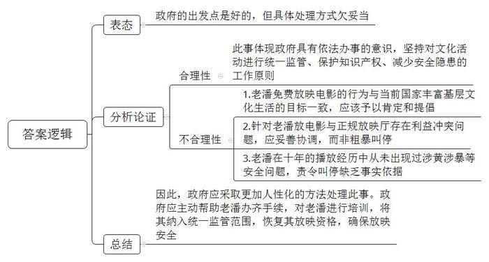
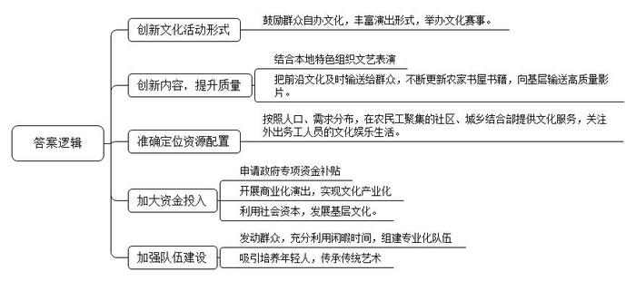

# 2017年江苏省公考《申论》题 （C卷）

> 候选采集稿。参考答案及解析来自粉笔页面，不代表官方答案或真实高分答卷；来源使用许可与原卷对应关系仍需人工核实。

## 给定材料

### 材料 material-94a65d65c919d2f9

2017年1月30日，正月初三，家家户户还处在节日的欢乐气氛里，J市城市管理执法支队对辖区道路开展了春联春贴专项整治活动。过年期间上街撕春联，让在节日期间的民众难以理解。网民质疑，城管是不是管理得太多了？贴春联这一延续了几千年的习俗被制止，太粗暴了！为此城管部门在官网上做了一个公开解释，回应说：“贴春联贴‘福’字，是传统风俗，在带来喜庆的同时，也带来了很大的安全隐患和视觉污染。节日过后，破旧凌乱的春联春贴不但失去了营造节日气氛的作用，还严重影响了市容市貌。因此，城市管理执法支队在尊重传统节日的同时，对辖区商户早宣传，对春联春贴早清理。节后，支队从正月初三起开展了专项整治活动。共清理春联、门贴、‘福’字等450余处，大大维护了文明、洁净、清新的城市环境。”让人诧异的是，回应最后还说，“正月初清理春联门贴，得到了绝大多数商户的理解和支持，也吁请辖区内广大市民予以理解和配合。”可从新闻下面的跟帖来看，遭到民间舆论的一致抵制，批评、质疑，甚至咒骂声一片。

今年63岁的老潘是G省一个地地道道的农民，他在当地有一个响当当的称号——“电影大亨”。2007年老潘自费买了一台电影播放机，免费给村民放电影，这一放就是10年。当地媒体多次报道过他的事迹，2013年他还入选了首届“感动G省人物”的候选人。2016年12月26号，老潘接到一个电话，要他去镇政府二楼纪委办公室去谈话，由于他没有经营许可证，涉嫌非法放映，被告知以后不能放电影了。

由于老潘在当地是个名人，此事引起公众的关注，有人上网查询后得知，所谓经营许可证是指“电影放映许可证”。这个证件，依法由县及县以上电影行政主管部门核发，只有办了证，才能在农村放电影。也有网友分析，目前国家为了丰富农村基层文化生活，正大力开展农村电影放映工程，这项工程有资金配套，每放一场电影会给正规放映队100元的补贴，而老潘免费给村民放电影，触动了正规放映队的利益，所以被叫停。

对于公众的质疑，当地政府部门发出了一个官方反馈，在反馈中，提及了叫停老潘放电影的理由有三个：一是不符合《电影放映条例》；二是他的放映行为不在监管范围，因老潘不服从统一的放映管理，和其他正规放映队相冲突；三是他的放映行为没有在广电局和电影公司的监管下进行，存在知识产权保护、涉黄涉暴的安全隐患，如果老潘在办理手续和接受培训后，可以恢复其资格。对于这样的结果，倔强的老潘不愿意接受，他说：“我是免费的，他规定我，我就不干了。我就不明白，做好事怎么还会被禁止呢？”

### 材料 material-19282eb27e37213c

崎岖的山路上，清一色的老人，步履蹒跚，他们正翻山越岭赶往相邻的村庄去听戏，那儿有“老杨剧团”在演出！这是春节期间F省某山区真实的一幕。“老杨剧团”是由农民老杨牵头自发组建的农民剧团。春节以来，这个剧团已接到5单生意，有本镇的，也有邻镇的，有私人祝寿的，也有村委会邀请的。演出形式涵盖采茶戏、歌舞、器乐表演等多个门类。尽管只是利用农闲季节、晚上和节假日时间演出，但在当地拥有不少“粉丝”。从2014年5月组建到今天，“老杨剧团”的演员人数从4人发展到了20多人，甚至还有“90后”新鲜血液加盟。“老乡们说我们自己编排的戏有乡土味，比县里剧团的演出都好看。”老杨脸上满满都是自豪。

“打麻将？谁有那闲工夫！年节是村里人聚得最全的时候，大家一起唱大戏、耍社火，都一心指望在全县社火大赛、戏剧大赛里拔头筹呢！”2017年2月18日，L县某村综合文化服务中心里，66岁的赵大爷司鼓，他62岁的老伴杨大娘扮演旦角，夫妻俩一唱一和，乐在其中。作为该村业余剧团的发起人，赵大爷不但把自家的服装、道具免费提供给剧团使用，还义务培养年轻人学习表演，一心要让传统艺术后继有人。

“如今，群众自办文化的热情被点燃，县里13个乡镇全部组建了业余剧团，成员达180多人。许多结合本地特色的文艺表演，让人眼前一亮。”L县文广新局局长说，“现在我们县的春节联欢晚会都是群众争着报名上节目，效果很好。以前我们总是花大价钱请些明星来演，人一走，又能留下什么呢？”

农民需要什么样的文化产品？我们能提供什么？是当前基层公共文化服务供给侧改革必须正面回答的问题。K市文化体育旅游局汤处长从事基层文化工作多年，走过不少地方。在他看来，农村大多数地区基层文化活动都缺乏新意，总是停留在传统的唱唱跳跳，搞活动就是喊一喊、凑一凑，花灯、小戏、广场舞居多；国家启动了一些文化下乡工程，但内容存在雷同、低质的现象。仔细分析一些农家书屋的书籍，会发现不少都是当地出版企业的库存书。“农村电影放映”工程放映的也多是上不了院线播映的影片。“配送错位，也是农村基层文化中一个潜在的问题。”汤处长介绍说，现代社会城镇化的发展趋势，使得部分农村地区的青壮年已转移到城市，有的举家搬迁到城郊居住，甚至整个村都转移出去。一些农民工大量聚集的社区、城乡结合部的公共文化服务严重不足，成为“真空地带”。在这些地区，资源配置需要重新定位。2016年汤处长他们为农民工送温暖，选择在城乡结合部放电影，没想到此举受到热烈欢迎，一年放了200多场。“外出打工的人没什么娱乐，文化生活非常单调，需要特别关心。”汤处长补充说，“缺人缺钱，仍是部分边远地区文化供给中存在的问题。在一些地方，尽管硬件配备齐全，但由于人手不足、资金短缺等问题导致基层文化服务无法高效开展。”

### 材料 material-a31e0c417111d443

在祖国的山山水水间，有这么一群人。他们或俯首案前，呕心沥血研究民间文化；或献身舞台，孜孜以求编演老百姓喜闻乐见的精彩节目；或走村串寨，把精神文化食粮播撒在田间地头……他们有一个共同的名字——“基层文化人”。

2017年1月9日晚，“最美基层文化人”颁奖典礼在H省音乐厅举行，H省“最美基层文化人”名单正式出炉。以下是几位“最美基层文化人”的简要事迹。

欧阳老师是M县僻远山区一名普通的文化辅导员。2014年退休后，他走乡串户收集改编民谣，为留守儿童编写了一本《十里山童谣》，融文明礼仪、法治安全、良好习惯、环境保护与资源节约等内容于一体，易读易记易懂，深受孩子们的喜爱。为了留守儿童的教育和成长，欧阳老师捐出自己的全部藏书和住房公积金创建“十里山留守儿童文化街”和“十里山书香文化社区”，为留守儿童建造了一个精神“粮仓”。

D市文化馆的王先生只有小学学历，自学成才。数十年来，他利用节假日和工作之便，自费跑遍了该市100多个乡镇村组，收集地方文化遗产资料三百余万字。利用在当地流传的“孟姜女传说”“荆河戏”等资料撰写了五部学术专著，著作的出版在当地学术界和文艺界引起了不小的震动。

作为H省省级非遗项目永兴大布江拼布绣的传承人，小何现在最大的愿望是打造一个大布江拼布绣产业园，在传承这项濒临失传的技艺的同时，让更多农村留守妇女多一份收入。小何曾执着地穿行在大布江的大山中，向当地民间艺人讨教拼布绣技艺；她不断摸索，自创了“回旋针法”等新颖针法；她锐意创新，将古老的艺术融入时尚生活，实现了大布江拼布绣艺术价值与经济效益的有机结合。随着小何的拼布绣作品越来越多地参加展会、比赛并获奖，大布江拼布绣逐渐声名鹊起，有的单幅作品最高售价达5万元，普通作品单幅售价也有数百元。小何建立了3个固定传习所，设立了4个固定展厅，培养出300多位年轻的熟练绣娘，让她们在家就实现了就业。同时，她还免费向聋哑儿童传授拼布技艺，提高他们的谋生技能。

Y自治州85岁的田大爷是民间戏曲——灯戏最忠诚的守护者。他14岁开始走上灯戏舞台，70年来坚守传承灯戏文化，将古老的灯戏撒播在家乡秀美的山水间。唱戏成为他生活的一部分，即使褪了青丝，没了牙齿，他依然咿咿呀呀地唱着，颤颤巍巍地舞着……

为群众需求而奔走，为精神食粮而劳作，是基层文化工作者们的真实写照。本次“最美基层文化人”评选活动由H省文化厅、H省委网信办、H省报业集团主办，各市州文（体）广新局承办。活动自2016年3月31日启动以来，共有1568名基层文化人报名，产生了热烈的社会反响。在这些报名者中，既有80多岁默默坚守一线的老艺术家，也有20多岁走时尚路线的文艺新秀，涵盖了基层文化工作者、艺术工作者、文化传承者、文化创意者四大群体。

评选活动打破了以往传统的“自上而下”的单一评奖模式，通过全省各市州、区县文化部门推荐以及文化工作者自荐、群众举荐等途径，经过专家评审、网络投票、集体决定、社会公示等环节，寻找出“最美基层文化人”候选人50名，最终评选出H省“最美基层文化人”10名、“最美基层文化人”提名奖40名。2016年7月22日寻找“最美基层文化人”活动投票环节全面开始，主办方开通了H省文化厅官方网站、文化江湖微信、微博、华声在线等网络投票渠道，活动期间，共有两千多万人次参与了投票。H省“最美基层文化人”评选活动的成功举办，引起了广泛的社会反响，邻近的J省也计划开展类似活动。

## 题目

### 第 1 题

**“给定资料**5**”中，对于叫停老潘免费放电影一事，当地政府部门给出了三点理由，谈谈你对此事的看法。（15分）**

关联材料：material-94a65d65c919d2f9

作答要求：

要求：分析透彻，观点正确。篇幅250字左右。

### 第 2 题

**假如你是一名农村文化工作者，请针对“给定资料**3**”中农村基层文化中存在的问题，就如何进一步提升基层文化的精准服务，提出对策和建议。（25分）**

关联材料：material-19282eb27e37213c

作答要求：

要求：措施具体，针对性强，条理清楚。篇幅250字左右。

### 第 3 题

**“给定资料”呈现了当前基层群众参与文化活动的一些新现象，请对此进行归纳概括。（20分）**

关联材料：material-a31e0c417111d443

作答要求：

要求：紧扣“给定资料”，准确全面，条理清楚，语言流畅。篇幅不超过250字。

### 第 4 题

**请围绕****“给定资料**7**”中的基层文化供给侧改革的要求，以“激发群众参与热情，创新文化服务方式”为主题，联系实际，自拟标题，写一篇议论文。（40分）**

关联材料：material-a31e0c417111d443

作答要求：

要求：不必拘泥于“给定资料”，符合议论文写作要求。篇幅1000字左右。

## 答案与解析

第 1 题

**参考答案（粉笔题库参考内容）**

政府的出发点是好的，但具体处理方式欠妥当。

一方面，此事体现政府具有依法办事的意识，坚持对文化活动进行统一监管、保护知识产权、减少安全隐患的工作原则。而不妥则体现在：1.老潘免费放映电影的行为与当前国家丰富基层文化生活的目标一致，应该予以肯定和提倡。2.针对老潘放电影与正规放映厅存在利益冲突问题，应妥善协调，而非粗暴叫停。3.老潘在十年的播放经历中从未出现过涉黄涉暴等安全问题，责令叫停缺乏事实依据。

因此，政府应采取更加人性化的方法处理此事。政府应主动帮助老潘办齐手续，对老潘进行培训，将其纳入统一监管范围，恢复其放映资格，确保放映安全。

**解析**

**参考答案说明：**思路方面，本参考答案按照观点现象分析题“解释抽象的观点、现象+表态+分析论证+总结”的一般答题思路展开。内容方面，本参考答案先对“政府叫停老潘免费放电影”这一事件进行了表态；“分析论证”部分分析了政府叫停放电影的合理性与不合理性；最后进行了总结。词句表达方面，本答案加上了“因此”等连接词来承接上下文。

**考点**：考点观点现象分析类

**来源**：来源2017年江苏省公考《申论》题 （C卷）

粉笔申论页面对本题只提供「解析视频」入口，该入口是会员推广位，页面无视频地址与文字解析。

第 2 题

**参考答案（粉笔题库参考内容）**

1.创新文化活动形式。鼓励群众自办文化，丰富演出形式，举办文化赛事。

2.创新内容，提升质量。结合本地特色组织文艺表演；把前沿文化及时输送给群众，不断更新农家书屋书籍，向基层输送高质量影片。

3.准确定位资源配置。按照人口、需求分布，在农民工聚集的社区、城乡结合部提供文化服务，关注外出务工人员的文化娱乐生活。

4.加大资金投入。申请政府专项资金补贴；开展商业化演出，实现文化产业化；利用社会资本，发展基层文化。

5.加强队伍建设。发动群众，充分利用闲暇时间，组建专业化队伍；吸引培养年轻人，传承传统艺术。

**解析**

**参考答案说明：**本参考答案从“创新文化活动形式”“创新内容，提升质量”“准确定位资源配置”“加大资金投入”“加强队伍建设”等五方面入手，进行相关原因的展开。各条的要点之间是并列关系，内容之间不存在重复、交叉。

**考点**：考点提出对策类

**来源**：来源2017年江苏省公考《申论》题 （C卷）

粉笔申论页面对本题只提供「解析视频」入口，该入口是会员推广位，页面无视频地址与文字解析。

第 3 题

**参考答案（粉笔题库参考内容）**

1.挖掘资源，研究利用。收集资料，编写书籍；建设文化街和文化社区；兴办文化产业，增加农民收入；传承灯戏文化。

2.创新模式，丰富内涵。把祠堂等传统建筑改造成文化礼堂；采用“农家书屋+电商”模式，组织培训，实现文化服务与电子商务融合发展；打造高端阅读空间，促进阅读空间与社区、商业体融合。

3.加强组织，建设队伍。自发组建剧团，突出特色；打造人才队伍，义务培养新人。

4.借助科技，参与文化。网红传播价值观和生活态度；开发APP推动文化服务数字化。

5.利用平台，坚定信念。参加中国诗词大会，催发内心，唤起生活信念。

**解析**

**参考答案说明：**本参考答案从“挖掘资源，研究利用”“创新模式，丰富内涵”“加强组织，建设队伍”“借助科技，参与文化”“利用平台，坚定信念”等不同方面进行了分条撰写。各条要点之间在内容上是并列的且没有交叉。并且撰写要点时，都提炼出来概括性强的总括词前置，满足了题目中要求的“归纳概括”。

**考点**：考点其他类

**来源**：来源2017年江苏省公考《申论》题 （C卷）

粉笔申论页面对本题只提供「解析视频」入口，该入口是会员推广位，页面无视频地址与文字解析。

第 4 题

**参考答案（粉笔题库参考内容）**

**激发群众参与热情需创新文化服务方式**

只有基层文化阵地活起来，百姓的精神才能富起来，国家才能更加稳步快速发展。但令人遗憾的是我国的基层文化建设却存在内容低质、流于形式、群众参与度低等诸多问题。为此，**我们要激发群众热情，创新服务方式，加快基层文化供给侧改革，更好地保障人民群众基本文化权益。**

**激发群众参与热情，政府要转变基层文化服务思路。既要在文化领域简政放权，给予群众参与文化的空间和自由，又要建立文化活动组织，打造人才队伍，也要搭好****“戏台”，让群众“点菜”。**基层文化服务应始终面向群众，以群众为中心，群众的满意度、参与度才是基层文化建设的出发点和落脚点。为了市容整洁大年初三上街撕春联，为了教条式落实规定禁止民众免费播放电影，为了安全取缔民间龙舟比赛……桩桩件件都会打击民众参与文化活动的积极性。所以我们应反其道行之，鼓励引导群众自发组织剧团、社团等，同时积极搭建文化平台，开办如类似《中国诗词大会》等以传统文化为主题的电视节目，邀请“草根”参与，为群众提供更多展示才华的舞台。

**创新文化服务方式，需要在传承的基础上创新。不断盘活传统文化资源，挖掘文化特色，探索文化服务新模式，并借助互联网手段，丰富文化供给内容，让群众拥有更多的选择权。**传统文化资源的改造与更新是创新文化服务最便捷有效的方式。如今祠堂、校舍、明清建筑等闲置资源都被重新改造，打造为民众从事文化活动的空间，转变成新时代的“精神高地”；图书馆也改变了原有的模式，开启免费借阅，优化借阅环境，创新借阅方式，让阅读成为老百姓幸福生活的精神滋养；互联网已变成创新文化服务方式的“刚需”，从“农村书屋+电商”的兴起到“网红”经济的出现，再到各类文化便民APP的研发，互联网掀起了文化服务的新浪潮。

**无论是激发群众参与文化的热情，还是创新文化服务方式，都需要实现文化产业化。**文化产业化为激发热情、创新方式提供坚实物质基础，为文化持续发展提供源源不断的动力，最终让中华民族品格提升，灵魂丰满。打造高端阅读空间，促进阅读空间与社区、商业体融合；建立刺绣产业园，实现艺术价值与经济价值的有机结合；利用网红效应，实现了商业变现……这些都是文化产业化鲜活的例子。然而，文化产业不同于其他产业，他左右着民众的主流价值，因此，需要政府加强监管，从业者坚守底线，民众理性冷静，不断提升文化产品的内容创意和价值引领。

文化植根于大地，植根于民间，应当从群众中来，到群众中去。唯有不断激发群众参与热情，创新服务方式，推动文化产业化发展，文化才能走近群众，深入人心。

**解析**

**文章分析**

**激发群众参与热情需创新文化服务方式**

【**标题的优点：**首先，范文的标题“激发群众参与热情需创新文化服务方式”突出了“激发群众参与热情，创新文化服务方式”这一主题。其次，形式上，文字简洁明快，不拖沓。】

（1）只有基层文化阵地活起来，百姓的精神才能富起来，国家才能更加稳步快速发展。但令人遗憾的是我国的（2）基层文化建设却存在内容低质、流于形式、群众参与度低等诸多问题。为此，**我们要激发群众热情，创新服务方式，**（3）**加快基层文化供给侧改革****，****更好地保障人民群众基本文化权益****。**

【**开头的优点：****★内容方面：**范文的开头是紧扣“激发群众参与热情，创新文化服务方式”这一主题展开的。首先，开头在段首处点出主题，做到了主题明确。其次，对“激发群众参与热情，创新文化服务方式”这一主题进行了分析阐述，指出了（1）“基层文化建设”的意义；（2）“基层文化建设”的问题；（3）“基层文化建设”的对策。**★文字表达方面：**使用了“只有……才……”“为此……”等关联词，使语言表达有逻辑性。】

**激发群众参与热情，政府要转变基层文化服务思路。既要**（1）**在文化领域简政放权****，****给予群众参与文化的空间和自由****，又要**（2）**建立文化活动组织****，****打造人才队伍****，****也要搭好****“****戏台****”，****让群众****“****点菜****”。**基层文化服务应始终面向群众，以群众为中心，群众的满意度、参与度才是基层文化建设的出发点和落脚点。为了市容整洁大年初三上街撕春联，为了教条式落实规定禁止民众免费播放电影，为了安全取缔民间龙舟比赛……桩桩件件都会打击民众参与文化活动的积极性。所以我们应反其道行之，（3）鼓励引导群众自发组织剧团、社团等，同时积极搭建文化平台，开办如类似《中国诗词大会》等以传统文化为主题的电视节目，邀请“草根”参与，为群众提供更多展示才华的舞台。

【**论述段****1****的优点：****★观点句：**范文的观点句是紧扣“激发群众参与热情，创新文化服务方式”这一文章主题提出的。形式上，它在段首处直接写出，位置突出，容易发现。内容上，关键词突出，内容要点明确，可以明显看出它是从“转变基层文化服务思路”这个角度入手，指出了“激发群众参与热情”的对策。**★论述内容：**（1）先介绍了“激发群众参与热情”的对策——在文化领域简政放权；（2）接着介绍了“激发群众参与热情”的对策——建立文化活动组织；（3）最后介绍了“激发群众参与热情”的对策——搭建文化平台。以上三个方面的内容都是紧扣“激发群众参与热情，政府要转变基层文化服务思路”这个观点进行分析论述的，论述的针对性强，内容层次丰富。最后，在论述方法上主要采取了讲道理和举例子相结合，做到了丰富多样。】

**创新文化服务方式，需要在传承的基础上创新。**（1）**不断盘活传统文化资源****，****挖掘文化特色****，****探索文化服务新模式****，并**（2）**借助互联网手段****，****丰富文化供给内容****，****让群众拥有更多的选择权****。**（3）传统文化资源的改造与更新是创新文化服务最便捷有效的方式。如今祠堂、校舍、明清建筑等闲置资源都被重新改造，打造为民众从事文化活动的空间，转变成新时代的“精神高地”；图书馆也改变了原有的模式，开启免费借阅，优化借阅环境，创新借阅方式，让阅读成为老百姓幸福生活的精神滋养；（4）互联网已变成创新文化服务方式的“刚需”，从“农村书屋+电商”的兴起到“网红”经济的出现，再到各类文化便民APP的研发，互联网掀起了文化服务的新浪潮。

【**论述段****2****的优点：****★观点句：**范文的观点句是紧扣“激发群众参与热情，创新文化服务方式”这一文章主题提出的。形式上，它在段首处直接写出，位置突出，容易发现。内容上，关键词突出，内容要点明确，可以明显看出它是从“在传承的基础上创新”这个角度入手，指出了“创新文化服务方式”的对策。**★论述内容：**（1）先介绍了“创新文化服务方式”的对策——盘活传统文化资源；（2）接着介绍了“创新文化服务方式”的对策——借助互联网手段；（3）然后介绍了“创新文化服务方式”的对策——改造、更新传统文化资源；（4）最后介绍了互联网对创新文化服务方式的重要性。以上四个方面的内容都是紧扣“创新文化服务方式，需要在传承的基础上创新”这个观点句进行分析论述的，论述的针对性强，内容层次丰富。最后，在论述方法上主要采取了讲道理和举例子相结合，做到了丰富多样。】

**无论是激发群众参与文化的热情，还是创新文化服务方式，都需要实现文化产业化。**（1）**文化产业化为激发热情****、****创新方式提供坚实物质基础****，****为文化持续发展提供源源不断的动力****，****最终让中华民族品格提升****，****灵魂丰满****。**打造高端阅读空间，促进阅读空间与社区、商业体融合；建立刺绣产业园，实现艺术价值与经济价值的有机结合；利用网红效应，实现了商业变现……这些都是文化产业化鲜活的例子。然而，（2）文化产业不同于其他产业，他左右着民众的主流价值，因此，需要政府加强监管，从业者坚守底线，民众理性冷静，不断提升文化产品的内容创意和价值引领。

【**论述段****3****的优点：****★观点句：**范文的观点句是紧扣“激发群众参与热情，创新文化服务方式”这一文章主题提出的。形式上，它在段首处直接写出，位置突出，容易发现。内容上，关键词突出，内容要点明确，可以明显看出它是从“文化产业化”这个角度入手，指出了“激发群众参与热情，创新文化服务方式”的对策。**★论述内容：**（1）先介绍了文化产业化对“激发群众参与热情，创新文化服务方式”的重要性；（2）接着介绍了“发展文化产业”的对策。以上两个方面的内容都是紧扣“无论是激发群众参与文化的热情，还是创新文化服务方式，都需要实现文化产业化”这个观点句进行分析论述的，论述的针对性强，内容层次丰富。最后，在论述方法上主要采取了讲道理和举例子相结合，做到了丰富多样。】

【**论述段之间的关系：****★内容的内在逻辑：**范文的论述段之间是依照并列逻辑展开的。论述段1先写了“激发群众参与热情”方面的对策，论述段2又写了“创新文化服务方式”方面的对策，论述段3再写了“激发群众参与热情，创新文化服务方式”方面的对策。**★段与段的外在衔接：**论述段3首处的“无论是激发群众参与文化的热情，还是创新文化服务方式，都需要实现文化产业化”，起到了承接论述段1、2，引出论述段3的作用。】

文化植根于大地，植根于民间，应当从群众中来，到群众中去。唯有不断（1）激发群众参与热情，创新服务方式，推动文化产业化发展，（2）文化才能走近群众，深入人心。

【**结尾的优点：**范文的结尾回扣了“激发群众参与热情，创新文化服务方式”这一主题。（1）再次提到了“激发群众参与热情，创新文化服务方式”；（2）阐述了深远意义。】

**考点**：考点文章写作题

**来源**：来源2017年江苏省公考《申论》题 （C卷）

粉笔申论页面对本题只提供「解析视频」入口，该入口是会员推广位，页面无视频地址与文字解析。

