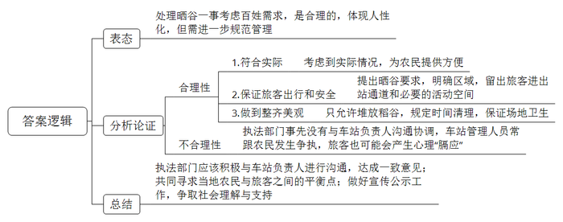
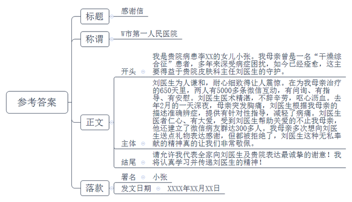

# 2018年江苏省公考《申论》题（B卷）

> 候选采集稿。参考答案及解析来自粉笔页面，不代表官方答案或真实高分答卷；来源使用许可与原卷对应关系仍需人工核实。

## 给定材料

### 材料 material-9caa093e75a6b7a4

“老百姓打官司不容易，不能让他们寒心。”这是崔法官经常说的一句话。崔法官是K县人民法院的一名老法官，20年来，经他审结的近千余起案件，无一件错案，无一件被投诉，无一件引发信访。

“他对案子总是一丝不苟，办案严谨、细心，坚守底线。”庭长告诉记者，崔法官办案从来不怕得罪人，有一次，崔法官的一位熟人找到他软磨硬泡，希望能够为其挪用公款的亲友减轻处罚，但崔法官严词拒绝：“对他的放纵就是我的失职。”在老家，不少人知道他是法官，权力不小，常想找他走后门，但都被崔法官拒绝了。

2017年9月，法院受理了一起棘手的赡养案件，杨老伯的4个子女拒绝履行赡养义务，庭长将这个案件交给崔法官。崔法官接案后，一夜没睡好，第二天就找来4个子女，对他们晓之以理、动之以情：“有一首叫《父亲》的歌说，‘人说养儿能防老’。子女小的时候，父母省吃俭用，对子女无微不至地关心，时刻担心他们吃不好、穿不暖，盼望着他们快快长大，成家立业。父母老了，生活不能自理了，按法律、论民俗、讲伦理，子女都应当赡养老人。”经过多次入情入理的调解，一直互相推诿的几个子女都愿意履行赡养义务。

曾经有一桩案件，被告威胁崔法官：“要是敢这么判，就有人放你的血，让你横着出去！”面对被告纠集的黑恶势力，崔法官毫不畏惧，“我当时也没多想，就觉得这个案子必须这样判，否则对不起庄严的国徽。”他连续工作多日，成功地解决了这起案件。事后，原告诚心诚意地送去了“为民解难，尽心尽责”的锦旗，并且表示，自己会以崔法官为榜样，尽其所能去温暖身边的人。

### 材料 material-147a075368563720

2017年11月，J县新建的火车站广场成了晒谷场一事引发了热议。从网民晒发的图文中看出，宽敞的火车站广场见不到什么旅客，反而是铺散在广场上大片大片的稻谷在太阳底下熠熠发光，特别引人注目。除了供旅客和行人通行的道路外，火车站广场成了金色的海洋，俨然是一道风景。

有网友质疑，本应整洁的火车站广场，竟然成了稻谷晒场，令人难以置信。一直以来，火车站给人的感觉就是安检严格、管理规范，广场上别说晒粮食，就是摆个小摊也不行。

面对质疑，当地执法部门做出了回应。这种情况他们其实是了解的，一开始有农民来广场晒谷时，他们就已经指出了这一行为的不妥之处。现在出现的情形是经过允许的，他们考虑到了周边农民的现实需求，进行了充分论证，并采取了相应的管理措施。

该火车站位置较为偏僻，农忙时节旅客较少，晾晒稻谷一般情况下不会给旅客出行和公共安全造成影响。执法部门考虑到农民在秋收时节的确缺少晾晒场地的实际情况，认为通过引导，可以给农民一些方便。同时，执法部门对广场晒谷提出了一系列具体要求，留出旅客进出站通道和必要的活动空间，保证不影响旅客通行；除稻谷外不允许堆放其他物品，保证车站广场的整齐美观；晚上6点之前必须将谷物清理干净，保证场地卫生。对于一些旅客可能会产生的心理“膈应”，执法部门表示，会尽力在当地农民与旅客之间寻找平衡点。

但是，火车站相关负责人却表示，执法部门事先没有与他们进行沟通和协调，他们对允许农民在车站广场晒谷的事情并不知情，车站管理人员常因此事跟农民发生争执。

### 材料 material-7834f1bc231f02ec

退休职工李阿姨曾是一名“干燥综合征”患者，多年来被口眼干燥、全身乏力、低热等病征困扰，痛苦不堪，家人为此担心不已，女儿小张更是揪心。幸运的是，李阿姨遇到了一位天使般的守护神——W市第一人民医院皮肤科主任刘医生。刘主任担任她的主治医生不久就和她互加了微信，粗略估算，650天的治疗时间里，两人有5000多条微信互动，有问询、有指导、有安慰。李阿姨早已把刘主任当成了朋友和家人，“这两年，要是没有刘医生，我都不知道怎么过。”她红着眼睛告诉记者。

回忆起去年2月的那天，李阿姨至今仍心有余悸：深夜11点，她正要睡觉时突发胸痛，好像被点了穴一样无法动弹，“那一刻，我害怕极了。”疼痛劲一过，她立即抓起手机，给刘主任发微信：“刘医生，我刚才突然胸痛得厉害，疼痛从前胸一直游走到了后背，人像被冰冻了一样。大概30秒钟的样子，现在已经缓解了。这是怎么回事？”刘主任立即回复：“我知道了，你别慌，深呼吸，吸气——呼气——吸气，慢慢让自己平静下来。”李阿姨又问：“不会是心脏病吧？”刘主任回答：“引起胸痛最常见的心绞痛或心梗，不会在短短30秒的时间内就缓解，疼痛时也不会出现冰冻感，更不会在全身游走，况且前不久的检查已经排除了你的心脏病史。干燥综合征影响体内激素引起的过敏性反应的可能性更大。你再观察一下，如果继续出现疼痛，马上去就近的医院；如果没有，你明天来医院，我给你配点药。”刘主任的一席话就像一颗定心丸，李阿姨安心了。放下手机，时间早已过了零点。

李阿姨告诉记者：“刘医生建立的病友微信群里有300多人呢，我只是其中的一个。他们和我一样，在这个微信群中得到了很多指导和帮助，感受到了刘医生的医者仁心。”李阿姨说，她总想送点礼物，向刘主任表达感激之情，可刘主任从未接受，“你们健康了，就是给我的最好的礼物。”如今，李阿姨的病已经痊愈，因为生病变得性格孤僻、见人都不愿打招呼的她恢复了原先的开朗，常跟姐妹们一起去唱歌、旅游。

### 材料 material-4a2b336f869e2413

“先天下之忧而忧，后天下之乐而乐”，写下这句千古名言的范仲淹是北宋著名的文学家，更是一代名臣。他出身贫苦，入仕从政后，十分关心百姓疾苦。有一年，淮南等地蝗灾、旱灾蔓延，灾情严重。范仲淹请求朝廷巡察处理，朝廷却置之不理。他十分气愤，冒着丢官之险、杀身之祸质问宋仁宗：“淮南等地百姓流离失所，饿殍遍野，朝廷怎能熟视无睹？”宋仁宗无言以对，便派他去救灾。范仲淹每到一地，就开官仓赈济灾民，发官钱救济百姓，并带领灾民生产自救。和百姓在一起的日子里，他看到饥饿的人们常常挖一种叫“乌味草”的野草充饥，就尝了一尝，感觉粗糙苦涩，难以下咽。回京时，范仲淹特意带回乌味草，呈给宋仁宗，请他传示皇亲国戚、朝廷上下，告诫他们勿忘百姓疾苦，杜绝奢侈恶习。时隔千年，范仲淹体恤民生多艰、心系百姓的道德风范和人格魅力，依然令人钦佩不已。

古人云“感人心者，莫先乎情”。一提起周恩来总理，他与人民一家亲的画面就会浮现在人们的脑海中。新中国成立之初，百废待兴，周总理经常坐在老乡家门槛上，向群众了解民情；黄河抢险时，周总理和纤夫一起喊着号子，齐心合力拉纤，保护大堤；1973年，周总理回到阔别20多年的延安，看到群众依然缺衣少食，十分自责：“乡亲们的生活还这么苦，我这个共和国总理没当好，我对不起乡亲们！”翻开周总理的著作，“为人民服务”的思想无不闪烁在各个篇章的字里行间。他深情地说，对人民，我们要像孺子牛一样勤勤恳恳、老老实实。他要求干部以人民的疾苦为忧，要有所爱，有所为，有所恨，有所怒。周总理的一生，始终满怀与人民群众亲密无间、心贴着心的情感，人民的好总理赢得了人民群众的衷心爱戴与拥护。

## 题目

### 第 1 题

**“****给定资料**3**～**5**”****列举的工作生活中的事例体现了心系他人的一些优良品质，请分别概括这些优良品质的具体表现。（****15****分）**

关联材料：material-9caa093e75a6b7a4

作答要求：

要求：紧扣给定资料，准确全面，条理清楚。篇幅不超过200字。

### 第 2 题

**请对“给定资料**7**”中执法部门对火车站广场晒谷一事的处理进行评析。（****20****分）**

关联材料：material-147a075368563720

作答要求：

要求：全面准确，分析透彻，观点正确。篇幅250字左右。

### 第 3 题

**请以****“****给定资料**5**”****中李阿姨女儿的名义，给刘医生所在的****W****市第一人民医院写一封感谢信。（****25****分）**

关联材料：material-7834f1bc231f02ec

作答要求：

要求：

（1）内容完整，条理清晰；

（2）结构严谨，语言流畅；

（3）情感真挚，有感染力；

（4）篇幅400字左右。

### 第 4 题

**请结合对****“****以百姓之心为己心，以他人之心为己心****”****这句话的理解，以****“****有温度的人生更美好****”****为主题，联系实际，自拟标题，写一篇议论文。（****40****分）**

关联材料：material-4a2b336f869e2413

作答要求：

要求：

（1）观点明确，见解深刻，内容充实；

（2）结合给定资料，但不拘泥于给定资料；

（3）思路清晰，结构完整，语言流畅；

（4）符合议论文写作要求，篇幅1000字左右。

## 答案与解析

第 1 题

**参考答案（粉笔题库参考内容）**

1.崔法官公正的法治精神。表现在办案严谨细心，上千案件无错案；坚守底线，拒绝亲友说情；关爱群众，调解亲情矛盾；勇敢无畏，不惧黑恶势力。

2.吕书记关爱群众的公仆精神。表现在爱岗敬业，筹措资金助群众脱贫；平易近人，深入群众，助群众致富；重视家风，引导孩子读书，树立正确价值观。

3.刘医生甘于奉献的大爱精神。表现在耐心细致，解答患者问题；专业性强，针对性治疗疾病；医者仁心，建微信群接受咨询；无私奉献，拒绝收礼。

**解析**

**参考答案说明****：**本答案对“崔法官”“吕书记”“刘医生”三位主人公的优秀品质及具体表现进行了分条撰写。每条要点之间内容上没有交叉，并对每条要点提炼出了总括词并前置。

**考点**：考点特点类

**来源**：来源2018年江苏省公考《申论》题（B卷）

粉笔申论页面对本题只提供「解析视频」入口，该入口是会员推广位，页面无视频地址与文字解析。

第 2 题

**参考答案（粉笔题库参考内容）**

处理晒谷一事考虑百姓需求，是合理的，体现人性化，但需进一步规范管理。

合理性有1.符合实际。考虑到实际情况，为农民提供方便。2.保证旅客出行和安全。提出晒谷要求，明确区域，留出旅客进出站通道和必要的活动空间。3.做到整齐美观。只允许堆放稻谷，规定时间清理，保证场地卫生。

但执法部门事先没有与车站负责人沟通协调，车站管理人员常跟农民发生争执，旅客也可能会产生心理“膈应”。

执法部门应该积极与车站负责人进行沟通，达成一致意见；共同寻求当地农民与旅客之间的平衡点；做好宣传公示工作，争取社会理解与支持。

**解析**

**参考答案说明：**思路方面，本参考答案按照观点现象分析题“表态+分析论证+总结”的一般答题思路展开。内容方面，本参考答案先对“处理火车站广场晒谷一事”进行了表态；“分析论证”部分先分析了处理晒谷一事的合理性，接着分析了处理晒谷一事的不合理性；最后提出对策，进行了总结。

**参考答案二：**

处理晒谷一事考虑到群众需求，是合理的，但也存在不足，需要进一步优化。

一、其合理性在于：1.执法人性化。考虑到农民在秋收时节缺少晾晒场地，想给农民提供便利。2.决策科学，论证充分。火车站位置偏僻，农忙时旅客少，对旅客出行、公共安全影响较小。3.管理到位。预留活动空间，保证旅客通行；只允许堆放稻谷，保证整齐美观；每晚清理谷物，保证场地卫生。

二、处理中确实存在不足：1.宣传沟通工作不到位，造成部分旅客不适。2.事先未与车站方沟通协调，使得车站管理人员与农民发生争执。

三、今后，执法部门应：1.做好宣传公示工作，在当地农民与旅客间寻找平衡点，争取社会理解与支持。2.与车站方面及时沟通，达成一致。

**考点**：考点观点现象分析类

**来源**：来源2018年江苏省公考《申论》题（B卷）

粉笔申论页面对本题只提供「解析视频」入口，该入口是会员推广位，页面无视频地址与文字解析。

第 3 题

**参考答案（粉笔题库参考内容）**

感谢信

W市第一人民医院:  

我是贵院病患李XX的女儿小张。我母亲曾是一名“干燥综合征”患者，多年来深受病症困扰，如今已经痊愈，这主要得益于贵院皮肤科主任刘医生的守护。

刘医生为人谦和，耐心细致地让人震惊。在为我母亲治疗的650天里，两人有5000多条微信互动，有问询、有指导、有安慰。刘医生医术精湛，不辞辛劳，呕心沥血。去年2月的一天深夜，母亲突发胸痛，刘医生根据我母亲的描述准确辨症，提供有针对性指导，减轻了病痛。刘医生医者仁心、有大爱。受到刘医生帮助关爱的不止我母亲，他还建立了微信病友群达300多人。我母亲多次想向刘医生送点礼物表达感谢，但都被拒绝了，刘医生这种无私奉献的精神真的让我们非常敬佩。

请允许我代表全家向刘医生及贵院表达最诚挚的谢意！我将认真学习并传递刘医生的精神！

小张

XXXX年XX月XX日

**解析**

**参考答案说明：**（1）格式方面，本参考答案写到了“标题”“称谓”“正文”“落款”。（2）正文部分，一方面从内容来看，开头部分首先介绍了自己和母亲的基本情况。其次主体部分从刘医生“为人谦和，细致耐心”“医术精湛”“医者仁心，有大爱”“无私奉献”四个方面阐述了向刘医生致谢原因。另一方面，形式上，本参考答案做到了分段、分条撰写，整体上条理较为清晰。（3）本参考答案能够结合题目要求“语言流畅”，在语言表达上做到了简洁、流畅。

**考点**：考点宣传类

**来源**：来源2018年江苏省公考《申论》题（B卷）

粉笔申论页面对本题只提供「解析视频」入口，该入口是会员推广位，页面无视频地址与文字解析。

第 4 题

**参考答案（粉笔题库参考内容）**

**用****“温度”成就美好人生**

鲁迅先生曾说，“愿中国青年都摆脱冷气，只是向上走，不必听自暴自弃者流的话。有一分热，发一分光。”诚哉斯言，**青年人想成就人生需要活出温度，我们的社会和国家想飞速发展更需要温度。**温度是什么？它是一种态度，积极向上，勇攀高峰，让自己的人生焕发光彩；它是一种责任，推己及人，施以援手，让他人感受温暖；它是一种情怀，关心天下，寻求认同，构建民族和世界情感共同体。

**想成就有****“温度”的人生，先要做个有“心”人。要懂得对自己负责，以积极的人生态度面对生活和工作，更要相信信仰的力量，勇于追求卓越和理想。**有价值的人生，向来都不是一马平川的，它体现在拥有坚毅的品格，面对自己的事情不轻言放弃；它还体现对人生充满希望与激情，坚定理想信念，执着热忱的精神力量。而在当下，颓废的生活态度却并不鲜见，时下流行的“佛系”青年的生活方式，表面上看无欲无求，实际上是对人生丧失了热情和干劲，丢掉了人生的意义。唯有将积极昂扬的温度注入生活和工作，对其保有激情，才在实现自我人生价值的同时实现更远大的抱负。

**想成就有“温度”的人生，还要学会****推己及人****。心系他人、体谅他人、温暖他人、帮助他人。**印度古谚说：“赠人玫瑰，手有余香。”的确，寄身于世间，我们每个人都不是寂寞行路的旅人，唯有心系他人，帮助他人，服务他人，人生之路才能越走越宽。我们要学会体谅年迈的父母，尽为人子女的孝心，给予父母精神的陪伴和心理的抚慰；我们要学会换位思考，尊重同事的想法，保持恰当的距离，给予对方独立空间；我们也要像刘医生一样无私奉献，帮助病患，让病人摆脱疾病的折磨，重新拥有健康人生……作为青年人，只有心系他人，才能够感受到有温度的人生真谛。

**这种****“温度”更呼唤着我们关心天下大事。要时刻关心人民群众的疾苦，视天下为己任，还要懂得以文化为载体传递精神“内核”，寻求全世界人民的理解和认同。**正如伟大的周恩来总理，他的一生始终以人民的疾苦为忧，始终满怀与人民群众亲密无间、心贴着心的情感，最终赢得了人民群众的衷心爱戴与拥护。全球一体化浪潮下，有温度的人生也应跨越国家、种族界限，推动文化认同，促进多元文化和谐发展。因此，青年人要推动文明互鉴，以文化共享的方式让各国人民享受更富内涵的精神生活，实现文明和谐，构建民族和世界情感共同体。

《礼记》有云：“修身齐家治国平天下。”诚然，青年人当有兼济天下的信念，才能推己及人。那些有温度的人，不仅成就了自己的人生，也在不断前行中实现了和谐社会的建设和民族精神的传承。

**解析**

**文章分析**

**用****“温度”成就美好人生**

【**标题的优点：**首先，范文的标题“让‘温度’成就美好人生”突出了“有温度的人生更美好”这一主题。其次，形式上采用了比拟的修辞手法，使得标题更加形象生动，有吸引力。】

鲁迅先生曾说，“愿中国青年都摆脱冷气，只是向上走，不必听自暴自弃者流的话。有一分热，发一分光。”诚哉斯言，**青年人想成就人生需要活出温度，我们的社会和国家想飞速发展更需要温度。**温度是什么？（1）它是一种态度，积极向上，勇攀高峰，让自己的人生焕发光彩；（2）它是一种责任，推己及人，施以援手，让他人感受温暖；（3）它是一种情怀，关心天下，寻求认同，构建民族和世界情感共同体。

【**开头的优点：**★内容方面。范文的开头是紧扣题目给定的“有温度的人生更美好”这一主题展开的。首先，开头用名人名言引出了主题，做到了主题明确。其次，对“有温度的人生更美好”这一主题进行了分析阐述，指出了（1）“温度”是积极向上，勇攀高峰的人生态度；（2）“温度”是推己及人，施以援手的责任意识；（3）“温度”是关心天下，寻求认同的情怀。★文字表达方面：长短句配合使用，使语言表达有节奏感；使用了比拟、引用等修辞手法，使文字表达更加形象、有力。】

**想成就有****“温度”的人生，先要做个有“心”人。要懂得对自己负责，以积极的人生态度面对生活和工作，更要相信信仰的力量，勇于追求卓越和理想。**有价值的人生，向来都不是一马平川的，（1）它体现在拥有坚毅的品格，面对自己的事情不轻言放弃；它还体现对人生充满希望与激情，坚定理想信念，执着热忱的精神力量。而在当下，颓废的生活态度却并不鲜见，时下流行的“佛系”青年的生活方式，（2）表面上看无欲无求，实际上是对人生丧失了热情和干劲，丢掉了人生的意义。（3）唯有将积极昂扬的温度注入生活和工作，对其保有激情，才在实现自我人生价值的同时实现更远大的抱负。

【**论述段****1****的优点：**本题严格要求结合对“以百姓之心为心、以他人之心为己心”这句话的理解，以“有温度的人生更美好”为主题来写文章，所以观点句和相应的论述内容都要严格按照题目要求和对应资料来写。★观点句：范文的观点句是紧扣“有温度的人生更美好”这一文章主题提出的。形式上，它在段首处直接写出，位置突出，容易发现。内容上，关键词突出，内容要点明确，可以明显看出它是从“做个有‘心’人”入手，指出了“如何成就有温度的人生”。★论述内容：（1）介绍了“有价值的人生的体现”；（2）介绍了“人生要有信仰否则颓废无意义”；（3）介绍了“如何追求卓越，实现人生价值”。注意：以上几个方面的内容都是紧扣“想成就有‘温度’的人生，先要做个有‘心’人。要懂得对自己负责，以积极的人生态度面对生活和工作，更要相信信仰的力量，勇于追求卓越和理想”这个观点句进行分析论述的，论述的针对性强，内容层次丰富。最后，在论述方法和论据的选取上做到了讲道理、举例子相结合，做到了丰富多样。】

**想成就有****“温度”的人生，还要学会****推己及人****。心系他人、体谅他人、温暖他人、帮助他人。**印度古谚说：“赠人玫瑰，手有余香。”的确，寄身于世间，我们每个人都不是寂寞行路的旅人，（1）唯有心系他人，帮助他人，服务他人，人生之路才能越走越宽。（2）我们要学会体谅年迈的父母，尽为人子女的孝心，给予父母精神的陪伴和心理的抚慰；（3）我们要学会换位思考，尊重同事的想法，保持恰当的距离，给予对方独立空间；我们也要像刘医生一样（4）无私奉献，帮助病患，让病人摆脱疾病的折磨，重新拥有健康人生……（5）作为青年人，只有心系他人，才能够感受到有温度的人生真谛。

【**论述段****2****的优点：**本题严格要求结合对“以百姓之心为心、以他人之心为己心”这句话的理解，以“有温度的人生更美好”为主题来写文章，所以观点句和相应的论述内容都要严格按照题目要求和对应资料来写。★观点句：范文的观点句是紧扣“有温度的人生更美好”这一文章主题提出的。形式上，它在段首处直接写出，位置突出，容易发现。关键词突出，内容上，关键词突出，内容要点明确，可以明显看出它是从“学会推己及人”入手，指出了“如何成就有温度的人生”。★论述内容：（1）介绍了“应当心系他人”；（2）介绍了“应当体谅他人”；（3）介绍了“应当换位思考温暖他人”；（4）介绍了“应当帮助他人”；（5）介绍了“年轻人心系他人的重要性”。注意：以上几个方面的内容都是紧扣“想成就有‘温度’的人生，还要学会推己及人。心系他人、体谅他人、温暖他人、帮助他人”这个观点句进行分析论述的，论述的针对性强，内容层次丰富。最后，在论述方法和论据的选取上做到了讲道理、举例子相结合，做到了丰富多样。】

**这种****“温度”更呼唤着我们关心天下大事。要时刻关心人民群众的疾苦，视天下为己任，还要懂得以文化为载体传递精神“内核”，寻求全世界人民的理解和认同。**正如伟大的周恩来总理，他的一生始终（1）以人民的疾苦为忧，始终满怀与人民群众亲密无间、心贴着心的情感，最终赢得了人民群众的衷心爱戴与拥护。全球一体化浪潮下，（2）有温度的人生也应跨越国家、种族界限，推动文化认同，促进多元文化和谐发展。因此，（3）青年人要推动文明互鉴，以文化共享的方式让各国人民享受更富内涵的精神生活，实现文明和谐，构建民族和世界情感共同体。

【**论述段****3****的优点：**本题严格要求结合对“以百姓之心为心、以他人之心为己心”这句话的理解，以“有温度的人生更美好”为主题来写文章，所以观点句和相应的论述内容都要严格按照题目要求和对应资料来写。★观点句：范文的观点句是紧扣“有温度的人生更美好”这一文章主题提出的。形式上，它在段首处直接写出，位置突出，容易发现。关键词突出，内容上，关键词突出，内容要点明确，可以明显看出它是从“关心天下大事”入手，指出了“如何成就有温度的人生”。★论述内容：（1）介绍了“时刻关心人民疾苦，视天下为己任”；（2）介绍了“有温度的人生的意义”；（3）介绍了“青年人如何成就有温度的人生”。注意：以上几个方面的内容都是紧扣“这种‘温度’更呼唤着我们关心天下大事。要时刻关心人民群众的疾苦，视天下为己任，还要懂得以文化为载体传递精神‘内核’，寻求全世界人民的理解和认同”这个观点句进行分析论述的，论述的针对性强，内容层次丰富。最后，在论述方法和论据的选取上做到了讲道理、举例子相结合，做到了丰富多样。】

【**论述段之间的关系**：★内容的内在逻辑：范文的论述段之间是依照“并列”的逻辑展开的。论述段1先写了“想成就有‘温度’的人生，先要做个有‘心’人”，论述段2再写了“想成就有‘温度’的人生，还要学会推己及人”，论述段3接着写了“这种‘温度’更呼唤着我们关心天下大事”。】

《礼记》有云：“修身齐家治国平天下。”诚然，（1）青年人当有兼济天下的信念，才能推己及人。那些有温度的人，（2）不仅成就了自己的人生，也在不断前行中实现了和谐社会的建设和民族精神的传承。

【**结尾的优点：**范文的结尾回扣了“有温度的人生更美好”这一主题。（1）再次总结了“有温度的人生更美好”；（2）阐述了深远意义。】

**考点**：考点文章写作题

**来源**：来源2018年江苏省公考《申论》题（B卷）

粉笔申论页面对本题只提供「解析视频」入口，该入口是会员推广位，页面无视频地址与文字解析。

