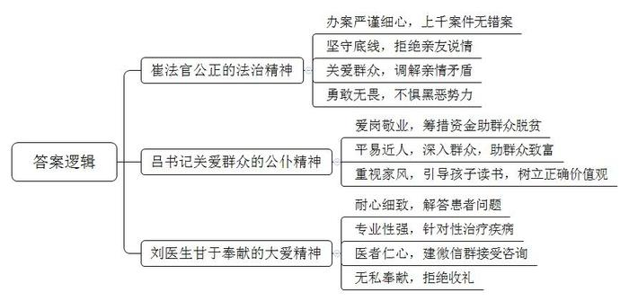
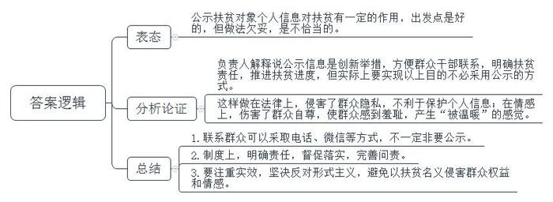
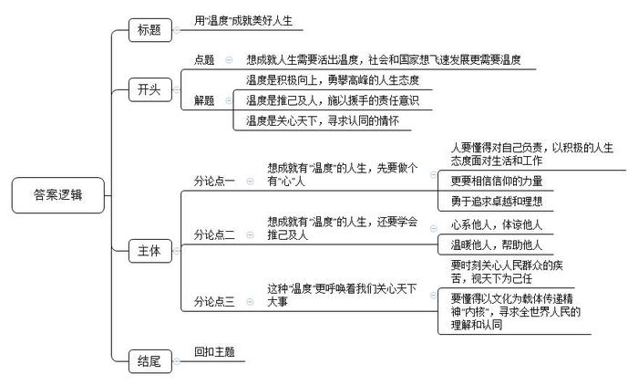

# 2018年江苏省公考《申论》题（A、普通选调卷）

<!-- gwy:overview:start -->
> **江苏 · 2018 · 申论 · 选调生** ｜ 4 题 · 图片 4 处 · 答案随题折叠

导航：[题目](#题目) · [材料 1](#材料-1)
<!-- gwy:overview:end -->

> 候选采集稿。参考答案及解析来自粉笔页面，不代表官方答案或真实高分答卷；来源使用许可与原卷对应关系仍需人工核实。

## 给定材料

### 材料 1

“先天下之忧而忧，后天下之乐而乐”，写下这句千古名言的范仲淹是北宋著名的文学家，更是一代名臣。他出身贫苦，入仕从政后，十分关心百姓疾苦。有一年，淮南等地蝗灾、旱灾蔓延，灾情严重。范仲淹请求朝廷巡察处理，朝廷却置之不理。他十分气愤，冒着丢官之险、杀身之祸质问宋仁宗：“淮南等地百姓流离失所，饿殍遍野，朝廷怎能熟视无睹？”宋仁宗无言以对，便派他去救灾。范仲淹每到一地，就开官仓赈济灾民，发官钱救济百姓，并带领灾民生产自救。和百姓在一起的日子里，他看到饥饿的人们常常挖一种叫“乌味草”的野草充饥，就尝了一尝，感觉粗糙苦涩，难以下咽。回京时，范仲淹特意带回乌味草，呈给宋仁宗，请他传示皇亲国戚、朝廷上下，告诫他们勿忘百姓疾苦，杜绝奢侈恶习。时隔千年，范仲淹体恤民生多艰、心系百姓的道德风范和人格魅力，依然令人钦佩不已。

古人云“感人心者，莫先乎情”。一提起周恩来总理，他与人民一家亲的画面就会浮现在人们的脑海中。新中国成立之初，百废待兴，周总理经常坐在老乡家门槛上，向群众了解民情；黄河抢险时，周总理和纤夫一起喊着号子，齐心合力拉纤，保护大堤；1973年，周总理回到阔别20多年的延安，看到群众依然缺衣少食，十分自责：“乡亲们的生活还这么苦，我这个共和国总理没当好，我对不起乡亲们！”翻开周总理的著作，“为人民服务”的思想无不闪烁在各个篇章的字里行间。他深情地说，对人民，我们要像孺子牛一样勤勤恳恳、老老实实。他要求干部以人民的疾苦为忧，要有所爱，有所为，有所恨，有所怒。周总理的一生，始终满怀与人民群众亲密无间、心贴着心的情感，人民的好总理赢得了人民群众的衷心爱戴与拥护。

### 材料 2

最是寻常见真情，最是细节显品格。相比于历史的宏大叙事，现实的平凡书写更有一种直击人心的力量。目前，平均每16个中国人里，就有1名共产党员。中国共产党引领中国航船驶过90多年之际，无数人都会从自己的视角审视这支队伍，从一件件小事、一个个普通党员身上感受历史的启示和信仰的力量。为此，某报社评论部携手该报新闻网、新闻客户端，发起了“我家的党员”征稿活动，让家人写家中的共产党员。这次征稿活动打开了人们认识身边共产党员的一扇窗口。

大量的稿件如雪片般飞来，让主办方感到惊喜。作者既有知识分子、公务员，也有企业职员、普通农民。很多人表示，投稿不是为了发表，只是为了表达真实的所见所感。正如刘先生所说，“投稿是为了见证家人的红色情怀，书写他们的红色记忆，传承他们的红色基因，传递他们身上的正能量。”

这些文章没有华丽的辞藻，都是真心话、真性情；没有空洞的理论，都是一个个鲜活的人生片段。到目前，该报已经刊发了多篇稿件，其官网及官方公众号上也都选登了若干篇。这些家人眼中的“党员故事”，组成了一幅生动真实、有情有义的共产党人群像。

透过家人的眼睛，读者看到了党员的正义与坚守。“倔牛”“‘轴’心骨”“二愣子”等，在充满生活气息的字里行间，一个个讲原则、有血肉的党员的形象扑面而来：投稿人小杜因拿红头公用信笺写作业而受到父亲训斥，从此记住了“公家的光一点都不能沾”；投稿人何老先生因为女儿坚决不肯走后门办私事而感到自豪，他记住了女儿的话，“现在你找别人帮忙，以后别人叫你办一些不合规矩的事，怎么办？”……日常的细节，让人感到了代际之间流淌着的一股力量。

透过家人的眼睛，读者还看到了信仰传递的力量。投稿人苏女士说：“我丈夫是党员，我看得到他的辛苦，深深地为他的执着所折服，也渐渐明白了，有追求、有信仰，才是真正脚踏实地、令人敬佩的人生。他追求着他的信仰，我自豪着他的信仰。爱他，就支持他。”投稿人小宋是一名中学生，他回忆了爸爸入党那天家里的情形。当晚，见到妈妈为爸爸准备了酒菜，小宋问家里有什么喜事，爸爸回答说：“儿子，今天是你老爸的‘生日’。从今往后，老爸就有了政治生命。”信仰的种子，就这样在小宋一辈的心中扎下了根。

### 材料 3

“老百姓打官司不容易，不能让他们寒心。”这是崔法官经常说的一句话。崔法官是K县人民法院的一名老法官，20年来，经他审结的近千余起案件，无一件错案，无一件被投诉，无一件引发信访。

“他对案子总是一丝不苟，办案严谨、细心，坚守底线。”庭长告诉记者，崔法官办案从来不怕得罪人，有一次，崔法官的一位熟人找到他软磨硬泡，希望能够为其挪用公款的亲友减轻处罚，但崔法官严词拒绝：“对他的放纵就是我的失职。”在老家，不少人知道他是法官，权力不小，常想找他走后门，但都被崔法官拒绝了。

2017年9月，法院受理了一起棘手的赡养案件，杨老伯的4个子女拒绝履行赡养义务，庭长将这个案件交给崔法官。崔法官接案后，一夜没睡好，第二天就找来4个子女，对他们晓之以理、动之以情：“有一首叫《父亲》的歌说，‘人说养儿能防老’。子女小的时候，父母省吃俭用，对子女无微不至地关心，时刻担心他们吃不好、穿不暖，盼望着他们快快长大，成家立业。父母老了，生活不能自理了，按法律、论民俗、讲伦理，子女都应当赡养老人。”经过多次入情入理的调解，一直互相推诿的几个子女都愿意履行赡养义务。

曾经有一桩案件，被告威胁崔法官：“要是敢这么判，就有人放你的血，让你横着出去！”面对被告纠集的黑恶势力，崔法官毫不畏惧，“我当时也没多想，就觉得这个案子必须这样判，否则对不起庄严的国徽。”他连续工作多日，成功地解决了这起案件。事后，原告诚心诚意地送去了“为民解难，尽心尽责”的锦旗，并且表示，自己会以崔法官为榜样，尽其所能去温暖身边的人。

### 材料 4

2017年12月，52岁的某贫困县县委书记老吕，突发心脏病，倒在了工作岗位上。吕书记生前结对帮扶的贫困户老肖，听到这个消息，眼泪流了下来：“简直不敢相信，吕书记好好的一个人，怎么突然就没了！”家住该县D村的老肖，原来生活异常贫困。2015年7月，吕书记走访贫困户时，看到他家徒四壁，便问他：“你有什么手艺吗？”老肖回答：“我会电焊，但没钱买设备。”“只要你勤快，愿意做，钱我可以帮你想办法。你马上列出所需设备的清单，我回县城就给你买，再帮你到路边租间门面。”吕书记随后为老肖购置电焊设备，帮他在街上租了一间门面房，老肖就开起了电焊铺。如今，老肖的日子一天天好了起来，一家人其乐融融。

吕书记平时不太爱说话，可跟群众在一起时，他的话匣子就打开了。在路上碰到乡亲，不管认识与否，他常常停下来，和他们拉拉家常。“吕书记真是个好领导，大家都愿意跟他说掏心窝子的话。他生前给我那么多指导和关心，现在他走了，我永远都不会忘记他……”说着说着，L村种草养羊带头人李大姐已经控制不住自己的泪水。

铁汉也有柔情。吕书记很恋家，总说家里的饭菜最香，即使是剩饭，吃起来也津津有味。他的女儿收拾父亲遗物的那天晚上，到了22点50分，吕书记手机的闹钟响了起来，那是他女儿中学时代下晚自习回到寝室的时间，“爸爸每晚这个时候都会打来电话，从不间断，至今已6年。”在女儿心里，父亲永远令她骄傲，“爸爸虽然很忙，但总是尽量抽时间陪我，他常教导我要树立正确的人生观，让我多读书，还经常向我推荐好书。”

最近，网上一则新闻引人关注。记者在H省某地进行扶贫调研时发现，当地挂在村委会和贫困户家中的“扶贫公示牌”上，除了帮扶责任人姓名、单位、电话以及他们的证件照外，还印有贫困户的基本信息。对这样的“公示牌”，一些困难群众表示，公示信息无所顾忌，这等于是“示众”，让人臊得慌、羞得很。对此，推行这项措施的有关负责人解释说：“将被帮扶人员的姓名、照片、电话、致贫原因，以及帮扶人员的帮扶措施印制在公示牌上，公开悬挂，是我们实施精准扶贫的创新举措。这样做，方便了贫困户与结对帮扶党员干部的精准联系，进一步夯实了扶贫责任，推进了扶贫工作进度。”有关职能部门也做出了回应，“公示牌挂出之后，极大地方便了贫困户，让他们在碰到问题和困难时，能快速、简便地联系上帮扶干部。”

网友“大龙”认为，公开贫困户信息，让他们“示众”、上媒体的做法，整得“地球人都知道”，使被帮扶或慰问的群众有“被温暖”的感觉，这让他们情何以堪？

### 材料 5

退休职工李阿姨曾是一名“干燥综合征”患者，多年来被口眼干燥、全身乏力、低热等病征困扰，痛苦不堪，家人为此担心不已，女儿小张更是揪心。幸运的是，李阿姨遇到了一位天使般的守护神——W市第一人民医院皮肤科主任刘医生。刘主任担任她的主治医生不久就和她互加了微信，粗略估算，650天的治疗时间里，两人有5000多条微信互动，有问询、有指导、有安慰。李阿姨早已把刘主任当成了朋友和家人，“这两年，要是没有刘医生，我都不知道怎么过。”她红着眼睛告诉记者。

回忆起去年2月的那天，李阿姨至今仍心有余悸：深夜11点，她正要睡觉时突发胸痛，好像被点了穴一样无法动弹，“那一刻，我害怕极了。”疼痛劲一过，她立即抓起手机，给刘主任发微信：“刘医生，我刚才突然胸痛得厉害，疼痛从前胸一直游走到了后背，人像被冰冻了一样。大概30秒钟的样子，现在已经缓解了。这是怎么回事？”刘主任立即回复：“我知道了，你别慌，深呼吸，吸气——呼气——吸气，慢慢让自己平静下来。”李阿姨又问：“不会是心脏病吧？”刘主任回答：“引起胸痛最常见的心绞痛或心梗，不会在短短30秒的时间内就缓解，疼痛时也不会出现冰冻感，更不会在全身游走，况且前不久的检查已经排除了你的心脏病史。干燥综合征影响体内激素引起的过敏性反应的可能性更大。你再观察一下，如果继续出现疼痛，马上去就近的医院；如果没有，你明天来医院，我给你配点药。”刘主任的一席话就像一颗定心丸，李阿姨安心了。放下手机，时间早已过了零点。

李阿姨告诉记者：“刘医生建立的病友微信群里有300多人呢，我只是其中的一个。他们和我一样，在这个微信群中得到了很多指导和帮助，感受到了刘医生的医者仁心。”李阿姨说，她总想送点礼物，向刘主任表达感激之情，可刘主任从未接受，“你们健康了，就是给我的最好的礼物。”如今，李阿姨的病已经痊愈，因为生病变得性格孤僻、见人都不愿打招呼的她恢复了原先的开朗，常跟姐妹们一起去唱歌、旅游。

### 材料 6

美丽的风光、悠久的历史、诱人的美食、友好的人民……如今，在越来越多的外国人眼中，中国是个充满诱惑和机遇的地方。许多外国人来华旅游、上学，流连忘返，有些人干脆留下来工作、生活，融入了中国社会。

刚刚在中国拿到博士学位的迪娜是一位美丽的埃及女孩。迪娜坦言，中国人的热情友善让她爱上了中国。“我们学校里有很多老爷爷老奶奶。当时，我刚学中文，表达能力不是很好，可他们总是很认真地听我说话、教我发音，有时还和我说说笑话。中国人，很有人情味，很有趣。”问她为什么与老人聊得来，迪娜说：“因为我觉得，他们是真正的中国人。”当记者请她给“真正的中国人”下个定义时，迪娜笑了：“就是觉得他们都很好，很热心，很乐观，特别有鼓励人的感觉。”

来自古巴的马丁内斯有一个很“中国”的名字——王少国。“这是古巴一所孔子学院的老师给我取的，我觉得很好听。”王少国与中国结缘，开始于在孔子学院的学习。“我非常喜欢中国文化，特别是书法与水墨画，那意境是无与伦比的！压力大的时候，我能从王羲之的《兰亭集序》中感到安静、放松，那飘逸潇洒的行书，让人体会到自由自在的情感抒发。”来到中国后，王少国的足迹遍及中国著名的美术馆、博物馆，去过黄山、九寨沟……“我特别爱看《三国演义》。充满情义的刘、关、张，鞠躬尽瘁的诸葛亮，敢为天下先的曹操，都让我很着迷。”谈及北京，王少国十分兴奋。“我很喜欢四合院，很喜欢故宫、景山、颐和园，那里充满了历史的味道，散发着中国几千年的人文气息。”王少国说，虽然这些地方之前在书本上也看到过，但身临其境会让人更加赞叹。

2017年春天，中国古典诗歌配乐朗诵会在Y市大剧院举行。除了国内著名艺术家，还有许多热衷于中国语言艺术和文化的外国朋友登台献艺。他们倾情朗诵了《春江花月夜》《茅屋为秋风所破歌》《念奴娇**·**赤壁怀古》等经典篇目，美妙的声线在丝丝入扣的配乐中流转。语言、文字和音乐相互交融，渗透出千百年来的厚重。这些外国友人赞叹：“中国诗歌有对大自然的爱，有对国家的爱，有对百姓的爱，还有对家人的爱，情感丰富，感人至深。”

### 材料 7

2017年11月，J县新建的火车站广场成了晒谷场一事引发了热议。从网民晒发的图文中看出，宽敞的火车站广场见不到什么旅客，反而是铺散在广场上大片大片的稻谷在太阳底下熠熠发光，特别引人注目。除了供旅客和行人通行的道路外，火车站广场成了金色的海洋，俨然是一道风景。

有网友质疑，本应整洁的火车站广场，竟然成了稻谷晒场，令人难以置信。一直以来，火车站给人的感觉就是安检严格、管理规范，广场上别说晒粮食，就是摆个小摊也不行。

面对质疑，当地执法部门做出了回应。这种情况他们其实是了解的，一开始有农民来广场晒谷时，他们就已经指出了这一行为的不妥之处。现在出现的情形是经过允许的，他们考虑到了周边农民的现实需求，进行了充分论证，并采取了相应的管理措施。

该火车站位置较为偏僻，农忙时节旅客较少，晾晒稻谷一般情况下不会给旅客出行和公共安全造成影响。执法部门考虑到农民在秋收时节的确缺少晾晒场地的实际情况，认为通过引导，可以给农民一些方便。同时，执法部门对广场晒谷提出了一系列具体要求，留出旅客进出站通道和必要的活动空间，保证不影响旅客通行；除稻谷外不允许堆放其他物品，保证车站广场的整齐美观；晚上6点之前必须将谷物清理干净，保证场地卫生。对于一些旅客可能会产生的心理“膈应”，执法部门表示，会尽力在当地农民与旅客之间寻找平衡点。

但是，火车站相关负责人却表示，执法部门事先没有与他们进行沟通和协调，他们对允许农民在车站广场晒谷的事情并不知情，车站管理人员常因此事跟农民发生争执。

### 材料 8

做着一份令人羡慕的工作，小唐却像学生厌学一样有“厌班症”。他说，只要一到办公室，疲惫的感觉就排山倒海般地袭来，但每次到医院检查，身体又查不出任何问题。小唐说，现在不愁吃不愁穿，但是这种莫名其妙的“发病”在他工作不久后就开始了，做什么都提不起劲。“赖在家里挺好，什么都不用操心”，小唐说，现在他根本不想上班。眼下，对办事情、写报告、跑下属单位等任何工作都嫌烦，就想整天窝在家里刷刷手机，什么人都不见、什么事都不干的情况发生在不少90后年轻人身上。

在某些90后年轻人中，“一切随缘”的“佛系”生活似乎很时髦。他们认为，接受了“一切随缘”，就能撇开快节奏、高压力环境下的疲惫和焦虑。于是，这些“佛系青年”对工作丧失热情，不喜不悲、不怒不嗔。老板骂我，我说“哦知道了”；老板鼓励我，我说“哦谢谢”；工作量剧增，我说“哦好的”……活成了一个大写的“哦”。

然而，对这些“佛系青年”的工作、生活态度，很多90后是不认可的。“我是第一批90后，我眼睛没瞎，头发没秃，不‘油腻’，而且财务也自由，但是我不打算‘佛系’，虚度人生。”网民“汤大侠”说，“麻烦那些做新媒体的，不要再用‘佛系’的标签消遣大众了。”网民“曹十八”说：“我们只是对无关紧要的事情‘佛系’，但大事我们都在努力。”网民“友友”说：“万物都是运动的，包括人的心情，人在可控范围内的消沉情绪是正常的。心累了就睡，明天‘小太阳’照常升起。”事实上，那些成为人生赢家的90后，都能以积极的人生态度面对生活和工作。

### 材料 9

鲁迅先生曾对青年寄予殷切的期待，他希望中国青年都摆脱冷气，只是向上走，不必听自暴自弃者的话，能有一分热，就发一分光。新时代的青年只有将生命的温度注入到工作和生活中，**以百姓之心为己心，以他人之心为己心**，才能真正享受到其中的欢乐。小到细微之事，大至重要之举，近在一朝一夕，远到世世代代，一颗热心、一份牵挂，连着你我他，更连着中华民族复兴的伟大事业。

## 题目

### 第 1 题

**“给定资料3～5”列举的工作生活中的事例体现了心系他人的一些优良品质，请分别概括这些优良品质的具体表现。（15分）**

关联材料：材料 3、材料 4、材料 5

作答要求：紧扣给定资料，准确全面，条理清楚。篇幅不超过200字。

第 1 题 · 答案与解析

**参考答案（粉笔题库参考内容）**

1.崔法官公正的法治精神。表现在办案严谨细心，上千案件无错案；坚守底线，拒绝亲友说情；关爱群众，调解亲情矛盾；勇敢无畏，不惧黑恶势力。

2.吕书记关爱群众的公仆精神。表现在爱岗敬业，筹措资金助群众脱贫；平易近人，深入群众，助群众致富；重视家风，引导孩子读书，树立正确价值观。

3.刘医生甘于奉献的大爱精神。表现在耐心细致，解答患者问题；专业性强，针对性治疗疾病；医者仁心，建微信群接受咨询；无私奉献，拒绝收礼。

**参考答案说明：**本答案对“崔法官”“吕书记”“刘医生”三位主人公的优秀品质及具体表现进行了分条撰写。每条要点之间内容上没有交叉，并对每条要点提炼出了总括词并前置。

**解析**

**考点**：特点类

**来源**：2018年江苏省公考《申论》题（B卷）

> 粉笔申论页面对本题只提供「解析视频」入口，该入口是会员推广位，页面无视频地址与文字解析。

### 第 2 题

**“给定资料4”中展示了帮扶对象信息公示问题产生的不同观点。对此，请谈谈你的看法。（20分）**

关联材料：材料 1、材料 2、材料 3、材料 4、材料 5、材料 6、材料 7、材料 8、材料 9

作答要求：准确全面，分析透彻，观点正确。篇幅250字左右。

第 2 题 · 答案与解析

**参考答案（粉笔题库参考内容）**

一、公示扶贫对象个人信息对扶贫有一定的作用，出发点是好的，但做法欠妥，是不恰当的。

二、负责人解释说公示信息是创新举措，方便群众干部联系，明确扶贫责任，推进扶贫进度，但实际上要实现以上目的不必采用公示的方式。这样做在法律上，侵害了群众隐私，不利于保护个人信息；在情感上，伤害了群众自尊，使群众感到羞耻，产生“被温暖”的感觉。

三、我们应该改进扶贫方式。1.联系群众可以采取电话、微信等方式，不一定非要公示。2.制度上，明确责任，督促落实，完善问责。3.要注重实效，坚决反对形式主义，避免以扶贫名义侵害群众权益和情感。

**参考答案说明：**思路方面，本参考答案按照观点现象分析题“表态+分析论证+总结”的一般答题思路展开。内容方面，本参考答案先对题干给定的说法进行了表态；“分析论证”部分先分析了“信息公示”的初衷，接着分析了反对“信息公示”的理由；最后进行了总结。

**解析**

**考点**：观点现象分析类

**来源**：2018年江苏省公考《申论》题（A、普通选调卷）

> 粉笔申论页面对本题只提供「解析视频」入口，该入口是会员推广位，页面无视频地址与文字解析。

### 第 3 题

**请以“给定资料5”中李阿姨女儿的名义，给刘医生所在的W市第一人民医院写一封感谢信。（25分）**

关联材料：材料 5

作答要求：

（1）内容完整，条理清晰；

（2）结构严谨，语言流畅；

（3）情感真挚，有感染力；

（4）篇幅400字左右。

第 3 题 · 答案与解析

**参考答案（粉笔题库参考内容）**

感谢信

W市第一人民医院:

我是贵院病患李XX的女儿小张。我母亲曾是一名“干燥综合征”患者，多年来深受病症困扰，如今已经痊愈，这主要得益于贵院皮肤科主任刘医生的守护。

刘医生为人谦和，耐心细致地让人震惊。在为我母亲治疗的650天里，两人有5000多条微信互动，有问询、有指导、有安慰。刘医生医术精湛，不辞辛劳，呕心沥血。去年2月的一天深夜，母亲突发胸痛，刘医生根据我母亲的描述准确辨症，提供有针对性指导，减轻了病痛。刘医生医者仁心、有大爱。受到刘医生帮助关爱的不止我母亲，他还建立了微信病友群达300多人。我母亲多次想向刘医生送点礼物表达感谢，但都被拒绝了，刘医生这种无私奉献的精神真的让我们非常敬佩。

请允许我代表全家向刘医生及贵院表达最诚挚的谢意！我将认真学习并传递刘医生的精神！

小张

XXXX年XX月XX日

**参考答案说明：**（1）格式方面，本参考答案写到了“标题”“称谓”“正文”“落款”。（2）正文部分，一方面从内容来看，开头部分首先介绍了自己和母亲的基本情况。其次主体部分从刘医生“为人谦和，细致耐心”“医术精湛”“医者仁心，有大爱”“无私奉献”四个方面阐述了向刘医生致谢原因。另一方面，形式上，本参考答案做到了分段、分条撰写，整体上条理较为清晰。（3）本参考答案能够结合题目要求“语言流畅”，在语言表达上做到了简洁、流畅。

**解析**

**考点**：宣传类

**来源**：2018年江苏省公考《申论》题（B卷）

> 粉笔申论页面对本题只提供「解析视频」入口，该入口是会员推广位，页面无视频地址与文字解析。

### 第 4 题

**请结合对“以百姓之心为己心，以他人之心为己心”这句话的理解，以“有温度的人生更美好”为主题，联系实际，自拟标题，写一篇议论文。（40分）**

关联材料：材料 1、材料 2、材料 3、材料 4、材料 5、材料 6、材料 7、材料 8、材料 9

作答要求：

（1）观点明确，见解深刻，内容充实；

（2）结合给定资料，但不拘泥于给定资料；

（3）思路清晰，结构完整，语言流畅；

（4）符合议论文写作要求，篇幅1000字左右。

第 4 题 · 答案与解析

**参考答案（粉笔题库参考内容）**

**用“温度”成就美好人生**

鲁迅先生曾说，“愿中国青年都摆脱冷气，只是向上走，不必听自暴自弃者流的话。有一分热，发一分光。”诚哉斯言，**青年人想成就人生需要活出温度，我们的社会和国家想飞速发展更需要温度。**温度是什么？它是一种态度，积极向上，勇攀高峰，让自己的人生焕发光彩；它是一种责任，推己及人，施以援手，让他人感受温暖；它是一种情怀，关心天下，寻求认同，构建民族和世界情感共同体。

**想成就有“温度”的人生，先要做个有“心”人。要懂得对自己负责，以积极的人生态度面对生活和工作，更要相信信仰的力量，勇于追求卓越和理想。**有价值的人生，向来都不是一马平川的，它体现在拥有坚毅的品格，面对自己的事情不轻言放弃；它还体现对人生充满希望与激情，坚定理想信念，执着热忱的精神力量。而在当下，颓废的生活态度却并不鲜见，时下流行的“佛系”青年的生活方式，表面上看无欲无求，实际上是对人生丧失了热情和干劲，丢掉了人生的意义。唯有将积极昂扬的温度注入生活和工作，对其保有激情，才在实现自我人生价值的同时实现更远大的抱负。

**想成就有“温度”的人生，还要学会推己及人。心系他人、体谅他人、温暖他人、帮助他人。**印度古谚说：“赠人玫瑰，手有余香。”的确，寄身于世间，我们每个人都不是寂寞行路的旅人，唯有心系他人，帮助他人，服务他人，人生之路才能越走越宽。我们要学会体谅年迈的父母，尽为人子女的孝心，给予父母精神的陪伴和心理的抚慰；我们要学会换位思考，尊重同事的想法，保持恰当的距离，给予对方独立空间；我们也要像刘医生一样无私奉献，帮助病患，让病人摆脱疾病的折磨，重新拥有健康人生……作为青年人，只有心系他人，才能够感受到有温度的人生真谛。

**这种“温度”更呼唤着我们关心天下大事。要时刻关心人民群众的疾苦，视天下为己任，还要懂得以文化为载体传递精神“内核”，寻求全世界人民的理解和认同。**正如伟大的周恩来总理，他的一生始终以人民的疾苦为忧，始终满怀与人民群众亲密无间、心贴着心的情感，最终赢得了人民群众的衷心爱戴与拥护。全球一体化浪潮下，有温度的人生也应跨越国家、种族界限，推动文化认同，促进多元文化和谐发展。因此，青年人要推动文明互鉴，以文化共享的方式让各国人民享受更富内涵的精神生活，实现文明和谐，构建民族和世界情感共同体。

《礼记》有云：“修身齐家治国平天下。”诚然，青年人当有兼济天下的信念，才能推己及人。那些有温度的人，不仅成就了自己的人生，也在不断前行中实现了和谐社会的建设和民族精神的传承。

**文章分析**

**用“温度”成就美好人生**

【**标题的优点：**首先，范文的标题“让‘温度’成就美好人生”突出了“有温度的人生更美好”这一主题。其次，形式上采用了比拟的修辞手法，使得标题更加形象生动，有吸引力。】

鲁迅先生曾说，“愿中国青年都摆脱冷气，只是向上走，不必听自暴自弃者流的话。有一分热，发一分光。”诚哉斯言，**青年人想成就人生需要活出温度，我们的社会和国家想飞速发展更需要温度。**温度是什么？（1）它是一种态度，积极向上，勇攀高峰，让自己的人生焕发光彩；（2）它是一种责任，推己及人，施以援手，让他人感受温暖；（3）它是一种情怀，关心天下，寻求认同，构建民族和世界情感共同体。

【**开头的优点：**★内容方面。范文的开头是紧扣题目给定的“有温度的人生更美好”这一主题展开的。首先，开头用名人名言引出了主题，做到了主题明确。其次，对“有温度的人生更美好”这一主题进行了分析阐述，指出了（1）“温度”是积极向上，勇攀高峰的人生态度；（2）“温度”是推己及人，施以援手的责任意识；（3）“温度”是关心天下，寻求认同的情怀。★文字表达方面：长短句配合使用，使语言表达有节奏感；使用了比拟、引用等修辞手法，使文字表达更加形象、有力。】

**想成就有“温度”的人生，先要做个有“心”人。要懂得对自己负责，以积极的人生态度面对生活和工作，更要相信信仰的力量，勇于追求卓越和理想。**有价值的人生，向来都不是一马平川的，（1）它体现在拥有坚毅的品格，面对自己的事情不轻言放弃；它还体现对人生充满希望与激情，坚定理想信念，执着热忱的精神力量。而在当下，颓废的生活态度却并不鲜见，时下流行的“佛系”青年的生活方式，（2）表面上看无欲无求，实际上是对人生丧失了热情和干劲，丢掉了人生的意义。（3）唯有将积极昂扬的温度注入生活和工作，对其保有激情，才在实现自我人生价值的同时实现更远大的抱负。

【**论述段1的优点：**本题严格要求结合对“以百姓之心为心、以他人之心为己心”这句话的理解，以“有温度的人生更美好”为主题来写文章，所以观点句和相应的论述内容都要严格按照题目要求和对应资料来写。★观点句：范文的观点句是紧扣“有温度的人生更美好”这一文章主题提出的。形式上，它在段首处直接写出，位置突出，容易发现。内容上，关键词突出，内容要点明确，可以明显看出它是从“做个有‘心’人”入手，指出了“如何成就有温度的人生”。★论述内容：（1）介绍了“有价值的人生的体现”；（2）介绍了“人生要有信仰否则颓废无意义”；（3）介绍了“如何追求卓越，实现人生价值”。注意：以上几个方面的内容都是紧扣“想成就有‘温度’的人生，先要做个有‘心’人。要懂得对自己负责，以积极的人生态度面对生活和工作，更要相信信仰的力量，勇于追求卓越和理想”这个观点句进行分析论述的，论述的针对性强，内容层次丰富。最后，在论述方法和论据的选取上做到了讲道理、举例子相结合，做到了丰富多样。】

**想成就有“温度”的人生，还要学会推己及人。心系他人、体谅他人、温暖他人、帮助他人。**印度古谚说：“赠人玫瑰，手有余香。”的确，寄身于世间，我们每个人都不是寂寞行路的旅人，（1）唯有心系他人，帮助他人，服务他人，人生之路才能越走越宽。（2）我们要学会体谅年迈的父母，尽为人子女的孝心，给予父母精神的陪伴和心理的抚慰；（3）我们要学会换位思考，尊重同事的想法，保持恰当的距离，给予对方独立空间；我们也要像刘医生一样（4）无私奉献，帮助病患，让病人摆脱疾病的折磨，重新拥有健康人生……（5）作为青年人，只有心系他人，才能够感受到有温度的人生真谛。

【**论述段2的优点：**本题严格要求结合对“以百姓之心为心、以他人之心为己心”这句话的理解，以“有温度的人生更美好”为主题来写文章，所以观点句和相应的论述内容都要严格按照题目要求和对应资料来写。★观点句：范文的观点句是紧扣“有温度的人生更美好”这一文章主题提出的。形式上，它在段首处直接写出，位置突出，容易发现。关键词突出，内容上，关键词突出，内容要点明确，可以明显看出它是从“学会推己及人”入手，指出了“如何成就有温度的人生”。★论述内容：（1）介绍了“应当心系他人”；（2）介绍了“应当体谅他人”；（3）介绍了“应当换位思考温暖他人”；（4）介绍了“应当帮助他人”；（5）介绍了“年轻人心系他人的重要性”。注意：以上几个方面的内容都是紧扣“想成就有‘温度’的人生，还要学会推己及人。心系他人、体谅他人、温暖他人、帮助他人”这个观点句进行分析论述的，论述的针对性强，内容层次丰富。最后，在论述方法和论据的选取上做到了讲道理、举例子相结合，做到了丰富多样。】

**这种“温度”更呼唤着我们关心天下大事。要时刻关心人民群众的疾苦，视天下为己任，还要懂得以文化为载体传递精神“内核”，寻求全世界人民的理解和认同。**正如伟大的周恩来总理，他的一生始终（1）以人民的疾苦为忧，始终满怀与人民群众亲密无间、心贴着心的情感，最终赢得了人民群众的衷心爱戴与拥护。全球一体化浪潮下，（2）有温度的人生也应跨越国家、种族界限，推动文化认同，促进多元文化和谐发展。因此，（3）青年人要推动文明互鉴，以文化共享的方式让各国人民享受更富内涵的精神生活，实现文明和谐，构建民族和世界情感共同体。

【**论述段3的优点：**本题严格要求结合对“以百姓之心为心、以他人之心为己心”这句话的理解，以“有温度的人生更美好”为主题来写文章，所以观点句和相应的论述内容都要严格按照题目要求和对应资料来写。★观点句：范文的观点句是紧扣“有温度的人生更美好”这一文章主题提出的。形式上，它在段首处直接写出，位置突出，容易发现。关键词突出，内容上，关键词突出，内容要点明确，可以明显看出它是从“关心天下大事”入手，指出了“如何成就有温度的人生”。★论述内容：（1）介绍了“时刻关心人民疾苦，视天下为己任”；（2）介绍了“有温度的人生的意义”；（3）介绍了“青年人如何成就有温度的人生”。注意：以上几个方面的内容都是紧扣“这种‘温度’更呼唤着我们关心天下大事。要时刻关心人民群众的疾苦，视天下为己任，还要懂得以文化为载体传递精神‘内核’，寻求全世界人民的理解和认同”这个观点句进行分析论述的，论述的针对性强，内容层次丰富。最后，在论述方法和论据的选取上做到了讲道理、举例子相结合，做到了丰富多样。】

【**论述段之间的关系**：★内容的内在逻辑：范文的论述段之间是依照“并列”的逻辑展开的。论述段1先写了“想成就有‘温度’的人生，先要做个有‘心’人”，论述段2再写了“想成就有‘温度’的人生，还要学会推己及人”，论述段3接着写了“这种‘温度’更呼唤着我们关心天下大事”。】

《礼记》有云：“修身齐家治国平天下。”诚然，（1）青年人当有兼济天下的信念，才能推己及人。那些有温度的人，（2）不仅成就了自己的人生，也在不断前行中实现了和谐社会的建设和民族精神的传承。

【**结尾的优点：**范文的结尾回扣了“有温度的人生更美好”这一主题。（1）再次总结了“有温度的人生更美好”；（2）阐述了深远意义。】

**解析**

**考点**：文章写作题

**来源**：2018年江苏省公考《申论》题（B卷）

> 粉笔申论页面对本题只提供「解析视频」入口，该入口是会员推广位，页面无视频地址与文字解析。

