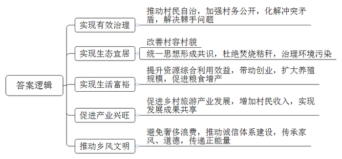
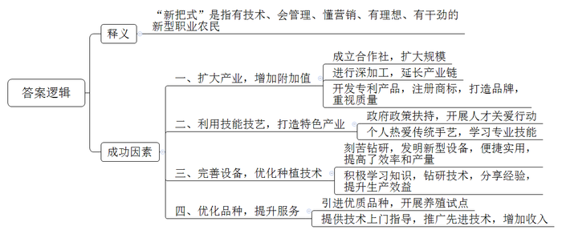
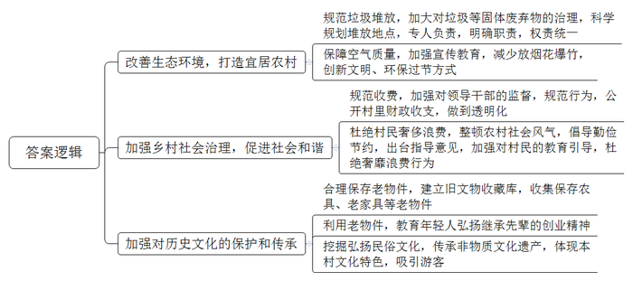
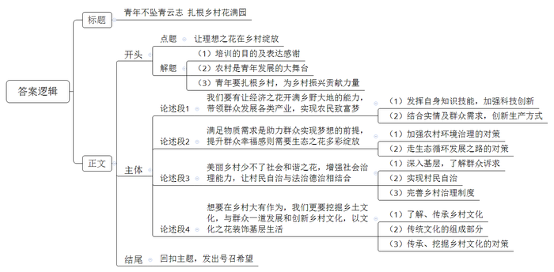

# 2019年江苏省公考《申论》题（C卷）

<!-- gwy:overview:start -->
> **江苏 · 2019 · 申论 · C类** ｜ 4 题 · 图片 4 处 · 答案随题折叠

导航：[题目](#题目) · [材料 1](#材料-1)
<!-- gwy:overview:end -->

> 候选采集稿。参考答案及解析来自粉笔页面，不代表官方答案或真实高分答卷；来源使用许可与原卷对应关系仍需人工核实。

## 给定材料

### 材料 1

每个月的10号，是H村村民翘首以盼的日子。这一天，不需要干部召集，村民们会准时从家中、田头聚集到村委会，共议村情村事。无论大事、小事、麻烦事、困难事，只要到村委会的“村民说事”上说一说、议一议，基本都能理顺解决。

“村民说事”制度起步于10年前。那年村里收到一笔工程补偿款，有传言说村干部私吞了，村民议论纷纷。村党支部书记当即决定召开现场说事会，清楚地说明了每一笔钱的去向，消除了村民的全部疑惑。从那时起，“村民说事”成为一项制度，村民们每月定期围坐在一起，将事情摆上台面，展开讨论，形成决策，接受监督。村里的中心广场、儿童活动室、文化礼堂、养老院、村史室……一个个村民关心的项目都是在说事会上顺利推进的，村子的“颜值”也一路飙升。

这项带着泥土芬芳的“村民说事”制度，几经打磨，形成了以“说、议、办、评”为核心内容的“说事”体系，从最初的1.0版逐步升级到3.0版。近几年村里又依托社区网格平台，实行“互联网+”说事模式，线上线下齐推进，走出了一条治村理事的新路子。

H村是农业大村，曾经长期受到秸秆焚烧问题的困扰。随着环境保护力度的加强，怎样处理秸秆成为“村民说事”的热点话题。经过多次讨论，村民统一了思想，形成了共识，坚决杜绝焚烧秸秆，但如何提高秸秆的综合利用效益，一时苦无良策。针对村民们的期盼，经过“村民说事”讨论，村委会决定选派人员到外地学习考察，从村集体经济中拿出一部分财力支持有能力有条件的村民，率先进行秸秆综合利用的探索。在此基础上，村里创办了两家综合利用秸秆的公司。一家是将秸秆切碎，经过发酵制成便于运输保存、不易自燃的青储饲料，扩大了全村的养殖规模。另一家是将回收的秸秆打成碎屑，与鸡粪混合生产有机肥，将其施用于耕地，收到了非常明显的增产效果。村里有了秸秆综合利用的成功范例，大大调动了村民们的创业热情，还有几户村民表示也要在秸秆综合利用方面上项目、闯新路。

H村地处市郊，特色农业发展较快，经常有很多市民利用节假日到该村游玩。针对这种情况，有村民提议，开办一些有特色的农家乐旅游项目。“村民说事”肯定了这一提议，并集思广益，最后商定由全村出资，推举6户村民分别经营餐饮、农产品销售、休闲娱乐、住宿等项目。农家乐旅游项目开业以来，由于特色鲜明、服务优良，吸引了大批游客，赢得了良好声誉。第一年收入就突破了百万元，并逐年递增。村集体每年从农家乐旅游项目经营的利润中提成10%，其余分配给村民，实现了成果共享。

H村富裕了，吸引了许多外来人口。人多了，麻烦和冲突也随之增加。有些外来人员租住了村民的房子后，乱拉电线，随意堆放易燃杂物，存在着不少隐患。村干部去做过一些工作，但效果不明显。后来镇上派出所的民警前来帮助调解，参加“村民说事”，顺利解决了问题。“村民说事”也由此延伸到“警民说事”，搭起了一座“连心桥”，以法治“定纷止争”，使很多棘手的问题得到了解决。

5年前，该村成立了“红白理事会”，通过“村民说事”总结出12套婚丧宴席菜单并予以推广。如今，村民家里有红白事，都会主动接受村红白理事会的监督，不大操大办、不吃名贵菜、不喝高档酒、不抽名牌烟，已成为村民的共识。该村文化礼堂内，一张“诚信指数”表引人注目：无私帮助贫困人员的加分，参加封建迷信活动的扣分……“我们通过‘村民说事’制定了这张表，每季度为村民评分，内容有邻里合作、配合发展等19项共性考评指标和9条差异化奖惩措施，总分100分，每个季度进行一次综合评估。”村委会主任解释说。2018年，该村又设立了“家庭联盟会”“道德评议会”“乡贤参事会”三个议事组织，将家风传承、道德评议等纳入“说事”范畴，乡风文明正能量得到广泛传播。

### 材料 2

以往种田靠的是“老把式”，如今新型职业农民开始出现。这些“新人”有技术、会管理、懂营销，既下得了田，又上得了网，是乡村沃土上涌现的“新把式”。

小郑是一位90后，大学毕业后回到家乡，起因是舍不得父母。小郑的父母是花椒种植大户，基本上是靠天吃饭，遇到天时不好的年头，农活增多，花椒减产，人就更加辛苦。每当看到父母劳累的背影，小郑就深切意识到，他们渐渐老了，事业需要有人来接手。于是，她下定决心回家乡帮助父母发展花椒产业。小郑的花椒创业与众不同，她不打算像父母那样，一味地在土里刨食，而是想把产业做大，提高产品附加值，创造更多效益。回乡不久，她就想方设法成立了花椒专业合作社。如今，合作社不仅种植花椒，还拓展了深加工业务。合作社开发了专利产品，在花椒油中科学地配入微量元素，生产出新型的保健食疗产品。小郑还为产品注册了商标，创立了品牌。合作社的花椒产品凭借过硬的质量，成功打入了邻近几个县城的超市，2018年销售额超过300万元。说起当年的回乡创业，小郑深有感触：“我要是不回来，也可能在哪个城市忙碌，但是我回来实现了自己的理想，不仅照顾了父母，还创立了值得骄傲的事业。今天看来，我这条路走对了。”

乡土人才技艺技能大赛是J省实施“乡土人才关爱行动”的系列举措之一。小傅第一次参加全省木工项目比赛，就获得了第一名，因此被推选代表国家参加世界木工技能大赛。乡亲们称赞小傅有出息，小傅自己也很开心：“能靠手艺为家乡争光，为国争光，我感到很骄傲！”小傅出身于木匠世家，对木工手艺有着天然的热爱之情，中学毕业后报考了技校，学习木工专业。他深情地说：“很多同学看不上这一行，觉得太土、太苦，但我就是喜欢。这些年国家政策好，大力扶持乡土专业人才，特别鼓励年轻人传承乡土特色技能。我真是赶上了好时候。”在J省农村，像小傅这样具有一技之长的专业人才还有很多，得益于“乡土人才关爱行动”的春风，篾匠、陶匠、漆匠、绣娘、织娘、茶娘等纷纷发挥才能，开创和经营自己的特色产业，并逐渐产生了良好的辐射效应。

轻轻一按按钮，大棚里的机器便自动匀速移动喷洒，不到半小时，60多米长的黄瓜大棚就已经喷洒完毕，这是M村村民小谢的蔬菜大棚里的一个场景。小谢介绍说，这台由他参与研发的既能打药又能施肥的机器，便捷实用，工作效率是人工喷洒的两三倍。小谢从十几岁就跟随父亲在大棚里干活，那时，浇水、打药全靠双手，除了苦就是累。在与蔬菜打交道的过程中，他开始琢磨怎么样让活干得更省劲、更高效，想通过自己的努力让种菜轻松一点。现在，小谢的蔬菜大棚内，自动化喷洒机、自动化放风机、电动轨道车……这些“高大上”的设备让人耳目一新。由于使用了新设备，劳动效率大大提高，蔬菜产量比原来增加20%左右。高中学历的小谢，还购买书籍，上网查阅资料，潜心钻研，认真学习有机质无土栽培蔬菜技术。这项技术不仅省肥、省水，而且基本上没有土产病害。小谢生产的放心菜、健康菜深受市场欢迎，他的日子越过越富裕。在多年种菜的过程中，小谢总结出不少“接地气”的种植技术和经验，成为当地的“创业达人”。为带动大家一起致富，他手把手、面对面，毫无保留地把“秘诀”传授给乡亲。村民称赞道：“跟着他学了不少技术，种菜的效益提高了，日子更有奔头了。”

养殖奶山羊是L县农民“发羊财”的重要途径。该县养殖奶山羊已有十多年的历史，目前优质奶山羊存栏量达到12万只以上，形成了较大规模，其系列羊奶产品成为该县的一张名片。取得这样的成绩，该县的农业科技人员和养殖户功不可没。L县原来养殖的奶山羊，每只日均产鲜奶仅有1.2公斤，每年产奶260天。农业科技人员推荐引进的优质奶山羊，每只日均产鲜奶3公斤以上，每年产奶300天。但在面临“更新换代”，推广优质奶山羊时，很多农民信心不足，担心养不好，反而影响经济效益。当时有几位年轻人勇于“吃螃蟹”，引进了一百多只优质奶山羊，开始用心试养。在此过程中，县农业科技人员经常上门指导，为养殖户保驾护航。最终，这些养殖户不仅掌握了先进的养殖技术，而且收入也大大增加。年轻人的示范效应让很多村民动了心，纷纷加入养殖优质奶山羊的队伍。这些“羊专家”示范户毫无保留地向村民们介绍自己的做法和经验，帮助他们掌握养殖技术，共同走上“发羊财”的道路。

N大学一位农业经济专家说，从很多地方的实践经验来看，近年来乡村中出现的一批“新把式”，是在乡土环境中生根、发芽、成长、壮大的，是一些“含金量”高的人才。他们有理想、有干劲，体现了新一代农民的优势，在乡村发展中会发挥越来越大的作用。

### 材料 3

T市旅游资源丰富，每年都有大量游客来观光。X村位于该市市郊，交通和区位优势明显，村里一直考虑依托T市资源发展乡村旅游。为此，村两委会多方筹集资金，计划打造集吃、住、行、文、娱为一体的特色旅游，让村民“坐在家里”就有钱赚。但一些有意投资的企业来考察，在村中逛一圈就打了退堂鼓。村民们都知道，问题出在村庄环境上，村旁一处占地三四亩、一人多高的垃圾堆十分刺眼。这个垃圾堆是最近一年内形成的。最初村里打算在这里建设一个大型农贸市场，后因种种原因，没有获批。于是，这块闲置的空地就成了附近企业倾倒垃圾的场所，村委会个别成员未经村民会议讨论，派人在那里收钱。垃圾越堆越高，不远的地方就是天然气加气站，隐患重重。夏天，更是恶臭扑鼻，蚊蝇乱飞。村民意见强烈，甚至出现“骂大街”的情况。

村里的垃圾清运其实是有专人负责的。2014年初，该村村委会作为甲方和当地一名村民（乙方）签署了《环境卫生承包协议书》，按照合同约定，乙方负责全村的垃圾清运工作，村委会每年向乙方支付承包金。村委会曾多次要求承包人清运这个垃圾堆，均遭到拒绝，理由是“后来形成的垃圾堆不在承包范围内”，“谁收钱，谁清理”。

过年放鞭炮也是一件让村民闹心的事，从年三十晚上放到大年初一早上8点多，只有夜里停歇一两个钟头。对面说话都听不清，家家门窗都要紧闭，一打开就浓烟滚滚。正月初一出门，路上一层碎纸屑，空气里满是呛人的硝石灰的异味。从外地回来过年的孩子根本适应不了，一直到返程都在咳嗽。村民们说，过年家家都放鞭炮，谁家不放就没有面子。村委会主任说：“每家买鞭炮烟花的钱差不多要2000元，贫困户再少也要200元左右，花了钱，还污染空气。”有一次因为放鞭炮引起了火灾，来了几辆消防车才把大火扑灭，村民们至今还感到后怕。

还有就是办酒席，村民过去长期被人情负担困扰，“吃酒送礼——办酒收礼——再吃酒再送礼”的怪圈多年不断，红白喜事、升学宴、谢师宴、满月宴、建房宴、装修宴、生日宴……每家每年“人情债”平均好几千元，动辄上万元，甚至两三万元，成了村民很重的负担。不少村民表示，不去吧，怕被人议论，硬着头皮也得去。T市发布的规范城乡居民操办酒席行为的指导意见中，将婚嫁酒、丧事酒以外的酒席定为“违规酒席”，不准操办。指导意见一出，有人叫好，也有人不理解，甚至认为政府管得太宽了。

X村历史悠久，至今还保留着一些人文遗址。村民建了新房，搬迁时往往把一些闲置不用的旧农具、旧家具等老物件都扔掉了，如纺车、织布机、石磨、石碾、板车、辘轳、水桶、水车、锈迹斑斑的铁锹、发黄的记工本……这些物品在村子里随处可见，明显影响环境卫生和村庄景观。村两委班子成员议论时认为，这些看似过时的老物件，记载着乡村的昨天和老一辈的创业辛劳，讲述的是村子的故事和发展变化，承载着乡村的农耕文化，是直观的村史。应当把这些“旧”东西收集、保存起来，乡村环境整洁了，又可以把它们作为教育下一代的活教材，让年轻一代保持先辈的创业精神，把以后的路走得更好，更长远。村中百姓骨子里透着对传统文化的敬仰，一些民俗活动蕴含着民间的礼仪传承。不少村民能唱戏，懂书法，会画画，也有人喜欢收藏。村两委认为，把环境治理好，想方设法展现本村特色文化，对外来游客就有了吸引力。

### 材料 4

去年，习近平总书记在北京大学师生座谈会上的讲话中对青年一代发出号召：“广大青年既是追梦者，也是圆梦人。追梦需要激情和理想，圆梦需要奋斗和奉献。广大青年应该在奋斗中释放青春激情、追逐青春理想，以青春之我、奋斗之我，为民族复兴铺路架桥，为祖国建设添砖加瓦。”

近期，一档大型人物纪录片《不负青春不负村》在全国热播。该片讲述了6位毕业于顶尖学府的高材生毅然放弃高薪工作投身新农村建设的事迹，以生动平实的镜头语言真实呈现了他们的工作常态，从不同的侧面展现出当下基层青年干部的精神面貌。一股股涌动在中国乡村的青春新势力跃然荧屏，一个个怀抱梦想的年轻观众深受鼓舞：“看哭了，真的是不负青春，我也想尽快找到自己的方向，自己的梦想。”“我也要像他们一样，从象牙塔到田间地头，用双脚丈量基层的每一寸土地，放下架子，俯下身子，跋山涉水，走村串户，坐百家板凳，解千家难题，实现自己的青春梦想。”

## 题目

### 第 1 题

**请从不同层面归纳概括“给定资料1”中H村“村民说事”在治村理事中发挥的作用。（15分）**

关联材料：材料 1

作答要求：

要求：紧扣给定资料，全面、准确。篇幅不超过200字。

第 1 题 · 答案与解析

**参考答案（粉笔题库参考内容）**

1.实现有效治理。推动村民自治，加强村务公开，化解冲突矛盾，解决棘手问题。

2.实现生态宜居。改善村容村貌；统一思想形成共识，杜绝焚烧秸秆，治理环境污染。

3.实现生活富裕。提升资源综合利用效益，带动创业，扩大养殖规模，促进粮食增产。

4.促进产业兴旺。促进乡村旅游产业发展，增加村民收入，实现发展成果共享。

5.推动乡风文明。避免奢侈浪费，推动诚信体系建设，传承家风、道德，传递正能量。

**参考答案说明：**本参考答案从“实现有效治理”“实现生态宜居”“实现生活富裕”“促进产业兴旺”“推动乡风文明”五个方面展开，各条答案要点之间在内容上是并列关系，没有交叉。

**解析**

**考点**：影响类

**来源**：2019年江苏省公考《申论》题（C卷）

> 粉笔申论页面对本题只提供「解析视频」入口，该入口是会员推广位，页面无视频地址与文字解析。

### 第 2 题

**“给定资料2”中的“新把式”们扎根乡村，取得了事业上的成功。请对他们成功的因素加以分析。（20分）**

关联材料：材料 2

作答要求：

要求：分析透彻，见解深刻。篇幅250字左右。

第 2 题 · 答案与解析

**参考答案（粉笔题库参考内容）**

“新把式”是指有技术、会管理、懂营销、有理想、有干劲的新型职业农民。其成功因素有：

一、扩大产业，增加附加值。成立合作社，扩大规模；进行深加工，延长产业链；开发专利产品，注册商标，打造品牌，重视质量。

二、利用技能技艺，打造特色产业。政府政策扶持，开展人才关爱行动；个人热爱传统手艺，学习专业技能。

三、完善设备，优化种植技术。刻苦钻研，发明新型设备，便捷实用，提高了效率和产量；积极学习知识，钻研技术，分享经验，提升生产效益。

四、优化品种，提升服务。引进优质品种，开展养殖试点；提供技术上门指导，推广先进技术，增加收入。

**参考答案说明：**本参考答案先对“新把式”的含义进行了解释。再从“扩大产业，增加附加值”“利用技能技艺，打造特色产业”“完善设备，优化种植技术”“优化品种，提升服务”四个方面对“新把式”们事业有成的原因进行了分析。各条答案要点之间在内容上相互并列，没有交叉。

**解析**

**考点**：原因类

**来源**：2019年江苏省公考《申论》题（C卷）

> 粉笔申论页面对本题只提供「解析视频」入口，该入口是会员推广位，页面无视频地址与文字解析。

### 第 3 题

**请对“给定资料3”中X村环境存在的问题提出治理建议。（25分）**

关联材料：材料 3

作答要求：

要求：

（1）准确全面，条理清楚；

（2）有针对性，有可行性；

（3）篇幅350字左右。

第 3 题 · 答案与解析

**参考答案（粉笔题库参考内容）**

针对X村环境存在的问题，提出如下建议：

1.改善生态环境，打造宜居农村。规范垃圾堆放，加大对垃圾等固体废弃物的治理，科学规划堆放地点，专人负责，明确职责，权责统一；保障空气质量，加强宣传教育，减少放烟花爆竹，创新文明、环保过节方式。

2.加强乡村社会治理，促进社会和谐。规范收费，加强对领导干部的监督，规范行为，公开村里财政收支，做到透明化；杜绝村民奢侈浪费，整顿农村社会风气，倡导勤俭节约，出台指导意见，加强对村民的教育引导，杜绝奢靡浪费行为。

3.加强对历史文化的保护和传承。合理保存老物件，建立旧文物收藏库，收集保存农具、老家具等老物件；利用老物件，教育年轻人弘扬继承先辈的创业精神；挖掘弘扬民俗文化，传承非物质文化遗产，体现本村文化特色，吸引游客。

**参考答案说明：**本参考答案从“改善生态环境，打造宜居农村”“加强乡村社会治理，促进社会和谐”“加强对历史文化的保护和传承”三方面展开，各条答案要点之间在内容上相互并列，没有交叉。

**解析**

**考点**：提出对策类

**来源**：2019年江苏省公考《申论》题（C卷）

> 粉笔申论页面对本题只提供「解析视频」入口，该入口是会员推广位，页面无视频地址与文字解析。

### 第 4 题

**近日，某镇政府准备举办一期初任公务员能力素质培训班，假如你是学员代表，请结合“给定资料4”，以“让理想之花在乡村绽放”为主题，拟写一份发言稿，在开班动员会上发言。（40分）**

关联材料：材料 1、材料 2、材料 3、材料 4

作答要求：

要求：

（1）自选角度，自拟标题；

（2）参考给定资料，不拘于给定资料；

（3）观点明确，内容充实，结构完整；

（4）篇幅1000字左右。

第 4 题 · 答案与解析

**参考答案（粉笔题库参考内容）**

**青年不坠青云志 扎根乡村花满园**

各位同仁：

大家好！首先感谢镇政府组织了此次初任公务员能力素质培训班，我很荣幸能作为学员代表在开班动员会上发言。作为一名即将走上岗位的基层公务员，我认为，农村这片广阔天地，是我辈昂扬青春斗志、建功立业的大舞台。**我们要有理想、有道德、有能力、有担当，响应总书记对青年一代的号召，回到乡村、发展乡村，扎根乡村，以青春之我、奋斗之我，为乡村振兴铺路架桥。**

**我们要有让经济之花开满乡野大地的能力，带领群众发展各类产业，实现农民致富梦。**习近平总书记说：广大青年既是追梦者，也是圆梦人。新时代的青年干部，要利用好自身的知识技能，钻研出提质增效的好方法，通过科技创新帮助乡亲们找到脱贫致富的好路子。面对农村复杂的现实情况，要将“一身武艺”与当地实情结合，了解群众需求，探索新的生产方式，如成立农业专业合作社、发展深加工工业、发展旅游业等，促进农村产业兴旺。

**满足物质需求是助力群众实现梦想的前提，提升群众幸福感则需要生态之花多彩绽放。**一方面，要加强对农村环境的治理，合理引导群众实施垃圾分类、定点投放，避免脏乱差；同时，以身作则，倡导绿色健康的过节方式。如积极跟民众沟通烟花燃放的危害和不足，引导群众减少烟花燃放，保护环境。另一方面，要真正实现生态文明，需要综合利用资源，如秸秆回收利用，沼气循环利用等，走生态循环之路，让绿水青山永在。

**当然，美丽乡村少不了社会和谐之花，增强社会治理能力，让村民自治与法治德治相结合。**基层工作千头万绪，群众诉求“五花八门”，只有组织好、沟通好、协调好、治理好，才能共议事、同发展。新任公务员只有深入群众，走入田间地头，主动与群众沟通，倾听群众心声，才能真正了解群众诉求，把握工作方向，实现高效治理。同时，还要加强组织协调能力，善于挖掘和释放群众智慧，发挥群众力量，共商共建，实现村民自治。当然，“一切成功都离不开制度的保障”，所以每个人还要具备严格执法能力，如制定村规民约严禁“大操大办”等不良习俗，依法依规办事，让乡村治理文明有序。

**想要在乡村大有作为，我们更要挖掘乡土文化，与群众一道发展和创新乡村文化，以文化之花装饰基层生活。**作为新任公务员我们不仅要了解乡村文化，欣赏乡村文化，更要传承、挖掘乡村文化。具有乡土特色的传统手艺，带有乡村印记的老物件，具有乡村气息的文化活动，都是传统文化不可或缺的一部分，我们要通过举办技能大赛等形式鼓励年轻人学习、传承特色乡土技能，要建立展览馆，组织文化活动，传承文化遗产，丰富基层文化生活。

“一枝独秀不是春，百花齐放春满园”，青年人当有不坠青云之志，好好学习，掌握知识，增长才干，在广袤的农村土地洒下梦想的种子，用智慧耕耘出理想之花！

**文章分析**

**青年不坠青云志 扎根乡村花满园**

【**标题的优点：**首先，范文的标题突出了“让理想之花在乡村绽放”这一主题，使文章主题更突出、清晰；其次，形式上采用对称式结构，使标题更加美观、饱满。】

各位同仁：

（1）大家好！首先感谢镇政府组织了此次初任公务员能力素质培训班，我很荣幸能作为学员代表在开班动员会上发言。（2）作为一名即将走上岗位的基层公务员，我认为，农村这片广阔天地，是我辈昂扬青春斗志、建功立业的大舞台。（3）**我们要有理想、有道德、有能力、有担当，响应总书记对青年一代的号召，回到乡村、发展乡村，扎根乡村，以青春之我、奋斗之我，为乡村振兴铺路架桥。**

【**开头的优点：**★内容方面。范文的开头是紧扣题目给定的“让理想之花在乡村绽放”这一主题展开的。首先，开头点出主题，做到了主题明确。其次，对“让理想之花在乡村绽放”这一主题进行了分析阐述，指出了（1）培训的目的及表达感谢；（2）农村是青年发展的大舞台；（3）青年要扎根乡村，为乡村振兴贡献力量。★文字表达方面：长短句配合使用，使语言表达有节奏感。】

**我们要有让经济之花开满乡野大地的能力，带领群众发展各类产业，实现农民致富梦。**习近平总书记说：广大青年既是追梦者，也是圆梦人。（1）新时代的青年干部，要利用好自身的知识技能，钻研出提质增效的好方法，通过科技创新帮助乡亲们找到脱贫致富的好路子。（2）面对农村复杂的现实情况，要将“一身武艺”与当地实情结合，了解群众需求，探索新的生产方式，如成立农业专业合作社、发展深加工工业、发展旅游业等，促进农村产业兴旺。

【**论述段1的优点：**★观点句：范文的观点句是紧扣“让理想之花在乡村绽放”这一文章主题提出的。形式上，它在段首处直接写出，位置突出，容易发现。内容上，关键词突出，内容要点明确，可以明显看出它是从“乡村经济”入手，指出了“青年在乡村绽放理想之花”的对策。★论述内容：（1）介绍了青年要发挥自身知识技能，加强科技创新；（2）介绍了青年要结合实情及群众需求，创新生产方式。注意：以上两个方面的内容都是紧扣“我们要有让经济之花开满乡野大地的能力，带领群众发展各类产业，实现农民致富梦”这个观点句进行分析论述的，论述的针对性强，内容层次丰富。在论述方法上采用了讲道理、举例子相结合的方式，论述内容充实。】

**满足物质需求是助力群众实现梦想的前提，提升群众幸福感则需要生态之花多彩绽放。**一方面，（1）要加强对农村环境的治理，合理引导群众实施垃圾分类、定点投放，避免脏乱差；同时，以身作则，倡导绿色健康的过节方式。如积极跟民众沟通烟花燃放的危害和不足，引导群众减少烟花燃放，保护环境。另一方面，（2）要真正实现生态文明，需要综合利用资源，如秸秆回收利用，沼气循环利用等，走生态循环之路，让绿水青山永在。

【**论述段2的优点：**★观点句：范文的观点句是紧扣“让理想之花在乡村绽放”这一文章主题提出的。形式上，它在段首处直接写出，位置突出，容易发现。内容上，关键词突出，内容要点明确，可以明显看出它是从“乡村生态”入手，指出了“青年在乡村绽放理想之花”的对策。★论述内容：（1）介绍了加强农村环境治理的对策；（2）介绍了走生态循环发展之路的对策。注意：以上两个方面的内容都是紧扣“满足物质需求是助力群众实现梦想的前提，提升群众幸福感则需要生态之花多彩绽放”这个观点句进行分析论述的，论述的针对性强，内容层次丰富。在论述方法上采取讲道理、举例子相结合的方式，论述内容充实。】

**当然，美丽乡村少不了社会和谐之花，增强社会治理能力，让村民自治与法治德治相结合。**基层工作千头万绪，群众诉求“五花八门”，只有组织好、沟通好、协调好、治理好，才能共议事、同发展。（1）新任公务员只有深入群众，走入田间地头，主动与群众沟通，倾听群众心声，才能真正了解群众诉求，把握工作方向，实现高效治理。同时，（2）还要加强组织协调能力，善于挖掘和释放群众智慧，发挥群众力量，共商共建，实现村民自治。当然，（3）“一切成功都离不开制度的保障”，所以每个人还要具备严格执法能力，如制定村规民约严禁“大操大办”等不良习俗，依法依规办事，让乡村治理文明有序。

【**论述段3的优点：**★观点句：范文的观点句是紧扣“让理想之花在乡村绽放”这一文章主题提出的。形式上，它在段首处直接写出，位置突出，容易发现。内容上，关键词突出，内容要点明确，可以明显看出它是从“乡村治理”入手，指出了“青年在乡村绽放理想之花”的对策。★论述内容：（1）介绍了要深入基层，了解群众诉求；（2）介绍了要实现村民自治；（3）介绍了要完善乡村治理制度。注意：以上三个方面的内容都是紧扣“美丽乡村少不了社会和谐之花，增强社会治理能力，让村民自治与法治德治相结合”这个观点句进行分析论述的，论述的针对性强，内容层次丰富。在论述方法上采用了讲道理、举例子相结合的方式，论述内容充实。】

**想要在乡村大有作为，我们更要挖掘乡土文化，与群众一道发展和创新乡村文化，以文化之花装饰基层生活。**（1）作为新任公务员我们不仅要了解乡村文化，欣赏乡村文化，更要传承、挖掘乡村文化。（2）具有乡土特色的传统手艺，带有乡村印记的老物件，具有乡村气息的文化活动，都是传统文化不可或缺的一部分，（3）我们要通过举办技能大赛等形式鼓励年轻人学习、传承特色乡土技能，要建立展览馆，组织文化活动，传承文化遗产，丰富基层文化生活。

【**论述段4的优点：**★观点句：范文的观点句是紧扣“让理想之花在乡村绽放”这一文章主题提出的。形式上，它在段首处直接写出，位置突出，容易发现。内容上，关键词突出，内容要点明确，可以明显看出它是从“乡村文化”入手，指出了“青年在乡村绽放理想之花”的对策。★论述内容：（1）介绍了要了解、传承乡村文化；（2）介绍了传统文化的组成部分；（3）介绍了传承、挖掘乡村文化的对策。注意：以上三个方面的内容都是紧扣“想要在乡村大有作为，我们更要挖掘乡土文化，与群众一道发展和创新乡村文化，以文化之花装饰基层生活”这个观点句进行分析论述的，论述的针对性强，内容层次丰富。在论述方法上主要采用了讲道理的方式，论述清晰透彻。】

【**论述段之间的关系**：★内容的内在逻辑：范文的论述段之间是依照“并列”的逻辑展开的。论述段1先写了“青年人要有发展乡村经济的能力”，论述段2再写了“青年人要有改善乡村生态的能力”，论述段3还写了“青年人要有增强乡村治理的能力”，论述段4最后写了“青年人要有挖掘乡村文化的能力”，论述逻辑清晰。】

“一枝独秀不是春，百花齐放春满园”，青年人当有不坠青云之志，好好学习，掌握知识，增长才干，在广袤的农村土地洒下梦想的种子，用智慧耕耘出理想之花！

【**结尾的优点**：范文的结尾回扣了“让理想之花在乡村绽放”这一主题，发出了呼吁号召。】

**解析**

**考点**：宣传类

**来源**：2019年江苏省公考《申论》题（C卷）

> 粉笔申论页面对本题只提供「解析视频」入口，该入口是会员推广位，页面无视频地址与文字解析。

