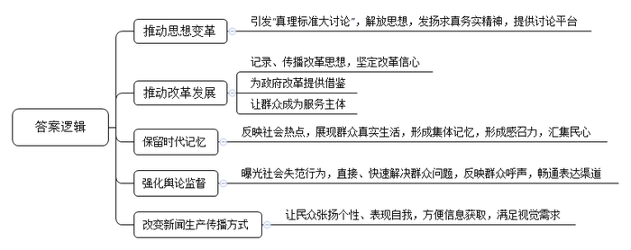
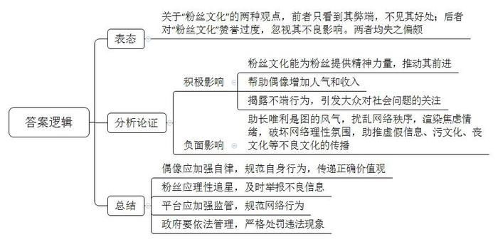
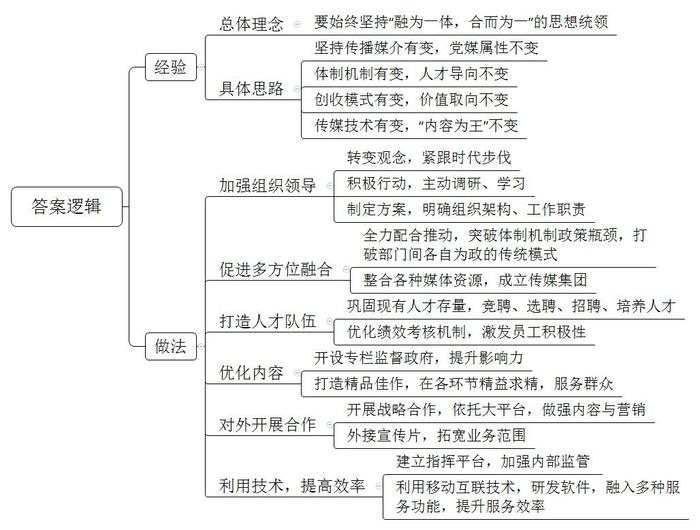
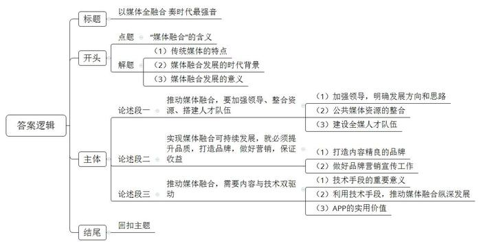

# 2019年江苏省公考《申论》题（A、普通选调卷）

<!-- gwy:overview:start -->
> **江苏 · 2019 · 申论 · 选调生** ｜ 4 题 · 图片 4 处 · 答案随题折叠

导航：[题目](#题目) · [材料 1](#材料-1)
<!-- gwy:overview:end -->

> 候选采集稿。参考答案及解析来自粉笔页面，不代表官方答案或真实高分答卷；来源使用许可与原卷对应关系仍需人工核实。

## 给定材料

### 材料 1

媒介的变革改变着我们感知世界的方式，也在一定程度上折射着时代精神与社会记忆。潮涨潮落，逐不去弄潮儿的身影，改革开放的历史进程与媒体变迁的脚步相互交织，彼此呼应。

1977年，南京的夏天格外炎热。南京大学教师胡福明正在医院照顾生病的妻子，酷热难耐，难以入睡，索性翻阅起手边的材料，蹲着身子构思一篇一直想写的文章。妻子出院，文章提纲也写好了。到8月中旬，初稿完成。胡福明将稿件寄给了曾向他约稿的《光明日报》哲学组。几经修改，1978年5月11日，《光明日报》将此文放到头版发表，标题定为《实践是检验真理的唯一标准》，署名为本报特约评论员。12日，《人民日报》《解放军报》等媒体纷纷转载。胡福明则是在一个早晨与妻子做早饭时，听到中央人民广播电台在广播这篇文章的，他回忆当时自己的心情：“很高兴，酝酿差不多一年的文章终于出来了。”影响深远的“真理标准大讨论”就此引发，媒体成了这场讨论的桥梁和平台。

1992年，88岁高龄的改革开放总设计师邓小平南行，并发表重要讲话。当年的记者陈先生回忆道：“小平同志来深圳，不报道、不接见、不题词，所以很多记者都不写了、不采访了。但我觉得他的讲话针对性、指导性太强，决心要报道。如果不报道，将是一辈子的遗憾。”1992年3月26日，《深圳特区报》头版发表了陈先生采写的长篇通讯《东方风来满眼春——邓小平同志在深圳纪实》。这篇报道用七个小短篇依序记录了1992年1月19日到23日邓小平同志在深圳视察的情形。当年的全国两会是在3月末，报纸送到广东代表团后，各个代表团很快把报纸抢光了。这篇文章被称为“历史关头的雄文”，将坚定改革的讯息传遍世界。媒体再次在改革关头发挥了重要作用。

1993年3月1日，中央电视台将一套节目的开播时间调整到了7点，安排了一档反映社会热点的栏目，取名为《新太阳60分》。后来按照要求，改名为《东方时空》，于当年5月1日开播。“讲述老百姓自己的故事”的片头语由此诞生，这句话成了一个时代的金句。90年代许多人的集体记忆是这样的：起床后，沐浴着晨光，吃着热气腾腾的早餐，听着《东方时空》晨曲。这之前，中国人很少早上看电视。当年的《东方时空》就像电视界的深圳，一种强大的感召力让大家从四面八方汇集而来，敬一丹、崔永元、白岩松、柴静这些我们耳熟能详的新闻人也在《东方时空》留下了他们的影像。

《东方时空》孵化的子栏目《焦点访谈》更是在当时产生了极大影响力。《焦点访谈》开播于1994年4月1日，把矛头对准社会失范行为，提倡短兵相接、立竿见影。许多群众遇到不平事无法解决，就会给《焦点访谈》写信，最多的时候，一天能有数千份观众来信。美国《纽约时报》曾评价《焦点访谈》是“每天吸引三亿人”的电视栏目。1998年10月7日，时任国务院总理的朱镕基视察《焦点访谈》，敬一丹在《我遇到你》一书中记录了当时的情况：在大家的注目中，总理落笔了：“舆论监督，群众喉舌。”白岩松站在总理后面鼓起掌来。总理说：“我还没写完呢！”总理又写：“政府镜鉴，改革尖兵。”演播室一片掌声，所有的目光和镜头都聚焦在题词上。

2009年，新浪微博横空出世。它以社交互动、碎片化、即时性为特征，极大程度上改变了新闻的生产方式和传播方式。同年，腾讯团队的“微信”悄然上线，它与“微博”一起，让媒体“飞入寻常百姓家”。自媒体成为普通人张扬个性、表现自我的最佳场所。如今，微博用户突破3亿，微信用户突破10亿，打开手机“刷”新闻已经成为我们的日常。短小精悍的新闻视频用现场感、新鲜感和互动感赢得了95后“视觉一族”的青睐。手机终端日新月异，4G技术早已普及，5G手机闪亮登场。人人都能发声，处处都是舆论场，如何在发展过程中更好地引导群众服务群众，成为新时期治国理政的重要课题。

40年前我们还用铅字印刷报纸，挤在一个屋子里看电视。没有人会想到，40年后，人工智能技术给中国带来了第一位“AI主播”；机器人开始写新闻；无人机技术突破了传统媒体的取景框与叙事框……未来已来，无法阻挡。

### 材料 2

咪蒙是自媒体的一个“奇葩”。2015年初，马某在自己的公众号“咪蒙”上，发表了一篇后来被称为“始祖级”的爆款网文《致贱人：我凭什么要帮你？》，这篇网文让咪蒙一炮而红，火遍了整个中国互联网。《致贱人》的火爆，在网民之间引发了一场声势浩大、针锋相对的论战。一派网民狂热地崇拜咪蒙，认为咪蒙的文章读来痛快，说出了他们平时想说又说不出来的心里话；另一派网民却认为，咪蒙的文章用词粗鄙，戾气有余而理性不足，这样的文章走红是中国互联网的耻辱。这个效果正是咪蒙想要的，她的目标是粉丝和财富。其后，咪蒙每发表一篇新文章，都会为她赢得更多的粉丝和收益，同时也会为她招来更多的骂名。2019年1月29日，咪蒙团队旗下公众号“才华有限青年”推出了一篇题为《一个出身寒门的状元之死》的文章，迅速火遍全网。此时，咪蒙系公众号已经坐拥1400万粉丝。正是这篇套路化到了极致的“作品”，一举引爆了公众此前对咪蒙积蓄的所有不满，成了压垮咪蒙的最后一根稻草。2019年2月21日，“今日头条”发布《头条号关于打击发布虚假内容、传播不良文化的公告》，“经用户举报和平台监测发现，部分账号存在发布虚假内容，传播污文化、丧文化，贩卖焦虑情绪、骗取流量的行为。”根据相关政策法规和平台规定，对@才华有限青年@咪蒙等账号进行了封禁处理。随后，多个自媒体平台也陆续宣布，永久关闭“咪蒙”“才华有限青年”账号。

咪蒙的每一篇文章都是为了吸引更多的粉丝。这个时代，粉丝的力量真不能小觑。在北京工作的刘小姐特别能体会这种心情，她曾为了大S到底美不美的问题，与好朋友吵了一架，好几天才和好。“粉上一个人，就像是一种信仰，爱ta，支持ta，保护ta，并以此为动力，不断前进。”打开微博，很多粉丝的ID都与爱豆有着千丝万缕的联系：“XXX今天穿秋裤了没有？”“我是XXX家的大可爱。”也会有粉丝发弹幕“澄清”，表示“XX伪粉不要在这里乱败路人缘”等。“正反”双方狂刷流量偶像的行为都在宣示着粉丝的力量。

通过新鲜、新奇甚至出格的言行来吸引眼球是各路明星的惯常手法，但一不小心，有时也会事与愿违。轻则粉丝脱粉，人气大损；重则人设崩塌，声誉扫地。Z演员是2019年春晚颇受观众欢迎的一位当红人气明星，也许是为了吸引更多的粉丝与人气，他晒出了自己北大某学院的博士后录取通知书，但随后又在直播中冒出了“知网是什么东西啊”的弱智发问。一个博士后竟然不知道知网？有网友随即搜索了他发表的文章与学位论文，他学术不端的问题开始暴露；再接着又有人搜索了他的导师，导师的资格受到质疑；再接着网友的注意力扩展到他的母校……一个吸粉的举动，一个傻傻的问题，推倒了“学术不端”的多米诺骨牌。随后Z演员发表致歉信，北大取消其博士后资格，母校导师的博导资格被取消，甚至连知网的学术资源垄断问题也因此进入公众视野。全媒体时代的故事颠覆了许多人的传统认知。

粉丝文化是一个比较复杂的现象，现在的新闻热搜中与明星相关的内容超过一半。今天他结婚，明天她离婚，全是一地鸡毛。许多网友表示：粉丝文化就是低俗文化，明星、博主与粉丝之间相互迎合，这些内容大量占用公共资源和社会注意力，实在不值得提倡。也有网友认为：许多隐蔽未显的社会问题正是在粉丝和网友的披露下才得以暴露，粉丝文化正推动着社会不断进步。

说好说坏，无论喜不喜欢，粉丝力量的崛起是谁也无法回避的一个事实。

### 材料 3

云稿库、媒e家、移动优先……一个个灵动而充满智慧的词汇，引发会场一次次思想激荡。2018年9月20日至21日，中宣部主办的县级融媒体中心建设现场推进会在Z省C县召开。C县越梦传媒集团走到了全国县级融媒体中心建设的聚光灯下。

越梦传媒集团成立于2016年4月。早在集团成立之前，C县领导班子就意识到，县域媒体融合已成为改革的热点，要生存、想发展，就必须紧跟时代步伐。为此，县主要领导多次到广播电视台调研，亲自为融媒体改革工作“把脉问诊”。派出工作人员南下北上，到兄弟县市对标学习。结合社会发展的现实需要，研究制定了《C县融媒体中心建设实施方案》，设计了组织结构，明确了工作职责。

融媒体的核心在于“融”。按照高标准谋划、高起点启动的要求，C县各部门全力配合，大力推动，突破体制机制政策瓶颈，打破“各吹各的号、各唱各的调”的传统模式，有效整合县域内公共媒体资源。县委报道组、县政府门户网站（新闻版块）、县广播电视台、县宣传信息中心等机构都整合到一起。成立后的越梦传媒集团旗下有三个电视频道、两个广播频率、一份报纸、两个网站，成为一家整合广播、电视、报纸、杂志、网站、两微一端、数字电视网络公司、大数据公司等于一体的县域全媒体传媒集团。

媒体融合，更需要一支专业精干的人才队伍。C县以广播电视台为主导力量，在巩固现有人才存量的同时，采用竞聘、选聘、招聘等方式，把真正有互联网思维、懂网络技能运用的专业人才吸纳到融媒体中心，培育更多全媒编辑、全媒记者、全媒经营管理人才，并实行多劳多得、优劳优得的绩效考核机制，激发全体员工的积极性。

一系列“改”与“融”的组合拳，开启了融媒体中心建设工作的加速器。越梦传媒集团成立后，持续开展舆论监督，提升媒体影响力。大型融媒体舆论监督栏目《直击问政》以县委县政府中心工作为主题，开展直播，已在本地打响品牌。集团的育婴类电视专题栏目都是融媒体栏目，在题材选择、策划拍摄、后期包装、全网推广四个方面精益求精。近日，由越梦传媒集团策划、出品的原创MV《越梦荷香》正式制作完成。MV画面中把“荷在湖中、湖在景中、景在城中、人在画中”的靓丽风景展现得淋漓尽致。“我的家乡美到极致！”“厉害了，我的越梦！”一系列精品佳作受到C县群众的大力称赞。

除了固定播出的电视专题栏目以外，集团外接宣传片也惊喜连连。每年完成将近100部专题片，一批优品佳作受到欢迎。与新浪、今日头条、东方卫视等开展战略合作，依托大平台，将内容与营销做大做强，发挥精英团队力量，为湖南、山西、江西等地的文化产品制作电视包装……越梦传媒集团在融媒体的路上越走越顺畅。

“总资产9亿元，年营收2.8亿元，一个县级融媒体是怎么做到的？”耳听为虚，眼见为实。9月20日下午，100多位与会人员来到越梦传媒集团，在融媒体中心指挥平台——“融媒眼”，一幅特别的“融媒地图”引发了大家的好奇，只见上面分布着蓝色和红色圆点，还有小车形状图标。这是干嘛的？工作人员一解释，大家才恍然大悟。原来，圆点就是在外记者所处的位置，红色表示正在执行任务，蓝色表示待命，小车图标显示的是采访车位置，值班领导可以随时点对点向记者发出指令。“‘融媒眼’相当于一个高效运转的‘大脑’，发挥着‘中央厨房’的功能。”一位与会人员深有感触地说。

“融为一体，合而为一”是融媒体发展的思想统领。C县县委周书记介绍，越梦传媒集团已由平台的简单相加向系统的深度相融转变，实现从“物理反应”到“化学反应”的变化，主要是准确把握了四个“变”与“不变”，即传播媒介有变，党媒属性不变；体制机制有变，人才导向不变；创收模式有变，价值取向不变；传媒技术有变，“内容为王”不变。

新时代的越梦故事随“指尖”传播。在越梦传媒集团，有一个新添置的秘密武器——手机APP“掌上越梦”。这个软件以用户为中心，集政务、民生、资讯、服务等功能于一体，还实现了电视、广播在手机端的直播、点播。“‘掌上越梦APP’信息发布非常权威也非常全面，比如说去政府部门办事吧，我就能提前在APP上看一下流程，在办事的时候再借助这个APP的帮助，就能把事很快办好，省时省力。”市民刘先生边演示边跟记者攀谈。

“我觉得越梦集团的经验完全可以复制！”“C县的经验，为我们树立了县级融媒体中心建设的标杆，让我们对做好这项工作更加充满信心。”一个多小时参观结束，许多与会人员觉得收获满满。

据报道，加强县级融媒体中心建设，是加强和改进基层宣传思想工作、推动县级媒体转型升级的战略工程。中宣部要求，2020年底基本实现全国全覆盖，2018年全国先行启动600个县级融媒体中心建设。一场打造“引导群众服务群众”融媒体阵地的盛宴正在中国大地排开。

### 材料 4

借力新媒体，是服务型政府的明智选择。这些真招实策，给老百姓带来哪些舒心的新实惠，让公共服务有了哪些悦目的新色彩？以下是记者捕捉的一组镜头。

青年党员小童：

“时下最火的APP是什么？你要不知道‘学习强国APP’就太low了！”为提升社区党员干部群众的政治理论素养，N社区党委于2019年2月18日组织开展“学习强国APP”注册学习活动。社区上下掀起了一波“学习”热，每天在下班之后，社区党员干部便打开“学习强国APP”，或看看《新闻联播》，或浏览最新的新闻资讯，或学习传统文化和理论常识……一直排在“学习强国APP积分英雄榜”前十名的小童，说起学习的心得体会，十分起劲：“现在每天可以通过‘学习强国APP'知道很多时事、要事，我非常喜欢里面的诗词和国学，它能够提升我个人的文学素养，今后我会将‘学习强国APP’当做工作生活中的一部分。”

市民张先生：

“我不用特意回老家开证明了！”2019年2月1日，市民张先生在H市新港派出所领到了自己急需的户籍证明。回想起前一天在“超省事”微信小程序上仅仅2分钟的操作，他不禁连连赞叹：“真是方便！”

“超省事”微信小程序是H市“数字政府”建设的首个成果，整合了社保、医保、交管、教育、税务、养老等多个领域的民生服务事项，实现民生事务“掌上办”“指尖办”。截至2019年初，“超省事”实名用户数累计336.6万，累计上线534项服务，业务量累计已达3441万件。

退休教师贾女士：

手机APP预约挂号，在线实时查看医疗检查结果，精准测算诊疗时间，专人指导设备使用……在Z大学医学院附属第二医院，“最多跑一次”的改革标签贴在显眼处，来往患者和家属脚步匆匆，但忙中有序。

“以往到医院看病，要预估一整天时间，现在挂号、诊疗时间都能精准到分。”退休教师贾女士对看病的新体验十分满意。

个体户老吴：

N市经营奶茶店的个体户老吴不慎丢失了营业执照，听人说可以网上补办，他试着登上政务服务网。“打开政务网，很容易就找到了‘营业执照遗失补领’菜单，详细流程图和所需材料清单一目了然。”老吴说，没想到后面还有惊喜，按要求提交了信息的老吴发现，居然还有“快递送”服务。“过去只是听说过‘不见面审批’，原来真的这么方便！”

### 材料 5

2019年1月25日，中共中央政治局举行第12次集体学习，主题是全媒体时代和媒体融合发展。这次集体学习的地点有些特殊，“课堂”搬到了媒体融合发展的第一线。

25日上午，在习近平总书记带领下，中共中央政治局的同志们来到人民日报社新媒体大厦。在移动报道指挥平台前，习近平同正在河北省承德市滦平县平坊满族乡于营村采访的记者和扶贫驻村第一书记连线交流，了解该村脱贫攻坚工作进展情况。习近平希望广大一线干部发扬优良作风，扑下身子，沉下心来，扎根基层，把基层特别是脱贫攻坚一线作为学习历练的平台和难得机会，增加见识，增进感情，增长才干，实实在在为当地百姓解决实际问题，为贫困乡村带来新变化。随后，习近平等在人民日报新媒体中心听取了人民日报微博、微信公众号、客户端建设情况汇报，观看了新媒体产品展示。

明者因时而变，知者随事而制。如何顺应时代要求？世界瞩目中国答卷。习近平总书记在主持学习时强调，推动媒体融合发展、建设全媒体成为我们面临的一项紧迫课题。要运用信息革命成果，推动媒体融合向纵深发展，做大做强主流舆论，巩固全党全国人民团结奋斗的共同思想基础，为实现“两个一百年”奋斗目标、实现中华民族伟大复兴的中国梦提供强大精神力量和舆论支持。

## 题目

### 第 1 题

**请归纳概括****“给定资料**1**”中媒体在推动社会发展方面的作用。（2****0****分）**

关联材料：材料 1

作答要求：

要求：紧扣给定材料，准确全面，条理清楚。篇幅不超过250字。

第 1 题 · 答案与解析

**参考答案（粉笔题库参考内容）**

1.推动思想变革。引发“真理标准大讨论”，解放思想，发扬求真务实精神，提供讨论平台。

2.推动改革发展。记录、传播改革思想，坚定改革信心；为政府改革提供借鉴；让群众成为服务主体。

3.保留时代记忆。反映社会热点，展现群众真实生活，形成集体记忆，形成感召力，汇集民心。

4.强化舆论监督。曝光社会失范行为，直接、快速解决群众问题，反映群众呼声，畅通表达渠道。

5.改变新闻生产传播方式。让民众张扬个性、表现自我，方便信息获取，满足视觉需求。

**参考答案说明**：本参考答案从“推动思想变革”“推动改革发展”“保留时代记忆”“强化舆论监督”“改变新闻生产传播方式”五个方面进行分条撰写。各条答案要点之间在内容上相互并列，没有交叉。

**解析**

**考点**：影响类

**来源**：2019年江苏省公考《申论》题（A、普通选调卷）

> 粉笔申论页面对本题只提供「解析视频」入口，该入口是会员推广位，页面无视频地址与文字解析。

### 第 2 题

**“给定材料**3**”中的“粉丝文化”引起热议，请对网友的不同观点进行评析。（1****5****分）**

关联材料：材料 2

作答要求：

要求：观点正确，分析透彻。篇幅250字左右。

第 2 题 · 答案与解析

**参考答案（粉笔题库参考内容）**

关于“粉丝文化”的两种观点，前者只看到其弊端，不见其好处；后者对“粉丝文化”赞誉过度，忽视其不良影响。两者均失之偏颇。
粉丝文化能为粉丝提供精神力量，推动其前进；帮助偶像增加人气和收入；揭露不端行为，引发大众对社会问题的关注。但负面影响也不容小觑：助长唯利是图的风气，扰乱网络秩序，渲染焦虑情绪，破坏网络理性氛围，助推虚假信息、污文化、丧文化等不良文化的传播。

偶像应加强自律，规范自身行为，传递正确价值观；粉丝应理性追星，及时举报不良信息；平台应加强监管，规范网络行为；政府要依法管理，严格处罚违法现象。

**参考答案说明：**思路方面，本参考答案按照观点现象分析题“表态+分析论证+总结”的一般答题思路展开。内容方面，本参考答案先对“网友的不同观点”进行了表态；“分析论证”部分先分析了粉丝文化的积极影响，接着分析了粉丝文化的负面影响；最后总结部分提出了对策。词句表达方面，本参考答案加上了“但”“也”等连接词来承接上下文。

**解析**

**考点**：观点现象分析类

**来源**：2019年江苏省公考《申论》题（A、普通选调卷）

> 粉笔申论页面对本题只提供「解析视频」入口，该入口是会员推广位，页面无视频地址与文字解析。

### 第 3 题

**如果你是某县政府办公室的一名工作人员，参加了****“给定资料**4**”中的县级融媒体中心建设现场推进会，请对C县建设融媒体中心的做法和经验加以总结，供领导决策参考。（2****5****分）**

关联材料：材料 3

作答要求：

要求：

（1）全面具体，条理清楚；

（2）有针对性，有可行性；

（3）篇幅350字左右。

第 3 题 · 答案与解析

**参考答案（粉笔题库参考内容）**

要始终坚持“融为一体，合而为一”的思想统领：坚持传播媒介有变，党媒属性不变；体制机制有变，人才导向不变；创收模式有变，价值取向不变；传媒技术有变，“内容为王”不变。

具体包括：1.加强组织领导。转变观念，紧跟时代步伐；积极行动，主动调研、学习；制定方案，明确组织架构、工作职责。2.促进多方位融合。全力配合推动，突破体制机制政策瓶颈，打破部门间各自为政的传统模式；整合各种媒体资源，成立传媒集团。3.打造人才队伍。巩固现有人才存量，竞聘、选聘、招聘、培养人才；优化绩效考核机制，激发员工积极性。4.优化内容。开设专栏监督政府，提升影响力；打造精品佳作，在各环节精益求精，服务群众。5.对外开展合作。开展战略合作，依托大平台，做强内容与营销；外接宣传片，拓宽业务范围。6.利用技术，提高效率。建立指挥平台，加强内部监管；利用移动互联技术，研发软件，融入多种服务功能，提升服务效率。

**参考答案说明：**（1）本参考答案写到了“经验”和“做法”两个部分。（2）其中“经验”部分从“总体理念”和“具体思路”两个方面展开；“做法”部分从“加强组织领导”“促进多方位融合”“打造人才队伍”“优化内容”“对外开展合作”“利用技术，提高效率”六个方面展开，各条答案要点之间在内容上相互并列，没有交叉。

**解析**

**考点**：经验启示类

**来源**：2019年江苏省公考《申论》题（A、普通选调卷）

> 粉笔申论页面对本题只提供「解析视频」入口，该入口是会员推广位，页面无视频地址与文字解析。

### 第 4 题

**给定资料中各级党委、政府顺应时代，推动融合发展所取得的成效一定带给你很多启示，请联系实际，从媒体融合发展说开去，写一篇文章。（****4****0****分）**

关联材料：材料 1、材料 4、材料 2、材料 3、材料 5

作答要求：

要求：

（1）自选角度，自拟标题；

（2）参考给定资料，不拘于给定资料；

（3）观点明确，内容充实，结构完整；

（4）篇幅1000字左右。

第 4 题 · 答案与解析

**参考答案（粉笔题库参考内容）**

**以媒体全融合 奏时代最强音**

传统媒体一般借助于电视、广告等传统媒介来发布信息，主导舆论，市民是信息的被动接受者。而新时代下，自媒体喷涌而出，舆论传播方式、渠道、速度都发生变革，传统的媒体无法满足人民需求，媒体全融合成为必然趋势。

但在媒体融合过程中，热衷八卦娱乐，盲目追求点击率，发表虚假信息，冲击主流价值观等问题层出不穷。如果仅靠传统媒体各自为战，力量分散且薄弱，要想满足时代发展需要，让主流价值观占领思想高地，引领社会风尚，减少丧文化、污文化，唯有实现全方位的媒体融合。

**推动媒体融合，要加强领导、整合资源、搭建人才队伍。**在融媒体时代，要生存、想发展，就要因势而谋、应势而动、顺势而为。领导干部应与时代接轨，通过到广播电视台、出版社调研考察，积极学习，明确媒体融合的思路和方向。同时深入学习贯彻落实习近平总书记重要讲话精神，将广播电视台、网站、报刊、客户端、微信微博等所有公共媒体资源整合起来，实现融合发展，提升媒体的传播力、引领力，让正能量更强劲、主旋律更高昂。除此之外，媒体融合发展关键在人才。建设一支政治过硬、业务精湛、作风优良的全媒人才队伍，是融媒体时代赋予的使命。

**实现媒体融合可持续发展，就必须提升品质，打造品牌，做好营销，保证收益。**多出群众喜爱的融合精品，媒体融合发展才有底气。坚持“内容为王”，调查了解群众需求，丰富栏目种类，打造一批精品佳作，创立自己的品牌，提升媒体的影响力。如推出一批舆论监督类、育婴类、自然风光类、教育咨询类、养生保健类等群众喜闻乐见的栏目，在题材选择、策划拍摄、后期包装、全网推广方面都要做到精益求精，精雕细琢。好的栏目还可借力打力，积极与新浪、腾讯等大平台合作，做好宣传推广，吸引更多人关注，最终实现内容与营销两翼齐飞。

**推动媒体融合，需要内容与技术双驱动。**如果说内容是根本，那技术就是有力支撑。媒体融合只有借助技术，才能实现媒体与媒体的融合，媒体与政务、民生的融合，进而为百姓提供更加丰富多样的服务。习总书记嘱托我们要利用信息革命成果，推动媒体融合向纵深发展，让融合成为基于媒体，又超出媒体的大发展。所以我们要充分利用人工智能、移动网络及新兴媒体的技术和思维进行深化创新，让媒体更好地适应差异化的服务需求。利用APP不仅可以在网上学习，提升政治素养、文化素养，还能预约各种服务，提高了办事效率，优化了办事流程，真正做到了服务利民。

“以自我革命的勇气和姿态，积极投身于媒体融合发展。”唯如此，才能顺应时代发展潮流，奏响时代的最强音！

**文章分析**

**以媒体全融合 奏时代最强音**

【**标题的优点：**首先，范文的标题“以媒体全融合，奏时代最强音”突出了“媒体融合发展”这一主题。其次，它在形式上采用对称式结构，前半句点出主题，后半句点出了目的，使标题更加完整、饱满。】

（1）传统媒体一般借助于电视、广告等传统媒介来发布信息，主导舆论，市民是信息的被动接受者。（2）而新时代下，自媒体喷涌而出，舆论传播方式、渠道、速度都发生变革，传统的媒体无法满足人民需求，媒体全融合成为必然趋势。

【**开头的优点：**★内容方面：范文的开头是紧扣“媒体融合发展”这一主题展开的。首先，开头点出主题，做到了主题明确。其次，对“媒体融合发展”这一主题进行了分析阐述：（1）先指出了“传统媒体的特点”；（2）再指出了“媒体融合发展的时代背景”。★文字表达方面：长短句配合使用，使语言表达有节奏感。】

但在媒体融合过程中，（1）热衷八卦娱乐，盲目追求点击率，发表虚假信息，冲击主流价值观等问题层出不穷。如果仅靠传统媒体各自为战，力量分散且薄弱，（2）要想满足时代发展需要，让主流价值观占领思想高地，引领社会风尚，减少丧文化、污文化，**唯有实现****全方位的媒体融合****。**

**【****过渡段的优点：**范文过渡段分析了（1）媒体融合发展过程中暴露出的问题；（2）媒体融合发展的意义。此外，还要注意过渡段末尾的“唯有实现全方位的媒体融合”是用来引起下文的过渡句。**】**

**推动媒体融合，要加强领导、整合资源、搭建人才队伍。**在融媒体时代，要生存、想发展，就要因势而谋、应势而动、顺势而为。（1）领导干部应与时代接轨，通过到广播电视台、出版社调研考察，积极学习，明确媒体融合的思路和方向。同时深入学习贯彻落实习近平总书记重要讲话精神，（2）将广播电视台、网站、报刊、客户端、微信微博等所有公共媒体资源整合起来，实现融合发展，提升媒体的传播力、引领力，让正能量更强劲、主旋律更高昂。除此之外，（3）媒体融合发展关键在人才。建设一支政治过硬、业务精湛、作风优良的全媒人才队伍，是融媒体时代赋予的使命。

【**论述段****1****的优点：**★观点句：范文的观点句是紧扣“媒体融合发展”这一文章主题提出的。形式上，它在段首处直接写出，位置突出，容易发现。内容上，要点明确，可以明显看出它是从“加强领导、整合资源、搭建人才队伍”入手，指出了“如何推动媒体融合”。★论述内容：（1）先介绍了“加强领导，明确发展方向和思路”；（2）再介绍了“公共媒体资源的整合”；（3）最后介绍了“建设全媒人才队伍”。注意：以上三个方面的内容都是紧扣“推动媒体融合，要加强领导、整合资源、搭建人才队伍”这个观点句进行分析论述的，论述的针对性强，内容层次丰富。最后，在论述方法和论据的选取上将讲道理、举例子相结合，做到了内容充实。】

**实现媒体融合可持续发展，就必须提升品质，打造品牌，做好营销，保证收益。**多出群众喜爱的融合精品，媒体融合发展才有底气。（1）坚持“内容为王”，调查了解群众需求，丰富栏目种类，打造一批精品佳作，创立自己的品牌，提升媒体的影响力。如推出一批舆论监督类、育婴类、自然风光类、教育咨询类、养生保健类等群众喜闻乐见的栏目，在题材选择、策划拍摄、后期包装、全网推广方面都要做到精益求精，精雕细琢。（2）好的栏目还可借力打力，积极与新浪、腾讯等大平台合作，做好宣传推广，吸引更多人关注，最终实现内容与营销两翼齐飞。

【**论述段****2****的优点：**★观点句：范文的观点句是紧扣“媒体融合发展”这一文章主题提出的。形式上，它在段首处直接写出，位置突出，容易发现。内容上，要点明确，可以明显看出它是从“打造品牌、做好营销”入手，指出了“如何实现媒体融合可持续发展”。★论述内容：（1）先介绍了“打造内容精良的品牌”；（2）再介绍了“做好品牌营销宣传工作”。注意：以上两个方面的内容都是紧扣“实现媒体融合可持续发展，就必须提升品质，打造品牌，做好营销，保证收益”这个观点句进行分析论述的，论述的针对性强，内容层次丰富。最后，在论述方法和论据的选取上将讲道理、举例子相结合，做到了丰富多样。】

**推动媒体融合，需要内容与技术双驱动。**如果说内容是根本，那技术就是有力支撑。（1）媒体融合只有借助技术，才能实现媒体与媒体的融合，媒体与政务、民生的融合，进而为百姓提供更加丰富多样的服务。（2）习总书记嘱托我们要利用信息革命成果，推动媒体融合向纵深发展，让融合成为基于媒体，又超出媒体的大发展。所以我们要充分利用人工智能、移动网络及新兴媒体的技术和思维进行深化创新，让媒体更好地适应差异化的服务需求。（3）利用APP不仅可以在网上学习，提升政治素养、文化素养，还能预约各种服务，提高了办事效率，优化了办事流程，真正做到了服务利民。

【**论述段****3****的优点：**★观点句：范文的观点句是紧扣“媒体融合发展”这一文章主题提出的。形式上，它在段首处直接写出，位置突出，容易发现。内容上，要点明确，可以明显看出它是从“内容与技术结合”入手，指出了“如何推动媒体融合”。★论述内容：（1）先介绍了“技术手段的重要意义”；（2）再介绍了“利用技术手段，推动媒体融合纵深发展”；（3）最后介绍了“APP的实用价值”。注意：以上三个方面的内容都是紧扣“推动媒体融合，需要内容与技术双驱动”这个观点句进行分析论述的，论述的针对性强，内容层次丰富。最后，在论述方法上主要采用了讲道理的方式，论述清晰透彻。】

【**论述段之间的关系**：★内容的内在逻辑：范文的论述段之间是依照“并列”的逻辑展开的。论述段1先写了“加强领导、整合资源、搭建人才队伍”，论述段2再写了“打造品牌，提升品质”，论述段3接着写了“借力技术手段”。★段与段的外在衔接：论述段3的段首处的过渡句“推动媒体融合，需要内容与技术双驱动”，起到了承接论述段2、引出了论述段3的作用。】

“以自我革命的勇气和姿态，积极投身于媒体融合发展。”唯如此，才能顺应时代发展潮流，奏响时代的最强音！

【**结尾的优点**：范文的结尾回扣了“媒体融合发展”这一主题。（1）再次提到了“媒体融合发展”；（2）发出了号召希望。】

**解析**

**考点**：文章写作题

**来源**：2019年江苏省公考《申论》题（A、普通选调卷）

> 粉笔申论页面对本题只提供「解析视频」入口，该入口是会员推广位，页面无视频地址与文字解析。

