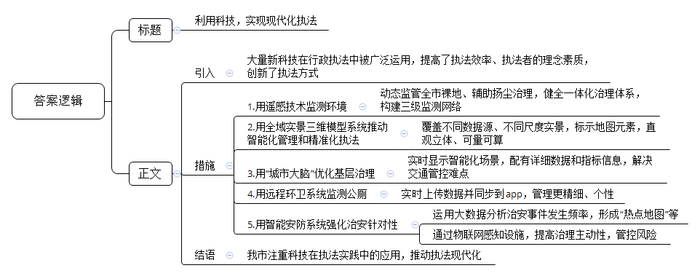
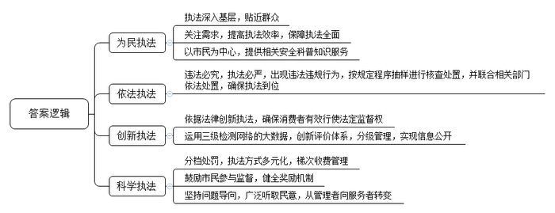
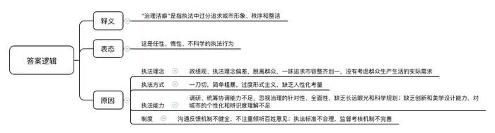
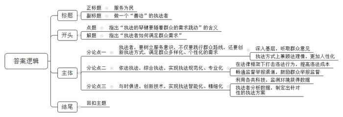

# 2020年江苏省公考《申论》题（B卷）

<!-- gwy:overview:start -->
> **江苏 · 2020 · 申论 · B类** ｜ 4 题 · 图片 4 处 · 答案随题折叠

导航：[题目](#题目) · [材料 1](#材料-1)
<!-- gwy:overview:end -->

> 候选采集稿。参考答案及解析来自粉笔页面，不代表官方答案或真实高分答卷；来源使用许可与原卷对应关系仍需人工核实。

## 给定材料

### 材料 1

世界新一轮科技革命和产业变革呼啸而来，带来了机遇，也带来了挑战。大量的新科技在行政执法实践中得到广泛运用，在显著提高执法效率的同时，也对执法者的理念和素质、执法的方式方法提出了新的要求。

一个“大相机”在空中一照，全市的裸地就尽收眼底。越来越多的蓝天，得益于遥感技术的动态监管。B市环境保护监测中心遥感室李主任介绍，B市已成为全国首个大范围应用遥感技术动态监管全市裸地、辅助扬尘治理的城市。裸地，就是没有植物生长的裸露地面，是扬尘等粗颗粒物的主要来源之一。B市的扬尘监控系统覆盖全市16个区的35个自动监测子站，1000余个PM2.5和粗颗粒物（TSP）高密度监测网络微站遍布全部街乡镇，每月对全市各区1400余条道路尘负荷情况开展走航监测。下一步，B市将结合新一代高时空分辨率卫星遥感、激光雷达垂直网络、高精度气象观测等技术，健全天地空一体化的大气环境治理监测体系，构建市、区、乡镇（街道）三级监测网络。

让城市在地图上“站”起来，是C省城市智能化管理和精准化执法的形象表达。从雄险秀美的峡谷山地到错落耸立的城区高楼，从地上的桥梁街道到地下的轨道交通，整个C省都用实景三维技术装进了省勘测院自主研发的“集景三维平台”系统里，每一个元素的位置、坐标、建筑高度都进行了精确标示，通过电脑可以随时调看。“地上大于5厘米的物体都可见。相比传统的二维地图，实景三维更加直观，可量、可算、信息丰富，是关系城市规划、智能交通、生态环保等诸多产业发展的重要应用技术。”省勘测院陈院长介绍。目前整个C省已经实现了全域不同数据源、不同尺度实景三维模型全覆盖，这也是全国首个省级全域实景三维模型系统。

近年来，G市H区以高度集成的智慧管理体系——“城市大脑”，探索提升基层治理能力的科技之路，打造新型智慧城市。在区城市管理服务指挥中心，十余个电子显示屏占据了一整面墙，上面实时显示着交通、市容、环境等领域数十个智能化场景，每一项运行情况都配有详细的数据和指标信息。作为中枢神经，它的“触角”正在向该区的每一个角落延伸。在交通领域，该系统已拥有8500多路摄像系统，积累车辆视频数据、图片数据、结构化数据等5.7亿余条。依靠这一系统，危化品车辆、渣土车辆等管控难点得到有效治理，重大逃逸案件的侦破率近100%。不久前，又有1400多套网格图像高清探头在H区正式启用，能对多种违法行为进行“一键式”抓拍。

厕间里，一个小小的匣子插着电，亮着绿色的指示灯。“这就是异味浓度传感器，可对所在空间的异味值进行实时监测，数据实时上传到区数字城管指挥中心，并同步到相关的手机APP。”这是W市智慧城管项目远程环卫监测系统的工作情景，目前该系统已在全市16座试点公厕应用。长期以来，对这些场所的监管主要依赖主管部门和养护单位自身的人工巡查。“有了这些实时监测数据的支撑，对养护单位的管理就可以细化了，养护单位还可以针对不同场所制定个性化的养护方案。”市数字城管指挥中心智慧城管项目负责人宋先生说。

### 材料 2

S市M区运用大数据分析，将社会治安的各类事件发生频率，以“热点地图”“词频分析”“排行榜”的形式呈现出来，强化了治安工作的针对性，破解了一系列执法难题。“通过物联网感知设施的‘互联、物联、数联’，推动社区治理由被动应付向主动发现转变，公共安全工作的重心从应急处置向风险管控转变。”S市公安局龚局长说。

“分析近半年来全区的110报警电话，聚焦从下午3点到凌晨3点这12个小时，形成了这张报警分布热力图。”不久前，在区公安分局的平安指数发布会上，主持人亮出了这张热力图。从2017年起，这个平安指数每半年发布一次。每次发布会，全区的居民代表都会被邀请到现场观看。

刚刚发布的平安指数显示，6个月间全区的警情，以廊桥派出所辖区内为最。而且全区报警高峰是下午5点到晚上7点，廊桥派出所辖区内的报警最高峰则是晚上9点到11点。原因何在？“很多都是酒惹出的麻烦。”廊桥派出所魏所长分析，辖区内有2000多家餐厅、酒吧、KTV，夜生活丰富，“喝多了”最易让事态升级：醉酒驾车被警方查处，当事人神志不清容易升级为妨碍公务；醉酒市民睡倒在街边，手机容易被盗；醉酒客人与他人打架、寻衅滋事……数据采集和分析让工作有了针对性，既然酒精度高低与夜生活息息相关，那就从这里入手。派出所民警联合属地相关部门，建议餐馆尤其是酒吧内部都设置洗手间，“这样可以减少客人往外走动的距离，降低小摩擦发生的概率。”派出所唐警官介绍。数据显示，在夜生活集聚区的周边，分布着一些24小时有人值守的空间，如便利店、保安亭等，可以利用这些空间联合设置“安全屋”。“安全屋的存在，对有违法犯罪企图的人来说是一种震慑，也让夜间在外的人更加心安。”魏所长认为。

在M区的松园地区，一幢25层的居民楼，4天之内，连续抛下了3只灭火器。什么人干的？松园派出所王所长觉得，可以借助“智能安防系统”找答案。于是，一个高空抛物监测系统安装在大楼旁，只要监测到目标楼房有坠物，系统就会把前后各30秒视频影像抓取存储下来。

在松园地区，像高空抛物监测系统这样的智能感知端应用已成常态。楼宇门禁安全系统可以实时监测楼道门的开关状况，灭弧式电器火灾监控系统一旦感受到电器异常就会第一时间断电报警……类似的17种“武器”覆盖了102个小区楼宇门禁、水电气表、窨井盖、消防栓。“这些智能‘神经元’，通过物联网技术集合，实现了‘人、房、物、点、路、网’六要素的泛在感知和综合应用。”王所长说，不论是火灾还是交通事故，任何突发事件，在当事人报警求助之前，就能被“区智能安防系统”自动捕捉。通过大数据分析和人工智能研判，系统会自动将情况推送至小区保安、居委会干部或公安民警手机里。这样的智能安防“神经元”，目前在全市3400多个小区里已经安装了70余万套件，它们可以即时感知推送各类风险隐患，全领域全天候全时段为城市安全站岗放哨。已经升级成为智能安防社区的小区，入室盗窃等可防性案件实现“零发案”；违法群租、停车阻塞通道、高空抛物伤人等社会治理“老大难”问题也得到有效破解。

### 材料 3

瓜果蔬菜是不是有农药残留？刚买的肉类是否有瘦肉精？移动实验室一测可知。2019年5月17日，G市L区开展食品安全“你送我检”活动，食品快检车开进东山肉菜市场、天嘉农产品市场等11个市场。活动现场设食品安全快检操作台，做到有送必检、随送随检。免费为市民检测米面制品类、腌制品类、水产品类等多个品种。检测项目主要为农药残留、二氧化硫、三聚氰胺、苏丹红等。检测工作人员现场回复所送样品的快速检测结果，并为市民提供食品安全科普知识咨询服务。

当天上午，在L区天嘉农产品市场，一台挂有“食品安全你送我检”条幅的检测车上，工作人员收取了18批次送检的食品，包括粮油蔬菜等。这些食品，经过取样、检测后，15分钟即可出检测结果。市民邱阿姨带着刚买的丝瓜来送检，她想知道丝瓜有没有农药残留。“我住在附近，经常在这市场买菜，有时候买完会送来检测，吃起来也放心。”邱阿姨说。摊主郭阿姨也主动送来青椒和西红柿，检测农药残留情况，“我卖出的东西，也要检测一下，自己放心也让顾客放心。如果检测出有残留，我也可以找我的上游供货商。”

市场监管局相关负责人介绍，今年以来，L区共开展食品安全“你送我检”活动25场次，接收市民送检食品样本749件，合格745件。对不合格食品，第一时间告知送样人样品可能存在的安全隐患，建议其停止食用，还会按照规定程序抽样，进行核查处置，对销售不合格食品的商家责令下架退市、停止销售，联合相关部门依法处罚。从此前开展的“你送我检”活动收集到的大数据来看，群众现阶段最关注的食品种类和检测项目，以蔬菜农残项目的“呼声”最高，其次是水产品中的甲醛，盐、食用油等食品检测也占有较大的比重。

“‘你送我检’并不是‘拍脑门式’创新，而是于法有据。”G市市场监管局相关负责人介绍，《消费者权益保护法》第十五条规定，消费者享有对商品和服务以及保护消费者权益工作进行监督的权利。“你送我检”就是消费者行使法定监督权的一种具体方式。目前，在L区的大小农贸市场，食品“安检”有了“三重门”：检测车流动快检、相关部门执法抽检、市场自检。运用三级检测网络的大数据，市场监管局还制作了“食安笑脸地图”。市民只要关注市场监管局官方微信，打开食安地图搜索市场名称，就可以看到大笑、微笑、平脸标志，对应的是优秀、良好、一般三种评价。目前，L区有408家市场登上了“食安笑脸地图”。

“‘你送我检’虽是小举措，却具有借鉴意义，这种监管模式可以在全市执法系统中推广。”G市杨副市长表示。

### 材料 4

“提前上班占车位”“回家晚了没车位”“外出游玩抢车位”……停车难，困扰着不少Y市车主，也成为该市市民吐槽的高频词。

F区滨河新村是上世纪80年代末建成的小区，有居民近千户。“小区刚建成时，全Y市都没几辆汽车。”老住户陈阿姨说，当年规划时，小区里正儿八经的停车位，总共只有几十个。这些年小区也不断增加停车的地方，但现在能停车的地方都停满了车。好多人抢到车位干脆就不开车了，“因为开出去后，再回来就停不了了。”不只是居民住宅区，在图书馆、医院、购物中心、政府办事大厅等公共场所，车同样不好停。市民黄先生说，一次他到福保街道办事，四处找不到车位，只能把车停到附近的马路边，“办完事出门，被贴了罚单，罚了500元。”

据统计，2017年，Y市交警共查处各类违法601万余起，其中违停名列第一，近180万起；2018年，违停再次位列榜首，仅通过电子警察抓拍违停就达31.66万起。

目前，对于违停车辆，Y市交警采取分档处罚的方式：对普通道路违停，罚款200元；繁忙道路违停，罚款500元；如车辆停在人行横道或者黄方格位置，罚款1000元；在小区门口堵塞通道停车，造成拥堵则罚款2000元。对于违停的查处，交警部门的执法方式包括现场交警贴单、电警抓拍和违停球自动抓拍等。同时，也鼓励市民对违停行为进行监督。举报线索处罚金额在1000元以上的，每条线索奖励100元，每人每月不超过500元。数据显示，2018年Y市交警共收到交通违法举报线索40余万条，累计发放奖金350万元。其中，违停占举报总数的22.77%，位居榜首。

去年，Y市推出了以手机付费为主要手段的“宜停车”路边临时停车管理体系，在全市施划了18617个路边停车泊位，以满足短时停车需求、改善交通秩序。据介绍，“宜停车”的收费原则是“停得越久越贵”。以工作日Y市市民中心附近的车位为例，停车30分钟内，收费为3元/半小时；30分钟至3小时，收费为6元/半小时；3小时以上，收费为10元/半小时。“通过梯次收费管理，既满足了市民短时停车需求，又起到释放道路资源、调控交通需求的作用。”Y市道路交通管理中心相关负责人表示，“宜停车”推出以来，路边停车管理取得较为明显的效果。

不过，“宜停车”等加强路边停车管理的方法，也带来许多争议。“我就多停了几分钟，结果就被罚了500元。”“操作指南离那么远，第一次用的人谁能看到……”市民对“宜停车”的意见，主要集中在收费标识不明、缴费流程复杂等问题上。

“加强车位管理是一个方面，我们也得做好服务工作。”Y市道路交通管理中心相关负责人介绍，近年来，该中心在广泛听取意见后，对“宜停车”进行持续完善：开通次日续时功能，对超时停车的用户采用敬告式执法，首3小时内的路边停车收费统一减免40%……“在与民共建共享路边停车管理成果中，我们实现了从管理者向服务者的转变。”该负责人表示。

根据Y市人大代表的调查结果，目前有73%的市民认为“宜停车”收费合理，72%的市民认为“宜停车”措施方便。相比该模式运营之初近九成的反对意见。目前情况有了极大改变。

近年来，Y市启动停车设施“百千万工程”，即新建“百”个公共停车场，扩容“千”个有停车需求的老旧小区，增加“万”个路边停车泊位，到2020年推动泊位建设10万个以上。Y市人大代表秦先生认为，未来Y市要支持机械立体车库的建设，充分发掘城市地上和地下的空间资源。希望Y市尽快将市内所有停车场纳入统一数据平台，并向社会开放，利用大数据手段解决城市停车资源配置的供需问题。“从长远来看，要解决Y市停车难的问题，还是要大力发展公共交通，引导社会采用绿色交通出行，减少小汽车的使用。”秦先生相信，这是Y市未来理想的交通发展方向。

### 材料 5

张女士在S区三湘风情街上开了一家名叫“脆靓”的水果店，仿木纹的铝塑板招牌上，两个充满“汁水”的圆润字体活泼可爱，给店里引来不少客流。这个外挂式“大灯箱”招牌刚刚用了两年，就被拆掉了。

事情是这样的：这条街上有许多老商户，他们各树各的牌，各立各的号，整条街貌与周边环境格格不入。为提升街面整体形象，S区发布《户外招牌改造提升实施方案》，由区、街镇两级财政补贴，开始了大规模的集中改造。

张女士的“大灯箱”招牌还是她美院毕业的女儿设计的，“脆靓”的店名是老公特意请一位知名书法家题写的。执法部门拆除的那一天，她心里特别难受，几天都没缓过劲儿来。让张女士没想到的是，新的店牌两个月之后才换上，这两个月里营业额减少了三分之一。更让她心里发毛的是，换上的新店牌居然是“黑底白字”，顾客们都私下里议论说太晦气。整条街上的店主满腹怨言，卖鲜花的、卖烟酒的、卖馒头的、卖五金的，还有饭店、理发店、干洗店……几乎所有的店铺店牌的大小、颜色、风格、字体都一模一样，连两家百年老店都没能幸免，“旧貌换了新颜”。路人经过这条街，放眼望去，“黑底白字”的店牌，配上黄白色的街花，好像是丧葬用品一条街。一位环卫工人说：“看上去整齐了，但人气没了。”张女士说：“我们按区里的要求，付了一半的招牌制作和安装费用，设计上为什么不征求一下店主们的意见呢？要是听听我女儿的意见，新店牌会漂亮得多。”

无独有偶，张女士娘家所在的A镇，为了达到地方政府制定的环保标准，在执法中强推“无猪镇”“无鸡镇”，那些养猪养鸡专业户一时间都忙着宰杀或者转卖，尽管政府补贴了一些，但是损失仍然不小。依山傍水的B镇，为了打造文旅小镇，要求地上不能留有一片落叶。环卫工人担心受罚，拿高压水枪喷射，让树叶加速落下，以便集中清扫。S区的这类做法招致很多网友的批评。“城市论坛”上，网友“老K”留言：招牌的个性化与辨识度，在一定程度上彰显着城市生活的温度与活力，“整齐划一”的店铺招牌让街道变丑了。网友“一叶知秋”留言：执法者要善用“十个手指弹钢琴”，激活每一个“音符”，校准每一声琴音，奏出和谐美妙的音乐。网友“天天向上”留言：同样的现象还有“小修摊”。现在城市格局越来越大，但“小修摊”往往难觅踪影。“小修摊”虽小却关乎城市生活的宜居程度，是市民切身利益之所在，应该多给“小修摊”留一点生存发展空间。不久前，天津市杨柳青镇首批26个便民修车修鞋铺投入使用，全部免费提供给经营者，我觉得这种做法具有借鉴意义。F大学发展学院丁教授表示，过于追求秩序和整洁，这是严重的“治理洁癖”，帮的是倒忙。“执法的琴键，只有随着群众的需求而跳动，才能奏出社会和谐的乐章。”

2019年10月31日，中国共产党第十九届中央委员会第四次全体会议通过的《中共中央关于坚持和完善中国特色社会主义制度、推进国家治理体系和治理能力现代化若干重大问题的决定》中强调：必须加强和创新社会治理，提高社会治安立体化、法治化、专业化、智能化水平，提高预测预警预防各类风险能力，增强社会治安防控的整体性、协同性、准确性，推动社会治理和服务重心向基层下移，更好提供精准化、精细化服务。在共建共治共享的社会治理制度越来越完善，国家治理体系和治理能力现代化不断推进的大背景下，如何顺应时代潮流，更新观念，努力学习高新技术，提高执法能力，更好地满足群众对美好生活的新期待，这是每一位执法者需要认真思考的问题。

## 题目

### 第 1 题

**假如你是某市执法部门的一名工作人员，要在执法工作研讨会上，做****“科技推进执法现代化”的主题发言，请根据“给定资料**1**、**2**”拟定一份发言的PPT内容提纲。（25分）**

关联材料：材料 1、材料 2

作答要求：

要求：

（1）内容全面，重点突出；

（2）条理清楚，有逻辑性；

（3）篇幅300字左右。

第 1 题 · 答案与解析

**参考答案（粉笔题库参考内容）**

利用科技，实现现代化执法

引入：大量新科技在行政执法中被广泛运用，提高了执法效率、执法者的理念素质，创新了执法方式。

措施：1.用遥感技术监测环境。动态监管全市裸地、辅助扬尘治理，健全一体化治理体系，构建三级监测网络。2.用全域实景三维模型系统推动智能化管理和精准化执法。覆盖不同数据源、不同尺度实景，标示地图元素，直观立体、可量可算。3.用“城市大脑”优化基层治理。实时显示智能化场景，配有详细数据和指标信息，解决交通管控难点。4.用远程环卫系统监测公厕。实时上传数据并同步到app，管理更精细、个性。5.用智能安防系统强化治安针对性。运用大数据分析治安事件发生频率，形成“热点地图”等；通过物联网感知设施，提高治理主动性，管控风险。

结语：我市注重科技在执法实践中的应用，推动执法现代化。

**参考答案说明****:**（1）格式方面，本参考答案写到了“标题”“正文”两个部分。（2）正文部分，一方面从内容来看，围绕着“科技推进执法现代化”这一主题，本参考答案从“引入”“措施”“结语”三个方面展开。另一方面，形式上，本参考答案做到了分段、分条撰写，整体上条理较为清晰。

**解析**

**考点**：总结类

**来源**：2020年江苏省公考《申论》题（B卷）

> 粉笔申论页面对本题只提供「解析视频」入口，该入口是会员推广位，页面无视频地址与文字解析。

### 第 2 题

**“给定资料**3**”中的“你送我检”和“给定资料**4**”中的“宜停车”，是基层执法中的创新案例，请归纳概括其中值得推广的执法理念。（20分）**

关联材料：材料 3、材料 4

作答要求：

要求：紧扣给定资料，准确全面，条理清楚。篇幅不超过250字。

第 2 题 · 答案与解析

**参考答案（粉笔题库参考内容）**

1.为民执法。执法深入基层，贴近群众；关注需求，提高执法效率，保障执法全面；以市民为中心，提供相关安全科普知识服务。

2.依法执法。违法必究，执法必严，出现违法违规行为，按规定程序抽样进行核查处置，并联合相关部门依法处置，确保执法到位。

3.创新执法。依据法律创新执法，确保消费者有效行使法定监督权；运用三级检测网络的大数据，创新评价体系，分级管理，实现信息公开。

4.科学执法。分档处罚，执法方式多元化，梯次收费管理；鼓励市民参与监督，健全奖励机制；坚持问题导向，广泛听取民意，从管理者向服务者转变。

**参考答案说明**：本参考答案从“为民执法”“依法执法”“创新执法”“科学执法”四个不同的话题进行了分条撰写。各条答案要点之间在内容上相互并列，没有交叉。

**解析**

**考点**：其他类

**来源**：2020年江苏省公考《申论》题（B卷）

> 粉笔申论页面对本题只提供「解析视频」入口，该入口是会员推广位，页面无视频地址与文字解析。

### 第 3 题

**请对****“给定资料**5**”中的执法“治理洁癖****”****产生的原因进行分析。（****15分）**

关联材料：材料 5

作答要求：

要求：观点正确，分析透彻。篇幅250字左右。

第 3 题 · 答案与解析

**参考答案（粉笔题库参考内容）**

“治理洁癖”是指执法中过分追求城市形象、秩序和整洁，这是任性、惰性、不科学的执法行为。其原因有：

1.执法理念上，政绩观、执法理念偏差，脱离群众，一味追求市容整齐划一，没有考虑群众生产生活的实际需求。2.执法方式上，一刀切，简单粗暴，过度形式主义，缺乏人性化考量。3.执法能力上，调研、统筹协调能力不足，忽视治理的针对性、全面性，缺乏长远眼光和科学规划；缺乏创新和美学设计能力，对城市的个性化和辨识度理解不足。4.制度上，沟通反馈机制不健全，不注重倾听百姓意见；执法标准不合理，监督考核机制不完善。

**参考答案说明：**本参考答案写到了“释义与表态”和“产生原因”这两大部分。第一部分先对“治理洁癖”的含义进行了解释，然后对执法中存在这一问题进行了表态；第二部分分别从“执法理念”“执法方式”“执法能力”“制度”这四个方面对产生这一问题的原因进行了分条撰写，各条要点之间在内容上相互并列，没有交叉。

**解析**

**考点**：原因类

**来源**：2020年江苏省公考《申论》题（B卷）

> 粉笔申论页面对本题只提供「解析视频」入口，该入口是会员推广位，页面无视频地址与文字解析。

### 第 4 题

**“给定资料**5**”中提到：“执法的琴键，只有随着群众的需求而跳动，才能奏出社会和谐的乐章。”请结合对这句话的思考，联系实际，写一篇议论文。（40分）**

关联材料：材料 1、材料 2、材料 3、材料 4、材料 5

作答要求：

要求：

（1）自选角度，自拟标题；

（2）参考给定资料，不拘于给定资料；

（3）观点明确，内容充实，结构完整；

（4）篇幅1000字左右。

第 4 题 · 答案与解析

**参考答案（粉笔题库参考内容）**

**服务为民**

**——做一个“善治”的执法者**

“执法的琴键要随着群众的需求跳动”指的是执法者要有宗旨意识，深入群众，听取群众意见，服务群众，以群众的利益为出发点、跟进点和落脚点。而执法者唯有具有法治意识，依法执法，于法有据，规范执法行为，唯有具有开放意识，顺应潮流，学习科技，提高执法效率，成为服务型、法治型、创新型政府，方能满足群众对美好生活的需求，方能让法治国家、和谐社会发出美妙的乐章。

**执法者，要树立服务意识，不仅要践行群众路线，还要创新执法方式，满足群众多样化、个性化的需求。**执法者要勤、要沉，深入基层，记录群众的难题、意见、建议，同时在执法之时兼顾法理情，既坚守原则、底线，又有人情味，做到人性化、柔性执法。试想，如果执法者只顾市容市貌、政绩而不顾群众的生产生活、意见声音，只注重外在、形式主义的内容而不顾群众内在的需求，一味简单化、粗暴式地执法，有严重的“治理洁癖”，那么最终失去的只会是民心和自身的形象。所以，执法者要以百姓之心为己心，做好服务者的角色，如：多开展“食品安全你送我检活动”、完善“宜停车”停车管理办法，少一些“自我”，多一些“大我”“无我”，不负人民，保障群众权利。

**作为执法部门，要满足群众的诉求、意愿，除了要有“情”，有“心”，还要“严”，要“新”。**

**执法者，要依法执法，综合执法，实现执法规范化、专业化。**具体而言，执法者有权不能任性，要在法律框架之下执法，对于有大量农药残留的食品、不带证件喝酒后的驾车、违规占道经营等违法行为，执法者必须进行严厉打击，提高违法成本。同时，执法者可以畅通监督渠道，鼓励群众举报监督，既增强群众的法治意识，又让群众成为执法的有力帮手，让“监控”覆盖更多的“零监管”范围，让违法行为无处遁形。

**执法者，还要与时俱进，创新技术，实现执法智能化、精细化。一方面，执法部门要引进科技，自主研发技术，善于收集信息、获取数据；另一方面，执法部门要善于分析数据，制定针对性、个性化的治理方案，减少安全隐患，提高风险管控能力。**我们身边不乏新科技在执法实践中的运用，无论是监控全市裸地、辅助治理扬尘，还我们蓝天的遥感技术，还是可观可量、信息丰富，可查一切建筑的实景三维技术，又或者是实时监测空气异味，便于量身定制养护方案的远程环卫监测系统，都是通过技术提升了执法效率，减少了行政成本，让我们的执法更加精准、科学。

“千里之行，始于足下。”成为善治者，必须具备视野、智慧，全方位提升执法能力、素质，才能化解民困、民忧、民怨，才能化解社会矛盾、实现社会稳定，实现建设法治国家的目标，让人民群众过上美好的生活。

**文章分析**

**服务为民**

**——做一个“善治”的执法者**

【**标题的优点：**首先，范文的标题“服务为民——做一个‘善治’的执法者”突出了“执法”“为民”等主题词。其次，形式上，主副标题的设置颇具亮点，主标题点出“为民”这一主题词，副标题以“执法者”对主标题作了具体解释，即要以更好的“执法”服务人民，使标题更加清晰、一目了然。】

（1）“执法的琴键要随着群众的需求跳动”指的是执法者要有宗旨意识，深入群众，听取群众意见，服务群众，以群众的利益为出发点、跟进点和落脚点。而（2）执法者唯有具有法治意识，依法执法，于法有据，规范执法行为，唯有具有开放意识，顺应潮流，学习科技，提高执法效率，成为服务型、法治型、创新型政府，方能满足群众对美好生活的需求，方能让法治国家、和谐社会发出美妙的乐章。

【**开头的优点：★内容方面。**范文的开头是紧扣“执法为民”这一主题展开的。首先，开头在段首处点出主题，做到了主题明确。其次，对“执法为民”这一主题进行了分析阐述，指出了（1）“执法为民（执法的琴键要随着群众的需求跳动）”的内涵；（2）“做‘善治’执法者”的对策和意义。**★文字表达方面。**使用了“唯有……唯有……”的排比句式，增强了文章气势，使语言表达富有节奏感。】

**执法者，要树立服务意识，不仅要践行群众路线，还要创新执法方式，满足群众多样化、个性化的需求。**（1）执法者要勤、要沉，深入基层，记录群众的难题、意见、建议，同时在（2）执法之时兼顾法理情，既坚守原则、底线，又有人情味，做到人性化、柔性执法。试想，（3）如果执法者只顾市容市貌、政绩而不顾群众的生产生活、意见声音，只注重外在、形式主义的内容而不顾群众内在的需求，一味简单化、粗暴式地执法，有严重的“治理洁癖”，那么最终失去的只会是民心和自身的形象。所以，（4）执法者要以百姓之心为己心，做好服务者的角色，如：多开展“食品安全你送我检活动”、完善“宜停车”停车管理办法，少一些“自我”，多一些“大我”“无我”，不负人民，保障群众权利。

【**论述段****1****的优点：★观点句：**范文的观点句是紧扣“执法为民”这一文章主题提出的。形式上，它在段首处直接写出，位置突出，容易发现。内容上，关键词突出，内容要点明确，可以明显看出它是从“树立服务意识”这个角度入手，指出了做“善治”执法者的对策。**★论述内容：**（1）介绍了做“善治”执法者的对策——深入基层方面；（2）介绍了做“善治”执法者的对策——人性执法方面；（3）介绍了执法不当的表现及危害；（4）介绍了做“善治”执法者的对策——角色定位方面。以上四个方面的内容都是紧扣“执法者，要树立服务意识，不仅要践行群众路线，还要创新执法方式，满足群众多样化、个性化的需求”这个观点进行分析论述的，论述的针对性强，内容层次丰富。最后，在论述方法上主要采取了讲道理和举例子相结合，做到了丰富多样。】

**作为执法部门，要满足群众的诉求、意愿，除了要有“情”，有“心”，还要“严”，要“新”。**

【**过渡段的优点：**范文的过渡段总结性地指出了“做‘善治’执法者”的对策，其中“除了要有‘情’，有‘心’，还要‘严’，要‘新’”是用来引起下文的过渡句，起到了承上启下的作用。】

**执法者，要依法执法，综合执法，实现执法规范化、专业化。**具体而言，（1）执法者有权不能任性，要在法律框架之下执法，对于有大量农药残留的食品、不带证件喝酒后的驾车、违规占道经营等违法行为，执法者必须进行严厉打击，提高违法成本。同时，（2）执法者可以畅通监督渠道，鼓励群众举报监督，既增强群众的法治意识，又让群众成为执法的有力帮手，让“监控”覆盖更多的“零监管”范围，让违法行为无处遁形。

【**论述段****2****的优点：★观点句：**范文的观点句是紧扣“执法为民”这一文章主题提出的。形式上，它在段首处直接写出，位置突出，容易发现。内容上，关键词突出，内容要点明确，可以明显看出它是从“规范化执法”这个角度入手，指出了做“善治”执法者的对策。**★论述内容：**（1）介绍了做“善治”执法者的对策——依法执法方面；（2）介绍了做“善治”执法者的对策——发动群众方面。以上两个方面的内容都是紧扣“执法者，要依法执法，综合执法，实现执法规范化、专业化”这个观点进行分析论述的，论述的针对性强，内容层次丰富。最后，在论述方法上主要采取了讲道理和举例子相结合，做到了丰富多样。】

**执法者，还要与时俱进，创新技术，实现执法智能化、精细化。一方面，**（1）**执法部门要引进科技****，****自主研发技术****，****善于收集信息****、****获取数据****；另一方面，**（2）**执法部门要善于分析数据****，****制定针对性****、****个性化的治理方案****，****减少安全隐患****，****提高风险管控能力****。**我们身边不乏新科技在执法实践中的运用，无论是监控全市裸地、辅助治理扬尘，还我们蓝天的遥感技术，还是可观可量、信息丰富，可查一切建筑的实景三维技术，又或者是实时监测空气异味，便于量身定制养护方案的远程环卫监测系统，都是（3）通过技术提升了执法效率，减少了行政成本，让我们的执法更加精准、科学。

【**论述段****3****的优点：★观点句：**范文的观点句是紧扣“执法为民”这一文章主题提出的。形式上，它在段首处直接写出，位置突出，容易发现。内容上，关键词突出，内容要点明确，可以明显看出它是从“执法智能化”这个角度入手，指出了做“善治”执法者的对策。**★论述内容：**（1）介绍了做“善治”执法者的对策——引进科技方面；（2）介绍了做“善治”执法者的对策——分析数据方面；（3）介绍了技术对执法的意义。以上三个方面的内容都是紧扣“执法者，还要与时俱进，创新技术，实现执法智能化、精细化”这个观点进行分析论述的，论述的针对性强，内容层次丰富。最后，在论述方法上主要采取了讲道理和举例子相结合，做到了丰富多样。】

【**论述段之间的关系：★内容的内在逻辑：**范文的论述段之间是依照并列逻辑展开的。论述段1先写了做“善治”执法者在树立服务意识、创新执法方式层面的对策，论述段2又写了做“善治”执法者在实现执法规范化、专业化层面的对策，论述段3再写了做“善治”执法者在实现执法智能化、精细化层面的对策。即先指出执法要有服务意识，不能将执法与民心对立，要做到执法为民，接着指出服务人民不是纵容人民，对违法行为要依法执法、坚决执法、严厉执法，最后指出要利用新技术拓展执法边界，提高执法效率，将服务人民与执法为民结合起来。**★段与段的外在衔接：**论述段1之后的过渡段“作为执法部门，要满足群众的诉求、意愿，除了要有‘情’，有‘心’，还要‘严’，要‘新’”，起到了总结论述段1，引领论述段2的作用。】

“千里之行，始于足下。”成为善治者，必须具备视野、智慧，（1）全方位提升执法能力、素质，才能化解民困、民忧、民怨，才能化解社会矛盾、（2）实现社会稳定，实现建设法治国家的目标，让人民群众过上美好的生活。

【**结尾的优点：**范文的结尾回扣了“执法为民”这一主题。（1）再次提到“执法”“为民”“人民”等主题词及其同义词；（2）阐述了深刻意义。】

**解析**

**考点**：文章写作题

**来源**：2020年江苏省公考《申论》题（B卷）

> 粉笔申论页面对本题只提供「解析视频」入口，该入口是会员推广位，页面无视频地址与文字解析。

