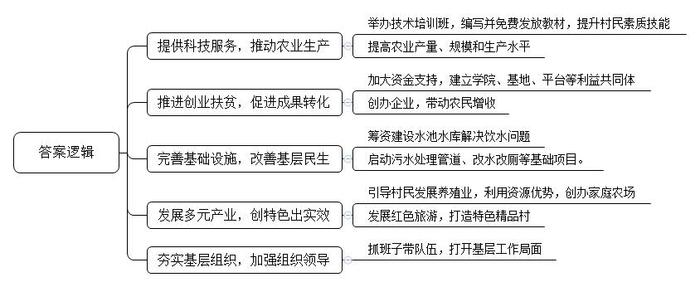
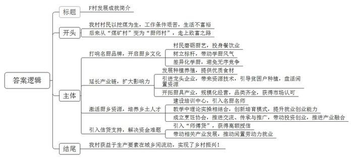
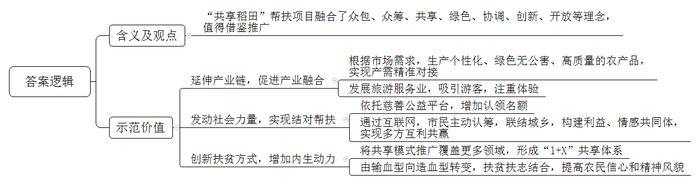
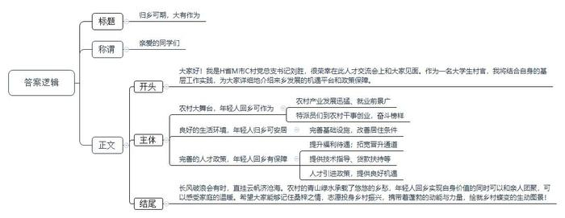

# 2020年江苏省公考《申论》题（C卷）

<!-- gwy:overview:start -->
> **江苏 · 2020 · 申论 · C类** ｜ 4 题 · 图片 4 处 · 答案随题折叠

导航：[题目](#题目) · [材料 1](#材料-1)
<!-- gwy:overview:end -->

> 候选采集稿。参考答案及解析来自粉笔页面，不代表官方答案或真实高分答卷；来源使用许可与原卷对应关系仍需人工核实。

## 给定材料

### 材料 1

“一个流动的中国，充满了繁荣发展的活力。我们都在努力奔跑，我们都是追梦人。”——这是国家主席习近平在2019年新年贺词中的深情言语。流动，一个充满动感、蕴含张力的词语；流动，携带着蓬勃的动能与力量。新时代的乡村中国正在演绎着“流动”的精彩！

在S省F村和Y省G村交界的金沙江上有条“鹦哥溜索”，这条溜索全长480米，距离江面270米，两岸的绝壁陡如刀削，往返其间，令人生畏。20多年来，人畜、油盐、砖瓦，甚至摩托车，G村的几乎所有物资，都是靠溜索从对岸运过来。2018年7月，此处“溜索改桥”工程正式竣工；今年6月底，大桥到村庄的引道全面竣工，两岸百姓出行不再靠溜索了。建起了桥，G村村民小张将建房计划提上日程。“以前买一袋水泥，从县城到溜索处运费要2块5，过溜索1块5，卸货搬到家门口再加3块，总共是7块。先不说要跑多少趟，建个房子光运费就要上万块。”小张说，现在好了，货车一口气运到家，费用省一大半。

随着乡村旅游的火爆，投资8亿元、长76公里的旅游干线无疑成了C县J镇发展经济的“加速器”。从培育旅游业态到打造“宜居、宜业、宜游”“产、城、人融合”的旅游副中心，再到国家4A级景区的建立，J镇一改当年的“落魄无人识”，成为如今的“芳名传万里”。“县生态公路串联了红色旅游、中草药之乡、水墨书画之都、运动港湾、蚕意小镇等5个风情小镇、450家农家乐、22个乡村旅游景点、11个登山露营基地等重要节点，30个环湖绿道骑行驿站，已成为农民自产自销的新平台。”C县交通运输局的相关负责人说，“我县生态公路和绿道的高水平建设，不是单一地打造绿色公共空间，更重要的是垒筑起绿色经济综合体，以此提升百姓的幸福指数。”

### 材料 2

近年来，各类优秀人才穿梭于乡村、躬耕在乡野，体现新时代的新气象，展现新时代的新作为。

科技特派员：

春山浅黛，时晴时雨。三月底的武夷山，十几万亩春茶吐露新芽。一场500多人参加的春茶采摘培训会，正等着52岁的科技特派员刘教授主持。1999年，福建省南平市针对基层“科技力量不足和科技服务缺位”这一农民反映突出的问题，将首批科技人才下派到农业生产一线，为农民提供最急需的科技服务。作为农艺专家的刘教授，成为当地首批科技特派员之一。当时的武夷岩茶总量少、规模小、水平低。刘教授深入山林、扎根茶厂，举办各类茶叶技术培训班，把自己多年经验总结编写成教材，免费发放给农户和茶企，和乡亲们一起把茶树变成了“摇钱树”。

2002年起，科技部开展科技特派员试点工作；2009年，科技部等八部门在全国启动科技特派员农村科技创业行动；2016年国务院办公厅印发《关于深入推行科技特派员制度的若干意见》，对科技特派员工作做出制度安排，科技特派员制度从地方实践上升到国家层面。

“有问题就问特派员！”从“靠天吃饭”到“科技兴农”，科技特派员走进了乡亲们的心里，让大家尝到了科技的甜头，不光腰包鼓了起来，脑袋也富了起来。做给农民看、带着农民干、帮着农民赚，20年间，数十万名和刘教授一样的科技特派员，任劳任怨、无怨无悔，矢志不渝地践行着“把论文写在大地上”的庄重誓言。

“庄稼一枝花，全靠肥当家。”曾几何时，一句通俗易懂的广告语，让广大农民群众认识到了正确施肥对种庄稼的重要性。当有了更好的条件，如何让越来越多的科技成果转化为推动农业农村发展的新动能？近年来，科技部推进创业式扶贫：福建成立科技特派员学院，浙江设立专项资金支持科技成果转化和示范基地建设，四川建立“科技扶贫在线平台”……截至2018年，科技特派员们与老乡建立利益共同体3万个，创办企业1.15万家，带动农民增收超过1010万户。“‘农’字里有‘大’作为。”科技部副部长徐南平表示。下一步，科技部将推动科技特派员制度深入实施，加大贫困地区本土科技人员培训力度，提高贫困农民科学文化素质，让贫困地区的老百姓掌握脱贫致富的“看家本领”、用知识“武装头脑”，彻底断掉“穷根”，在科技助力脱贫攻坚中做出更大的贡献。

乡村振兴领航员：

2018年10月21日，N市委启动实施“乡村振兴领航计划”，选派一批临近退休的处级干部退出领导岗位或提前退休，投身到乡村振兴一线，推动乡村振兴创特色、走前头、出实效。经过组织慎重考虑、严格挑选，该市从67位报名的市直单位处级干部中选出28位工作经验丰富的优秀代表。他们中有的被派往干部原籍村或邻近村，有的被派往其生活或工作过的乡村，有的被派往所在单位挂钩帮扶村。乡村振兴领航员将在驻点村承担起推动产业发展、夯实基层组织等职责。

“当了领航员，就要为乡亲做实事，大家都看着呢。”杨树村领航员老王说。杨树村海拔517米，基础设施落后，村民长期靠天喝水，有挑井水喝的，也有拉软管从山涧引水的。一下雨，水就很浑浊。老王是县科技局地震办干部，去年，他回到老家杨树村任村主任助理，返乡第一件事，就是筹资13万元建设水池和引水管道解决全村饮水问题。任领航员以来，他的双休日几乎都在村里度过，先后筹措120多万元，启动建设污水处理管道、改水改厕等项目，并引导贫困户发展山羊养殖业。观里村是著名的革命老区基点村，市文旅局薛局长被派到观里村履职后，他利用原单位的资源优势，组织干部群众创办家庭农场，发展红色旅游，把观里村打造成了特色精品村。

“我们选派的处级干部，工作阅历丰富，领导力强，抓班子、带队伍都很有一套，再加上他们的家乡情怀和奉献精神，很容易在基层打开工作局面。”N市委于书记说。

### 材料 3

“全村2600多人，有1000多人从事餐饮服务，八成以上的家庭有人外出做厨，年薪20万元以上的厨师超过百人，一年带回劳务收入5000多万元。”F村党支部郭书记介绍村情，如数家珍。

时间的指针拨回改革开放前：

那时，F村还是远近闻名的“煤矿村”。“到处是小煤矿，六成以上的村民挖煤。村民虽多在煤矿务工，但生活并不富裕。”郭书记记忆犹新，“爷爷那辈挖了200余米深，父亲那辈又挖了200余米深，到了我们这辈就只能深入到井下500余米的地方挖。有的坑道高不足1米，斗车进不去，人只能以爬代走。”回想当年，郭书记笑言自己就没干净过，“出来后只有牙是白的”。

时间的指针指向改革开放后：

听说外面的世界很精彩，当年17岁的F村村民扬叔选择加入悄然兴起的打工潮，只身来到珠海。“进过皮革厂，卖过猪肉，一路辛苦一路迷茫，也打过退堂鼓，甚至到了车站要离开却又咬牙留了下来。”经人介绍，扬叔进入一家企业饭堂打下手。几经磨砺，厨艺精进，扬叔后来凭借一道拿手的“干炒牛河”，被一家四星级酒店破格录用，开启梦想进阶之路。从食堂学厨到饭店掌勺，直到后来投资深圳、中山、珠海等地11家酒店，扬叔成为F村的标杆人物。打响F村品牌的名厨，不止扬叔一个。F村厨乡文化展馆的墙上，满壁皆是名厨风采。出了名厨，出了名菜，F村人更加直观地感受到了市场经济的魅力——这是个大舞台，只要有真本事，人人都有出彩机会。

“种葱堆在一起会烂，必须分开来种，厨师也是一样。”村里做厨的人越来越多，难免会扎堆甚至出现无序竞争。针对这种情况，村两委鼓励村民到不同的餐馆学厨，同时支持村民发展种植养殖，为餐饮业提供好食材。为此，F村引进一家农业龙头企业，引进发展现代农业的资源和技术。“28户贫困户种起了木耳，一期采摘木耳8000多公斤，盈利5.8万元。”郭书记介绍，村里计划将荒废的水田及山地用来发展水产养殖、种植有机蔬菜。“既解决了村里闲置劳动力的就业问题，又打通了绿色食材与餐桌之间的供应通道。”

“你性格活络，喜欢跟人聊天，有时耽误烧菜，还是干销售好。”听了扬叔的建议，村民阿正改行做了厨具生意，没过几年，他就把店开到了市里最大的厨具专业市场。“从厨台、炉具、烤箱，到锅盆、碗碟、刀叉、杯勺，共有2万多个品种。”阿正开设的1400平方米的厨具体验馆让顾客非常震撼。在市场经济的大潮中搏击，F村餐饮的产业链不断延伸，品牌影响力愈来愈大。

时间的指针转到当下：

D省大力推进“粤菜师傅”工程，组织专业师资送教下乡，全力扶持城乡劳动者就业创业。“计划到2022年培训‘粤菜师傅’5万人次以上，将直接带动30万人就业创业。”D省人力资源和社会保障厅曹厅长说，“培训合格后颁发‘粤菜师傅’技能证书。山区农民，学历普遍不高，通过‘粤菜师傅’工程，提升就业创业能力，特别切合农民实际。”

借着政策东风，郭书记与村干部谋划以“客家菜师傅”乡土人才培养为切入点，引入名师、名厨，建设集交流平台、展示窗口、实训基地为一体的培训中心。“F村名厨大多在外闯荡，我们一直在思考，如何激活‘厨乡’资源，吸引村民返乡创业。”郭书记说，“‘粤菜师傅’工程一下子让我们开了窍，村里也找到了发展门道。”

“有理论、有现场实操，已经搞了3次培训，有200多人参加，都是本地的贫困户和技校学生。”忙里忙外的大厨老朱，手机响个不停，“做梦也没想过，我会走上讲台当老师。”

“别小看厨师培训，名堂大着呢。”区委常委、组织部李部长说，通过组建厨师协会平台，打造品牌，“形成‘名企出名厨，名厨带名徒，名徒成名厨，名厨联名企’的人才培育模式。”F村还召集村里名厨成立了“厨乡烹饪协会”和“客家菜师傅培训基地”，既推进客家菜师傅交流、推广传承客家菜，也鼓励乡贤回乡投资，开发旅游观光和农家乐，搞种植养殖业。

“师傅贷”是为培养客家菜厨师、打造农家乐旅游项目专门推出的一款信贷产品，2019年4月，F村获整村授信3000万元额度，发展资金短缺难题得到缓解。郭书记说，在“师傅贷”支持下，已有两家农家乐开张营业，带动村里近20名闲置劳动力就业。越来越多的F村人，正从技术、资本等要素不断在城乡间双向流动中获益，走上一条乡村振兴的“风味之路”。

### 材料 4

近日，N市Y区面向全体市民再推出1万块“共享稻田”。这次“共享稻田”每块100平方米，每年给认领的市民提供50公斤大米，认筹价格1000元。这个运用众包、众筹、共享等新经济理念的“共享稻田”帮扶项目，是Y区发动社会力量参与精准扶贫的一次创新尝试。

“以前是‘将就吃’，现在是‘讲究吃’，我们认筹的农产品都是‘私人订制’的，绝对绿色无公害。”来自N市的认领人李先生开心地说，“一端连着我们，一端连着村民，神奇的互联网，让两个相隔数百公里的地方，真正实现了‘天涯若比邻’。”这是李先生第二次认筹，他还专门组织亲友团来收获自己的成果。“‘稻花香里说丰年，听取蛙声一片’，曾经诗意的田园生活如今就在眼前。这样一块大田，几家人一起劳作、娱乐，共同分享收获的喜悦。对于孩子来说，这也是一种寓教于乐、亲近大自然的好机会。”阵阵笑声从共享稻田里传出来。

伴随着市场化、商品化进程，当今的农民越来越多地进入或者被卷入到一个开放的、流动的、分工的社会化体系之中，与传统的封闭的小农经济形态渐行渐远。“我们山里大米品质好，但地处偏远，又不了解外面的行情，要么卖不出去、要么卖不出好价钱。”M村的王大嫂说，“以前种田是‘面朝黄土背朝天’的单打独斗，如今从播种到收割，全程都有城里人视频关注，有些人还专门从城里赶来体验帮忙。我们不仅赚了钱，还交了朋友。”在自家的田地边，王大嫂正忙着给认筹人的“收获”打包。“‘共享稻田’建构了一个利益共同体和情感共同体，实现了多方的互利共赢。”正在排队打包的认领人张先生说。

以大米为主打产品，Y区还将把“共享稻田”模式推广到畜禽、药材等领域，形成“1+X”的共享体系。“当前，‘共享稻田’的扶贫方式是‘输血型’向‘造血型’的转变，‘共享稻田’依靠的还是农民的穷而有志和自力更生，不仅会让农民的物质条件得以改善，也会提振他们的信心和精神风貌。”Y区发改局有关负责人介绍，“共享稻田”很受城市白领欢迎，成了一个他们参与慈善公益的平台，不少爱心企业、爱心人士都希望能增加一些认领名额。

### 材料 5

80后大学生村官刘胜，赶上了这么一个事：他2012年当选H省M市C村村主任，2018年当选村党总支书记。对这个小伙儿，乡亲们直竖大拇指，以前贫穷落后的小山村，变身产业兴旺的美丽村，多亏小刘这些年领着村民苦干实干。可家人却多次劝他辞职：挣得少、养家难，进不了“体制”就“一无所有”，没有五险一金、无保障、没盼头……这让小刘十分纠结。

今年7月，M市委瞄准镇村基层干部招不来、留不住、没发展等痛点，出台了《拓展基层干部晋升通道实施方案》和《提高基层干部待遇实施方案》等政策文件。政策出台不久，M市就从全市选出了多名优秀村党组织书记，解决事业单位编制，小刘成为第一批受益者，家人也支持他继续干了。“我决定就扎根C村了！”小刘目光炯炯、语气坚定。

在C村采访，返乡大学生小丽坦言，她差点成了“逃兵”。几年前，她大学毕业后回乡发展生猪养殖，但因缺乏经验，起步阶段损失惨重，就在要放弃的时候，农业部门提供技术指导，金融部门提供贷款，帮她渡过了难关。

不久前，在M市E村工作还不满一年的小徐，成功申报了省级创新能力提升计划项目——“农村集体产权制度改革试点研究”，并担任项目主持人。“在这里工作，获得感满满！”小徐说。去年6月，作为Z大学的一名应届毕业生，小徐本已与一家规划设计院签订了就业协议。然而，校园网上的一则“M市2018年人才引进计划选聘公告”，让她的内心开始动摇。“我更看重的，是这里的待遇和发展前景。”小徐说。

长期以来，乡村干部待遇保障等问题，不但制约了优秀干部、急需人才向基层流动，也限制了农村事业的发展。近年来，M市针对基层干部待遇不高、晋升通道狭窄等问题出台了一揽子政策。比如，对于村党支部书记和村委会主任购买养老保险的，按3000元标准算，由财政给予2000元补贴；再比如，县级党政领导班子至少应各配备1名以上有乡镇党政正职经历的干部。同时，该市提出对在乡镇累计工作满20年或在乡镇工作时间较长且年满50周岁的干部，可根据本人意愿优先安排到县直机关事业单位工作。此外，根据相关政策，优秀大学毕业生一年考察试用期满考核合格的，任命为副科级职务或享受待遇；适合从事党政管理工作的，可安排挂任乡镇副职；4年后能力突出的，可担任乡镇正职或享受待遇。正是这些政策吸引了小徐，让她把人生事业发展的第一站选择在了乡村。

据媒体报道，2020届大学毕业生人才交流会将于2019年12月在省城国展中心举行。“本届交流会参会高校多、人才素质高，机会难得。我们将组团前往，通过摆事实、讲政策、说机遇、谈发展，吸引更多优秀大学毕业生来我市乡村干事创业。”M市委常委、组织部严部长说，“与城镇相比，农村有其独特优势，青山绿水、清新空气是不少人记忆中的乡愁。随着优质绿色农产品市场需求旺盛，乡村旅游、农村电商等成为投资风口，对于那些有意愿、有能力、有感情的人才，把他们引回来的同时，更应倍加珍惜，努力创造优良环境，让他们留下来，扎根农村。”

“以前做农业农村工作，更多的是考虑人往哪里去。现在要重点考虑人从哪里来，吸引各方人才到乡村广阔天地大显身手。”国家农业农村部韩长赋表示，破解“谁来兴村”问题，关键是要想方设法创造条件，让农村的机会吸引人、农村的环境留住人，培养造就一支高素质农业农村人才队伍，改善农村人力资源结构。

## 题目

### 第 1 题

**“给定资料2”中，“特派员”“领航员”们助力乡村发展取得了丰硕的成果，请对他们在这一过程中发挥的作用加以归纳概括。**（20分）

关联材料：材料 2

作答要求：紧扣给定资料，准确全面，条理清楚。篇幅不超过250字。

第 1 题 · 答案与解析

**参考答案（粉笔题库参考内容）**

1.提供科技服务，推动农业生产。举办技术培训班，编写并免费发放教材，提升村民素质技能，提高农业产量、规模和生产水平。

2.推进创业扶贫，促进成果转化。加大资金支持，建立学院、基地、平台等利益共同体，创办企业，带动农民增收。

3.完善基础设施，改善基层民生。筹资建设水池水库解决饮水问题，启动污水处理管道、改水改厕等基础项目。

4.发展多元产业，创特色出实效。引导村民发展养殖业，利用资源优势，创办家庭农场，发展红色旅游，打造特色精品村。

5.夯实基层组织，加强组织领导。抓班子带队伍，打开基层工作局面。

**参考答案说明**：本参考答案从“提供科技服务，推动农业生产”“推进创业扶贫，促进成果转化”“完善基础设施，改善基层民生”“发展多元产业，创特色出实效”“夯实基层组织，加强组织领导”五个方面进行了分条撰写。各条要点在内容上相互并列，没有交叉。

**解析**

**考点**：影响类

**来源**：2020年江苏省公考《申论》题（C卷）

> 粉笔申论页面对本题只提供「解析视频」入口，该入口是会员推广位，页面无视频地址与文字解析。

### 第 2 题

**“给定资料3”中的F村正在筹划“F村发展成就展”，假如你是该村驻村第一书记，请拟写一份展览内容提纲。**（25分）

关联材料：材料 3

作答要求：

（1）内容全面，重点突出；

（2）条理清楚，有逻辑性；

（3）篇幅350字左右。

第 2 题 · 答案与解析

**参考答案（粉笔题库参考内容）**

F村发展成就简介

改革开放前，我村村民以挖煤为生，工作条件艰苦，生活不富裕，后来从“煤矿村”变为“厨师村”，走上致富之路。发展成就简介如下：

一、打响名厨品牌，开启厨乡文化。村民磨砺厨艺，投身餐饮业，树立标杆，带动学厨风气；差异化学厨，避免无序竞争。二、延长产业链，扩大影响力。发展种植养殖，提供优质食材，引进龙头企业，带来资源技术，引导贫困户种植，盘活闲置资源；开拓厨具产业，规模化经营，品类齐全，获得市场认可。三、激活厨乡资源，培养乡土人才。建设培训中心，引入名厨名师，教学中理论实操相结合，创新培育模式，提升就业创业能力；成立烹饪协会，推进交流、传承与推广，带动投资创业，推进产业融合。四、引入信贷支持，解决资金难题。引入“师傅贷”，获得高额授信，带动相关产业发展，推动闲置劳动力就业。

我村获益于生产要素在城乡间流动，实现了乡村振兴！

**参考答案说明**：（1）从内容来看，开头部分对“F村的发展情况”进行了简单介绍；主体部分从“打响名厨品牌，开启厨乡文化”“延长产业链，扩大影响力”“激活厨乡资源，培养乡土人才”“引入信贷支持，解决资金难题”这四个方面介绍了F村的发展成就；结尾部分对F村的发展成就进行了总结；（2）形式上来看，本参考答案做到了分段、分条撰写，整体上条理较为清晰。

**解析**

**考点**：总结类

**来源**：2020年江苏省公考《申论》题（C卷）

> 粉笔申论页面对本题只提供「解析视频」入口，该入口是会员推广位，页面无视频地址与文字解析。

### 第 3 题

**“给定资料4”中的“共享稻田”模式获得了成功，请对该模式在农村脱贫攻坚中的示范价值进行分析。**（15分）

关联材料：材料 4

作答要求：观点正确，分析透彻，篇幅250字左右。

第 3 题 · 答案与解析

**参考答案（粉笔题库参考内容）**

“共享稻田”帮扶项目融合了众包、众筹、共享、绿色、协调、创新、开放等理念，值得借鉴推广。其示范价值有：

一、延伸产业链，促进产业融合。1.根据市场需求，生产个性化、绿色无公害、高质量的农产品，实现产需精准对接；2.发展旅游服务业，吸引游客，注重体验。

二、发动社会力量，实现结对帮扶。1.依托慈善公益平台，增加认领名额。2.通过互联网，市民主动认筹，联结城乡，构建利益、情感共同体，实现多方互利共赢。

三、创新扶贫方式，增加内生动力。1.将共享模式推广覆盖更多领域，形成“1+X”共享体系；2.由输血型向造血型转变，扶贫扶志结合，提高农民信心和精神风貌。

**参考答案说明**：本参考答案先介绍了“共享稻田”模式的含义，并表明了观点；接着从“延伸产业链，促进产业融合”“发动社会力量，实现结对帮扶”“创新扶贫方式，增加内生动力”三个方面对其示范价值进行了分条撰写。各条答案要点之间在内容上相互并列，没有交叉。

**解析**

**考点**：影响类

**来源**：2020年江苏省公考《申论》题（C卷）

> 粉笔申论页面对本题只提供「解析视频」入口，该入口是会员推广位，页面无视频地址与文字解析。

### 第 4 题

**假如你是“给定资料5”中的C村大学生村官刘胜，领导安排你在省城国展中心举行的“2020届大学毕业生人才交流会”上进行宣讲，请你结合基层工作实践，写一份宣讲稿。**（40分）

关联材料：材料 1、材料 2、材料 3、材料 4、材料 5

作答要求：

（1）角色定位准确；

（2）内容切合主题；

（3）语言流畅，有感染力；

（4）篇幅1000字左右。

第 4 题 · 答案与解析

**参考答案（粉笔题库参考内容）**

**归乡可期，大有作为**

亲爱的同学们：

大家好！我是H省M市C村党总支书记刘胜，很荣幸在此人才交流会上和大家见面。作为一名大学生村官，我将结合自身的基层工作实践，为大家详细地介绍来乡发展的机遇平台和政策保障。

**农村大舞台，年轻人回乡可作为**。乡村顺应发展潮流，不断优化升级产业，为年轻人扎根农村干事创业提供了足够的发展空间，一批又一批有志之士也已经投身农村，助力乡村发展。一方面，优质绿色农产品市场需求旺盛，乡村旅游、农村电商也成为投资风口，市场潜力大，就业岗位多。所以，有意愿、有能力的人才回来有干大事的市场机遇。另一方面，一批批科技特派员、乡村领航员下沉到基层，身先士卒，积极为农村发展提供技术指导，培养乡村人才，也让年轻人才看到了奋斗的榜样。总之，优秀人才都能在乡村这个广阔的舞台上看到发展的希望，挥洒干事激情，收获成长的喜悦！

**良好的生活环境，年轻人归乡可安居**。过去农村发展落后，基本的生活设施都不健全，缺水、缺电、缺网、道路坑洼难行，居尚大不易，何谈回乡创业。而现在，随着乡村振兴的全面推进：道路硬化、景观亮化；设施完善、服务优化；环境美化、村貌升级……乡村的交通出行、环境卫生、居住条件已经有了质的改善。G村“溜索改桥”工程正式竣工投入使用，已经给农村、农业、农民带来了实实在在的好处。宜居的环境不仅体现在硬件设施上，更落实在人性化的服务里。农村教育、医疗、生活娱乐等公共服务的建设，满足了人们更高层次的生活需求。因此，宜居的乡村环境，既有美景、又有服务，让归乡人才可以享受到高质量的生活，扎根农村。

**完善的人才政策，年轻人回乡有保障**。挣得少、养家难、无保障、没盼头，进不了“体制”就“一无所有”……这一系列的问题让很多大学生“想回乡又难以回乡、想留下又难以安定”。而现在，基层政府已经有所行动：首先，提升福利待遇，完善养老保险等制度，保障了物质生活，解决了大学生们的后顾之忧；其次，拓宽晋升通道，完善考核评优制度，通过正向激励推动更多急需人才向基层流动；再则，树立服务意识，提供财政补贴、税收优惠、金融扶持等资金保障，使得有理想、有抱负的年轻人回乡，不再遭遇“没技术、没经验、没资金”的困扰。希望这一系列积极、开放、有效的人才政策，能够使应届大学生们愿意来、留得住、有发展。

长风破浪会有时，直挂云帆济沧海。农村的青山绿水承载了悠悠的乡愁，年轻人回乡实现自身价值的同时可以和亲人团聚，可以感受家庭的温暖。希望大家能够记住桑梓之情，志愿投身乡村振兴，携带着蓬勃的动能与力量，绘就乡村蝶变的生动图景！

**文章分析**

**归乡可期，大有作为**

【**标题的优点：**首先，宣讲稿的标题突出了“吸引大学生回乡发展”这一主题。其次，形式上，文字简洁明快。】

亲爱的同学们：

【**称谓的优点：**宣讲稿的称谓定位准确、格式正确。本次宣讲的对象是大学毕业生，所以称为可以写为：亲爱的同学们。】

（1）大家好！我是H省M市C村党总支书记刘胜，很荣幸在此人才交流会上和大家见面。作为一名大学生村官，（2）我将结合自身的基层工作实践，为大家详细地介绍来乡发展的机遇平台和政策保障。

【**开头的优点：**宣讲稿的开头进行了简单的自我介绍，并讲明了宣讲的目的。（1）概述宣讲人的身份：H省M市C村党总支书记刘胜，一名大学生村官。（2）指出了本次宣讲的目的：为大家介绍来乡发展的机遇平台和政策保障。】

**农村大舞台，年轻人回乡可作为。乡村顺应发展潮流，不断优化升级产业，为年轻人扎根农村干事创业提供了足够的发展空间**，一批又一批有志之士也已经投身农村，助力乡村发展。一方面，优质绿色农产品市场需求旺盛，乡村旅游、农村电商也成为投资风口，市场潜力大，就业岗位多。所以，有意愿、有能力的人才回来有干大事的市场机遇。另一方面，一批批科技特派员、乡村领航员下沉到基层，身先士卒，积极为农村发展提供技术指导，培养乡村人才，也让年轻人才看到了奋斗的榜样。总之，优秀人才都能在乡村这个广阔的舞台上看到发展的希望，挥洒干事激情，收获成长的喜悦！

【**主体部分1的优点：**★核心句：宣讲稿的核心句是紧扣“吸引大学生回乡发展”这一主题提出的。形式上，它在段首处直接写出，位置突出，容易发现。内容上，关键词突出，内容要点明确，可以明显看出它是从“农村具有广阔发展空间”这一方面入手，介绍了“农村吸引年轻人回乡的优势”。★具体展开：（1）介绍了“乡村成为投资风口，市场潜力大”；（2）介绍了“科技特派员、乡村领航员下沉基层，提供技术、培养人才”；（3）总结介绍“乡村是有发展希望的舞台”。注意：以上三个方面采取“分-总”结构紧扣“农村大舞台，年轻人回乡可作为。乡村顺应发展潮流，不断优化升级产业，为年轻人扎根农村干事创业提供了足够的发展空间”这个核心句进行分析论述的，具体展开的内容针对性强，层次丰富。在具体内容的展开上采用了讲道理、举例子相结合，做到了丰富多样。】

**良好的生活环境，年轻人归乡可安居**。（1）过去农村发展落后，基本的生活设施都不健全，缺水、缺电、缺网、道路坑洼难行，居尚大不易，何谈回乡创业。而现在，随着乡村振兴的全面推进：道路硬化、景观亮化；设施完善、服务优化；环境美化、村貌升级……乡村的交通出行、环境卫生、居住条件已经有了质的改善。（2）G村“溜索改桥”工程正式竣工投入使用，已经给农村、农业、农民带来了实实在在的好处。（3）宜居的环境不仅体现在硬件设施上，更落实在人性化的服务里。农村教育、医疗、生活娱乐等公共服务的建设，满足了人们更高层次的生活需求。因此，（4）宜居的乡村环境，既有美景、又有服务，让归乡人才可以享受到高质量的生活，扎根农村。

【**主体部分2的优点：**★核心句：宣讲稿的核心句是紧扣“吸引大学生回乡发展”这一主题提出的。形式上，它在段首处直接写出，位置突出，容易发现。内容上，关键词突出，内容要点明确，可以明显看出它是从“农村具有良好的生活环境”这一方面入手，介绍了“农村吸引年轻人回乡的优势”。★具体内容：（1）通过“过去的乡村与现在乡村”进行对比，阐明现在乡村有良好的环境；（2）介绍了“乡村基础硬件设施不断完善”；（3）介绍了“乡村具备人性化的服务”；（4）总结介绍“宜居的乡村环境让归乡人才扎根农村”。注意：以上四个方面采取“分-总”结构紧扣“良好的生活环境，年轻人归乡可安居”这个核心句进行分析论述的，具体展开的内容针对性强，层次丰富。在具体内容的展开上采用了讲道理、举例子相结合，做到了丰富多样。】

**完善的人才政策，年轻人回乡有保障**。（1）挣得少、养家难、无保障、没盼头，进不了“体制”就“一无所有”……这一系列的问题让很多大学生“想回乡又难以回乡、想留下又难以安定”。而现在，基层政府已经有所行动：（2）首先，提升福利待遇，完善养老保险等制度，保障了物质生活，解决了大学生们的后顾之忧；（3）其次，拓宽晋升通道，完善考核评优制度，通过正向激励推动更多急需人才向基层流动；（4）再则，树立服务意识，提供财政补贴、税收优惠、金融扶持等资金保障，使得有理想、有抱负的年轻人回乡，不再遭遇“没技术、没经验、没资金”的困扰。希望这一系列积极、开放、有效的人才政策，能够使应届大学生们愿意来、留得住、有发展。

【**主体部分3的优点：**★核心句：宣讲稿的核心句是紧扣“吸引大学生回乡发展”这一主题提出的。形式上，它在段首处直接写出，位置突出，容易发现。内容上，关键词突出，内容要点明确，可以明显看出它是从“农村完善人才政策”这一方面入手，介绍了“农村吸引年轻人回乡的优势”。★具体内容：（1）介绍了“以前乡村的问题让大学生‘难以回村’”；（2）通过“提升福利待遇”，留住回乡人；（3）通过“拓宽晋升通道”，留住回乡人；（4）通过“树立服务意识”，留住回乡人。注意：以上四个方面紧扣“完善的人才政策，年轻人回乡有保障”这个核心句进行分析论述的，具体展开的内容针对性强，层次丰富。在具体内容的展开上采用了讲道理、举例子相结合，做到了丰富多样。】

长风破浪会有时，直挂云帆济沧海。（1）农村的青山绿水承载了悠悠的乡愁，年轻人回乡实现自身价值的同时可以和亲人团聚，可以感受家庭的温暖。（2）希望大家能够记住桑梓之情，志愿投身乡村振兴，携带着蓬勃的动能与力量，绘就乡村蝶变的生动图景！

【**结尾的优点**：宣讲稿的结尾回扣了“吸引大学生回乡发展”这一主题。（1）再次提到了“年轻人回乡”；（2）发出了呼吁，号召年轻人助力乡村发展。】

**解析**

**考点**：宣传类

**来源**：2020年江苏省公考《申论》题（C卷）

> 粉笔申论页面对本题只提供「解析视频」入口，该入口是会员推广位，页面无视频地址与文字解析。

