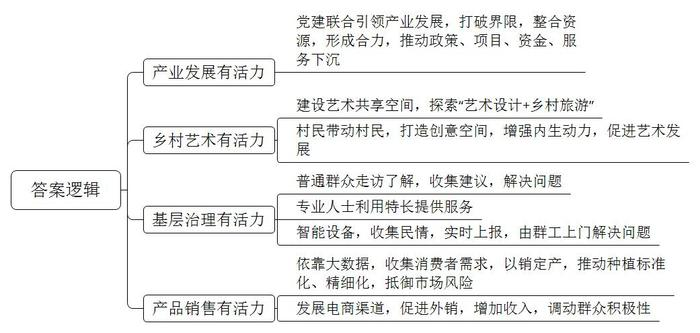
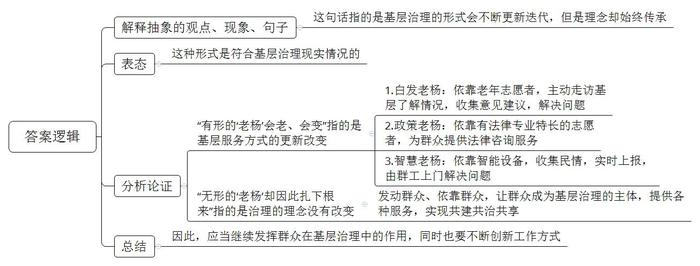
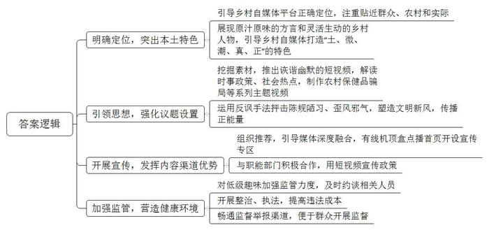
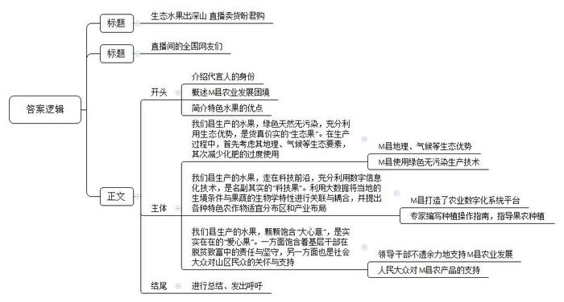

# 2021年江苏省公考《申论》题（C卷）

> 候选采集稿。参考答案及解析来自粉笔页面，不代表官方答案或真实高分答卷；来源使用许可与原卷对应关系仍需人工核实。

## 给定材料

### 材料 1

问渠那得清如许，为有源头活水来。“十三五”时期是我国决胜全面建成小康社会，决战脱贫攻坚的关键五年。五年来，我国乡村振兴开局良好、农村改革持续深化、农村社会和谐稳定、农民获得感不断增强，一个充满生机的“活力乡村”呈现在人们的眼前。

金秋十月，L县文德乡达康产业园区党建联合体的菜农们异常繁忙，采摘下来的一车车优质新鲜的西红柿源源不断地运往北京、上海等地市场。“今年的西红柿价格真好，一个大棚稳赚三四万块钱！”看着眼前的场景，乡党委赵书记脸上洋溢着喜悦，这一切源于L县提出的党建引领产业发展的工作思路。从2018年开始，L县把文德乡作为党建引领产业一体化发展的“试验田”，横向联合7个村，纵向联合40个党组织，规划建设了总面积为2万亩的文德乡达康产业园。文德乡西山村有水、幸福村有地，如何打破村与村之间的界限，将资源整合？产业园党委牵头召开联席会，各村党支部书记、村委会主任一起商议。最后决定，把西山村的水抽到山顶的蓄水池，园区共用；用幸福村的土地建园区蔬菜收购市场，各村共享。“现在7个村抱团取暖、联建园区，成了一家人！”赵书记说，“我们的党建联合体给产业园注入了活力，使得产业园在整合资源上形成了合力，推动政策、项目、资金、服务下沉，走上了园区农业发展的快车道。”

### 材料 2

2019年4月，Z大学丛教授带着“艺术推动乡村内生发展”课题来到T县葛家村。8个月的时间里，丛教授团队和村民共同建设了40多个乡村艺术共享空间，探索出一条艺术设计+乡村旅游的发展之路，当年就吸引3万多名游客。

2019年年底，积累了一身本领的葛家村村民登上大学讲台。摇身变成了“乡建艺术家”，艺术激活乡村，“乡巴佬”成了艺术家，葛家村的成功给刚脱贫不久的定汪村带来了很大启发，经验能否复制，道路能否延续？

抱着同一个梦想，定汪村与葛家村许下约定，用艺术改造定汪。老葛、小吴等5位村民从几十名葛家村乡建艺术家中脱颖而出，组成首批帮扶小组前往定汪村，出行前丛教授给这支队伍取了个颇有气势的名字——“葛家军”。定汪村，地处深山，村里137户人家，长期以来习惯了自给自足的生产生活，外界不了解定汪村，定汪村村民了解外界的愿望也不怎么强烈。虽然脱贫了，但返贫的危机依然存在，该从哪里破局？老葛想到去年丛教授激活葛家村的一招妙棋——给村民上课，烈日当空，村口小卖部前，六七十名村民围坐在一起。老葛第1个站起来：“我们是来帮你们的，但是你们必须和我们一起干，你们才是村子的主人。”接下来每位成员挨个讲话，同样透着真诚和自信。

“我报名！”这时角落里传来一个青年的声音，“我也报名！”另一人应和着，人群逐渐沸腾起来，越来越多的激情被点燃。

村里的小罗是一名大三学生，家里拥有全村唯一一台电脑，还有书籍，有书看、有电脑用，村里的孩子最爱到小罗家玩，“能不能改造小孩看书的阅览室？我愿意腾出我家的房间”，小罗拉着老葛说。老葛在村民的帮助下找到主战场——废弃的村活动中心，他盘算着要在这里展示印染土布。小吴在走访中发现村里妇女擅长刺绣，建议在村里开辟一个空间，村民项大嫂听说后，立马毛遂自荐建起了“织梦坊”，女儿在市里读技校，她利用自己的专长，主动为妈妈设计了许多时尚的刺绣花样，不仅是可供欣赏的艺术品，而且是实用的生活品。最近小项正在为把织梦坊搬上网络云端做准备工作，这种与时俱进的生活绣理念为织梦坊开辟了一片崭新天地。

小罗家的“未来书院”，小项家的“织梦坊”……一个个前所未有的创意空间在两地村民的思想碰撞中逐渐变成现实。定汪的生产生活，淳朴风俗与自然风光交织出一幅生机勃勃的乡村画。丛教授表示，这次选择村民带村民的方式，放手让葛家村村民做师傅，是因为两地村民都有共同的身份，相似的技能，“有村民做主角，乡村的发展更有活力也更精彩了，定汪定会更旺！”

### 材料 3

在C县金凤镇有一句话在百姓间口口相传：“有事儿找老杨，老杨帮你忙；金凤一群杨，专帮百姓忙。”老杨是C县金凤镇原综治办主任，从事了30多年基层工作，深受群众信赖，在他的带动下，一个“老杨”已经变成了活跃在金凤镇的一群“老杨”，他的“老杨工作法”也已拓展成为一种为基层社会治理增效的样板。近日记者来到金凤镇，用相机记录下了“老杨”们工作的身影。

镜头一：海兰村老杨群众工作室的廖奶奶。现年67岁的廖奶奶是海兰村群众工作室的一员，本该在家颐养天年，而她主动投身基层服务事业，帮助乡亲解决困难，廖奶奶记性不太好，腿脚也不利索，但社区有多少幢楼、多少店面、多少重点单位，哪些重点人口、哪些矛盾焦点，她都清清楚楚。遇到有困难的企业和需要调解的居民纠纷，她都亲自走访，了解情况。4年多走访群众近千人次、重点企业50户次，收集到涉及基础设施、城市管理、社会事业等方面的意见建议231条……“白发老杨”成为海兰村老杨群众工作室的一道别致风景。

镜头二：金凤老杨群众工作室的小朱。今年8月，刚从某大学法律专业毕业的小朱主动加入“老杨群工”，利用业余时间和专业特长为大家服务。大家都亲切地称他为“政策老杨”，记者在金凤园区老杨群众工作室找到他，他正在为园区设置公交站的事与相关部门沟通协调。“在劳资方面，我们公司几乎没有发生过纠纷，这些都得益于‘政策老杨’小朱为我们提供的法律咨询服务和解决对策。”台晶电子相关负责人说。禾裕田科技相关负责人也表示，“前两天小朱还组织宣讲团队走进我们企业，为企业员工答疑解惑，提供社保劳动纠纷一类的政策、法律咨询，我们特别感谢他。”

镜头三：办事大厅的“智慧老杨”。“您好，我是老杨！”正在办事大厅接待前来办事群众的这台智能机器人，是金凤镇“老杨群工”的新成员——智慧老杨。别看它个头不大，功能可不少，老杨群工站工作人员告诉记者，“智慧老杨”具备与群众办事息息相关的“反映民情”功能，通过它，群众就可以轻松办事。在工作人员演示下，记者看到，一有来访群众，“智慧老杨”马上热情洋溢地打招呼。根据提示，来访群众可在机器人界面上逐步操作：进入反映民情界面后，手动或语音输入问题。“智慧老杨”将民情收集后，会实时上报老杨群工站，站里派单给不同的老杨群工点，再由“老杨”们逐户上门解决问题。

从白发老杨到政策老杨再到“智慧老杨”，有形的“老杨”会老、会变，无形的“老杨”却因此扎下根来。“‘老杨’来了，问题走了，发展更有活力了。”C县县委于书记说。

### 材料 4

“叮咚、叮咚……”订单声此起彼伏，Z县W村黄金荚种植基地，热闹非凡。一张张订单，改变了Z县特色蔬菜黄金荚的命运。“咱们种的可都是‘网红’啊！”W村村委会蒋主任说。一年两季的豆荚，能从6月摘到国庆前，靠着电商供应链，不到24小时，沾着露水的豆荚就会送到城里的超市货架。

黄金荚是Z县一种特有的蔬菜，金黄色的四季豆，纤维少、口感脆、营养丰富，但黄金荚的“成名”之路比较不顺利。“养在深山人未识啊！”说起一路走来的坎坷，蒋主任不无感慨地说。最初，黄金荚都是农户自产自销，市场仅限于当地，卖不上价。“当时，产业发展陷入两难——继续扶持，资金压力大；可如果放弃，农民种在地里的咋办？”他清楚地记得，2017年，他拉着1500斤黄金荚到省城，结果3天只卖出75斤。2018年7月，产业迎来新转机，新零售超市H公司采销总监到Z县寻访农产品，“雪山就在眼前，山水土壤纯净，黄金荚口感好、颜值高、辨识度强，有做网红蔬菜的潜质。”2019年6月，黄金荚被推向全国，销售异常火爆。

蒋主任说凭借强大的数据能力，H公司给种植户动态反馈消费者的需求，让黄金荚的种植更加精细化和标准化。“订单让种植更智慧！”蒋主任说，“黄金荚卖全国，不同地方的人口感不一样。成都人喜欢凉拌，要嫩一点的；北京顾客喜欢爆炒，要稍长大一点的。村里定制化生产，筐筐都能卖上好价。”价值分配也让种植户更容易接受更高的种植要求，以销定产，减少冗余，抵御了市场波动带来的风险。

有了新零售超市“包销”，村民种植黄金荚的劲头更足了。W村83户，迄今为止，已经有53户种上了黄金荚。一年前，这里的村民还在树下乘凉打牌。如今村民都在地里忙碌，他们笑言，“生物钟”都被打破了。“叮咚、叮咚”优美的旋律演绎着乡村产业的无限的生机与活力。

### 材料 5

怎样看待乡村自媒体的走红？乡村的自媒体与主流媒体碰撞将产生怎样的火花？近日，G市龙溪县举办首届乡村自媒体发展圆桌论坛。论坛上，龙溪县的网红自媒体“欢笑龙溪”团队成员，县委宣传部、网信办、融媒体中心负责人及部分工作人员，高校学者与网友等围坐在一起。

主持人：“天黑路滑，这网络复杂。你不把眼擦，就要小心搭扑爬……”大家对这段rap一定不陌生吧？

网友大龙：何止不陌生，简直不要太熟悉啊，刚刚我还唱来着！（笑）这是“欢笑龙溪”的“神曲”！

主持人：那就请“欢笑龙溪”的王总来介绍一下“神曲”背后的故事吧。

“欢笑龙溪”王总：好的，首先，谢谢大龙的关注。这段“土味rap”出自我们为国家网络安全宣传周特制的短视频，推出短短两天，视频点击量就达到了50万！

主持人：50万啊，太牛了！作为咱们龙溪的网红自媒体，你们是怎样一步一步“红”起来的？

“欢笑龙溪”王总：我们成立于2018年，团队成员全是90后，大家都来自本县农村，方言俚语说得地道。一开始我们的定位是方言搞笑，什么搞笑拍什么，没有特定的主题，点击量只有200多，一直处于不温不火的状态。

县融媒体中心丁主任：我插一句啊，其实也“火”过。有几次，他们因为低级趣味的搞笑，还被我们约谈过，“火火”地上了新闻头条。(笑)

“欢笑龙溪”王总：是的，那段时间我没少去丁主任那边。(笑)每次谈话，主任总是提醒我们，要注重贴近群众、农村和实际，将原汁原味的龙溪方言、灵活生动的龙溪人物搬上视频。

“欢笑龙溪”主创小张：丁主任的提醒，真的太重要了！我们团队的第一个“爆款”作品的素材就出自我身边：我们村有个贫困户，母亲和哥哥都患病，生活艰难，但这贫困户还要应付名目众多的“无事酒”，常常要借钱来送人情，十分苦恼，这给我带来了创作灵感，我就和团队成员以讽刺“无事酒”为主题，制作了短视频《不整无事酒 不赴违规宴》，短短几分钟的视频，把“无事酒”带来的危害表现得淋漓尽致，乡亲们争相转发，“欢笑龙溪”点击量首次突破8000。（掌声）那个贫困户后来悄悄告诉我，自从这期短视频传开后，村里有好几家准备办酒的都打消了念头，让他省了不少钱。（笑）

“欢笑龙溪”王总：那次“爆款”经历，让我开始思考团队未来的发展方向。低级趣味的恶搞，并不能长期吸引粉丝，只有用诙谐幽默的短视频，把时事政策、社会热点解读给大家看，在欢笑声中传播正能量，才能做出更多“爆款”。（掌声）

县融媒体中心丁主任：是的，及时转型让“欢笑龙溪”接下来“爆款”频出，农村的保健品骗局、电信诈骗等都成为他们的选题，他们还用反讽手法抨击当地的一些陈规陋习、歪风邪气，很受老百姓喜欢。2019年，围绕我县脱贫攻坚，他们创作了两期《懒汉脱贫》短视频，在今年中组部举办的第十五届全国党员教育电视片观摩交流活动中，《懒汉脱贫》获得了全国优秀奖。（掌声）

主持人：陈教授，请您来谈谈您的研究对象——“欢笑龙溪”吧。

某大学陈教授：好的。这两年，我一直对“欢笑龙溪”进行跟踪调研，我给他们总结出了“土、微、潮、真、正”五大特色，这是他们最鲜亮的底色，也是他们走红的直接原因。当然，他们还需要聚焦思想引领、强化议题设置、发挥内容和渠道的优势，我们的课题组会持续关注。（掌声）

主持人：乡村自媒体与主流媒体碰撞将产生怎样的火花？谈主任，请您回答一下这个问题吧。

县网信办谈主任：好的。从去年3月份开始，经我办推荐，我县的多个融媒体平台就开始播放“欢笑龙溪”的微视频了，有线机顶盒点播首页也为他们开设了专区。此外，我办还牵线搭桥，让县相关职能部门与“欢笑龙溪”积极合作，通过他们制作的短视频宣传各项政策。今年以来，他们就在卫生防疫部门指导下推出了4期防控新冠肺炎的短视频，及时帮助我县群众了解如何科学防疫，群众对“欢笑龙溪”更熟悉、更喜欢了。乡村自媒体与主流媒体的碰撞产生了神奇的效应！（掌声）

主持人：谢谢谈主任，最后，让我们有请朱部长。

县委宣传部朱部长：谢谢主持人，通过本次论坛，大家一定和我一样，感受到了乡村自媒体的独特魅力。乡村自媒体源自乡村，充满活力，是塑造乡村文明新风，参与乡村治理的重要新生力量。希望大家认真总结“欢笑龙溪”在我县成功实践的经验，加强对乡村自媒体的引导与培育，让乡村自媒体成为乡村活力的“新生源”，成为乡村党群的“连心桥”。（掌声）

### 材料 6

M县处于高山峡谷地区，当地具有“一山有四季，十里不同天”的特点。自然风景优美，旅游资源丰富，自古以来就有野生珍稀生物生长之“生物基因库”“天然氧吧”之称，但因为地形原因，耕地地块呈碎片化，且气候条件、光照、积温、土壤类型等都不一样。老百姓大多跟风种植，瞅见什么卖钱就种什么，忽略了相应的生态要素，导致农产品质量不高或少产，甚至过度施肥导致对农业生态环境的破坏。如何有效利用M县20万余亩耕地，提升特色农作物品质，使其发挥最大的经济价值？近日在中科院成都生物研究所内，石福孙向记者介绍展示了M县农业数字化系统平台。

登录平台后，屏幕右边为M县全县地形与耕地分布图，左边图例内分门别类涵盖全县农业耕地的环境条件、气候条件、土壤养分含量等数字信息。点击任一地块，该地块水平的温度、降水、光照、海拔和土壤等数字信息就能在地图上显示。

“我们从2011年开始，受当地政府邀请，就开始建设这个数据平台。整套数据库依托GIS数据采集库，将全县收集到的真实数据，结合卫星地图遥感技术进行封装。”石福孙表示，目的就是利用大数据能够将当地的生境条件与果蔬的生物学特性进行关联与耦合，并提出各种特色农作物适宜分布区和产业布局。季所长说，如今，基于该数字平台，生物研究所已完成甜樱桃、枇杷、羌脆李等10个重点品种的规划和操作指南的编写，为扶贫工作提供数据支撑。

与此同时，M县的基层干部发挥各自的优势，有的邀请农科所专家针对当地气候条件，定点指导村民科学种植；有的利用专业特长，积极推动农产品销售，使得当地“水果之乡”的声誉近年来越发响亮。独具一格的土产，四季一体的风光，吸引了越来越多的游客走进了深山，农家乐、民宿等产业发展起来。2020年，突如其来的新冠肺炎疫情使得大量特色水果积压山里，急坏了村民。为此，M县不老村的村干部们发起了一场“助农富农网络行，生态水果出深山”的直播带货活动，在驻村第一书记小吕声情并茂地推销下，一张张凝聚爱心的订单从全国各地飞来。

## 题目

### 第 1 题

**给定资料**1**\-**4**中，乡村发展的活力表现在诸多方面，请对此加以归纳概括。（20分）**

关联材料：material-1、material-2、material-3、material-4

作答要求：

要求：紧扣给定资料，准确全面，条理清楚，篇幅不超过250字。

### 第 2 题

**给定资料**3**中的划线句说“有形的‘老杨’会老、会变，无形的‘老杨’却因此扎下根来”，请谈谈你对这句话的理解与认识。（15分）**

关联材料：material-3

作答要求：

要求：观点正确，分析透彻，篇幅250字左右。

### 第 3 题

**假如你是****“给定资料**5**”****中****龙溪县融媒体中心的一名工作人员，参加了首届乡村自媒体发展圆桌论坛，请就****“如何引导乡村自媒体健康发展，进一步激发乡村活力”提出建议。（25分）**

关联材料：material-5

作答要求：

要求：

（1）紧扣给定资料；

（2）全面具体，条理清晰；

（3）有针对性，有可行性；

（4）篇幅350字左右。

### 第 4 题

**如果你是“给定资料**6**”中M县不老村的第一书记小吕，将在“助农富农网络行，生态水果出深山”的直播中为当地的特色水果做代言，请拟写一份直播代言稿。（40分）**

关联材料：material-1、material-2、material-3、material-4、material-5、material-6

作答要求：

要求：

（1）思路清晰，结构完整，语言流畅；

（2）结合给定资料，但不拘于给定资料；

（3）内容充实，有感染力；

（4）篇幅1000字左右。

## 答案与解析

第 1 题

**参考答案（粉笔题库参考内容）**

1.产业发展有活力。党建联合引领产业发展，打破界限，整合资源，形成合力，推动政策、项目、资金、服务下沉。

2.乡村艺术有活力。建设艺术共享空间，探索“艺术设计+乡村旅游”；村民带动村民，打造创意空间，增强内生动力，促进艺术发展。

3.基层治理有活力。普通群众走访了解，收集建议，解决问题；专业人士利用特长提供服务；智能设备，收集民情，实时上报，由群工上门解决问题。

4.产品销售有活力。依靠大数据，收集消费者需求，以销定产，推动种植标准化、精细化，抵御市场风险；发展电商渠道，促进外销，增加收入，调动群众积极性。

**参考答案说明：**（1）本参考答案从“产业发展有活力”“乡村艺术有活力”“基层治理有活力”“产品销售有活力”四个方面对乡村发展活力的表现进行了分条撰写。（2）各条要点之间在内容上是并列的，没有交叉。

**解析状态：unknown（来源未提供）**

第 2 题

**参考答案（粉笔题库参考内容）**

这句话指的是基层治理的形式会不断更新迭代，但是理念却始终传承。这种形式是符合基层治理现实情况的。

一、“有形的‘老杨’会老、会变”指的是基层服务方式的更新改变。具体表现为：1.白发老杨：依靠老年志愿者，主动走访基层了解情况，收集意见建议，解决问题。2.政策老杨：依靠有法律专业特长的志愿者，为群众提供法律咨询服务。3.智慧老杨：依靠智能设备，收集民情，实时上报，由群工上门解决问题。

二、“无形的‘老杨’却因此扎下根来”指的是治理的理念没有改变。具体体现为：发动群众、依靠群众，让群众成为基层治理的主体，提供各种服务，实现共建共治共享。

因此，应当继续发挥群众在基层治理中的作用，同时也要不断创新工作方式。

**参考答案说明：**（1）思路方面，本参考答案按照观点现象分析题“解释抽象的观点、现象、句子+表态+分析论证+总结”的思路展开。（2）内容方面，本参考答案首先总体解释了划线句子的含义并进行了表态；然后分别分析论证了“有形的‘老杨’会老、会变”和“无形的‘老杨’却因此扎下根来”的含义及其具体表现；最后，总结部分针对如何加强基层社会治理提出对策。（3）词句表达方面，本参考答案加上了“因此”等连接词来承接上下文。

**解析状态：unknown（来源未提供）**

第 3 题

**参考答案（粉笔题库参考内容）**

1.明确定位，突出本土特色。引导乡村自媒体平台正确定位，注重贴近群众、农村和实际；展现原汁原味的方言和灵活生动的乡村人物，引导乡村自媒体打造“土、微、潮、真、正”的特色。

2.引领思想，强化议题设置。挖掘素材，推出诙谐幽默的短视频，解读时事政策、社会热点，制作农村保健品骗局等系列主题视频；运用反讽手法抨击陈规陋习、歪风邪气，塑造文明新风，传播正能量。

3.开展宣传，发挥渠道优势。组织推荐，引导媒体深度融合，有线机顶盒点播首页开设宣传专区；与职能部门积极合作，用短视频宣传政策。

4.加强监管，营造健康环境。对低级趣味加强监管力度，及时约谈相关人员；开展整治、执法，提高违法成本；畅通监督举报渠道，便于群众开展监督。

**参考答案说明：**（1）本参考答案从“明确定位，突出本土特色”“引领思想，强化议题设置”“开展宣传，发挥渠道优势”“加强监管，营造健康环境”这四个方面对乡村自媒体健康发展的建议进行了分条撰写。（2）各条要点之间在内容上是并列的，没有交叉。

**解析状态：unknown（来源未提供）**

第 4 题

**参考答案（粉笔题库参考内容）**

**生态水果出深山 直播卖货盼君购**

直播间的全国网友们：

大家好！欢迎大家来到“助农富农网络行，生态水果出深山”直播间，我是M县不老村的第一书记小吕。因为新冠肺炎疫情突如其来，我县大量甜樱桃、枇杷、羌脆李等特色水果积压山里，急坏了村民。但是我县水果不仅仅是生长在好地方，而且黑科技满满，还包裹着浓浓的爱意，接下来，我就为大家详细地介绍介绍我县水果的独特之处。

**我们县生产的水果，绿色天然无污染，充分利用生态优势，是货真价实的****“生态果”。在生产过程中，首先考虑其地理、气候等生态要素，其次减少化肥的过度使用。**我县处于高山峡谷地区，当地雨量充足，日照时间长，早晚温差大，土壤微量元素丰富，具有“一山有四季，十里不同天”的特点，培育出的果子更是果香浓郁、果肉细腻、爆甜多汁、营养均衡，是真正“原生态”农产品。不仅如此，生产中用有机肥料代替农药化肥，运输中冷链运输代替保鲜剂、防腐剂，更是保证了果子的绿色天然无公害。好生态、好理念让我县水果做到了真正的“原生态”。

**我们县生产的水果，走在科技前沿，充分利用数字信息化技术，是名副其实的****“科技果”。利用大数据将当地的生境条件与果蔬的生物学特性进行关联与耦合，并提出各种特色农作物适宜分布区和产业布局。**我县政府早在2011年，就邀请中科院成都生物研究所前来考察研究，并建立了M县农业数字化系统平台，依托GIS数据采集库和卫星地图遥感技术，全面、准确地采集我县土地相关信息，真正做到了“因地种果”。此外今天直播间所售卖的甜樱桃、枇杷、羌脆李等等，都是按照生物研究所专家基于该数字平台编写的规划和操作指南种植的。有高科技的保驾护航，我们的水果品质一定有保证。

**我们县生产的水果，颗颗饱含****“大心意”，是实实在在的“爱心果”。一方面饱含着基层干部在脱贫致富中的责任与坚守，另一方面也是社会大众对山区民众的关怀与支持。**在我县种植生产水果的过程中，基层干部发挥各自优势，有的邀请农科所专家，定点指导村民科学种植；有的利用专业特长，积极推动农产品销售。同时“水果之乡”的美誉，也离不开大家对于我们的支持与关心。正是因为党员干部齐上阵，专家学者来指导，人民群众皆帮忙，我们的水果才能走出深山，我县才能走出一条成功的助农、富农之路。

新冠病毒如洪水猛兽，虽冲击着我县的劳动人民，但抹不掉农民的实在；虽淹没了我县的特色水果，但掩盖不了果子的香甜。希望直播间里有爱心的你们，能感受到我县水果的独特与美好，然后一起“种草”买买买吧！

**文章分析**

**生态水果出深山 直播卖货盼君购**

【**标题的优点：**首先，代言稿的标题突出了“为特色水果直播代言”这一主题。其次，它在形式上采用了对称式结构，使标题更加完整、饱满。】

直播间的全国网友们：

【**称谓的优点：**代言稿的称谓定位准确、格式正确。本次代言的对象是广大网友，所以称谓可以写为：直播间的全国网友们。】

大家好！（1）欢迎大家来到“助农富农网络行，生态水果出深山”直播间，我是M县不老村的第一书记小吕。（2）因为新冠肺炎疫情突如其来，我县大量甜樱桃、枇杷、羌脆李等特色水果积压山里，急坏了村民。（3）但是我县水果不仅仅是生长在好地方，而且黑科技满满，还包裹着浓浓的爱意，接下来，我就为大家详细地介绍介绍我县水果的独特之处。

【**开头的优点：**代言稿的开头从三个方面展开，具体包括：（1）介绍代言人的身份；（2）概述M县发展面临的困境；（3）简介M县特色水果的优点。】

**我们县生产的水果，绿色天然无污染，充分利用生态优势，是货真价实的****“生态果”。在生产过程中，首先考虑其地理、气候等生态要素，其次减少化肥的过度使用。**（1）我县处于高山峡谷地区，当地雨量充足，日照时间长，早晚温差大，土壤微量元素丰富，具有“一山有四季，十里不同天”的特点，培育出的果子更是果香浓郁、果肉细腻、爆甜多汁、营养均衡，是真正“原生态”农产品。（2）不仅如此，生产中用有机肥料代替农药化肥，运输中冷链运输代替保鲜剂、防腐剂，更是保证了果子的绿色天然无公害。好生态、好理念让我县水果做到了真正的“原生态”。

【**主体部分****1的优点：**★核心句：代言稿的核心句是紧扣“为特色水果直播代言”这一主题提出的。形式上，它在段首处直接写出，位置突出，容易发现。内容上，关键词突出，内容要点明确，可以明显看出它是从“生态环境”这一方面入手，介绍了“水果产业的优势”。★具体展开：（1）介绍了“M县地理、气候等生态优势”；（2）介绍了“M县使用绿色无污染生产技术”。注意：以上两个方面紧扣“我们县生产的水果，绿色天然无污染，充分利用生态优势，是货真价实的‘生态果’”这个核心句进行分析论述的，具体展开的内容针对性强，层次丰富。在具体内容的展开上采用了讲道理、举例子相结合，做到了丰富多样。】

**我们县生产的水果，走在科技前沿，充分利用数字信息化技术，是名副其实的****“科技果”。利用大数据将当地的生境条件与果蔬的生物学特性进行关联与耦合，并提出各种特色农作物适宜分布区和产业布局。**（1）我县政府早在2011年，就邀请中科院成都生物研究所前来考察研究，并建立了M县农业数字化系统平台，依托GIS数据采集库和卫星地图遥感技术，全面、准确地采集我县土地相关信息，真正做到了“因地种果”。（2）此外今天直播间所售卖的甜樱桃、枇杷、羌脆李等等，都是按照生物研究所专家基于该数字平台编写的规划和操作指南种植的。有高科技的保驾护航，我们的水果品质一定有保证。

【**主体部分****2****的优点：**★核心句：代言稿的核心句是紧扣“为特色水果直播代言”这一主题提出的。形式上，它在段首处直接写出，位置突出，容易发现。内容上，关键词突出，内容要点明确，可以明显看出它是从“科学技术”这一方面入手，介绍了“水果产业的优势”。★具体展开：（1）介绍了“M县打造了农业数字化系统平台”；（2）介绍了“专家编写种植操作指南，指导果农种植”。注意：以上两个方面紧扣“好技术，种出‘品质果’”这个核心句进行分析论述的，具体展开的内容针对性强，层次丰富。在具体内容的展开上采用了讲道理、举例子相结合，做到了丰富多样。】

**我们县生产的水果，颗颗饱含****“大心意”，是实实在在的“爱心果”。一方面饱含着基层干部在脱贫致富中的责任与坚守，另一方面也是社会大众对山区民众的关怀与支持。**（1）在我县种植生产水果的过程中，基层干部发挥各自优势，有的邀请农科所专家，定点指导村民科学种植；有的利用专业特长，积极推动农产品销售。（2）同时“水果之乡”的美誉，也离不开大家对于我们的支持与关心。正是因为党员干部齐上阵，专家学者来指导，人民群众皆帮忙，我们的水果才能走出深山，我县才能走出一条成功的助农、富农之路。

【**主体部分****3****的优点：**★核心句：代言稿的核心句是紧扣“为特色水果直播代言”这一主题提出的。形式上，它在段首处直接写出，位置突出，容易发现。内容上，关键词突出，内容要点明确，可以明显看出它是从“社会支持”这一方面入手，介绍了“水果产业的优势”。★具体展开：（1）介绍了“领导干部不遗余力地支持M县农业发展”；（2）介绍了“人民大众对M县农产品的支持”。注意：以上两个方面紧扣“好服务，卖出‘放心果’”这个核心句进行分析论述的，具体展开的内容针对性强，层次丰富。在具体内容的展开上采用了讲道理、举例子相结合，做到了丰富多样。】

新冠病毒如洪水猛兽，虽冲击着我县的劳动人民，但抹不掉农民的实在；虽淹没了我县的特色水果，但掩盖不了果子的香甜。希望直播间里有爱心的你们，能感受到我县水果的独特与美好，然后一起“种草”买买买吧！

【**结尾的优点**：宣讲稿的结尾回扣了“为特色水果直播代言”这一主题。（1）对比了疫情前后M县的情况；（2）发出了呼吁，号召网友献出爱心，积极购买。】

**解析状态：unknown（来源未提供）**

