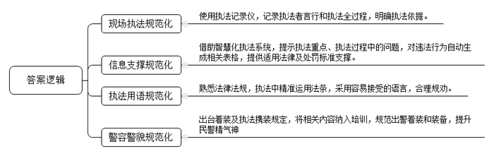
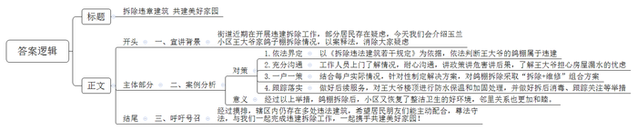
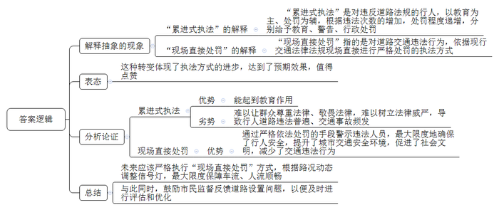
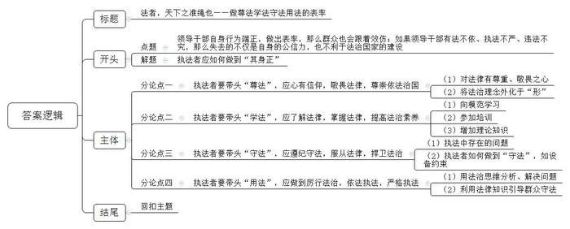

# 2021年江苏省公考《申论》题（B卷）

> 候选采集稿。参考答案及解析来自粉笔页面，不代表官方答案或真实高分答卷；来源使用许可与原卷对应关系仍需人工核实。

## 给定材料

### 材料 material-054bbd3549f9fff3

执法好不好，看看记录仪就知道。“我怎么一直抱着双手？这种姿态好像拒人千里之外，下次得改。”“你说话太急了，应该有条不紊地把执法依据讲明白。”w市市场监督管理局的执法人员一边整理执法记录，一边评点着各自的执法表现。2017年以来，w市所有案件的执法全过程都必须使用执法记录仪，这一做法对执法者的言行提出了更高的要求，执法过程中吸烟、袖手、背手或将手插入衣裤口袋内之类的情形，都会被“记录在案”。

前不久，w市市场监督管理局接到群众举报，一所民房内有人非法加工牛肠牛肚，市场监督管理局执法局刘局长立即带队去现场检查。进入民房前，刘局长按最新工作流程打开了记录仪。地上的苍蝇像铺了一层煤渣，油上的黑渍像撒了一层芝麻……加工场触目惊心，都被清晰地录制下来，作为下一步的处罚依据。执法记录也仅记录了执法人员列队进入现场、出示证件、勘查取证，以及后期送达行政执法文书的全过程。“无论何时何地，只要是执法，记录仪必须打开，这既是道‘紧箍咒’，又是张‘护身符’，能有效防范个别当事人的无理纠缠。”刘局长说，此前很多地方也用过执法记录仪，但随意性比较大。往往是执法人员判断可能会产生纠纷时才会开启，而现在是从头到尾，一举一动，全程记录，执法过程更加规范了。

“这是水务局在检查河道。”在T市滨海新区智慧执法系统的后方监督平台前，运行管理处谢处长指着大屏幕说，“执法人员有定位，现场检查，现场传图，音视图文和当前案件同步显示，执法时间、地点、所走路线都能实时看到，执法结束后还要上传图像资料。有图有真相，可以大大增强执法的针对性，提高执法的效能，也有助于有效防范和妥善处理执法纠纷。”

智慧执法系统采集的动态数据中蕴含着丰富的信息。“比如地点，看似简单，数据多了就能从中找出规律。”谢处长介绍，“整理后的地点数据会告诉我们哪个区域是违法行为高发地，具有一定的预警作用。如果某个工厂短时间内被多次执法，它的情况就会被记入企业信用体系。”此外，通过分析这些数据还可发现是否存在多头执法的问题，是否需要启动联合执法，以提高执法效能。

除了执法动态留痕，文书静态留痕也可以同步进行。滨海新区开发了一套法律数据库系统，执法人员只要将违法事实输入电脑，立案审批表、行政处罚表就可由系统自动生成。在电脑上打开立案审批表，输入关键词，或者在下拉框中进行选择，就会出现对应的案由信息、适用的法律法条；处罚表中，输入时间，处罚类型、处罚金额也都会自动匹配。

平台运行管理处工作人员打开系统，边演示边介绍说：“在前期开发时，我们已经将900多部法律法规进行了编码化处理。比如1xxxxx6201，就代表某部法律法规的第六十二条第一款。今后，如果新的法律法规出台，或现行法律法规有所修订完善，我们也会在这一系统中同步更新。”

### 材料 material-74e35aa3ba22560c

“这个违建大鸽棚一拆，我们心都跟着亮堂了。小区恢复了整洁卫生的好环境，带着孩子在楼下玩，再也不用担心鸽子粪便掉到身上。”家住M市王庄街道玉兰小区的李阿姨高兴地说，“这个心病我有好多年了，现在终于消除了。”

李阿姨所说的违建鸽棚在玉兰小区2号楼楼顶，户主王大爷在这个私搭的违建里养了80多只鸽子，鸽子毛满天飞不说，鸽子的粪便也随处可见，从楼下经过的人时常会不幸“中招”，到了夏天更是臭气冲天，开窗通风成了奢望，邻居们饱受其扰，苦不堪言，意见很大，居委会工作人员虽多次上门沟通，但王大爷家极不配合，成了远近闻名的“钉子户”。

新冠肺炎疫情发生以来，居民对养鸽子造成的环境卫生问题更加担忧。为了杜绝疾病传播的隐患，今年3月，王庄街道综合行政执法办根据M市《拆除违法建筑若干规定》，将依法拆除违建作为工作重点，成立拆违专项工作组，在所辖14个社区的54个小区进行宣传，开始执法行动。

负责拆违的街道执法队陈队长介绍，“玉兰小区这个鸽棚是个顽疾，一开始王大爷家抵触情绪相当严重，我们多次去找，他们连门都不开。我们就连续多天，天天上门，他不开门就在门口跟他沟通，耐心地做工作、讲政策，严肃地讲危害、讲后果。”后来，王大爷终于说出了自己的担忧，原来王大爷家是老房子，他们认为拆除屋顶的鸽棚会导致房屋漏水。了解这一情况后，街道制定了“拆除+维修”的组合方案，打消王大爷一家的顾虑。20多天后，鸽棚终于顺利拆除了。施工人员又对楼顶进行了防水保温和安全加固处理，王大爷一家悬着的心落地了。针对居民们的担忧，社区还采取了拆后消毒、跟踪关注等多项措施，受到一致好评。“讲法讲理，加上细致周到的沟通和‘一户一策’的措施，老百姓一定会理解配合。”陈队长说。

为了摸清辖区内其他违建的具体情况，王庄街道综合行政执法办最近用上了新式武器，那是一架配有北斗导航系统、具有高清摄像功能的无人机。执法人员用无人机对辖区内建筑展开了地毯式“扫描”，准确定位到辖区内仍有违建鸽棚20多处、“房上房”10多处、“盆景阳光房”“杂物堆放间”等30多处。违规圈占面积达2900余平方米，拆违任务依然艰巨。陈队长表示，下一步，他们打算以M市《拆除违法建筑若干规定》为依据，以拆除玉兰小区王大爷家的违建鸽棚为典型案例，以案释法，争取违建户主动配合，圆满完成拆违工作。

### 材料 material-819c1c03ec5989a5

今年年初的一天，市民小张、小李和小罗三人有说有笑地结伴逛街，经过一个路口时，不小心闯了红灯，被正在执勤的交警拦下。交警在查看、核验了三人的身份证后，对小张和小李进行了批评教育，而对小罗却开出了一张罚款通知单。小罗感到很不理解，三人一起闯红灯，为什么只罚自己一个人？

交警解释，自2017年开始，对于违反道路交通法律法规的行人，S市交通管理部门在不违反相关法律规定的前提下，采用“累进式执法”的方式——行人有道路交通违法行为的，民警第一次会对其进行教育，第二次进行警告，第三次按照法律的规定进行处罚。小张、小李是第一次闯红灯被查，而小罗因为之前曾有乱穿马路、不走人行道的行为，今天已经是第三次被交警拦下了，了解政策后，小罗对处罚心服口服。

“累进式执法”实行三年来，S市交管部门教育、查处行人655.2万余人次。“这是个什么概念？按照S市的人口结构来看，基本等于每个家庭单位都已接受过行人道路交通违法的教育和警告了。”市公安局交警总队勤务处勤务指导科何科长介绍，由于年龄、受教育水平以及守法意识等方面的差异，市民对交通法规遵守的程度往往不一样，“我们采取的是教育为主、处罚为辅的方式，屡教不改的才当场处罚。”应该说，大部分市民都有遵守交通法规的自觉性。但是要达到“将法律的威严时刻记在心上”的理想状况，还有很长的路要走。2019年，S市的亡人道路交通事故占到亡人事故总数的18％，大多是行人违法闯红灯、乱穿马路等原因造成的。“要改善这种状况，还需要加大现场执法力度。”何科长说。

从今年7月开始，S市取消“累进式执法”方式，对行人闯红灯、乱穿马路、不走人行道等道路交通违法行为，依据现行交通法律法规进行“现场直接处罚”。据市交警总队统计，执法首日全市共查处行人道路交通违法行为900余起。“有些人觉得交警严处行人违法是不近人情，其实恰恰相反，通过严格依法处罚的手段警示违法人员，是为了最大限度地确保行人安全，进一步提升城市交通安全环境。”S市公安交警部门相关负责人说。很多市民也对这一做法表示理解，“我举双手赞成。严格执法是为了大家的安全，也可以让社会更文明。现在，确实感到交通路口行人违法行为明显减少了。”市民小孔说。

市交警部门表示，为了更好地执行“现场直接处罚”的措施，他们将根据道路和车流实际情况不断进行信号灯动态调整，最大限度保障车流、人流顺畅；如果市民发现路口、路段设置不合理，希望能及时向公安交警部门反映，他们将第一时间进行评估和优化。

## 题目

### 第 1 题

**给定资料**1**\-**4**中，行政执法的规范化表现在诸多方面，请对此加以归纳概括。（****15****分）**

关联材料：material-054bbd3549f9fff3

作答要求：

要求：紧扣给定资料，准确全面，条理清楚，篇幅不超过200字。

### 第 2 题

**假如你是****“给定资料**5**”中王庄街道综合行政执法办的一名工作人员，将对辖区内违建户进行一次“以案释法”宣讲，请拟写一份宣讲提纲。（****25****分）**

关联材料：material-74e35aa3ba22560c

作答要求：

要求：紧扣给定资料，内容完整，条理清楚，篇幅350字左右。

### 第 3 题

**“给定资料**6**”中****S****市对行人道路交通违法的执法方式，经历了“累进式执法”到“现场直接处罚”的变化，请对这一变化进行评析。（****20****分）**

关联材料：material-819c1c03ec5989a5

作答要求：

要求：观点正确，层次清晰，分析透彻，篇幅300字左右。

### 第 4 题

**请在深刻领会****“给定资料**8**”中习近平总书记指示精神的基础上，结合你对“其身正，不令而行；其身不正，虽令不从”这句话的认识，联系实际，写一篇文章。（****40****分）**

关联材料：material-054bbd3549f9fff3

作答要求：

要求：

（1）自选角度自拟标题；

（2）参考给定资料，不拘于给定资料；

（3）观点明确，内容充实，结构完整，语言流畅；

（4）篇幅1000字左右。

## 答案与解析

第 1 题

**参考答案（粉笔题库参考内容）**

1.现场执法规范化。使用执法记录仪，记录执法者言行和执法全过程，明确执法依据。

2.信息支撑规范化。借助智慧化执法系统，提示执法重点、执法过程中的问题，对违法行为自动生成相关表格，提供适用法律及处罚标准支撑。

3.执法用语规范化。熟悉法律法规，执法中精准运用法条，采用容易接受的语言，合理规劝。

4.警容警貌规范化。出台着装及执法携装规定，将相关内容纳入培训，规范出警着装和装备，提升民警精气神。

**解析**

**参考答案说明**：本参考答案从“现场执法规范化”“信息支撑规范化”“执法用语规范化”“警容警貌规范化”这四个方面进行分条撰写，各条要点在内容上并列且无交叉。

**考点**：考点概括措施类

**来源**：来源2021年江苏省公考《申论》题（B卷）

粉笔申论页面对本题只提供「解析视频」入口，该入口是会员推广位，页面无视频地址与文字解析。

第 2 题

**参考答案（粉笔题库参考内容）**

拆除违章建筑 共建美好家园

一、宣讲背景：街道近期在开展违建拆除工作，部分居民存在疑虑，今天我们会介绍玉兰小区王大爷家鸽子棚拆除情况，以案释法，消除大家疑虑。

二、案例分析：1.依法界定。以《拆除违法建筑若干规定》为依据，依法判断王大爷的鸽棚属于违建。2.充分沟通。工作人员上门了解情况，耐心沟通，讲政策讲危害讲后果，了解王大爷担心房屋漏水的忧虑。3.一户一策。结合每户实际情况，针对性制定解决方案，对鸽棚拆除采取“拆除+维修”组合方案。4.跟踪落实。做好后续服务，对王大爷楼顶进行防水保温和加固处理，并做好拆后消毒、跟踪关注等举措。经过以上举措，鸽棚拆除后，小区又恢复了整洁卫生的好环境，邻里关系也更加和睦。

三、呼吁号召：经过摸排，辖区内仍存在多处违法建筑，希望居民朋友们能主动配合，尊法守法，与我们一起完成违建拆除工作，一起携手共建美好家园！

**解析**

**参考答案说明：**（1）本题虽然是写“宣讲提纲”，不必考虑格式，但是为了保险起见，建议加上标题。（2）正文部分，从内容来看，围绕着“对违建户进行‘以案释法’”这一主题，本参考答案开头部分写出了拆除违建的背景目的等；主体部分从对策、意义等方面给出了具体的分析；最后结尾部分给出了总结呼吁。从形式来看，本参考答案做到了分段、分条撰写，整体上条理较为清晰。

**考点**：考点宣传类

**来源**：来源2021年江苏省公考《申论》题（B卷）

粉笔申论页面对本题只提供「解析视频」入口，该入口是会员推广位，页面无视频地址与文字解析。

第 3 题

**参考答案（粉笔题库参考内容）**

“累进式执法”是对违反道路法规的行人，以教育为主、处罚为辅，根据违法次数的增加，处罚程度递增，分别给予教育、警告、行政处罚。而“现场直接处罚”指的是对道路交通违法行为，依据现行交通法律法规现场直接进行严格处罚的执法方式。这种转变体现了执法方式的进步，达到了预期效果，值得点赞。

“累进式执法”虽然能起到教育作用，但难以让群众尊重法律、敬畏法律，难以树立法律威严，导致行人道路违法普遍、交通事故频发。而“现场直接处罚”通过严格依法处罚的手段警示违法人员，最大限度地确保了行人安全，提升了城市交通安全环境，促进了社会文明，减少了交通违法行为。

因此，未来应该严格执行“现场直接处罚”方式，根据路况动态调整信号灯，最大限度保障车流、人流顺畅；与此同时，鼓励市民监督反馈道路设置问题，以便及时进行评估和优化。

**解析**

**参考答案说明：**思路方面，本参考答案按照观点现象分析题“解释抽象的现象+表态+分析论证+总结”的一般答题思路展开。内容方面，本参考答案先对“累进式执法”和“现场直接处罚”进行解释，并对“‘累进式执法’到‘现场直接处罚’的变化”进行了表态；“分析论证”部分先分析了“累进式执法”的优劣势，接着分析了“现场直接处罚”的优势；最后总结部分提出了更好地执行“现场直接处罚”的对策。词句表达方面，本答案加上了“因此”等连接词来承接上下文。

**考点**：考点观点现象分析类

**来源**：来源2021年江苏省公考《申论》题（B卷）

粉笔申论页面对本题只提供「解析视频」入口，该入口是会员推广位，页面无视频地址与文字解析。

第 4 题

**参考答案（粉笔题库参考内容）**

**法者，天下之准绳也**

**——做尊法学法守法用法的表率**

“其身正，不令而行；其身不正，虽令不从。”这句话指的是领导干部自身行为端正，做出表率，那么群众也会跟着效仿；如果领导干部有法不依、执法不严、违法不究，那么失去的不仅是自身的公信力，也不利于法治国家的建设。**因此，执法者应从自身做起，增强法治意识，学习法律知识，严格遵守法律，做到秉公执法，方能促进社会的公平正义，保护人民群众的权益。**

**执法者要带头****“尊法”，应心有信仰，敬畏法律，****尊崇依法治国。**具体而言，执法者心中要有对法律的尊重之心、敬畏之心，要坚持法律是国之重器，坚持法律面前人人平等，坚持权由法定，拒绝亲友托关系、朋友找门路的行为，坚守原则、坚守底线、拒绝诱惑。除了要将这些法治理念内化于心，还要将其外化于“形”，譬如警察注重警容、警貌、警风，这是对外在的要求，是内在精气神的体现，更是内心信仰法治、尊重法律的体现。

**执法者要带头****“学法”，应了解法律，掌握法律，提高法治素养。**在平时，执法者应向模范学习，多翻阅案件资料，多做法律的功课，写下密密麻麻的批注，注重一点一滴的积累；在闲暇时，执法者应多参加培训，提高自身能力，熟知各项业务，能够在面对群众的询问、解释政策时多一些底气。所以，执法者要学习“有字之书”，增加自己的理论知识，增强自身的本领，更加专业化，才能更好地指导实践。

**执法者要带头****“守法”，应****遵纪守法，服从法律，捍卫法治。**在平时的工作中，有执法者不注重自身言行，执法流程不规范，譬如随意进入现场、不出示证件，勘查取证具有随意性，在执法过程中出现吸烟、喝酒、背手或将手插入衣裤口袋等情况，对此，执法部门应利用科技，配备执法记录仪这一“紧箍咒”，做到执法动态留痕，让执法人员牢记法律红线不可逾越、法律底线不可触碰。

**执法者要带头****“用法”，应做到厉行法治，依法执法，严格执法。**执法者不仅要用法治思维来分析问题、解决问题，还要利用法律知识，引导群众守法，从而解决违法问题。我们身边不乏这样的“教科书式执法”，无论是能够讲法规字字规范、讲道理句句在理，“怼”得司机认可处罚结果的网红交警，还是讲法讲理，细致沟通，以案释法，争取违建户主动配合，圆满完成拆违工作的执法办，他们都能在法律的框架下化解矛盾纠纷，化解民忧、民困，值得学习、效仿。

“奉法者强则国强，奉法者弱则国弱。”对于执法水平的提升，对于法治国家的建设，我们固然要有“一万年太久、只争朝夕”的紧迫感，但也不能期望一蹴而就，**唯有踏踏实实，从自身做起，并身体力行，影响百姓，**才能营造公平的法治环境，才能构建和谐社会！

**解析**

**文章分析**

**法者，天下之准绳也**

**——做尊法学法守法用法的表率**

【**标题的优点：**首先，范文的标题“法者，天下之准绳也——做尊法学法守法用法的表率”突出了“执法者尊法学法守法用法”这一主题。其次，形式上，主副标题的设置颇有亮点，主标题先给出“法”的意义，副标题再点出要尊法学法守法用法，指明对策，使标题逻辑清晰、层次分明。】

“其身正，不令而行；其身不正，虽令不从。”（1）这句话指的是领导干部自身行为端正，做出表率，那么群众也会跟着效仿；如果领导干部有法不依、执法不严、违法不究，那么失去的不仅是自身的公信力，也不利于法治国家的建设。因此，（2）执法者应从自身做起，增强法治意识，学习法律知识，严格遵守法律，做到秉公执法，方能促进社会的公平正义，保护人民群众的权益。

【**开头的优点：****★内容方面。**范文的开头是紧扣“执法者尊法学法守法用法”这一主题展开的。首先，开头在段首处点出主题，做到了主题明确。其次，对“执法者尊法学法守法用法”这一主题进行了分析阐述，指出了（1）“其身正，不令而行；其身不正，虽令不从”的内涵；（2）如何做到“其身正”。**★文字表达方面：**使用了“因此……”等关联词，使语言表达有逻辑性。】

**执法者要带头****“尊法”，应心有信仰，敬畏法律，尊崇依法治国。**具体而言，（1）执法者心中要有对法律的尊重之心、敬畏之心，要坚持法律是国之重器，坚持法律面前人人平等，坚持权由法定，拒绝亲友托关系、朋友找门路的行为，坚守原则、坚守底线、拒绝诱惑。（2）除了要将这些法治理念内化于心，还要将其外化于“形”，譬如警察注重警容、警貌、警风，这是对外在的要求，是内在精气神的体现，更是内心信仰法治、尊重法律的体现。

【**论述段****1的优点：★观点句：**范文的观点句是紧扣“执法者尊法学法守法用法”这一文章主题提出的。形式上，它在段首处直接写出，位置突出，容易发现。内容上，关键词突出，内容要点明确，可以明显看出它是从“尊法”这个角度入手，指出了执法者如何做到“其身正”。**★论述内容：**（1）介绍了执法者做到“尊法”的对策——内心敬畏方面；（2）介绍了执法者做到“尊法”的对策——外在形象方面。以上两个方面的内容都是紧扣“执法者要带头‘尊法’，应心有信仰，敬畏法律，尊崇依法治国”这个观点进行分析论述的，论述的针对性强，内容层次丰富。最后，在论述方法上主要采取了讲道理和举例子相结合，做到了丰富多样。】

**执法者要带头****“学法”，应了解法律，掌握法律，提高法治素养。**在平时，（1）执法者应向模范学习，多翻阅案件资料，多做法律的功课，写下密密麻麻的批注，注重一点一滴的积累；在闲暇时，（2）执法者应多参加培训，提高自身能力，熟知各项业务，能够在面对群众的询问、解释政策时多一些底气。所以，（3）执法者要学习“有字之书”，增加自己的理论知识，增强自身的本领，更加专业化，才能更好地指导实践。

【**论述段****2的优点：★观点句：**范文的观点句是紧扣“执法者尊法学法守法用法”这一文章主题提出的。形式上，它在段首处直接写出，位置突出，容易发现。内容上，关键词突出，内容要点明确，可以明显看出它是从“学法”这个角度入手，指出了执法者如何做到“其身正”。**★论述内容：**（1）介绍了执法者做到“学法”的对策——学习模范方面；（2）介绍了执法者做到“学法”的对策——参加培训方面；（3）介绍了执法者做到“学法”的对策——自主学习方面。以上三个方面的内容都是紧扣“执法者要带头‘学法’，应了解法律，掌握法律，提高法治素养”这个观点进行分析论述的，论述的针对性强，内容层次丰富。最后，在论述方法上采取了讲道理的方式进行展开，做到了论述有力。】

**执法者要带头****“守法”，应遵纪守法，服从法律，捍卫法治。**在平时的工作中，（1）有执法者不注重自身言行，执法流程不规范，譬如随意进入现场、不出示证件，勘查取证具有随意性，在执法过程中出现吸烟、喝酒、背手或将手插入衣裤口袋等情况，对此，（2）执法部门应利用科技，配备执法记录仪这一“紧箍咒”，做到执法动态留痕，让执法人员牢记法律红线不可逾越、法律底线不可触碰。

【**论述段****3的优点：★观点句：**范文的观点句是紧扣“执法者尊法学法守法用法”这一文章主题提出的。形式上，它在段首处直接写出，位置突出，容易发现。内容上，关键词突出，内容要点明确，可以明显看出它是从“守法”这个角度入手，指出了执法者如何做到“其身正”。**★论述内容：**（1）介绍了执法中存在的问题；（2）介绍了执法者做到“守法”的对策——设备约束方面。以上两个方面的内容都是紧扣“执法者要带头‘守法’，应遵纪守法，服从法律，捍卫法治”这个观点进行分析论述的，论述的针对性强，内容层次丰富。最后，在论述方法上主要采取了讲道理和举例子相结合，做到了丰富多样。】

**执法者要带头****“用法”，应做到厉行法治，依法执法，严格执法。**（1）执法者不仅要用法治思维来分析问题、解决问题，（2）还要利用法律知识，引导群众守法，从而解决违法问题。我们身边不乏这样的“教科书式执法”，无论是能够讲法规字字规范、讲道理句句在理，“怼”得司机认可处罚结果的网红交警，还是讲法讲理，细致沟通，以案释法，争取违建户主动配合，圆满完成拆违工作的执法办，他们都能在法律的框架下化解矛盾纠纷，化解民忧、民困，值得学习、效仿。

【**论述段****4的优点：★观点句：**范文的观点句是紧扣“执法者尊法学法守法用法”这一文章主题提出的。形式上，它在段首处直接写出，位置突出，容易发现。内容上，关键词突出，内容要点明确，可以明显看出它是从“用法”这个角度入手，指出了执法者如何做到“其身正”。**★论述内容：**（1）介绍了执法者做到“用法”的对策——法治思维方面；（2）介绍了执法者做到“用法”的对策——法律知识方面。以上两个方面的内容都是紧扣“执法者要带头‘用法’，应做到厉行法治，依法执法，严格执法”这个观点进行分析论述的，论述的针对性强，内容层次丰富。最后，在论述方法上主要采取了讲道理和举例子相结合，做到了丰富多样。】

【**论述段之间的关系：****★内容的内在逻辑：**范文的论述段之间是依照递进逻辑展开的。论述段1-4按照主题“执法者尊法学法守法用法”，从“尊-学-守-用”四方面层层深入、依次展开，既符合文章主题的叙述顺序，又暗含了从重视，到学习，再到遵守，最后到运用的一般规律，对文章主题的阐述十分充分。】

“奉法者强则国强，奉法者弱则国弱。”（1）对于执法水平的提升，对于法治国家的建设，我们固然要有“一万年太久、只争朝夕”的紧迫感，但也不能期望一蹴而就，（2）唯有踏踏实实，从自身做起，并身体力行，影响百姓，才能营造公平的法治环境，才能构建和谐社会！

【**结尾的优点：**范文的结尾回扣了“执法者尊法学法守法用法”这一主题。（1）再次提到了“执法”“法治”等主题词；（2）再次总结了对策。】

**考点**：考点文章写作题

**来源**：来源2021年江苏省公考《申论》题（B卷）

粉笔申论页面对本题只提供「解析视频」入口，该入口是会员推广位，页面无视频地址与文字解析。

