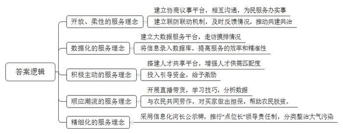
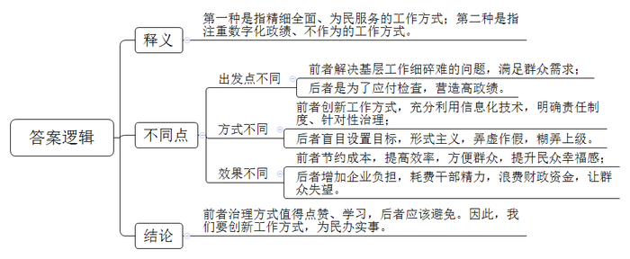
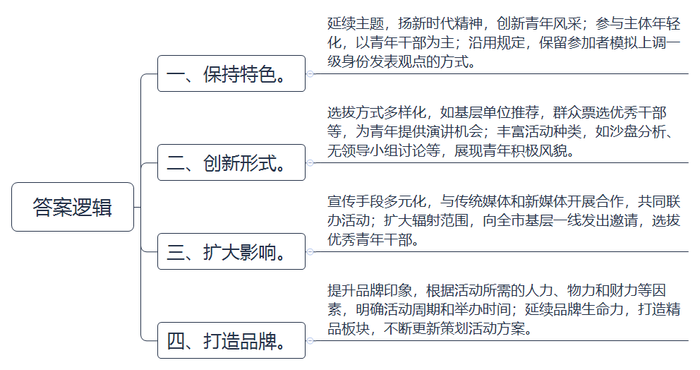
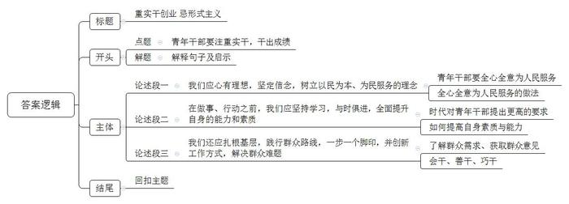

# 2021年江苏省公考《申论》题（A、普通选调卷）

> 候选采集稿。参考答案及解析来自粉笔页面，不代表官方答案或真实高分答卷；来源使用许可与原卷对应关系仍需人工核实。

## 给定材料

### 材料 material-b7ce9b786687a733

沧海横流，方显英雄本色，社会发展日新月异，各种挑战层出不穷。在百年未有之大变局中，社会治理只有准确识变、科学应变、主动求变，才有可能实现更高质量、更可持续、更为安全的发展；基层干部只有扎根基层、锐意进取、奋发有为，经风雨、见世面，才能百炼成钢，成长为政治坚定、能力出众，攻坚克难的弄潮儿，更好地肩负起新时代的职责和使命。

盛大姐是t市宁安区天虹街道华荣社区党总书记，这个国际社区的居民来自近50个国家和地区。在小区里，随处可见日本人、韩国人、新加坡人、印度人、土耳其人、英国人……曾有两个外国家庭，为了一个停车位吵翻了天，也曾有一个外国家庭在家里开“轰趴”吵到邻居报警……

传统的基层工作方法在国际社区“水土不服”，该怎么办？盛大姐用开放的思维方式和一口流利的英语打开了局面。她运用在外企学到的管理模式和柔性管理方法，针对国际社区的特点，搭建了由中外居民组成的协商议事平台——“居民议事厅”。中外居民在议事厅可以自主议事，议事员都在社区里有着自己熟悉的“圈子”，颇具民意代表性。

居民议事厅很快成为社区居民的“圆梦园”。荷兰居民珍妮弗提议开设居民私藏展，并带头进行了首场展出。随后西班牙籍议事员瑞卡多也毛遂自荐，想开亚洲地图展。原来，瑞卡多当年就是无意中翻到了中国地图，于是说走就走来中国扎了根。十几年来，他搜集了不少古老的亚洲地图希望能为西方人看亚洲提供一个独特视角。居民的事，就是大事。在盛大姐的领导下，社区干事开始为瑞卡多圆梦，提供场地，帮忙裱框，为展览做双语翻译……开幕式上，盛大姐送来了鲜花水果咖啡，中外朋友们到场助阵，瑞卡多觉得倍儿有面，“我能够感受到盛书记对工作的用心。”议事厅议事员，菲律宾籍居民王女士坦言，她刚来中国时有点水土不服，通过议事厅这个平台，渐渐认可了如今的生活环境，现在更是赞不绝口，“这个平台解决的是实际问题，办的都是实事，比如养宠物纠纷，停车位纠纷等等不是来虚的。”

疫情期间，盛大姐带领团队，针对境外输入防控难点，提出了“老外+老外的柔性化服务模式”。俗话说老乡帮老乡，让老外之间去沟通往往更奏效。一位韩国籍居民从韩国回来后，按规定实行居家隔离，有一次测量体温超过了37.3摄氏度，如果两次体温超过37.3摄氏度，就该采取一定措施了，当时屋内开着地暖。房间内有食物的味道，但他不愿意告诉我们之前吃了什么，也不愿再测量，盛大姐说，因为对方不配合，场面一度陷入僵局，这时她想到了在韩国居民中比较有影响力的文先生，最后由文先生和那位韩国籍居民沟通后得知，因为吃了火锅，房间里开着地暖，导致隔离人员的第一次测温结果偏高等，屋内通风后，体温便恢复了正常。

“盛书记的手机里有几千个联系人，最紧张的那几天她每天睡眠也就三四个小时。”小区物业祝经理透露，由于盛书记前期的悉心耕耘，华荣社区扎实的治理基础，在疫情防控中得以显现，社区、业委会、物业作为社区治理的“三驾马车”，建立起紧密的联防联动机制。疫情时有一个专门的疫情防控工作群。社区干部和各小区物业、业委会负责人都在群中，相关情况都会在工作群里迅速反馈。国际社区这个“小小联合国”共建出了一个“融情大家园”。

突如其来的新冠肺炎疫情，使社区工作的强度与工作量陡增，人手不够怎么办？服务手段落后如何解决？“我们社区一共2542户、7243人。平时工作全靠一双‘铁脚板’。”W市九龙新寓社区党总支书记老常对社区家底“一口清”，“我们社区工作人员一共9个人，一个人要对应五到六个工作口子，有上班时间没有下班时间……”他告诉记者，疫情期间，多亏来了一群“支援力量”，为他们解了燃眉之急。老常盘点了部分“支援力量”：一位区委常委挂包街道，一名民生工作站领导担任社区“第一书记”，区检察院入驻社区的民生工作站支援社区，街道一名负责综治的副主任带领平安建设部全体人员对接社区……区街干部的加入，带来了资源，增强了我们“铁脚板”的力量，还提升了我们化解难题的能力。

各路“支援力量”中，最让老常满意的是疫情期间推出的大数据服务平台——“彩虹家园”，这一创新项目成为了一线“铁脚板”，我们的工作利器。这一平台设计开发的时候就专门面向社区征询意见，重点解决一线城市的实际需求。老常说社区里租户多，流动人口多，往往是“人跑得快，信息上来得慢”。结合疫情防控社区“铁脚板”们用一个多月把社区2542户全都摸排了一遍，根据街道统一部署，按人户一致、人在户不在、户在人不在、普通出租、混合居住、多户合租、工企租等七种类型，标注成七色录入数据库。“这一平台太管用了，现在我们找人摸排情况有的放矢，省去了很多无效劳动。”彩虹家园平台在功能上实现了四个“1分钟”：1分钟定人精准筛选，1分钟定向精准宣传，1分钟定位精准调度，1分钟定点精准服务。“大数据”赋能“铁脚板”，聚焦现实疑难问题，提供基层社会治理，“彩虹家园”管理服务平台，让最近的人口普查工作也大大提速了。

### 材料 material-ecf7881d8795f155

基层工作细、碎、难，用的多是“绣花功夫”。社会新变化、新现象、新需要层出不穷，这番“绣花功夫”既需要持之以恒，也需要变中出新的“巧心”。S市新江区最近更新了河长制公示牌，和以往不同的是，公示牌上不再直接写明河长姓名、职务、联系方式，而是改放一个二维码，市民通过扫描这张“电子身份证”，相关信息便一目了然。新江区河长办的工作人员算了一笔账：传统的公示牌经常因为河长职务调整等原因需要现场更新张贴信息，改成二维码后，信息更新在网络后台操作即可，节约了维护经费，也提高了工作效率。据估算，采用信息化河长制公示牌，全区每年可节约公示牌更新费用100万元以上，同时增加了不少新的服务功能，老百姓可随时通过扫描二维码反映问题或提出意见。新江区河长制公示牌“升级”，这一细微处的治理创新正是城市治理能力现代化的体现。

近年来，N市在治理大气污染方面大力推行“点位长”领导责任制，全市划出35个重点区域，对数百家包装印刷企业、上千家汽车维修企业，开展挥发性有机物治理；针对汽车尾气、扬尘、餐饮油烟等污染滚动开展专项整治；全市2000多家工地都配备了喷淋降尘设备、防尘网，让扬尘“扬”不起来。精细化管控下，N市PM2.5年均浓度5年来下降近一半，细微处的“绣花功夫”显著提升了老百姓的蓝天幸福。

### 材料 material-1fb5533c799bf062

“假如我是一名综合科科长，首先，我要转变个人定位，立足科室职责，谋划服务效能......”

“假如我是研究室主任，我将针对当前的区块链热点展开调研，今年主要开展以下几方面的工作......”

“如果我有机会到窗口服务部门去锻炼，我将在智能化服务方面积极拓展......”

这是N市Y区开展的以“扬新时代精神，创新青年风采”为主题的青年干部论坛主旨演讲中的情景，这个论坛的参加者大都是“90后”的年轻干部。论坛有个特殊的规定，要求参加者必须模拟自己职务上调一级身份发表观点。

只有通过前期征文评选的优胜者，才有机会最终走上主旨论坛，没有机会走上主旨论坛的参加者，可以自由组队参加论坛后期的“千变万化”辩论赛。今年是论坛的第二届，辩论环节的主题是“落实垃圾分类主要靠法律强制还是教育引导？”辩论双方参赛队员针锋相对，妙语连珠，辩论现场气氛热烈，充分展现了年轻干部积极向上的精神面貌。

青年干部论坛的举办，不仅在青年干部群体中成为热点，也得到了社会各界的一致好评。

论坛评委S大学吴教授：“参赛选手都有一定的工作经验，这种基于自己职务上调一级身份的发言方式，既拓展了青年干部的思维和视野，也打开了青年干部的成长空间，对干部的成长益处多多。”

论坛评委（新潮晚报）胡总编：“发言太精彩了！通过选手们的发言，我看到了青年干部群体满满的正能量，许多想法都是接地气的金点子，这对于我们媒体来说也是难得的资源，很受启发，今后我们可以加大合作，共同联办。”

市民大爷：“我家老太婆原来对垃圾分类很抵触，觉得多此一举，在电视上看了辩论赛后，我们全家都认识到这个问题的重要性，现在我家小孙女成了家庭垃圾分类的监督员。这些年轻人真不简单！”

Y区委组织部罗部长:“通过两届青年干部论坛，我们发现了一些好苗子。这些选手都来自基层一线，基层是最贴近群众的地方，是年轻干部历练成长的‘沃土’。只有在‘沃土’中努力扎根，青年干部才能汲取到成长的营养。这个论坛今后还要继续办下去。”

## 题目

### 第 1 题

**“给定资料**1**\-**3**”中列举了新形势下一些地方在社会发展变局中服务民生的新举措，请对其中蕴含的服务理念进行归纳概括。（20分）**

关联材料：material-b7ce9b786687a733

作答要求：

要求：紧扣给定资料，准确全面，条理清楚，篇幅不超过250字。

### 第 2 题

**“给定资料**3**”与“给定资料**4**”中提到了一些地方在应对社会发展变化新情况时所采用的两种“绣花功夫”，请对其进行比较分析。（15分）**

关联材料：material-ecf7881d8795f155

作答要求：

要求：观点正确，分析透彻，篇幅250字左右。

### 第 3 题

**假如你是****“给定资料**6**”中N市Y区委组织部的一名工作人员，将负责第三届“扬新时代精神 创新青年风采”青年干部论坛活动，领导要求本次论坛要“保持特色，创新形式，扩大影响，做出品牌”，请就如何落实领导要求，谈谈你开展这项活动的思路。（25分）**

关联材料：material-1fb5533c799bf062

作答要求：

要求：紧扣给定资料，切合实际，可行性强，条理清楚，篇幅350字左右。

### 第 4 题

**请结合你对****“给定资料**7**”中“牡丹花大空入目，麦花虽微结成实”这句话内涵的理解，围绕习近平总书记“开学第一课”上对青年干部的要求，联系实际，写一篇文章。（40分）**

关联材料：material-b7ce9b786687a733

作答要求：

要求：

（1）自选角度，自拟标题。

（2）参考给定资料，不拘于给定资料。

（3）观点明确，内容充实，结构完整。

（4）篇幅1000字左右。

## 答案与解析

第 1 题

**参考答案（粉笔题库参考内容）**

1.开放、柔性的服务理念。建立协商议事平台，相互沟通，为民服务办实事；建立联防联动机制，及时反馈情况，推动共建共治。

2.数据化的服务理念。建立大数据服务平台，走访摸排情况；将信息录入数据库，提高服务的效率和精准性。

3.积极主动的服务理念。搭建人才共享平台，增强人才供需匹配度；投入引导资金，给予激励。

4.顺应潮流的服务理念。开展直播带货，学习技巧，分析数据；与农民共同劳作，对买家做出担保，帮助农民脱贫。

5.精细化的服务理念。采用信息化河长公示牌，推行“点位长”领导责任制，分类整治大气污染。

**解析**

**参考答案说明**：本参考答案从“开放、柔性的服务理念”“数据化的服务理念”“积极主动的服务理念”“顺应潮流的服务理念”“精细化的服务理念”五个方面进行了分条撰写，各条答案要点在内容上是并列关系，没有交叉。

**考点**：考点其他类

**来源**：来源2021年江苏省公考《申论》题（A、普通选调卷）

粉笔申论页面对本题只提供「解析视频」入口，该入口是会员推广位，页面无视频地址与文字解析。

第 2 题

**参考答案（粉笔题库参考内容）**

第一种是指精细全面、为民服务的工作方式；第二种是指注重数字化政绩、不作为的工作方式。

不同之处：1.出发点不同：前者解决基层工作细碎难的问题，满足群众需求；后者是为了应付检查，营造高政绩。

2.方式不同：前者创新工作方式，充分利用信息化技术，明确责任制度、针对性治理；后者盲目设置目标，形式主义，弄虚作假，糊弄上级。

3.效果不同：前者节约成本，提高效率，方便群众，提升民众幸福感；后者增加企业负担，耗费干部精力，浪费财政资金，让群众失望。

前者治理方式值得点赞、学习，后者应该避免。因此，我们要创新工作方式，为民办实事。

**解析**

**参考答案说明：**本参考答案首先分别解释了两种“绣花功夫”的内涵，接着从出发点、方式、效果三个角度入手，对比了不同点；最后总结性地给出了结论。

**参考答案****二**

第一种“绣花功夫”是指精细全面、为民服务的工作方式。为解决基层工作细碎难的问题，满足群众需求，创新工作方式，充分利用信息化技术，明确责任制度、进行针对性治理，不仅节约了成本，提高了效率，还方便了群众，提升了民众幸福感。

第二种“绣花功夫”是指注重数字化政绩、不作为的工作方式。为了应付检查，营造高政绩，盲目设置目标，形式主义，弄虚作假，糊弄上级。导致企业负担增加，耗费干部精力，还浪费财政资金，让群众失望。

因此，我们要点赞、学习前者治理方式，避免后者行为，创新工作方式，为民办实事。

**考点**：考点对比分析类

**来源**：来源2021年江苏省公考《申论》题（A、普通选调卷）

粉笔申论页面对本题只提供「解析视频」入口，该入口是会员推广位，页面无视频地址与文字解析。

第 3 题

**参考答案（粉笔题库参考内容）**

一、保持特色。延续主题，扬新时代精神，创新青年风采；参与主体年轻化，以青年干部为主；沿用规定，保留参加者模拟上调一级身份发表观点的方式。

二、创新形式。选拔方式多样化，如基层单位推荐，群众票选优秀干部等，为青年提供演讲机会；丰富活动种类，如沙盘分析、无领导小组讨论等，展现青年积极风貌。

三、扩大影响。宣传手段多元化，与传统媒体和新媒体开展合作，共同联办活动；扩大辐射范围，向全市基层一线发出邀请，选拔优秀青年干部。

四、打造品牌。提升品牌印象，根据活动所需的人力、物力和财力等因素，明确活动周期和举办时间；延续品牌生命力，打造精品板块，不断更新策划活动方案。

**解析**

**参考答案说明：**本参考答案按照“保持特色”“创新形式”“扩大影响”“打造品牌”这四个方面进行了分条撰写，各条答案要点在内容上相互并列，没有交叉。

**考点**：考点提出对策类

**来源**：来源2021年江苏省公考《申论》题（A、普通选调卷）

粉笔申论页面对本题只提供「解析视频」入口，该入口是会员推广位，页面无视频地址与文字解析。

第 4 题

**参考答案（粉笔题库参考内容）**

**重实干创业** **忌形式主义**

“牡丹花大空入目，麦花虽微结成实”，这句话的意思是指牡丹花好看，但只能使人饱饱眼福，解决不了饥饿难题；小麦花虽不惹人眼，但结出的小麦却能食用。这启示了青年干部要说实话，做实事，切忌形式主义。那么，我们该如何实干，干出成绩？我认为，必须先从思想入手，青年干部要树立服务的理念，并且坚持学习，提升能力，深入基层，干事创业，从而解决群众的难题，实现自身的人生价值。

**我们应心有理想，坚定信念，树立以民为本、为民服务的理念**。“为天地立心，为生民立命”，作为青年干部，我们应思考生命的意义，追求生命的层次，即全心全意为人民服务，实现为国利民。我们应“积极主动”，思考群众的所忧、所愁、所困、所惑，像临湖区人社局一般，解决企业用人难的问题，稳定了就业岗位；我们应“巧借东风”，做到与时俱进、顺势而为、敢为人先，像网红县长一般，学习网络直播技巧，帮助群众脱贫致富；我们应“耐心细致”，注重服务的精准性、精细化，像基层社区一般，划分网格，明确职责，提高服务效率。

“长安何处在，只在马蹄下。”没有轻松实现的梦想，古往今来，无论是通达美好梦想，还是成就壮丽事业，都需要我们做到一往无前的实干、久久为功的力行。

**在做事、行动之前，我们应坚持学习，与时俱进，全面提升自身的能力和素质。**“青春虚度无所成，白首衔悲亦何及”，当今时代，是一个“求快”的时代，经济快速发展，科技水平提升，新业态层出不穷……这也对青年干部的素质提出了更高的要求，譬如要提高调查研究能力、科学决策能力、群众工作能力、应急处突能力等。因此，我们应树立开放的思维，向领导、同事学习，学习工作方法、沟通技巧等；向榜样、模范学习，学习优秀的事迹和品质精神；向书本学习，增长知识，开拓视野，提高理论水平和专业素质……如此一来，我们就有了“金刚钻”，为干好事、干实事打下坚实的基础。

**我们还应扎根基层，践行群众路线，一步一个脚印，并创新工作方式，解决群众难题。**如果我们总是在办公室，不走访，那么我们就无法获取群众的意见、建议，很容易做出不符合实际、令群众失望的决策。所以，我们应该练就一双“铁脚板”，勤走、勤问、勤记，了解群众需求。此外，我们还要做到会干、善干、巧干，譬如采用信息化河长制公示牌的行为，创新了社会治理方式，提高了工作效率；又如推行“点位长”领导责任制的做法，减少了大气污染，提升了老百姓的蓝天幸福……这些都是与时俱进的体现，都不是“虚招”“花架子”“表面工程”，而是发挥了“店小二”的精神，是真正的实干。

“积力之所举，则无不胜也；众智之所为，则无不成也。”作为新时代的青年干部，我们要不忘初心、心有群众，扎根基层、脚踏实地，不驰于空想、不骛于虚声，做到知行合一，方能不负时代，不辱使命，书写华丽的人生篇章！

**解析**

**文章分析**

**重实干创业 忌形式主义**

【**标题的优点：**首先，范文的标题“重实干创业，忌形式主义”突出了“实干”这一主题。其次，它在形式上采用对称式结构，标题更加完整、饱满。】

（1）“牡丹花大空入目，麦花虽微结成实”，这句话的意思是指牡丹花好看，但只能使人饱饱眼福，解决不了饥饿难题；小麦花虽不惹人眼，但结出的小麦却能食用。（2）这启示了青年干部要说实话，做实事，切忌形式主义。（3）那么，我们该如何实干，干出成绩？我认为，必须先从思想入手，青年干部要树立服务的理念，并且坚持学习，提升能力，深入基层，干事创业，从而解决群众的难题，实现自身的人生价值。

【**开头的优点：**★内容方面。范文的开头是紧扣题目给定的“实干”这一主题展开的。首先，开头第一句话点出主题，做到了主题明确。其次，对“实干”这一主题进行了分析阐述：（1）解释题干给定句子的含义；（2）分析句子带来的启示；（3）如何实干，干出成绩。★文字表达方面。使用了“但”“那么”等关联词，使语言表达有逻辑性。】

**我们应心有理想，坚定信念，树立以民为本、为民服务的理念。**（1）“为天地立心，为生民立命”，作为青年干部，我们应思考生命的意义，追求生命的层次，即全心全意为人民服务，实现为国利民。（2）我们应“积极主动”，思考群众的所忧、所愁、所困、所惑，像临湖区人社局一般，解决企业用人难的问题，稳定了就业岗位；我们应“巧借东风”，做到与时俱进、顺势而为、敢为人先，像网红县长一般，学习网络直播技巧，帮助群众脱贫致富；我们应“耐心细致”，注重服务的精准性、精细化，像基层社区一般，划分网格，明确职责，提高服务效率。

【**论述段****1的优点：**★观点句：范文的观点句是紧扣“实干”这一文章主题提出的。形式上，它在段首处直接写出，位置突出，容易发现。内容上，内容要点明确，可以明显看出它是从“理想信念”入手，指出了“青年干部要全心全意为人民服务”。★论述内容：（1）先介绍了“青年干部要全心全意为人民服务”；（2）再介绍了“全心全意为人民服务的做法”。注意：以上两个方面的内容都是紧扣“我们应心有理想，坚定信念，树立以民为本、为民服务的理念”这个观点句进行分析论述的，论述的针对性强，内容层次丰富。最后，在论述方法和论据的选取上做到了讲道理、举例子相结合，做到了丰富多样。】

“长安何处在，只在马蹄下。”没有轻松实现的梦想，古往今来，无论是通达美好梦想，还是成就壮丽事业，都需要我们做到一往无前的实干、久久为功的力行。

【**过渡段的优点：**过渡段再次强调了实干的重要性。由“无论是通达美好梦想，还是成就壮丽事业，都需要我们做到一往无前的实干、久久为功的力行”引出下文的内容。】

**在做事、行动之前，我们应坚持学习，与时俱进，全面提升自身的能力和素质**。（1）“青春虚度无所成，白首衔悲亦何及”，当今时代，是一个“求快”的时代，经济快速发展，科技水平提升，新业态层出不穷……这也对青年干部的素质提出了更高的要求，譬如要提高调查研究能力、科学决策能力、群众工作能力、应急处突能力等。（2）因此，我们应树立开放的思维，向领导、同事学习，学习工作方法、沟通技巧等；向榜样、模范学习，学习优秀的事迹和品质精神；向书本学习，增长知识，开拓视野，提高理论水平和专业素质……如此一来，我们就有了“金刚钻”，为干好事、干实事打下坚实的基础。

【**论述段****2****的优点：**★观点句：范文的观点句是紧扣“实干”这一文章主题提出的。形式上，它在段首处直接写出，位置突出，容易发现。内容上，关键词突出，内容要点明确，可以明显看出它是从“坚持学习”入手，指出了“青年干部要提升自身能力和素质”。★论述内容：（1）先介绍了“时代对青年干部提出更高的要求”；（2）再介绍了“青年干部如何提高自身素质与能力”。注意：以上两个方面的内容都是紧扣“在做事、行动之前，我们应坚持学习，与时俱进，全面提升自身的能力和素质”这个观点句进行分析论述的，论述的针对性强，内容层次丰富。最后，在论述方法和论据的选取上以讲道理为主。】

**我们还应扎根基层，践行群众路线，一步一个脚印，并创新工作方式，解决群众难题。**（1）如果我们总是在办公室，不走访，那么我们就无法获取群众的意见、建议，很容易做出不符合实际、令群众失望的决策。所以，我们应该练就一双“铁脚板”，勤走、勤问、勤记，了解群众需求。（2）此外，我们还要做到会干、善干、巧干，譬如采用信息化河长制公示牌的行为，创新了社会治理方式，提高了工作效率；又如推行“点位长”领导责任制的做法，减少了大气污染，提升了老百姓的蓝天幸福……这些都是与时俱进的体现，都不是“虚招”“花架子”“表面工程”，而是发挥了“店小二”的精神，是真正的实干。

【**论述段****3****的优点：**★观点句：范文的观点句是紧扣“实干”这一文章主题提出的。形式上，它在段首处直接写出，位置突出，容易发现。内容上，关键词突出，内容要点明确，可以明显看出它是从“基层工作”入手，指出了“青年干部要扎根基层”。★论述内容：（1）先介绍了“了解群众需求、获取群众意见”；（2）再介绍了“会干、善干、巧干”。注意：以上两个方面的内容都是紧扣“我们还应扎根基层，践行群众路线，一步一个脚印，并创新工作方式，解决群众难题”这个观点句进行分析论述的，论述的针对性强，内容层次丰富。最后，在论述方法和论据的选取上做到了讲道理、举例子相结合，做到了丰富多样。】

【**论述段之间的关系：**★内容的内在逻辑：范文的论述段之间是按照递进逻辑展开的。论述段1先写了“应心有理想，坚定信念，树立以民为本、为民服务的理念”，论述段2再写了“应坚持学习，与时俱进，全面提升自身的能力和素质”，论述段3接着写了“应扎根基层，践行群众路线，创新工作方式，解决群众难题”，论述逐层深入。★段与段的外在衔接：论述段1之后的过渡段“无论是通达美好梦想，还是成就壮丽事业，都需要我们做到一往无前的实干、久久为功的力行”，起到了引出下文的作用。】

“积力之所举，则无不胜也；众智之所为，则无不成也。”作为新时代的青年干部，我们要不忘初心、心有群众，扎根基层、脚踏实地，不驰于空想、不骛于虚声，做到知行合一，方能不负时代，不辱使命，书写华丽的人生篇章！

【**结尾的优点：**范文的结尾回扣了“实干”这一主题，并发出了呼吁，再次强调了对青年干部的要求。】

**考点**：考点文章写作题

**来源**：来源2021年江苏省公考《申论》题（A、普通选调卷）

粉笔申论页面对本题只提供「解析视频」入口，该入口是会员推广位，页面无视频地址与文字解析。

