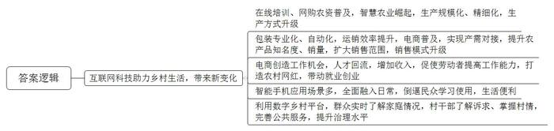
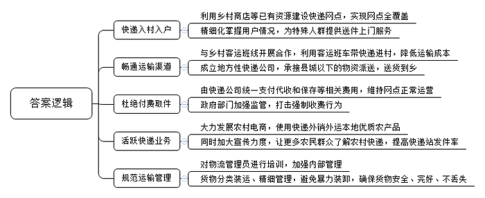
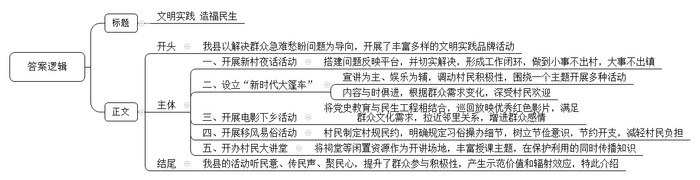
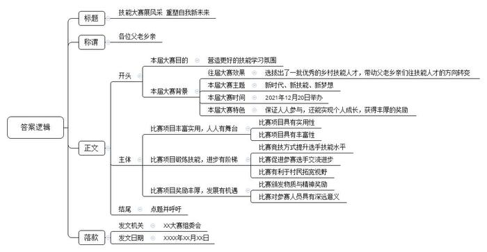

# 2022年江苏省公考《申论》题（C卷）

> 候选采集稿。参考答案及解析来自粉笔页面，不代表官方答案或真实高分答卷；来源使用许可与原卷对应关系仍需人工核实。

## 给定材料

### 材料 material-be035ca664b85a80

这是新的征程，也是新的起点。2021年2月25日16时，北京市朝阳区太阳宫北街1号，“国家乡村振兴局”的牌子正式挂出。此前，“国务院扶贫开发领导小组办公室”的牌子已经摘下，一摘一挂，所体现的正是脱贫攻坚与乡村振兴的有机衔接。

“‘老黄历’管不了新农田”“水是苗的命，也是苗的病”……这段时间，K县高级农艺师老童凭借“硬核知识”成了农户心中的“网红”。在助农网课中，他的许多“金句”获得种田人的“花式点赞”，一堂课下来点击量达13万人次。如果说在线培训、网购农资等是“互联网+农业”的浅层对接，那依托云计算、大数据、物联网等新技术崛起的智慧农业则是两者的深度融合。“你看，我们基地上万亩田地的耕作层深度、有无重复耕作和漏耕的情况一目了然。”K县农业科技发展有限公司负责人老班打开手机上的“大田物联APP”说。他们的田间都装有物联网设备，可以随时监测田地的土壤温度、湿度、光照度以及农作物长势等，科学种田在今天有了新的内涵。

L镇是有名的苹果种植基地，果子因“丑”起名，表皮粗糙且果皮长得极不规则，但香脆可口、甜度高，深受市场欢迎。今年由于雨水少，苹果的果径普遍偏小，但种植户老廖对此并不担心，老寥说：“家里种了近600颗苹果树，今年果子小是小了点，但一点也不愁卖，村里的小何早就以2.2元一斤的价格把我的果子全包了。”小何是当地最大的苹果收购商和经销商。每年丰收季一到，小何就没日没夜地盯在果园里，苹果一摘下就被装进了“加硬加厚”的包装箱里，还有专门定制的“包装卡座”和加厚的泡沫。他还花大价钱建起了标准化仓库，引进了自动分拣包装流水线，大大提升了运销效率。小何说，最忙的时候，光打包的工人就有100多位，人均工资每天200元左右。今年，他经营的网店已“拼”出10万多单苹果，复购率一直保持在60%左右。现在，他每天都要收购10多万斤苹果。在当地，像小何这样的电商从业者，每天穿梭于各个农产品基地；他们通过“源头分级、产地直发”等模式，将零散的市场需求和产地货源直接相连；他们带去了现金补贴、万人拼团等一系列平台扶持资源，帮助农户们卖得多、卖得远、卖得好。据悉，在K县的一些农产品生产重镇，电商销售的比重已达50%，百姓熟悉的传统行业，正呈现出一派新气象。

### 材料 material-b4da1d317cfa78cf

近日，D县乡村振兴局接到群众反映，快递到乡镇很顺畅，但再往村里送却遇到了阻碍，受限于各种原因，快递包裹常常在乡镇止步，老百姓遭遇“快递进村难”。为此，D县乡村振兴局组织专人进行了走访调研，并召开座谈会，参加座谈会的有村干部、村民代表、快递从业人员等。以下是调研座谈会的部分发言记录：

村干部小陈：我们周边20多个村组，只有一两个村设有快递点，很多快递包裹需要村民自己到乡镇去取，取一次包裹非常麻烦。遇到农忙时节，村民们根本抽不出时间去镇上取包裹。镇上快递代收点的物流量很大，没有及时领取的包裹很容易丢失。

村民陆大姐：我们村离镇上有40多公里，快递送不过来，大家只能去镇上取包裹。有些经常往返村镇之间的司机会帮忙取快递，但每件要收取5至10元的费用。还有些司机取了包裹后寄存在村里的小卖店，小卖店还要收一笔保管费。这样层层加价下来，有时一件快递的物流费用比买东西花的钱都多。

村民老刘：我常年在外务工，有时会网购一些生活用品给留守家中的老人和小孩，由于村中没有快递站点，我给他们买的东西经常无法及时送达。老人腿脚不便，也不懂取件码这些东西，取快递存在较大困难，请邻居代为取件也不是长久之计。

村民吴大哥：近两年随着包裹数量增加，村里也建起了代收点，但普遍需要付费。一次，我得知快递已送到镇上，便赶到快递站去取，没想到工作人员却告知我必须到村代收点付费收取。我都到快递站了，还要我回村里才能取包裹，他们就是为了赚这笔钱，这不是强制收费吗？

某镇快递站站长老谢：我所在的快递站连公司规定发件率的20%都无法完成，加之派件收费较低，送件入村很不划算，所以只要是寄往农村的快递，都是通知收件人自行来取。

村民老杨：从镇上到村里的物流，由于缺乏统一管理，经常把包裹和化肥等货物一同装车，包裹被压坏、摔坏甚至丢失都是常有的事。有一次，装化肥的口袋漏了，我给孩子网购的饼干都混在了化肥里，你说，那饼干我还敢给孩子吃吗？

某快递公司毛经理：其实，咱们县乡村出产葡萄、蔬菜等优质农产品，但多数农民还不善于使用快递外销外运农产品。如果村民能够用快递物流运输，就可以改变目前物流主要是送货单向物流的现状。希望政府广泛宣传，让更多农民群众了解和使用快递，只有货件货源多起来，快递业务才能在广大农村活跃起来。

某乡村小卖店张老板：我家小店很愿意做村快递点的，在村里开店十几年了，村里家家户户的情况我都熟悉，谁家来寄个包裹、收个快递啥的，我一定会搞得清清楚楚，大家来来往往，也可以为小店带来不少人气。人气上来了，快递服务的成本也就降下来了！

农家乐服务员小谭：我娘家在R县，因为乡村客运班线发达，县里就和客运班线开展合作，利用客运班车捎带快递进村。另外，他们还有县城内的专业快递公司，专门承接顺丰等其他快递公司到县城以后的物资派送，送货到乡，深受百姓欢迎。

### 材料 material-29956675cdac93e0

近年来，Q县新时代文明实践中心以解决群众急难愁盼问题为导向，开展了丰富多样的文明实践品牌活动。

“‘新村夜话’好，赛过找领导，七嘴八舌提建议，文明实践效率高。”这是H镇村民在自创的快板节目中对“新村夜话”活动的由衷赞叹。85岁的钟大爷指着整修一新的村史馆说：“你看，这就是我之前在‘新村夜话’提建议的成果。”如今，修缮一新的村史馆每年都能吸引众多游客前来参观。返乡青年小夏看着新扩建的养鸡场，也是喜上眉梢。小夏的家庭农场年养殖1万多只土鸡，他不愁销路，最愁的就是没有扩大养殖的场地，在上个月的“新村夜话”中，小夏说出了自己的烦恼。在镇村领导的关心协调下，养殖场扩建用地问题很快得以解决。“‘新村夜话’就是灵，这下，我就可以放手大干了！”小夏说。H镇负责人介绍说：“‘新村夜话’是我们精心打造的文明实践品牌。对群众反映的问题，我们形成了‘一夜话一销号，一月一汇总’的工作闭环，营造了‘小事不出村，大事不出镇’的乡村氛围。”据悉，今年1月到现在，H镇共选出6个夜话示范村，组织开展了52场夜话活动，参与群众达5000余人次。

车里车外印有金句、读书角各类书籍随意翻阅、车载电视播放文明宣传视频……这样的“新时代大篷车”每天在M镇大街小巷来回穿梭，成为一道流动的风景。到了傍晚时分，“大篷车”就变身为“小舞台”，拉开了表演的帷幕，“各位大娘大姐，咱们的广场舞培训差不多了，大家听我讲讲乡村振兴政策，等会儿还有一场精彩的戏曲演出。”这是该镇“新时代大篷车”文明实践活动中的寻常一幕。“新时代大篷车”以宣讲为主、娱乐为辅，按照“文娱活动开场热身+主讲人围绕主题开讲+引导组织群众谈想法感悟+其他文娱活动收尾”顺序组织开展活动，形成了“一个主题+多种活动”的“新时代大篷车”，套餐的内容与时俱进，根据群众的需求而不断变化，深受村民的欢迎。

“听说晚上村头有电影看，我带孩子们来凑凑热闹。”Y镇黄湖村黄大爷吃过晚饭，带着两个孙子早早来到村头，等候电影开始。摆桌子、调音响、挂影布……放映员动作麻利，不一会儿，红色电影《建党伟业》的片头就出现在了影布上。新时代文明实践中心送电影下乡活动在Y镇家喻户晓，每到送影下乡的日子，村民们便早早地等候在放映现场。他们或站、或坐、或蹲，在享受电影带来快乐的同时，也拉近了邻里关系，增进了彼此之间的感情。今年以来，Y镇将党史学习教育与民生工程相结合，精心挑选了《建党伟业》《开国大典》《我和我的祖国》《长津湖》等十多部优秀红色影片，在全镇14个村巡回放映，让广大村民足不出户就能享受电影文化大餐，村民们直呼过瘾。

岭头节是Q县无为村一带的民间传统节庆，“吃岭头”是多年承袭下来的风俗习惯，每年农历八九月，无为村节日氛围浓厚，但大操大办的习俗也给村民们带来了沉重的负担。“以前过节，我们要办50桌以上的酒席。每次办完酒席后，一家人都要为‘钱袋子’发愁。”村民老荣说。为解决“吃岭头”大操大办、相互攀比、大吃大喝等问题，村民们共同商议制定了“拉黑约定”“文明积分”等一批村规民约，酒席的规模、礼金金额、办理天数等都有了明确规定。“有了约定，各家各户都知道克制了”，老荣感慨地说。据统计，仅此一项，每年村里节约开支40多万元。

祠堂变讲堂，老树开新花。一扇屏风、一张条桌、几十把矮凳，整齐摆放在四水归堂的天井下，村民们有序落座，授课人侃侃而谈，上面说得认真，这下面听得仔细……一场生动有趣的党课正在平章村老祠堂里开讲。平章祠堂，始建于乾隆年间，至今已有近300年历史，因故曾一度闲置。如何让闲置的祠堂“复活”，既能保护好，还能利用好？平章村党总支陈书记思来想去，决定把村民大讲堂搬过来。随着大讲堂的开讲，前来听课的村民一次比一次多，授课的主题也越来越广泛，有说茶叶种植的，还有宣传惠民政策的……一到开课，村民们便早早来到现场等候，大家济济一堂。看到沉寂多年的老祠堂重新焕发生机，70岁的平章村老支书刘大爷比谁都开心，“我回回都来，一堂课都没落下，这老祠堂好久没这么热闹了。”

Q县新时代文明实践活动听民意、传民声、聚民心，提升了百姓参与文明实践的积极性，形成了示范价值，产生了良好的辐射效应。Q县新时代文明实践活动声名远播，吸引了包括E县在内的不少周边区县前来学习取经。

### 材料 material-ec420f52095a641c

2020年12月20日，H县杨安镇举办了第一届乡村技能大赛，以下是比赛现场实录：

剪影一：“宝贝，快来，小熊在等你一起玩呢！”选手小梁一边挥动手上的玩偶小熊，一边用呼喊声吸引宝宝，帮助宝宝练习爬行。在育婴员比赛区，选手们正在参加不同场景下对婴幼儿进行日常照料、护理和辅助成长的项目比赛。“宝贝真乖，舒服吧，我们来揉揉小肚肚。”在小梁旁边，选手小祝正在给小宝宝进行按摩，“这对参赛选手的育婴知识水平和育婴服务技能都是不小的考验。”裁判员老丁介绍说。在养老护理员比赛区，选手们正在帮老人铺设床铺、调整轮椅、给老人喂饭、帮老人按摩等。“育婴员和养老护理员都是市场需求量较大但人才供给较少的热门职业，也是省市乡村技能培训的重点内容。”大赛组委会小储介绍，“本届大赛中设置这两个比赛项目，既切合乡村实际又紧贴市场需求。”

剪影二：在电子商务项目比赛区，选手们正在努力推介当地的羊肉、苹果、大枣等土特产品，裁判员在一旁仔细观看、认真记录。“电子商务在乡村振兴中扮演着越来越重要的角色，需要更多的专业人才加入。”大赛组委会老李说，“本次比赛设置电子商务项目竞技，为我镇搭建了一个乡村电子商务人才切磋的平台。”

剪影三：“羊肉要肥瘦相间，烤完外焦里嫩、有热度有香味，吃着口感好、不柴。”中式烹饪师（羊肉烘烤）项目裁判员老夏一边向记者介绍，一边仔细观察参赛选手小赵的操作。小赵和他的妻子小吕都报名参加了本次比赛，和小赵不同的是，小吕参加了餐厅服务员的比赛。“我们夫妻俩在村里开了一家农家乐餐厅。”小吕说，“来报名参赛，一是想来见见世面，二是想结交一些同样经营农家乐的志同道合的朋友。”“在本次技能大赛中，我们设置了中式烹饪师（羊肉烘烤）项目。过去中式烹饪师比赛都是以制作八大菜系为主，新项目既突出了我们杨安镇的羊肉饮食特色，也顺应了当前年轻人消费的新趋势。”大赛组委会小乔介绍说。

剪影四：樱桃树冬季修剪比赛区，选手们正在进行修剪作业。他们通过抽签编号，确定了实际操作工位，一人两棵树，动作敏捷，修剪精准，H县高级农艺师老蔺作为裁判员在一旁仔细观察。“我重点关注的是选手们修剪樱桃树的关键技术。”老蔺说，“樱桃产业是我们杨安镇的支柱产业，希望通过本次比赛，能提高参赛人员樱桃树修剪的实操水平，夯实我镇樱桃产业可持续发展的人才基础。”

通过举办第一届乡村技能大赛，杨安镇从全镇农业家庭户籍人员中选拔了一批优秀的乡村技能人才，起到了良好的示范效应。为巩固第一届大赛的成果，进一步掀起全镇村民技能学习的热潮，带动和鼓励更多村民向技能人才迈进，杨安镇决定于2021年12月20日举办以“新时代、新技能、新梦想”为主题的第二届乡村技能大赛，大赛在即，记者前往大赛组委会进行了采访。

第二届乡村技能大赛组委会主任、杨安镇党委蔡书记在接受记者采访时表示，“相对于第一届比赛，第二届大赛的最大亮点是，获得各比赛项目前3名的选手经报请县人社局核准后，将被授予‘全县乡村技术能手’称号，并颁发证书和奖金。此外，我们还会协调安排意向企业对接获奖选手，为获奖选手提供后续的项目支持和资金保障。”

记者从杨安镇第二届乡村技能大赛组委会了解到，大赛聚焦农村实用型技能，设立了果树修剪、乡村养老护理员、育婴员、电子商务师、中式烹饪师、砌筑工、无人机驾驶等15个比赛项目，比第一届增加了5个项目，目前，大赛的各项筹备工作正在紧锣密鼓地进行中。

## 题目

### 第 1 题

**“****给定资料**1**\-**3**”****呈现了互联网科技给农村生产生活带来的新变化，请用一段话对此加以归纳概括****。****（****15分）**

关联材料：material-be035ca664b85a80、material-b4da1d317cfa78cf、material-29956675cdac93e0、material-ec420f52095a641c

作答要求：

要求：紧扣给定资料，准确全面。条理清晰，语言通顺。篇幅不超过250字。

### 第 2 题

**假如你是****D县乡村振兴局的一名工作人员，参加了****“****给定资料**4**”****中的调研座谈会，请就解决座谈会中群众反映的****“****快递进村难****”****问题，提出对策建议。（****20分）**

关联材料：material-be035ca664b85a80、material-b4da1d317cfa78cf、material-29956675cdac93e0、material-ec420f52095a641c

作答要求：

要求：全面具体，条理清晰，有针对性、可行性。篇幅350字左右。

### 第 3 题

**E县相关部门决定来Q县考察学习文明实践品牌活动经验，假如你是Q县新时代文明实践中心的一名工作人员，受领导指派做经验介绍****。****请根据****“****给定资料**5**”****拟写一份经验介绍提纲****。****（****25分）**

关联材料：material-be035ca664b85a80、material-b4da1d317cfa78cf、material-29956675cdac93e0、material-ec420f52095a641c

作答要求：

要求：内容全面，重点突出，条理清晰。篇幅350字左右。

### 第 4 题

**假如你是****“****给定资料**6**”****中杨安镇的一名工作人员，为宣传发动群众积极报名参加第二届乡村技能大赛，请你以大赛组委会的名义，给全镇村民写一封公开信****。****（****40分）**

关联材料：material-be035ca664b85a80、material-b4da1d317cfa78cf、material-29956675cdac93e0、material-ec420f52095a641c

作答要求：

要求：

（1）自选角度，自拟标题；

（2）结合给定资料，不拘于给定资料；

（3）内容充实，结构完整，语言流畅，有感召力；

（4）篇幅1000字左右。

## 答案与解析

第 1 题

**参考答案（粉笔题库参考内容）**

互联网科技助力乡村生活，带来新变化：在线培训、网购农资普及，智慧农业崛起，生产规模化、精细化，生产方式升级；包装专业化、自动化，运销效率提升，电商普及，实现产需对接，提升农产品知名度、销量，扩大销售范围，销售模式升级；电商创造工作机会，人才回流，增加收入，促使劳动者提高工作能力，打造农村网红，带动就业创业；智能手机应用场景多，全面融入日常，倒逼民众学习使用，生活便利；利用数字乡村平台，群众实时了解家庭情况，村干部了解诉求、掌握村情，完善公共服务，提升治理水平。

**解析**

**参考答案说明：**本参考答案按照“总结性引导语+互联网科技对农村生产生活带来的新变化”，具体从“农业生产方式”“农产品销售模式”“电商创业就业”“生活便利”和“乡村治理”五个方面展开，各条答案要点之间在内容上相互并列，没有交叉，并且整体以“一段话”的形式来呈现，符合题目要求。

**考点**：考点变化类

**来源**：来源2022年江苏省公考《申论》题（C卷）

粉笔申论页面对本题只提供「解析视频」入口，该入口是会员推广位，页面无视频地址与文字解析。

第 2 题

**参考答案（粉笔题库参考内容）**

1.快递入村入户。利用乡村商店等已有资源建设快递网点，实现网点全覆盖；精细化掌握用户情况，为特殊人群提供送件上门服务。

2.畅通运输渠道。与乡村客运班线开展合作，利用客运班车带快递进村，降低运输成本；成立地方性快递公司，承接县城以下的物资派送，送货到乡。

3.杜绝付费取件。由快递公司统一支付代收和保存等相关费用，维持网点正常运营；政府部门加强监管，打击强制收费行为。

4.活跃快递业务。大力发展农村电商，使用快递外销外运本地优质农产品，同时加大宣传力度，让更多农民群众了解农村快递，提高快递站发件率。

5.规范运输管理。对物流管理员进行培训，加强内部管理；货物分类装运、精细管理，避免暴力装卸，确保货物安全、完好、不丢失。

**解析**

**参考答案说明：**本参考答案从“快递入村入户”“畅通运输渠道”“杜绝付费取件”“活跃快递业务”“规范运输管理”五个方面提出对策建议，进行了分类分条撰写。各条要点彼此独立、没有交叉。

  

**考点**：考点提出对策类

**来源**：来源2022年江苏省公考《申论》题（C卷）

粉笔申论页面对本题只提供「解析视频」入口，该入口是会员推广位，页面无视频地址与文字解析。

第 3 题

**参考答案（粉笔题库参考内容）**

文明实践 造福民生

背景：我县以解决群众急难愁盼问题为导向，开展了丰富多样的文明实践品牌活动。

经验：一、开展新村夜话活动。搭建问题反映平台，并切实解决，形成工作闭环，做到小事不出村，大事不出镇。二、设立“新时代大篷车”。宣讲为主、娱乐为辅，调动村民积极性，围绕一个主题开展多种活动；内容与时俱进，根据群众需求变化，深受村民欢迎。三、开展电影下乡活动。将党史教育与民生工程相结合，巡回放映优秀红色影片，满足群众文化需求，拉近邻里关系，增进群众感情。四、开展移风易俗活动。村民制定村规民约，明确规定习俗操办细节，树立节俭意识，节约开支，减轻村民负担。五、开办村民大讲堂。将祠堂等闲置资源作为开讲场地，丰富授课主题，在保护利用的同时传播知识。

结语：我县的活动听民意、传民声、聚民心，提升了群众参与积极性，产生示范价值和辐射效应，特此介绍。

**解析**

**参考答案说明：**（1）格式方面，本参考答案写到了“标题”“正文”两个部分。（2）正文部分，一方面，从内容上来看，围绕着“文明实践品牌活动”这一主题，本参考答案的开头先写到了“文明实践品牌活动的背景”；主体部分从“开展新村夜话活动”“设立‘新时代大篷车’”“开展电影下乡活动”“开展移风易俗活动”“开办村民大讲堂”等五个方面介绍了具体的经验。另一方面，形式上，本参考答案做到了分段、分条撰写，整体上条理较为清晰。

**考点**：考点总结类

**来源**：来源2022年江苏省公考《申论》题（C卷）

粉笔申论页面对本题只提供「解析视频」入口，该入口是会员推广位，页面无视频地址与文字解析。

第 4 题

**参考答案（粉笔题库参考内容）**

**技能大赛展风采** **重塑****自****我新未来**

各位父老乡亲：

**大家好！****去年，****我们举办了第一届乡村技能大赛，选拔出了一批优秀的乡村技能人才，带动父老乡亲们往技能人才的方向转变。为了营造更好的技能学习氛围，****我们将于****2021年12月20日举办****以****“新时代、新技能、新梦想”为主题的第二届乡村技能大赛****。****本次大赛不仅消除参赛壁垒，保证人人参与，还能实现个人成长，获得丰厚的奖励，希望大家踊跃报名参与****。**

**比赛项目丰富实用，人人有舞台。**本次大赛与其他技能大赛门槛高、比赛难度大的情况不同，我们设计了非常多接地气的比赛项目，与大家的日常生活和咱们镇的生产实际相关。比如，我们设计了养老护理、育儿项目，与家庭生活息息相关；我们还设计了樱桃果木的修剪项目，这是我们镇大多数人必备的生产技能；即使是看似复杂的电子商务、无人机驾驶等项目，咱们镇上的一些年轻人也接受过类似的技能培训，在相关行业中工作。本次比赛几乎做到了镇上职业的全覆盖，无论你擅长哪一方面，都能够在本次大赛中找到适合自己的项目，尽情展示自我风采。

**比赛项目锻炼技能，进步有阶梯。**咱们的比赛竞技方式就是在练中考，在考中练，这个过程本身就能提升操作能力，评比的结论还能为后续的努力提供方向。比如在“烤肉串”的比赛项目中，会重点关注选手对时间、温度、火候的控制，自身的不足就会在评比中得到指正。同时，大赛还能为大家提供沟通交流的平台，方便向经验丰富的前辈请教，与想法新颖的后辈沟通，结交志同道合的朋友，实现共同进步。此外，本次大赛还面向全体村民开放，大家可以在闲暇时间来到比赛现场，观看不同类型的比赛，了解新事物，开拓视野，丰富眼界。

**比赛项目奖励丰厚，发展有机遇。**通过大赛的角逐，获得各比赛项目前3名的选手将被授予“全县乡村技术能手”称号，并获得政府部门颁发的荣誉证书和奖金。同时，我们将协调安排意向企业对接获奖选手，为获奖选手提供后续的项目支持和资金保障，增加获奖选手技能的实操机会、学习机会和发展机会，扩宽了优秀人才的后续发展空间，营造双赢局面。

父老乡亲们，让我们一起在技能大赛的舞台上，赛出水平、赛出自我、赛出风采，尽情展现自我吧！

XX大赛组委会

XXXX年XX月XX日

**解析**

**文章****分析**

**技能大赛展风采** **重塑自我新未来**

【**标题的优点：**公开信的标题在内容上突出主题，采取对称式结构，在形式上也颇有亮点。】

各位父老乡亲：

【**称谓的优点：**公开信的称谓定位准确、格式正确。本公开信的发文对象是全体村民，因此称谓可写为：各位父老乡亲。】

大家好！（1）去年，我们举办了第一届乡村技能大赛，选拔出了一批优秀的乡村技能人才，带动父老乡亲们往技能人才的方向转变。（2）为了营造更好的技能学习氛围，我们将于2021年12月20日举办以“新时代、新技能、新梦想”为主题的第二届乡村技能大赛。（3）本次大赛不仅消除参赛壁垒，保证人人参与，还能实现个人成长，获得丰厚的奖励，希望大家踊跃报名参与。

【**开头的优点：**公开信的开头介绍了技能大赛的往届情况与本届背景，并说明了本届大赛的目的、特点。（1）介绍往届技能大赛成果。（2）指出了本届技能大赛的目的、主题。（3）简要说明了本次大赛的特色。】

**比赛项目丰富实用，人人有舞台。**（1）本次大赛与其他技能大赛门槛高、比赛难度大的情况不同，我们设计了非常多接地气的比赛项目，与大家的日常生活和咱们镇的生产实际相关。比如，我们设计了养老护理、育儿项目，与家庭生活息息相关；我们还设计了樱桃果木的修剪项目，这是我们镇大多数人必备的生产技能；即使是看似复杂的电子商务、无人机驾驶等项目，咱们镇上的一些年轻人也接受过类似的技能培训，在相关行业中工作。（2）本次比赛几乎做到了镇上职业的全覆盖，无论你擅长哪一方面，都能够在本次大赛中找到适合自己的项目，尽情展示自我风采。

【**主体部分****1的优点：**★核心句：公开信的核心句是紧扣“乡村技能大赛”这一主题提出的。形式上，它在段首处直接写出，位置突出，容易发现。内容上，关键词突出，内容要点明确，可以明显看出它是从“比赛项目的丰富实用性”这一方面入手，介绍了“技能大赛的特点与作用”。★具体展开：（1）先介绍了“比赛项目具有实用性”；（2）接着介绍了“比赛项目具有丰富性”。注意：以上两个方面的内容都是紧扣“比赛项目丰富实用，人人有舞台”这个核心句进行分析论述的，具体展开的内容针对性强，层次丰富。在具体内容的展开上采用了讲道理、举例子相结合，做到了丰富多样。】

**比赛项目锻炼技能，进步有阶梯。**（1）咱们的比赛竞技方式就是在练中考，在考中练，这个过程本身就能提升操作能力，评比的结论还能为后续的努力提供方向。比如在“烤肉串”的比赛项目中，会重点关注选手对时间、温度、火候的控制，自身的不足就会在评比中得到指正。（2）同时，大赛还能为大家提供沟通交流的平台，方便向经验丰富的前辈请教，与想法新颖的后辈沟通，结交志同道合的朋友，实现共同进步。（3）此外，本次大赛还面向全体村民开放，大家可以在闲暇时间来到比赛现场，观看不同类型的比赛，了解新事物，开拓视野，丰富眼界。

【**主体部分****2****的优点：**★核心句：公开信的核心句是紧扣“乡村技能大赛”这一主题提出的。形式上，它在段首处直接写出，位置突出，容易发现。内容上，关键词突出，内容要点明确，可以明显看出它是从“比赛项目的锻炼技能，促进进步”这一方面入手，介绍了“技能大赛的特点与作用”。★具体展开：（1）先介绍了“比赛竞技方式提升选手技能水平”；（2）接着介绍了“比赛促进参赛选手交流进步”；（3）最后介绍了“比赛有利于村民拓宽视野”。注意：以上三个方面的内容都是紧扣“比赛项目锻炼技能，进步有阶梯”这个核心句进行分析论述的，具体展开的内容针对性强，层次丰富。在具体内容的展开上采用了讲道理、举例子相结合，做到了丰富多样。】

**比赛项目奖励丰厚，发展有机遇。**（1）通过大赛的角逐，获得各比赛项目前3名的选手将被授予“全县乡村技术能手”称号，并获得政府部门颁发的荣誉证书和奖金。（2）同时，我们将协调安排意向企业对接获奖选手，为获奖选手提供后续的项目支持和资金保障，增加获奖选手技能的实操机会、学习机会和发展机会，扩宽了优秀人才的后续发展空间，营造双赢局面。

【**主体部分****3****的优点：**★核心句：公开信的核心句是紧扣“乡村技能大赛”这一主题提出的。形式上，它在段首处直接写出，位置突出，容易发现。内容上，关键词突出，内容要点明确，可以明显看出它是从“比赛的奖励机制”这一方面入手，介绍了“技能大赛的特点”。★具体展开：（1）先介绍了“比赛颁发物质与精神奖励”；（2）接着介绍了“比赛对参赛人员具有深远意义”。注意：以上两个方面的内容都是紧扣“比赛项目奖励丰厚，发展有机遇”这个核心句进行分析论述的，具体展开的内容针对性强，层次丰富。在具体内容的展开上采用了讲道理、举例子相结合，做到了丰富多样。】

父老乡亲们，让我们一起在技能大赛的舞台上，赛出水平、赛出自我、赛出风采，尽情展现自我吧！

【**结尾的优点**：公开信的结尾回扣了“乡村技能大赛”这一主题。发出了呼吁，动员群众积极参赛。】

XX大赛组委会

XXXX年XX月XX日

【**落款的优点：**公开信的落款定位准确、格式正确。本公开信的发文机关是大赛组委会，因此落款可写为：XX大赛组委会；再加上日期：XXXX年XX月XX日。】

  
  

**考点**：考点宣传类

**来源**：来源2022年江苏省公考《申论》题（C卷）

粉笔申论页面对本题只提供「解析视频」入口，该入口是会员推广位，页面无视频地址与文字解析。

