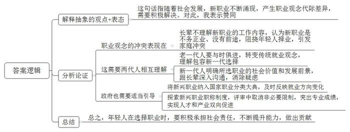
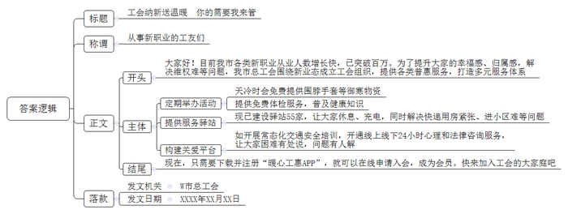
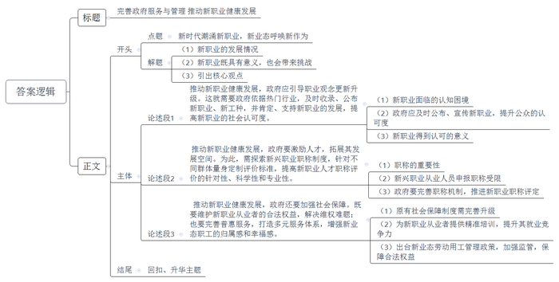

# 2022年江苏省公考《申论》题（A、普通选调卷）

> 候选采集稿。参考答案及解析来自粉笔页面，不代表官方答案或真实高分答卷；来源使用许可与原卷对应关系仍需人工核实。

## 给定材料

### 材料 material-975ae8041499c3db

新时代带来新生活，新生活潮涌新职业。进入新时代以来，社会发展一日千里，基层面貌日新月异，一些此前从未听说过的新职业、新人群在我们的生活中不断涌现，并渐成常态。这些“后浪”新职业所引领的新业态既是社会发展的新气象、新希望，也对政府服务提出了新要求、新挑战。

一身“蓝骑士”套装，身披绶带，满面笑容，2021年4月27日，来自S市的外卖骑手小宋在人民大会堂郑重接下“全国五一劳动奖章”和证书，成为首位获此殊荣的外卖骑手。“兴奋、激动，为自己身为一名外卖骑手而自豪！”小宋的高兴藏也藏不住。

2014年，为了与妻子团聚，小宋来到S市打拼。谈起最初选择外卖工作的理由，小宋说，“我要找一份收入稳定，能快速了解、融入这座国际化大城市的工作。”然而要熟悉这座超大城市，并没有小宋想象中那么简单。不熟悉交通路线，总有送餐延误的时候，甚至免不了被客户打个差评；遇到暴雨大风等极端天气，送餐途中必须格外小心。一次，他接了一份披萨订单，由于商家没有给披萨密封，送达时已经凉透了。“客人不满意，我内心也很愧疚。”思来想去，第二天小宋买了个毛绒玩具作为礼物向客人道歉，得到了对方的谅解。

抱着“既然做了就一定要做好”的决心，小宋克服了一个个困难。不熟悉交通路线，他就利用休息时间反复研究区域道路；商务楼电梯等不及，他就靠爬楼梯节约时间；碰到客户心情不好，他总能将心比心及时化解尴尬。凭着这股劲，仅用了8个月，小宋就从一名骑手被破格提升为凯旋路配送站的站长。站长的要求更高，既要懂配送，也要会规划，能够处理好站点关于调度、客户纠纷、骑手意外事故等方面的问题。小宋曾在暴雨天给骑手送电瓶，曾在阴雨天和严寒时，熬上一锅红糖姜茶送到骑手休息的地铁站……如今，小宋又从站长晋升为物流经理，主要从事骑手及站长的培训工作。截至目前，小宋已培训超过400名骑手，每月还举办“站长班”，把站点管理经验传授给更多站长。

在小宋眼中，外卖骑手这个职业在社会中的作用越来越重要了，不仅是给客户送餐，还能在基础物资保障、城市发展，甚至社会稳定方面发挥重要作用。在新冠肺炎疫情防控中，小宋和其他外卖骑手就发挥了独特作用。面对骤然增加的配送需求，当时已成为站点负责人的他，重返一线骑手岗位，主动揽下医院、隔离点等高风险场所的送餐任务，还自掏腰包，给站点的骑手们配备了5000只口罩。作为首位获得“全国五一劳动奖章”的外卖骑手，小宋说：“这不仅是我个人的荣誉，更是属于数百万每日奔波在路上的外卖骑手群体的荣誉，我要用更好的服务回馈社会，让这个行业得到更多的社会认可。”

### 材料 material-06a517f4377d7062

三百六十行，行行出状元。新职业的不断出现也在呼唤传统就业观念的升级。

11月7日凌晨，在冰岛举行的2021英雄联盟全球总决赛中，代表中国LPL赛区出战的EDG战队夺冠，战报传来，全网沸腾。央视新闻在第一时间给予了祝贺。

以下是几个网友的发言。

网友A：央视新闻第一时间发文祝贺，太牛了！短短半小时，点赞数量就超过了180万，不得不说，EDG真的太有排面了！

网友B：我哭了，我哭的不是EDG夺冠，而是久久不被承认的自己。今天，激动也好、流泪也好，全社会对待电子竞技应有一个理性的认知了。

网友C：不得了，我们大学宿舍出现了“喊楼”的壮观场面。

J省某职业学院电子竞技运动与管理专业2019级学生小胡是众多狂欢者中的一员。对小胡来说，EDG的这场胜利特别重要，从此他要大声地对家人说，他所学习和将要从事的，不是“难登大雅之堂”的游戏了，而是正经的职业了。

小胡高中时在一所重点中学就读，高二开始接触王者荣耀，巅峰时能打到全国前100名左右。那个时候的他特别自信，特别有执念，想走职业的路子，但是家里并不看好他，小胡的父亲是一所中学的历史老师，一心希望儿子能考上一所985大学，他觉得以儿子的资质将来在事业上一定能超过自己。“打游戏不就是玩吗？这能有什么前途，我看就是不务正业！说出去我都觉得丢人！”听了小胡的想法后，老胡火气很大。那段时间老胡整天虎着脸，小胡也提不起学习的兴趣，最后，高考和电竞两头都落空了，高考分数只够得上现在的职业学院。职院就职院吧，在专业选择上父子俩又爆发了冲突，老胡希望儿子选财会专业或者经济管理专业，小胡却只肯报电竞专业，谁说也不让步。这回老胡对儿子彻底失望了，甚至连开学报到都拒绝送儿子去。

上了职业学院后，随着专业学习的不断深入，小胡对电竞有了更新的认识，“可能会让大家有点意外，现在我打王者荣耀的时间其实少之又少，已经很少单纯为了玩而玩了，更多时候是为校队比赛做一些集中训练，至于学校里电子竞技的实训课，也只是为了熟悉各款游戏运营方面的课程，比如营销、解说、直播、数据分析等等。”

今年暑假，小胡得到了一个去电竞俱乐部当夏令营助教的机会。夏令营里基本都是中学生，不少人也和曾经的小胡一样抱着打职业赛事的梦想。有一个学习成绩和电竞技术都挺不错的孩子，在体验了3天的职业选手生活后，跟小胡说：“可能这个行业并不是特别适合我。”这让小胡很触动，这孩子是一个天赋型的选手，但因为性格原因经常与教练和队友发生冲突，很难协作。“职业竞技跟打游戏完全是两回事，不仅需要天赋和苦练，还需要良好的心态和沟通能力。”做助教的这段经历让小胡思考了很多，“今后我想做电竞教育，让喜欢电竞的一些孩子在人生的关键阶段能够明确自己该怎么选择。不过今晚，我首先要跟我爸谈谈，我要告诉他，我所选择的，也是个有社会价值、有未来的职业。”

社会飞速发展，职业的内涵在不断延伸。当你问一个新职业人的父母，“您的孩子做什么职业”时，他们常常语焉不详，甚至羞于启齿。对于职业发展，N大学社会管理学院陈教授说：“老一代有老一代的经验，新一代有新一代的兴趣，在鲜活的时代画板上，社会成员间的互相理解与政府的适当引导往往是最好的调色剂。”不管老一辈理解不理解，电竞这个行业是实实在在发展起来了。据《2021年中国电竞行业研究报告》，电竞市场规模预计到2022年将增长至1843.3亿元。此次EDG夺冠引发的热潮将加速中国电竞产业的发展。近日，2022杭州亚运会组委会官宣，包括英雄联盟、王者荣耀（亚运版）等8个电竞小项加入亚运会正式竞赛项目，这表明电子竞技进一步得到行业认可，小胡们的未来真不是梦。

### 材料 material-4cf27ffb5eab87c8

“瞧，这是工会给我们免费提供的围脖和手套，赶上这大冷天真是太实用了！”这几天，W市高新区快递小哥小田逢人就念叨加入工会的好处，小田是11月初加入到工会组织中。今年以来，W市总工会针对新业态职工增长快、权益维护难等情况，力推新就业形态建会入会工作，在网约车司机、快递员、网约送餐员等群体成立工会组织35家，吸纳工会会员2563人。

“您下载并注册‘暖心工惠APP’，就可以在线申请网上入会，成为工会会员后就能参加我们定期组织的各项活动。”11月27日上午，在W市人才交流中心广场，市总工会工作人员正在进行“招新”宣传。这里是W市“工会进万家·新就业形态劳动者温暖行动”服务月工作推进会现场，会上发布总工会面向新业态从业人员开展的一系列服务活动，包含为新业态从业人员送出8000个体检名额、合计200万元的体检服务在内的线上线下两大活动和六大类二十个服务项目，重点聚焦快递员、外卖配送员、网约车司机等新就业群体开展服务活动。活动现场，参加义诊的市人民医院医务人员正在为顺丰快递员小张测量血压，小张表示：“快递员工作经常早出晚归，吃饭没个准点，这次活动给我们普及健康知识，给身体提个醒，真是太重要了。”

“现在天越来越冷，不忙的时候我们都会到就近的驿站喝喝水，歇歇脚，充充电，感觉很暖心。”最近寒潮来袭，位于W市中心的几家工会服务驿站比往常热闹了许多，送餐间隙，这里成为了网约送餐员和快递小哥们的“避风港”。近年来，W市总工会整合社区党群服务中心、网格服务站、物业用房，联建共建快递小哥服务驿站55家，解决了快递末端用房紧张、快递员进小区难等问题。针对新业态工作特点，市总工会常态化开展交通安全培训，开通线上线下24小时心理和法律咨询服务，为新就业形态群体构建了“困难有处说，问题有人解”的关爱平台。

“哪里有职工，哪里就有工会组织。”W市总工会严主席说，“新职业群体以灵活就业为主，数量庞大，目前仅W市就有100多万人，其中许多人对工会的职能、意义缺乏了解，这给我们发展新会员带来挑战。”为最大限度地将灵活就业人员组织到工会中来，W市总工会在新业态职工中广泛开展政策咨询、技能培训、劳动权益维护等普惠服务，打造出线上线下有机融合、协同互动的多元服务体系，有效提升了新业态职工的归属感、幸福感。

## 题目

### 第 1 题

**“给定资料**1**～**3**中”列举了新时代出现的一些新职业，这些新职业对社会发展起到了一定的积极作用，请用一段话对此进行概括。（2****0****分）**

关联材料：material-975ae8041499c3db

作答要求：

要求：紧扣给定资料，准确全面，条理清晰，语言流畅。篇幅不超过250字。

### 第 2 题

**“给定资料**4**”中说“老一代有老一代的经验，新一代有新一代的兴趣，****在鲜活的时代画板上****，社会成员间的****互相****理解与政府的适当引导往往是最好的调色剂。****”请结合给定****资料**4**、**5**，谈谈你的理解和认识。（2****0****分）**

关联材料：material-06a517f4377d7062

作答要求：

要求：观点正确，分析透彻，篇幅250字左右。

### 第 3 题

**“给定资料**6**”中的W市总工会在新业态群体中发展新会员的工作正在持续推进中，假如你是该总工会一名工作人员，请你为招新工作拟定一份宣传单。（2****0****分）**

关联材料：material-4cf27ffb5eab87c8

作答要求：

要求：符合给定资料情境，有吸引力，操作性强，语言流畅，篇幅350字左右。

### 第 4 题

**请结合****你对****“给定资料**7**”中“如何更好地在变局中开新局，成为政府部门执政能力与管理能力的试金石”这句话的理解，****围绕****“****新时代潮涌新职业，新业态呼唤新作为****”这一主题，联系实际，写一篇对策性文章。（4****0****分）**

关联材料：material-975ae8041499c3db

作答要求：

要求：

（1）自选角度，自拟标题；

（2）参考给定资料，不拘泥于给定资料；

（3）观点明确，内容充实，结构完整，语言流畅；

（4）篇幅1000字左右。

## 答案与解析

第 1 题

**参考答案（粉笔题库参考内容）**

新职业引领的新业态是社会发展的新气象、新希望：外卖员便利群众生活，提供基础物资保障，促进城市发展和社会稳定；网络监督师监督他人自律，使其高效利用时间，提升其效率和信心，满足个性化需求；网上导购师为客户提供购物建议，减少支出，引导其自我约束和理性消费，并提供平等自由的工作模式；社群管理师帮助企业维持用户活跃度，增强粘性，满足特定群体就业需求；制冰师满足冬奥会等赛事需求，助推国家规划落实，保证场地设施供给，推动群众冰雪运动；助老员提供贴心舒适的养老服务，应对老龄社会，弘扬敬老爱老助老的传统美德。

**解析**

**参考答案说明：**本参考答案按照“总结性引导语+新职业对社会发展起到的积极作用”，具体从“外卖员”“网络监督师”“网上导购师”“社群管理师”“制冰师”“助老员”等六个新职业对社会的积极作用展开，各条答案要点之间在内容上相互并列，没有交叉，并以一段话的形式进行呈现。

**考点**：考点影响类

**来源**：来源2022年江苏省公考《申论》题（A、普通选调卷）

粉笔申论页面对本题只提供「解析视频」入口，该入口是会员推广位，页面无视频地址与文字解析。

第 2 题

**参考答案（粉笔题库参考内容）**

这句话指随着社会发展，新职业不断涌现，产生职业观念代际差异，需要积极解决。对此，我表示赞同。

1.职业观念的冲突表现在：长辈不理解新职业的工作内容，认为新职业是不务正业、没有前途，阻挠年轻人择业，引发家庭冲突。

2.这需要两代人相互理解：老一代人要与时俱进，转变传统就业观念，理解包容新一代选择；新一代人明确所选职业的社会价值和发展前景，跟长辈深入沟通，消除疑虑。

3.政府也需要适当引导：将新兴职业纳入国家职业分类大典，及时反映就业方向变化；探索新兴职业职称制度，评审中取消非必要限制，突出专业成绩，实现人才和产业双向促进。

总之，年轻人在选择职业时，要积极承担社会责任，不断提升能力，做出贡献。

**解析**

**参考答案说明：**（1）思路方面，本参考答案按照“解释抽象的观点、现象+表态+分析论证+总结”的答题思路展开。（2）内容方面，首先对观点句子进行解释与表态；接着“分析论证”部分，从“两代人的职业观念冲突”“两代人需要相互理解”“政府需要适当引导”三个方面分别进行分析；最后在“总结”部分，结合全篇材料与考情，自行补充了对策。（3）词句表达方面，本参考答案加上了“总之”等连接词来承接上下文。

**考点**：考点观点现象分析类

**来源**：来源2022年江苏省公考《申论》题（A、普通选调卷）

粉笔申论页面对本题只提供「解析视频」入口，该入口是会员推广位，页面无视频地址与文字解析。

第 3 题

**参考答案（粉笔题库参考内容）**

工会纳新送温暖 你的需要我来管

从事新职业的工友们：

大家好！目前我市各类新职业从业人数增长快，已突破百万。为了提升大家的幸福感、归属感，解决维权难等问题，我市总工会围绕新业态成立工会组织，提供各类普惠服务，打造多元服务体系。工会的具体服务内容包括：

一、定期举办活动。比如，天冷时会免费提供围脖手套等御寒物资；提供免费体检服务，普及健康知识。二、提供服务驿站。现已建设驿站55家，让大家休息、充电，同时解决快递用房紧张、进小区难等问题。三、构建关爱平台。如开展常态化交通安全培训，开通线上线下24小时心理和法律咨询服务，让大家困难有处说，问题有人解。

现在，只需要下载并注册“暖心工惠APP”，就可以在线申请入会，成为会员。快来加入工会的大家庭吧！

W市总工会

XXXX年XX月XX日

**解析**

**参考答案说明：**（1）格式方面，本参考答案写到了“标题”“称谓”“正文”“落款”四个部分。（2）正文部分，一方面从内容上来看，围绕“工会招新”这一主题，本参考答案的开头先写到了“工会成立的背景、意义，工会的职能等”；主体部分从“定期举办活动”“提供服务驿站”“构建关爱平台”这三个方面介绍了工会提供的具体服务；结尾介绍了入会方式，并邀请新业态群体加入。另一方面，形式上，本参考答案做到了分段、分条撰写，整体上条理较为清晰。

**考点**：考点宣传类

**来源**：来源2022年江苏省公考《申论》题（A、普通选调卷）

粉笔申论页面对本题只提供「解析视频」入口，该入口是会员推广位，页面无视频地址与文字解析。

第 4 题

**参考答案（粉笔题库参考内容）**

**完善政府服务与管理** **推动新职业健康发展**

穿梭于城市街头巷尾的“蓝骑士”，电脑屏幕前与陌生网友“侃大山”的管理师，陪伴在年迈老人身边的助老员……当下，各类新兴职业层见叠出，可以说是中国新业态蓬勃发展的真实写照。然而，它给社会发展带来新气象、新希望的同时，也给政府提出了新要求、新挑战。因此，政府需要在变局中开新局，加强管理力度，拓宽服务宽度，主动作为，积极创新，助推新职业健康发展。

**推动新职业健康发展，政府应引导职业观念更新升级。这就需要政府依据热门行业，及时收录、公布新职业、新工种，并肯定、支持新职业的发展，提高新职业的社会认可度。**新职业的快速兴起，让不少思想保守的人一时无法接受，甚至对于部分新职业羞于启齿。正因如此，政府需要为新职业、新工种“正名”，及时向社会公布权威职业名录，颁布职业分类大典，更新职业岗位信息。除此之外，也要宣传普及新职业的贡献率、社会价值以及未来的发展前景，提高公众对其的认知与了解。唯有如此，才能让更多人接纳新工种、新职业、新业态，让我们的就业市场呈现百花齐放之姿。

**推动新职业健康发展，政府要激励人才，拓展其发展空间。为此，需探索新兴职业职称制度，针对不同群体量身定制评价标准，提高新职业人才职称评价的针对性、科学性和专业性。**职称是评价人才、推动产业发展的“指挥棒”。然而，新兴职业从业人员普遍面临职称申报无门的窘境。对此，一方面，政府要尊重新职业特点，制定职称分类细则，让每一个新职业就业者有职称可评，从而激发工作积极性、创造性。另一方面，也要完善评价内容，弱化学历、资历等要求，突出人才在专业领域取得的业绩、成果和行业认可度，避免职称评价“一刀切”。

**推动新职业健康发展，政府还要加强社会保障。既要维护新职业从业者的合法权益，解决维权难题****，****也要完善普惠服务，打造多元服务体系，增强新业态职工的归属感和幸福感。**当下，不少新职业的就业形式打破了时间和空间的限制，原本的社会保障制度也需就此完善升级。例如，政府可以结合传统培训与数字培训方式，为希望从事新职业的劳动者提供精准培训，提高其就业竞争力。此外，政府也需尽快出台新业态劳动用工管理政策，规范新职业的劳务报酬、社会保险、工时休假等，并通过加强行业监管，严惩侵犯新职业从业者权益的行为，保障其合法权益。

新职业是中国产业升级的产物。作为人民的服务者，政府要持续作为，让新职业成为推动发展、改善民生的新动能，让更多新职业从业者在各自的就业岗位上实现自我价值，大放异彩！

**解析**

**文章分析**

**完善政府服务与管理** **推动新职业健康发展**

【**标题的优点：**标题中含有主题词，使文章主题更突出、清晰。其次，标题在形式上采用对称式结构，使标题更有亮点。】

（1）穿梭于城市街头巷尾的“蓝骑士”，电脑屏幕前与陌生网友“侃大山”的管理师，陪伴在年迈老人身边的助老员……当下，各类新兴职业层见叠出，可以说是中国新业态蓬勃发展的真实写照。（2）然而，它给社会发展带来新气象、新希望的同时，也给政府提出了新要求、新挑战。（3）因此，政府需要在变局中开新局，加强管理力度，拓宽服务宽度，主动作为，积极创新，助推新职业健康发展。

【**开头的优点：**★内容方面。范文的开头是紧扣题目给定的“新时代潮涌新职业，新业态呼唤新作为”这一主题展开的。首先，通过举例说明新职业的发展情况；其次，指出了新职业给社会发展带来新气象、新希望的同时，也给政府提出了新要求、新挑战；最后，引出核心观点，政府要积极作为，助推新职业健康发展。★文字表达方面。使用了“然而”“因此”等连接词，使语言表达有逻辑性。】

**推动新职业健康发展，政府应引导职业观念更新升级。这就需要政府依据热门行业，及时收录、公布新职业、新工种，并肯定、支持新职业的发展，提高新职业的社会认可度。**（1）新职业的快速兴起，让不少思想保守的人一时无法接受，甚至对于部分新职业羞于启齿。（2）正因如此，政府需要为新职业、新工种“正名”，及时向社会公布权威职业名录，颁布职业分类大典，更新职业岗位信息。除此之外，也要宣传普及新职业的贡献率、社会价值以及未来的发展前景，提高公众对其的认知与了解。（3）唯有如此，才能让更多人接纳新工种、新职业、新业态，让我们的就业市场呈现百花齐放之姿。

【**论述段****1的优点：**★观点句：范文的观点句是紧扣“新时代潮涌新职业，新业态呼唤新作为”这一文章主题提出的。形式上，它在段首处直接写出，位置突出，容易发现。内容上，关键词突出，内容要点明确，可以明显看出主要论述“政府应引导职业观念更新升级”。★论述内容：（1）先指出了新职业面临的认知困境；（2）再阐释了政府应及时公布、宣传新职业，提升公众的认可度；（3）新职业得到认可的意义。注意：以上几个方面的内容都是紧扣“推动新职业健康发展，政府应引导职业观念更新升级。这就需要政府依据热门行业，及时收录、公布新职业、新工种，并肯定、支持新职业的发展，提高新职业的社会认可度”这个观点句进行分析论述的，论述的针对性强，内容层次丰富。在论述方法上主要采用了讲道理的方式，论述清晰透彻。】

**推动新职业健康发展，政府要激励人才，拓展其发展空间。为此，需探索新兴职业职称制度，针对不同群体量身定制评价标准，提高新职业人才职称评价的针对性、科学性和专业性。**（1）职称是评价人才、推动产业发展的“指挥棒”。（2）然而，新兴职业从业人员普遍面临职称申报无门的窘境。（3）对此，一方面，政府要尊重新职业特点，制定职称分类细则，让每一个新职业就业者有职称可评，从而激发工作积极性、创造性。另一方面，也要完善评价内容，弱化学历、资历等要求，突出人才在专业领域取得的业绩、成果和行业认可度，避免职称评价“一刀切”。

【**论述段****2的优点**：★观点句：范文的观点句是紧扣“新时代潮涌新职业，新业态呼唤新作为”这一文章主题提出的。形式上，它在段首处直接写出，位置突出，容易发现。内容上，关键词突出，内容要点明确，可以明显看出主要论述“政府要激励人才”。★论述内容：（1）先介绍了职称的重要性；（2）再介绍了新兴职业从业人员申报职称受限；（3）最后指出政府要完善职称机制，推进新职业职称评定。注意：以上几个方面的内容都是紧扣“推动新职业健康发展，政府要激励人才，拓展其发展空间。为此，需探索新兴职业职称制度，针对不同群体量身定制评价标准，提高新职业人才职称评价的针对性、科学性和专业性”这个观点句进行分析论述的，论述的针对性强，内容层次丰富。在论述方法上主要采用了讲道理的方式，论述清晰透彻。】

**推动新职业健康发展，政府还要加强社会保障。既要维护新职业从业者的合法权益，解决维权难题，也要完善普惠服务，打造多元服务体系，增强新业态职工的归属感和幸福感。**（1）当下，不少新职业的就业形式打破了时间和空间的限制，原本的社会保障制度也需就此完善升级。（2）例如，政府可以结合传统培训与数字培训方式，为希望从事新职业的劳动者提供精准培训，提高其就业竞争力。（3）此外，政府也需尽快出台新业态劳动用工管理政策，规范新职业的劳务报酬、社会保险、工时休假等，并通过加强行业监管，严惩侵犯新职业从业者权益的行为，保障其合法权益。

【**论述段****3的优点：**★观点句：范文的观点句是紧扣“新时代潮涌新职业，新业态呼唤新作为”这一文章主题提出的。形式上，它在段首处直接写出，位置突出，容易发现。内容上，关键词突出，内容要点明确，可以明显看出主要论述“加强新职业的社会保障”。★论述内容：（1）指出了原有社会保障制度需完善升级；（2）为新职业从业者提供精准培训，提升其就业竞争力；（3）出台新业态劳动用工管理政策，加强监管，保障合法权益。注意：以上几个方面的内容都是紧扣“推动新职业健康发展，政府还要加强社会保障。既要维护新职业从业者的合法权益，解决维权难题，也要完善普惠服务，打造多元服务体系，增强新业态职工的归属感和幸福感”这个观点句进行分析论述的，论述的针对性强，内容层次丰富。在论述方法上主要采用了讲道理、举例子相结合的方式，论述清晰透彻。】

【**论述段之间的关系：**★内容的内在逻辑：论述段1从“政府应引导职业观念更新升级”层面论证主题，论述段2从“政府要激励人才，拓展其发展空间”层面论证主题，论述段3从“政府要加强社会保障”层面论证主题。三个论述段相互并列，逻辑清晰。】

新职业是中国产业升级的产物。作为人民的服务者，政府要持续作为，让新职业成为推动发展、改善民生的新动能，让更多新职业从业者在各自的就业岗位上实现自我价值，大放异彩！

【**结尾的优点：**范文的结尾回扣了“新时代潮涌新职业，新业态呼唤新作为”这个主题，并且进行了总结提升。】

**考点**：考点文章写作题

**来源**：来源2022年江苏省公考《申论》题（A、普通选调卷）

粉笔申论页面对本题只提供「解析视频」入口，该入口是会员推广位，页面无视频地址与文字解析。

