# 2022年江苏省公务员录用考试《行测》题（A类）（网友回忆版）

<!-- gwy:overview:start -->
> **江苏 · 2022 · 行测 · A类** ｜ 135 题 · 图片 335 处 · 答案随题折叠

| 题型模块 | 题量 | 题号 |
| --- | ---: | ---: |
| 常识判断 | 15 | 1–15 |
| 言语理解与表达 | 30 | 16–45 |
| 数量关系 | 20 | 46–65 |
| 判断推理 | 50 | 66–115 |
| 资料分析 | 20 | 116–135 |
| **合计** | **135** | |

导航：[题型与作答说明](#题型与作答说明) · [题目](#题目) · [材料 1](#材料-1)
<!-- gwy:overview:end -->

> 候选采集稿。参考答案及解析来自粉笔页面，不代表官方答案或真实高分答卷；来源使用许可与原卷对应关系仍需人工核实。

## 题型与作答说明

常识判断

（15题）

根据题目要求，从四个选项中选出一项最恰当的答案。

言语理解与表达

（30题）

本部分包含片段阅读、文章阅读、选词填空三个部分。

数量关系

（20题）

本部分包含数字推理和数学运算两部分。

判断推理

（50题）

本部分包含类比推理、图形推理、逻辑判断和定义判断四个部分。

资料分析

（20题）

下列给出的文字、表格、图形资料均有五个问题要你回答，请根据资料提供的信息进行分析、计算、处理，然后从四个选项中选出一项正确的答案。

## 题目

### 第 1 题

党的十九届六中全会通过的《中共中央关于党的百年奋斗重大成就和历史经验的决议》。在十九大报告“八个明确”的基础上，用“十个明确”对习近平新时代中国特色社会主义思想的核心内容作了进一步概括，增加的两个“明确”的主要内容是（ ）。

①必须坚持和完善社会主义基本经济制度

②坚持和发展中国特色社会主义的总任务

③中国特色大国外交要推动构建人类命运共同体

④全面从严治党的战略方针和新时代党的建设总要求

A. ①②

B. ②③

C. ①④

D. ③④

第 1 题 · 答案与解析

**参考答案（粉笔题库参考内容）**

C

**解析**

本题考查政治常识。

①④正确，②③错误，《中共中央关于党的百年奋斗重大成就和历史经验的决议》在党的十九大报告“八个明确”的基础上，增加的两个“明确”，主要内容是：明确必须坚持和完善社会主义基本经济制度，使市场在资源配置中起决定性作用，更好发挥政府作用，把握新发展阶段，贯彻创新、协调、绿色、开放、共享的新发展理念，加快构建以国内大循环为主体、国内国际双循环相互促进的新发展格局，推动高质量发展，统筹发展和安全；明确全面从严治党的战略方针，提出新时代党的建设总要求，全面推进党的政治建设、思想建设、组织建设、作风建设、纪律建设，把制度建设贯穿其中，深入推进反腐败斗争，落实管党治党政治责任，以伟大自我革命引领伟大社会革命。

故正确答案为C。

### 第 2 题

2021年9月召开的中央人才工作会议强调，我国必须坚持长远眼光，有意识地发现和培养更多具有战略科学家潜质的高层次复合型人才，形成战略科学家成长梯队。下列不属于战略科学家应具备的条件或素质的是（ ）。

A. 具有卓越领导才能和崇高道德

B. 担纲领衔国家重大科技研究任务

C. 兼具战略眼光和深厚科学素养

D. 拥有国际顶级科研机构荣誉头衔

第 2 题 · 答案与解析

**参考答案（粉笔题库参考内容）**

D

**解析**

本题考查政治常识。

D项错误，A、B、C三项正确，2021年9月27日至28日，习近平总书记出席中央人才工作会议并发表重要讲话，指出：“要大力培养使用战略科学家，坚持实践标准，在国家重大科技任务担纲领衔者中发现具有深厚科学素养、长期奋战在科研第一线，视野开阔，前瞻性判断力、跨学科理解能力、大兵团作战组织领导能力强的科学家。要坚持长远眼光，有意识地发现和培养更多具有战略科学家潜质的高层次复合型人才，形成战略科学家成长梯队。”因此，拥有国际顶级科研机构荣誉头衔不属于战略科学家应具备的条件或素质。

本题为选非题，故正确答案为D。

### 第 3 题

中共中央、国务院印发的《法治政府建设实施纲要（2021—2025年）》明确要求，依法推进决策后评估工作，将决策后评估结果作为调整重大行政决策的重要依据。下列有关决策后评估的说法正确的是（ ）。

A. 评估信息是影响决策后评估质量的关键性因素

B. 决策后评估结论必须通过法制机构的合法性审查

C. 只有经过决策后评估才能对重大行政决策作出调整

D. 决策后评估要以重大行政决策执行效率为评估依据

第 3 题 · 答案与解析

**参考答案（粉笔题库参考内容）**

A

**解析**

本题考查管理常识。

A项正确，评估信息是影响决策后评估质量的关键性因素。开展决策后评估应当全面调查了解重大行政决策的执行情况，运用科学的方法和技术手段收集、分析和评估相关资料，及时进行分类整理，逐步建立健全评估信息收集系统，并听取公民、法人或者其他组织的意见，全面客观地作出评估。

B项错误，重大行政决策需要经过负责合法性审查部门的合法性审查工作。决策草案提交决策机关讨论前，应当进行合法性审查。不得以征求意见、会签、参加审议等方式代替合法性审查。决策后评估结论不需要通过法制机构的合法性审查。

C项错误，依法作出的重大行政决策，未经法定程序不得随意变更或者停止执行。执行中出现重大行政决策存在问题、客观情况发生重大变化，或者决策执行中发生不可抗力等严重影响决策目标实现的，应当及时向决策机关报告。决策机关行政首长可以先决定中止执行；需要作出重大调整的，应当依照相关条例履行相关法定程序。并未要求只有经过决策后评估才能对重大行政决策作出调整。

D项错误，根据《重大行政决策程序暂行条例》第三十六条第四款规定：“决策后评估结果应当作为调整重大行政决策的重要依据。”

故正确答案为A。

### 第 4 题

习近平总书记在全国脱贫攻坚总结表彰大会上指出：“伟大事业孕育伟大精神，伟大精神引领伟大事业。”上述重要论断蕴含的哲理是（ ）。

A. 本质是现象的根据，现象从特定方面表现事物的本质

B. 质变是量变的必然结果，质变体现和巩固量变的成果

C. 内容是事物存在的基础，形式对事物的内容具有反作用

D. 实践是认识发生和发展的基础，认识对实践有指导作用

第 4 题 · 答案与解析

**参考答案（粉笔题库参考内容）**

D

**解析**

本题考查政治常识。

习近平总书记在全国脱贫攻坚总结表彰大会上指出：“伟大事业孕育伟大精神，伟大精神引领伟大事业。脱贫攻坚伟大斗争，锻造形成了‘上下同心、尽锐出战、精准务实、开拓创新、攻坚克难、不负人民’的脱贫攻坚精神。”其中“伟大事业”指的是推进中国特色社会主义伟大事业，属于实践层面的内容，“伟大精神”指的是脱贫攻坚精神，属于认识层面的内容。

A项错误，本质是事物的根本性质，是构成事物的诸要素之间的内在联系；现象是事物的外部联系和表面特征，是事物本质的外在表现。本质决定现象，本质总是通过一定的现象表现自己的存在；现象表现本质，现象的存在和变化归根到底依赖于本质。选项表述正确，但与题干无关。

B项错误，量变是事物数量的增减和组成要素排列次序的变动，是保持事物的质的相对稳定性的不显著变化，体现了事物发展渐进过程的连续性；质变是事物性质的根本变化，是事物由一种质态向另一种质态的飞跃。量变是质变的必要准备；质变是量变的必然结果；量变和质变相互渗透、相互依存、相互贯通。选项表述正确，但与题干无关。

C项错误，内容指构成事物的一切要素的总和；形式指把事物的内容诸要素统一起来的结构或外部表现方式。任何事物都是内容与形式的统一。内容是事物存在的基础，对形式具有决定作用；形式对内容具有反作用。适合内容的形式，对内容的发展起积极的推动作用；不适合内容的形式，对内容的发展起消极的阻碍作用。选项表述正确，但与题干无关。

D项正确，实践在认识活动中起着决定作用：实践是认识的来源，认识的内容是在实践活动的基础上产生和发展的；实践是认识发展的动力，实践的需要推动认识的产生和发展，推动人类的科学发现和技术发明，推动人类的思想进步和理论创新。实践是认识的目的，人们通过实践获得认识，其最终目的是为实践服务，指导实践，以满足人们生活和生产的需要。实践是检验认识真理性的唯一标准，认识是否具有真理性只有在实践中才能得到验证。“伟大事业”即实践，“伟大精神”即认识，“伟大事业孕育伟大精神”体现了实践是认识发生和发展的基础，“伟大精神引领伟大事业”体现了认识对实践具有指导作用。

故正确答案为D。

### 第 5 题

当前我国正在向第二个百年奋斗目标迈进，要协调好初次分配、再次分配、三次分配这三种分配的关系，扎实推进共同富裕，下列有关三种分配说法正确的是：

A. 在产生次序上可以并行不悖

B. 都要通过转移支付来实现

C. 均不计入国内生产总值核算

D. 促进共同富裕的作用相同

第 5 题 · 答案与解析

**参考答案（粉笔题库参考内容）**

A

**解析**

本题考查经济常识。

三次分配包括初次分配、再分配和三次分配，其中初次分配是根据土地、资本、劳动力、数据等各种生产要素在生产过程中的贡献进行分配。再分配（二次分配）是指政府根据法律法规，在初次分配的基础上通过征收税收和政府非税收入，在各收入主体之间以现金或实物进行的收入再次分配过程。三次分配有别于前两者，主要是企业、社会组织、家族、家庭和个人等基于自愿原则和道德准则，以募集、捐赠、资助、义工等慈善、公益方式对所属资源和财富进行分配。

A项正确，三次分配是对初次分配和再分配的有益补充，三种分配并不必然存在产生次序上的先后关系。三次分配体现在初次分配和再分配的全过程之中，甚至在初次分配和再分配的过程之外。

B项错误，转移支付是指政府或者企业无偿地支付给个人或者下级政府，以增加其购买力和收入的一种形式。是再分配的一种手段，初次分配和三次分配不是通过转移支付来实现的。

C项错误，国内生产总值（GDP）是指在一定时期内（一个季度或一年），一个国家或地区的经济中所生产出的全部最终产品和劳务的价值，从收入形态看，它是所有常住单位在一定时期内创造并分配给常住单位和非常住单位的初次收入之和，因此初次分配应该计入到国内生产总值核算中。

D项错误，初次分配主要体现效率优先原则，即以生产中要素的效率功能来进行分配，这对于“做大蛋糕”很关键；再分配主要体现的是公平原则，主要是政府运用“看得见的手”来分配，从而实现民生目标、社会目标和政治目标，这对于“分好蛋糕”很关键；而三次分配能够促进社会和谐，使大量的高收入人群按照社会公益、社会公德、社会和谐等道德伦理体系来行动，从而形成一个良性循环。因此三种分配对于共同富裕的作用有区别也有联系。

故正确答案为A。

### 第 6 题

我国民法典编纂的一大特色是融入了社会主义核心价值观，比如《民法典》第1043条第１款规定，“家庭应当树立优良家风，弘扬家庭美德，重视家庭文明建设。”该条款最集中体现的社会主义核心价值观是（ ）。

A. 平等

B. 和谐

C. 诚信

D. 友善

第 6 题 · 答案与解析

**参考答案（粉笔题库参考内容）**

B

**解析**

本题考查政治常识。

党的十八大提出，倡导富强、民主、文明、和谐，倡导自由、平等、公正、法治，倡导爱国、敬业、诚信、友善，积极培育和践行社会主义核心价值观，这24个字是社会主义核心价值观的基本内容。

A项错误，平等指的是公民在法律面前的一律平等。它要求尊重和保障人权，人人依法享有平等参与、平等发展的权利。与题干无关。

B项正确，和谐是中国传统文化的基本理念，集中体现了学有所教、劳有所得、病有所医、老有所养、住有所居的生动局面，是社会主义现代化国家在社会建设领域的价值诉求，是经济社会和谐稳定、持续健康发展的重要保证。优良家风条款进入《民法典》体现了立法者对家庭伦理道德的引导规范，鼓励人们培养优良家风，创建和谐婚姻家庭关系，以提升社会整体风气。故题干最集中体现的社会主义核心价值观是和谐。

C项错误，诚信即诚实守信，是人类社会千百年传承下来的道德传统，也是社会主义道德建设的重点内容。它强调诚实劳动、信守承诺、诚恳待人。与题干无关。

D项错误，友善强调公民之间应互相尊重、互相关心、互相帮助，和睦友好，努力形成社会主义的新型人际关系。与题干无关。

故正确答案为B。

### 第 7 题

近年来我国基础研究和原始创新取得重要进展，战略高技术领域实现新跨越。下列属于实现了战略高技术新跨越的成就是：

A. “嫦娥五号”月球探测器实现地外天体采样返回

B. 76个光子的量子计算原型机“九章”成功问世

C. “慧眼号”硬X射线调制望远镜直接测量到迄今宇宙最强磁场

D. “墨子号”量子科学实验卫星实现无中继千公里级量子密钥分发

第 7 题 · 答案与解析

**参考答案（粉笔题库参考内容）**

D

**解析**

本题考查政治常识。

2021年5月28日，习近平总书记在北京出席中国科学院第二十次院士大会、中国工程院第十五次院士大会、中国科协第十次全国代表大会并发表讲话。

A、B、C三项错误，习近平总书记在讲话中指出：“基础研究和原始创新取得重要进展。基础研究整体实力显著加强，化学、材料、物理、工程等学科整体水平明显提升。在量子信息、干细胞、脑科学等前沿方向上取得一批重大原创成果。成功组织了一批重大基础研究任务，‘嫦娥五号’实现地外天体采样返回，‘天问一号’开启火星探测，‘怀柔一号’引力波暴高能电磁对应体全天监测器卫星成功发射，‘慧眼号’直接测量到迄今宇宙最强磁场，500米口径球面射电望远镜首次发现毫秒脉冲星，新一代‘人造太阳’首次放电，‘雪龙2’号首航南极，76个光子的量子计算原型机‘九章’、62比特可编程超导量子计算原型机‘祖冲之号’成功问世。散裂中子源等一批具有国际一流水平的重大科技基础设施通过验收。”

D项正确，习近平总书记在讲话中指出：“几年来，在党中央坚强领导下，在全国科技界和社会各界共同努力下，我国科技实力正在从量的积累迈向质的飞跃、从点的突破迈向系统能力提升，科技创新取得新的历史性成就······战略高技术领域取得新跨越。在深海、深空、深地、深蓝等领域积极抢占科技制高点。‘海斗一号’完成万米海试，‘奋斗者’号成功坐底，北斗卫星导航系统全面开通，中国空间站天和核心舱成功发射，‘长征五号’遥三运载火箭成功发射，世界最强流深地核天体物理加速器成功出束，‘神威·太湖之光’超级计算机首次实现千万核心并行第一性原理计算模拟，‘墨子号’实现无中继千公里级量子密钥分发。‘天鲲号’首次试航成功。‘国和一号’和‘华龙一号’三代核电技术取得新突破。”

故正确答案为D。

### 第 8 题

元宇宙是通过数字技术构建起来的与现实世界平行的虚拟世界，表现为虚拟演唱会、在线会议等场景应用，具有广阔的市场空间。如果提前布局对元宇宙市场的规范管理，首先需要解决的问题是：

A. 研发适应元宇宙技术特点的管理工具

B. 认识元宇宙市场的内在机制和发展规律

C. 组建由元宇宙专业人士组成的管理团队

D. 制定满足元宇宙市场发展需要的制度规范

第 8 题 · 答案与解析

**参考答案（粉笔题库参考内容）**

B

**解析**

本题考查管理常识。

A项错误，在布局对元宇宙市场的管理之前，应当对该市场有充分的认识，了解市场运行特点，以及潜在的管理风险，然后在此基础之上，研发适应元宇宙技术特点的管理工具。

B项正确，元宇宙市场属于新型市场，目前缺乏对该市场相应的认知，在布局对元宇宙市场的管理之前，应对该市场的内在机制以及发展规律等问题进行深入了解和认识，为后续的政策制定和管理提供方向指导和基础性理论保证。

C项错误，在布局对元宇宙市场的管理之前，应当对该市场有充分的认识，然后根据市场特点与管理需要，搭配相应管理人才，组建管理团队。

D项错误，在布局对元宇宙市场的管理之前，应当对该市场有充分的认识，然后依照市场的运营机制，制定符合市场发展需要的规范制度。

故正确答案为B。

### 第 9 题

2021年10月我国正式设立第一批国家公园，将建立统一规范高效的管理体制，有效解决交叉重叠、多头管理的碎片化问题。如果以大圆表示国家公园管理机构，以小圆表示其他相关部门，下列最能表示国家公园管理机构与其他相关部门关系的图示是：

A. 

B. 

C. 

D. 

第 9 题 · 答案与解析

**参考答案（粉笔题库参考内容）**

A

**解析**

本题考查管理常识。

A项正确，B、C、D三项错误，2017年9月中共中央办公厅、国务院办公厅印发的《建立国家公园体制总体方案》第三部分“建立统一事权、分级管理体制”中指出：“建立统一管理机构。整合相关自然保护地管理职能，结合生态环境保护管理体制、自然资源资产管理体制、自然资源监管体制改革，由一个部门统一行使国家公园自然保护地管理职责。国家公园设立后整合组建统一的管理机构，履行国家公园范围内的生态保护、自然资源资产管理、特许经营管理、社会参与管理、宣传推介等职责，负责协调与当地政府及周边社区关系。可根据实际需要，授权国家公园管理机构履行国家公园范围内必要的资源环境综合执法职责。”即国家公园管理机构统一管理国家公园内的整体事务，与其他部门不存在职责交叉。B、C、D三项均有职责交叉或重叠，A项符合题意。

故正确答案为A。

### 第 10 题

2021年10月16日，我国神舟十三号载人航天飞船发射成功，翟志刚、王亚平、叶光富三名航天员执行此次飞行任务，按照计划他们将在天和核心舱驻留半年，按照计划，他们回到地面后即将迎来的首个节气是：

A. 雨水

B. 惊蛰

C. 谷雨

D. 小满

第 10 题 · 答案与解析

**参考答案（粉笔题库参考内容）**

C

**解析**

本题考查地理国情。

2021年10月16日，神舟十三号载人航天飞船发射成功，计划半年回到地面，故回到地面的时间大致是2022年4月16日。

A项错误，雨水是二十四节气中的第二个节气，通常在每年公历的2月18日-20日，表示天渐回暖，雨量增多。

B项错误，惊蛰是二十四节气中的第三个节气，通常在每年公历的3月5日或6日，表示冬眠动物开始苏醒。

C项正确，谷雨是二十四节气中的第六个节气，通常在每年公历的4月19日-21日，表示降水明显增多，有利于谷物生长。故按照计划，他们回到地面后即将迎来的首个节气是谷雨。

D项错误，小满是二十四节气中的第八个节气，通常在每年公历的5月20日-22日，表示麦类作物籽粒开始饱满。

故正确答案为C。

### 第 11 题

城市微治理就是要以“绣花功夫”来实现大城善治，这种治理理念在我国古已有之。下列古语最能体现微治理理念的是：

A. 夫祸患常积于忽微，而智勇多困于所溺

B. 利民之事，丝发必兴；厉民之事，毫末必去

C. 亲亲而仁民，仁民而爱物；治国有常，而利民为本

D. 求木之长者，必固其根本；欲流之远者，必浚其泉源

第 11 题 · 答案与解析

**参考答案（粉笔题库参考内容）**

B

**解析**

本题考查管理常识。

从题干可知，城市微治理理念就是要以“绣花功夫”来实现大城善治，亦即立足实际、服务群众，在细微之处着力。

A项错误，“夫祸患常积于忽微，而智勇多困于所溺”语出欧阳修的《五代史伶官传序》，意思是祸患常常是由一点一滴极小的不良细节积累而酿成的，纵使是聪明有才能的和英勇果敢的人也多半沉溺于某种不良的嗜好中，受其迷惑而陷于困顿。表明不良的嗜好、习惯一旦养成，久而久之就会成为你本性的一部分，日后则会成为你成功的绊脚石。强调的是防微杜渐的重要性。与城市微治理理念不符。

B项正确，“利民之事，丝发必兴；厉民之事，毫末必去”是一个典故，出自清·万斯大《周官辨非》，释义是圣人治理天下所用之道，但凡是于民有利的事情，一丝一发也要推行；于民有害之事，一毫一末也必须革除。2014年1月20日，习近平在群众路线教育实践活动第一批总结暨第二批部署会上的讲话中引用了该典故。意在告诫党员干部，不要放过与群众有关的任何细节。每一分错误，在群众那里都会加倍负担；每一分改进，也都会具备乘数效应。与城市微治理理念相符合。

C项错误，“亲亲而仁民，仁民而爱物”出自《孟子》的《尽心章句上》，意思是亲爱亲人而仁爱百姓，仁爱百姓而爱惜万物。“治国有常，而利民为本”出自《淮南子·汜论训》，意思是治理国家有不变的法则，但最根本的是让人民获利。强调的是均是以人民为中心的思想。与城市微治理理念不符。

D项错误，“求木之长者，必固其根本；欲流之远者，必浚其泉源”出自魏征《谏太宗十思疏》，意思是想要树木生长，一定要稳固它的根；想要泉水流得远，一定要疏通它的源泉；想要国家安定，一定要厚积道德仁义。与城市微治理理念不符。

故正确答案为B。

### 第 12 题

春节燃放烟花爆竹，是我国的传统习俗，近年来，不少地方出台文件，管控烟花爆竹的燃放，但违规燃放仍屡禁不止。对此，下列说法正确的是：

A. 历史悠久的习俗凝聚了民众的正确信念

B. 法律的运行效果受到习俗的影响与制约

C. 习俗具有高度稳定性，法律无法改变习俗

D. 习俗通过道德教化来改变，不受法律调整

第 12 题 · 答案与解析

**参考答案（粉笔题库参考内容）**

B

**解析**

本题考查法律常识。

A项错误，历史悠久的习俗并不都凝聚着民众正确的信念，有一些习俗是落后的、消极的。

B项正确，法的运行受政治、经济、文化等社会因素的制约。法总是十分依赖其外部条件，其作用总是容易受到社会因素的制约。其中的主要因素有经济体制、政治体制、执法机关的工作状况、各级领导干部及普通公民的法律观、传统法律文化等等。因此法律的运行效果会受到习俗的影响和制约，这也就是即使管控烟花爆竹燃放，还是有违规燃放行为的原因。

C项错误，有些习俗随着社会发展被法律所禁止，比如《民法典》第一千零四十一条第二款规定：“实行婚姻自由、一夫一妻、男女平等的婚姻制度。”将以往“父母之命，媒妁之言”这一习俗改变。

D项错误，习俗若违背法律，就会受到法律的调整，比如过年燃放烟花爆竹是习俗，但被多地出台文件所禁止，例如《南京市关于禁止燃放烟花爆竹的规定》第三条规定：“在本市玄武区、秦淮区、建邺区、鼓楼区、雨花台区，栖霞区尧化、迈皋桥、马群、燕子矶、仙林街道，江宁区东山街道、江宁经济技术开发区、江宁高新技术产业园，浦口区江浦、泰山、顶山、沿江街道，以及六合区长芦、大厂街道范围内，禁止任何单位和个人销售、燃放烟花爆竹。其他禁放区域由所在区人民政府确定并公布。”

故正确答案为B。

### 第 13 题

因家中失窃，谢某在楼道里安装了摄像头，该摄像头能拍摄到邻居胡女士家的大门，胡女士为此要求拆除，遭拒后，便将摄像头砸坏。对此，下列说法不正确的是：

A. 谢某安装摄像头无须经小区业主委员会同意

B. 谢某的行为侵害了胡女士的隐私权

C. 小区物业服务公司有权直接强行拆除摄像头

D. 胡女士应当向谢某赔偿被其破坏的摄像头

第 13 题 · 答案与解析

**参考答案（粉笔题库参考内容）**

C

**解析**

本题考查法律常识。

A项正确，根据《民法典》第二百八十六条第二款规定：“业主大会或者业主委员会，对任意弃置垃圾、排放污染物或者噪声、违反规定饲养动物、违章搭建、侵占通道、拒付物业费等损害他人合法权益的行为，有权依照法律、法规以及管理规约，请求行为人停止侵害、排除妨碍、消除危险、恢复原状、赔偿损失。”题中，业主委员会的职权在于管理涉及小区业主共同利益的事务，谢某安装摄像头的行为虽然侵犯了胡女士的隐私权，但是并未侵害小区业主共同利益，因此只需要得到胡女士的同意，而不需要得到业主委员会的同意。

B项正确，根据《民法典》第一千零三十三条第二项规定：“除法律另有规定或者权利人明确同意外，任何组织或者个人不得实施下列行为：······（二）进入、拍摄、窥视他人的住宅、宾馆房间等私密空间；······”题中，谢某在楼道装摄像头，其监控范围涉及到邻居胡女士的大门，可能拍摄到进出胡女士房屋人员以及房屋内部分区域等胡女士的私密空间，侵犯了胡女士的隐私权。

C项错误，根据《民法典》第九百四十二条规定：“物业服务人应当按照约定和物业的使用性质，妥善维修、养护、清洁、绿化和经营管理物业服务区域内的业主共有部分，维护物业服务区域内的基本秩序，采取合理措施保护业主的人身、财产安全。对物业服务区域内违反有关治安、环保、消防等法律法规的行为，物业服务人应当及时采取合理措施制止、向有关行政主管部门报告并协助处理。”题中，物业服务公司对于谢某的行为可以采取劝导等措施，若谢某仍不拆除，物业可以向有关部门报告，而无权直接拆除。

D项正确，根据《民法典》第一千一百七十七条规定：“合法权益受到侵害，情况紧迫且不能及时获得国家机关保护，不立即采取措施将使其合法权益受到难以弥补的损害的，受害人可以在保护自己合法权益的必要范围内采取扣留侵权人的财物等合理措施；但是，应当立即请求有关国家机关处理。受害人采取的措施不当造成他人损害的，应当承担侵权责任。”第一百二十条规定：“民事权益受到侵害的，被侵权人有权请求侵权人承担侵权责任。”谢某的行为虽然侵犯了胡女士的隐私权，但不属于可以采取私力救济的情形，胡女士应当向谢某赔偿被其破坏的摄像头。

本题为选非题，故正确答案为C。

### 第 14 题

近年来，我国各地纷纷推出公共管理新举措，如

①某区针对辖区内老人的具体情况，推出了多项养老服务套餐

②某地推出定制化公交线路，解决了偏远地区小学生上学难问题

③某省开通综合企业服务热线，为企业提供政策咨询服务

④某街道实施订单式服务，居民“点单”，相关部门“接单”“办单”

上述公共管理新举措的共同点是：

A. 按公众需求提供公共服务

B. 以现代手段提供公共服务

C. 完善公共服务保障机制

D. 加大公共服务供给数量

第 14 题 · 答案与解析

**参考答案（粉笔题库参考内容）**

A

**解析**

本题考查管理常识。

公共服务是指由政府部门、国有企事业单位和相关中介机构履行法定职责，根据公民、法人或者其他组织的要求，为其提供帮助或者办理有关事务的行为。

A项正确，B、C、D三项错误，①某区推出了多项养老服务套餐，是针对辖区内老人的具体情况，体现了按照老人群体的需求提供公共服务；②某地推出定制化公交线路，解决了偏远地区小学生上学难问题，体现了按照偏远地区小学生群体的需求提供公共服务；③某省开通综合企业服务热线，是为了给企业提供政策咨询服务，体现了按照企业这个群体的需求提供公共服务；④某街道实施居民“点单”，相关部门“接单”“办单”的订单式服务，体现了按照人民群众的需求提供公共服务。故①②③④的共同点是按公众需求提供公共服务。

故正确答案为A。

### 第 15 题

很多成语是历史的缩影，浓缩了历史的精华片段。下列成语与所涉历史人物对应关系不正确的是：

A. 因势利导——孙膑

B. 擘肌分理——管仲

C. 约法三章——刘邦

D. 潜精研思——班固

第 15 题 · 答案与解析

**参考答案（粉笔题库参考内容）**

B

**解析**

本题考查人文常识。

A项正确，“因势利导”出自于西汉·司马迁的《史记·孙子吴起列传》，原文为“善战者，因其势而利导之”，指顺着事情发展的趋势向有利的方向引导。马陵之战中，善于用兵的孙膑猜透庞涓轻敌的心理，因势利导，减灶诱敌，营造出齐军士兵胆小逃跑的假象；与此同时，他暗中埋伏弓箭手，等待敌人上当；轻敌的庞涓果然进入圈套，被迫自杀。故所涉历史人物为孙膑。

B项错误，“擘肌分理”出自汉代张衡的《西京赋》，原文为“若其五县游丽辩论之士，街谈巷议，弹射臧否，剖析毫厘，擘肌分理，所好生毛羽，所恶成疮痏”，比喻分析事理十分细致。故所涉历史人物为张衡，而不是管仲。

C项正确，“约法三章”出自汉代司马迁的《史记·高祖本纪》，原文为“与父老约，法三章耳：杀人者死，伤人及盗抵罪”，原指刘邦进入咸阳，废除秦法之后制定出三条简单法令；后泛指约好或提出几条规定，大家共同遵守。故所涉历史人物为刘邦。

D项正确，“潜精研思”出自南朝宋范晔的《后汉书·班固传》，原文为“固以彪所续前史未详，乃潜精研思，欲就其业”，指专心钻研。故所涉历史人物为班固。

本题为选非题，故正确答案为B。

### 第 16 题

我国《民法典》系统整合了新中国70多年来长期实践形成的民事法律规范，汲取了中华民族5000多年优秀法律文化，借鉴了人类法治文明建设有益成果，是一部体现我国社会主义性质、符合人民利益和愿望、顺应时代发展要求的民法典。

这段文字重在说明：

A. 我国《民法典》切合司法实践诉求

B. 我国《民法典》具有鲜明的中国特色

C. 我国《民法典》体现新中国的法治化进程

D. 我国《民法典》符合时代法治建设发展要求

第 16 题 · 答案与解析

**参考答案（粉笔题库参考内容）**

D

**解析**

文段首先通过“整合了······，汲取了······，借鉴了······”说明我国《民法典》的形成过程，最后通过“是一部······的民法典”指出《民法典》形成后的价值、意义，文段重在强调《民法典》能体现我国社会主义性质、符合人民利益和愿望、顺应时代发展要求，此三点均为现阶段法治建设的发展要求，对应D项。

A项，“切合司法实践诉求”对应“整合了······”为引出《民法典》价值、意义前的铺垫，非重点，且内容片面，排除；

B项，“鲜明的中国特色”对应“体现我国社会主义性质”，表述片面，排除；

C项，“体现新中国的法治化进程”强调《民法典》与法治化进程之间的关系，并非文段重点，排除。

故正确答案为D。

【文段出处】《民法典：新时代我国社会主义法治建设的重大成果》

### 第 17 题

经济全球化促进了各国的经济往来，必定会在一定程度上减少各民族文化的差异，在一定程度上使人类生存方式趋同。但是，一个民族的文化传统是几千年或更长的时间积累的结果。文化，是一个民族的灵魂和尊严，是一个民族区别于其他民族的标记。要将世界上各民族长期形成的、千差万别的文化变成单一的文化，是不可想象的。那种失去了多姿多彩的单调的文化，也是我们不愿意看到的。

这段文字主要强调：

A. 各民族之间最重要的区别在于其传统文化

B. 长期形成的民族文化传统是该民族的灵魂

C. 经济全球化中切不可丢失各民族文化传统

D. 警惕经济全球化导致所有人生存方式趋同

第 17 题 · 答案与解析

**参考答案（粉笔题库参考内容）**

C

**解析**

文段开篇指出经济全球化会使人类的生存方式趋同，接着通过“但是”转折强调，一个民族的文化传统是非常重要而宝贵的，要将这些不同的文化变成单一的文化是不可想象的，也是我们不愿意看到的。所以文段在转折后以反面提对策的方式提醒我们，在经济全球化的进程中不要失去自己的民族文化传统，对应C项。

A项，民族文化只是其区别的一种标记，“最重要的区别”无中生有，排除；

B项，对应文段“文化，是一个民族的灵魂和尊严”，虽有提及但并非文段重点强调的内容，排除；

D项，“警惕生存方式趋同”不如C项表达的对策更加明确，排除。

故正确答案为C。

【文段出处】《袁行霈：文化拒绝全球化》

### 第 18 题

要达成科学上的一致见解，道路是曲折的，会历经许许多多的死胡同。偶尔，人们最后发现，那个独辟蹊径的人才是正确的——大家乐见其成，但这样的案例比我们想象的要少得多，甚至比媒体报道的还要少。有时，新的发现推翻了先前的共识。但绝大多数时候，科学的进步是超越并拓展了过去的概念，而非提出相反的概念。例如，爱因斯坦并没有“推翻”牛顿。他只是超越了牛顿，为理解空间、时间和引力提供了一个全新的、更为广阔和深刻的视角。

下列说法与文意不符的是：

A. 科学的发展进步大多是在前人基础上的超越

B. 独辟蹊径并且取得成功在科学界其实非常难

C. 新发现推翻先前共识是科学界经常发生的事

D. 许多科学发展并非建立在颠覆原有的认知上

第 18 题 · 答案与解析

**参考答案（粉笔题库参考内容）**

C

**解析**

A项，根据“但绝大多数时候，科学的进步是超越并拓展了过去的概念”可知，表述正确，排除；

B项，根据“要达成科学上的一致见解，道路是曲折的，会历经许许多多的死胡同”及“那个独辟蹊径的人才是正确的······但这样的案例比我们想象的要少得多，甚至比媒体报道的还要少”可知，独辟蹊径并且取得成功是非常难的，表述正确，排除；

C项，根据“有时，新的发现推翻了先前的共识。但绝大多数时候，科学的进步是超越并拓展了过去的概念，而非提出相反的概念”可知，“推翻先前共识”并非经常发生，表述错误，当选；

D项，根据“有时，新的发现推翻了先前的共识。但绝大多数时候，科学的进步是超越并拓展了过去的概念，而非提出相反的概念”可知，表述正确，排除。

本题为选非题，故正确答案为C。

【文段出处】《科学家一定要非常聪明吗？》

### 第 19 题

今天，信息无障碍建设应从单纯为某个用户群体服务转变为创建全社会的信息无障碍环境。当前，网站、APP是各行各业向用户提供服务的信息窗口，这就意味着，需要对现有的所有信息设备和服务进行无障碍优化，保障所有人平等参与社会生活。通过培育多元化市场主体、充分调动企业积极性，将信息无障碍的理念融入到信息产品的研发和信息服务的运营中，才能促进信息技术服务社会水平的整体提升。

这段文字意在说明：

A. 信息无障碍建设是经济社会发展的基础

B. 应当将信息无障碍建设融入信息化社会

C. 信息无障碍将全面进入人们的社会生活

D. 信息无障碍建设促使信息技术水平提升

第 19 题 · 答案与解析

**参考答案（粉笔题库参考内容）**

B

**解析**

文段开篇通过对策标志词“应”提出对策，指出信息无障碍建设应该转变为创建全社会的信息无障碍环境，之后通过两个方面进行分析，一是网站、APP需要对现有的所有信息设备和服务进行无障碍优化，二是在信息产品的研发和信息服务的运营中也要融入信息无障碍的理念。故文段重在说明信息无障碍建设应该融入到全社会的方方面面，创建全社会的信息无障碍环境，对应B项。

A项，“经济社会发展的基础”文段并未提及，无中生有，排除；

C项，文段重点为对策性观点，而该项为对未来的猜想，并非对策性表述，排除；

D项，文段尾句强调“能促进信息技术服务社会水平的整体提升”，而非“信息技术水平提升”，偷换概念，排除。

故正确答案为B。

【文段出处】《让信息无障碍成为社会共识（人民时评）》

### 第 20 题

随着学科的不断延伸、细分、侧生和增多，现在全新的独立学科创生越来越少，以至于更多的新学科是由多个已有学科交融孕育而成的。这些新学科被称为交叉学科。研究学科学的人，为了表征新学科的创生规律，就归纳出一些交叉学科的创生模式，并经常用简单直观的集合或几何图交叉加以示意表达。这类表达方式被外行人或寻求简单化的管理者误解和误用，让很多人认为交叉学科就是现有多学科的几何交集，学科交叉的形式是有限的，是可以图示化的，等等。

下列说法与文意不符的是：

A. 交叉学科的创生模式并非简单的多学科交集

B. 用几何图交叉表达交叉学科的模式是错误的

C. 交叉学科的形式实际上具有非常多的可能性

D. 当下产生全新的独立学科的可能性越来越小

第 20 题 · 答案与解析

**参考答案（粉笔题库参考内容）**

B

**解析**

A项，根据“归纳出一些交叉学科的创生模式，并经常用简单直观的集合或几何图交叉加以示意表达。这类表达方式被外行人或寻求简单化的管理者误解和误用，让很多人认为交叉学科就是现有多学科的几何交集”可知，交叉学科的创生模式并非简单的多学科交集，符合文意，排除；

B项，根据“经常用简单直观的集合或几何图交叉加以示意表达。这类表达方式被外行人或寻求简单化的管理者误解和误用”可知，有问题的是“外行人或寻求简单化的管理者误解和误用”，而非几何图交叉表达方式本身，不符合文意，当选；

C项，根据“这类表达方式被外行人或寻求简单化的管理者误解和误用，让很多人认为交叉学科就是现有多学科的几何交集，学科交叉的形式是有限的，是可以图示化的，等等”可知，学科交叉的形式有限是人们的误解，所以交叉学科的形式具有非常多的可能性，符合文意，排除；

D项，根据“随着学科的不断延伸、细分、侧生和增多，现在全新的独立学科创生越来越少，以至于更多的新学科是由多个已有学科交融孕育而成的”可知，产生全新的独立学科的可能性越来越小，符合文意，排除。

本题为选非题，故正确答案为B。

【文段出处】《从“学科”到“学块”，让学科交叉成真！》

### 第 21 题

农村金融需求是否满足，对农村发展的进程有极大影响。全面疏解农村地区信贷供给，是我国推进农业农村优先发展的重要一环。要不断完善金融支农的激励约束机制，加快农村金融回归“三农”本源的进程，促进金融资源向农业农村流动，以打通农村金融供需“梗阻”。持续推进农村金融供给侧结构性改革，增强农村金融服务农村实体经济的能力。同时，大力发展农村普惠金融，鼓励各金融机构为农业农村优先发展提供多层次、广覆盖、低成本、可持续的金融服务。

这段文字中提取的关键词最恰当的是：

A. 农村金融 农村发展 金融支农

B. 农村金融 金融机构 金融服务

C. 农村金融 金融资源 农业农村

D. 农村金融 普惠金融 服务农村

第 21 题 · 答案与解析

**参考答案（粉笔题库参考内容）**

A

**解析**

文章开篇指出农村金融需求的满足对农村发展的重要性，并指出其积极意义。后文围绕如何满足农村金融需求促进农村发展的措施展开，一方面要完善激励约束机制，加快农村金融回归“三农”本源的进程，持续推进农村金融供给侧结构性改革；另一方面要大力发展农村普惠金融，两方面措施均属于农村金融促进农村发展的方式，即利用金融支农的方式。故文段重在说明要通过一系列金融支农的方式让农村金融促进农村发展，围绕的核心话题为农村金融、农村发展、金融支农，对应A项。

B项，“金融机构”与“金融服务”对应“同时”之后的内容，表述片面，排除；

C项，“金融资源”对应“同时”之前的内容，表述片面，排除；

D项，“普惠金融”对应“同时”之后的内容，表述片面，排除。

故正确答案为A。

【文段出处】《稳步实现农业农村高质量发展》

### 第 22 题

作为应对人类发展挑战的重要手段，科学技术是世界性的、时代性的，更是人类智慧的共同结晶。一部科技发展史，留下了一段段各国科学家紧密协作、共同应对挑战的佳话。随着探索的深入，世界科技合作日益紧密，形成了难以分割的创新链条。拍出一张来自5500万光年外的黑洞照片，需要调动全球8台射电望远镜；支撑一个底层软件的流畅运行，离不开十几个国家程序员写下的几千万行代码；拿起一部智能手机，里面集合了芯片、摄像头、高端机床、模具制造等各种精细工艺，整合了从实验室到车间的无数智慧。实践证明，无论是基础性、长周期的探索研究，还是分工复杂的高科技产业，单靠一个国家的力量远远不够。

这段文字接下来最有可能讨论的是：

A. 高科技产业如何寻求全球人才加盟

B. 国际合作的科研工作有怎样的前景

C. 科研工作者应该如何依靠全球合作

D. 怎样进一步推动科技界的国际合作

第 22 题 · 答案与解析

**参考答案（粉笔题库参考内容）**

D

**解析**

本题为接语选择题。文段首先指出科学技术的重要性，然后分析了科技发展与各国科学家共同努力密切相关，并通过三个例子论证前文。尾句通过“实践证明”得出结论，强调无论是探索研究还是高科技产业，单靠一个国家的力量是不够的，即需要国家间的合作，对应D项。

A项，“高科技产业”仅对应尾句后半部分内容，表述片面，且未提及“国家间的合作”，无法对应文段最后讨论的核心话题，排除；

B项，“科研工作”仅对应尾句前半部分“探索研究”，表述片面，且“前景”对比D项，非对策表述，应该放在D项之后，排除；

C项，文段尾句并未论述“科研工作者”，无法对应文段最后讨论的核心话题，排除。

故正确答案为D。

【文段出处】《人民日报创新谈：进一步推动国际科技合作》

### 第 23 题

白噪声是指功率谱密度在整个频率频域内均匀分布的，所有频率具有相同能量密度的噪声。大自然中海浪拍打岩石的声音，风吹过树叶的声音，枝头鸟儿轻轻吟唱的声音以及雨滴落在屋檐上的声音，都是类似于白噪声的声音，现实生活中的噪声嘈杂刺耳，令人厌烦，会影响人们的工作、学习和休息。而白噪声，由于其均匀分布，比较“悦耳”，在白噪声环境中，人们往往能放松心情。

下列诗句与上文中论及的白噪声带来的心理感受，最接近的是：

A. 蝉噪林逾静，鸟鸣山更幽

B. 百里雷声震，鸣弦暂辍弹

C. 夜阑卧听风吹雨，铁马冰河入梦来

D. 今夜闻君琵琶语，如听仙乐耳暂明

第 23 题 · 答案与解析

**参考答案（粉笔题库参考内容）**

A

**解析**

文段首先通过下定义的形式引出白噪声，并列举了大自然中类似于白噪声的声音，例如海浪拍打岩石、风吹树叶、鸟儿吟唱等。接着说明现实生活中的噪声会让人烦躁，而白噪声是悦耳的，能让人放松心情，故白噪声给人带来的心理感受是比较放松。A项，“蝉噪林逾静，鸟鸣山更幽”意思是蝉声高唱，树林却显得格外宁静，鸟鸣声声，深山里倒比往常更清幽，可以体现树林的幽静，能让人心情放松，符合文意，当选。

B项，“百里雷声震，鸣弦暂辍弹”意思是江潮如雷，声震百里，隆隆滚过，暂且停止了弹拨手中的琴，强调江潮如雷声一样响亮，注意力被吸引了，并非是心情上的放松，不符合文意，排除；

C项，“夜阑卧听风吹雨，铁马冰河入梦来”意思是夜将尽了，我躺在床上听到那风雨的声音，迷迷糊糊地梦见，自己骑着披着铁甲的战马跨过冰封的河流，出征北方疆场，并非是心情上的放松，不符合文意，排除；

D项，“今夜闻君琵琶语，如听仙乐耳暂明”意思是今晚听到她的琵琶声，好像听到了仙乐，耳朵里只有这个声音，别的都听不到，强调的是注意力被琴声吸引，很专注，并非是心情上的放松，且“琵琶声”也未必是频率能量密度相同的声音，不符合文意，排除。

故正确答案为A。

【文段出处】《白噪音，让你睡得更好一点的枕边噪音》

### 第 24 题

截至2020年底，全球氢燃料电池汽车保有量较上一年度增长38%。氢能的大规模应用正从汽车领域逐步拓展至其他交通、建筑和工业等领域。应用在轨道交通和船舶上，氢能可降低长距离、高负荷交通运输对传统油气燃料的依赖。应用于分布式发电，氢能可为家庭住宅、商业建筑供电供暖。氢能还可直接为石化、钢铁、冶金等行业提供高效原料、还原剂和高品质热源，有效减少碳排放。

这段文字着重介绍的是：

A. 氢能热效率高于传统能源

B. 氢能利用将取代传统的工业原料

C. 氢能有着多元的应用场景

D. 氢能利用将成为节能减排新举措

第 24 题 · 答案与解析

**参考答案（粉笔题库参考内容）**

C

**解析**

文段开篇介绍氢燃料电池汽车保有量增长，随后提出观点，氢能应用从汽车领域正拓展至其他各领域。随后进行具体的解释说明，指出氢能应用到轨道交通和船舶、应用于分布式发电、作为高效原料等带来的诸多好处，论证氢能应用范围的广泛。故文段为分总分结构，重在论述氢能的应用范围非常广泛，对应C项。

A项，文段核心话题为“氢能”，“氢能热效率”偏离核心话题，排除；

B项，“取代传统的工业原料”无中生有，排除；

D项，“节能减排”对应文段尾句解释说明的内容，非重点且无法全面概括，排除。

故正确答案为C。

【文段出处】《氢能缘何受瞩目》

### 第 25 题

企业经济效益与其环境治理的关系十分紧密，环境管理在公司财务绩效中往往起到关键作用。环境管理与业务绩效之间呈正相关，精益生产经验与环境管理实践呈正相关，单独的环境管理实践与市场和财务绩效呈负相关。然而改善的环境绩效大大降低了环境管理实践对市场和财务绩效的负面影响，这说明环境治理产生的环境绩效有利于企业长期的经济效益。

这段文字重在说明：

A. 开展环境治理，从长期来看，对企业经济效益的影响是积极的

B. 环境治理产生的环境绩效有利于企业不断提升其经济效益

C. 环境管理实践对企业绩效造成的损失仅是暂时性

D. 环境管理在公司财务绩效中常产生无法预估的影响

第 25 题 · 答案与解析

**参考答案（粉笔题库参考内容）**

A

**解析**

文段首先引出话题，企业的经济效益和环境治理，两者关系十分紧密，同时通过“关键作用”强调了环境管理的重要性。后文详细论述了环境管理在企业中，与业务绩效、精益生产经验、市场和财务绩效之间的关系。随后通过“然而”转折关系进行强调，且通过“这说明”对全文进行总结，即环境治理有利于企业长期的经济效益。故文段重点在尾句，A项与之对应恰当，当选。

B项，“环境绩效”非重点，且“不断提升”与文段“长期”表述不符，排除。

C项，“环境管理实践”对应结论之前，非重点，且“造成的损失仅是暂时性”文段并未提及，无中生有，排除。

D项，“公司财务绩效”非重点，且“产生无法预估的影响”文段并未提及，无中生有，排除。

故正确答案为A。

【文段出处】《推动企业实现绿色治理》

### 第 26 题

獬豸，是中国古代神话传说中的“法兽”，据《论衡》中描述，其双目明亮有神，独角，能辨是非曲直，能识善恶忠奸，有勇猛、公正的寓意。在我国一些法院门口，往往能看到獬豸的雕像，象征着对公平正义的守护。公平正义是司法的灵魂，是人民群众感知法治建设的一把尺子。推进全面依法治国，要紧紧围绕保障和促进社会公平正义来进行，把这一价值追求贯穿到立法、执法、司法、守法的全过程和各方面。

这段文字意在强调：

A. 古代典籍描述的獬豸是法治的象征

B. 司法公平是社会的底线公平

C. 法治建设要贯穿于法制工作的全过程

D. 公平和正义，是法治的生命线

第 26 题 · 答案与解析

**参考答案（粉笔题库参考内容）**

D

**解析**

文段开篇介绍了獬豸是中国古代神话传说中的“法兽”，象征着对公平正义的守护，随后强调了公平正义对法治建设的重要性，最后指出要把公平正义落实到依法治国的各个环节。故文段重点强调法治建设离不开公平正义，对应D项。

A项，“獬豸”对应文段首句的内容，属于话题引入部分，非重点，排除；

B项，“司法”表述片面，排除；

C项，仅提及“法治”，缺少另一主题词“公平正义”，排除。

故正确答案为D。

【文段出处】《如何理解公正司法是维护社会公平正义的最后一道防线？》

### 第 27 题

互联网新闻业颠覆了新闻媒介和职业记者是公众与消息来源和信息准确可靠性之间权威通道的传统理念。以往优秀的职业记者和强大公信力的媒介机构在获取消息来源、验证信息准确度方面具有得天独厚的资源和优势，这也是职业与非职业新闻业之间的分野所在。然而今天，除了各类消息来源都可以直接面对公众之外，遍布全球、专业高效的互联网用户，也使得信息的交叉验证变得比以往更为便捷。简而言之，媒介机构不再是新闻事件的权威阐释主体，新闻报道的价值和意义                    。

填入画横线处最恰当的是：

A. 已然掌握在互联网各类新媒体手中

B. 不再由传统的权威新闻媒体所定义

C. 由互联网用户的广泛参与而消解

D. 经由公众的集体参与而被重塑

第 27 题 · 答案与解析

**参考答案（粉笔题库参考内容）**

D

**解析**

横线出现在文段结尾，且由“简而言之”引导，可知是对前文的总结。文段开篇引出“互联网新闻业”这一话题，接着介绍了以往职业记者和媒介机构是获取消息来源、验证信息准确性的权威通道，随后通过转折词“然而”强调在今天公众可以直接获取各类消息来源，并通过互联网快速验证信息，尾句对前文进行总结，即媒介机构不再是新闻事件的权威阐释主体，公众的参与让新闻报道的价值和意义和以往大不相同，对应D项。

A项，“互联网各类新媒体”文段并未提及，无中生有，排除；

B项，未提及前文核心话题“公众”，且填入横线后不如D项表述更加明确，排除；

C项，“互联网用户”表述片面，且“消解”程度过重，排除。

故正确答案为D。

【文段出处】《读<“液态”的新闻业：新传播形态与新闻专业主义再思考>有感》

### 第 28 题

城市治理活动中海量数据的背后，隐藏着人们对公共治理需求的偏好，也隐藏着公共治理需求的优先顺序和变化趋势。数字化治理致力于运用大数据、云计算、区块链、人工智能等技术，优化甚至重塑治理流程、组织结构、运行机制。通过数字化改革，治理主体能够更加精确地掌握不同区域、不同群体甚至不同个体的治理需求及其动态变化，进而优化公共资源配置和服务流程，实现城市治理的智能化。

这段文字意在强调：

A. 精准化与智能化是数字化治理终极目标

B. 数字化治理将会引发公共治理性质的革命性变革

C. 数字化治理的基础是公共治理的数据化

D. 数字化治理将有效提升公共治理主体的治理水平

第 28 题 · 答案与解析

**参考答案（粉笔题库参考内容）**

D

**解析**

文段首句论述了城市治理的背后隐藏着人们对公共治理需求的偏好及优先顺序和变化趋势，引出公共治理这一话题，接着指出数字化治理致力于运用各种技术优化甚至重塑治理流程等，即介绍数字化治理的目的，最后进一步指明数字化改革可以提升治理主体的水平进而提升城市治理的智能化，即强调数字化对公共治理的作用，对应D项。

A项，缺少主题词“公共治理”，且“终极目标”文段并未提及，无中生有，排除；

B项，“公共治理性质的革命性变革”文段并未提及，无中生有，排除；

C项，“数字化治理的基础”文段并未提及，无中生有，排除。

故正确答案为D。

【文段出处】《数字化让城市更智慧（思想纵横）》

### 第 29 题

中国瓷器大规模外销始于唐、五代时期。宋元时期，北方的磁州窑、定窑、耀州窑，南方的越窑、龙泉窑、景德镇窑等名窑产品都有外销。但多数窑口距离海港路途遥远，运输成本以及损耗率居高不下，难成规模。而泉州所管辖的德化、晋江、南安等地区，多山脉丘陵，林木茂密，溪流纵横，瓷土资源丰富，水陆交通畅达，具备制瓷手工业发展的所有必要条件。为满足海外市场对名窑瓷器的巨大需求，宋元时期泉州所辖管的地方开始设窑大量仿烧越窑、龙泉窑的青瓷、景德镇窑的青白瓷，专供外销。

以下概括文中未涉及的是：

A. 泉州地区拥有优越的瓷器生产条件

B. 海上运输是宋元瓷器外销的重要通道

C. 泉州地区外销瓷器工艺水平后来居上

D. 南北方生产的瓷器中均有名品外销

第 29 题 · 答案与解析

**参考答案（粉笔题库参考内容）**

C

**解析**

A项，根据“泉州所管辖的德化、晋江、南安等地区······具备制瓷手工业发展的所有必要条件”可知，泉州瓷土资源丰富，具备瓷器生产优势，符合文意，排除；

B项，根据“多数窑口距离海港路途遥远······难成规模”“而泉州······水陆交通畅达，具备制瓷手工业发展的所有必要条件”可知，海上运输是宋元瓷器外销的重要方式，符合文意，排除；

C项，文段并未提及泉州地区外销瓷器工艺水平超越其它地区之意，“后来居上”无中生有，当选；

D项，根据“宋元时期，北方的磁州窑、定窑、耀州窑，南方的越窑、龙泉窑、景德镇窑等名窑产品都有外销”可知，符合文意，排除。

本题为选非题，故正确答案为C。

【文段出处】《德化瓷器行销天下》

### 第 30 题

①其背后的机制非常多样，其中一个可能的机制是，丰富的生物多样性可以让生物之间形成比较复杂的相互牵制关系

②然而，我们已经有许多证据充分表明，丰富的生物多样性往往可以保证一个生态系统维持较高的稳定性和抗干扰性

③20世纪后期以来，由于人类对全球生态系统的干扰和破坏不断加剧

④生物多样性保护成为热门研究和实践领域

⑤从而不会让某类生物一家独大造成失衡，引发整个生态系统的破坏

⑥由于生物圈的复杂性，时至今日，生态学界还没有发现生物多样性和地球生态系统稳定性之间存在什么简单的定律

将以上6个句子重新排列，语序正确的一项是：

A. ⑥③①②⑤④

B. ⑥①⑤②③④

C. ③④⑥②①⑤

D. ③⑤④⑥②①

第 30 题 · 答案与解析

**参考答案（粉笔题库参考内容）**

C

**解析**

对比选项，判断首句。③句指出“人类对全球生态系统的干扰和破坏不断加剧”，⑥句指出“生态学界还没有发现生物多样性和地球生态系统稳定性之间存在什么简单的定律”，难以判断首句，寻找其他线索。

继续观察发现，②句出现转折词“然而”，且表明已有证据能说明“丰富的生物多样性”可以保证“生态系统维持较高的稳定性和抗干扰性”，⑥句论述生态学界还没有发现“生物多样性”和“地球生态系统稳定性”之间是否存在定律，与②句可以构成转折关系，故⑥②两句构成捆绑，保留C、D两项。①句具体论述了“生物多样性”可以让生物之间形成相互牵制关系，⑤句引导了一个结果，即不会让某类生物一家独大造成失衡，⑤①两句均无法与②句构成转折关系，排除A、B两项。

对比C、D两项的尾句，⑤句论述“不会让某类生物一家独大造成失衡”，①句表明“生物多样性”可以让生物之间形成相互牵制关系，有了相互牵制，就不会造成“某类生物一家独大”，按照逻辑顺序，①句应该放在⑤句之前，⑤句更适合作尾句，排除D项，C项当选。

故正确答案为C。

【文段出处】《刘夙评<稀有地球>︱复杂生命诞生的条件》

### 第 31 题

疫情导致全球产业格局重塑，中国国内也面临严峻挑战，中国将        内陆的新基建投资和消费转型构建稳定的国内循环，巩固脱贫攻坚成果与乡村振兴的有机        ，进一步为深化中国自然资本增值和重塑区域经济提供新的方向。

依次填入画横线处最恰当的一项是：

A. 提振 结合

B. 抓紧 协调

C. 依托 衔接

D. 力促 联系

第 31 题 · 答案与解析

**参考答案（粉笔题库参考内容）**

C

**解析**

本题可从第二空入手，“脱贫攻坚成果”和“乡村振兴”这两者的关系应该是先有“脱贫攻坚成果”然后才能实现“乡村振兴”，C项“衔接”指相互连接，能体现这两者间的承接关系，保留。A项“结合”指彼此紧密联系，B项“协调”指配合适当，步调一致，D项“联系”指联络、接洽，也指事物之间的有机关联，均不如C项“衔接”更能体现出两者的承接关系，排除。

第一空，代入验证，依托内陆的新基建投资和消费转型，搭配恰当，C项当选。

故正确答案为C。

【文段出处】《脱贫攻坚的历史经验与生态化转型》

### 第 32 题

视听传播行业的发展繁荣，需要“数据治理”作保障。加大监管力度，不断        视听传播数据的管理体系，运用大数据等手段        统计信息系统，才能让相关政策法规更好落地见效，推动行业高质量发展。

依次填入画横线处最恰当的一项是：

A. 规范 支持

B. 升级 更新

C. 健全 完善

D. 优化 重组

第 32 题 · 答案与解析

**参考答案（粉笔题库参考内容）**

C

**解析**

本题可从第二空入手，根据“让相关政策法规更好落地见效，推动行业高质量发展”可知，横线处词语应体现大数据等手段对统计信息系统的发展有促进作用，使其更好之意，C项“完善”指使完备美好，与文意相符，保留。A项“支持”指鼓励或援助，与“更好”的文意无关，排除；B项“更新”指去掉旧的，新的产生，D项“重组”指重新组合，二者都强调“新”，并未体现“更好”之意，且文段只强调让系统“更好”，并无“新”之意，排除。

第一空，代入验证，C项“健全”体系搭配恰当，当选。

故正确答案为C。

【文段出处】人民网《严防视听传播统计造假》

### 第 33 题

广大进城务工人员常常在医疗、社保、子女入学等涉及公共服务均等化的民生保障问题上面临        ，这些都是摆在我们面前的现实问题。城镇化是一个渐进过程，很多问题的解决无法            ，但至少应该在发展的过程中，努力体现解决问题的诚意。

依次填入画横线处最恰当的一项是：

A. 挫折 迎刃而解

B. 窘境 一蹴而就

C. 劣势 急功近利

D. 困难 立竿见影

第 33 题 · 答案与解析

**参考答案（粉笔题库参考内容）**

B

**解析**

第一空，搭配“面临”，A项“挫折”、B项“窘境”、D项“困难”均搭配恰当，保留。C项“劣势”一般搭配“处于”“处在”等，与“面临”搭配不当，排除。

第二空，由“城镇化是一个渐进过程”可知，城镇化是一个长期过程，横线处应体现问题无法短期、快速解决之意。B项“一蹴而就”形容做事轻而易举，一下子就能成功，与文意相符，且该词多用于否定句，当选。A项“迎刃而解”比喻处理事情、解决问题很顺利，体现不出“时间短”的含义，排除；D项“立竿见影”指收效非常迅速，常见搭配如“政策立竿见影”“效果立竿见影”等，强调的是效果好，与文段解决问题的语境不符，且与“问题的解决”搭配不当，排除。

故正确答案为B。

【文段出处】《称“农民工”为“建设者”是好开端》（光明网）

### 第 34 题

“微改造”的城市更新模式遵循“修旧如旧，建新如故”的原则，采取            的办法进行修复改造，很好地保留了历史建筑的整体        和空间肌理，同时        文创产业，为历史街区增添了活力。

依次填入画横线处最恰当的一项是：

A. 精雕细刻 风貌 导入

B. 返璞归真 面貌 植入

C. 一丝不苟 样貌 融入

D. 纤毫毕现 容貌 引入

第 34 题 · 答案与解析

**参考答案（粉笔题库参考内容）**

A

**解析**

第一空，横线处成语搭配“办法”，且根据后文“很好地保留了历史建筑的整体······和空间肌理”可知，该办法所达到的效果既能呈现历史建筑的整体还能呈现细节，A项“精雕细刻”指精心细致地雕刻，多用于形容做事认真细致，符合文意，保留。B项“返璞归真”指去掉外在的装饰，恢复原来的质朴状态，侧重于回归本初，但是文段“修旧如旧，建新如故”指城市更新要与历史风貌不冲突，而不是回到原来的状态，与文意不符，排除；C项“一丝不苟”形容办事认真，多形容做事态度，与“办法”搭配不当，排除；D项“纤毫毕现”形容极细微的东西都显现了出来，与“办法”搭配不当，排除。

第二空，代入验证，根据前文“遵循‘修旧如旧，建新如故’的原则”可知，历史建筑保留了原来的样子，A项“风貌”指风格和面貌，符合文意，保留。

第三空，代入验证，搭配“文创产业”，且根据后文“为历史街区增添了活力”可知，横线处应体现历史街区增加了文创产业，A项“导入”指引入，与“文创产业”搭配恰当，符合文意，当选。

故正确答案为A。

【文段出处】《永庆坊的悠长时光》

### 第 35 题

中国人口众多，地域辽阔，使得我们具有            的内需市场和分工体系，即使在外部需求受到冲击的情况下，仍然可能通过增加内部的        来保持增长，这已经被全球金融危机后的一系列的事实所证明。由于各地发展仍不平衡，很多地方的经济发展具有很大的潜力，大国经济发展上的区域间的差异，既是作为发展中国家尚不发达的重要经济        ，同时也是可以保持更长期持续增长“梯度效应”的重要条件。

依次填入画横线处最恰当的一项是：

A. 不可多得 消费 特征

B. 天时地利 调节 特点

C. 得天独厚 循环 标志

D. 无可比拟 供给 标识

第 35 题 · 答案与解析

**参考答案（粉笔题库参考内容）**

C

**解析**

第一空，“使得”引导结论，根据“中国人口众多，地域辽阔”可知，横线处应体现我们具有的优势，C项“得天独厚”指人的禀赋等素质特别优异或所处的环境特别优越，能够体现中国优势所起到的作用，保留。A项“不可多得”形容人或事物很稀少、很难得，文段没有涉及到中国的内需市场和分工体系是否非常稀少，与文意不符，排除；B项“天时地利”指作战时的自然气候条件、地理环境优越，文段没有涉及自然气候条件，与文意不符，排除；D项“无可比拟”指没有可以相比的，程度过重，文段仅强调具有优势条件，没有涉及到与其他国家的对比，排除。

第二空，代入验证，搭配“增加”，C项“循环”指事物周而复始、往复相承地运转或变化，置于此处与前文“外部需求受到冲击”形成对应，体现依靠内循环经济保持增长之意，符合文意，保留。

第三空，代入验证，C项“标志”指表明事物特征的记号，符合文意，当选。

故正确答案为C。

【文段出处】《刘伟 蔡志洲：中国经济发展的突出特征在于增长的稳定性》

### 第 36 题

以都市圈视角来看，超大城市的城区和郊区应该互相        、互相补充并            ：城区是超大集聚，郊区则应该是中型或小型集聚；城区是尽显        的超级都市，郊区则是各有特色的市镇体系和生态田园；城区是高容积率和高密度的，郊区则是相对低容积率和低密度的。

依次填入画横线处最恰当的一项是：

A. 提携 美美与共 气势

B. 呼应 融为一体 实力

C. 错位 相得益彰 魅力

D. 借鉴 珠联璧合 优势

第 36 题 · 答案与解析

**参考答案（粉笔题库参考内容）**

C

**解析**

第一空，横线处形容“城区和郊区”之间的关系，根据横线所在句子后的“：”可知，后文是对横线处的解释说明，根据后文可知，文段表达城区和郊区应采用两种不同的思路发展，C项“错位”指离开原来的或应有的位置，置于此处表达两者错开，位置不同，可体现走不同路线，不同思路之意，与文意相符，保留。A项“提携”比喻在事业上扶植后辈或携手合作，与“城区和郊区”搭配不当，排除；B项“呼应”指彼此关联、照应，D项“借鉴”指把别的人或事当镜子，对照自己，以便吸取经验或教训，均无法体现出“城区和郊区”之间互不相同的关系，与文意不符，排除。

第二空，代入验证，C项“相得益彰”指相互帮助、互相补充，更能显出好处，置于此处表达城区和郊区两者相互配合，相互补充，更好发展，与文意相符，保留。

第三空，代入验证，搭配“尽显”，尽显“魅力”指魅力全部显露，搭配恰当且符合文意，C项当选。

故正确答案为C。

【文段出处】《谋划“十四五”⑧求解超大城市土地发展难题》

### 第 37 题

数字技术开启了图像和视频时代，极大拓展了各类人群参与文化创作和消费的规模。消费者以较低费用甚至免费登录一个平台，文化服务就会            ，能够听到或试听世界各地的音乐，看到或试看全球的电影，            地欣赏博物馆中珍贵的藏品。手机和平板电脑的便携性和移动性，更加        现代社会快节奏、时间碎片化、空间移动频繁的特点，更利于创作和欣赏文化产品。

依次填入画横线处最恰当的一项是：

A. 触手可及 酣畅淋漓 符合

B. 应有尽有 足不出户 契合

C. 扑面而来 无拘无束 贴合

D. 信手拈来 赏心悦目 切合

第 37 题 · 答案与解析

**参考答案（粉笔题库参考内容）**

B

**解析**

第一空，搭配“文化服务”，且根据后文“能够听到······音乐，看到······电影······博物馆中珍贵的藏品”可知，横线处表达平台内容很丰富，全面，获取方便，A项“触手可及”指近在手边，一伸手就可以接触到，形容获取方便，B项“应有尽有”指应该有的都有，形容很全面，均符合文意，保留。C项“扑面而来”表示事物从正对着自己的方向急促地赶来，多形容感觉、味道或者某种状态，可搭配“气息”“香味”等，与“文化服务”搭配不当，排除；D项“信手拈来”指随手拿来，多形容写文章时词汇或材料丰富，不费思索，就能写出来，与文意不符，排除。

第二空，根据文意可知，横线处意在突出数字技术的作用，且根据“平台”“便携性”“博物馆中珍贵的藏品”可知，横线处体现出有了数字技术，我们通过手机等产品，在平台上可以很轻松容易地欣赏到博物馆中的藏品，B项“足不出户”指脚不跨出大门一步，形容不与外界接触，置于此处可体现数字技术的作用，与文意相符，保留。A项“酣畅淋漓”形容非常畅快，多指文艺作品中刻画人物形象或抒发感情很充分，与文意不符，排除。

第三空，代入验证，B项“契合”指投合，符合，置于此处表达手机和平板电脑的便携性和移动性与现代社会的快节奏等特点相符，符合文意，当选。

故正确答案为B。

【文段出处】《数字时代的技术与文化》

### 第 38 题

与地震、爆炸不同，任何一场森林大火，最初都是比较        的，速度只有百米或几百米每小时，一旦发展成大火，速度会增加几十倍甚至上百倍，森林大火或特大火灾，依靠人力是很难扑灭的，它的热辐射能力非常强，防火隔离带对它            。当火线强度超过1700千瓦/米时，就超出了人类目前的灭火技术水平，只能依靠降雨、可燃物燃尽、燃至湖海等方式熄灭。因此，对于森林大火而言，            是最有效的办法。

依次填入画横线处最恰当的一项是：

A. 微弱 形同虚设 未雨绸缪

B. 缓慢 望洋兴叹 防患未然

C. 可控 鞭长莫及 斩草除根

D. 温和 无能为力 防微杜渐

第 38 题 · 答案与解析

**参考答案（粉笔题库参考内容）**

D

**解析**

第一空，横线处词语表示森林火灾最初的特点，根据后文“速度只有百米或几百米每小时”可知，森林火灾最初发展较慢，A项“微弱”、B项“缓慢”和D项“温和”均符合语境，保留。C项“可控”指事件的发展在我们能够预期和把握的范围内，符合森林火灾初期的特点，保留。

第二空，由“依靠人力是难扑灭的，它的热辐射能力非常强”可知，横线处成语强调防火隔离带对森林大火或特大火灾不起作用，B项“望洋兴叹”比喻做事力量不够或条件缺乏而感到无可奈何，D项“无能为力”指用不上力量或者力量薄弱，均符合语境，保留。A项“形同虚设”指形式上虽设有，但却起不了作用，如同没有一样，置于此处应表述为“防火隔离带形同虚设”，不能表述为“对······形同虚设”，用法不当，排除；C项“鞭长莫及”比喻相隔太远，力量达不到，文段没有提及空间距离上的远近，排除。

第三空，“因此”引导因果关系，前文强调森林火灾一旦从小火发展为森林大火或特大火灾，就很难熄灭，所以横线处成语强调在火灾初期就采取措施，D项“防微杜渐”指在不良的事物刚刚露出苗头时，就加以制止和杜绝，不让它发展下去，符合语境，当选。B项“防患未然”指在事故、灾害发生之前做好防范准备，不符合防止森林火灾从小火变为大火或特大火灾的时态，排除。

故正确答案为D。

【文段出处】《加强预警 把火苗扑灭在摇篮里》

### 第 39 题

作者以文学实录的形式写下的山民故事和个人感悟，            ，情深意切。有的考证源流，有的用诗词歌赋表达山川秀美、古迹悠悠，有的记录        花海的一头幸福猪、古镇休憩中的一条藏獒，幽默之处常常引得读者            ，有的讲述古城的故人故事，有的怀念家人朋友，感人至深。

依次填入画横线处最恰当的一项是：

A. 娓娓道来 徜徉 会心一笑

B. 滔滔不绝 徘徊 拍手叫好

C. 从容不迫 寄身 抚掌大笑

D. 侃侃而谈 闯入 忍俊不禁

第 39 题 · 答案与解析

**参考答案（粉笔题库参考内容）**

A

**解析**

本题可先从第二空入手，“一头幸福猪”与“一条藏獒”并列，故横线处词语与“休憩”并列，应表示“一头幸福猪”在花海中的放松状态，A项“徜徉”指陶醉于某事物当中，符合语境，保留。B项“徘徊”比喻犹豫，拿不定主意，D项“闯入”指突然进入、冲进，均与“休憩”时的放松状态不符，排除；C项“寄身”指托身，一般用于人，如“诗人寄身于山水之间”，不能用于“猪”，排除。

第一空，代入验证。A项“娓娓道来”形容谈论不倦或说话动听，置于此处可表示作者传达山民故事和个人感悟时写作手法巧妙，符合语境，保留。

第三空，代入验证。A项“会心一笑”指领会到对方没有表明的意思而微微一笑，置于此处表示读者领会到幽默之处而微笑，符合语境，当选。

故正确答案为A。

【文段出处】《沉潜学海三十载 寻径问学度华年》

### 第 40 题

访古是十分感人的经历，尤其是当我们踏上古代文献中            的地点时。亲手触摸庄重威严的利簋，秀丽铭文好像把我们拉回到三千年前牧野之战的场景，             中描绘的古代社会面貌在脑海中清晰了起来，我们感受到了历史迎面扑来的强烈震颤。这种感觉，对于考古学家来说可谓一种致命的“诱惑”。然而，身为一名严谨科学的从业者，必须对这种诱惑保持足够的警惕，维护考古记录的          ，这是一名考古学者的自警，也是整个考古学学科的自尊。

依次填入画横线处最恰当的一项是：

A. 如雷贯耳 刀光剑影 客观性

B. 如数家珍 白纸黑字 严肃性

C. 司空见惯 鼓角齐鸣 主体性

D. 耳熟能详 只言片语 独立性

第 40 题 · 答案与解析

**参考答案（粉笔题库参考内容）**

D

**解析**

本题可从第二空入手，根据“古代文献”“秀丽铭文”“描绘”可知，横线处词语应体现出文献文字的特征。D项“只言片语”意为个别的词句，片段的话语，符合文献记录的特征，与文意相符，保留。A项“刀光剑影”形容激烈的厮杀、搏斗或杀气腾腾的气势，C项“鼓角齐鸣”形容军队出击时的雄壮阵势，均属于战斗场景，而非文字文献，排除；B项“白纸黑字”意为白纸上写的黑字，常用以比喻证据确凿，不容怀疑，与文段语境不符，排除。

第一空，代入验证。D项“耳熟能详”意为听的次数多，熟悉得能详尽地说出来，符合古代文献中经常出现的地名的特点，与文意相符，保留。

第三空，代入验证。根据“身为一名严谨科学的从业者，必须对这种诱惑保持足够的警惕”可知，考古工作者要尽量避免自己的主观情感影响到客观的考古记录。D项“独立性”指不易受他人的影响，不依附、不隶属，能体现维护考古记录不受主观情感影响之意，当选。

故正确答案为D。

【文段出处】《发现与推理：如何做好一个“考古侦探”？》

## 材料 1

我们习惯了出门要先看看天气预报。其实在太空中也是如此——空间环境预报对保证航天员的工作、保障载人空间站的安全非常重要。

中科院空间环境预报中心承担着空间环境预报的任务，不仅要为发射任务提供空间环境保障服务，还将开启          的空间环境保障模式，不间断地为我国载人空间站的在轨安全运行保驾护航。

影响载人空间站发射和运行安全的轨道空间环境主要是大气环境、高能辐射环境和流星体环境等。这些环境的变化主要受太阳活动和地磁活动的制约。太阳活动是近地空间环境的扰动源，大的太阳爆发活动直接影响近地空间环境，如产生太阳质子事件引起高能辐射环境的变化。地磁暴期间，高层大气密度会迅速上升，导致低轨道上航天器的阻力增加，从而改变航天器的正常运行轨道，增大航天器定轨和轨道预测的误差。

载人空间站各个舱段的发射期（2021-2022年）处于第25太阳活动周的开始和上升阶段，太阳爆发活动的强度和频次相对低一些。但是这并不意味着空间环境就可以平静无虞了。太阳上的冕洞经常连续几个太阳自转周（27天）引起地磁扰动，偶发的日冕物质抛射也会时不时引起地磁暴。

最重要的是，载人空间站的运行期为10余年，将横跨第25太阳活动周，甚至延长至第26太阳活动周。长期的在轨运行，工程任务将越来越复杂，也将面临更加复杂多变的空间环境要素威胁。

首先，空间站是一个大型航天器，更容易遭受空间粒子辐射、原子氧腐蚀、碎片撞击等效应影响。它在轨时间很长，这就使得空间环境影响的累计效应非常突出。其次，空间站要正常运行，必备一个高压供电系统，太空中的等离子体环境会导致弧光放电、电流泄露等效应突出。再次，空间站将一直运行在低轨道区域，大气环境和碎片环境恶劣，轨道衰变、机械碰撞效应更为显著。对于航天员而言，需要常驻在空间站，并开展出舱、交会对接等航天活动，遭受空间辐射的概率大大增加。空间站长期运行任务中，将包括核心舱、货运飞船、载人飞船、实验舱1、实验舱2、光学舱等频繁的发射和回收，航天任务重。要保障这些飞行任务的空间安全，需要的空间环境安全窗口更多。

预报中心早在天和核心舱发射前一年就进入保障状态，对空间站任务期的整体空间环境态势及其对任务的可能影响进行了全面的分析，为后续预报任务的制定和实行奠定了基础。

自2020年6月以来，预报中心对现有的空间环境预报保障系统进行了全面的升级和改造，重点增加了针对空间站轨道预报的支持产品和针对航天员辐射安全的预警评估产品，并于2021年1月完成了整个系统的建设和改造任务。

从核心舱发射前三个月开始，预报中心持续不断地向工程有关部门提供空间环境预报报告，对发射窗口的空间环境状况进行精密的分析和预测，并分析空间环境可能对核心舱的影响，给出了精确的短期预报结论：太阳不会发生强爆发活动，地磁不会发生强扰动，预计发射窗口的空间环境是安全的。从4月29日核心舱入轨开始，预报中心进入空间站在轨飞行空间环境保障任务状态。空间环境预报员24小时值班，时刻监视空间环境的变化，及时报告空间环境态势，评估空间环境变化对载人空间站可能带来的威胁，协助空间站系统和航天员及时规避未知的空间环境危害，保障载人空间站的安全稳定运行。

### 第 41 题

填入文中画横线处最恰当的一项是：

A. 一站式

B. 无缝隙

C. 全天候

D. 定制型

第 41 题 · 答案与解析

**参考答案（粉笔题库参考内容）**

C

**解析**

横线出现在第二段，搭配“空间环境保障模式”，根据横线后“不间断地为我国载人空间站的在轨安全运行保驾护航”可知，这一空间环境保障模式是一直连续、没有中断的，故横线处应体现连续不停之意。C项“全天候”即不受任何条件限制、能二十四小时使用，符合文意，当选。

A项“一站式”指一次性完成、一步到位，俗称一条龙服务，B项“无缝隙”指事物没有空隙或缝合的痕迹，D项“定制型”指按个别客户自身要求，为其提供适合其需求的、令其满意的服务，均无法体现连续、不间断之意，与文意不符，排除。

故正确答案为C。

【文段出处】《这些新科技，为航天员护航》

### 第 42 题

作者认为影响载人空间站发射和运行安全的最大因素在于：

A. 太阳质子引发高能辐射环境变化

B. 空间环境高层大气密度迅速上升

C. 太阳活动周循环进入新上升阶段

D. 太阳的强爆发活动及地磁暴活动

第 42 题 · 答案与解析

**参考答案（粉笔题库参考内容）**

D

**解析**

“影响载人空间站发射和运行安全的因素”出现在文章第三段，根据“影响载人空间站发射和运行安全的轨道空间环境主要是大气环境、高能辐射环境和流星体环境等。这些环境的变化主要受太阳活动和地磁活动的制约”以及“大的太阳爆发活动直接影响近地空间环境”“地磁暴期间，高层大气密度会迅速上升，导致低轨道上航天器的阻力增加，从而改变航天器的正常运行轨道，增大航天器定轨和轨道预测的误差”可知，最大的影响因素是“太阳爆发活动”和“地磁暴活动”，对应D项。

A项，根据“太阳活动是近地空间环境的扰动源，大的太阳爆发活动直接影响近地空间环境，如产生太阳质子事件引起高能辐射环境的变化”可知，“太阳质子”仅对应“太阳爆发活动”，表述片面，排除；

B项，根据文段“地磁暴期间，高层大气密度会迅速上升”可知，“高层大气密度迅速上升”仅对应“地磁暴活动”，表述片面，排除；

C项，“太阳活动周循环进入新上升阶段”文章并未提及，无中生有，排除。

故正确答案为D。

【文段出处】《这些新科技，为航天员护航》

### 第 43 题

根据文意，载人空间站的发射期定于2021-2022年的原因主要是：

A. 第25太阳活动周尚在开始阶段

B. 空间环境处于相对的平静时期

C. 方便航天器进入正常轨道运行

D. 减少航天器定轨时产生的误差

第 43 题 · 答案与解析

**参考答案（粉笔题库参考内容）**

B

**解析**

“载人空间站的发射期定于2021-2022年”出现在文章第四段。根据“载人空间站各个舱段的发射期（2021-2022年）处于第25太阳活动周的开始和上升阶段，太阳爆发活动的强度和频次相对低一些”可知，将载人空间站的发射期定于2021-2022年主要是因为此时的太阳爆发活动强度与频次相对较低，即空间环境是相对平静的，对应B项。

A项，仅为客观背景的表述，并非选择该时期的主要原因，且根据“处于第25太阳活动周的开始和上升阶段”可知，“尚在开始阶段”表述片面，排除；

C项，文段并未提及“航天器进入正常轨道运行”，无中生有，排除；

D项，根据第三段“地磁暴期间，高层大气密度会迅速上升，导致低轨道上航天器的阻力增加，从而改变航天器的正常运行轨道，增大航天器定轨和轨道预测的误差”可知，“航天器定轨时产生的误差”仅为影响载人空间站发射众多因素中的一方面，并非是决定发射期的主要原因，排除。

故正确答案为B。

【文段出处】《这些新科技，为航天员护航》

### 第 44 题

空间环境预报中心时刻监测空间环境变化，其任务不包括：

A. 密切监控防止空间站高压供电系统电流泄露

B. 评估空间环境变化对空间站可能带来的威胁

C. 针对空间站航天员辐射安全发出预警评估

D. 协助航天员及时规避未知的空间环境危害

第 44 题 · 答案与解析

**参考答案（粉笔题库参考内容）**

A

**解析**

A项，“防止空间站高压供电系统电流泄露”文章未提及，无中生有，当选；

B项，根据文章第九段“空间环境预报员24小时值班，时刻监视空间环境的变化，及时报告空间环境态势，评估空间环境变化对载人空间站可能带来的威胁”可知，表述正确，排除；

C项，根据文章第八段“预报中心对现有的空间环境预报保障系统进行了全面的升级和改造，重点增加了针对空间站轨道预报的支持产品和针对航天员辐射安全的预警评估产品”可知，表述正确，排除；

D项，根据文章第九段“时刻监视空间环境的变化······协助空间站系统和航天员及时规避未知的空间环境危害”可知，表述正确，排除。

本题为选非题，故正确答案为A。

【文段出处】《这些新科技，为航天员护航》

### 第 45 题

作为文章标题，最切合文意的一项是：

A. 空间“晴雨”早知道

B. 规避航天风险的“利器”

C. 保障航天安全 监测提前预报

D. 空间环境预报 守护航天安全

第 45 题 · 答案与解析

**参考答案（粉笔题库参考内容）**

D

**解析**

文章第一、二段引出空间环境预报的话题，并表明其对航空安全的重要性；第三段至第六段具体说明影响载人空间站发射和运行安全的轨道空间环境因素，以及空间站面临的复杂环境；第七段至第九段论述空间环境预报中心分析并时刻监测空间环境，保障载人空间站安全平稳运行。故文章重点强调空间环境预报能保证航天员的工作、保障载人空间站的安全，核心话题为“空间环境预报”与“航天安全”，对应D项。

A、B、C三项，均偏离核心话题“空间环境预报”，且 A项无法体现出对于航天安全的意义，均可排除。

故正确答案为D。

【文段出处】《这些新科技，为航天员护航》

### 第 46 题

7，23，-1，35，-19，（ ）

A. 62

B. 67

C. 72

D. 77

第 46 题 · 答案与解析

**参考答案（粉笔题库参考内容）**

A

**解析**

数列无明显特征，优先考虑多级数列。后一项-前一项得到新数列：16，-24，36，-54，（ ），观察发现新数列正、负交替，且相邻两项存在明显的倍数关系，新数列后一项前一项均为-1.5，则新数列下一项为（-54）×（-1.5）=81。故所求项=（-19）+81=62。

故正确答案为A。

### 第 47 题

2.5，2.4，8.9，56.13，560.22，（ ）

A. 5600.36

B. 6140.35

C. 6720.36

D. 7280.35

第 47 题 · 答案与解析

**参考答案（粉笔题库参考内容）**

D

**解析**

数列各项均为小数，优先考虑机械划分。将原数列整数部分与小数部分分别找规律。整数部分组成的新数列为：2，2，8，56，560，（ ），观察该数列存在明显倍数关系，后一项前一项后得到：1，4，7，10，（ ），是公差为3的等差数列，则等差数列的下一项为10+3=13，故所求项的整数部分为560×13=7280；小数部分组成的新数列为：5，4，9，13，22，（ ），观察可知：5+4=9，4+9=13，9+13=22，即第一项+第二项=第三项，故所求项的小数部分为13+22=35。综上，原数列所求项为7280.35。

故正确答案为D。

### 第 48 题

\-1，2，6，21，43，（ ）

A. 61

B. 75

C. 82

D. 98

第 48 题 · 答案与解析

**参考答案（粉笔题库参考内容）**

C

**解析**

数列无明显特征，考虑多级数列。作差无规律，考虑作和。数列相邻两项相加得到新数列：1，8，27，64，依次可整理为：，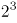，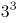，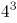，新数列各项均为立方数，且底数为公差为1的等差数列，则下一项为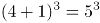，故所求项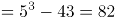。

故正确答案为C。

### 第 49 题

，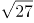，10，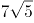，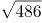，（ ）

A. 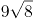

B. 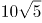

C. 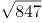

D. 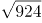

第 49 题 · 答案与解析

**参考答案（粉笔题库参考内容）**

C

**解析**

观察数列，有整数和根号，优先考虑机械划分。原数列可转化为：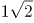，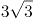，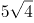，，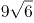，（ ）。整数部分为：1，3，5，7，9，是公差为2的等差数列，故所求项的整数部分为9+2=11；根号部分为：2，3，4，5，6，是公差为1的等差数列，故所求项的根号部分为6+1=7，则所求项为。

故正确答案为C。

### 第 50 题

1，3，，，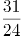，（ ）

A. 

B. 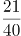

C. 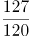

D. 5

第 50 题 · 答案与解析

**参考答案（粉笔题库参考内容）**

B

**解析**

数列大部分为分数，考虑分数数列。对数列进行反约分可得：、、、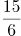、。分子部分为：1、3、7、15、31，后一项-前一项可得：2、4、8、16，是公比为2的等比数列，则所求项的分子部分为16×2+31=63。分母部分为：1、1、2、6、24，观察发现存在明显倍数关系，后一项前一项可得：1、2、3、4，是公差为1的等差数列，则所求项的分母部分为（4+1）×24=120。故所求项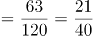。

故正确答案为B。

### 第 51 题

日常生活中，每家每户都会排放“碳”。家用水、电、气的碳排放量（单位：千克）分别等于用水吨数乘以0.9、用电度数乘以0.8、用气立方米数乘以0.2。若某户平均每月用水10吨，用电380度，用气35立方米，则该户一年所用水、电、气产生的碳排放量是：

A. 320千克

B. 640千克

C. 1920千克

D. 3840千克

第 51 题 · 答案与解析

**参考答案（粉笔题库参考内容）**

D

**解析**

根据题意可知，该户平均每月所用水、电、气产生的碳排放量为：10×0.9+380×0.8+35×0.2=320千克，一年有12个月，则一年所用水、电、气产生的碳排放量为：320×12=3840千克。

故正确答案为D。

### 第 52 题

某公益组织登记在册的男、女志愿者人数之比为2：3，男性志愿者中20%为教师，女性志愿者中25%为教师。现从该公益组织登记在册的志愿者中随机选出1人，恰好为教师，则该志愿者为男性的概率是：

A. 

B. 

C. 

D. 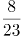

第 52 题 · 答案与解析

**参考答案（粉笔题库参考内容）**

D

**解析**

题目给比例求比例，考虑赋值法。根据男、女志愿者人数之比为2：3，为方便计算，赋值男性志愿者40人，女性志愿者60人；则男性志愿者中教师有40×20%=8人，女性志愿者中教师有60×25%=15人，共有教师8+15=23人。因此从志愿者中随机选出1名教师恰好为男性的概率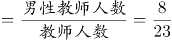。

故正确答案为D。

### 第 53 题

下列图形中，阴影部分面积为2的是：

A. 

B. 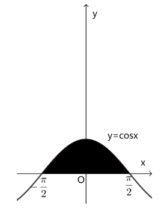

C. 

D. 

第 53 题 · 答案与解析

**参考答案（粉笔题库参考内容）**

B

**解析**

方法一：根据微积分原理，如果f(x)是区间\[a，b\]上的连续函数，并且，则。

A项：直线x=-1，x=1，以及曲线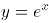和x轴围成的图形的面积可表示，x在\[-1，1\]上的积分，被积函数为，所以所求面积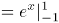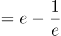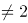，不符合题意；

B项：直线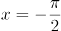，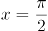，以及曲线y=cosx和x轴围成的图形的面积可表示，x在\[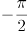，\]上的积分，被积函数为y=cosx，所以所求面积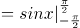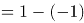\=2，符合题意；

C项：直线x=0，x=4，以及曲线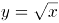和x轴围成的图形的面积可表示，x在\[0，4\]上的积分，被积函数为，所以所求面积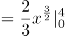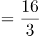，不符合题意；

D项：直线x=0，x=2，以及曲线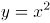和x轴围成的图形的面积可表示，x在\[0，2\]上的积分，被积函数为，所以所求面积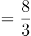，不符合题意。

方法二：A项：

如图长方形的面积为2，多余的阴影部分面积明显超过长方形中多算的空白面积，即所求函数阴影面积不为2，不符合题意；

C项：

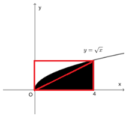

如图长方形的面积为4×2=8，所求函数阴影面积明显超过长方形面积的一半，即超过2，不符合题意；

D项：

如图长方形的面积为4×2=8，所求函数阴影面积明显超过长方形面积的，即超过2，不符合题意。

故正确答案为B。

### 第 54 题

某机构对全运会收视情况进行调查，在1000名受访者中，观看过乒乓球比赛的占87%，观看过跳水比赛的占75%，观看过田径比赛的占69%。这1000名受访者中，乒乓球、跳水和田径比赛都观看过的至少有：

A. 310人

B. 440人

C. 620人

D. 690人

第 54 题 · 答案与解析

**参考答案（粉笔题库参考内容）**

A

**解析**

根据“都······至少”判定本题为多集合反向构造问题。

第一步反向：乒乓球比赛、跳水比赛、田径比赛没有看过的分别为：1000-1000×87%=130人、1000-1000×75%=250人、1000-1000×69%=310人。

第二步作和：乒乓球比赛、跳水比赛、田径比赛没有看过的最多为130+250+310=690人。

第三步作差：乒乓球、跳水和田径比赛都观看过的至少有1000-690=310人。

故正确答案为A。

### 第 55 题

某政府机关将甲、乙两个部门合并。合并前，甲、乙两部门的男女人数之比分别为4：1和3：2，男女党员人数之比分别为9：2和9：4，乙部门女党员人数占本部门人数的比重是甲部门的两倍。合并后，若男女人数之比为7：3，则男女党员人数之比为：

A. 18：5

B. 27：8

C. 3：1

D. 27：10

第 55 题 · 答案与解析

**参考答案（粉笔题库参考内容）**

C

**解析**

根据题意，设甲部门的男女人数分别为4x、x，乙部门的男女人数分别为3y、2y。因合并后，男女人数之比为7：3，可列等式：，解得：x=y，说明合并前，甲部门总人数为4x+x=5x，乙部门总人数为3y+2y=5y，即甲、乙两部门总人数相等。

因“乙部门女党员人数占本部门人数的比重是甲部门的两倍”，且甲、乙两部门总人数又相等，可知乙部门女党员人数是甲部门女党员人数的两倍。根据“甲、乙两部门的男女党员人数之比分别为9：2和9：4”，设甲部门女党员人数为2a，则乙部门女党员人数为4a，甲部门男党员人数为9a，乙部门男党员人数为9a，故所求男女党员人数之比为（9a+9a）：（2a+4a）=18a：6a=3：1。

故正确答案为C。

### 第 56 题

已知A、B两地相距9公里，甲、乙两人匀速从A地前往B地。甲每小时走6公里，每走半小时休息15分钟；乙比甲早15分钟出发，中间不休息。若他们在途中（不含起点和终点）相遇了2次，则乙从A地到B地所用的时间至少为：

A. 75分钟

B. 120分钟

C. 135分钟

D. 150分钟

第 56 题 · 答案与解析

**参考答案（粉笔题库参考内容）**

C

**解析**

根据题意，因为乙比甲先出发15分钟，所以第一次相遇是甲追上乙。要使得乙从A地到B地所用的时间尽可能少，则乙的速度应尽可能大，即甲第一次追上乙花费的时间应尽可能多。因此当甲行驶30分钟后才追上乙时，乙的速度最大，此时甲、乙路程相等。可得方程：，解得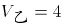公里/小时，则乙从A地到B地所用的时间至少为小时=135分钟。

备注：下图为甲、乙两人全程的路程与时间的函数图像，第一次相遇在45分钟，此时甲追上乙，然后甲休息，乙继续走。第二次相遇在90分钟，此时甲第二次追上乙，然后甲休息，乙继续走。第三次相遇在135分钟，此时两人同时到达B点，满足题干所说途中（不含起点和终点）相遇了2次。

故正确答案为C。

### 第 57 题

如图所示，小王买了一块直三棱柱形状的蛋糕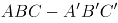，其中，。为与两位室友分享，他切出一小块和原蛋糕形状相同的蛋糕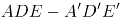，其体积与原蛋糕的体积之比为1：3。若，则线段AE与EB的长度之比为：

A. 2：1

B. 3：2

C. ：1

D. 2：

第 57 题 · 答案与解析

**参考答案（粉笔题库参考内容）**

A

**解析**

根据题意，直三棱柱与直三棱柱的体积之比为1：3，根据三棱柱体积=底面积×高，高度相同（以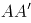为高），故底面积之比为1：3，即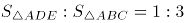。该立体图形的俯视图如下图所示：

在直角中，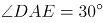，即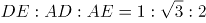，同理，设DE为x，则，AE=2x。由于且有公共角，故，因面积之比为相似比的平方，故相似比为，即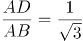，则，EB=3x-2x=x，所求长度之比为：。

故正确答案为A。

### 第 58 题

某学者认为，人类的体力、情绪、智力自出生日起分别以22天、28天、33天为周期开始往复循环变化，前半个周期是“高潮期”，后半个周期是“低潮期”。根据该学者的观点，我们过公历生日时，体力、情绪和智力同时处于“高潮期”的最小年龄是：

A. 4周岁

B. 3周岁

C. 2周岁

D. 1周岁

第 58 题 · 答案与解析

**参考答案（粉笔题库参考内容）**

C

**解析**

根据题意利用代入排除法，问最小年龄，从小到大进行代入。代入D项若最小年龄为1周岁，即365天，体力处于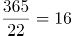个周期⋯⋯13天，22天前半个周期11天是“高潮期”，13天不满足题意，排除D项；代入C项若最小年龄为2周岁，即365×2=730天，体力处于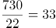个周期⋯⋯4天，情绪处于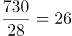个周期······2天，智力处于个周期······4天，均处于以22天、28天、33天为周期的前半个周期“高潮期”，满足题意。

备注：即使在2周岁时经历了闰年366天，所有余数均加一，仍然均处于前半个周期“高潮期”。

故正确答案为C。

### 第 59 题

某企业年终评选了30名优秀员工，分三个等级，分别按每人10万元、5万元、1万元给与奖励。若共发放奖金89万元，则获得1万元奖金的员工有：

A. 14人

B. 19人

C. 20人

D. 21人

第 59 题 · 答案与解析

**参考答案（粉笔题库参考内容）**

B

**解析**

设三个等级奖励的人数分别为：10万元x人，5万元y人，1万元z人。根据“评选了30名优秀员工”可得，x+y+z=30······①；根据“共发放奖金89万元”可得，10x+5y+z=89······②。令①×5-②可消去y，得4z-5x=61。由于x，z0，且x，z均为整数。根据奇偶特性判定4z为偶数，则5x必为奇数，故5x尾数为5，由此推出4z尾数必须为6，排除C、D两项。代入A项，若z=14，解得x=-1，不符合题意，排除。

故正确答案为B。

### 第 60 题

某市民中心广场钟楼上东、西、南、北四面各有一个挂钟，则每日早8点至晚8点，任意相邻两个钟的时针互相垂直的次数是：

A. 2

B. 3

C. 4

D. 5

第 60 题 · 答案与解析

**参考答案（粉笔题库参考内容）**

A

**解析**

如下图，设相邻两个挂钟所在平面为A、B，则A、B两个平面相互垂直。根据几何结论：若一条线段与一个平面垂直，则该线段垂直于平面上所有线段。因此需要平面B内挂钟的时针在水平方向，此时与相邻的平面A垂直即与平面A内挂钟的时针垂直。如下图所示：只有在早上9点（实线所示）、下午3点（虚线所示）这两次，平面B内挂钟的时针与平面A垂直，即A、B两个面上挂钟时针相互垂直。

故正确答案为A。

### 第 61 题

师徒二人用15天合作生产1000个零件，前5天师傅的效率是徒弟的2倍，中间5天师傅休息，徒弟每天比原来多生产5个零件，最后5天两人又一起工作，师傅的效率不变，徒弟的效率比中间5天提高了50%，徒弟这15天生产的零件个数是：

A. 450

B. 500

C. 550

D. 600

第 61 题 · 答案与解析

**参考答案（粉笔题库参考内容）**

B

**解析**

设徒弟前5天每天的效率为x个，则师傅前5天每天的效率为2x个，中间5天徒弟每天的效率为（x+5）个，最后5天徒弟每天的效率为1.5×（5+x）个，根据师徒二人用15天合作生产1000个零件，可列式为（2x+x）×5+（x+5）×5+\[1.5×（5+x）+2x\]×5=1000，解得x=25，则徒弟15天生产的零件个数为5×25+5×（5+25）+5×1.5×（5+25）=500个。

故正确答案为B。

### 第 62 题

某餐饮公司甲、乙两种外卖每份的售价分别为30元和50元，若该公司某天售出这两种外卖共500份，销售收入为21400元，则售出的两种外卖数量相差：

A. 140份

B. 160份

C. 180份

D. 200份

第 62 题 · 答案与解析

**参考答案（粉笔题库参考内容）**

A

**解析**

假设甲外卖和乙外卖当天分别卖出x份和y份。根据题干条件可知，这两种外卖共售出500份，可列式为x+y=500······①；这两种外卖的销售收入为21400元，可列式为30x+50y=21400······②。联立方程组，解得x=180，y=320，故售出的两种外卖数量相差320-180=140份。

故正确答案为A。

### 第 63 题

某企业举行职业技能大赛，3个下属分公司均选2名员工参赛。若同一分公司的员工比赛时出场顺序不能相邻，则参赛的6名员工不同的出场顺序共有：

A. 80种

B. 120种

C. 160种

D. 240种

第 63 题 · 答案与解析

**参考答案（粉笔题库参考内容）**

D

**解析**

位置1，从6名员工中选1名员工，有种排法；

位置2，从另外两个公司的4名员工中选1名员工，有种排法；

后续情况较复杂，考虑枚举法，设三个公司分别为A、B、C，6名员工分别为，，，，，，假设位置1安排出场，位置2安排出场，将出场顺序情况梳理如下：

此时后续符合条件的情况有10种，因此总情况为6×4×10=240种不同的出场顺序。

故正确答案为D。

### 第 64 题

有5支足球队进行单循环比赛，每场比赛胜者得3分，负者不得分，平局双方各得1分。比赛结束后，若5支球队的总得分为25分，冠军得12分，则亚军得：

A. 5分

B. 6分

C. 7分

D. 8分

第 64 题 · 答案与解析

**参考答案（粉笔题库参考内容）**

A

**解析**

根据题意可得，5支足球队进行单循环比赛，总场次有场。设10场比赛中分出胜负的有x场，平局有y场。根据每场胜负共得3+0=3分，每场平局共得1+1=2分，总得分为25分，可列方程组：x+y=10……①；3x+2y=25……②。联立①②，解得x=5，y=5。由于每支球队均要进行4场比赛，冠军总得分为12分，可知冠军4场全胜，则亚军必有1胜（5-4=1）、1负(输于冠军)，剩余2场为平局，故总得分为3+0+1+1=5分。

故正确答案为A。

### 第 65 题

如图所示，为测量珠穆朗玛峰上某点C的海拔高度，测量队选择了两个海拔高度相差100米的珠峰测量点A和B，测得为，从A观测B、C的仰角分别为和，从B观测C的仰角也为30°，则C点的海拔高度比A点高：

A. 米

B. 150米

C. 米

D. 200米

第 65 题 · 答案与解析

**参考答案（粉笔题库参考内容）**

D

**解析**

如图所示，A和B两个海拔高度相差100米（即BE=100米），从A观测B的仰角为，因是的直角三角形，则三边关系为，所以AB=100×2=200米。从B观测C的仰角也为，根据题意，设CO=X米，则CD=（X-100）米，因是的直角三角形，则三边关系为，所以BC=2（X-100）=（2X-200）米。又因为从A观测C的仰角为，是的直角三角形，则三边关系为，所以米。在中，为，根据勾股定理可知，，即，解得X=200，则C点的海拔高度比A点高200米。

故正确答案为D。

### 第 66 题

峰：山峰：碳达峰

A. 界：世界：思想界

B. 潮：海潮：移民潮

C. 子：儿子：菜篮子

D. 羊：山羊：领头羊

第 66 题 · 答案与解析

**参考答案（粉笔题库参考内容）**

B

**解析**

第一步：判断题干词语间逻辑关系。

“山峰”指山突出来的顶端，山峰中的“峰”指山的尖顶。“碳达峰”指在某一个时点，二氧化碳的排放达到峰值后不再增长，之后逐步回落，碳达峰中的“峰”即峰值的意思，两个“峰”的意思不一致。题干中山峰是具体的事物，而碳达峰是抽象概念。

第二步：判断选项词语间逻辑关系。

A项：“世界”广义上来讲，就是指全部、所有、一切，世界中的“界”指范围。“思想界”指的是思想这个范畴，两个“界”的意思一致，与题干逻辑关系不一致，排除；

B项：“海潮”中的“潮”指的是潮汐、潮水，“移民潮”指的是移民的潮流，移民潮中的“潮”是比喻大规模的社会变动或运动发展的起伏形。两个“潮”的意思是不一致的。海潮是具体的事物，而移民潮是抽象概念，与题干逻辑关系一致，当选；

C项：“儿子”是指父母对孩子的一种称谓，“菜篮子”指的是装菜的一种器具。这两个“子”都是附加在名词、动词、形容词后，具有名词性（读轻声）的意思，与题干逻辑关系不一致，排除；

D项：“山羊”指的是一种动物、家畜，“领头羊”是指羊群中领头的羊，借指带领大家前进的领头人或单位。对于本意来说两个“羊”的意思是一致的，而且领头羊不是抽象概念，与题干逻辑关系不一致，排除。

故正确答案为B。

### 第 67 题

论辩：辩护：共识

A. 贸易：签约：利益

B. 就读：休学：考试

C. 调研：座谈：问卷

D. 看病：诊脉：理疗

第 67 题 · 答案与解析

**参考答案（粉笔题库参考内容）**

A

**解析**

第一步：判断题干词语间逻辑关系。

“论辩”和“辩护”的目的都是为了达成“共识”，二者为目的对应关系。

第二步：判断选项词语间逻辑关系。

A项：“贸易”和“签约”的目的都是为了获得“利益”，二者为目的对应关系，与题干逻辑关系一致，当选；

B项：“休学”的目的不是为了“考试”，与题干逻辑关系不一致，排除；

C项：“调研”和“座谈”的目的不是为了“问卷”，与题干逻辑关系不一致，排除；

D项：“理疗”的意思是用物理疗法治疗，“看病”的目的是为了康复，并不是为了“理疗”，与题干逻辑关系不一致，排除。

故正确答案为A。

### 第 68 题

电气：煤气：气

A. 酸奶：羊奶：奶

B. 银河：运河：河

C. 正面：反面：面

D. 榆钱：金钱：钱

第 68 题 · 答案与解析

**参考答案（粉笔题库参考内容）**

B

**解析**

第一步：判断题干词语间逻辑关系。

电气是利用电产生能量的方式，与煤气无关，而且电气不是气。煤气是气的一种，后两者是种属关系。

第二步：判断选项词语间逻辑关系。

A项：酸奶与奶是原材料与制成品的关系，羊奶是奶的一种，后两者是种属关系，与题干逻辑关系不一致，排除；

B项：银河与运河无关，而且银河不是河。运河是河的一种，后两者是种属关系，与题干逻辑关系一致，当选；

C项：正面与反面属于事物的两面性，二者为并列关系，二者均与面构成种属关系，与题干逻辑关系不一致，排除；

D项：榆钱是植物，不是钱，金钱和钱为全同关系，与题干逻辑关系不一致，排除。

故正确答案为B。

### 第 69 题

神奇：鬼斧神工

A. 善良：大慈大悲

B. 强大：不可一世

C. 寒冷：冰天雪地

D. 混乱：乱七八糟

第 69 题 · 答案与解析

**参考答案（粉笔题库参考内容）**

C

**解析**

第一步：判断题干词语间逻辑关系。

鬼斧神工原意是像鬼神制作出来的，形容艺术技巧高超，不像是人力所能达到的，与神奇构成近义关系。鬼斧神工用夸张的修辞来表示非常神奇，程度加深。

第二步：判断选项词语间逻辑关系。

A项：大慈大悲形容人心肠慈悲，乐善好施，与善良构成近义关系。但大慈大悲没有用夸张的修辞手法，与题干逻辑关系不一致，排除；

B项：不可一世形容人自命不凡，狂妄自大到了极点。与强大没有关系，与题干逻辑关系不一致，排除；

C项：冰天雪地指寒冷的地方，也形容天气非常寒冷，与寒冷构成近义关系。冰天雪地用夸张的修辞来表示非常寒冷，程度加深，与题干逻辑关系一致，当选；

D项：乱七八糟形容毫无条理和秩序，乱的不成样子，与混乱构成近义关系。但乱七八糟没有用夸张的修辞手法，与题干逻辑关系不一致，排除。

故正确答案为C。

### 第 70 题

冬：暖冬

A. 妻：未婚妻

B. 人：植物人

C. 菜：平价菜

D. 书：有声书

第 70 题 · 答案与解析

**参考答案（粉笔题库参考内容）**

D

**解析**

第一步：判断题干词语间逻辑关系。

暖冬是冬天，二者为种属关系。

第二步：判断选项词语间逻辑关系。

A项：未婚妻指已与某男子订婚尚未结婚的女子，故在法律意义上，未婚妻不是妻子，与题干逻辑关系不一致，排除；

B项：植物人是与植物生存状态相似的特殊人体状态，植物人是人，与题干逻辑关系一致，保留；

C项：平价菜是菜，二者为种属关系，与题干逻辑关系一致，保留；

D项：有声书指用声音来表达内容的书，二者为种属关系，与题干逻辑关系一致，保留；

对比BCD三项，冬天一般是冷的，暖冬是与冬天特性相反的特殊情况；D项书一般是无声的，有声书是书特性相反的特殊情况，D项与题干更为接近。

故正确答案为D。

### 第 71 题

灭蚊剂：蚊子

A. 居家隔离：病毒

B. 市场经济：垄断

C. 首问负责：推诿

D. 民意测验：分歧

第 71 题 · 答案与解析

**参考答案（粉笔题库参考内容）**

C

**解析**

第一步：判断题干词语间逻辑关系。

灭蚊剂是用来消灭蚊子的，所以二者为功能对应关系。

第二步：判断选项词语间逻辑关系。

A项：居家隔离是为了阻断病毒的传播，但是并不能消灭病毒，而题干中灭蚊剂是对蚊子存在致命性伤害，与题干逻辑关系不一致，排除；

B项：市场经济和垄断没有必然的关系，与题干逻辑关系不一致，排除；

C项：首问负责的意思是谁接到问题，谁就负责到底。具体内容为最先接到来访或来办理业务时，其作为首问负责的人，首问负责是用来消除工作人员对来访人员推诿的，二者为功能对应关系，与题干逻辑关系一致，当选；

D项：民意测验是为了了解公众对特定问题的看法和意见，与分歧没有明显关系，与题干逻辑关系不一致，排除。

故正确答案为C。

### 第 72 题

水中捞月：白费功夫

A. 霸王之兵：勇往直前

B. 天涯海角：杳无音信

C. 棋逢对手：不相上下

D. 蚍蜉撼树：不自量力

第 72 题 · 答案与解析

**参考答案（粉笔题库参考内容）**

D

**解析**

第一步：判断题干词语间逻辑关系。

水中捞月比喻去做根本做不到的事情，只能白费力气。水中捞月可以用来形容白费功夫，二者为比喻象征义，且水中捞月为贬义词。

第二步：判断选项词语间逻辑关系。

A项：霸王之兵出自《孙子兵法》，形容强大的国家必须要有一支强大的军队。勇往直前形容不怕艰险，奋勇地一直往前进。两者无明显语义关系，与题干逻辑关系不一致，排除；

B项：天涯海角形容极远的地方，或相隔极远。杳无音信形容没有一点消息。两者无明显语义关系，与题干逻辑关系不一致，排除；

C项：棋逢对手是指下棋碰上了水平相当的对手，比喻双方本领不相上下。棋逢对手可以用来形容不相上下，二者为比喻象征义，但棋逢对手为褒义词，与题干逻辑关系不一致，排除；

D项：蚍蜉撼树是指蚂蚁想摇动大树，比喻狂妄，不自量力。蚍蜉撼树可以用来形容不自量力，二者为比喻象征义，且蚍蜉撼树为贬义词，与题干逻辑关系一致，当选。

故正确答案为D。

### 第 73 题

东北亚 之于 （ ） 相当于 （ ） 之于 树冠

A. 韩国；树墩

B. 南亚；树根

C. 东半球；树洞

D. 日本海；树荫

第 73 题 · 答案与解析

**参考答案（粉笔题库参考内容）**

B

**解析**

逐一代入选项。

A项：韩国是东北亚的一部分，二者是组成关系，树墩与树冠都是树木的组成部分，二者为并列关系，前后逻辑关系不一致，排除；

B项：东北亚和南亚是不同的地理区域，二者是并列关系，树根和树冠都是树木的组成部分，二者为并列关系，前后逻辑关系一致，当选；

C项：东北亚是东半球的一部分，二者是组成关系，树洞和树冠都是树木的组成部分，二者为并列关系，前后逻辑关系不一致，排除；

D项：日本海是东北亚的一部分，二者为组成关系，树荫是指树下日光照不到的地方，树冠经阳光照射后能形成树荫，二者为对应关系，前后逻辑关系不一致，排除。

故正确答案为B。

### 第 74 题

呼气 之于 吸气 相当于 （ ） 之于 （ ）

A. 救火；灭火

B. 治病；养病

C. 入神；出神

D. 出世；入世

第 74 题 · 答案与解析

**参考答案（粉笔题库参考内容）**

D

**解析**

第一步：判断题干词语间逻辑关系。

呼气指呼吐空气，吸气指吸入空气，二者为语义关系中的反义关系。

第二步：判断选项词语间逻辑关系。

A项：救火和灭火均指扑灭火灾，二者为语义关系中的近义关系，与题干逻辑关系不一致，排除；

B项：治病指治疗疾病，养病指因患病而休养，二者无明显语义关系，与题干逻辑关系不一致，排除；

C项：入神指因对某事物兴趣浓厚，而精神集中，心无旁骛，出神指精神过度集中而发呆，均指精神集中，二者为语义关系中的近义关系，与题干逻辑关系不一致，排除；

D项：出世指淡泊名利，超出尘俗，入世指置身于红尘俗世之中，二者为语义关系中的反义关系，与题干逻辑关系一致，当选。

故正确答案为D。

### 第 75 题

良禽择木而栖 之于 贤臣择主而事 相当于 （ ） 之于 （ ）

A. 关关雎鸠在河之洲；窈窕淑女君子好逑

B. 树欲静而风不止；子欲养而亲不待

C. 天有不测风云；人有旦夕祸福

D. 士为知己者死；女为悦己者容

第 75 题 · 答案与解析

**参考答案（粉笔题库参考内容）**

C

**解析**

第一步：判断题干词语间逻辑关系。

“良禽择木而栖”指的是好的鸟要选择树木栖息；“贤臣择主而事”指的是贤明的臣子要选择君主侍奉，第一句话用自然界的现象引出第二句话中的道理，二者为引申义对应。

第二步：判断选项词语间逻辑关系。

A项：“关关雎鸠在河之洲”指的是关关和鸣的雎鸠，相伴在河中的小洲；“窈窕淑女君子好逑”指的是美丽贤淑的女子，是君子的好配偶，二者不是引申义对应，与题干逻辑关系不一致，排除；

B项：“树欲静而风不止”指的是树希望静止不摆，风却不停息；“子欲养而亲不待”指的是子女想赡养父母，父母却已离去了，二者是两件不相关的事，与题干逻辑关系不一致，排除；

C项：“天有不测风云”指的是自然界的变化难以预测；“人有旦夕祸福”指的是人一生的问题难以预测，均比喻有些灾祸的发生，事先是无法预料的，第一句话用自然界的现象引出了第二句中的人的旦夕祸福，二者为引申义对应，与题干逻辑关系一致，当选；

D项：“士为知己者死”指的是志士愿意为赏识自己、了解自己的人献身；“女为悦己者容”指的是女人愿意为欣赏自己、喜欢自己的人而打扮，两句话均描述的是人，不是引申义对应，与题干逻辑关系不一致，排除。

故正确答案为C。

### 第 76 题

请从所给的四个选项中，选出最恰当的一项填入问号处，使之呈现一定的规律性。

A. A

B. B

C. C

D. D

第 76 题 · 答案与解析

**参考答案（粉笔题库参考内容）**

B

**解析**

图形元素组成不同，且无明显属性规律，考虑数量规律。观察发现，图形线条交叉明显，考虑交点数。题干图形的交点数分别为2、3、4、5、6、？，因此？处图形的交点数应为7个，只有B项符合规律。

故正确答案为B。

### 第 77 题

请从所给的四个选项中，选出最恰当的一项填入问号处，使之呈现一定的规律性。

A. A

B. B

C. C

D. D

第 77 题 · 答案与解析

**参考答案（粉笔题库参考内容）**

D

**解析**

图形元素组成相同，但无位置规律，且无属性规律，考虑数量规律。观察发现，题干图形的黑球数均为3，排除B项；继续观察发现，题干图形的黑白球被分隔开，因此考虑部分数。黑球的部分数依次是1、3、2、2、2，无规律；再观察白球的部分数，发现白球的部分数均为2，故？处应选择白球的部分数为2的图形，只有D项符合。

故正确答案为D。

### 第 78 题

请从所给的四个选项中，选出最恰当的一项填入问号处，使之呈现一定的规律性。

A. A

B. B

C. C

D. D

第 78 题 · 答案与解析

**参考答案（粉笔题库参考内容）**

A

**解析**

元素组成不同，优先考虑属性规律。观察发现，题干图形出现箭头、等腰元素图形，考虑对称性。题干每幅图都由两个单对称轴图形组成，因此分别画出每个图形的对称轴，发现每幅图的两条对称轴之间都是垂直关系，只有A项符合。

故正确答案为A。

### 第 79 题

从所给的四个选项中，选择最合适的一个填入问号处，使之呈现一定的规律性：

A. A

B. B

C. C

D. D

第 79 题 · 答案与解析

**参考答案（粉笔题库参考内容）**

D

**解析**

元素组成相同，优先考虑位置规律。观察发现，三角形沿着正方形的四个角依次顺时针移动一个角的位置，？处应移动到左上角，排除A项；继续观察题干，发现小圆数量发生变化，内圈小圆数量依次为1、2、1、2、1、？，？处应选择内圈有2个小圆的图形，排除B项；外圈小圆数量均为6个，排除C项，只有D项符合规律。

故正确答案为D。

### 第 80 题

请从所给的四个选项中，选出最恰当的一项填入问号处，使之呈现一定的规律性。

A. A

B. B

C. C

D. D

第 80 题 · 答案与解析

**参考答案（粉笔题库参考内容）**

C

**解析**

图形元素组成不同，且无明显属性规律，优先考虑数量规律。九宫格优先横向看，题干中图形均由直线构成，考虑直线数，但整体数直线后没有规律，考虑线的细化考法，即线的方向。第一行图一有1组平行线，图二有2组平行线，图三有3组平行线，第二行也满足此规律，第三行前两个图也符合规律，故？处应该有3组平行线。只有C项符合。

故正确答案为C。

### 第 81 题

请从所给的四个选项中，选出最恰当的一项填入问号处，使之呈现一定的规律性。

A. A

B. B

C. C

D. D

第 81 题 · 答案与解析

**参考答案（粉笔题库参考内容）**

B

**解析**

元素组成相同，优先考虑位置规律。九宫格优先横向看，第一行中，图一逆时针旋转得到图二，图二上下翻转得到图三；第二行经验证，符合该规律；第三行应用规律，只有B项符合。

故正确答案为B。

### 第 82 题

下边四个图形中，只有一个是由上边的四个图形拼合（只能通过上、下、左、右平移）而成的，请把它找出来。

A. A

B. B

C. C

D. D

第 82 题 · 答案与解析

**参考答案（粉笔题库参考内容）**

A

**解析**

本题考查平面拼合，可采用平行且等长相消的方式解题。消去平行且等长的线段后进行组合即可得到轮廓图，即为A项。平行且等长相消的方式如下图所示：

故正确答案为A。

### 第 83 题

下边四个图形中，只有一个是由上边的四个图形拼合（只能通过上、下、左、右平移）而成的，请把它找出来。

A. A

B. B

C. C

D. D

第 83 题 · 答案与解析

**参考答案（粉笔题库参考内容）**

D

**解析**

本题考察平面拼合，可采用平行且等长相消的方法解题。消去平行且等长的线段后进行组合即可得到轮廓图，即为D项。平行且等长相消的方式如下图所示：

故正确答案为D。

### 第 84 题

下边四个图形中，只有一个是由上边的四个图形拼合（只能通过上、下、左、右平移）而成的，请把它找出来。

A. A

B. B

C. C

D. D

第 84 题 · 答案与解析

**参考答案（粉笔题库参考内容）**

A

**解析**

本题考查平面拼合。消去凹凸匹配的线条后进行组合可得到轮廓图，即为A项。具体拼合方式如下图所示：

故正确答案为A。

### 第 85 题

上边四张纸片，每张纸片一面是黑色，另一面是白色，下边仅有一项能由其拼合（可以平移、旋转、翻转）而成，请把它找出来。

A. A

B. B

C. C

D. D

第 85 题 · 答案与解析

**参考答案（粉笔题库参考内容）**

D

**解析**

本题考查平面拼合，可以平移、旋转、翻转，且每张纸片一面是黑色，另一面是白色，需要考虑翻转后的颜色变化。将题干图形标上序号如下图，逐一进行分析。

A项：左下角的三角形是由图①平移过去的，颜色应该是白色，而选项是黑色，排除；

B项：左上角的三角形是由图①旋转后平移过去的，颜色应该是白色，而选项是黑色，排除；

C项：左下角的三角形是由图①翻转且旋转后平移过去的，翻转后的面颜色应该是黑色，而选项是白色。右侧的三角形是由图②翻转后平移过去的，翻转后的面颜色应该是黑色，而选项是白色，排除；

D项：可以由题干图形拼合而成，拼合方式如图所示，当选。

故正确答案为D。

### 第 86 题

上边四张纸片，每张纸片一面是黑色，另一面是白色，下边仅有一项能由其拼合（可以平移、旋转、翻转）而成，请把它找出来。

A. A

B. B

C. C

D. D

第 86 题 · 答案与解析

**参考答案（粉笔题库参考内容）**

C

**解析**

本题考查平面拼合，根据题干可知，纸片平移、旋转，颜色不变；翻转，颜色改变，纸片①和纸片②翻转后为黑色，纸片③和纸片④翻转后为白色。将题干图形标上序号如下图，逐一进行分析。

A项：图4进行了旋转，颜色应仍为黑色，而选项是白色，排除；

B项：图1进行了平移，颜色应仍为白色，而选项是黑色；图4进行了翻转，颜色应为白色，而选项是黑色，排除；

C项：可以由题干图形拼合而成，拼合方式如图所示，当选；

D项：图1进行了平移，颜色应仍为白色，而选项是黑色；图4进行了翻转，颜色应为白色，而选项是黑色，排除。

故正确答案为C。

### 第 87 题

左图给定的是多面体的外表面，右边哪一项能由它折叠而成？请把他找出来。

A. A

B. B

C. C

D. D

第 87 题 · 答案与解析

**参考答案（粉笔题库参考内容）**

B

**解析**

将原展开图标上序号如下图，逐一进行分析。

A项：选项由面e和面h构成，题干展开图中面e和面h的公共边没有挨着面e中的白色三角形，而选项中面e和面h的公共边挨着面e中的白色三角形，选项和题干不一致，排除；

B项：选项由面e和面h构成，选项与题干一致，当选；

C项：选项由面f和面g构成，题干展开图中面g中小三角形的顶点与面f中的线段相接，而选项中面g中小三角形的顶点没有与面f中的线段相接，选项与题干不一致，排除；

D项：选项由面e和面h构成，题干展开图中面e和面h的公共边没有挨着面e中的白色三角形，而选项中面e和面h的公共边挨着面e中的白色三角形，选项和题干不一致，排除。

故正确答案为B。

### 第 88 题

左边给定的是纸盒外表面的展开图，右边哪一项能由它折叠而成？请把它找出来。

A. A

B. B

C. C

D. D

第 88 题 · 答案与解析

**参考答案（粉笔题库参考内容）**

C

**解析**

将原展开图标上序号，如下图所示，逐一进行分析。

A项：选项由面e和面g构成，展开图中面e与面g的公共边挨着面g的空白面，而选项中面e与面g的公共边半边挨着面g的灰色面，选项与题干展开图不一致，排除；

B项：选项由面g和面h构成，展开图中面g和面h的公共边挨着面g的灰色面，而选项中面g和面h的公共边挨着面g的空白面，选项与题干展开图不一致，排除；

C项：选项由面e和面h构成，选项与题干展开图一致，当选；

D项：选项由面e和面f构成，以面e的灰色顶点（蓝点）为起点顺时针画边，展开图中边2与面f中的长线相交于点1（边2与边3的交点），而选项中边2与面f中的长线不相交于点1（边2与边3的交点），选项与题干展开图不一致，排除。

故正确答案为C。

### 第 89 题

左边给定的是多面体的外表面，右边哪一项能由它折叠而成？请把它找出来。

A. A

B. B

C. C

D. D

第 89 题 · 答案与解析

**参考答案（粉笔题库参考内容）**

A

**解析**

将原展开图标上序号，如下图所示，逐一进行分析。

A项：选项三个面为面a、面e和面c，选项与题干展开图一致，当选；

B项：选项三个面为面a、面b和面f，在展开图和选项中以面f中挨着白色小圆的边为起始边，在面f中顺时针画边，展开图中边1对应面d，而选项中边1对应面b，选项与题干展开图不一致，排除；

C项：选项三个面为面b、面d和面f，展开图中面d和面f的公共边挨着面f中的白色小圆，而选项中面d和面f的公共边挨着面f中的白色小圆和黑色大圆，选项与题干展开图不一致，排除；

D项：选项三个面为面a、面b和面c，展开图中三个面的公共点在面a中引出一条线，而选项中三个面的公共点没有引出一条线，选项与题干展开图不一致，排除。

故正确答案为A。

### 第 90 题

左边给定的是多面体的外表面，右边哪一项能由它折叠而成? 请把它找出来。

A. A

B. B

C. C

D. D

第 90 题 · 答案与解析

**参考答案（粉笔题库参考内容）**

C

**解析**

将原展开图标上序号，如下图所示，逐一进行分析。

A项：选项为面a、面b和面e，题干展开图中面a和面b的公共边（如上图绿线所示）挨着面a中2个小矩形，而选项中二者的公共边挨着面a中2个大矩形，选项与题干展开图不一致，排除；

B项：选项为面a、面e和面f，题干展开图中面a和面f为相对面，不能同时出现，选项与题干展开图不一致，排除；

C项：选项为面a、面d与面e，选项与题干展开图一致，当选；

D项：选项为面b、面c和面f，以面c中空白矩形的一条长边作为起始边，顺时针进行画边（如上图所示），题干展开图中边2对应面a，而选项中边2对应面f，选项与题干展开图不一致，排除。

故正确答案为C。

### 第 91 题

在广袤的中华大地上，最近几十年已经新植了数以十亿计的树木，绿色植被的增长有目共睹，沙漠化和水土流失情况得到了极大缓解。据此，有专家指出，中国已经是全球变绿的最重要的力量之一。

以下哪项如果为真，最能支持上述专家的观点？

A. 中国西南地区和东北地区的快速造林大大减少了我国对进口木材的依赖

B. 卫星数据对比显示，中国大量过去荒漠化的地方现在已经被绿色植被所覆盖

C. 中国的植被面积仅占全球的6.6%，但全球植被面积净增长的25%来自中国

D. 在有些国家和地区，毁林开荒正在导致具有全球气候调节功能的雨林面积大大减少

第 91 题 · 答案与解析

**参考答案（粉笔题库参考内容）**

C

**解析**

第一步：找出论点和论据。

论点：中国已经是全球变绿的最重要的力量之一。

论据：在广袤的中华大地上，最近几十年已经新植了数以十亿计的树木，绿色植被的增长有目共睹，沙漠化和水土流失情况得到了极大缓解。

本题论点和论据都在讨论的是中国绿化的情况，话题一致，加强优先考虑补充论据。

第二步：逐一分析选项。

A项：该项说中国快速造林减少了对进口木材的依赖，而论点讨论的是中国是全球变绿的重要力量，话题不一致，无法加强，排除；

B项：该项说中国过去荒漠化的地方已经被绿色植被所覆盖，对比的是中国的过去情况和现在情况，而论点讨论的是中国是全球变绿的重要力量之一，话题不一致，无法加强，排除；

C项：该项说全球植被面积净增长的25%来自中国，补充论据说明中国是全球变绿的重要力量之一，可以加强，当选；

D项：该项说有些国家和地区的雨林面积大大减少，而论点讨论的是中国是全球变绿的重要力量之一，话题不一致，无法加强，排除。

故正确答案为C。

### 第 92 题

普通话是国家通用语言，除普通话外，还有粤语、吴语等方言。近年来，用各种方言演绎的段子大量涌入影视作品、短视频和网络综艺节目，这些作品生动有趣，让那些即使是从小生长在普通话环境里的人也会觉得亲切，兴起了一股学习方言的热潮。因此，有专家认为，各种方言作品大行其道，其实不利于普通话在全国范围内的使用推广。

以下哪项如果为真，最能质疑上述专家的观点？

A. 保护传承方言是国家语言文字事业的重要组成部分，也是社会大众的共同愿望

B. 方言多用于家庭等非正式场合，不会损害普通话在公共场所等正式场合的应用

C. 短时间内让方言恢复自身活力或使用频率，既缺乏可行性，也没有必要性

D. 每个人都有自己的故乡，方言承载着人们的乡土之情，是普通话的根

第 92 题 · 答案与解析

**参考答案（粉笔题库参考内容）**

B

**解析**

第一步：找出论点和论据。

论点：各种方言作品大行其道，其实不利于普通话在全国范围内的使用推广。

论据：无。

本题只有论点，没有论据，削弱可以优先考虑削弱论点。

第二步：逐一分析选项。

A项：该项说的是保护传承方言是国家语言文字事业的重要组成部分，也是社会大众的共同愿望，说的是保护传承方言的必要性，但未提及方言作品对普通话在全国范围内的使用推广有何影响，话题不一致，无法削弱，排除；

B项：该项说的是方言不会损害普通话在公共场所等正式场合的应用，而普通话的推广使用主要集中在公共场所等正式场合，也就是说方言作品不会损害普通话在全国范围内的推广使用，削弱论点，当选；

C项：该项说的是短时间内不需要也很难恢复方言的活力，而论点说的是方言作品不利于普通话在全国范围内的使用推广，话题不一致，无法削弱，排除；

D项：该项说的是方言承载着人们的乡土之情，说的是方言的作用，但论点说的是方言作品不利于普通话在全国范围内的使用推广，话题不一致，无法削弱，排除。

故正确答案为B。

### 第 93 题

某企业秉持人才为上的理念，一直致力于专业技术人才队伍建设，十年来，该企业招聘的大部分机械工人来自甲职业技术学院，今年招聘的机械工人总数明显增加，但从该学院招聘的机械工人数量却大幅减少，而且招进来的很多人没有经过职业技术学院系统的学习。

以下哪项如果为真，最能解释该企业今年招聘情况的变化？

A. 该企业增设了技术培训部门，以培训新招聘的机械工人

B. 三年前，该企业的管理层进行了重大重组，决定推广AI的应用

C. 从去年开始，权威的职业技术学院排行榜上，甲学院落后于乙学院

D. 很多没有上过职业技术学院的工人很有才华，只是没有机会上学

第 93 题 · 答案与解析

**参考答案（粉笔题库参考内容）**

A

**解析**

第一步：找出题干矛盾。

某企业一直致力于专业技术人才队伍建设，十年来招聘的大部分机械工人来自甲职业技术学院，今年招聘的机械工人总数明显增加，但从该学院招聘的机械工人数量却大幅减少，而且招进来的很多人没有经过职业技术学院系统的学习。

第二步：逐一分析选项。

A项：该项说的是该企业增设了技术培训部门，以培训新招聘的机械工人，说明新招聘来的人虽没有经过职业技术学院系统的学习，但通过技术培训部门的培训也能掌握相应的技术从而胜任工作，能够解释题干矛盾，当选；

B项：该项说的是该企业的管理层三年前进行了重大重组，决定推广AI的应用，一方面三年前进行管理层的重大重组，不能解释为什么今年的招聘才和往年不同，另一方面，也不能确定管理层的重大重组及推广AI的应用对人才招聘的影响如何，因此不能解释题干矛盾，排除；

C项：该项说的是从去年开始，权威的职业技术学院排行榜上，甲学院落后于乙学院，这只能解释为什么该公司从甲学院招聘的机械工人数量大幅减少，但不能解释为什么招进来的很多人没有经过职业技术学院系统的学习，这明显与该企业致力于专业技术人才队伍建设的理念相违背，不能解释题干矛盾，排除；

D项：该项说的是很多没有上过职业技术学院的工人很有才华，只是没有机会上学，但有才华并不等同于有技术，这也与该企业致力于专业技术人才队伍建设的理念相违背，不能解释题干矛盾，排除。

故正确答案为A。

### 第 94 题

唐代大诗人刘禹锡《望洞庭》诗云：“湖光秋月两相和，潭面无风镜未磨。遥望洞庭山水翠，白银盘里一青螺。”然而，在一般不对原文做修改的宋清两朝的诸多类书中诗首句“秋月”皆作“秋色”，有专家据此指出，诗中首句的“秋月”其实应为“秋色”。

以下哪项如果为真，最能支持上述专家的观点？

A. 《望洞庭》为经典名作，历朝历代众口传诵，期间难免出现不同的版本

B. 月光下很难分辨山水的不同色彩，翠色，白银盘、青螺皆是白天的景观

C. 洞庭秋色是历代文人所关注的美景，该诗强调秋色之美也在常理之中

D. 学术界公认这首诗，描写了洞庭湖的优美景色，应是诗人对洞庭湖的实景描写

第 94 题 · 答案与解析

**参考答案（粉笔题库参考内容）**

B

**解析**

第一步：找出论点和论据。

论点：刘禹锡《望洞庭》中首句的“秋月”其实应为“秋色”。

论据：在一般不对原文做修改的宋清两朝的诸多类书中诗首句“秋月”皆作“秋色”。

本题论点、论据都是在讨论“秋月”与“秋色”哪种用法更合理，论点论据话题一致，所以加强可以优先考虑补充论据。

第二步：逐一分析选项。

A项：指出该诗在传诵过程中出现了许多不同版本，而论点讨论的是“秋色”与“秋月”用法的合理性，这些不同的版本是否是在“秋色”一词上有所差异并不明确，不明确项，无法加强，排除；

B项：指出白银盘、青螺等景色仅能在白天观察到，说明在“秋月”的情况下无法观察到诗中描写的景色，因此该诗中的“秋月”应为“秋色”，补充论据，可以加强，当选；

C项：指出洞庭湖的秋色常被诗人们关注，该诗描写秋色有其合理性，但这仅能说明该诗可能描写了洞庭湖的“秋色”，但该诗中的“秋月”的表述是否合理，该项并未提及，不明确项，无法加强，排除；

D项：指出该诗是对洞庭湖的实景描写，讨论的是诗人所写景色的虚实，而论点讨论的是诗中“秋月”与“秋色”哪种用法更合理，话题不一致，无法加强，排除。

故正确答案为B。

### 第 95 题

某单位准备从甲、乙、丙、丁、戊、己六人中择优录取数名技术人员，录用情况符合如下条件：

（1）丙和丁恰有一人被录取；

（2）甲和乙至少有一人被录取；

（3）甲和丁恰有一人被录取；

（4）录取乙当且仅当录用丙；

（5）甲、戊、己中恰有两人被录用；

根据上述信息，可以推出最终录用的人数为：

A. 2

B. 3

C. 4

D. 5

第 95 题 · 答案与解析

**参考答案（粉笔题库参考内容）**

C

**解析**

第一步：分析题干条件。

（1）要么丙要么丁；

（2）甲 或 乙；

（3）要么甲要么丁；

（4）乙丙，丙乙；

（5）甲、戊、己中有两人被录取。

第二步：根据题干条件进行推理。

根据条件（1）（5）可知，甲、丙、丁、戊、己五人中会录取三人，则只需判断乙是否会被录取，因此考虑假设法。

假设乙不被录取，根据条件（2）可知，甲会被录取，同时根据条件（4）否后必否前可得，丙不会被录取，又结合条件（1）可知，丁会被录取，此时甲、丁都会被录取，与条件（3）矛盾，因此该假设不成立，那么可以推出乙被录取，再结合“甲、丙、丁、戊、己五人中会录取三人”可以得出最终共录用4人，对应C项。

故正确答案为C。

## 材料 2

运动会的3000米比赛中，运动员你追我赶，其中选手甲、乙、丙、丁表现特别出色，交替领先。观众张、王、李、赵分别预测了4位选手的最终名次：

张：甲第四，乙第三，丙第二，丁第一；

王：甲第三，乙第二，丙第四，丁第一；

李：甲第四，乙第二，丙第一，丁第三；

赵：甲第二，乙第三，丙第一，丁第四。

比赛结束后，甲、乙、丙、丁确实位列前四名，而且不存在并列情况。但他们的具体名次，张全猜错了，而其余3人分别猜对了1个。

### 第 96 题

根据以上陈述，以下哪项可能为真？

A. 丙第一，甲第二，丁第三，乙第四

B. 乙第一，丁第二，甲第三，丙第四

C. 乙第一，甲第二，丁第三，丙第四

D. 甲第一，丁第二，丙第三，乙第四

第 96 题 · 答案与解析

**参考答案（粉笔题库参考内容）**

C

**解析**

第一步：分析题干条件。

（1）张：甲第四，乙第三，丙第二，丁第一；

（2）王：甲第三，乙第二，丙第四，丁第一；

（3）李：甲第四，乙第二，丙第一，丁第三；

（4）赵：甲第二，乙第三，丙第一，丁第四；

（5）甲、乙、丙、丁位列前四名，且不存在并列；

（6）张全猜错了，其余3人分别猜对了1个。

第二步：根据题干条件进行推理。

本题题干信息不确定，选项信息充分，优先考虑代入法。

代入A项，王全猜错，不符合条件（6）王猜对1个，排除；

代入B项，王猜对2个，不符合条件（6）王猜对1个，排除；

代入C项，满足题干所有条件，当选；

代入D项，王全猜错，不符合条件（6）王猜对1个，排除。

故正确答案为C。

### 第 97 题

假如王猜对了甲的名次，那么以下哪项一定为真?

A. 丁第四

B. 丙第一

C. 乙第二

D. 乙第一

第 97 题 · 答案与解析

**参考答案（粉笔题库参考内容）**

B

**解析**

第一步：分析题干条件。

（1）张：甲第四，乙第三，丙第二，丁第一；

（2）王：甲第三，乙第二，丙第四，丁第一；

（3）李：甲第四，乙第二，丙第一，丁第三；

（4）赵：甲第二，乙第三，丙第一，丁第四；

（5）甲、乙、丙、丁位列前四名，且不存在并列；

（6）张全猜错了，其余3人分别猜对了1个；

（7）王猜对了甲的名次。

第二步：根据题干条件进行推理。

从确定信息条件（7）入手进行推理，与条件（2）（6）结合，可以推出甲第三，乙不是第二，丙不是第四，丁不是第一；

根据条件（5）以及甲第三可知，乙、丙、丁都不是第三；

根据条件（6）张全猜错以及条件（1）可以推出，乙不是第三，丙不是第二，丁不是第一；

综合上述推理可知，丙不是第二、三、四，那么丙只能是第一，对应B项。

故正确答案为B。

### 第 98 题

麦子大约在五千年前由西亚传入中国，但由麦子做成的面食直到唐宋时期才成为北方人的主食。在此之前，北方的主粮是粟，也就是小米。秦汉时期的老百姓很不愿意种麦子，汉朝曾为增加粮食产量两次大力推广种麦子，但老百姓并没有积极响应。

以下哪项如果为真，最能解释上述历史现象？

A. 外来作物很多，除了麦子，还有番薯、胡麻等，不是每种作物一传入就被接受

B. 磨粉技术传播较晚，东汉时只有官宦人家才拥有上下两扇带有磨齿的磨盘

C. 麦粒直接煮成的“麦饭”生硬难咽、口感很差，秦汉时期的绝大多数人都不爱吃

D. 东汉以后磨盘磨粉和“热汤饼”等面食技术逐渐推广开来，麦子才变得“好吃”了

第 98 题 · 答案与解析

**参考答案（粉笔题库参考内容）**

C

**解析**

第一步：找出题干矛盾。

秦汉时期的老百姓很不愿意种麦子，汉朝曾两次大力推广种麦子，但老百姓并没有积极响应。

第二步：逐一分析选项。

A项：该项说的是有些外来作物并不能马上被接受，但是汉朝已经两次大力推广了，为什么还是不能被接受，不能解释题干矛盾，排除；

B项：该项说的是东汉时期只有官宦人家才能将麦子磨粉，那在麦子不能被磨粉时，为什么老百姓不愿意种植，选项并没有明确说明，不能解释题干矛盾，排除；

C项：该项说的是由麦粒直接煮成的“麦饭”口感很差，秦汉时期的绝大多数人都不爱吃，因为麦粒不好吃所以不种麦子，可以解释即使国家大力推广，老百姓也不积极响应的原因，可以解释题干矛盾，当选；

D项：该项说的是麦子从东汉以后因为磨盘磨粉和面食技术才变得好吃，题干要解释的矛盾点是为什么国家推广也不种，C项很直接地说明因为不好吃，所以不种；D项在解释怎么才变得“好吃”，没有C项直接，排除。

故正确答案为C。

### 第 99 题

“同情用药”指的是某些重症患者可以在不参加临床试验的情况下，使用尚未获批上市的在研药物。在新冠肺炎疫情初期，提前使用抗疫药物的同情用药案例数有所增加，效果良好。但是，同情用药的实施条件十分严格，大部分患者不具备用药资格。对此，有专家建议，应该放宽同情用药的使用条件。

以下哪项如果为真，最能质疑上述专家建议的合理性?

A. 同情用药会破坏新药审批的程序和权威，这对患者和社会都有不可预料的后果

B. 即便“无药可救”的患者愿意使用未获批的在研药物，也不一定能够成功延长生命

C. 为了保护患者用药安全，大部分国家目前严禁未经过临床试验的药品上市

D. 目前，大部分常见疾病都已经有一些适用药物，这些疾病并不需要同情用药

第 99 题 · 答案与解析

**参考答案（粉笔题库参考内容）**

A

**解析**

第一步：找出论点和论据。

论点：应该放宽同情用药的使用条件。

论据：在新冠肺炎疫情初期，提前使用抗疫药物的同情用药案例数有所增加，效果良好。但是，同情用药的实施条件十分严格，大部分患者不具备用药资格。

本题的论点和论据讨论的都是同情用药的使用条件问题，二者话题一致，优先考虑削弱论点，即表明不应放宽同情用药的使用条件。

第二步：逐一分析选项。

A项：该项说的是同情用药会破坏新药审批的程序和权威，对患者和社会都有不可预料的后果，表明放宽同情用药的使用条件会产生不利影响，因此同情用药的使用条件应该严格，可以削弱，当选；

B项：该项说的是患者愿意使用未获批的在研药物后不一定能延长生命，但是论点讨论的是同情药物的使用条件是否应当放宽，讨论内容为什么样的病人应该使用该药物，而不是使用药物后可能的效果，无法削弱，排除；

C项：该项说的是未经过临床试验的药品能否上市的问题，论点讨论的是同情用药使用的限制条件，二者话题不一致，无法削弱，排除；

D项：该项说的是大部分常见疾病是否需要同情用药，而题干讨论的同情用药指的是重症患者的特殊情况，二者话题不一致，无法削弱，排除。

故正确答案为A。

### 第 100 题

甲：这本小说太精彩了，你喜欢里面的哪个角色呢？

乙：我对小说不感兴趣，没有读过这本小说

以下哪项的对话与上述对话最为相似？

A. 教师：你不努力学习以后怎么能考上理想的大学呢？

学生：我理想的大学太难考了，再努力也不一定能考上

B. 员工甲：总经理的讲话中，你认可哪些呢？

员工乙：总经理的讲话我都赞成，我会尽全力执行讲话中的要求

C. 孩子：爸爸，夏天游泳更能锻炼身体呢，还是冬天游泳更能锻炼身体呢？

父亲：游泳是非常好的锻炼方式，在任何时候游泳都能锻炼人

D. 商户：您上个月在我们商店购买的冰箱好用吗？

顾客：你可能记错了，我上个月在你们店购买的是洗衣机

第 100 题 · 答案与解析

**参考答案（粉笔题库参考内容）**

D

**解析**

第一步：分析题干逻辑关系。

甲以“看过这本小说”为前提，问乙“喜欢哪个角色”，乙表示“没有读过这本小说”，没有直接回答甲的问题，而是对甲问题的前提进行否定。

第二步：逐一分析选项。

A项：教师问“不努力学习以后怎么能考上理想的大学”，学生表示“因为理想的大学太难考，再努力也不一定能考上”，是直接回答了教师的问题，没有否定问题的前提，与题干对话方式不一致，排除；

B项：员工甲问“认可总经理的哪些讲话”，员工乙表示“都赞成”，是直接回答了员工甲的问题，没有否定问题的前提，与题干对话方式不一致，排除；

C项：孩子问“是夏天游泳更能锻炼身体，还是冬天游泳更能锻炼身体”，父亲表示“任何时候游泳都能锻炼人”，是直接回答了孩子的问题，没有否定问题的前提，与题干对话方式不一致，排除；

D项：商户以“购买过冰箱”为前提，问顾客“是否好用”，顾客表示“购买的不是冰箱，而是洗衣机”，没有直接回答商户的问题，而是对商户问题的前提进行否定，与题干对话方式一致，当选。

故正确答案为D。

### 第 101 题

甲、乙、丙是好朋友，一个住在城东，一个住在城南，一个住在城西。三人相约到城北的射箭场比拼射箭技术，结果住在城南的比丙得分低，甲比住在城东的得分高，乙和住在城南的得分不同。

根据以上陈述，可以推出以下哪项：

A. 甲住城西，乙住城东

B. 乙住城东，丙住城西

C. 乙住城南，丙住城西

D. 甲住城南，丙住城东

第 101 题 · 答案与解析

**参考答案（粉笔题库参考内容）**

B

**解析**

第一步：分析题干条件。

三人射箭技术的得分顺序如下：

①丙＞住在城南的；

②甲＞住在城东的；

③乙≠住在城南的。

第二步：根据题干条件进行推理。

“住在城南的”出现次数最多，为最大信息，可作为突破口。根据条件①和③可知，住在城南的既不是丙也不是乙，因此三人中住在城南的只能是甲，则条件①可表示为丙＞甲。再结合条件②可知，丙＞甲＞住在城东的，因此丙不可能住在城东，再结合甲住在城南可知，丙只能住在城西，剩下的乙就住在城东，只有B项符合。

故正确答案为B。

### 第 102 题

在知识经济时代，社会持续发展的前提之一是培养大量高素质人才，只有高校教育质量的提升才能培养出大量高素质人才，而高校教育质量的提升一定要求高校教师整体素养的提升。

如果以上陈述为真，则可以推出以下哪项：

A. 只要社会持续发展，就要求提升高校教师整体素养

B. 如果没有大量高素质人才，那么高校教育质量不会有提升

C. 如果培养了大量高素质人才，那么社会就能持续发展

D. 如果处在知识经济时代，高校教育质量必定有所提升

第 102 题 · 答案与解析

**参考答案（粉笔题库参考内容）**

A

**解析**

第一步：翻译题干。

①社会持续发展培养大量高素质人才

②培养大量高素质人才高校教育质量提升

③高校教育质量提升高校教师整体素养提升

以上条件可以递推出：④社会持续发展培养大量高素质人才高校教育质量提升高校教师整体素养提升

第二步：逐一分析选项。

A项：翻译为社会持续发展提升高校教师整体素养，是对④的肯前，肯前必肯后，可以推出，当选；

B项：翻译为-大量高素质人才高校教育质量提升，是对②的否前，否前得不出必然结论，无法推出，排除；

C项：翻译为培养大量高素质人才社会持续发展，是对①的肯后，肯后得不出必然结论，无法推出，排除；

D项：翻译为知识经济时代高校教育质量提升，题干中“知识经济时代”和“高校教育质量提升”之间没有推出关系，无法推出，排除。

故正确答案为A。

### 第 103 题

某高校选派甲、乙、丙、丁4位专家组成乡村振兴调研小组，担任组长的专家为男性、党员、教授。已知这4位专家中：

（1）每位专家都至少具有组长的一个特征；

（2）有党员3人，男性2人，教授1人；

（3）甲和乙性别相同；

（4）乙是党员当且仅当丙是党员；

（5）丙和丁不全是党员。

由此推出，担任组长的是：

A. 甲

B. 乙

C. 丙

D. 丁

第 103 题 · 答案与解析

**参考答案（粉笔题库参考内容）**

C

**解析**

第一步：分析题干条件。

（1）担任组长的专家为男性、党员、教授；

（2）每位专家都至少具有组长的一个特征；

（3）有党员3人；

（4）男性2人；

（5）教授1人；

（6）甲和乙性别相同；

（7）乙、丙要么都是党员，要么都不是党员；

（8）丙不是党员或丁不是党员。

第二步：根据题干条件进行推理。

根据条件（3）和（7），得出乙和丙都是党员，再根据条件（3）和（8）得出丁不是党员，甲是党员，根据条件（4）和（6），假设甲和乙都是男性，那么丁既不是党员也不是男性，又根据条件（2），得出丁必须是教授，再根据条件（5），得出其他人都不是教授，此时并没有一个人具有担任组长的三个特征，与条件（1）矛盾，因此假设不成立；故甲和乙都不是男性，丙和丁都是男性，此时只有丙既是党员又是男性，再根据条件（1）和（5），得出丙必须也是教授。因此同时具有担任组长三个特征的专家是丙。表格如下：

故正确答案为C。

## 材料 3

甲、乙、丙、丁4人为室友，来自江苏、浙江、湖南、湖北，毕业时都考上了研究生，录取她们的有师范大学、医科大学、财经大学、农业大学，已知：甲考上的不是农业大学，考上农业大学的是江苏人，丙考上了师范大学，丁是湖北人。

### 第 104 题

根据上述信息，可以推出以下哪项？

A. 丙是湖南人

B. 甲是浙江人

C. 丁考上了财经大学

D. 乙考上了农业大学

第 104 题 · 答案与解析

**参考答案（粉笔题库参考内容）**

D

**解析**

第一步：分析题干信息。

（1）甲农业大学；

（2）考上农业大学的是江苏人；

（3）丙=师范大学；

（4）丁=湖北人。

第二步：根据题干条件进行推理。

本题题干信息较多，可考虑列表。将题干已知条件填入表格，如下表：

又由条件（2）可知，考上农业大学的是江苏人，说明需要将“农业大学”和“江苏”分配给同一个人，通过上表可知只能是乙，因此乙考上了农业大学，对应D项。

故正确答案为D。

### 第 105 题

如果考上医科大学的是湖南人，那么以下哪项为假？

A. 甲考上了医科大学

B. 丁考上了财经大学

C. 丙不是浙江人

D. 丙不是湖南人

第 105 题 · 答案与解析

**参考答案（粉笔题库参考内容）**

C

**解析**

第一步：分析题干信息。

（1）甲农业大学；

（2）考上农业大学的是江苏人；

（3）丙=师范大学；

（4）丁=湖北人。

（5）考上医科大学的是湖南人。

第二步：根据题干条件进行推理。

由上一题结论可知，考上农业大学的是乙，因此乙是江苏人，如下表：

结合条件（5）可知，考上医科大学的是湖南人，说明需要将“医科大学”和“湖南”分配给同一个人，通过上表可知只能是甲，此时可以得到：甲是考上医科大学的湖南人，如下表：

此时通过上表可知，丁被财经大学录取，丙是浙江人，如下表：

通过上表可知：甲是考上医科大学的湖南人，乙是考上农业大学的江苏人，丙是考上师范大学的浙江人，丁是考上财经大学的湖北人，A、B、D三项均符合题干条件，只有C项为假。

本题为选非题，故正确答案为C。

### 第 106 题

微躺青年：指面对现实中的竞争压力，既不参与过度竞争，也不消极接受现状，而在专注于本职工作的同时，合理调整工作方向，追求自我价值实现的年轻人。

下列属于微躺青年的是：

A. 设计师小谭研究生毕业后，因与投资人理念不合，离开了加盟三年的设计公司到外地改做陶瓷设计。最艰难的时候，天天工作到深夜，终于设计出大受市场欢迎的产品，实现了大学以来的梦想

B. 随着新冠肺炎疫情防控形势好转，各地游客都明显增多，商家纷纷推出低价游，抢占旅游市场。小李把自己的旅行社转让出去后，开始在网络上进行家乡景点直播，很快就成为直播达人，带动了家乡旅游产业的发展

C. 今年大学毕业的小柳投递了许多份求职信，但都石沉大海。索性在网上当起了自律监督师，每天要定十几个闹钟，最多同时监督20多个人。刚开始觉得工作枯燥乏味，但现在已经收到了数百条好评，让他很有成就感

D. 小何毕业后一直在互联网公司工作，公司内部竞争压力很大，常常加班到深夜。虽然收入十分可观，但他觉得高强度工作损害了身心健康，决定每年给自己放个小长假

第 106 题 · 答案与解析

**参考答案（粉笔题库参考内容）**

A

**解析**

第一步：找出定义关键词。

“面对现实中的竞争压力，既不参与过度竞争，也不消极接受现状”、“专注于本职工作的同时，合理调整工作方向”、“追求自我价值实现”。

第二步：逐一分析选项。

A项：设计师小谭离开原来的设计公司后并没有消极接受现状，而是调整了工作方向，改做陶瓷设计，符合“面对现实中的竞争压力，既不参与过度竞争，也不消极接受现状”、“专注于本职工作的同时，合理调整工作方向”，经过不懈努力，设计的产品获得市场欢迎，最终实现了自身的梦想，符合“追求自我价值实现”，符合定义，当选；

B项：商家纷纷推出低价游，抢占旅游市场，小李把自己的旅行社转让出去后，在网络上进行家乡景点直播，符合“面对现实中的竞争压力，既不参与过度竞争，也不消极接受现状”，但小李是迫于市场的压力转出了旅行社，改做网络直播，不符合“追求自我价值实现”，不符合定义，排除；

C项：大学刚毕业的小柳投递的许多份求职信石沉大海，于是在网上当起了自律监督师，符合“面对现实中的竞争压力，既不参与过度竞争，也不消极接受现状”，但没有体现专注本职工作及工作方向上的调整，不符合“专注于本职工作的同时，合理调整工作方向”，不符合定义，排除；

D项：在互联网公司工作的小何由于工作强度高，决定每年给自己放个小长假，符合“面对现实中的竞争压力，既不参与过度竞争，也不消极接受现状”，但放小长假不属于工作方向上的调整，不符合“专注于本职工作的同时，合理调整工作方向”，不符合定义，排除。

注：本题正确率很低，粉笔通过多次教研并查询原文，如下图所示：

1.A项是微躺青年的典型案例，而且A项在原文的基础上最后加了“实现大学以来的梦想”，更符合定义关键词“自我价值实现”；

2.有同学质疑A项“天天工作到深夜”根本不微躺，但是注意A项说“最艰难的时候”，并不是每天都卷；

3.ACD这三个选项都是“大学毕业/研究生毕业”，都能够体现出“青年、年轻人”，而B项只是说“小李”，身份不明确，这个点也不如A项。

故正确答案为A。

### 第 107 题

田保姆：指在不改变土地承包关系的前提下，农户将耕、种、管、收等部分或全部作业环节委托给社会化组织完成，成为规模经营的参与者和受益者的新型农业经营方式。

下列不属于田保姆的是：

A. 晚稻收割接近尾声，泥瓦匠老李仍然不慌不忙，在周边市区接了好几单活，他家的10亩稻田三年前已经以每年5000元的价格租给了在家务农的邻居，连收带运，啥都不用他操心

B. 老刘夫妇近年来一直跟着亲戚在外地打工，每到收割季节都得回家忙乎一阵子。去年，村里的几个年轻人合伙买了大型收割机，成立了生产合作社，老刘全家商量后，就把田里的农活全部包给了他们

C. 每年收获季，处置成堆的秸秆都让种植户非常头疼，为了解决这个问题，大王庄村委会先后购置了10套秸秆打捆、粉碎机械，及时推出了秸秆回收加工服务项目，周围村子的农民再也不为这个事情发愁了

D. 某农业科技服务公司在各个村镇建立了所管地块的示范田，定期召开现场会，展示播种方式、田间管理等，当地不少农民变成了“甩手掌柜”，随时可以通过扫描公司的二维码了解托管服务的进程

第 107 题 · 答案与解析

**参考答案（粉笔题库参考内容）**

A

**解析**

第一步：找出定义关键词。

“在不改变土地承包关系的前提下”、“农户将耕、种、管、收等部分或全部作业环节委托给社会化组织”、“成为规模经营的参与者和受益者”。

第二步：逐一分析选项。

A项：该项中泥瓦匠老李只是出租了家中的10亩稻田，符合“在不改变土地承包关系的前提下”，但承租对象是在家务农的邻居，并非社会化组织，不符合“农户将耕、种、管、收等部分或全部作业环节委托给社会化组织”，不符合定义，当选；

B项：该项中老刘全家只是把田里的农活包给村里年轻人成立的生产合作社，符合“在不改变土地承包关系的前提下”，生产合作社属于社会化组织，且老刘全家都是规模经营的参与者和受益者，符合“农户将耕、种、管、收等部分或全部作业环节委托给社会化组织”、“成为规模经营的参与者和受益者”，符合定义，排除；

C项：该项中大王庄村委会推出的秸秆回收加工服务项目给种植户带来了便利，但没有改变土地承包关系，符合“在不改变土地承包关系的前提下”，大王庄村委会属于社会化组织，参与秸秆回收加工服务项目的农民都是规模经营的参与者和受益者，符合“农户将耕、种、管、收等部分或全部作业环节委托给社会化组织”、“成为规模经营的参与者和受益者”，符合定义，排除；

D项：该项中某农业科技服务公司对于农民的土地来说只是起到了管理的作用，符合“在不改变土地承包关系的前提下”，农业科技服务公司属于社会化组织，当地参与托管服务的农民都是规模经营的参与者和受益者，符合“农户将耕、种、管、收等部分或全部作业环节委托给社会化组织”、“成为规模经营的参与者和受益者”，符合定义，排除。

本题为选非题，故正确答案为A。

### 第 108 题

去雇主化职业：指作为独立个体不受雇于任何雇主，依托网络平台提供商品或服务并获得相应报酬的就业形式。

下列属于去雇主化职业的是：

A. 林先生辞职后来到南方注册了一家绿植盆景网店，在一个多月的时间里，租赁场地，筹措资金，完善平台，忙得不亦乐乎

B. 专业买手陈女士每月穿梭在世界各地，寻找带有当季流行元素或者可能在国内热卖的款式和品牌服装，并将其带回国内

C. 小李加入了一个微信群，里面提供了许多可兼职工作的岗位，经过一番挑选，他选择了一份帮忙代取快递的兼职，用赚来的钱贴补每月生活费

D. 喜欢写作的大二学生小孟在某平台网文写手的影响下，也开始在这家平台上更新写的小说，得到了许多粉丝的打赏，他很有成就感

第 108 题 · 答案与解析

**参考答案（粉笔题库参考内容）**

D

**解析**

第一步：找出定义关键词。

“作为独立个体不受雇于任何雇主”、“依托网络平台提供商品或服务”、“获得相应报酬”。

第二步：逐一分析选项。

A项：林先生辞职后注册网店提供绿植盆景，符合“作为独立个体不受雇于任何雇主”、“依托网络平台提供商品或服务”，但未体现出获得报酬，不符合“获得相应报酬”，不符合定义，排除；

B项：陈女士把服装从世界各地带回国内，但未体现出是否依托网络平台售卖，是否获得报酬，不符合“依托网络平台提供商品或服务”、“获得相应报酬”，不符合定义，排除；

C项：小李通过微信群找到代取快递的兼职，不符合“作为独立个体不受雇于任何雇主”，不符合定义，排除；

D项：小孟依托网络平台更新写的小说，符合“作为独立个体不受雇于任何雇主”、“依托网络平台提供商品或服务”，且得到了许多粉丝的打赏，符合“获得相应报酬”，符合定义，当选。

故正确答案为D。

### 第 109 题

鲜活性效应：指重在依据自己耳闻目睹的具体个案而不是权威性、科学性信息做出选择的现象。

下列不属于鲜活性效应的是：

A. 众所周知，飞机的事故率在所有交通工具中是最低的。但是李先生在电视上看到一则民航客机失事的新闻后，再也没有乘坐过飞机

B. 小罗看中了某知名品牌的洗衣机，正打算付款，一个好朋友打来电话告诉她，自家这个牌子的洗衣机经常出故障，小罗当场放弃了购买计划

C. 王大伯非常注重养生，本来滴酒不沾，后来他看到80岁高龄的邻居老赵每天都要小酌几杯，身体一直很好。于是，他逐渐不再刻意回避喝酒

D. 小缪常用的视频网站总是会给她推送某品牌的按摩椅，父亲节的时候小缪想给父亲送按摩椅当礼物，就登录该品牌的官网购买

第 109 题 · 答案与解析

**参考答案（粉笔题库参考内容）**

D

**解析**

第一步：找出定义关键词。

“依据自己耳闻目睹的具体个案”。

第二步：逐一分析选项。

A项：李先生决定不再乘坐飞机的依据是从新闻里看到了一则民航客机失事的新闻，符合“依据自己耳闻目睹的具体个案”，符合定义，排除；

B项：小罗决定不买该品牌洗衣机的依据是听说好朋友家里那个该品牌的洗衣机质量不好，符合“依据自己耳闻目睹的具体个案”，符合定义，排除；

C项：王大伯决定不再刻意回避喝酒的依据是看到某个邻居每天小酌并且身体一直很好，符合“依据自己耳闻目睹的具体个案”，符合定义，排除；

D项：小缪决定购买官网中按摩椅的依据是常用的视频网站经常推送该品牌的按摩椅，但没有提及视频网站的推送视频是否是利用个案来宣传，不符合“依据自己耳闻目睹的具体个案”，不符合定义，当选。

本题为选非题，故正确答案为D。

### 第 110 题

信用联动奖惩：指有关部门或组织在法定范围内根据企业、个人信用记录，采取部门联动、社会协同等方式，对其依法联合实施奖励或惩戒的行为。

下列属于信用联动奖惩的是：

A. 某市设立了无偿献血“五星级志愿者”、志愿服务终身荣誉奖，获奖市民可以免除市管公园门票，免费乘坐市内公交车，享受市属公立医院诊察费半价优惠

B. 餐馆老板李先生在当地政务服务网提交了经营性临时占道申请，由于其信用等级为A级，可以享受审批绿色通道，第二天就收到了城管和其他相关部门的许可短信

C. 阮先生在承租的公租房里开设棋牌室，违背了申请公租房时的诚信承诺，被住房保障部门扣罚了住房保证金，并纳入五年内不得申请公租房的名单。阮先生对自己的失信行为深感后悔，保证以后一定做一个诚信公民

D. 某区政府接到媒体举报，辖区内一超市以次充好，将普通猪肉当黑猪肉售卖，区政府立即召集市场监管、税务等职能部门赶到超市，现场联合办公，对相关责任人进行查处

第 110 题 · 答案与解析

**参考答案（粉笔题库参考内容）**

B

**解析**

第一步：找出定义关键词。

“根据企业、个人信用记录”、“部门联动、社会协同”、“依法联合实施奖励或惩戒”。

第二步：逐一分析选项。

A项：根据无偿献血的志愿行为来实施奖励，不符合“根据企业、个人信用记录”，不符合定义，排除；

B项：由于李先生的信用等级为A级，符合“根据企业、个人信用记录”，可以享受审批绿色通道，且收到城管和其他相关部门的许可短信，符合“部门联动、社会协同”，也符合“依法联合实施奖励或惩戒”，符合定义，当选；

C项：阮先生在公租房开设棋牌室是违背了诚信承诺，符合“根据企业、个人信用记录”，扣罚住房保证金、纳入五年内不得申请公租房的名单均为惩戒手段，符合“依法联合实施奖励或惩戒”，但该行为均由住房保障部门实施，未提及其他有关部门，不符合“部门联动、社会协同”，不符合定义，排除；

D项：市场监管、税务等职能部门联合办公，符合“部门联动、社会协同”，但以次充好，将普通猪肉当黑猪肉售卖，属于不诚信经营的行为，并未提及商家的信用记录，不符合“根据企业、个人信用记录”，不符合定义，排除。

故正确答案为B。

### 第 111 题

闲置经济：指将一些还有使用价值但闲置未用的物品，以较低的价格通过网络平台进行交易的经济现象。

下列属于闲置经济的是：

A. 某品牌电器官网举办以旧换新活动，孔女士便把家里用了三年的电磁炉寄去换了一台新款，比直接购买省了一半的钱

B. 每到毕业季，大学生就会在操场、寝室门口等校园网上公布的位置摆摊设点，将自己的专业书籍低价转让给学弟学妹

C. 近年来，老陈在网上买到了不少便宜货，如老旧缝纫机、修鞋机、磅秤等，他用这些别人眼中的废品做成了再生艺术品

D. 小佳在社交平台看到了一则北方小镇遭受雪灾的消息，就将自己前些年穿过的厚衣物寄给平台，统一消毒后发往灾区

第 111 题 · 答案与解析

**参考答案（粉笔题库参考内容）**

C

**解析**

第一步：找出定义关键词。

“一些还有使用价值但闲置未用的物品”、“以较低的价格”、“通过网络平台进行交易”。

第二步：逐一分析选项。

A项：孔女士用于置换的物品是家里用了三年的电磁炉，不清楚该电磁炉是否为闲置未用的物品，不符合“一些还有使用价值但闲置未用的物品”，电磁炉以旧换新的活动并非是直接以低价进行交易，也不符合“以较低的价格进行交易”，不符合定义，排除；

B项：大学生只是通过网上公布的位置摆摊设点，但是实际交易的时候应该是在摊点通过线下的方式，不符合“通过网络平台进行交易”，不符合定义，排除；

C项：老陈在网上买到了便宜货，符合“通过网络平台进行交易”，也符合“以较低的价格”，且在别人眼中是废品，但是老陈用它们做成了再生艺术品，说明在别人眼里是闲置未用的物品，但对老陈有用，符合“一些还有使用价值但闲置未用的物品”，符合定义，当选；

D项：小佳将自己前些年穿过的厚衣物寄给平台，属于向灾区的捐赠行为，不属于交易，不符合“以较低的价格”，也不符合“通过网络平台进行交易”，不符合定义，排除。

故正确答案为C。

### 第 112 题

信息瀑布：指现实生活中，当受到前人信息的影响时，放弃自己原有的想法，跟着他人选择的现象。

下列属于信息瀑布的是：

A. 小李从单位离职后在家里呆了一段时间，上个月他发现了几份适合自己的工作，就分别递交了求职信。这几天收到了多封邮件，招聘单位大都以他失业太久为理由而拒绝了他

B. 公司去陌生小镇组织团建活动，午餐时看到街边的一排小餐馆，不爱吃辣的胡先生纠结了一会，最终还是跟着几位湖南同事进了一家湘菜馆

C. 消费者们通常认为十多年前的服装款式已经过时，但经过时装周推广、明星带货，那些款式往往又会成为新的时尚，重新受到追捧

D. 某家具厂的一款外壳酷似史前巨型昆虫的黑色办公椅，全厂上下都觉得像是用回收垃圾做的，对它的市场前景表示悲观，却意外地受到了办公人士的喜爱，最终成了该厂建厂以来最畅销的椅子

第 112 题 · 答案与解析

**参考答案（粉笔题库参考内容）**

C

**解析**

第一步：找出定义关键词。

“当受到前人信息的影响时”、“放弃自己原有的想法，跟着他人选择的现象”。

第二步：逐一分析选项。

A项：招聘单位拒绝小李的理由是他失业太久，做出该决定并没有受到前人的影响，不符合“当受到前人信息的影响时”，不符合定义，排除；

B项：不爱吃辣的胡先生是自己纠结午餐吃什么，并未体现出同事对他的影响，不符合“当受到前人信息的影响时”，不符合定义，排除；

C项：消费者们受到时装周和明星的影响，重新接受了之前认为过时的服装，符合“当受到前人信息的影响时”、“放弃自己原有的想法，跟着他人选择的现象”，符合定义，当选；

D项：该家具厂的办公椅意外地受到办公人士的喜爱，没有体现全厂员工和这些办公人士的选择受到前人信息的影响，不符合“当受到前人信息的影响时”，不符合定义，排除。

故正确答案为C。

### 第 113 题

胶带纸思维：指使用各种表面上看似比较简单、笨拙的临时性手段，有效解决实际问题的方式。

下列不属于胶带纸思维的是：

A. 临近下班的时候突然下了大雨，穿了新鞋子的小丽不想把鞋子弄脏，于是从办公室抽屉里拿了两个塑料袋套在脚上，一直走到地铁站鞋子都没湿

B. 马先生家下水道堵了好几天，偶然在短视频中看到了一个用白醋兑苏打水通下水道的方法，在家试验多次都没有成功，最后还得请专业人员上门疏通

C. 某社区举办的花街夜市突然停电，周围一片黑暗，社工小叶立刻去商店买来了一些蜡烛，点点烛光不仅照亮花街，还吸引了更多的游客

D. 小雯的房间突然掉了一块墙皮，但第二天有几个朋友要来访，她急中生智找出与朋友们的合影遮住了脱落墙皮的地方，美观又温馨

第 113 题 · 答案与解析

**参考答案（粉笔题库参考内容）**

B

**解析**

第一步：找出定义关键词。

“表面上看似比较简单、笨拙的临时性手段”、“有效解决实际问题”。

第二步：逐一分析选项。

A项：从办公室抽屉里拿了两个塑料袋套在鞋子上，符合“表面上看似比较简单、笨拙的临时性手段”，一直走到地铁站鞋子都没湿，符合“有效解决实际问题”，符合定义，排除；

B项：用白醋兑苏打水通下水道的方法，符合“表面上看似比较简单、笨拙的临时性手段”，但试验多次都没有成功，不符合“有效解决实际问题”，不符合定义，当选；

C项：去商店买来了一些蜡烛用来照明，符合“表面上看似比较简单、笨拙的临时性手段”，点点烛光不仅照亮花街，还吸引了更多的游客，符合“有效解决实际问题”，符合定义，排除；

D项：找出与朋友们的合影来掩盖脱落墙皮的地方，符合“表面上看似比较简单、笨拙的临时性手段”，遮住了脱落墙皮的地方，美观又温馨，符合“有效解决实际问题”，符合定义，排除。

本题为选非题，故正确答案为B。

### 第 114 题

陌生人社交困境：指在与陌生人交往过程中，由于误解他人行为动机或意图而造成不良后果的现象。

下列不属于陌生人社交困境的是：

A. 早高峰时段、骑电瓶车忘戴头盔的小吴被文明交通志愿者拦下来批评教育，担心上班迟到的小吴觉得志愿者是故意针对他，当场情绪失控。路口因此造成了二十分钟的拥堵

B. 赵女士在田边拍照，看到远处有村民向她挥手大喊，以为村民担心她会踩坏庄稼，就挥了挥手，继续拍照。不一会儿，她被旁边树上飞出的马蜂蛰了，又疼又肿

C. 农村随迁儿童转学到城市学校后，不少孩子最初都会担心受到歧视而不愿与大家交往，抵触班级的集体活动，学习成绩也有所下滑，性格也变得更加敏感脆弱，情况严重者甚至需要半年时间，自卑心理才会逐渐消失

D. 杨女士经常叮嘱三岁的女儿小青不要和陌生人说话、不要随便跟陌生人走、不要吃陌生人的东西、不要给陌生人开门。结果，小青进幼儿园以后的几个月里，非常胆小，动不动就哭，平时连老师问话都不回答

第 114 题 · 答案与解析

**参考答案（粉笔题库参考内容）**

C

**解析**

第一步：找出定义关键词。

“在与陌生人交往过程中”、“由于误解他人行为动机或意图而造成不良后果的现象”。

第二步：逐一分析选项。

A项：小吴被志愿者拦下来，符合“在与陌生人交往过程中”，志愿者因小吴忘戴头盔对其进行批评教育是正常工作，小吴觉得志愿者是故意针对他，当场情绪失控，路口因此造成了二十分钟的拥堵，符合“由于误解他人行为动机或意图而造成不良后果的现象”，符合定义，排除；

B项：赵女士与村民的交流，符合“在与陌生人交往过程中”，她以为村民挥手大喊是担心她会踩坏庄稼，而实际上村民是在对她进行提醒，最后没有重视提醒的田女士被马峰蛰了，符合“由于误解他人行为动机或意图而造成不良后果的现象”，符合定义，排除；

C项：农村随迁儿童担心受到歧视而不愿与大家交往，并未体现出同学是否做出了某种行为使得随迁儿童产生误解，不符合“由于误解他人行为动机或意图而造成不良后果的现象”，不符合定义，当选；

D项：小青进入幼儿园后，与同学和老师都不认识，符合“在与陌生人交往过程中”，老师问话都不答说明是受到了母亲的影响而误解了老师的行为，符合“由于误解他人行为动机或意图而造成不良后果的现象”，符合定义，排除。

本题为选非题，故正确答案为C。

### 第 115 题

网约护士服务：指经过官方许可，以“线上申请、线下服务”的方式，为老弱病残孕等行动不便的人上门提供慢病管理、康复护理或专项护理等延续性的便捷服务。

下列不属于网约护士服务的是：

A. 谭女士因治疗原因留置了PICC管，每周需要更换一次贴膜，家住得比较远，每次去医院换膜都要耗费大量时间。家人在线下单预约后，医院护士准备好护理用品，到谭女士家中为她更换PICC管专用贴膜，同时对其家人进行了护理指导

B. 颜奶奶在医院进行了胆总管探查术，出院后需要定期进行T管维护，家属利用小程序预购了医院护理服务。接到订单后，肝胆外科护士上门为颜奶奶进行T管冲洗。家属感激地说：“护士上门服务真方便，以后再也不用发愁去医院了”

C. 某民营医院最近推出了一项新的便民服务措施，慢病患者下载“医者仁心”术后护理APP，进入平台选择自己所需要的服务项目，只要详细填写服务需求，上传就医证明，完成预约后，就可以等待护士上门服务

D. 刘爷爷平时独居在家，一天因高血压晕倒，被邻居及时送到医院才脱离危险。在外工作的子女急忙回家到医院为他申请定期看护服务，护士会在每次服务后将他的健康报告上传到系统中，以便子女了解刘爷爷的健康情况

第 115 题 · 答案与解析

**参考答案（粉笔题库参考内容）**

D

**解析**

第一步：找出定义关键词。

“以‘线上申请、线下服务’的方式”、“为老弱病残孕等行动不便的人上门提供慢病管理、康复护理或专项护理等延续性的便捷服务”。

第二步：逐一分析选项。

A项：家人在线下单预约，符合“以‘线上申请、线下服务’的方式”，护士到谭女士家中为她更换PICC管专用贴膜，符合“为老弱病残孕等行动不便的人上门提供慢病管理、康复护理或专项护理等延续性的便捷服务”，符合定义，排除；

B项：家属利用小程序预购医院护理服务，符合“以‘线上申请、线下服务’的方式”，护士上门为颜奶奶进行T管冲洗，符合“为老弱病残孕等行动不便的人上门提供慢病管理、康复护理或专项护理等延续性的便捷服务”，符合定义，排除；

C项：慢病患者通过APP选择服务项目，符合“以‘线上申请、线下服务’的方式”，之后护士会上门服务，符合“为老弱病残孕等行动不便的人上门提供慢病管理、康复护理或专项护理等延续性的便捷服务”，符合定义，排除；

D项：刘爷爷的子女到“医院”申请定期看护服务，不符合“线上申请”，不符合定义，当选。

本题为选非题，故正确答案为D。

## 材料 4

2020年江苏省实现以新产业、新业态、新模式为主要内容的“三新”经济增加值25177亿元，比上年增长5.6%，比全省地区生产总值的增速快1.5个百分点，占全省地区生产总值的比重为24.5%。全省战略性新兴产业产值增长11.0%，快于规模以上工业5.5个百分点。其中新能源汽车、数字创意、新能源和高端装备制造业的产值增速分别为21.0%、19.8%、15.6%和15.5%。高技术制造业增加值增长10.3%，占规模以上工业的比重为23.5%，提高1.7个百分点。高技术服务业营业收入增长14.1%，占规模以上服务业的比重为37.9%，提高2.4个百分点。全省碳纤维增强复合材料、新能源汽车、城市轨道车辆、集成电路、太阳能电池等新产品的产量分别增长48.9%、42.0%、24.5%、22.3%和16.5%。全省现代设施农业占地面积100.5万公顷，其中属于战略性新兴产业的中药材种植业种植面积1.8万公顷，实现产值32亿元，产值增长138.1%。全省网上零售额10602亿元，增长10.0%。其中，实物商品网上零售额增长13.9%，增速比上年快5.2个百分点，占社会消费品零售总额37086亿元的比重为24.9%，提高2.7个百分点。

### 第 116 题

2020年江苏数字创意产业产值增速比规模以上工业产值增速快：

A. 5.5个百分点

B. 10.1个百分点

C. 14.3个百分点

D. 15.5个百分点

第 116 题 · 答案与解析

**参考答案（粉笔题库参考内容）**

C

**解析**

定位文字材料“2020年······全省战略性新兴产业产值增长11.0%，快于规模以上工业5.5个百分点。其中······数字创意······产值增速为19.8%”。则2020年规模以上工业产值增速为11.0%-5.5%=5.5%，所求差值为19.8%-5.5%=14.3%，即2020年江苏数字创意产业产值增速比规模以上工业产值增速快14.3个百分点。

故正确答案为C。

### 第 117 题

2020年江苏中药材种植业平均每公顷产值为：

A. 14.4万元

B. 15.4万元

C. 16.3万元

D. 17.8万元

第 117 题 · 答案与解析

**参考答案（粉笔题库参考内容）**

D

**解析**

根据题干“2020年江苏中药材种植业平均每公顷产值为”，结合材料时间为2020年，可判定本题为现期平均数计算问题。定位文字材料可知，2020年，属于战略性新兴产业的中药材种植业种植面积1.8万公顷，实现产值32亿元，根据平均每公顷产值，可得2020年江苏中药材种植业平均每公顷产值万元。

故正确答案为D。

### 第 118 题

2019年江苏“三新”经济增加值占全省地区生产总值的比重是：

A. 20.5%

B. 24.2%

C. 27.1%

D. 30.0%

第 118 题 · 答案与解析

**参考答案（粉笔题库参考内容）**

B

**解析**

根据题干“2019年······占······的比重是”，结合材料时间为2020年，可判定本题为基期比重计算问题。定位文字材料可得：2020年江苏省实现以新产业、新业态、新模式为主要内容的“三新”经济增加值25177亿元，比上年增长5.6%，比全省地区生产总值的增速快1.5个百分点，占全省地区生产总值的比重为24.5%。根据公式：基期比重，可得2019年江苏“三新”经济增加值占全省地区生产总值的比重为，与B项最接近。

故正确答案为B。

### 第 119 题

下列可以作为计算2019年江苏非实物商品网上零售额的算式是：

A. 

B. 

C. 

D. 

第 119 题 · 答案与解析

**参考答案（粉笔题库参考内容）**

A

**解析**

根据题干“······2019年江苏非实物商品网上零售额······”，结合材料时间为2020年，可判定本题为基期计算问题。定位文字材料可知，2020年全省网上零售额10602亿元，增长10.0%。其中，实物商品网上零售额增长13.9%，占社会消费品零售总额37086亿元的比重为24.9%。根据公式：，可得2019年全省网上零售额；根据公式：部分=整体×比重，可得2020年实物商品网上零售额=37086×24.9%，则2019年实物商品网上零售额。非实物商品网上零售额=全省网上零售额-实物商品网上零售额，因此2019年江苏非实物商品网上零售额，与A项对应。

故正确答案为A。

### 第 120 题

能够从上述资料中推出的是：

A. 2020年江苏省地区生产总值超过10万亿元

B. 2020年江苏非实物商品网上零售额增速高于13.9%

C. 2020年江苏高技术服务业营业收入增长速度慢于规模以上服务业

D. 2020年江苏新能源汽车、集成电路和太阳能电池产量的平均增长速度是26.9%

第 120 题 · 答案与解析

**参考答案（粉笔题库参考内容）**

A

**解析**

A项：定位文字材料可知：2020年江苏省实现以新产业、新业态、新模式为主要内容的“三新”经济增加值25177亿元，占全省地区生产总值的比重为24.5%。根据公式：，可得2020年江苏省地区生产总值亿元，即2020年江苏省地区生产总值超过10万亿元，正确；

B项：定位文字材料可知：2020年全省网上零售额增长10.0%。其中，实物商品网上零售额增长13.9%。根据混合增长率口诀“混合后居中”可得，2020年江苏非实物商品网上零售额增速小于全省网上零售额增速，即小于10.0%，错误；

C项：定位文字材料可知：2020年高技术服务业营业收入增长14.1%，占规模以上服务业的比重为37.9%，提高2.4个百分点。根据两期比重比较结论，部分增长率＞整体增长率时，比重上升。2020年高技术服务业营业收入占规模以上服务业的比重高于上年，则2020年高技术服务业营业收入增长速度快于规模以上服务业，错误；

D项：定位材料查找可知，材料只给出2020年江苏新能源汽车、集成电路和太阳能电池的增速，并未给出三者的产量，故无法计算平均增长速度，错误。

故正确答案为A。

## 材料 5

### 第 121 题

“十三五”时期，我国航天发射次数占全球的比重为：

A. 15%

B. 20%

C. 25%

D. 30%

第 121 题 · 答案与解析

**参考答案（粉笔题库参考内容）**

D

**解析**

根据题干“‘十三五’时期······比重为”，结合材料时间为2016—2020年，可判定本题为现期比重问题。定位表格材料，可知“十三五”时期我国及全球的航天发射次数。根据公式：比重，可得“十三五”时期，我国航天发射次数占全球的比重。

故正确答案为D。

### 第 122 题

下列国家或地区中，2017—2020年发射数量年均增速为负的是：

A. 中国

B. 美国

C. 俄罗斯

D. 欧洲

第 122 题 · 答案与解析

**参考答案（粉笔题库参考内容）**

C

**解析**

根据题干“······2017—2020年发射数量年均增速······”，可判定本题为年均增长率问题。定位表格材料，可知2016年、2020年中国、美国、俄罗斯、欧洲的航天器发射数量。根据年均增长率公式：，可得年均增速为负即，故现期量＜基期量。观察发现只有俄罗斯满足该要求。

因此2017—2020年发射数量年均增速为负的是俄罗斯。

故正确答案为C。

### 第 123 题

2016—2020年全球主要国家或地区单次发射航天器的最大数量：

A. 大于24枚

B. 大于16枚且不大于24枚

C. 小于11枚

D. 不小于11枚且不大于16枚

第 123 题 · 答案与解析

**参考答案（粉笔题库参考内容）**

A

**解析**

根据题干“2016—2020年······单次发射航天器······”，可判定本题为现期平均数问题。定位表格材料，可知2016—2020年中国、美国、俄罗斯、欧洲航天发射次数和航天器发射数量。根据公式：单次发射航天器数量，可知2020年美国单次发射航天器的数量最大。代入计算可得：2020年美国单次发射航天器数量枚＞24枚。

故正确答案为A。

### 第 124 题

下列饼图中，能正确反映对应年份中国、美国、俄罗斯及其他国家和地区航天器发射数量占比关系的是：

A. 

B. 

C. 

D. 

第 124 题 · 答案与解析

**参考答案（粉笔题库参考内容）**

D

**解析**

根据题干“······占比关系的是”，结合材料给出相应年份数据，可判定本题为现期比重问题。定位统计表材料，可知2016-2019年全球、中国、美国、俄罗斯航天器发射数量。结合选项，各年份情况如下：

2016年：中国航天器发射数量大于俄罗斯，A项不符合，排除；

2017年：美国航天器发射数量大于俄罗斯，B项不符合，排除；

2018年：中国航天器发射数量占比，C项不符合，排除。

故正确答案为D。

### 第 125 题

不能从上述资料中推出的是：

A. 2017—2020年全球航天器发射数量增速最慢的年份是2018年

B. 2017—2020年俄罗斯与美国发射航天器的数量差距逐年增大

C. 2016—2020年中国单次发射航天器的平均数量大于2枚

D. 2019年全球主要国家或地区中发射航天器数量增速最快的是俄罗斯

第 125 题 · 答案与解析

**参考答案（粉笔题库参考内容）**

B

**解析**

A项：定位统计表，可知2016—2020年全球航天器发射数量。根据公式：增长率，可得2017—2020年全球航天器发射数量的增速分别为：2017年，；2018年，；2019年，；2020年，。则增速最慢的是2018年，正确；

B项：定位统计表，可知2016—2020年俄罗斯与美国航天器发射数量。2016年两国航天器发射数量的差距为72-27=45枚，2017年为152-116=36枚，则2017年的差距小于2016年，故差距并非逐年增大，错误；

C项：定位统计表，可知2016—2020年中国航天发射次数和航天器发射数量。2016—2020年，中国航天发射总次数=22+18+39+34+39=152次，航天器发射总数量=40+34+95+81+77=327枚，则2016—2020年中国单次发射航天器的平均数量枚，正确；

D项：定位统计表，可知2018年、2019年全球主要国家或地区发射航天器的数量。根据公式：增长率，可得2019年中国、美国、俄罗斯、欧洲发射航天器数量的增长率分别为：中国，；美国，；俄罗斯，；欧洲，。则2019年发射航天器数量增速最快的是俄罗斯，正确。

本题为选非题，故正确答案为B。

## 材料 6

### 第 126 题

“十三五”时期，我国住房公积金实缴余额年均增量为：

A. 0.39万亿元

B. 0.43万亿元

C. 0.54万亿元

D. 0.65万亿元

第 126 题 · 答案与解析

**参考答案（粉笔题库参考内容）**

D

**解析**

根据题干“‘十三五时期’······年均增量为”可判定本题为年均增长量问题。定位统计表可得：2020年我国住房公积金实缴余额为7.30万亿元；2015年我国住房公积金实缴余额为4.07万亿元。根据公式：年均增长量，则“十三五”时期，我国住房公积金实缴余额年均增量万亿元。

故正确答案为D。

### 第 127 题

2020年我国实缴职工的人均实缴住房公积金为：

A. 1.50万元

B. 1.61万元

C. 1.71万元

D. 1.87万元

第 127 题 · 答案与解析

**参考答案（粉笔题库参考内容）**

C

**解析**

根据题干“2020年······人均······为”，结合材料时间为2020年，可判定本题为现期平均数问题。定位统计表可得：2020年我国住房公积金实缴额为2.62万亿元；定位统计图可得：2020年我国住房公积金实缴职工人数为1.53亿人。则2020年我国实缴职工的人均实缴住房公积金万元。

故正确答案为C。

### 第 128 题

设2020年我国住房公积金实缴额、实缴余额、实缴职工人数、实缴单位数的增速分别为、、、，则下列关系正确的是：

A. 

B. 

C. 

D. 

第 128 题 · 答案与解析

**参考答案（粉笔题库参考内容）**

A

**解析**

根据题干“······2020年······增速······则下列关系正确的是”，可判定本题为一般增长率问题。定位统计表和统计图，可得2020年我国住房公积金实缴额、实缴余额、实缴职工人数、实缴单位数分别为2.62万亿元、7.30万亿元、1.53亿人、365万个；2019年我国住房公积金实缴额、实缴余额、实缴职工人数、实缴单位数分别为2.37万亿元、6.54万亿元、1.49亿人、322万个。根据公式：增长率，可得、、、，即。

故正确答案为A。

### 第 129 题

2016-2020年我国住房公积金实缴职工人数年增长超过4%的年份个数是：

A. 2

B. 3

C. 4

D. 5

第 129 题 · 答案与解析

**参考答案（粉笔题库参考内容）**

B

**解析**

根据题干“2016-2020年······增长超过4%······”，可判定本题为一般增长率问题。定位统计图可得：2015-2020年我国住房公积金实缴职工人数分别为1.24亿人、1.31亿人、1.37亿人、1.44亿人、1.49亿人、1.53亿人。根据公式：增长率，可得2016-2020年我国住房公积金实缴职工人数的年增长率分别为：

2016年：，满足；

2017年：，满足；

2018年：，满足；

2019年：，不满足；

2020年：，不满足。

综上，2016-2020年我国住房公积金实缴职工人数年增长超过4%的年份有2016年、2017年、2018年，共计3年。

故正确答案为B。

### 第 130 题

能够从上述资料中推出的是：

A. 2020年我国住房公积金实缴余额小于2019年

B. 2019年我国住房公积金实缴单位数增速大于2018年

C. 2020年我国住房公积金实缴单位的平均人数不足40人

D. 2016-2020年我国住房公积金实缴额年增量均超过2000亿元

第 130 题 · 答案与解析

**参考答案（粉笔题库参考内容）**

D

**解析**

A项：定位统计表可得，2020年我国住房公积金实缴余额为7.30万亿元；2019年我国住房公积金实缴余额为6.54万亿元，2020年>2019年，错误；

B项：定位统计图可得，2017-2019年，我国住房公积金实缴单位数分别为262万个、292万个、322万个，根据增长率可得：2019年我国住房公积金实缴单位数增长率，2018年我国住房公积金实缴单位数增长率，2019年<2018年，错误；

C项：定位统计图可得，2020年我国住房公积金实缴单位数为365万个，实缴职工人数为1.53亿人，则2020年我国住房公积金实缴单位的平均人数人>40人，错误；

D项：定位统计表可得，2015-2020年我国住房公积金实缴额分别为1.45万亿元、1.66万亿元、1.87万亿元、2.11万亿元、2.37万亿元、2.62万亿元，根据公式：增长量=现期量-基期量，则2016-2020年我国住房公积金实缴额年增量分别为：2016年=1.66-1.45=0.21万亿元>2000亿元、2017年=1.87-1.66=0.21万亿元>2000亿元、2018年=2.11-1.87=0.24万亿元>2000亿元、2019年=2.37-2.11=0.26万亿元>2000亿元、2020年=2.62-2.37=0.25万亿元>2000亿元，均超过2000亿元，正确。

故正确答案为D。

## 材料 7

2021年1-7月，我国原油产量11561万吨，同比增长2.4%，比2019年同期增长3.9%。其中，7月我国原油产量1686万吨，增长2.5%，比2019年同期增长3.1%。1-7月我国进口原油30193万吨，下降5.6%。其中，7月进口原油4124万吨，下降19.6%。

### 第 131 题

2020年6月，我国原油日均产量是：

A. 52.8万吨

B. 53.2万吨

C. 54.1万吨

D. 55.5万吨

第 131 题 · 答案与解析

**参考答案（粉笔题库参考内容）**

C

**解析**

根据题干“2020年6月······日均产量是”，结合材料时间为2021年，可判定本题为基期计算问题。定位表格材料可得：2021年6月我国原油日均产量为55.6万吨，同比增长2.8%。根据公式：基期量，可得2020年6月，我国原油日均产量为万吨，最接近C项。

故正确答案为C。

### 第 132 题

2020年7月-2021年6月，我国原油季度产量同比增速超过2.5%的季度个数是：

A. 0

B. 1

C. 2

D. 3

第 132 题 · 答案与解析

**参考答案（粉笔题库参考内容）**

B

**解析**

根据题干“······我国原油季度产量同比增速······”，且材料给出各月份我国原油日均产量的同比增速，可判定本题为混合增长率问题。定位表格材料可得：2020年7月-2021年6月，我国原油日均产量的同比增速分别为：0.6%（2020年7月）、2.3%（2020年8月）、2.4%（2020年9月）、1.4%（2020年10月）、1.2%（2020年11月）、0.9%（2020年12月）、0.4%（2021年1-2月）、3.3%（2021年3月）、3.4%（2021年4月）、3.5%（2021年5月）、2.8%（2021年6月）。

根据混合增长率口诀“混合后居中”可得：

0.6%＜＜2.4%，不超过2.5%，排除；

0.9%＜＜1.4%，不超过2.5%，排除；

2.8%＜＜3.5%，超过2.5%，满足。

根据“偏向基期量大的”可得：由于1-2月天数＞3月天数，则1-2月原油产量＞3月原油产量，混合增速会偏向1-2月的0.4%，即，不超过2.5%，排除。

故2020年7月-2021年6月，仅有1个季度（2021年第二季度）我国原油季度产量同比增速超过2.5%。

故正确答案为B。

【备注的备注】2021年2月有28天，2020年2月有29天，因此2月月均增速≠日均增速，但很接近，不影响后续计算，误差可忽略。

### 第 133 题

2021年上半年，我国原油进口量比生产量多：

A. 1.6倍

B. 1.8倍

C. 2.6倍

D. 2.9倍

第 133 题 · 答案与解析

**参考答案（粉笔题库参考内容）**

A

**解析**

根据题干“2021年上半年，······比······多”，结合选项为几倍，且与材料时间一致，可判定本题为现期倍数计算问题。定位文字材料可得：2021年1-7月，我国原油产量11561万吨······其中，7月我国原油产量1686万吨。1-7月我国进口原油30193万吨······其中，7月进口原油4124万吨。则2021年上半年原油进口量=30193-4124=26069万吨；原油生产量=11561-1686=9875万吨，故所求倍数倍。

故正确答案为A。

### 第 134 题

2020年1-7月，我国原油产量的同比增速是：

A. 1.46%

B. 1.90%

C. 2.36%

D. 3.15%

第 134 题 · 答案与解析

**参考答案（粉笔题库参考内容）**

A

**解析**

根据题干“2020年1-7月······同比增速是”，结合材料给出2021年1-7月我国原油产量的同比增速以及相对于2019年同期的增速，可判定本题为间隔增长率问题。定位文字材料可得：2021年1-7月，我国原油产量同比增长2.4%（），比2019年同期增长3.9%（）。根据公式：，代入数据可得，整理可得，即2020年1-7月我国原油产量的同比增速不到1.5%，结合选项，只有A项符合。

故正确答案为A。

### 第 135 题

能够从上述资料中推出的是：

A. 2021年1-7月，我国原油月产量最多的是7月

B. 2021年二季度，我国原油进口量同比下降13.1%

C. 2021年上半年，我国原油生产量环比有所增加

D. 2021年7月，我国原油生产量与进口量的差距较上半年的月平均差距有所扩大

第 135 题 · 答案与解析

**参考答案（粉笔题库参考内容）**

C

**解析**

A项：定位统计表可知，2021年1-2月我国原油日均产量为54.4万吨。但无法推出1月和2月每个月各自的日均产量是多少，也就无法推出1月和2月的月产量，故无法推出2021年1-7月，我国原油月产量最多的是7月。错误；

B项：定位柱状图可知，2021年4月我国原油进口量为4036万吨，同比增长-0.1%；5月进口量为4097万吨，同比增长-14.6%；6月进口量为4013万吨，同比增长-24.5%。则2021年二季度我国原油进口量为4036+4097+4013=12146万吨。根据基期量，则2020年4月我国原油进口量为万吨；5月进口量为万吨；6月进口量为万吨。则2020年二季度我国原油进口量为4036+4780+5351=14167万吨。根据增长率，则2021年二季度，我国原油进口量同比增速为，下降率不是13.1%。错误；

C项：定位文字材料可知，2021年1-7月，我国原油产量11561万吨；其中，7月我国原油产量1686万吨。则2021年上半年我国原油产量为：11561-1686=9875万吨；定位统计表可知，2020年7月至2020年12月我国原油的日均产量，则2020年下半年我国原油产量为：53.1×31+53.7×31+53.7×30+52.9×31+53.2×30+52.5×31=（53.1+53.7+53.7+52.9+53.2+52.5）×30+53.1+53.7+52.9+52.5=9573+212.2=9785.2万吨。因为9875>9785.2，所以2021年上半年，我国原油生产量环比有所增加。正确；

D项：定位文字材料可知，2021年1-7月，我国原油产量11561万吨。其中，7月我国原油产量1686万吨。1-7月我国进口原油30193万吨。其中，7月进口原油4124万吨，则2021年7月，我国原油生产量与进口量的差距为4124-1686=2438万吨；2021年上半年，我国原油产量为11561-1686=9875万吨，进口原油30193-4124=26069万吨，则2021年上半年，我国原油生产量与进口量的月平均差距为万吨。因此2021年7月，我国原油生产量与进口量的差距（2438万吨）较上半年的月平均差距（2699万吨）有所缩小。错误。

故正确答案为C。

