# 2022年江苏省公务员录用考试《行测》题（B类）（网友回忆版）

<!-- gwy:overview:start -->
> **江苏 · 2022 · 行测 · B类** ｜ 135 题 · 图片 194 处 · 答案随题折叠

| 题型模块 | 题量 | 题号 |
| --- | ---: | ---: |
| 常识判断 | 20 | 1–20 |
| 言语理解与表达 | 25 | 21–45 |
| 数量关系 | 20 | 46–65 |
| 判断推理 | 50 | 66–115 |
| 资料分析 | 20 | 116–135 |
| **合计** | **135** | |

导航：[题型与作答说明](#题型与作答说明) · [题目](#题目) · [材料 1](#材料-1)
<!-- gwy:overview:end -->

> 候选采集稿。参考答案及解析来自粉笔页面，不代表官方答案或真实高分答卷；来源使用许可与原卷对应关系仍需人工核实。

## 题型与作答说明

常识判断

（20题）

根据题目要求，从四个选项中选出一项最恰当的答案。

言语理解与表达

（25题）

本部分包含片段阅读、文章阅读、选词填空三个部分。

数量关系

（20题）

本部分包含数字推理和数学运算两部分。

判断推理

（50题）

本部分包含类比推理、图形推理、逻辑判断和定义判断四个部分。

资料分析

（20题）

下列给出的文字、表格、图形资料均有五个问题要你回答，请根据资料提供的信息进行分析、计算、处理，然后从四个选项中选出一项正确的答案。

## 题目

### 第 1 题

党的十九届六中全会通过的《中共中央关于党的百年奋斗重大成就和历史经验的决议》。在十九大报告“八个明确”的基础上，用“十个明确”对习近平新时代中国特色社会主义思想的核心内容作了进一步概括，增加的两个“明确”的主要内容是（ ）。

①必须坚持和完善社会主义基本经济制度

②坚持和发展中国特色社会主义的总任务

③中国特色大国外交要推动构建人类命运共同体

④全面从严治党的战略方针和新时代党的建设总要求

A. ①②

B. ②③

C. ①④

D. ③④

第 1 题 · 答案与解析

**参考答案（粉笔题库参考内容）**

C

**解析**

本题考查政治常识。

①④正确，②③错误，《中共中央关于党的百年奋斗重大成就和历史经验的决议》在党的十九大报告“八个明确”的基础上，增加的两个“明确”，主要内容是：明确必须坚持和完善社会主义基本经济制度，使市场在资源配置中起决定性作用，更好发挥政府作用，把握新发展阶段，贯彻创新、协调、绿色、开放、共享的新发展理念，加快构建以国内大循环为主体、国内国际双循环相互促进的新发展格局，推动高质量发展，统筹发展和安全；明确全面从严治党的战略方针，提出新时代党的建设总要求，全面推进党的政治建设、思想建设、组织建设、作风建设、纪律建设，把制度建设贯穿其中，深入推进反腐败斗争，落实管党治党政治责任，以伟大自我革命引领伟大社会革命。

故正确答案为C。

**考点**：其他建设、重要文件

**来源**：2022年江苏省公务员录用考试《行测》题（A类）（网友回忆版）第1题

### 第 2 题

习近平总书记在全国脱贫攻坚总结表彰大会上指出：“伟大事业孕育伟大精神，伟大精神引领伟大事业。”上述重要论断蕴含的哲理是（ ）。

A. 本质是现象的根据，现象从特定方面表现事物的本质

B. 质变是量变的必然结果，质变体现和巩固量变的成果

C. 内容是事物存在的基础，形式对事物的内容具有反作用

D. 实践是认识发生和发展的基础，认识对实践有指导作用

第 2 题 · 答案与解析

**参考答案（粉笔题库参考内容）**

D

**解析**

本题考查政治常识。

习近平总书记在全国脱贫攻坚总结表彰大会上指出：“伟大事业孕育伟大精神，伟大精神引领伟大事业。脱贫攻坚伟大斗争，锻造形成了‘上下同心、尽锐出战、精准务实、开拓创新、攻坚克难、不负人民’的脱贫攻坚精神。”其中“伟大事业”指的是推进中国特色社会主义伟大事业，属于实践层面的内容，“伟大精神”指的是脱贫攻坚精神，属于认识层面的内容。

A项错误，本质是事物的根本性质，是构成事物的诸要素之间的内在联系；现象是事物的外部联系和表面特征，是事物本质的外在表现。本质决定现象，本质总是通过一定的现象表现自己的存在；现象表现本质，现象的存在和变化归根到底依赖于本质。选项表述正确，但与题干无关。

B项错误，量变是事物数量的增减和组成要素排列次序的变动，是保持事物的质的相对稳定性的不显著变化，体现了事物发展渐进过程的连续性；质变是事物性质的根本变化，是事物由一种质态向另一种质态的飞跃。量变是质变的必要准备；质变是量变的必然结果；量变和质变相互渗透、相互依存、相互贯通。选项表述正确，但与题干无关。

C项错误，内容指构成事物的一切要素的总和；形式指把事物的内容诸要素统一起来的结构或外部表现方式。任何事物都是内容与形式的统一。内容是事物存在的基础，对形式具有决定作用；形式对内容具有反作用。适合内容的形式，对内容的发展起积极的推动作用；不适合内容的形式，对内容的发展起消极的阻碍作用。选项表述正确，但与题干无关。

D项正确，实践在认识活动中起着决定作用：实践是认识的来源，认识的内容是在实践活动的基础上产生和发展的；实践是认识发展的动力，实践的需要推动认识的产生和发展，推动人类的科学发现和技术发明，推动人类的思想进步和理论创新。实践是认识的目的，人们通过实践获得认识，其最终目的是为实践服务，指导实践，以满足人们生活和生产的需要。实践是检验认识真理性的唯一标准，认识是否具有真理性只有在实践中才能得到验证。“伟大事业”即实践，“伟大精神”即认识，“伟大事业孕育伟大精神”体现了实践是认识发生和发展的基础，“伟大精神引领伟大事业”体现了认识对实践具有指导作用。

故正确答案为D。

**考点**：认识论

**来源**：2022年江苏省公务员录用考试《行测》题（A类）（网友回忆版）第4题

### 第 3 题

习近平总书记指出：“法律是准绳，任何时候都必须遵循；道德是基石，任何时候都不可忽视。”下列古语与习近平总书记这句话的内涵相契合的是：

A. 德明而易从，法约而易行

B. 观时而制法，因事而制礼

C. 法度行则国治，私意行则国乱

D. 德礼为政教之本，刑罚为政教之用

第 3 题 · 答案与解析

**参考答案（粉笔题库参考内容）**

D

**解析**

本题考查法律常识。

A项错误，该句出自《盐铁论·刑德》，意思是道德标准明确，人们就容易遵从；法律简要，人们就容易实行。与题干中总书记的话内涵不相符。

B项错误，该句出自《战国策·赵策二》，意思是根据变化的时代来制定法令，根据具体的情况来制定礼教。强调的是法律与道德的与时俱进，与题干中习总书记的话内涵不相符。

C项错误，该句出自《管子·明法解》，意思是法令制度能够推行，国家就能得到治理；私人不依法度，随意专断，国家就会发生祸乱。只强调了法治的重要性，与题干中总书记的话内涵不相符。

D项正确，该句出自《唐律疏议·名例》，意思是以礼义教化作为治理国家的基本方法，而以刑罚制裁作为治理国家的辅助手段，礼仪教化与刑罚本用互补。同时强调了德礼和刑罚对政教的不可或缺。题干中习总书记这句话即在强调法治和德治不可分离，国家治理需要法律和道德协同发力，与题干中总书记的话内涵相符。

故正确答案为D。

**考点**：法理学

**来源**：2022年江苏省公务员录用考试《行测》题（B类）（网友回忆版）第3题

### 第 4 题

我国要坚持以人民为中心的发展思想，在高质量发展中促进共同富裕。下列对我国共同富裕的理解正确的是（ ）。

A. 全体人民共同富裕是一个总体概念

B. 共同富裕是人民群众的物质生活富裕

C. 共同富裕主要通过第三次分配来实现

D. 共同富裕的目标将在2035年基本实现

第 4 题 · 答案与解析

**参考答案（粉笔题库参考内容）**

A

**解析**

本题考查政治常识。

2021年10月16日出版的第20期《求是》杂志发表了习近平总书记的重要文章《扎实推动共同富裕》（以下简称文章）。

A项正确，文章指出：“我总的认为，像全面建成小康社会一样，全体人民共同富裕是一个总体概念，是对全社会而言的，不要分成城市一块、农村一块，或者东部、中部、西部地区各一块，各提各的指标，要从全局上来看。”

B项错误，文章指出：“共同富裕是社会主义的本质要求，是中国式现代化的重要特征。我们说的共同富裕是全体人民共同富裕，是人民群众物质生活和精神生活都富裕，不是少数人的富裕，也不是整齐划一的平均主义。”

C项错误，文章指出：“促进共同富裕总的思路是，坚持以人民为中心的发展思想，在高质量发展中促进共同富裕，正确处理效率和公平的关系，构建初次分配、再分配、三次分配协调配套的基础性制度安排，加大税收、社保、转移支付等调节力度并提高精准性，扩大中等收入群体比重，增加低收入群体收入，合理调节高收入，取缔非法收入，形成中间大、两头小的橄榄型分配结构，促进社会公平正义，促进人的全面发展，使全体人民朝着共同富裕目标扎实迈进。”

D项错误，文章指出：“到2035年，全体人民共同富裕取得更为明显的实质性进展，基本公共服务实现均等化。到本世纪中叶，全体人民共同富裕基本实现，居民收入和实际消费水平差距缩小到合理区间。”

故正确答案为A。

**考点**：经济建设、重要文件

**来源**：2022年江苏省公务员录用考试《行测》题（C类）（网友回忆版）第5题

### 第 5 题

2021年8月，第十三届全国人大常委会通过的《中华人民共和国个人信息保护法》，奠定了我国网络社会和数字经济的法律之基，根据该法规定，下列不属于敏感个人信息的是：

A. 生物识别

B. 特定身份

C. 文化程度

D. 医疗健康

第 5 题 · 答案与解析

**参考答案（粉笔题库参考内容）**

C

**解析**

本题考查法律常识。

A、B、D三项正确，C项错误，根据《中华人民共和国个人信息保护法》第二十八条第一款规定：“敏感个人信息是一旦泄露或者非法使用，容易导致自然人的人格尊严受到侵害或者人身、财产安全受到危害的个人信息，包括生物识别、宗教信仰、特定身份、医疗健康、金融账户、行踪轨迹等信息，以及不满十四周岁未成年人的个人信息。”题中，属于敏感个人信息的是生物识别、特定身份和医疗健康信息，文化程度不属于敏感个人信息。

本题为选非题，故正确答案为C。

**考点**：其他法律法规

**来源**：2022年江苏省公务员录用考试《行测》题（B类）（网友回忆版）第5题

### 第 6 题

近年来我国基础研究和原始创新取得重要进展，战略高技术领域实现新跨越。下列属于实现了战略高技术新跨越的成就是：

A. “嫦娥五号”月球探测器实现地外天体采样返回

B. 76个光子的量子计算原型机“九章”成功问世

C. “慧眼号”硬X射线调制望远镜直接测量到迄今宇宙最强磁场

D. “墨子号”量子科学实验卫星实现无中继千公里级量子密钥分发

第 6 题 · 答案与解析

**参考答案（粉笔题库参考内容）**

D

**解析**

本题考查政治常识。

2021年5月28日，习近平总书记在北京出席中国科学院第二十次院士大会、中国工程院第十五次院士大会、中国科协第十次全国代表大会并发表讲话。

A、B、C三项错误，习近平总书记在讲话中指出：“基础研究和原始创新取得重要进展。基础研究整体实力显著加强，化学、材料、物理、工程等学科整体水平明显提升。在量子信息、干细胞、脑科学等前沿方向上取得一批重大原创成果。成功组织了一批重大基础研究任务，‘嫦娥五号’实现地外天体采样返回，‘天问一号’开启火星探测，‘怀柔一号’引力波暴高能电磁对应体全天监测器卫星成功发射，‘慧眼号’直接测量到迄今宇宙最强磁场，500米口径球面射电望远镜首次发现毫秒脉冲星，新一代‘人造太阳’首次放电，‘雪龙2’号首航南极，76个光子的量子计算原型机‘九章’、62比特可编程超导量子计算原型机‘祖冲之号’成功问世。散裂中子源等一批具有国际一流水平的重大科技基础设施通过验收。”

D项正确，习近平总书记在讲话中指出：“几年来，在党中央坚强领导下，在全国科技界和社会各界共同努力下，我国科技实力正在从量的积累迈向质的飞跃、从点的突破迈向系统能力提升，科技创新取得新的历史性成就······战略高技术领域取得新跨越。在深海、深空、深地、深蓝等领域积极抢占科技制高点。‘海斗一号’完成万米海试，‘奋斗者’号成功坐底，北斗卫星导航系统全面开通，中国空间站天和核心舱成功发射，‘长征五号’遥三运载火箭成功发射，世界最强流深地核天体物理加速器成功出束，‘神威·太湖之光’超级计算机首次实现千万核心并行第一性原理计算模拟，‘墨子号’实现无中继千公里级量子密钥分发。‘天鲲号’首次试航成功。‘国和一号’和‘华龙一号’三代核电技术取得新突破。”

故正确答案为D。

**考点**：重要事件、其他建设

**来源**：2022年江苏省公务员录用考试《行测》题（A类）（网友回忆版）第7题

### 第 7 题

2021年10月16日，我国神舟十三号载人航天飞船发射成功，翟志刚、王亚平、叶光富三名航天员执行此次飞行任务，按照计划他们将在天和核心舱驻留半年，按照计划，他们回到地面后即将迎来的首个节气是：

A. 雨水

B. 惊蛰

C. 谷雨

D. 小满

第 7 题 · 答案与解析

**参考答案（粉笔题库参考内容）**

C

**解析**

本题考查地理国情。

2021年10月16日，神舟十三号载人航天飞船发射成功，计划半年回到地面，故回到地面的时间大致是2022年4月16日。

A项错误，雨水是二十四节气中的第二个节气，通常在每年公历的2月18日-20日，表示天渐回暖，雨量增多。

B项错误，惊蛰是二十四节气中的第三个节气，通常在每年公历的3月5日或6日，表示冬眠动物开始苏醒。

C项正确，谷雨是二十四节气中的第六个节气，通常在每年公历的4月19日-21日，表示降水明显增多，有利于谷物生长。故按照计划，他们回到地面后即将迎来的首个节气是谷雨。

D项错误，小满是二十四节气中的第八个节气，通常在每年公历的5月20日-22日，表示麦类作物籽粒开始饱满。

故正确答案为C。

**考点**：自然地理

**来源**：2022年江苏省公务员录用考试《行测》题（A类）（网友回忆版）第10题

### 第 8 题

春节燃放烟花爆竹，是我国的传统习俗，近年来，不少地方出台文件，管控烟花爆竹的燃放，但违规燃放仍屡禁不止。对此，下列说法正确的是：

A. 历史悠久的习俗凝聚了民众的正确信念

B. 法律的运行效果受到习俗的影响与制约

C. 习俗具有高度稳定性，法律无法改变习俗

D. 习俗通过道德教化来改变，不受法律调整

第 8 题 · 答案与解析

**参考答案（粉笔题库参考内容）**

B

**解析**

本题考查法律常识。

A项错误，历史悠久的习俗并不都凝聚着民众正确的信念，有一些习俗是落后的、消极的。

B项正确，法的运行受政治、经济、文化等社会因素的制约。法总是十分依赖其外部条件，其作用总是容易受到社会因素的制约。其中的主要因素有经济体制、政治体制、执法机关的工作状况、各级领导干部及普通公民的法律观、传统法律文化等等。因此法律的运行效果会受到习俗的影响和制约，这也就是即使管控烟花爆竹燃放，还是有违规燃放行为的原因。

C项错误，有些习俗随着社会发展被法律所禁止，比如《民法典》第一千零四十一条第二款规定：“实行婚姻自由、一夫一妻、男女平等的婚姻制度。”将以往“父母之命，媒妁之言”这一习俗改变。

D项错误，习俗若违背法律，就会受到法律的调整，比如过年燃放烟花爆竹是习俗，但被多地出台文件所禁止，例如《南京市关于禁止燃放烟花爆竹的规定》第三条规定：“在本市玄武区、秦淮区、建邺区、鼓楼区、雨花台区，栖霞区尧化、迈皋桥、马群、燕子矶、仙林街道，江宁区东山街道、江宁经济技术开发区、江宁高新技术产业园，浦口区江浦、泰山、顶山、沿江街道，以及六合区长芦、大厂街道范围内，禁止任何单位和个人销售、燃放烟花爆竹。其他禁放区域由所在区人民政府确定并公布。”

故正确答案为B。

**考点**：法理学

**来源**：2022年江苏省公务员录用考试《行测》题（A类）（网友回忆版）第12题

### 第 9 题

王某因殴打他人被处行政拘留5日。王某已离异，4岁女儿在外地。对此，公安机关恰当的做法是：

A. 将行政拘留换处罚为罚款

B. 停止执行行政拘留处罚

C. 将王某的女儿接到拘留场所便于王某照看

D. 为王某女儿安排必要的临时生活照料措施

第 9 题 · 答案与解析

**参考答案（粉笔题库参考内容）**

D

**解析**

本题考查法律常识。

A项错误，行政拘留，是根据《治安管理处罚法》的规定，对当事人进行处罚的一种类型，是公安机关对违反行政法律规范的人，在短期内限制人身自由的一种行政处罚。也是最严厉的一种行政处罚，通常适用于严重违反治安管理但不构成犯罪，而警告、罚款处罚不足以惩戒的情况。因此法律对它的设定及实施条件和程序均有严格的规定，不得随意进行变更。

B项错误，根据《治安管理处罚法》第二十一条规定：“违反治安管理行为人有下列情形之一，依照本法应当给予行政拘留处罚的，不执行行政拘留处罚：（一）已满14周岁不满16周岁的；（二）已满16周岁不满18周岁，初次违反治安管理的；（三）70周岁以上的；（四）怀孕或者哺乳自己不满1周岁婴儿的。”题中，王某不符合上述情形。

C项错误，D项正确，将王某女儿接到拘留场所不利于其身心健康，也会扰乱拘留所工作秩序。《民法典》第三十四条第四款规定：“因发生突发事件等紧急情况，监护人暂时无法履行监护职责，被监护人的生活处于无人照料状态的，被监护人住所地的居民委员会、村民委员会或者民政部门应当为被监护人安排必要的临时生活照料措施。”故为王某女儿安排必要的临时生活照料措施符合法律规定。

故正确答案为D。

**考点**：行政法

**来源**：2022年江苏省公务员录用考试《行测》题（B类）（网友回忆版）第9题

### 第 10 题

下列行政执法文书部分内容的表述，符合《行政处罚法》等法律规定的是：

A. 某非法运营案件处罚决定书的违法事实：“非法经营客运出租汽车”

B. 某治安行政案件的物品扣押清单：“宝马3系（320）小轿车一辆”

C. 某交通事故认定书的事故地点：“312国道南京方向286公里处”

D. 某广告违法案件处罚决定书的法律依据：“依据《广告法》相关规定”

第 10 题 · 答案与解析

**参考答案（粉笔题库参考内容）**

B

**解析**

本题考查法律常识。

A项错误，案件事实就是案件发生时的一切真实情况，行政处罚决定书上的案件事实表述要完整准确，包括：案件来源、违法行为发生的时间、地点、经过、情节和结果等要素。“非法经营客运出租汽车”过于简单。

B项正确，《扣押物品清单》是指公安机关侦查人员在办案过程中依法制作的专门记载扣押物品的文书。填写时，应填清编号、物品名称、数量、单位、特征，“宝马3系（320）小轿车一辆”符合本项规定。

C项错误，交通事故认定书，是指公安交通管理部门通过对交通事故现场勘察、技术分析和有关检验、鉴定结论，分析查明交通事故的基本事实、成因和当事人责任后所作的技术性结论。其中，交通事故地点的填写应当具体，“312国道南京方向286公里处”过于笼统。

D项错误，根据《行政处罚法》第五十九条第一款规定：“行政机关依照本法第五十七条的规定给予行政处罚，应当制作行政处罚决定书。行政处罚决定书应当载明下列事项：（一）当事人的姓名或者名称、地址；（二）违反法律、法规、规章的事实和证据；（三）行政处罚的种类和依据；（四）行政处罚的履行方式和期限；（五）申请行政复议、提起行政诉讼的途径和期限；（六）作出行政处罚决定的行政机关名称和作出决定的日期。”作出行政处罚的依据应当具体到条款，“依据《广告法》相关规定”不符合规定。

故正确答案为B。

**考点**：行政法

**来源**：2022年江苏省公务员录用考试《行测》题（B类）（网友回忆版）第10题

### 第 11 题

陈某眼镜店张贴有“验光费30元，配镜验光免费”的告示。李某验光后没有配镜，就应否付费与陈某发生争执，但最终还是付了款。李某忿忿不平，在多个微信群称陈某的眼镜店是“黑店”，王某将微信截图转发到朋友圈。对此，下列说法正确的是：

A. 李某的行为侵害了眼镜店的名誉权

B. 王某转发朋友圈的行为不构成侵权

C. 李某有权以重大误解为由，请求返还验光费

D. 陈某眼镜店的告示显失公平，不具有法律效力

第 11 题 · 答案与解析

**参考答案（粉笔题库参考内容）**

A

**解析**

本题考查法律常识。

A项正确，B项错误，根据《民法典》第一千零二十四条规定：“民事主体享有名誉权。任何组织或者个人不得以侮辱、诽谤等方式侵害他人的名誉权。名誉是对民事主体的品德、声望、才能、信用等的社会评价。”第一千零二十五条第二项规定：“行为人为公共利益实施新闻报道、舆论监督等行为，影响他人名誉的，不承担民事责任，但是有下列情形之一的除外：······（二）对他人提供的严重失实内容未尽到合理核实义务；······”李某恶意造谣陈某眼镜店是“黑店”，侵害了眼镜店的名誉权。即使王某属于舆论监督，但其并未合理审核李某发送的消息，导致更多的人误解眼镜店，也构成侵权。

C项错误，重大误解是指由于行为人在对行为的性质、对方当事人以及标的物的品种、质量、规格和数量等方面的错误认识，使行为的后果与自己的意思相悖，并造成较大损失情况下而为的民事法律行为。题中，就“验光费30元，配镜验光免费”这一告示，李某并未产生任何误解，不构成重大误解。

D项错误，《民法典》第一百五十一条规定：“一方利用对方处于危困状态、缺乏判断能力等情形，致使民事法律行为成立时显失公平的，受损害方有权请求人民法院或者仲裁机构予以撤销。”第一百五十五条规定：“无效的或者被撤销的民事法律行为自始没有法律约束力。”首先，显失公平是指民事主体双方的权利义务不对等。题中，陈某眼镜店的告示并未使自身享受过多权利，也未使李某承担过多义务，并不显失公平。其次，即使李某付费的行为显失公平，该行为也不是陈某利用李某处于危困状态、缺乏判断能力等情形下成立的，不属于可撤销的民事法律行为。因此，李某的付费行为有效。

故正确答案为A。

**考点**：民法典

**来源**：2022年江苏省公务员录用考试《行测》题（B类）（网友回忆版）第11题

### 第 12 题

甲从乙网店购买葡萄酒，指定丙为收货人，乙网店将酒交给丁公司运输，丙收到货时发现酒瓶有破裂，经核实是运输不当所致，关于葡萄酒的损失，下列说法正确的是：

A. 甲有权要求丁公司赔偿

B. 乙网店有权要求丁公司赔偿

C. 丙有权要求乙网店赔偿

D. 丙有权要求丁公司赔偿

第 12 题 · 答案与解析

**参考答案（粉笔题库参考内容）**

B

**解析**

本题考查法律常识。

合同相对性是指原则上合同项下的权利义务只能赋予给当事人或加在当事人身上，合同只能对合同当事人产生拘束力，而非合同当事人不能诉请强制执行合同。

A项错误，题中红酒的运输合同双方当事人为乙网店和丁公司，甲与乙网店之间存在买卖合同，甲不能请求丁公司承担运输不当的赔偿责任。

B项正确，乙网店是运输合同的托运人，因丁公司原因导致红酒损失，乙网店可以请求丁公司承担运输不当的赔偿责任。

C、D两项错误，丙并非红酒买卖合同的当事人，无权要求乙网店、丁公司承担赔偿责任。

故正确答案为B。

**考点**：民法典

**来源**：2022年江苏省公务员录用考试《行测》题（B类）（网友回忆版）第12题

### 第 13 题

因家中失窃，谢某在楼道里安装了摄像头，该摄像头能拍摄到邻居胡女士家的大门，胡女士为此要求拆除，遭拒后，便将摄像头砸坏。对此，下列说法不正确的是：

A. 谢某安装摄像头无须经小区业主委员会同意

B. 谢某的行为侵害了胡女士的隐私权

C. 小区物业服务公司有权直接强行拆除摄像头

D. 胡女士应当向谢某赔偿被其破坏的摄像头

第 13 题 · 答案与解析

**参考答案（粉笔题库参考内容）**

C

**解析**

本题考查法律常识。

A项正确，根据《民法典》第二百八十六条第二款规定：“业主大会或者业主委员会，对任意弃置垃圾、排放污染物或者噪声、违反规定饲养动物、违章搭建、侵占通道、拒付物业费等损害他人合法权益的行为，有权依照法律、法规以及管理规约，请求行为人停止侵害、排除妨碍、消除危险、恢复原状、赔偿损失。”题中，业主委员会的职权在于管理涉及小区业主共同利益的事务，谢某安装摄像头的行为虽然侵犯了胡女士的隐私权，但是并未侵害小区业主共同利益，因此只需要得到胡女士的同意，而不需要得到业主委员会的同意。

B项正确，根据《民法典》第一千零三十三条第二项规定：“除法律另有规定或者权利人明确同意外，任何组织或者个人不得实施下列行为：······（二）进入、拍摄、窥视他人的住宅、宾馆房间等私密空间；······”题中，谢某在楼道装摄像头，其监控范围涉及到邻居胡女士的大门，可能拍摄到进出胡女士房屋人员以及房屋内部分区域等胡女士的私密空间，侵犯了胡女士的隐私权。

C项错误，根据《民法典》第九百四十二条规定：“物业服务人应当按照约定和物业的使用性质，妥善维修、养护、清洁、绿化和经营管理物业服务区域内的业主共有部分，维护物业服务区域内的基本秩序，采取合理措施保护业主的人身、财产安全。对物业服务区域内违反有关治安、环保、消防等法律法规的行为，物业服务人应当及时采取合理措施制止、向有关行政主管部门报告并协助处理。”题中，物业服务公司对于谢某的行为可以采取劝导等措施，若谢某仍不拆除，物业可以向有关部门报告，而无权直接拆除。

D项正确，根据《民法典》第一千一百七十七条规定：“合法权益受到侵害，情况紧迫且不能及时获得国家机关保护，不立即采取措施将使其合法权益受到难以弥补的损害的，受害人可以在保护自己合法权益的必要范围内采取扣留侵权人的财物等合理措施；但是，应当立即请求有关国家机关处理。受害人采取的措施不当造成他人损害的，应当承担侵权责任。”第一百二十条规定：“民事权益受到侵害的，被侵权人有权请求侵权人承担侵权责任。”谢某的行为虽然侵犯了胡女士的隐私权，但不属于可以采取私力救济的情形，胡女士应当向谢某赔偿被其破坏的摄像头。

本题为选非题，故正确答案为C。

**考点**：民法典

**来源**：2022年江苏省公务员录用考试《行测》题（A类）（网友回忆版）第13题

### 第 14 题

城市微治理就是要以“绣花功夫”来实现大城善治，这种治理理念在我国古已有之。下列古语最能体现微治理理念的是：

A. 夫祸患常积于忽微，而智勇多困于所溺

B. 利民之事，丝发必兴；厉民之事，毫末必去

C. 亲亲而仁民，仁民而爱物；治国有常，而利民为本

D. 求木之长者，必固其根本；欲流之远者，必浚其泉源

第 14 题 · 答案与解析

**参考答案（粉笔题库参考内容）**

B

**解析**

本题考查管理常识。

从题干可知，城市微治理理念就是要以“绣花功夫”来实现大城善治，亦即立足实际、服务群众，在细微之处着力。

A项错误，“夫祸患常积于忽微，而智勇多困于所溺”语出欧阳修的《五代史伶官传序》，意思是祸患常常是由一点一滴极小的不良细节积累而酿成的，纵使是聪明有才能的和英勇果敢的人也多半沉溺于某种不良的嗜好中，受其迷惑而陷于困顿。表明不良的嗜好、习惯一旦养成，久而久之就会成为你本性的一部分，日后则会成为你成功的绊脚石。强调的是防微杜渐的重要性。与城市微治理理念不符。

B项正确，“利民之事，丝发必兴；厉民之事，毫末必去”是一个典故，出自清·万斯大《周官辨非》，释义是圣人治理天下所用之道，但凡是于民有利的事情，一丝一发也要推行；于民有害之事，一毫一末也必须革除。2014年1月20日，习近平在群众路线教育实践活动第一批总结暨第二批部署会上的讲话中引用了该典故。意在告诫党员干部，不要放过与群众有关的任何细节。每一分错误，在群众那里都会加倍负担；每一分改进，也都会具备乘数效应。与城市微治理理念相符合。

C项错误，“亲亲而仁民，仁民而爱物”出自《孟子》的《尽心章句上》，意思是亲爱亲人而仁爱百姓，仁爱百姓而爱惜万物。“治国有常，而利民为本”出自《淮南子·汜论训》，意思是治理国家有不变的法则，但最根本的是让人民获利。强调的是均是以人民为中心的思想。与城市微治理理念不符。

D项错误，“求木之长者，必固其根本；欲流之远者，必浚其泉源”出自魏征《谏太宗十思疏》，意思是想要树木生长，一定要稳固它的根；想要泉水流得远，一定要疏通它的源泉；想要国家安定，一定要厚积道德仁义。与城市微治理理念不符。

故正确答案为B。

**来源**：2022年江苏省公务员录用考试《行测》题（A类）（网友回忆版）第11题

### 第 15 题

某木材加工厂非法占用耕地建造厂房，经土地承包经营人张某举报，当地主管部门对该厂作出行政处理决定：责令限期拆除厂房，退还土地；没收建筑物和其他设施；涉案人员移送公安机关立案侦查。该厂收到处理决定后未提出异议，超过规定期限2年仍未拆除厂房及退还土地；主管部门也未将涉案人员移送公安机关立案侦查。关于本案，下列说法不正确的是：

A. 木材加工厂违法占地建房，主管部门的行政处理决定合法

B. 木材加工厂放弃异议、逾期未拆除厂房，主管部门应申请法院强制执行

C. 当地检察机关有权向主管部门发出检察建议，督促其履行职责

D. 张某对主管部门的行政不作为行为有权提起行政诉讼

第 15 题 · 答案与解析

**参考答案（粉笔题库参考内容）**

A

**解析**

本题考查法律常识。

A项错误，根据《土地管理法》第七十七条第一款规定：“未经批准或者采取欺骗手段骗取批准，非法占用土地的，由县级以上人民政府自然资源主管部门责令退还非法占用的土地，对违反土地利用总体规划擅自将农用地改为建设用地的，限期拆除在非法占用的土地上新建的建筑物和其他设施，恢复土地原状，对符合土地利用总体规划的，没收在非法占用的土地上新建的建筑物和其他设施，可以并处罚款；对非法占用土地单位的直接负责的主管人员和其他直接责任人员，依法给予处分；构成犯罪的，依法追究刑事责任。”木材加工厂占用的土地为耕地而非建设用地，不符合土地利用总体规划，主管部门只可以要求木材加工厂拆除厂房退还土地，无权没收建筑物和其他设施。

B项正确，根据《土地管理法》第八十三条规定：“依照本法规定，责令限期拆除在非法占用的土地上新建的建筑物和其他设施的，建设单位或者个人必须立即停止施工，自行拆除；对继续施工的，作出处罚决定的机关有权制止。建设单位或者个人对责令限期拆除的行政处罚决定不服的，可以在接到责令限期拆除决定之日起十五日内，向人民法院起诉；期满不起诉又不自行拆除的，由作出处罚决定的机关依法申请人民法院强制执行，费用由违法者承担。”木材加工厂放弃异议、逾期未拆除厂房，主管部门应申请法院强制执行。

C项正确，根据《行政诉讼法》第二十五条第四款规定：“人民检察院在履行职责中发现生态环境和资源保护、食品药品安全、国有财产保护、国有土地使用权出让等领域负有监督管理职责的行政机关违法行使职权或者不作为，致使国家利益或者社会公共利益受到侵害的，应当向行政机关提出检察建议，督促其依法履行职责。行政机关不依法履行职责的，人民检察院依法向人民法院提起诉讼。”木材加工厂非法占用耕地属于迫害自然资源的行为，主管部门不履行申请强制执行的职责，当地检察机关可以发出检察建议。

D项正确，根据《行政诉讼法》第十二条第一款第六项规定：“人民法院受理公民、法人或者其他组织提起的下列诉讼：（六）申请行政机关履行保护人身权、财产权等合法权益的法定职责，行政机关拒绝履行或者不予答复的。”主管部门未将涉案人员移送公安机关立案侦查，也未申请法院强制执行，没有履行保护张某财产权益的职责，属于行政不作为，张某有权提起行政诉讼。

本题为选非题，故正确答案为A。

【注】D项张某对主管部门的行政不作为行为，根据2024年1月施行的《中华人民共和国行政复议法》第二十三条第一款第三条规定：“有下列情形之一的，申请人应当先向行政复议机关申请行政复议，对行政复议决定不服的，可以再依法向人民法院提起行政诉讼：（三）认为行政机关存在本法第十一条规定的未履行法定职责情形；”D项说法错误，张某应先申请行政复议，不服再提起行政诉讼。

**考点**：行政法

**来源**：2022年江苏省公务员录用考试《行测》题（B类）（网友回忆版）第15题

### 第 16 题

某面包店虽然规模不大，但在S市有较高知名度，其招牌面包被市民赞誉为“最好吃的面包”。店主觉得很自豪，便将这几个字印在包装袋上。不久，该店被市民举报，市场监管部门认定该店的宣传行为违法，作出罚款30万元的处罚决定。面包店不服，向人民法院提起行政诉讼。关于本案，下列说法不正确的是：

A. 面包店的宣传行为违反我国《广告法》

B. 面包店贬损同行商誉，构成不正当竞争

C. 市场监管部门的处罚有违过罚相当原则

D. 人民法院有权对罚款处罚作出变更判决

第 16 题 · 答案与解析

**参考答案（粉笔题库参考内容）**

B

**解析**

本题考查法律常识。

A项正确，根据《中华人民共和国广告法》第九条规定：“广告不得有下列情形：······（三）使用“国家级”、“最高级”、“最佳”等用语；······。”故面包店将“最好吃的面包”几个字印在包装袋上违反了该条规定。

B项错误，根据《中华人民共和国反不正当竞争法》第八条规定：“经营者不得对其商品的性能、功能、质量、销售状况、用户评价、曾获荣誉等作虚假或者引人误解的商业宣传，欺骗、误导消费者。经营者不得通过组织虚假交易等方式，帮助其他经营者进行虚假或者引人误解的商业宣传。”题中，面包店仅宣传自己的面包最好吃，未编造、传播虚假信息或者误导性信息，损害竞争对手。

C项正确，根据《中华人民共和国广告法》第五十七条规定，使用“国家级”、“最高级”、“最佳”等用语的，由市场监督管理部门责令停止发布广告，对广告主处二十万元以上一百万元以下的罚款，情节严重的，并可以吊销营业执照，由广告审查机关撤销广告审查批准文件、一年内不受理其广告审查申请。题中，面包店老板情节较为轻微，予以30万元的罚款不符合过罚相当原则。

D项正确，根据《中华人民共和国行政诉讼法》第七十七条规定：“行政处罚明显不当，或者其他行政行为涉及对款额的确定、认定确有错误的，人民法院可以判决变更。人民法院判决变更，不得加重原告的义务或者减损原告的权益。但利害关系人同为原告，且诉讼请求相反的除外。”市场监管部门的处罚明显不当，因此人民法院可以做出变更判决。

本题为选非题，故正确答案为B。

**考点**：行政法

**来源**：2022年江苏省公务员录用考试《行测》题（B类）（网友回忆版）第16题

### 第 17 题

市民孙某未经批准将已故父母的农村住宅进行了扩建，出售给市民江某。当地执法机关接到举报后，认定孙某扩建房屋违法，但因该房屋坐落的地块将被征收，故未作出拆除违建的处理决定。关于本案，下列说法正确的是：

A. 孙某不具有村民身份，无权继承宅基地使用权

B. 孙某与江某的房屋买卖有效，但不能办理宅基地使用权变更登记

C. 因该房屋坐落的地块将被征收，执法机关的行为合法合理

D. 孙某虽然有违法扩建行为，但仍有权获得相关的拆迁补偿

第 17 题 · 答案与解析

**参考答案（粉笔题库参考内容）**

D

**解析**

本题考查法律常识。

A项错误，根据《民法典》第一千一百二十二条规定：“遗产是自然人死亡时遗留的个人合法财产。依照法律规定或者根据其性质不得继承的遗产，不得继承。”此外，根据自然资源部经商住房城乡建设部、民政部、国家保密局、最高人民法院、农业农村部、国家税务总局，对“十三届全国人大三次会议第3226号建议”作出答复，就建议中提到的“关于农村宅基地使用权登记问题”，答复明确：农民的宅基地使用权可以依法由城镇户籍的子女继承并办理不动产登记。由此可知，孙某已故父母的农村住宅，是其父母的个人合法财产，孙某可以继承。既然可以继承宅基上的住宅，那么“地随房走，房随地走”，孙某也有权继承宅基地使用权。

B项错误，根据《国务院办公厅关于加强土地转让管理严禁炒卖土地的通知》规定：“农民的住宅不得向城市居民出售，也不得批准城市居民占用农民集体土地建住宅，有关部门不得为违法建造和购买的住宅发放土地使用证和房产证。”由此可知，孙某与江某的房屋买卖因违背国务院相关规定而无效。

C项错误，执法机关的行为是错误的，既然孙某扩建房屋的行为违法，行政机关就应该依据法的规定作出拆除违建的处理决定，与该房屋坐落的地块是否将被征收无关。

D项正确，根据《民法典》第一百一十七条规定：“为了公共利益的需要，依照法律规定的权限和程序征收、征用不动产或者动产的，应当给予公平、合理的补偿。”由此可知，虽然孙某的行为属于违法扩建，但是其对于原有宅基地上的合法房屋具有继承权，既然该地块要被征收，孙某就有权获得相关补偿。

故正确答案为D。

**考点**：民法典

**来源**：2022年江苏省公务员录用考试《行测》题（B类）（网友回忆版）第17题

### 第 18 题

村民钱某承包的林地被依法征收。征收补偿协议规定，林木由钱某自行采伐，归钱某所有。补偿协议生效后，两名小学生在钱某承包的林地玩火导致火灾，五分之二面积的林木被烧毁。关于本案，下列说法不正确的是：

A. 钱某自行采伐林木，应当取得采伐许可

B. 因五分之二面积林木被毁，征收部门应当减少相应补偿

C. 两名小学生玩火导致火灾，其监护人应当承担赔偿责任

D. 钱某获得的征收补偿款，无需缴纳个人所得税

第 18 题 · 答案与解析

**参考答案（粉笔题库参考内容）**

B

**解析**

本题考查法律常识。

A项正确，根据《中华人民共和国森林法》第五十六条第一款规定：“采伐林地上的林木应当申请采伐许可证，并按照采伐许可证的规定进行采伐；采伐自然保护区以外的竹林，不需要申请采伐许可证，但应当符合林木采伐技术规程。”

B项错误，补偿协议已生效，征收部门应当按照协议将补偿款发放给钱某。林木毁损所造成的损害应由林木所有人钱某向侵权人主张。

C项正确，根据《民法典》第一千一百八十八条第一款规定：“无民事行为能力人、限制民事行为能力人造成他人损害的，由监护人承担侵权责任。监护人尽到监护职责的，可以减轻其侵权责任。”小学生属于无民事行为能力人或限制民事行为能力人，给钱某造成的损害应由其监护人承担赔偿责任。

D项正确，根据《个人所得税法》第二条第一款规定：“下列各项个人所得，应当缴纳个人所得税：（一）工资、薪金所得；（二）劳务报酬所得；（三）稿酬所得；（四）特许权使用费所得；（五）经营所得；（六）利息、股息、红利所得；（七）财产租赁所得；（八）财产转让所得；（九）偶然所得。”征收补偿款不属于个人所得税的范畴，无需缴纳个人所得税。

本题为选非题，故正确答案为B。

**考点**：行政法

**来源**：2022年江苏省公务员录用考试《行测》题（B类）（网友回忆版）第18题

### 第 19 题

某市执法机关扣押了甲公司的一批药材，致使甲公司无法向乙公司履行合同。甲公司向人民法院提起行政诉讼，要求撤销扣押决定。经审理，法院认定扣押行为违法。因该批药已经灭失，甲公司在承担违约责任后，提起行政赔偿诉讼。关于本案，下列说法不正确的是：

A. 甲公司因药材被扣押无法履行合同不构成情势变更

B. 乙公司在两起行政诉讼中均不具有共同原告资格

C. 甲公司提起行政赔偿诉讼须经赔偿义务机关先行处理

D. 执法机关的行政赔偿范围包括甲公司承担的违约责任

第 19 题 · 答案与解析

**参考答案（粉笔题库参考内容）**

D

**解析**

本题考查法律常识。

A项正确，根据《民法典》第五百三十三条规定：“合同成立后，合同的基础条件发生了当事人在订立合同时无法预见的、不属于商业风险的重大变化，继续履行合同对于当事人一方明显不公平的，受不利影响的当事人可以与对方重新协商；在合理期限内协商不成的，当事人可以请求人民法院或者仲裁机构变更或者解除合同。人民法院或者仲裁机构应当结合案件的实际情况，根据公平原则变更或者解除合同。”情势变更是指合同在履行过程中，由于发生了当事人在订立合同时无法预见的非商业风险，继续履行合同可能会使当事人一方负担明显加重。情势变更中的“情势”指合同赖以订立的客观基础事实，“变更”一般表现为超出市场波动范围重大变化，例如物价异常上涨、国家产业政策的重大调整等。题中，首先甲公司的药材被扣押不属于甲乙公司药材买卖合同赖以订立的客观基础事实，其次甲公司不是履行合同会明显不公，而是根本无法再履行合同。因此，所述事实不构成情势变更。

B项正确，根据《行政诉讼法》第二十五条第一款规定：“行政行为的相对人以及其他与行政行为有利害关系的公民、法人或者其他组织，有权提起诉讼。”在第一个行政诉讼中，扣押这一具体行政行为的相对人和因该扣押行为受到损失的一方是甲公司，只有甲公司能作为原告。根据《国家赔偿法》第六条第一款的规定，行政赔偿的申请人包括受害的公民、法人和其他组织。在第二个行政诉讼中，只有甲公司是受害方。因此，乙公司在两起行政诉讼中均不具有共同原告资格。

C项正确，根据《国家赔偿法》第九条规定：“赔偿义务机关有本法第三条、第四条规定情形之一的，应当给予赔偿。赔偿请求人要求赔偿应当先向赔偿义务机关提出，也可以在申请行政复议或者提起行政诉讼时一并提出。”第十四条规定：“赔偿义务机关在规定期限内未作出是否赔偿的决定，赔偿请求人可以自期限届满之日起三个月内，向人民法院提起诉讼。赔偿请求人对赔偿的方式、项目、数额有异议的，或者赔偿义务机关作出不予赔偿决定的，赔偿请求人可以自赔偿义务机关作出赔偿或者不予赔偿决定之日起三个月内，向人民法院提起诉讼。”题中，甲公司应当先向赔偿义务机关申请赔偿，只有在赔偿义务机关超过决定期限未作出决定、对决定有异议或者赔偿义务机关作出不予赔偿的决定时才可以提起行政赔偿诉讼。

D项错误，根据《国家赔偿法》第三十六条第二至四项规定：“侵犯公民、法人和其他组织的财产权造成损害的，按照下列规定处理：（二）查封、扣押、冻结财产的，解除对财产的查封、扣押、冻结，造成财产损坏或者灭失的，依照本条第三项、第四项的规定赔偿；（三）应当返还的财产损坏的，能够恢复原状的恢复原状，不能恢复原状的，按照损害程度给付相应的赔偿金；（四）应当返还的财产灭失的，给付相应的赔偿金；”题中，执法机关只需赔偿药材损失。

本题为选非题，故正确答案为D。

**考点**：行政法

**来源**：2022年江苏省公务员录用考试《行测》题（B类）（网友回忆版）第19题

### 第 20 题

村民姜某承包了村里的果园。因铁路建设需要，征地部门在未与姜某签订征收补偿协议的情况下强制清除了果园的果树。姜某不服，申请行政复议，请求确认强制清除行为违法并赔偿损失，复议机关作出由征地部门与姜某补签补偿协议的决定，姜某不服复议决定，向人民法院提起行政诉讼。关于本案，下列说法正确的是：

A. 复议机关与征地部门是本案的共同被告

B. 复议机关的复议决定合法合理，法院应当判决维持

C. 征地部门应当赔偿姜某的损失，赔偿数额不低于补偿标准

D. 姜某应当对清除果园所造成的损失数额承担举证责任

第 20 题 · 答案与解析

**参考答案（粉笔题库参考内容）**

C

**解析**

本题考查法律常识。

A项错误，根据《中华人民共和国行政诉讼法》第二十六条规定：“公民、法人或者其他组织直接向人民法院提起诉讼的，作出行政行为的行政机关是被告。经复议的案件，复议机关决定维持原行政行为的，作出原行政行为的行政机关和复议机关是共同被告；复议机关改变原行政行为的，复议机关是被告。复议机关在法定期限内未作出复议决定，公民、法人或者其他组织起诉原行政行为的，作出原行政行为的行政机关是被告；起诉复议机关不作为的，复议机关是被告。两个以上行政机关作出同一行政行为的，共同作出行政行为的行政机关是共同被告。”本案中，复议机关作出了由征地部门与姜某补签补偿协议的决定，改变了原行政行为，姜某不服复议决定，复议机关应作为被告。

B项错误，根据《中华人民共和国行政诉讼法》第五十四条第一款规定：“具体行政行为证据确凿，适用法律、法规正确，符合法定程序的，判决维持。”复议机关的决定明显违法，人民法院可以做出变更判决，而不是维持。

C项正确，根据《中华人民共和国国家赔偿法》第四条规定：“行政机关及其工作人员在行使行政职权时有下列侵犯财产权情形之一的，受害人有取得赔偿的权利：（一）违法实施罚款、吊销许可证和执照、责令停产停业、没收财物等行政处罚的；（二）违法对财产采取查封、扣押、冻结等行政强制措施的；（三）违法征收、征用财产的；（四）造成财产损害的其他违法行为。”被征收人作为赔偿权利人可以请求国家赔偿。由于赔偿与补偿指向的客体基本相同，这种赔偿的范围、标准和方式除依照《中华人民共和国国家赔偿法》的有关规定执行，赔偿的金额原则上不能低于补偿的数额。

D项错误，根据《中华人民共和国行政诉讼法》第三十八条第二款规定：“在行政赔偿、补偿的案件中，原告应当对行政行为造成的损害提供证据。因被告的原因导致原告无法举证的，由被告承担举证责任。”本案中，果树已经被强制清除，姜某无法举证，应当由被告承担举证责任。

故正确答案为C。

**考点**：行政法

**来源**：2022年江苏省公务员录用考试《行测》题（B类）（网友回忆版）第20题

### 第 21 题

城市治理活动中海量数据的背后，隐藏着人们对公共治理需求的偏好，也隐藏着公共治理需求的优先顺序和变化趋势。数字化治理致力于运用大数据、云计算、区块链、人工智能等技术，优化甚至重塑治理流程、组织结构、运行机制。通过数字化改革，治理主体能够更加精确地掌握不同区域、不同群体甚至不同个体的治理需求及其动态变化，进而优化公共资源配置和服务流程，实现城市治理的智能化。

这段文字意在强调：

A. 精准化与智能化是数字化治理终极目标

B. 数字化治理将会引发公共治理性质的革命性变革

C. 数字化治理的基础是公共治理的数据化

D. 数字化治理将有效提升公共治理主体的治理水平

第 21 题 · 答案与解析

**参考答案（粉笔题库参考内容）**

D

**解析**

文段首句论述了城市治理的背后隐藏着人们对公共治理需求的偏好及优先顺序和变化趋势，引出公共治理这一话题，接着指出数字化治理致力于运用各种技术优化甚至重塑治理流程等，即介绍数字化治理的目的，最后进一步指明数字化改革可以提升治理主体的水平进而提升城市治理的智能化，即强调数字化对公共治理的作用，对应D项。

A项，缺少主题词“公共治理”，且“终极目标”文段并未提及，无中生有，排除；

B项，“公共治理性质的革命性变革”文段并未提及，无中生有，排除；

C项，“数字化治理的基础”文段并未提及，无中生有，排除。

故正确答案为D。

【文段出处】《数字化让城市更智慧（思想纵横）》

**考点**：主题词

**来源**：2022年江苏省公务员录用考试《行测》题（A类）（网友回忆版）第28题

### 第 22 题

文物承载着灿烂文明，传承着历史文化，是华夏先祖留给我们的宝贵遗产，赋予我们奋进新征程的精神力量，不久前受到普遍关注。在这次被大家称作“三星堆上新”的考古过程中，人们通过网络直播与新闻报道，热烈而深入地参与到考古互动中。当古代文化与现代生活相遇，人们展现出探讨历史、关注文化的浓厚兴趣，使得考古不再“冷门”，文物不再“高高在上”。

关于“三星堆上新”的意义，文中未涉及的是：

A. 必将带动古代文化特色旅游的勃兴

B. 充分体现了文化自信和民族自豪感

C. 拓展了公众对历史文化的认知兴趣

D. 被称为一次极为成功的考古科普活动

第 22 题 · 答案与解析

**参考答案（粉笔题库参考内容）**

A

**解析**

A项，文段并未提及“三星堆上新”会为古代文化特色旅游的发展起到带动作用，无中生有，当选；

B项，根据“文物承载着灿烂文明，传承着历史文化，是华夏先祖留给我们的宝贵遗产，赋予我们奋进新征程的精神力量”可知，“体现了文化自信和民族自豪感”符合文意，排除；

C项，根据“人们展现出探讨历史、关注文化的浓厚兴趣”可知，“拓展了公众对历史文化的认知兴趣”符合文意，排除；

D项，根据“人们通过网络直播与新闻报道，热烈而深入地参与到考古互动中”可知，“一次极为成功的考古科普活动”符合文意，排除。

本题为选非题，故正确答案为A。

【文段出处】《引人注目的“三星堆上新”考古过程》

**考点**：细节判断题

**来源**：2022年江苏省公务员录用考试《行测》题（B类）（网友回忆版）第22题

### 第 23 题

截至2020年底，全球氢燃料电池汽车保有量较上一年度增长38%。氢能的大规模应用正从汽车领域逐步拓展至其他交通、建筑和工业等领域。应用在轨道交通和船舶上，氢能可降低长距离、高负荷交通运输对传统油气燃料的依赖。应用于分布式发电，氢能可为家庭住宅、商业建筑供电供暖。氢能还可直接为石化、钢铁、冶金等行业提供高效原料、还原剂和高品质热源，有效减少碳排放。

这段文字着重介绍的是：

A. 氢能热效率高于传统能源

B. 氢能利用将取代传统的工业原料

C. 氢能有着多元的应用场景

D. 氢能利用将成为节能减排新举措

第 23 题 · 答案与解析

**参考答案（粉笔题库参考内容）**

C

**解析**

文段开篇介绍氢燃料电池汽车保有量增长，随后提出观点，氢能应用从汽车领域正拓展至其他各领域。随后进行具体的解释说明，指出氢能应用到轨道交通和船舶、应用于分布式发电、作为高效原料等带来的诸多好处，论证氢能应用范围的广泛。故文段为分总分结构，重在论述氢能的应用范围非常广泛，对应C项。

A项，文段核心话题为“氢能”，“氢能热效率”偏离核心话题，排除；

B项，“取代传统的工业原料”无中生有，排除；

D项，“节能减排”对应文段尾句解释说明的内容，非重点且无法全面概括，排除。

故正确答案为C。

【文段出处】《氢能缘何受瞩目》

**考点**：主题词

**来源**：2022年江苏省公务员录用考试《行测》题（A类）（网友回忆版）第24题

### 第 24 题

教育与产业毕竟有不同的利益诉求，双方是否能够采取产教融合的共同行动？有学者认为，德国的传统中小企业中存在大量的非研发创新或低技术创新的需求，正是这类创新，而不是大企业的技术研发，确保了德国制造业的长盛不衰。中国的中小企业数量远远多于德国，其技术能力远远落后于大企业，有大量的非研发创新或低技术创新的需求。这正是职业教育可以发挥作用的空间。

这段文字意在强调：

A. 职业教育实施产教融合是可能与可行的

B. 中小企业要注重学习德国既有的成功经验

C. 职业教育需要强化服务中小企业的意识

D. 中小企业要关注非研发创新与低技术创新

第 24 题 · 答案与解析

**参考答案（粉笔题库参考内容）**

A

**解析**

文段开篇提出问题，即教育与产业能否采取产教融合的共同行动，并以后文内容进行了回答。先以德国为例，说明德国传统中小企业中的非研发创新或低技术创新的需求保证了制造业的活力，接着对比指出中国中小企业也有大量的非研发创新或低技术创新的需求，尾句通过指代词“这”指代前文，强调职业教育大有可为。故尾句是对首句问题的回答，即职业教育可以采取产教融合的共同行动，对应A项。

B项，缺少主题词“职业教育”，且“学习德国既有的成功经验”文段未提及，无中生有，排除；

C项，“强化服务中小企业的意识”文段未提及，无中生有，排除。

D项，缺少主题词“职业教育”，且“要关注非研发创新与低技术创新”的对策无中生有，排除。

故正确答案为A。

**考点**：关联词-因果、主题词

**来源**：2022年江苏省公务员录用考试《行测》题（C类）（网友回忆版）第24题

### 第 25 题

射电望远镜是一种利用无线电波来“观看”远方物体的科学仪器。通过天线、接收机和一系列设备，射电望远镜把远处物体发射的无线电波接收进来，然后转变为可视的信号，例如荧屏上的亮点、记录仪上的曲线、电脑打印的数字和图表等，然后再进行观看。因而是一种间接的“观看”，与普通光学望远镜是大不相同的。

文中“观看”二字加引号的理由不包括：

A. 媒介是肉眼看不见的无线电波

B. 所观测的都是极其遥远的物体

C. 所获得的只是信号而并非物象

D. 不同于光学望远镜的直接观看

第 25 题 · 答案与解析

**参考答案（粉笔题库参考内容）**

B

**解析**

A项，根据“射电望远镜是一种利用无线电波来‘观看’远方物体的科学仪器”可知，“媒介是肉眼看不见的无线电波”属于“观看”二字加引号的理由，排除；

B项，根据“通过天线、接收机和一系列设备，射电望远镜把远处物体发射的无线电波接收进来，然后转变为可视的信号”可知，射电望远镜接收的是远处物体发射的无线电波而非直接观测远方的具体物体，因此“所观测的都是极其遥远的物体”不属于“观看”二字加引号的理由，当选；

C项，根据“······把远处物体发射的无线电波接收进来，然后转变为可视的信号，例如荧屏上的亮点、记录仪上的曲线······”可知，“所获得的只是信号而并非物象”属于“观看”二字加引号的理由，排除；

D项，根据“因而是一种间接的‘观看’，与普通光学望远镜是大不相同的”可知，“不同于光学望远镜的直接观看”属于“观看”二字加引号的理由，排除。

本题为选非题，故正确答案为B。

**考点**：细节判断题

**来源**：2022年江苏省公务员录用考试《行测》题（B类）（网友回忆版）第25题

### 第 26 题

农村金融需求是否满足，对农村发展的进程有极大影响。全面疏解农村地区信贷供给，是我国推进农业农村优先发展的重要一环。要不断完善金融支农的激励约束机制，加快农村金融回归“三农”本源的进程，促进金融资源向农业农村流动，以打通农村金融供需“梗阻”。持续推进农村金融供给侧结构性改革，增强农村金融服务农村实体经济的能力。同时，大力发展农村普惠金融，鼓励各金融机构为农业农村优先发展提供多层次、广覆盖、低成本、可持续的金融服务。

这段文字中提取的关键词最恰当的是：

A. 农村金融 农村发展 金融支农

B. 农村金融 金融机构 金融服务

C. 农村金融 金融资源 农业农村

D. 农村金融 普惠金融 服务农村

第 26 题 · 答案与解析

**参考答案（粉笔题库参考内容）**

A

**解析**

文章开篇指出农村金融需求的满足对农村发展的重要性，并指出其积极意义。后文围绕如何满足农村金融需求促进农村发展的措施展开，一方面要完善激励约束机制，加快农村金融回归“三农”本源的进程，持续推进农村金融供给侧结构性改革；另一方面要大力发展农村普惠金融，两方面措施均属于农村金融促进农村发展的方式，即利用金融支农的方式。故文段重在说明要通过一系列金融支农的方式让农村金融促进农村发展，围绕的核心话题为农村金融、农村发展、金融支农，对应A项。

B项，“金融机构”与“金融服务”对应“同时”之后的内容，表述片面，排除；

C项，“金融资源”对应“同时”之前的内容，表述片面，排除；

D项，“普惠金融”对应“同时”之后的内容，表述片面，排除。

故正确答案为A。

【文段出处】《稳步实现农业农村高质量发展》

**考点**：关联词-对策、主题词

**来源**：2022年江苏省公务员录用考试《行测》题（A类）（网友回忆版）第21题

### 第 27 题

大数据为审判执行赋能。大数据在众多司法活动领域如类案推送、量刑辅助、偏离预警、裁判文书自动生成、虚假诉讼识别、判决结果预测、诉讼风险评估等都有应用前景，给审判执行工作现代化带来新机遇。大数据可实现类案自动关联、法律法规推送，为法官工作提供个性化、精细化、智能化服务，便于统一法律适用标准，避免“同案不同判”。通过区块链技术统一证据标准，还能辅助案件办理过程中的证据采集和认定工作。

下列说法文中未涉及的是：

A. 运用司法大数据可以有效地避免适用法律不当

B. 运用司法大数据有助于证据采集认定

C. 运用司法大数据有助于实现审判执行的精准化

D. 运用司法大数据有助于提升普法成效

第 27 题 · 答案与解析

**参考答案（粉笔题库参考内容）**

D

**解析**

A项，根据文段中“大数据可实现······便于统一法律适用标准，避免‘同案不同判’”可知，表述正确，排除；

B项，根据文段尾句“通过区块链······证据采集和认定工作”可知，表述正确，排除；

C项，根据文段中“大数据可实现······精细化、智能化服务”可知，表述正确，排除；

D项，文段并未提及司法大数据的运用是否“有助于提升普法成效”，无中生有，当选。

本题为选非题，故正确答案为D。

【文段出处】《让大数据更好为司法赋能》

**考点**：细节判断题

**来源**：2022年江苏省公务员录用考试《行测》题（B类）（网友回忆版）第27题

### 第 28 题

互联网新闻业颠覆了新闻媒介和职业记者是公众与消息来源和信息准确可靠性之间权威通道的传统理念。以往优秀的职业记者和强大公信力的媒介机构在获取消息来源、验证信息准确度方面具有得天独厚的资源和优势，这也是职业与非职业新闻业之间的分野所在。然而今天，除了各类消息来源都可以直接面对公众之外，遍布全球、专业高效的互联网用户，也使得信息的交叉验证变得比以往更为便捷。简而言之，媒介机构不再是新闻事件的权威阐释主体，新闻报道的价值和意义                    。

填入画横线处最恰当的是：

A. 已然掌握在互联网各类新媒体手中

B. 不再由传统的权威新闻媒体所定义

C. 由互联网用户的广泛参与而消解

D. 经由公众的集体参与而被重塑

第 28 题 · 答案与解析

**参考答案（粉笔题库参考内容）**

D

**解析**

横线出现在文段结尾，且由“简而言之”引导，可知是对前文的总结。文段开篇引出“互联网新闻业”这一话题，接着介绍了以往职业记者和媒介机构是获取消息来源、验证信息准确性的权威通道，随后通过转折词“然而”强调在今天公众可以直接获取各类消息来源，并通过互联网快速验证信息，尾句对前文进行总结，即媒介机构不再是新闻事件的权威阐释主体，公众的参与让新闻报道的价值和意义和以往大不相同，对应D项。

A项，“互联网各类新媒体”文段并未提及，无中生有，排除；

B项，未提及前文核心话题“公众”，且填入横线后不如D项表述更加明确，排除；

C项，“互联网用户”表述片面，且“消解”程度过重，排除。

故正确答案为D。

【文段出处】《读<“液态”的新闻业：新传播形态与新闻专业主义再思考>有感》

**考点**：横线在结尾

**来源**：2022年江苏省公务员录用考试《行测》题（A类）（网友回忆版）第27题

### 第 29 题

螳螂大臂的锯齿和木工锯子如出一辙，鱼鳔和潜水艇的压载水舱也是异曲同工。然而，同样也很明显，蝙蝠的耳朵和雷达长相完全不同，人类捆扎上翅膀并不能飞行，而最终制造出来的飞机既没有羽毛，也没有翅膀上下扇动。这说明，仿生学是人类向自然求教、收获知识并改造世界的一条有效路径，却未必是唯一路径。比如飞行能力背后的依据是抽象的空气动力学，这种能力的实现固然需要载体，但载体之间的差异可能非常大。

下列说法与文意不符的是：

A. 仿生学原理引发了多种不同的发明创造

B. 鸟类能够飞行激起人类建造飞机的愿望

C. 飞机具有的飞行能力与仿生学并无关系

D. 发明创造更依赖于大量抽象的科学理论

第 29 题 · 答案与解析

**参考答案（粉笔题库参考内容）**

D

**解析**

A项，根据文段“螳螂大臂的锯齿和木工锯子如出一辙，鱼鳔和潜水艇的压载水舱也是异曲同工”可知，一些发明创造正是源于仿生学原理，表述正确，排除；

B项，根据文段“人类捆扎上翅膀并不能飞行，而最终制造出来的飞机既没有羽毛”可知，人们是想通过模仿鸟类飞行的，建造飞机的愿望即表达对飞行的愿望，表述正确，排除；

C项，根据文段“比如飞行能力背后的依据是抽象的空气动力学”可知，表述正确，排除；

D项，根据文段“这说明，仿生学是人类向自然求教、收获知识并改造世界的一条有效路径，却未必是唯一路径”可知，不论是仿生学还是其它抽象的科学理论均是学习改造的路径，并没有更加突出其中一方，该项属于无关对比，表述错误，当选。

本题为选非题，故正确答案为D。

【文段出处】《人工智能与心理学的迷思》

**考点**：细节判断题

**来源**：2022年江苏省公务员录用考试《行测》题（B类）（网友回忆版）第29题

### 第 30 题

①此外，对社会秩序的维护和对国民生活及生命安全的保护，也不只是专业团体的责任

②对公共事务的参与，应该被视为他们的天职

③另一方面，专业群体对职业规范的遵守，各行各业的正常运行，无不与人们的财产、经济生活、居住生活、食品安全、环境安全及生命健康等等息息相关

④在现代社会尤其是城市社会中，任何行业的从业人员都需要受到相关法律和职业规范的约束

⑤也因此，任何职业的从业人员的责任和权利，都具有天然的公共性

⑥它需要各种社会团体的有效运作和相互协作

将以上6个句子重新排列，语序正确的一项是：

A. ④③⑤②①⑥

B. ④⑤⑥②①③

C. ④①②⑤⑥③

D. ④②③①⑤⑥

第 30 题 · 答案与解析

**参考答案（粉笔题库参考内容）**

A

**解析**

观察选项，首句相同，寻找其他解题突破口。⑥句出现指代词“它”，且根据“需要”可知，此句提出了对策，即需要各种社会团体的有效运作和相互协作，结合选项寻找其指代对象，判断⑥句之前是①句还是⑤句，①句介绍对社会秩序的维护和国民安全的保护不只是专业团体的责任，可与⑥句构成指代词捆绑，即强调对社会秩序的维护和国民安全的保护不只是专业团体的责任，还需要各种社会团体的共同努力，保留A项。⑤句论述任何职业的从业人员的责任和权利都具有天然的公共性，与⑥句的语义无关，无法与⑥句指代词“它”构成指代词捆绑，排除B、C、D三项。

验证A项，文段首先指出任何行业的从业人员都需要受到相关法律和职业规范的约束，且对职业规范的遵守与人们的财产、生活等方面息息相关，随后通过“因此”进行总结，得出结论，强调任何职业的从业人员的责任和权利都有天然的公共性，对公共事务的参与也是他们的天职，最后提出对策，即对社会秩序的维护和国民安全的保护不只是专业团体的责任，还需要各种社会团体的共同努力，逻辑得当，当选。

故正确答案为A。

【文段出处】《陈映芳：“保卫张医生”，我们想要保护什么？》

**考点**：确定捆绑

**来源**：2022年江苏省公务员录用考试《行测》题（B类）（网友回忆版）第30题

### 第 31 题

数字时代，            的科技进步为红色文创开拓了新的发展空间。一些设计师顺势而为，积极借助数字技术        红色资源，创新体验形式。

依次填入画横线处最恰当的一项是：

A. 突飞猛进 利用

B. 日新月异 转化

C. 一日千里 借鉴

D. 一飞冲天 依托

第 31 题 · 答案与解析

**参考答案（粉笔题库参考内容）**

B

**解析**

第一空，横线处所填成语用来修饰“科技进步”且对应后文“开拓了新的发展空间”，B项“日新月异”指每天每月都有新的变化，形容进步、发展很快，C项“一日千里”指发展极快，均可以修饰“科技进步”，并与后文形成对应，保留。A项“突飞猛进”指事业、学问等进展非常迅速，与“科技进步”中的“进步”语义重复，排除；D项“一飞冲天”指平时没有特殊表现，一下做出了惊人的成绩，与文段语境无关，排除。

第二空，横线处所填词语搭配“资源”且对应后文“创新体验形式”，B项“转化”指转变、改变，与“资源”搭配恰当，也能体现出数字技术对红色资源的创新性开发，符合文意，当选。C项“借鉴”指跟别的人或事相对照，以便取长补短或吸取教训，多搭配“经验、理念”等，与“资源”搭配不当，排除。

故正确答案为B。

【文段出处】《红色文创焕发新活力》

**考点**：词的辨析-搭配对象、对应关系-前后呼应、混搭填空

**来源**：2022年江苏省公务员录用考试《行测》题（B类）（网友回忆版）第31题

### 第 32 题

面对国际金融危机冲击，我们之所以能            ，率先重返平稳较快发展轨道，靠的就是扩大内需，以内需的确定性和稳定性        外需的不确定性和不稳定性。相应地，我国经济的对外依存度有了明显下降。

依次填入画横线处最恰当的一项是：

A. 处变不惊 缓解

B. 化险为夷 对冲

C. 有惊无险 消弭

D. 处之泰然 中和

第 32 题 · 答案与解析

**参考答案（粉笔题库参考内容）**

B

**解析**

第一空，根据“面对国际金融危机冲击”“率先重返平稳较快发展轨道”可知，横线处成语应体现我们渡过了国际金融危机的冲击，已稳步发展之意，B项“化险为夷”指化危险为平安，转危为安，C项“有惊无险”形容过程形势严峻，但是最终达到了预期的结果，均符合文意，保留。A项“处变不惊”指处在变乱之中，能沉着应付，一点儿也不惊慌，D项“处之泰然”指遇到事情时态度镇定，神色安恬自若，二者只能表现遇到变化困难等情况所展现出来的态度，均无法体现我们已稳步发展之意，排除。

第二空，根据“相应地，我国经济的对外依存度有了明显下降”可知，横线处词语应体现降低外部风险之意，B项“对冲”指特意减低另一项投资风险的投资，符合文意，当选。C项“消弭”指清除、消除某些事情，程度过重，排除。

故正确答案为B。

【文段出处】《构建新发展格局须统筹发展和安全》

**考点**：词的辨析-搭配对象、词的辨析-程度轻重、对应关系-前后呼应、混搭填空

**来源**：2022年江苏省公务员录用考试《行测》题（B类）（网友回忆版）第32题

### 第 33 题

广大进城务工人员常常在医疗、社保、子女入学等涉及公共服务均等化的民生保障问题上面临        ，这些都是摆在我们面前的现实问题。城镇化是一个渐进过程，很多问题的解决无法            ，但至少应该在发展的过程中，努力体现解决问题的诚意。

依次填入画横线处最恰当的一项是：

A. 挫折 迎刃而解

B. 窘境 一蹴而就

C. 劣势 急功近利

D. 困难 立竿见影

第 33 题 · 答案与解析

**参考答案（粉笔题库参考内容）**

B

**解析**

第一空，搭配“面临”，A项“挫折”、B项“窘境”、D项“困难”均搭配恰当，保留。C项“劣势”一般搭配“处于”“处在”等，与“面临”搭配不当，排除。

第二空，由“城镇化是一个渐进过程”可知，城镇化是一个长期过程，横线处应体现问题无法短期、快速解决之意。B项“一蹴而就”形容做事轻而易举，一下子就能成功，与文意相符，且该词多用于否定句，当选。A项“迎刃而解”比喻处理事情、解决问题很顺利，体现不出“时间短”的含义，排除；D项“立竿见影”指收效非常迅速，常见搭配如“政策立竿见影”“效果立竿见影”等，强调的是效果好，与文段解决问题的语境不符，且与“问题的解决”搭配不当，排除。

故正确答案为B。

【文段出处】《称“农民工”为“建设者”是好开端》（光明网）

**考点**：词的辨析-搭配对象、对应关系-前后呼应、混搭填空

**来源**：2022年江苏省公务员录用考试《行测》题（A类）（网友回忆版）第33题

### 第 34 题

关于江南的意象，古代诗词中            。这些意象的产生，半是源于江南人对故乡的回望，半是来自异乡人的反观。在这中间，运河作为出入江南的重要通道，成了古典诗词的审美对象，因而有着“唐诗之河”“宋词之河”等        。

依次填入画横线处最恰当的一项是：

A. 不计其数 代称

B. 车载斗量 雅号

C. 琳琅满目 别称

D. 俯拾皆是 美誉

第 34 题 · 答案与解析

**参考答案（粉笔题库参考内容）**

D

**解析**

第一空，搭配“意象”，A项“不计其数”指没法计算数目，形容极多，B项“车载斗量”指用车来装，用斗来量，形容数量极多，D项“俯拾皆是”形容数量非常多，极容易得到，均可以体现出诗词中关于江南的意象很多，搭配得当，符合文意，保留。C项“琳琅满目”比喻充满了美好珍贵的事物，常用来形容商品、工艺品，与“意象”搭配不当，排除。

第二空，搭配“运河”，且根据横线前的“因而”可知，横线处词语与“运河作为出入江南的重要通道，成了古典诗词的审美对象”构成因果关系，应体现运河的重要与美好，表达积极的感情色彩，D项“美誉”指美好的名誉，符合文意，当选。A项“代称”指代替正式名称的另一名称，为中性词，与文段感情色彩不一致，排除；B项“雅号”指高雅的名号，多用于尊称他人的名字，与“运河”搭配不当，排除。

故正确答案为D。

【文段出处】《古典诗词中的“下江南”意象》

**考点**：词的辨析-搭配对象、词的辨析-感情色彩、混搭填空、关联关系-因果关系

**来源**：2022年江苏省公务员录用考试《行测》题（C类）（网友回忆版）第32题

### 第 35 题

根据相关规定，当事人之间        串通，企图通过诉讼、调解等方式        他人合法权益的，人民法院应当驳回其请求，并根据情节轻重予以罚款、拘留；构成犯罪的，依法追究刑事责任。

依次填入画横线处最恰当的一项是：

A. 故意 侵犯

B. 恶意 侵害

C. 有意 侵占

D. 蓄意 侵吞

第 35 题 · 答案与解析

**参考答案（粉笔题库参考内容）**

B

**解析**

本题可从第二空入手，搭配“合法权益”，A项“侵犯”指非法干涉别人，损害其权益，B项“侵害”指用暴力或非法手段损害，均与“合法权益”搭配得当，保留。C项“侵占”指非法占有财产或用武力侵略、占有别国的领土等，D项“侵吞”指用武力吞并或占有别国的领土，或暗中非法占有别人的东西或公共的财物、土地等，均与“合法权益”搭配不当，排除。

第一空，搭配“串通”，且根据后文可知，此处应体现消极的感情色彩，B项“恶意”指不良的居心或坏的用意，搭配得当且符合文意，当选。A项“故意”指存心或有意识地，为中性词，与文段感情色彩不符，排除。

故正确答案为B。

【文段出处】《中华人民共和国民事诉讼法》

**考点**：词的辨析-搭配对象、词的辨析-感情色彩、实词填空

**来源**：2022年江苏省公务员录用考试《行测》题（C类）（网友回忆版）第35题

### 第 36 题

以都市圈视角来看，超大城市的城区和郊区应该互相        、互相补充并            ：城区是超大集聚，郊区则应该是中型或小型集聚；城区是尽显        的超级都市，郊区则是各有特色的市镇体系和生态田园；城区是高容积率和高密度的，郊区则是相对低容积率和低密度的。

依次填入画横线处最恰当的一项是：

A. 提携 美美与共 气势

B. 呼应 融为一体 实力

C. 错位 相得益彰 魅力

D. 借鉴 珠联璧合 优势

第 36 题 · 答案与解析

**参考答案（粉笔题库参考内容）**

C

**解析**

第一空，横线处形容“城区和郊区”之间的关系，根据横线所在句子后的“：”可知，后文是对横线处的解释说明，根据后文可知，文段表达城区和郊区应采用两种不同的思路发展，C项“错位”指离开原来的或应有的位置，置于此处表达两者错开，位置不同，可体现走不同路线，不同思路之意，与文意相符，保留。A项“提携”比喻在事业上扶植后辈或携手合作，与“城区和郊区”搭配不当，排除；B项“呼应”指彼此关联、照应，D项“借鉴”指把别的人或事当镜子，对照自己，以便吸取经验或教训，均无法体现出“城区和郊区”之间互不相同的关系，与文意不符，排除。

第二空，代入验证，C项“相得益彰”指相互帮助、互相补充，更能显出好处，置于此处表达城区和郊区两者相互配合，相互补充，更好发展，与文意相符，保留。

第三空，代入验证，搭配“尽显”，尽显“魅力”指魅力全部显露，搭配恰当且符合文意，C项当选。

故正确答案为C。

【文段出处】《谋划“十四五”⑧求解超大城市土地发展难题》

**考点**：词的辨析-搭配对象、混搭填空、关联关系-并列关系、对应关系-解释说明

**来源**：2022年江苏省公务员录用考试《行测》题（A类）（网友回忆版）第36题

### 第 37 题

“微改造”的城市更新模式遵循“修旧如旧，建新如故”的原则，采取            的办法进行修复改造，很好地保留了历史建筑的整体        和空间肌理，同时        文创产业，为历史街区增添了活力。

依次填入画横线处最恰当的一项是：

A. 精雕细刻 风貌 导入

B. 返璞归真 面貌 植入

C. 一丝不苟 样貌 融入

D. 纤毫毕现 容貌 引入

第 37 题 · 答案与解析

**参考答案（粉笔题库参考内容）**

A

**解析**

第一空，横线处成语搭配“办法”，且根据后文“很好地保留了历史建筑的整体······和空间肌理”可知，该办法所达到的效果既能呈现历史建筑的整体还能呈现细节，A项“精雕细刻”指精心细致地雕刻，多用于形容做事认真细致，符合文意，保留。B项“返璞归真”指去掉外在的装饰，恢复原来的质朴状态，侧重于回归本初，但是文段“修旧如旧，建新如故”指城市更新要与历史风貌不冲突，而不是回到原来的状态，与文意不符，排除；C项“一丝不苟”形容办事认真，多形容做事态度，与“办法”搭配不当，排除；D项“纤毫毕现”形容极细微的东西都显现了出来，与“办法”搭配不当，排除。

第二空，代入验证，根据前文“遵循‘修旧如旧，建新如故’的原则”可知，历史建筑保留了原来的样子，A项“风貌”指风格和面貌，符合文意，保留。

第三空，代入验证，搭配“文创产业”，且根据后文“为历史街区增添了活力”可知，横线处应体现历史街区增加了文创产业，A项“导入”指引入，与“文创产业”搭配恰当，符合文意，当选。

故正确答案为A。

【文段出处】《永庆坊的悠长时光》

**考点**：词的辨析-搭配对象、对应关系-前后呼应、混搭填空

**来源**：2022年江苏省公务员录用考试《行测》题（A类）（网友回忆版）第34题

### 第 38 题

作为传统文化数千年一系的文明古国，中国数字文化产业发展有着得天独厚的            。中华文化源远流长、博大精深、丰厚多样，文化知识        巨大。我国数字文化产业能够萃取获得和转化创新的文化资源是海量和多元的。传承发扬中华文化，赋予中国传统优秀文化以精当表达，向世界准确        中国文化的当代价值，是数字文化产业的责任担当，也是巨大机遇。

依次填入画横线处最恰当的一项是：

A. 发展空间 数量 传输

B. 先天优势 体量 传扬

C. 战略储备 能量 传播

D. 资源禀赋 存量 传递

第 38 题 · 答案与解析

**参考答案（粉笔题库参考内容）**

D

**解析**

第一空，搭配“中国数字文化产业发展”，表示中国数字文化产业发展的环境或条件。D项“资源禀赋”指资源条件，符合文意，保留。A项“发展空间”的“发展”与前文的“中国数字文化产业发展”语义重复，搭配不当，排除。B项“先天优势”与前文的“得天独厚”语义重复，排除。C项“战略储备”是人为创造的条件，不能用“得天独厚”来修饰，排除。

第二空，代入验证。 “文化知识存量”搭配恰当，且可体现出中华文化源远流长，符合文意，D项保留。

第三空，代入验证。D项“传递”指辗转递送，对应“传承发扬中华文化”，符合文意，当选。

故正确答案为D。

【文段出处】《数字时代的技术与文化》

**考点**：词的辨析-搭配对象、实词填空、对应关系-前后呼应

**来源**：2022年江苏省公务员录用考试《行测》题（B类）（网友回忆版）第38题

### 第 39 题

视线越过长满谷物的绿色斜坡，可以看见轻薄的雾气在远处林间        ，群山            。白杨树娇嫩的新叶色泽浅淡发白，还不能像大片叶子那样哗啦啦作响，只在风中发出        的沙沙声。

依次填入画横线处最恰当的一项是：

A. 环绕 似有若无 脆弱

B. 萦绕 时有时无 娇弱

C. 缭绕 若隐若现 微弱

D. 缠绕 忽隐忽现 纤弱

第 39 题 · 答案与解析

**参考答案（粉笔题库参考内容）**

C

**解析**

第一空，根据文意可知，横线处形容“雾气”在林间的状态。A项“环绕”指围绕，置于此处可体现“雾气”在林间回旋的状态，B项“萦绕”指萦回环绕，常搭配云雾，C项“缭绕”指回环旋转，常搭配炊烟等，均符合文意，保留。D项“缠绕”形容条状物回旋地束缚在别的物体上，文段并未体现“雾气”束缚“林间”之意，不符合文意，排除。

第二空，根据“视线越过长满谷物的绿色斜坡”及“远处林间”可知，横线处意在表明因距离较远，“群山”在眼中显现得并不十分清晰明了。A项“似有若无”指好像有又好像没有，C项“若隐若现”指好像消失，又好像出现，形容似有似无，不真切、不明朗，均可体现在远处观望“群山”时呈现出的状态，保留。B项“时有时无”指有时存在，有时消失，文段意指看得不是十分清晰，并非强调某一时间段是否能看到，不符合文意，排除。

第三空，搭配“沙沙声”，且根据“还不能像大片叶子那样哗啦啦作响，只在······”可知，横线处词语与“哗啦啦”语义相反，表明声音微小。C项“微弱”指小而弱，符合文意且搭配得当，当选。A项“脆弱”多指人的才力、身体薄弱，单薄，与文意不符，排除。

故正确答案为C。

【文段出处】《草木味道》

**考点**：词的辨析-搭配对象、对应关系-前后呼应、混搭填空

**来源**：2022年江苏省公务员录用考试《行测》题（B类）（网友回忆版）第39题

### 第 40 题

资金不足是限制农产品品牌形成和发展的重要原因。品牌的建立是一个            的复杂过程。创立品牌、支撑品牌、品牌经销等各环节都需要资金            地注入，其中巨额广告费让许多农村电商经营主体            。从外部因素看，帮助农村电商经营主体解决资金问题是树立品牌的关键。

依次填入画横线处最恰当的一项是：

A. 旷日持久 无休无止 望尘莫及

B. 日积月累 雷打不动 心力交瘁

C. 环环相扣 巨细无遗 不堪重负

D. 循序渐进 源源不断 望而却步

第 40 题 · 答案与解析

**参考答案（粉笔题库参考内容）**

D

**解析**

本题可从第二空入手，搭配“注入”，且根据横线前“创立品牌、支撑品牌、品牌经销等各环节都需要资金”及横线后“注入”可知，横线处所填词语应体现出资金“不断地”注入之意，A项“无休无止”指不罢休，不停止，没完没了，D项“源源不断”形容接连不断，均符合文意，保留。B项“雷打不动”形容意志非常坚定，不可动摇或做事沉着、稳妥，C项“巨细无遗”指大小都没有遗漏，均体现不出“不断”之意，排除。

第三空，根据横线前“巨额广告费”和横线后“帮助农村电商经营主体解决资金问题是树立品牌的关键”可知，“巨额广告费”让许多农村电商经营主体承受不起，D项“望而却步”指看到了危险或力不能及的事而往后退缩，符合文意，保留。A项“望尘莫及”比喻远远地落在后面，文段并未体现出广告费让许多农村电商经营主体落在后面，与文意不符，排除。

第一空，代入验证。D项“循序渐进”指按照一定的步骤或程序逐渐推进或提高，置于此处可体现品牌的建立是一个复杂过程，需要逐步进行，符合文意，当选。

故正确答案为D。

**考点**：词的辨析-搭配对象、对应关系-前后呼应、成语填空

**来源**：2022年江苏省公务员录用考试《行测》题（B类）（网友回忆版）第40题

## 材料 1

我们习惯了出门要先看看天气预报。其实在太空中也是如此——空间环境预报对保证航天员的工作、保障载人空间站的安全非常重要。

中科院空间环境预报中心承担着空间环境预报的任务，不仅要为发射任务提供空间环境保障服务，还将开启          的空间环境保障模式，不间断地为我国载人空间站的在轨安全运行保驾护航。

影响载人空间站发射和运行安全的轨道空间环境主要是大气环境、高能辐射环境和流星体环境等。这些环境的变化主要受太阳活动和地磁活动的制约。太阳活动是近地空间环境的扰动源，大的太阳爆发活动直接影响近地空间环境，如产生太阳质子事件引起高能辐射环境的变化。地磁暴期间，高层大气密度会迅速上升，导致低轨道上航天器的阻力增加，从而改变航天器的正常运行轨道，增大航天器定轨和轨道预测的误差。

载人空间站各个舱段的发射期（2021-2022年）处于第25太阳活动周的开始和上升阶段，太阳爆发活动的强度和频次相对低一些。但是这并不意味着空间环境就可以平静无虞了。太阳上的冕洞经常连续几个太阳自转周（27天）引起地磁扰动，偶发的日冕物质抛射也会时不时引起地磁暴。

最重要的是，载人空间站的运行期为10余年，将横跨第25太阳活动周，甚至延长至第26太阳活动周。长期的在轨运行，工程任务将越来越复杂，也将面临更加复杂多变的空间环境要素威胁。

首先，空间站是一个大型航天器，更容易遭受空间粒子辐射、原子氧腐蚀、碎片撞击等效应影响。它在轨时间很长，这就使得空间环境影响的累计效应非常突出。其次，空间站要正常运行，必备一个高压供电系统，太空中的等离子体环境会导致弧光放电、电流泄露等效应突出。再次，空间站将一直运行在低轨道区域，大气环境和碎片环境恶劣，轨道衰变、机械碰撞效应更为显著。对于航天员而言，需要常驻在空间站，并开展出舱、交会对接等航天活动，遭受空间辐射的概率大大增加。空间站长期运行任务中，将包括核心舱、货运飞船、载人飞船、实验舱1、实验舱2、光学舱等频繁的发射和回收，航天任务重。要保障这些飞行任务的空间安全，需要的空间环境安全窗口更多。

预报中心早在天和核心舱发射前一年就进入保障状态，对空间站任务期的整体空间环境态势及其对任务的可能影响进行了全面的分析，为后续预报任务的制定和实行奠定了基础。

自2020年6月以来，预报中心对现有的空间环境预报保障系统进行了全面的升级和改造，重点增加了针对空间站轨道预报的支持产品和针对航天员辐射安全的预警评估产品，并于2021年1月完成了整个系统的建设和改造任务。

从核心舱发射前三个月开始，预报中心持续不断地向工程有关部门提供空间环境预报报告，对发射窗口的空间环境状况进行精密的分析和预测，并分析空间环境可能对核心舱的影响，给出了精确的短期预报结论：太阳不会发生强爆发活动，地磁不会发生强扰动，预计发射窗口的空间环境是安全的。从4月29日核心舱入轨开始，预报中心进入空间站在轨飞行空间环境保障任务状态。空间环境预报员24小时值班，时刻监视空间环境的变化，及时报告空间环境态势，评估空间环境变化对载人空间站可能带来的威胁，协助空间站系统和航天员及时规避未知的空间环境危害，保障载人空间站的安全稳定运行。

### 第 41 题

填入文中画横线处最恰当的一项是：

A. 一站式

B. 无缝隙

C. 全天候

D. 定制型

第 41 题 · 答案与解析

**参考答案（粉笔题库参考内容）**

C

**解析**

横线出现在第二段，搭配“空间环境保障模式”，根据横线后“不间断地为我国载人空间站的在轨安全运行保驾护航”可知，这一空间环境保障模式是一直连续、没有中断的，故横线处应体现连续不停之意。C项“全天候”即不受任何条件限制、能二十四小时使用，符合文意，当选。

A项“一站式”指一次性完成、一步到位，俗称一条龙服务，B项“无缝隙”指事物没有空隙或缝合的痕迹，D项“定制型”指按个别客户自身要求，为其提供适合其需求的、令其满意的服务，均无法体现连续、不间断之意，与文意不符，排除。

故正确答案为C。

【文段出处】《这些新科技，为航天员护航》

**考点**：逻辑填空题、普通篇章

**来源**：2022年江苏省公务员录用考试《行测》题（A类）（网友回忆版）第41题

### 第 42 题

作者认为影响载人空间站发射和运行安全的最大因素在于：

A. 太阳质子引发高能辐射环境变化

B. 空间环境高层大气密度迅速上升

C. 太阳活动周循环进入新上升阶段

D. 太阳的强爆发活动及地磁暴活动

第 42 题 · 答案与解析

**参考答案（粉笔题库参考内容）**

D

**解析**

“影响载人空间站发射和运行安全的因素”出现在文章第三段，根据“影响载人空间站发射和运行安全的轨道空间环境主要是大气环境、高能辐射环境和流星体环境等。这些环境的变化主要受太阳活动和地磁活动的制约”以及“大的太阳爆发活动直接影响近地空间环境”“地磁暴期间，高层大气密度会迅速上升，导致低轨道上航天器的阻力增加，从而改变航天器的正常运行轨道，增大航天器定轨和轨道预测的误差”可知，最大的影响因素是“太阳爆发活动”和“地磁暴活动”，对应D项。

A项，根据“太阳活动是近地空间环境的扰动源，大的太阳爆发活动直接影响近地空间环境，如产生太阳质子事件引起高能辐射环境的变化”可知，“太阳质子”仅对应“太阳爆发活动”，表述片面，排除；

B项，根据文段“地磁暴期间，高层大气密度会迅速上升”可知，“高层大气密度迅速上升”仅对应“地磁暴活动”，表述片面，排除；

C项，“太阳活动周循环进入新上升阶段”文章并未提及，无中生有，排除。

故正确答案为D。

【文段出处】《这些新科技，为航天员护航》

**考点**：细节判断题、普通篇章

**来源**：2022年江苏省公务员录用考试《行测》题（A类）（网友回忆版）第42题

### 第 43 题

根据文意，载人空间站的发射期定于2021-2022年的原因主要是：

A. 第25太阳活动周尚在开始阶段

B. 空间环境处于相对的平静时期

C. 方便航天器进入正常轨道运行

D. 减少航天器定轨时产生的误差

第 43 题 · 答案与解析

**参考答案（粉笔题库参考内容）**

B

**解析**

“载人空间站的发射期定于2021-2022年”出现在文章第四段。根据“载人空间站各个舱段的发射期（2021-2022年）处于第25太阳活动周的开始和上升阶段，太阳爆发活动的强度和频次相对低一些”可知，将载人空间站的发射期定于2021-2022年主要是因为此时的太阳爆发活动强度与频次相对较低，即空间环境是相对平静的，对应B项。

A项，仅为客观背景的表述，并非选择该时期的主要原因，且根据“处于第25太阳活动周的开始和上升阶段”可知，“尚在开始阶段”表述片面，排除；

C项，文段并未提及“航天器进入正常轨道运行”，无中生有，排除；

D项，根据第三段“地磁暴期间，高层大气密度会迅速上升，导致低轨道上航天器的阻力增加，从而改变航天器的正常运行轨道，增大航天器定轨和轨道预测的误差”可知，“航天器定轨时产生的误差”仅为影响载人空间站发射众多因素中的一方面，并非是决定发射期的主要原因，排除。

故正确答案为B。

【文段出处】《这些新科技，为航天员护航》

**考点**：细节判断题、普通篇章

**来源**：2022年江苏省公务员录用考试《行测》题（A类）（网友回忆版）第43题

### 第 44 题

空间环境预报中心时刻监测空间环境变化，其任务不包括：

A. 密切监控防止空间站高压供电系统电流泄露

B. 评估空间环境变化对空间站可能带来的威胁

C. 针对空间站航天员辐射安全发出预警评估

D. 协助航天员及时规避未知的空间环境危害

第 44 题 · 答案与解析

**参考答案（粉笔题库参考内容）**

A

**解析**

A项，“防止空间站高压供电系统电流泄露”文章未提及，无中生有，当选；

B项，根据文章第九段“空间环境预报员24小时值班，时刻监视空间环境的变化，及时报告空间环境态势，评估空间环境变化对载人空间站可能带来的威胁”可知，表述正确，排除；

C项，根据文章第八段“预报中心对现有的空间环境预报保障系统进行了全面的升级和改造，重点增加了针对空间站轨道预报的支持产品和针对航天员辐射安全的预警评估产品”可知，表述正确，排除；

D项，根据文章第九段“时刻监视空间环境的变化······协助空间站系统和航天员及时规避未知的空间环境危害”可知，表述正确，排除。

本题为选非题，故正确答案为A。

【文段出处】《这些新科技，为航天员护航》

**考点**：细节判断题、普通篇章

**来源**：2022年江苏省公务员录用考试《行测》题（A类）（网友回忆版）第44题

### 第 45 题

作为文章标题，最切合文意的一项是：

A. 空间“晴雨”早知道

B. 规避航天风险的“利器”

C. 保障航天安全 监测提前预报

D. 空间环境预报 守护航天安全

第 45 题 · 答案与解析

**参考答案（粉笔题库参考内容）**

D

**解析**

文章第一、二段引出空间环境预报的话题，并表明其对航空安全的重要性；第三段至第六段具体说明影响载人空间站发射和运行安全的轨道空间环境因素，以及空间站面临的复杂环境；第七段至第九段论述空间环境预报中心分析并时刻监测空间环境，保障载人空间站安全平稳运行。故文章重点强调空间环境预报能保证航天员的工作、保障载人空间站的安全，核心话题为“空间环境预报”与“航天安全”，对应D项。

A、B、C三项，均偏离核心话题“空间环境预报”，且 A项无法体现出对于航天安全的意义，均可排除。

故正确答案为D。

【文段出处】《这些新科技，为航天员护航》

**考点**：标题填入题、普通篇章

**来源**：2022年江苏省公务员录用考试《行测》题（A类）（网友回忆版）第45题

### 第 46 题

7，23，-1，35，-19，（ ）

A. 62

B. 67

C. 72

D. 77

第 46 题 · 答案与解析

**参考答案（粉笔题库参考内容）**

A

**解析**

数列无明显特征，优先考虑多级数列。后一项-前一项得到新数列：16，-24，36，-54，（ ），观察发现新数列正、负交替，且相邻两项存在明显的倍数关系，新数列后一项÷前一项均为-1.5，则新数列下一项为（-54）×（-1.5）=81。故所求项=（-19）+81=62。

故正确答案为A。

**考点**：多级数列

**来源**：2022年江苏省公务员录用考试《行测》题（A类）（网友回忆版）第46题

### 第 47 题

5/6，1/12，11/20，3/10，1/2，（ ）

A. 2/7

B. 3/8

C. 5/14

D. 7/10

第 47 题 · 答案与解析

**参考答案（粉笔题库参考内容）**

B

**解析**

观察数列特征，均为分数，考虑分数数列。观察分子、分母无明显规律，考虑反约分，原数列可转化为：5/6，1/12，11/20，9/30，21/42。观察发现，分母：6，12，20，30，42，作差后得：6，8，10，12，是公差为2的等差数列，则下一项是14，即所求项的分母为：42+14=56；分子：5，1，11，9，21，无明显规律，考虑分子分母结合看，观察发现，6-5=1，12-1=11，20-11=9，30-9=21，即后一项分子=前一项分母-前一项分子，则所求项的分子为：42-21=21，则所求项应为21/56=3/8，对应B项。

故正确答案为B。

**考点**：分数数列

**来源**：2022年江苏省公务员录用考试《行测》题（C类）（网友回忆版）第50题

### 第 48 题

2.5，2.4，8.9，56.13，560.22，（ ）

A. 5600.36

B. 6140.35

C. 6720.36

D. 7280.35

第 48 题 · 答案与解析

**参考答案（粉笔题库参考内容）**

D

**解析**

数列各项均为小数，优先考虑机械划分。将原数列整数部分与小数部分分别找规律。整数部分组成的新数列为：2，2，8，56，560，（ ），观察该数列存在明显倍数关系，后一项÷前一项后得到：1，4，7，10，（ ），是公差为3的等差数列，则等差数列的下一项为10+3=13，故所求项的整数部分为560×13=7280；小数部分组成的新数列为：5，4，9，13，22，（ ），观察可知：5+4=9，4+9=13，9+13=22，即第一项+第二项=第三项，故所求项的小数部分为13+22=35。综上，原数列所求项为7280.35。

故正确答案为D。

**考点**：机械划分

**来源**：2022年江苏省公务员录用考试《行测》题（A类）（网友回忆版）第47题

### 第 49 题

√2，√27，10，7√5，√486，（ ）

A. 9√8

B. 10√5

C. √847

D. √924

第 49 题 · 答案与解析

**参考答案（粉笔题库参考内容）**

C

**解析**

观察数列，有整数和根号，优先考虑机械划分。原数列可转化为：1√2，3√3，5√4，7√5，9√6，（ ）。整数部分为：1，3，5，7，9，是公差为2的等差数列，故所求项的整数部分为9+2=11；根号部分为：2，3，4，5，6，是公差为1的等差数列，故所求项的根号部分为6+1=7，则所求项为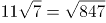。

故正确答案为C。

**考点**：机械划分

**来源**：2022年江苏省公务员录用考试《行测》题（A类）（网友回忆版）第49题

### 第 50 题

1，3，7/2，5/2，31/24，（ ）

A. 8/15

B. 21/40

C. 127/120

D. 5

第 50 题 · 答案与解析

**参考答案（粉笔题库参考内容）**

B

**解析**

数列大部分为分数，考虑分数数列。对数列进行反约分可得：1/1、3/1、7/2、15/6、31/24。分子部分为：1、3、7、15、31，后一项-前一项可得：2、4、8、16，是公比为2的等比数列，则所求项的分子部分为16×2+31=63。分母部分为：1、1、2、6、24，观察发现存在明显倍数关系，后一项÷前一项可得：1、2、3、4，是公差为1的等差数列，则所求项的分母部分为（4+1）×24=120。故所求项。

故正确答案为B。

**考点**：分数数列

**来源**：2022年江苏省公务员录用考试《行测》题（A类）（网友回忆版）第50题

### 第 51 题

小王和小李进行七局四胜的乒乓球比赛，两人水平相当，每局胜对方的概率都是1/2。若前三局过后小王获胜的概率是11/16，则她前三局的胜负情况是：

A. 胜3局

B. 胜2局、负1局

C. 负3局

D. 胜1局、负2局

第 51 题 · 答案与解析

**参考答案（粉笔题库参考内容）**

B

**解析**

由题意可知，三局之后小王获胜的概率大于1/2，可知她前三局胜多负少，排除C、D两项。剩余两项，剩二代一：

A项：小王前三局胜三局，之后只需要再胜一局即可获胜，分类情况如下：①第四局获胜，概率=1/2；②第四局败，第五局胜，概率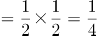；③第四、五局都败、第六局胜，概率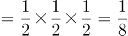；④第四、五、六局都败，第七局胜，概率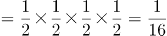。故小王获胜概率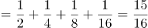，错误，排除；

B项：小王前三局，胜两局，之后还需胜两局即可获胜，分类情况如下：①第四、五局连胜两局，概率；②第四、五局中胜一局败一局，第六局胜，概率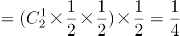；③第四、五、六局中胜一局败两局，第七局胜，概率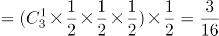。故小王获胜概率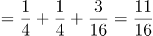，正确。

故正确答案为B。

备注：①考场上排除C、D、A三项后，无需验证B项，直接选即可。

②A项概率也可反面求解：获胜概率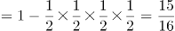。

**考点**：给概率求概率

**来源**：2022年江苏省公务员录用考试《行测》题（B类）（网友回忆版）第51题

### 第 52 题

甲、乙两人对100个家庭进行电话调查。若甲、乙完成对1个家庭的调查需要的时间分别是12分钟和20分钟，则他们完成这次电话调查需要的时间至少是：

A. 12小时28分钟

B. 12小时32分钟

C. 12小时36分钟

D. 12小时40分钟

第 52 题 · 答案与解析

**参考答案（粉笔题库参考内容）**

C

**解析**

方法一：甲、乙完成对1个家庭的调查需要的时间分别是12分钟和20分钟，因此每小时（60分钟）甲调查5个家庭，乙调查3个家庭，合计调查5+3=8个家庭。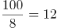小时······4个家庭，剩余4个家庭由甲调查3个，乙调查1个，用时是最少的，需要36分钟。因此两人合计用时最少为12小时36分钟，对应C项。

方法二：由于选项都是12小时多，且问“至少”，故可利用代入排除法。12小时调查数量为：甲个家庭，乙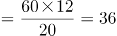个家庭，合计60+36=96个家庭，还剩4个家庭未调查。问题问“至少”，从最小的开始代入。

A项：28分钟，甲可调查2个家庭，乙可调查1个家庭，合计2+1=3个，不足4个，排除；

B项：32分钟，甲可调查2个家庭，乙可调查1个家庭，合计2+1=3个，不足4个，排除；

C项：36分钟，甲可调查3个家庭，乙可调查1个家庭，合计3+1=4个，当选。

故正确答案为C。

**考点**：非典型最值问题、给具体单位型

**来源**：2022年江苏省公务员录用考试《行测》题（C类）（网友回忆版）第63题

### 第 53 题

下列图形中，阴影部分面积为2的是：

A. 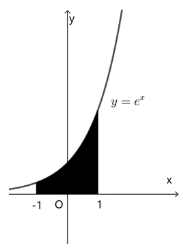

B. 

C. 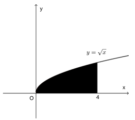

D. 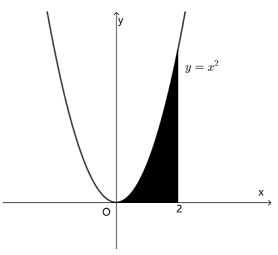

第 53 题 · 答案与解析

**参考答案（粉笔题库参考内容）**

B

**解析**

方法一：根据微积分原理，如果f(x)是区间\[a，b\]上的连续函数，并且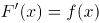，则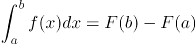。

A项：直线x=-1，x=1，以及曲线y=e^x和x轴围成的图形的面积可表示，x在\[-1，1\]上的积分，被积函数为y=e^x，所以所求面积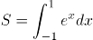=e^x|_{-1}^{1}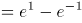≠2，不符合题意；

B项：直线，x=π/2，以及曲线y=cosx和x轴围成的图形的面积可表示，x在\[π/2，π/2\]上的积分，被积函数为y=cosx，所以所求面积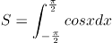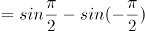\=2，符合题意；

C项：直线x=0，x=4，以及曲线y=√x和x轴围成的图形的面积可表示，x在\[0，4\]上的积分，被积函数为y=√x，所以所求面积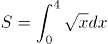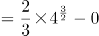=16/3，不符合题意；

D项：直线x=0，x=2，以及曲线y=x^2和x轴围成的图形的面积可表示，x在\[0，2\]上的积分，被积函数为y=x^2，所以所求面积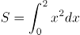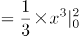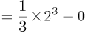=8/3，不符合题意。

方法二：A项：

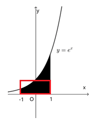

如图长方形的面积为2，多余的阴影部分面积明显超过长方形中多算的空白面积，即所求函数阴影面积不为2，不符合题意；

C项：

如图长方形的面积为4×2=8，所求函数阴影面积明显超过长方形面积的一半，即超过2，不符合题意；

D项：

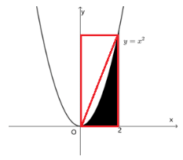

如图长方形的面积为4×2=8，所求函数阴影面积明显超过长方形面积的1/4，即超过2，不符合题意。

故正确答案为B。

**来源**：2022年江苏省公务员录用考试《行测》题（A类）（网友回忆版）第53题

### 第 54 题

某疫苗接种点市民正在有序排队等候接种。假设之后每小时新增前来接种疫苗的市民人数相同，且每个接种台的效率相同，经测算：若开8个接种台，6小时后不再有人排队；若开12个接种台，3小时后不再有人排队。如果每小时新增的市民人数比假设的多25%，那么为保证2小时后不再有人排队，需开接种台的数量至少为：

A. 14个

B. 15个

C. 16个

D. 17个

第 54 题 · 答案与解析

**参考答案（粉笔题库参考内容）**

D

**解析**

设原来排队市民总数为Y人，假设每小时新增的市民人数为X人，接种台数量为N个，由牛吃草公式Y=（N-X）×T有：Y=（8-X）×6=（12-X）×3，解得：X=4，Y=24；根据“每小时新增的市民人数比假设的多25%”可得，现在每小时新增的市民人数为：4×（1+25%）=5。同样代入牛吃草公式有：24=（N-5）×2，解得：N=17。

故正确答案为D。

**来源**：2022年江苏省公务员录用考试《行测》题（C类）（网友回忆版）第60题

### 第 55 题

某人以每小时10公里的速度从甲地骑车前往乙地，中午12:30到达。若以每小时15公里的速度行驶，上午11:00到达，则他出发的时间是：

A. 上午7:15

B. 上午7:30

C. 上午7:45

D. 上午8:00

第 55 题 · 答案与解析

**参考答案（粉笔题库参考内容）**

D

**解析**

方法一：设速度为10公里/小时时所用时间为t小时，则速度为15公里/小时时所用时间为（t-1.5）小时。根据S=V×T，可得：10t=15（t-1.5），解得t=4.5。故出发时间为12:30前推4.5小时，即上午8:00。

方法二：甲地到乙地的路程一定，则速度与时间成反比。速度之比为10：15=2：3，对应时间之比为3：2。相差的1份对应1.5小时。当速度为10公里/小时，所用时间为3×1.5=4.5小时，中午12:30到达，对应出发时间为上午8:00。

故正确答案为D。

**考点**：普通行程

**来源**：2022年江苏省公务员录用考试《行测》题（B类）（网友回忆版）第55题

### 第 56 题

某单位拟开展3场文化交流活动，安排给3个部门进行策划。若每个部门最多承担2场活动的策划，每场活动只安排给1个部门，则不同的安排方法共有：

A. 16种

B. 24种

C. 32种

D. 48种

第 56 题 · 答案与解析

**参考答案（粉笔题库参考内容）**

B

**解析**

因为每个部门最多承担2场活动的策划，不同的分类方式为：

情况1：三个部门各承担1场活动，共A_3^3=6种安排方法；

情况2：从三个部门选出1个部门承担2场活动，有C_3^1=3种，从三场活动中选取两个活动，有C_3^2=3种，最后一场活动由剩余的两个部门其中1个进行承担，有C_2^1=2种。共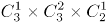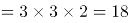种安排方法。

则共有6+18=24种安排方法。

故正确答案为B。

**考点**：基础排列组合

**来源**：2022年江苏省公务员录用考试《行测》题（B类）（网友回忆版）第56题

### 第 57 题

某金融机构向9家“专精特新”企业共发放了4500万元贷款，若这9家企业获得的贷款额从少到多排列，恰好为一个等差数列，且排第3的企业获得420万元贷款，排第8的企业获得的贷款额为：

A. 620万元

B. 660万元

C. 720万元

D. 760万元

第 57 题 · 答案与解析

**参考答案（粉笔题库参考内容）**

A

**解析**

由题干可知：9家企业共发放4500万元且贷款额从少到多排列，恰好为一个等差数列。根据等差数列求和公式：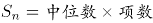，可知排名第5的企业（中位数）获得=4500÷9=500万元。又已知排名第3的企业获得420万元，则根据等差数列的通项公式：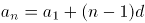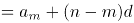可知，等差数列的公差为：万元，排名第8的企业获得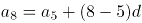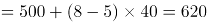万元。

故正确答案为A。

**考点**：数列问题

**来源**：2022年江苏省公务员录用考试《行测》题（C类）（网友回忆版）第64题

### 第 58 题

有5支足球队进行单循环比赛，每场比赛胜者得3分，负者不得分，平局双方各得1分。比赛结束后，若5支球队的总得分为25分，冠军得12分，则亚军得：

A. 5分

B. 6分

C. 7分

D. 8分

第 58 题 · 答案与解析

**参考答案（粉笔题库参考内容）**

A

**解析**

根据题意可得，5支足球队进行单循环比赛，总场次有场。设10场比赛中分出胜负的有x场，平局有y场。根据每场胜负共得3+0=3分，每场平局共得1+1=2分，总得分为25分，可列方程组：x+y=10……①；3x+2y=25……②。联立①②，解得x=5，y=5。由于每支球队均要进行4场比赛，冠军总得分为12分，可知冠军4场全胜，则亚军必有1胜（5-4=1）、1负(输于冠军)，剩余2场为平局，故总得分为3+0+1+1=5分。

故正确答案为A。

**考点**：排列组合问题-其他

**来源**：2022年江苏省公务员录用考试《行测》题（A类）（网友回忆版）第64题

### 第 59 题

某机构对全运会收视情况进行调查，在1000名受访者中，观看过乒乓球比赛的占87%，观看过跳水比赛的占75%，观看过田径比赛的占69%。这1000名受访者中，乒乓球、跳水和田径比赛都观看过的至少有：

A. 310人

B. 440人

C. 620人

D. 690人

第 59 题 · 答案与解析

**参考答案（粉笔题库参考内容）**

A

**解析**

根据“都······至少”判定本题为多集合反向构造问题。

第一步反向：乒乓球比赛、跳水比赛、田径比赛没有看过的分别为：1000-1000×87%=130人、1000-1000×75%=250人、1000-1000×69%=310人。

第二步作和：乒乓球比赛、跳水比赛、田径比赛没有看过的最多为130+250+310=690人。

第三步作差：乒乓球、跳水和田径比赛都观看过的至少有1000-690=310人。

故正确答案为A。

**考点**：多集合反向构造

**来源**：2022年江苏省公务员录用考试《行测》题（A类）（网友回忆版）第54题

### 第 60 题

如图所示，考古队在B和C两处发现重要遗址，根据对周边环境考察，确定以A和D为顶点划出一个正方形挖掘区域。已知AB、CD都与BC垂直，AB=7米，BC=7米，CD=42米，则这个正方形挖掘区域的边长为：

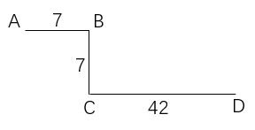

A. 49米

B. 45米

C. 40米

D. 35米

第 60 题 · 答案与解析

**参考答案（粉笔题库参考内容）**

D

**解析**

B、C两处为重要遗址，因此以A和D为顶点划出的正方形挖掘区域，需要包含B、C两点，才能对遗址进行挖掘。同时由题意可知，AD的长度大于42+7=49米，若AD为正方形的一条边，则所给选项均不满足，故AD只能为正方形的对角线。如下图所示，设正方形挖掘区域的边长AE和DE为x米，过点A作DC的垂线，与DC的延长线相交于点F，则DF=FC+CD=AB+CD=7+42=49米，AF=BC=7米。根据勾股定理，在三角形ADF和三角形ADE中，，即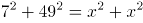，解得x=35，即这个正方形挖掘区域的边长为35米。

故正确答案为D。

**考点**：几何结论类-三角形相关

**来源**：2022年江苏省公务员录用考试《行测》题（C类）（网友回忆版）第52题

### 第 61 题

甲、乙、丙三个物流公司合作完成两个仓库K和L的货物搬运任务。已知两个仓库的工作量相同，他们先在K工作2小时，完成了K工作量的75%；然后乙、丙先去L工作，甲留在K继续工作，并用3小时完成了K的剩余工作量后再去L工作，直至任务全部完成。甲在L工作的总时间为：

A. 20分钟

B. 30分钟

C. 40分钟

D. 50分钟

第 61 题 · 答案与解析

**参考答案（粉笔题库参考内容）**

A

**解析**

甲用3小时完成K工作总量的1-75%=25%，赋值甲的工作效率为1，则K的工作总量为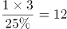，L的工作总量也为12。甲、乙、丙合作2小时完成K的工作量为12×75%=9，则甲、乙、丙的工作效率之和为9/2=4.5，乙、丙的工作效率之和为4.5-1=3.5。乙、丙在L工作3小时完成的工作量为3.5×3=10.5，L剩余的工作量为12-10.5=1.5。因此甲在L工作的总时间为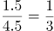小时，即20分钟。

故正确答案为A。

**考点**：给效率比例型

**来源**：2022年江苏省公务员录用考试《行测》题（B类）（网友回忆版）第61题

### 第 62 题

正方体中，E、F分别为棱A_1A和C_1C的中点，则平面D_1EF截该正方体所得截面的形状是：

A. 三角形

B. 四边形

C. 五边形

D. 六边形

第 62 题 · 答案与解析

**参考答案（粉笔题库参考内容）**

B

**解析**

如图所示，设正方体的中心点为O，E、F分别分别为A_1A、C_1C的中点，D_1B为正方体的体对角线，连接D_1E、EB、BF、FD_1、D_1B、EF，易得此六条线段在同一平面上，则故平面D_1EF截该正方体所得截面即为四边形。

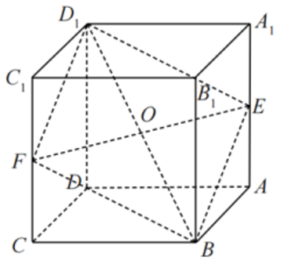

故正确答案为B。

**考点**：几何其他题型

**来源**：2022年江苏省公务员录用考试《行测》题（C类）（网友回忆版）第55题

### 第 63 题

某餐饮公司甲、乙两种外卖每份的售价分别为30元和50元，若该公司某天售出这两种外卖共500份，销售收入为21400元，则售出的两种外卖数量相差：

A. 140份

B. 160份

C. 180份

D. 200份

第 63 题 · 答案与解析

**参考答案（粉笔题库参考内容）**

A

**解析**

假设甲外卖和乙外卖当天分别卖出x份和y份。根据题干条件可知，这两种外卖共售出500份，可列式为x+y=500······①；这两种外卖的销售收入为21400元，可列式为30x+50y=21400······②。联立方程组，解得x=180，y=320，故售出的两种外卖数量相差320-180=140份。

故正确答案为A。

**考点**：和差倍比问题

**来源**：2022年江苏省公务员录用考试《行测》题（A类）（网友回忆版）第62题

### 第 64 题

某学者认为，人类的体力、情绪、智力自出生日起分别以22天、28天、33天为周期开始往复循环变化，前半个周期是“高潮期”，后半个周期是“低潮期”。根据该学者的观点，我们过公历生日时，体力、情绪和智力同时处于“高潮期”的最小年龄是：

A. 4周岁

B. 3周岁

C. 2周岁

D. 1周岁

第 64 题 · 答案与解析

**参考答案（粉笔题库参考内容）**

C

**解析**

根据题意利用代入排除法，问最小年龄，从小到大进行代入。代入D项若最小年龄为1周岁，即365天，体力处于个周期⋯⋯13天，22天前半个周期11天是“高潮期”，13天不满足题意，排除D项；代入C项若最小年龄为2周岁，即365×2=730天，体力处于个周期⋯⋯4天，情绪处于个周期······2天，智力处于个周期······4天，均处于以22天、28天、33天为周期的前半个周期“高潮期”，满足题意。

备注：即使在2周岁时经历了闰年366天，所有余数均加一，仍然均处于前半个周期“高潮期”。

故正确答案为C。

**考点**：周期余数问题

**来源**：2022年江苏省公务员录用考试《行测》题（A类）（网友回忆版）第58题

### 第 65 题

如图所示，为测量珠穆朗玛峰上某点C的海拔高度，测量队选择了两个海拔高度相差100米的珠峰测量点A和B，测得∠ABC为90°，从A观测B、C的仰角分别为30°和45°，从B观测C的仰角也为30°，则C点的海拔高度比A点高：

A. 100√2米

B. 150米

C. 100√3米

D. 200米

第 65 题 · 答案与解析

**参考答案（粉笔题库参考内容）**

D

**解析**

如图所示，A和B两个海拔高度相差100米（即BE=100米），从A观测B的仰角为30°，因△ABE是30°的直角三角形，则三边关系为，所以AB=100×2=200米。从B观测C的仰角也为30°，根据题意，设CO=X米，则CD=（X-100）米，因△BCD是30°的直角三角形，则三边关系为，所以BC=2（X-100）=（2X-200）米。又因为从A观测C的仰角为45°，△AOC是45°的直角三角形，则三边关系为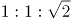，所以米。在△ABC中，∠ABC为90°，根据勾股定理可知，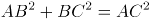，即，解得X=200，则C点的海拔高度比A点高200米。

故正确答案为D。

**考点**：几何结论类-三角形相关

**来源**：2022年江苏省公务员录用考试《行测》题（A类）（网友回忆版）第65题

### 第 66 题

新教师：老教师

A. 计划：总结

B. 序言：结尾

C. 草稿：定稿

D. 初赛：决赛

第 66 题 · 答案与解析

**参考答案（粉笔题库参考内容）**

C

**解析**

第一步：判断题干词语间逻辑关系。

新教师是教师，老教师是教师，二者为并列关系，且由新教师变成老教师，存在内在的转变。

第二步：判断选项词语间逻辑关系。

A项：计划是工作前的提纲，总结是工作后的评价，故二者不是并列关系，与题干逻辑关系不一致，排除；

B项：书籍或文章的开头叫“序言”，与结尾不构成并列关系，与题干逻辑关系不一致，排除；

C项：草稿指在进行文学创作前提前整理的文本内容，定稿指创作内容全部确定的最后完成稿，二者为并列关系，且由草稿变成定稿，存在内在的转变，与题干逻辑关系一致，当选；

D项：初赛和决赛为并列关系，但不是由初赛变为决赛，二者不存在内在的转变，与题干逻辑关系不一致，排除。

故正确答案为C。

**考点**：逻辑关系-并列关系

**来源**：2022年江苏省公务员录用考试《行测》题（C类）（网友回忆版）第69题

### 第 67 题

冬：暖冬

A. 妻：未婚妻

B. 人：植物人

C. 菜：平价菜

D. 书：有声书

第 67 题 · 答案与解析

**参考答案（粉笔题库参考内容）**

D

**解析**

第一步：判断题干词语间逻辑关系。

暖冬是冬天，二者为种属关系。

第二步：判断选项词语间逻辑关系。

A项：未婚妻指已与某男子订婚尚未结婚的女子，故在法律意义上，未婚妻不是妻子，与题干逻辑关系不一致，排除；

B项：植物人是与植物生存状态相似的特殊人体状态，植物人是人，与题干逻辑关系一致，保留；

C项：平价菜是菜，二者为种属关系，与题干逻辑关系一致，保留；

D项：有声书指用声音来表达内容的书，二者为种属关系，与题干逻辑关系一致，保留；

对比BCD三项，冬天一般是冷的，暖冬是与冬天特性相反的特殊情况；D项书一般是无声的，有声书是书特性相反的特殊情况，D项与题干更为接近。

故正确答案为D。

**考点**：逻辑关系-包容关系

**来源**：2022年江苏省公务员录用考试《行测》题（A类）（网友回忆版）第70题

### 第 68 题

灭蚊剂：蚊子

A. 居家隔离：病毒

B. 市场经济：垄断

C. 首问负责：推诿

D. 民意测验：分歧

第 68 题 · 答案与解析

**参考答案（粉笔题库参考内容）**

C

**解析**

第一步：判断题干词语间逻辑关系。

灭蚊剂是用来消灭蚊子的，所以二者为功能对应关系。

第二步：判断选项词语间逻辑关系。

A项：居家隔离是为了阻断病毒的传播，但是并不能消灭病毒，而题干中灭蚊剂是对蚊子存在致命性伤害，与题干逻辑关系不一致，排除；

B项：市场经济和垄断没有必然的关系，与题干逻辑关系不一致，排除；

C项：首问负责的意思是谁接到问题，谁就负责到底。具体内容为最先接到来访或来办理业务时，其作为首问负责的人，首问负责是用来消除工作人员对来访人员推诿的，二者为功能对应关系，与题干逻辑关系一致，当选；

D项：民意测验是为了了解公众对特定问题的看法和意见，与分歧没有明显关系，与题干逻辑关系不一致，排除。

故正确答案为C。

**考点**：逻辑关系-对应关系

**来源**：2022年江苏省公务员录用考试《行测》题（A类）（网友回忆版）第71题

### 第 69 题

水中捞月：白费功夫

A. 霸王之兵：勇往直前

B. 天涯海角：杳无音信

C. 棋逢对手：不相上下

D. 蚍蜉撼树：不自量力

第 69 题 · 答案与解析

**参考答案（粉笔题库参考内容）**

D

**解析**

第一步：判断题干词语间逻辑关系。

水中捞月比喻去做根本做不到的事情，只能白费力气。水中捞月可以用来形容白费功夫，二者为比喻象征义，且水中捞月为贬义词。

第二步：判断选项词语间逻辑关系。

A项：霸王之兵出自《孙子兵法》，形容强大的国家必须要有一支强大的军队。勇往直前形容不怕艰险，奋勇地一直往前进。两者无明显语义关系，与题干逻辑关系不一致，排除；

B项：天涯海角形容极远的地方，或相隔极远。杳无音信形容没有一点消息。两者无明显语义关系，与题干逻辑关系不一致，排除；

C项：棋逢对手是指下棋碰上了水平相当的对手，比喻双方本领不相上下。棋逢对手可以用来形容不相上下，二者为比喻象征义，但棋逢对手为褒义词，与题干逻辑关系不一致，排除；

D项：蚍蜉撼树是指蚂蚁想摇动大树，比喻狂妄，不自量力。蚍蜉撼树可以用来形容不自量力，二者为比喻象征义，且蚍蜉撼树为贬义词，与题干逻辑关系一致，当选。

故正确答案为D。

**考点**：语义关系-比喻象征义、语义-其他

**来源**：2022年江苏省公务员录用考试《行测》题（A类）（网友回忆版）第72题

### 第 70 题

峰：山峰：碳达峰

A. 界：世界：思想界

B. 潮：海潮：移民潮

C. 子：儿子：菜篮子

D. 羊：山羊：领头羊

第 70 题 · 答案与解析

**参考答案（粉笔题库参考内容）**

B

**解析**

第一步：判断题干词语间逻辑关系。

“山峰”指山突出来的顶端，山峰中的“峰”指山的尖顶。“碳达峰”指在某一个时点，二氧化碳的排放达到峰值后不再增长，之后逐步回落，碳达峰中的“峰”即峰值的意思，两个“峰”的意思不一致。题干中山峰是具体的事物，而碳达峰是抽象概念。

第二步：判断选项词语间逻辑关系。

A项：“世界”广义上来讲，就是指全部、所有、一切，世界中的“界”指范围。“思想界”指的是思想这个范畴，两个“界”的意思一致，与题干逻辑关系不一致，排除；

B项：“海潮”中的“潮”指的是潮汐、潮水，“移民潮”指的是移民的潮流，移民潮中的“潮”是比喻大规模的社会变动或运动发展的起伏形。两个“潮”的意思是不一致的。海潮是具体的事物，而移民潮是抽象概念，与题干逻辑关系一致，当选；

C项：“儿子”是指父母对孩子的一种称谓，“菜篮子”指的是装菜的一种器具。这两个“子”都是附加在名词、动词、形容词后，具有名词性（读轻声）的意思，与题干逻辑关系不一致，排除；

D项：“山羊”指的是一种动物、家畜，“领头羊”是指羊群中领头的羊，借指带领大家前进的领头人或单位。对于本意来说两个“羊”的意思是一致的，而且领头羊不是抽象概念，与题干逻辑关系不一致，排除。

故正确答案为B。

**考点**：拆分思维

**来源**：2022年江苏省公务员录用考试《行测》题（A类）（网友回忆版）第66题

### 第 71 题

电气：煤气：气

A. 酸奶：羊奶：奶

B. 银河：运河：河

C. 正面：反面：面

D. 榆钱：金钱：钱

第 71 题 · 答案与解析

**参考答案（粉笔题库参考内容）**

B

**解析**

第一步：判断题干词语间逻辑关系。

电气是利用电产生能量的方式，与煤气无关，而且电气不是气。煤气是气的一种，后两者是种属关系。

第二步：判断选项词语间逻辑关系。

A项：酸奶与奶是原材料与制成品的关系，羊奶是奶的一种，后两者是种属关系，与题干逻辑关系不一致，排除；

B项：银河与运河无关，而且银河不是河。运河是河的一种，后两者是种属关系，与题干逻辑关系一致，当选；

C项：正面与反面属于事物的两面性，二者为并列关系，二者均与面构成种属关系，与题干逻辑关系不一致，排除；

D项：榆钱是植物，不是钱，金钱和钱为全同关系，与题干逻辑关系不一致，排除。

故正确答案为B。

**考点**：逻辑关系-包容关系

**来源**：2022年江苏省公务员录用考试《行测》题（A类）（网友回忆版）第68题

### 第 72 题

地砖：方砖：长条砖

A. 菜肴：荤菜：白菜

B. 零食：素食：热食

C. 青茄：紫茄：番茄

D. 木船：客船：货船

第 72 题 · 答案与解析

**参考答案（粉笔题库参考内容）**

D

**解析**

第一步：判断题干词语间逻辑关系。

“方砖”和“长条砖”是两种不同形状的砖，二者为并列关系，同时均与“地砖”为交叉关系。

第二步：判断选项词语间逻辑关系。

A项：荤菜指的是所有含有动物性成分的菜，荤菜是菜肴的一种，二者是种属关系，与题干逻辑关系不一致，排除；

B项：零食、素食、热食两两之间是交叉关系，与题干逻辑关系不一致，排除；

C项：青茄、紫茄、番茄为三种蔬菜，三者为并列关系，与题干逻辑关系不一致，排除；

D项：“客船”和“货船”是两种不同功能的船，二者为并列关系，同时均与“木船”为交叉关系，与题干逻辑关系一致，当选。

故正确答案为D。

**考点**：逻辑关系-并列关系、逻辑关系-交叉关系

**来源**：2022年江苏省公务员录用考试《行测》题（C类）（网友回忆版）第72题

### 第 73 题

东北亚 之于 （ ） 相当于 （ ） 之于 树冠

A. 韩国；树墩

B. 南亚；树根

C. 东半球；树洞

D. 日本海；树荫

第 73 题 · 答案与解析

**参考答案（粉笔题库参考内容）**

B

**解析**

逐一代入选项。

A项：韩国是东北亚的一部分，二者是组成关系，树墩与树冠都是树木的组成部分，二者为并列关系，前后逻辑关系不一致，排除；

B项：东北亚和南亚是不同的地理区域，二者是并列关系，树根和树冠都是树木的组成部分，二者为并列关系，前后逻辑关系一致，当选；

C项：东北亚是东半球的一部分，二者是组成关系，树洞和树冠都是树木的组成部分，二者为并列关系，前后逻辑关系不一致，排除；

D项：日本海是东北亚的一部分，二者为组成关系，树荫是指树下日光照不到的地方，树冠经阳光照射后能形成树荫，二者为对应关系，前后逻辑关系不一致，排除。

故正确答案为B。

**考点**：逻辑关系-并列关系

**来源**：2022年江苏省公务员录用考试《行测》题（A类）（网友回忆版）第73题

### 第 74 题

（ ） 之于 帐篷 相当于 进餐 之于 （ ）

A. 敖包；餐厅

B. 野营；碗筷

C. 宿营；用餐

D. 探险；烤鸭

第 74 题 · 答案与解析

**参考答案（粉笔题库参考内容）**

B

**解析**

逐一代入选项。

A项：敖包是指蒙古族人民做路标和界标的堆子，用土、石、草等堆成，与帐篷无明显对应关系；在餐厅进餐，两者是地点对应关系，前后逻辑关系不一致，排除；

B项：野营需要用到帐篷，两者是工具对应关系；进餐需要用到碗筷，两者也是工具对应关系，前后逻辑关系一致，当选；

C项：宿营是指军队行军或战斗后的临时住宿，宿营可能需要用到帐篷，两者是工具对应关系；进餐和用餐都表示“用餐”的意思，两者是全同关系，前后逻辑关系不一致，排除；

D项：探险可能需要用到帐篷，两者是工具对应关系；进餐可以吃烤鸭，两者是对象对应关系，前后逻辑关系不一致，排除。

故正确答案为B。

**考点**：逻辑关系-对应关系

**来源**：2022年江苏省公务员录用考试《行测》题（B类）（网友回忆版）第74题

### 第 75 题

（ ） 之于 高洁 相当于 红色 之于 （ ）

A. 高尚：红花

B. 典雅：色彩

C. 牡丹：喜庆

D. 莲花：革命

第 75 题 · 答案与解析

**参考答案（粉笔题库参考内容）**

C

**解析**

逐一代入选项。

A项：高尚和高洁都是形容品行高尚纯洁，二者是近义关系，红花是红色的，二者是属性对应关系，前后逻辑关系不一致，排除；

B项：典雅形容高雅而不浅俗，高洁形容高尚纯洁，二者均为美好品质，是并列关系，红色是色彩，二者是种属关系，前后逻辑关系不一致，排除；

C项：牡丹象征高洁、端庄秀雅，二者是比喻象征义，红色象征喜庆，二者是比喻象征义，前后逻辑关系一致，保留；

D项：莲花象征清白纯洁、高尚谦虚，二者是比喻象征义，红色象征革命，二者是比喻象征义，前后逻辑关系一致，保留；

比较C、D两项，题干高洁是形容词，C项喜庆是形容词，D项革命为动词，所以C项比D项更接近题干。

故正确答案为C。

**考点**：语义关系-比喻象征义、语法关系

**来源**：2022年江苏省公务员录用考试《行测》题（B类）（网友回忆版）第75题

### 第 76 题

请从所给的四个选项中，选出最恰当的一项填入问号处，使之呈现一定的规律性。

A. A

B. B

C. C

D. D

第 76 题 · 答案与解析

**参考答案（粉笔题库参考内容）**

A

**解析**

元素组成不同，优先考虑属性规律。观察题干图形，出现等腰三角形、等腰梯形等明显轴对称图形，考虑对称性。题干对称轴数量均为1，排除C项。继续观察发现，题干对称轴依次顺时针旋转45°，则“？”处应该填入对称轴方向为右上-左下的图形，只有A项符合。

故正确答案为A。

**考点**：属性规律-对称性

**来源**：2022年江苏省公务员录用考试《行测》题（B类）（网友回忆版）第76题

### 第 77 题

请从所给的四个选项中，选出最恰当的一项填入问号处，使之呈现一定的规律性。

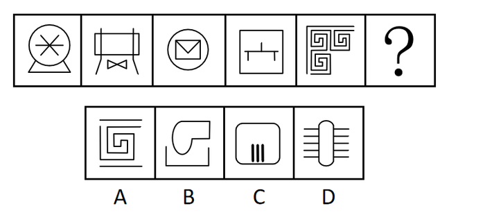

A. A

B. B

C. C

D. D

第 77 题 · 答案与解析

**参考答案（粉笔题库参考内容）**

B

**解析**

元素组成不同，无明显属性规律，考虑数量规律。观察发现题干出现较多生活化图形，考虑部分数。题干图形的部分数均为2，故？处要选一个部分数为2的图形，只有B项符合。

故正确答案为B。

**考点**：数量规律-素

**来源**：2022年江苏省公务员录用考试《行测》题（B类）（网友回忆版）第77题

### 第 78 题

请从所给的四个选项中，选出最恰当的一项填入问号处，使之呈现一定的规律性。

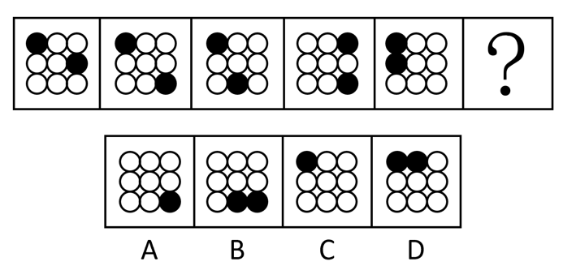

A. A

B. B

C. C

D. D

第 78 题 · 答案与解析

**参考答案（粉笔题库参考内容）**

A

**解析**

图形元素组成相同，优先考虑位置规律。观察发现，题干图形中两个黑球沿九宫格的外圈进行平移。优先考虑就近假设，图一左上角黑球保持位置不动，但图四不符合此规律，因此图一左上角黑球对应图二右下角黑球。如下图所示，从图一到图五，黑球1沿外圈每次顺时针平移4格，黑球2沿外圈每次逆时针平移3格，因此？处图形也应满足此规律，黑球位置如下图所示，对应A项。

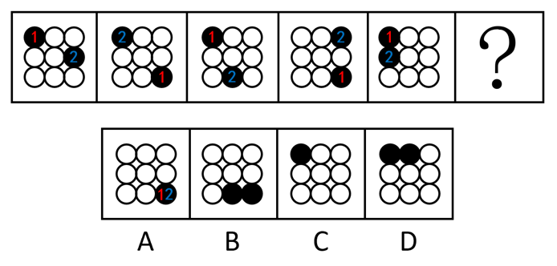

故正确答案为A。

**考点**：位置规律-平移

**来源**：2022年江苏省公务员录用考试《行测》题（B类）（网友回忆版）第78题

### 第 79 题

从所给的四个选项中，选择最合适的一个填入问号处，使之呈现一定的规律性：

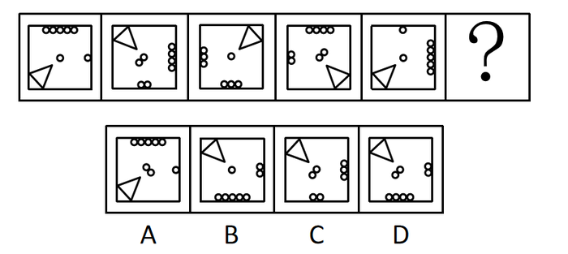

A. A

B. B

C. C

D. D

第 79 题 · 答案与解析

**参考答案（粉笔题库参考内容）**

D

**解析**

元素组成相同，优先考虑位置规律。观察发现，三角形沿着正方形的四个角依次顺时针移动一个角的位置，？处应移动到左上角，排除A项；继续观察题干，发现小圆数量发生变化，内圈小圆数量依次为1、2、1、2、1、？，？处应选择内圈有2个小圆的图形，排除B项；外圈小圆数量均为6个，排除C项，只有D项符合规律。

故正确答案为D。

**考点**：位置规律-平移、数量规律-素

**来源**：2022年江苏省公务员录用考试《行测》题（A类）（网友回忆版）第79题

### 第 80 题

请从所给的四个选项中，选出最恰当的一项填入问号处，使之呈现出一定的规律性。

A. A

B. B

C. C

D. D

第 80 题 · 答案与解析

**参考答案（粉笔题库参考内容）**

A

**解析**

图形元素组成不同，且无明显属性规律，考虑数量规律。观察发现，题干图形中出现明显单一直线及多边形，优先考虑数直线，发现整体数直线无规律，而题干图形中横线、竖线较多，因此考虑分开数横竖线。九宫格优先横行看，三行图形的横线数依次为3、4、3、4、3、4、4、3，三行图形的竖线数依次为2、3、2、3、2、3、3、2，单看横竖线数无规律，考虑二者做运算。发现题干所有图形的横线数减竖线数均为1，故？处应选择横线数减竖线数等于1的图形，只有A项符合规律。

故正确答案为A。

**考点**：数量规律-线

**来源**：2022年江苏省公务员录用考试《行测》题（C类）（网友回忆版）第80题

### 第 81 题

请从所给的四个选项中，选出最恰当的一项填入问号处，使之呈现出一定的规律性：

A. A

B. B

C. C

D. D

第 81 题 · 答案与解析

**参考答案（粉笔题库参考内容）**

A

**解析**

元素组成相似，优先考虑样式规律，且相同线条重复出现，因此考虑样式规律中的加减同异。九宫格优先按行看，观察发现，第一行中，图2逆时针旋转45°，再与图1求异得到图3。经验证，第二行也满足此规律。因此第三行应用此规律，图2逆时针旋转45°，再与图1求异，得到A项图形。

故正确答案为A。

**考点**：样式规律-加减同异

**来源**：2022年江苏省公务员录用考试《行测》题（B类）（网友回忆版）第81题

### 第 82 题

下边四个图形中，只有一个是由上边的四个图形拼合（只能通过上、下、左、右平移）而成的，请把它找出来。

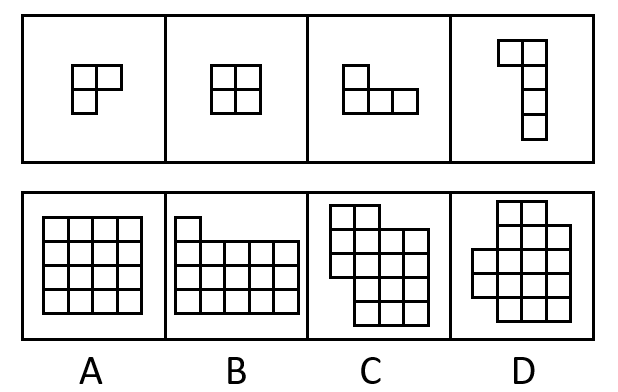

A. A

B. B

C. C

D. D

第 82 题 · 答案与解析

**参考答案（粉笔题库参考内容）**

A

**解析**

本题考查平面拼合，可采用平行且等长相消的方式解题。消去平行且等长的线段后进行组合即可得到轮廓图，即为A项。平行且等长相消的方式如下图所示：

故正确答案为A。

**来源**：2022年江苏省公务员录用考试《行测》题（A类）（网友回忆版）第82题

### 第 83 题

下边四个图形中，只有一个是由上边的四个图形拼合（只能通过上、下、左、右平移）而成的，请把它找出来。

A. A

B. B

C. C

D. D

第 83 题 · 答案与解析

**参考答案（粉笔题库参考内容）**

B

**解析**

本题考察平面拼合，可采用平行且等长相消的方式解题。消去平行且等长的线段后进行组合即可得到轮廓图，即为B项。平行且等长相消的方式如下图所示：

故正确答案为B。

**来源**：2022年江苏省公务员录用考试《行测》题（C类）（网友回忆版）第83题

### 第 84 题

下边四个图形中，只有一个是由上边的四个图形拼合（只能通过上、下、左、右平移）而成的，请把它找出来。

A. A

B. B

C. C

D. D

第 84 题 · 答案与解析

**参考答案（粉笔题库参考内容）**

A

**解析**

本题考查平面拼合。消去凹凸匹配的线条后进行组合可得到轮廓图，即为A项。具体拼合方式如下图所示：

故正确答案为A。

**来源**：2022年江苏省公务员录用考试《行测》题（A类）（网友回忆版）第84题

### 第 85 题

上边四张纸片，每张纸片一面是黑色，另一面是白色，下边仅有一项能由其拼合（可以平移、旋转、翻转）而成，请把它找出来。

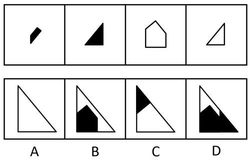

A. A

B. B

C. C

D. D

第 85 题 · 答案与解析

**参考答案（粉笔题库参考内容）**

A

**解析**

本题考查平面拼合，可以平移、旋转、翻转，且每张纸片一面是黑色，另一面是白色，需要考虑翻转后的颜色变化。将题干图形标上序号，如下图所示，逐一分析选项。

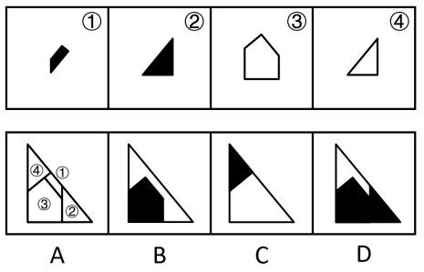

A项：可以由题干图形拼合而成，拼合方式如上图所示，当选；

B项：左下角的五边形是由图③平移过去的，颜色应该是白色，而选项是黑色，排除；

C项：右下角的白色三角形是由图④翻转后平移过去的，颜色应该是黑色，而选项是白色，排除；

D项：左下角的五边形是由图③平移过去的，颜色应该是白色，而选项是黑色；且右下角的三角形是由图②翻转后平移得到的，颜色应该是白色，而选项是黑色。排除。

故正确答案为A。

**来源**：2022年江苏省公务员录用考试《行测》题（B类）（网友回忆版）第85题

### 第 86 题

上边四张纸片，每张纸片一面是黑色，另一面是白色，下边仅有一项能由其拼合（可以平移、旋转、翻转）而成，请把它找出来。

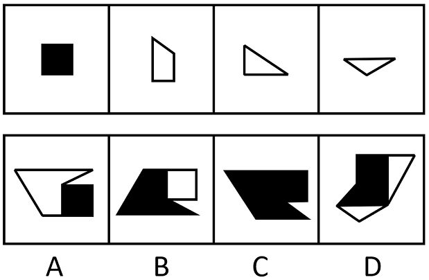

A. A

B. B

C. C

D. D

第 86 题 · 答案与解析

**参考答案（粉笔题库参考内容）**

C

**解析**

本题考查平面拼合，题干已知每张纸片一面是黑色，另一面是白色，且可以涉及转动，故可知，平移和旋转时纸片颜色不会改变，翻转时颜色会发生改变。经过拼合后只能得到C项。如下图所示：

故正确答案为C。

**来源**：2022年江苏省公务员录用考试《行测》题（C类）（网友回忆版）第86题

### 第 87 题

左边给定的是多面体的外表面，右边哪一项能由它折叠而成？

A. A

B. B

C. C

D. D

第 87 题 · 答案与解析

**参考答案（粉笔题库参考内容）**

A

**解析**

将题干展开图标上序号，如下图所示，逐一进行分析。

A项：选项由面b和面c构成，选项与题干展开图一致，当选；

B项：选项由面b和面c构成，以面c中空白顶点为起点进行画边（如上图蓝线所示），展开图中边1对应面b，选项中边3对应面b，选项与题干展开图不一致，排除；

C项：选项由面a和面c构成，展开图中，二者的公共边与面a内部阴影小三角形的顶点重合，选项中不重合（如下图绿线所示），选项与题干展开图不一致，排除；

D项：选项由面b和面d构成，展开图中，二者的公共边与面d内部三角形的边重合，选项中不重合（如下图红线所示），选项与题干展开图不一致，排除。

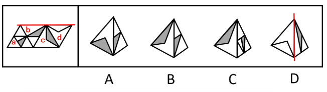

故正确答案为A。

**考点**：空间类-空间重构-四面体

**来源**：2022年江苏省公务员录用考试《行测》题（C类）（网友回忆版）第87题

### 第 88 题

左边给定的是多面体的外表面，右边哪一项能由它折叠而成？

A. A

B. B

C. C

D. D

第 88 题 · 答案与解析

**参考答案（粉笔题库参考内容）**

C

**解析**

将题干展开图标上序号，如下图所示，逐一进行分析。

A项：选项由面b、面a或面c构成，题干展开图中面b内白色三角形的顶点（如下图蓝点所示）只与面a或面c中白色三角形相邻，而选项中面b内白色三角形的顶点与面a或面c中阴影三角形和白色三角形均相邻，选项与题干展开图不一致，排除；

B项：选项由面b、面d构成，题干展开图中面d的白色部分挨着面b，而选项中面d的灰色部分挨着面b，选项与题干展开图不一致，排除；

C项：选项由面a、面c构成，选项与题干展开图一致，当选；

D项：选项由面d、面a或面c构成，题干展开图中面d白色部分的最长边挨着面b，而选项中面d白色部分的最长边没有挨着面b，选项与题干展开图不一致，排除。

故正确答案为C。

**考点**：空间类-空间重构-四面体

**来源**：2022年江苏省公务员录用考试《行测》题（B类）（网友回忆版）第88题

### 第 89 题

左边给定的是多面体的外表面，右边哪一项能由它折叠而成？请把它找出来。

A. A

B. B

C. C

D. D

第 89 题 · 答案与解析

**参考答案（粉笔题库参考内容）**

C

**解析**

将原展开图标上序号，如下图所示，逐一进行分析。

A项：选项中出现了面a和面e，面a中黑点所在矩形的长边（如下图线1所示）与面e相邻，而展开图中该矩形的长边与面b相邻，选项与题干展开图不一致，排除；

B项：选项中出现了面c、面f，面f中白圆所在矩形的长边（如下图线2所示）与面c相邻，而展开图中该矩形的长边与面e相邻，选项与题干展开图不一致，排除；

C项：选项中出现了面c、面d和面f，选项与题干展开图一致，当选；

D项：选项中出现了面a、面e，顶面为面b或面d，面e挨着顶面的空白三角形（如下图线3所示），但展开图中面e挨着面b或面d内的阴影三角形，选项与题干展开图不一致，排除。

故正确答案为C。

**考点**：空间类-空间重构-六面体

**来源**：2022年江苏省公务员录用考试《行测》题（C类）（网友回忆版）第89题

### 第 90 题

左边给定的是多面体的外表面，右边哪一项能由它折叠而成？请把它找出来。

A. A

B. B

C. C

D. D

第 90 题 · 答案与解析

**参考答案（粉笔题库参考内容）**

C

**解析**

本题考查六面体，将原展开图标上序号，如下图所示，逐一进行分析。

A项：选项中必然存在面b、面c和面d，题干展开图中三个面的公共点没有引出面c中的小短线，而选项中三个面的公共点引出了面c中的小短线，选项与题干展开图不一致，排除；

B项：选项中必然存在面b、面d和面f，题干展开图中三个面的公共点引出面d中的斜线，而选项中三个面的公共点没有引出面d中的斜线，选项与题干展开图不一致，排除；

C项：选项中必然存在面a、面e和面f，选项与题干展开图一致，当选；

D项：选项中必然存在面a、面c和面e，题干展开图中三个面的公共点在面a中对应的是大矩形，而选项中三个面的公共点在面a中对应的是小矩形，选项与题干展开图不一致，排除。

故正确答案为C。

**考点**：空间类-空间重构-六面体

**来源**：2022年江苏省公务员录用考试《行测》题（B类）（网友回忆版）第90题

### 第 91 题

新信息技术的不断发展，使生产要素配置发生变化；生产要素配置的变化又使企业运营模式发生变化，进而使市场对人才的需求发生变化；而市场对人才的需求发生了变化，就会促使高校重新制定人才培养方案。

以上陈述如果为真，可以推出以下哪项？

A. 市场对人才的需求发生变化会导致企业运营模式发生变化

B. 如果高校没有重新制定人才培养方案，说明市场对人才的需求没有什么变化

C. 如果没有新信息技术的不断发展，市场对人才的需求就不会发生变化

D. 企业运营模式的变化不一定会导致高校重新制定人才培养方案

第 91 题 · 答案与解析

**参考答案（粉笔题库参考内容）**

B

**解析**

第一步：翻译题干。

①新信息技术的不断发展→生产要素配置发生变化；

②生产要素配置的变化→企业运营模式发生变化→市场对人才的需求发生变化；

③市场对人才的需求发生了变化→高校重新制定人才培养方案；

以上条件可以递推出：④新信息技术的不断发展→生产要素配置发生变化→企业运营模式发生变化→市场对人才的需求发生变化→高校重新制定人才培养方案。

第二步：逐一分析选项。

A项：翻译为市场对人才的需求发生变化→企业运营模式发生变化，是对②的肯后，肯后得不出必然结论，无法推出，排除；

B项：翻译为-高校重新制定人才培养方案→市场对人才的需求发生变化，是对③的否后，否后必否前，可以推出，当选；

C项：翻译为-新信息技术的不断发展→市场对人才的需求发生变化，是对④的否前，否前得不出必然结论，无法推出，排除；

D项：根据④可知，企业运营模式的变化一定会导致高校重新制定人才培养方案，故此项无法推出，排除。

故正确答案为B。

**考点**：常规翻译

**来源**：2022年江苏省公务员录用考试《行测》题（B类）（网友回忆版）第91题

### 第 92 题

盲盒是指消费者不能提前得知包装盒内具体产品的销售方式。现在许多商家大量销售盲盒，文具盲盒、零食盲盒等“盲盒+”商业模式迅速走红。心理学研究表明，打开盲盒时的不确定性会刺激人们尤其是青少年重复购买。对此，有专家认为，盲盒这种销售方式如果不加监管会给青少年的身心健康造成负面影响。

以下哪项如果为真，最能支持上述专家的观点？

A. 越来越多的青少年对盲盒已从单纯的猎奇逐步升级到追求美感、情感等价值层面

B. 打开盲盒时的不确定性令身心发育不成熟的青少年沉迷，激发其跟风攀比之心

C. 盲盒销售的价格通常远高于其实际价值，大大加重了青少年家长的经济负担

D. 许多商家将盲盒销售当作清理库存商品的方式，严重损害了消费者的合法权益

第 92 题 · 答案与解析

**参考答案（粉笔题库参考内容）**

B

**解析**

第一步：找出论点和论据。

论点：盲盒这种销售方式如果不加监管会给青少年的身心健康造成负面影响。

论据：打开盲盒时的不确定性会刺激人们尤其是青少年重复购买。

本题论点和论据讨论的都是盲盒会给青少年造成负面影响，话题一致，加强优先考虑补充论据。

第二步：逐一分析选项。

A项：该项说的是青少年对盲盒的追求变化，从猎奇升级到追求美感、情感等价值层面，但这种追求的变化是否会给青少年的身心健康造成负面影响并不明确，无法加强，排除；

B项：该项说的是打开盲盒时的不确定性会让青少年沉迷，激发他们的跟风攀比之心，解释了为什么盲盒这种销售方式会给青少年的身心健康造成负面影响，补充论据，可以加强，当选；

C项：该项说的是盲盒的销售模式加重家长的经济负担，讲的是对家长的负面影响，没有提及是否会给青少年的身心健康造成负面影响，话题不一致，无法加强，排除；

D项：该项说的是盲盒的销售模式损害消费者的合法权益，没有提及是否会给青少年的身心健康造成负面影响，话题不一致，无法加强，排除。

故正确答案为B。

**考点**：补充论据

**来源**：2022年江苏省公务员录用考试《行测》题（B类）（网友回忆版）第92题

### 第 93 题

近年来，我国企业在设计产品时，注重融入中国元素，例如，在T恤上印上京剧脸谱等图案，推出中国航天系列文创产品······这些产品一上市，就受到消费者的热捧，“国货即潮流”的新消费观念正逐渐形成。有专家就此认为，正是这些中国元素的融入让国潮商品获得了国内消费者的青睐。

以下哪项如果为真，最能支持上述专家的观点？

A. 中国文化五千年来绵延不绝，传统文化已深深刻在中国人的骨子里

B. “中国制造”的高品质、高性能提升了消费者对其的认可度和忠诚度

C. 随着视野的开阔，消费者渐趋理性，对明显溢价的洋品牌不再盲目追捧

D. 中国文化的软实力已经深深影响着我国民众日常生活的方方面面

第 93 题 · 答案与解析

**参考答案（粉笔题库参考内容）**

D

**解析**

第一步：找出论点和论据。

论点：正是这些中国元素的融入让国潮商品获得了国内消费者的青睐。

论据：近年来，我国企业在设计产品时，注重融入中国元素，这些产品一上市，就受到消费者的热捧，“国货即潮流”的新消费观念正逐渐形成。

论据说的是注重融入中国元素的设计产品会受到消费者的热捧，而论点说正是这些中国元素的融入让国潮商品获得了国内消费者的青睐。论点论据话题一致，所以加强可以优先考虑补充论据，可以举例子，也可以解释原因。

第二步：逐一分析选项。

A项：该项说的是中国传统文化对中国人的影响深刻，正是由于传统文化的深刻影响，才让融入中国传统文化元素的国货产品获得了国内消费者的青睐，能够解释论点，可以加强，保留；

B项：该项说的是“中国制造”的高品质、高性能会影响消费者对产品的认可度和忠诚度，但并没有说明中国元素的融入是否会影响消费者对产品的青睐程度，和论点话题不一致，无法加强，排除；

C项：该项说的是消费者对洋品牌不再盲目追捧，但对洋品牌不追捧不代表就会青睐融入中国元素的国潮商品，和论点话题不一致，无法加强，排除；

D项：该项说的是中国文化的软实力已经深深影响着我国民众日常生活的方方面面，正是由于中国文化的软实力的深刻影响，才让融入中国元素的国潮商品获得了国内消费者的青睐，能够解释论点，可以加强，保留。

对比A、D两项，A项只提及了传统文化，而D项的中国文化软实力不仅包括传统文化，还包括其他内容，论点中的中国元素不仅包括传统文化元素，还包括了航天等非传统文化元素，这也是中国文化软实力的一部分，所以D项的加强力度优于A项，D项当选。

故正确答案为D。

**考点**：补充论据

**来源**：2022年江苏省公务员录用考试《行测》题（B类）（网友回忆版）第93题

### 第 94 题

某高校选派甲、乙、丙、丁4位专家组成乡村振兴调研小组，担任组长的专家为男性、党员、教授。已知这4位专家中：

（1）每位专家都至少具有组长的一个特征；

（2）有党员3人，男性2人，教授1人；

（3）甲和乙性别相同；

（4）乙是党员当且仅当丙是党员；

（5）丙和丁不全是党员。

由此推出，担任组长的是：

A. 甲

B. 乙

C. 丙

D. 丁

第 94 题 · 答案与解析

**参考答案（粉笔题库参考内容）**

C

**解析**

第一步：分析题干条件。

（1）担任组长的专家为男性、党员、教授；

（2）每位专家都至少具有组长的一个特征；

（3）有党员3人；

（4）男性2人；

（5）教授1人；

（6）甲和乙性别相同；

（7）乙、丙要么都是党员，要么都不是党员；

（8）丙不是党员或丁不是党员。

第二步：根据题干条件进行推理。

根据条件（3）和（7），得出乙和丙都是党员，再根据条件（3）和（8）得出丁不是党员，甲是党员，根据条件（4）和（6），假设甲和乙都是男性，那么丁既不是党员也不是男性，又根据条件（2），得出丁必须是教授，再根据条件（5），得出其他人都不是教授，此时并没有一个人具有担任组长的三个特征，与条件（1）矛盾，因此假设不成立；故甲和乙都不是男性，丙和丁都是男性，此时只有丙既是党员又是男性，再根据条件（1）和（5），得出丙必须也是教授。因此同时具有担任组长三个特征的专家是丙。表格如下：

故正确答案为C。

**考点**：框架题

**来源**：2022年江苏省公务员录用考试《行测》题（A类）（网友回忆版）第103题

### 第 95 题

麦子大约在五千年前由西亚传入中国，但由麦子做成的面食直到唐宋时期才成为北方人的主食。在此之前，北方的主粮是粟，也就是小米。秦汉时期的老百姓很不愿意种麦子，汉朝曾为增加粮食产量两次大力推广种麦子，但老百姓并没有积极响应。

以下哪项如果为真，最能解释上述历史现象？

A. 外来作物很多，除了麦子，还有番薯、胡麻等，不是每种作物一传入就被接受

B. 磨粉技术传播较晚，东汉时只有官宦人家才拥有上下两扇带有磨齿的磨盘

C. 麦粒直接煮成的“麦饭”生硬难咽、口感很差，秦汉时期的绝大多数人都不爱吃

D. 东汉以后磨盘磨粉和“热汤饼”等面食技术逐渐推广开来，麦子才变得“好吃”了

第 95 题 · 答案与解析

**参考答案（粉笔题库参考内容）**

C

**解析**

第一步：找出题干矛盾。

秦汉时期的老百姓很不愿意种麦子，汉朝曾两次大力推广种麦子，但老百姓并没有积极响应。

第二步：逐一分析选项。

A项：该项说的是有些外来作物并不能马上被接受，但是汉朝已经两次大力推广了，为什么还是不能被接受，不能解释题干矛盾，排除；

B项：该项说的是东汉时期只有官宦人家才能将麦子磨粉，那在麦子不能被磨粉时，为什么老百姓不愿意种植，选项并没有明确说明，不能解释题干矛盾，排除；

C项：该项说的是由麦粒直接煮成的“麦饭”口感很差，秦汉时期的绝大多数人都不爱吃，因为麦粒不好吃所以不种麦子，可以解释即使国家大力推广，老百姓也不积极响应的原因，可以解释题干矛盾，当选；

D项：该项说的是麦子从东汉以后因为磨盘磨粉和面食技术才变得好吃，题干要解释的矛盾点是为什么国家推广也不种，C项很直接地说明因为不好吃，所以不种；D项在解释怎么才变得“好吃”，没有C项直接，排除。

故正确答案为C。

**考点**：原因解释

**来源**：2022年江苏省公务员录用考试《行测》题（A类）（网友回忆版）第98题

### 第 96 题

近年来，某小区流浪猫泛滥成灾。去年年初该小区的物业对流浪猫进行了绝育处理。然而在今年年初，业主们发现该小区流浪猫的数量至少有去年年初的1.5倍之多。

以下哪项如果为真，最能解释上述现象？

A. 该小区多年来环境保护良好，有许多鸟类在此栖息，流浪猫极易获得食物

B. 该小区少数业主去年成立了爱猫小组，定期在该小区投放食物喂养流浪猫

C. 该小区有一些养宠物猫的租户今年退租后，将宠物猫遗弃在小区内

D. 该小区紧邻其他大型小区，流浪猫可以在这些小区间自由流动

第 96 题 · 答案与解析

**参考答案（粉笔题库参考内容）**

D

**解析**

第一步：找出题干矛盾。

去年年初该小区的物业对流浪猫进行了绝育处理，但今年年初该小区流浪猫的数量至少有去年年初的1.5倍之多。

第二步：逐一分析选项。

A项：该小区多年来环境保护良好，流浪猫极易获得食物，可以解释为什么多年来该小区有流浪猫，但是无法解释为什么去年年初对流浪猫进行绝育处理后，今年年初流浪猫的数量至少有去年年初的1.5倍之多，不能解释题干矛盾，排除；

B项：业主成立爱猫小组，投放食物，可以解释为什么该小区有流浪猫，但是无法解释为什么去年年初对流浪猫进行绝育处理后，今年年初流浪猫的数量至少有去年年初的1.5倍之多，不能解释题干矛盾，排除；

C项：一些租户将宠物猫遗弃在该小区，可以解释为什么流浪猫的数量增加了，但“一些”仅是少数，无法解释为什么今年年初流浪猫的数量至少有去年年初的1.5倍之多，不能解释题干矛盾，排除；

D项：该小区紧邻其他大型小区，流浪猫可以在小区间进行流动，说明一方面别的小区的流浪猫能流动到本小区，另一方面它们仍可以繁衍新的小猫。且“其他大型小区”体现出很有可能紧邻小区的非绝育猫咪数量不少，解释了为什么去年对本小区的流浪猫绝育，但今年年初流浪猫的数量至少有去年年初的1.5倍之多，可以解释题干矛盾，当选。

故正确答案为D。

**考点**：原因解释

**来源**：2022年江苏省公务员录用考试《行测》题（C类）（网友回忆版）第96题

### 第 97 题

教育部出台“双减”政策后，某市教育部门对中小学课外补习制定了具体规定：针对义务教育阶段的学科类补习只能在工作日晚上9点之前进行，周末可以进行艺术类补习。

根据上述陈述，以下哪项陈述的情况违反了该市教育部门的规定？

A. 四年级同学小明在周三放学之后参加了两个艺术类辅导班

B. 初三学生小红在工作日晚上九点之后仍在刻苦学习各学科知识

C. 某培训机构针对上班族推出英语口语培训班，吸引了许多学员

D. 某培训机构在国庆假期为小升初学生补上因疫情耽搁的数学课程

第 97 题 · 答案与解析

**参考答案（粉笔题库参考内容）**

D

**解析**

逐一分析选项。

A项：四年级同学小明在周三放学之后参加了两个艺术类辅导班，小明参加的是艺术类补习，而题干中没有说工作日晚上是否可以进行艺术类补习，因此没有违反该市教育部门的规定，排除；

B项：初三学生小红在工作日晚上九点之后仍在刻苦学习各学科知识，小红是自己刻苦学习，并没有参加任何补习班，没有违反该市教育部门的规定，排除；

C项：某培训机构针对上班族推出英语口语培训班，这个培训机构针对的是上班族，而不是针对的义务教育阶段的学生，没有违反该市教育部门的规定，排除；

D项：某培训机构在国庆假期为小升初学生补上因疫情耽搁的数学课程，小升初学生是在义务教育阶段，国庆假期补习数学课程违反了学科类补习只能在工作日晚上9点之前进行的规定，当选。

故正确答案为D。

**考点**：削弱论点

**来源**：2022年江苏省公务员录用考试《行测》题（B类）（网友回忆版）第97题

### 第 98 题

甲：这本小说太精彩了，你喜欢里面的哪个角色呢？

乙：我对小说不感兴趣，没有读过这本小说

以下哪项的对话与上述对话最为相似？

A. 教师：你不努力学习以后怎么能考上理想的大学呢？

学生：我理想的大学太难考了，再努力也不一定能考上

B. 员工甲：总经理的讲话中，你认可哪些呢？

员工乙：总经理的讲话我都赞成，我会尽全力执行讲话中的要求

C. 孩子：爸爸，夏天游泳更能锻炼身体呢，还是冬天游泳更能锻炼身体呢？

父亲：游泳是非常好的锻炼方式，在任何时候游泳都能锻炼人

D. 商户：您上个月在我们商店购买的冰箱好用吗？

顾客：你可能记错了，我上个月在你们店购买的是洗衣机

第 98 题 · 答案与解析

**参考答案（粉笔题库参考内容）**

D

**解析**

第一步：分析题干逻辑关系。

甲以“看过这本小说”为前提，问乙“喜欢哪个角色”，乙表示“没有读过这本小说”，没有直接回答甲的问题，而是对甲问题的前提进行否定。

第二步：逐一分析选项。

A项：教师问“不努力学习以后怎么能考上理想的大学”，学生表示“因为理想的大学太难考，再努力也不一定能考上”，是直接回答了教师的问题，没有否定问题的前提，与题干对话方式不一致，排除；

B项：员工甲问“认可总经理的哪些讲话”，员工乙表示“都赞成”，是直接回答了员工甲的问题，没有否定问题的前提，与题干对话方式不一致，排除；

C项：孩子问“是夏天游泳更能锻炼身体，还是冬天游泳更能锻炼身体”，父亲表示“任何时候游泳都能锻炼人”，是直接回答了孩子的问题，没有否定问题的前提，与题干对话方式不一致，排除；

D项：商户以“购买过冰箱”为前提，问顾客“是否好用”，顾客表示“购买的不是冰箱，而是洗衣机”，没有直接回答商户的问题，而是对商户问题的前提进行否定，与题干对话方式一致，当选。

故正确答案为D。

**考点**：论证结构

**来源**：2022年江苏省公务员录用考试《行测》题（A类）（网友回忆版）第100题

## 材料 2

运动会的3000米比赛中，运动员你追我赶，其中选手甲、乙、丙、丁表现特别出色，交替领先。观众张、王、李、赵分别预测了4位选手的最终名次：

张：甲第四，乙第三，丙第二，丁第一；

王：甲第三，乙第二，丙第四，丁第一；

李：甲第四，乙第二，丙第一，丁第三；

赵：甲第二，乙第三，丙第一，丁第四。

比赛结束后，甲、乙、丙、丁确实位列前四名，而且不存在并列情况。但他们的具体名次，张全猜错了，而其余3人分别猜对了1个。

### 第 99 题

根据以上陈述，以下哪项可能为真？

A. 丙第一，甲第二，丁第三，乙第四

B. 乙第一，丁第二，甲第三，丙第四

C. 乙第一，甲第二，丁第三，丙第四

D. 甲第一，丁第二，丙第三，乙第四

第 99 题 · 答案与解析

**参考答案（粉笔题库参考内容）**

C

**解析**

第一步：分析题干条件。

（1）张：甲第四，乙第三，丙第二，丁第一；

（2）王：甲第三，乙第二，丙第四，丁第一；

（3）李：甲第四，乙第二，丙第一，丁第三；

（4）赵：甲第二，乙第三，丙第一，丁第四；

（5）甲、乙、丙、丁位列前四名，且不存在并列；

（6）张全猜错了，其余3人分别猜对了1个。

第二步：根据题干条件进行推理。

本题题干信息不确定，选项信息充分，优先考虑代入法。

代入A项，王全猜错，不符合条件（6）王猜对1个，排除；

代入B项，王猜对2个，不符合条件（6）王猜对1个，排除；

代入C项，满足题干所有条件，当选；

代入D项，王全猜错，不符合条件（6）王猜对1个，排除。

故正确答案为C。

**来源**：2022年江苏省公务员录用考试《行测》题（A类）（网友回忆版）第96题

### 第 100 题

假如王猜对了甲的名次，那么以下哪项一定为真?

A. 丁第四

B. 丙第一

C. 乙第二

D. 乙第一

第 100 题 · 答案与解析

**参考答案（粉笔题库参考内容）**

B

**解析**

第一步：分析题干条件。

（1）张：甲第四，乙第三，丙第二，丁第一；

（2）王：甲第三，乙第二，丙第四，丁第一；

（3）李：甲第四，乙第二，丙第一，丁第三；

（4）赵：甲第二，乙第三，丙第一，丁第四；

（5）甲、乙、丙、丁位列前四名，且不存在并列；

（6）张全猜错了，其余3人分别猜对了1个；

（7）王猜对了甲的名次。

第二步：根据题干条件进行推理。

从确定信息条件（7）入手进行推理，与条件（2）（6）结合，可以推出甲第三，乙不是第二，丙不是第四，丁不是第一；

根据条件（5）以及甲第三可知，乙、丙、丁都不是第三；

根据条件（6）张全猜错以及条件（1）可以推出，乙不是第三，丙不是第二，丁不是第一；

综合上述推理可知，丙不是第二、三、四，那么丙只能是第一，对应B项。

故正确答案为B。

**来源**：2022年江苏省公务员录用考试《行测》题（A类）（网友回忆版）第97题

### 第 101 题

张先生的孩子简直就是一个“麻烦制造者”，在学校上课经常与身旁同学交头接耳，不时还与老师唱反调；在家里边写作业边听音乐，不到10分钟就又开始上蹿下跳；批评两句他根本不放在心上，反而嘻皮笑脸对你做个鬼脸。张先生觉得自家的孩子浑身上下到处是缺点，对他的未来充满了焦虑。

以下哪项如果为真，最有助于缓解张先生目前的焦虑？

A. 每个孩子都有自己的行为和性格特点，这些特点可能与其父母或他人不尽相同，但不一定是真正的缺点

B. 孩子思维活跃、行动自在，敢于打破常规、表达自我，恰恰是其充满活力、有创新潜能的表现

C. 孩子不把家长批评放在心上，是因为在他们看来，家长的批评实际上是关心爱护自己的表现

D. 如果孩子过于安静，不喜欢结交同学，对家长的批评总保持沉默，家长也会感到焦虑

第 101 题 · 答案与解析

**参考答案（粉笔题库参考内容）**

B

**解析**

第一步：找出论点和论据。

论点：张先生觉得自家的孩子浑身上下到处是缺点，对他的未来充满了焦虑。

论据：张先生的孩子简直就是一个“麻烦制造者”，在学校上课经常与身旁同学交头接耳，不时还与老师唱反调；在家里边写作业边听音乐，不到10分钟就又开始上蹿下跳；批评两句他根本不放在心上，反而嘻皮笑脸对你做个鬼脸。

论点说的是张先生因觉得孩子充满缺点而对其未来充满焦虑，论据说的是孩子的一些表现，二者均讨论孩子充满缺点，话题一致，削弱优先考虑削弱论点。

第二步：逐一分析选项。

A项：说的是孩子与他人不同的特点不一定是真正的缺点，但孩子与他人不同的特点是否会影响孩子未来的发展并不清楚，不明确选项，无法削弱，排除；

B项：说的是孩子的表现从另一个角度看恰恰是优点，说明孩子并非充满缺点，进而也无须对其未来充满焦虑，直接削弱论点，可以削弱，当选；

C项：说的是孩子为什么不把家长批评放在心上，只解释了孩子其中一个缺点的形成原因，与张先生对孩子未来充满焦虑无关，无法削弱，排除；

D项：说的是即使孩子的表现与现在完全相反，张先生也会焦虑，但不能明确说明目前孩子的表现张先生是否会对其未来充满焦虑，二者话题不一致，无关项，无法削弱，排除。

故正确答案为B。

**考点**：削弱论点

**来源**：2022年江苏省公务员录用考试《行测》题（C类）（网友回忆版）第98题

### 第 102 题

青山村山清水秀，环境优美，村民们在村委会带领下规划自己的美好未来。他们计划：

（1）如果兴建葡萄庄园或修建民宿，就要开发乡村旅游；

（2）如果发展水产养殖或开发乡村旅游，则要修建民宿；

（3）如果不兴建葡萄庄园，就发展水产养殖；

（4）如果开发乡村旅游，则要改造村容村貌。

如果上述计划得以实施，可以得出以下哪项？

A. 青山村会兴建葡萄庄园

B. 青山村会改造村容村貌

C. 青山村不会修建民宿

D. 青山村不会发展水产养殖

第 102 题 · 答案与解析

**参考答案（粉笔题库参考内容）**

B

**解析**

第一步：分析题干条件。

（1）兴建葡萄庄园 或 修建民宿→开发乡村旅游；

（2）发展水产养殖 或 开发乡村旅游→修建民宿；

（3）-兴建葡萄庄园→发展水产养殖；

（4）开发乡村旅游→改造村容村貌。

第二步：根据题干条件进行推理。

解题思路一：

题干信息较多没有明显推理起点，可从最大信息入手，条件（1）、（2）、（4）均提到了开发乡村旅游，故从开发乡村旅游这个最大信息开始假设。

假设开发乡村旅游，依据条件（2），或关系一真即真，可得：修建民宿。再依据条件（1），或关系一真即真，可得：开发乡村旅游。开发乡村旅游是对条件（4）的肯前，可得：改造村容村貌。此种假设（开发乡村旅游）与题干信息均无矛盾。

假设不开发乡村旅游，这是对条件（1）的否后，可得：-兴建葡萄庄园 且 -修建民宿。-兴建葡萄庄园是对条件（3）的肯前，可得：发展水产养殖。再依据条件（2），或关系一真即真，可得：修建民宿，此时与已推出的不修建民宿的信息矛盾，所以第二种假设（不开发乡村旅游）不成立。

综上所述，开发乡村旅游一定成立，开发乡村旅游是对条件（4）的肯前，可得：改造村容村貌，因此，B项可以推出。

解题思路二：

条件（1）、（3）均提到“兴建葡萄庄园”，且一个是肯定一个是否定，可优先从是否兴建葡萄庄园进行假设。

假设“兴建葡萄庄园”，依据条件（1）可知，“开发乡村旅游”成立，结合条件（2）、（4）可知，“修建民宿”和“改造村容村貌”也成立；

假设“不兴建葡萄庄园”，依据条件（3）可知，“发展水产养殖”成立，结合条件（2）可知，“修建民宿”成立，根据条件（1）、（4）可知，“开发乡村旅游”、“改造村容村貌”也成立；

综上所述，无论是否兴建葡萄庄园，“开发乡村旅游”“修建民宿”“改造村容村貌”一定成立，因此，B项可以推出。

故正确答案为B。

**考点**：假设

**来源**：2022年江苏省公务员录用考试《行测》题（C类）（网友回忆版）第97题

### 第 103 题

某游戏公司规定，登录游戏必须实名验证，未成年人每天最多只能在线100分钟，晚上8点至次日上午6点不能使用。然而，后台的账户登录数据显示，规定实施后，未成年人账户登录游戏的平均时长与之前相比增加了15％。

以下哪项如果为真，最能解释上述现象？

A. 规定实施后，许多家长通过为孩子注册未成年人账户来限制其长时间玩游戏

B. 许多未成年人通过购买成年人账号或者使用其父母账号登录游戏

C. 未成年人有逆反心理，新规定反而刺激了他们在节假日过度玩游戏

D. 规定实施后，公司推出在线满90分钟送装备活动，吸引了许多购买力不强的玩家

第 103 题 · 答案与解析

**参考答案（粉笔题库参考内容）**

C

**解析**

第一步：找出题干矛盾。

登录游戏必须实名验证，未成年人每天最多只能在线100分钟，但后台的账户登录数据显示，规定实施后，未成年人账户登录游戏的平均时长与之前相比增加了15％。

第二步：逐一分析选项。

A项：许多家长为孩子注册未成年人账户限制其游戏时长，说明家长在限制孩子游戏的时间，无法解释为何实名验证后未成年人账户登录时长增加，不能解释题干矛盾，排除；

B项：许多未成年人购买成年人账号或使用父母账号登录游戏，说明他们登录游戏的账户是成年人账户，但是题干说的是未成年人账户的使用情况，不能解释题干矛盾，排除；

C项：在新规之后，未成年人在节假日会过度游戏，即在节假日未成年人账户登录时长增加，可以导致未成年人账户登录游戏的平均时长比之前增加，可以解释题干矛盾，当选；

D项：规定实施后，新活动吸引许多购买力不强的玩家，但购买力不强的玩家不明确是否一定是未成年人，也可能是很多不喜欢在游戏中充值的成年人，不能解释题干矛盾，排除。

故正确答案为C。

**考点**：原因解释

**来源**：2022年江苏省公务员录用考试《行测》题（C类）（网友回忆版）第93题

## 材料 3

张研究员要在甲、乙、丙、丁、戊、己、庚7个村中选取4个进行乡村文明建设调研。因为地点、时间、经费等原因，选择还要符合以下条件：

（1）如果不选择甲，就要选乙；

（2）如果选丙，则不能选乙；

（3）如果选丁，则不能选庚；

（4）如果选戊，则要选丁；

（5）己和庚有且只有一个入选。

### 第 104 题

根据以上信息，以下哪项可能是张研究员选择的4个村？

A. 甲、丙、丁、戊

B. 甲、乙、丁、己

C. 丙、丁、戊、己

D. 乙、丙、戊、庚

第 104 题 · 答案与解析

**参考答案（粉笔题库参考内容）**

B

**解析**

第一步：分析题干条件。

（1）-甲→乙；

（2）丙→ -乙；

（3）丁→ -庚；

（4）戊→丁；

（5）己/庚。

第二步：逐一验证选项。

提问方式问可能，优先考虑代入法。

代入A项，不满足条件（5）己和庚有且只有一个入选，不符合题干条件，排除；

代入B项，符合题干条件，当选；

代入C项，结合条件（2）可知，丙入选了，则乙不能入选，又结合条件（1）可知，甲一定入选，与选项矛盾，排除；

代入D项，结合条件（2）可知，乙入选了，则丙不能入选，与选项矛盾，排除。

故正确答案为B。

**来源**：2022年江苏省公务员录用考试《行测》题（C类）（网友回忆版）第99题

### 第 105 题

如果张研究员选择了乙，再得知以下哪个村入选就可以确定4个要调研的村？

A. 甲

B. 丁

C. 己

D. 庚

第 105 题 · 答案与解析

**参考答案（粉笔题库参考内容）**

A

**解析**

第一步：分析题干条件。

（1）-甲→乙；

（2）丙→乙；

（3）丁→庚；

（4）戊→丁；

（5）己/庚。

第二步：根据题干条件分析选项。

张研究员选择了乙，根据条件（2）可知，丙不入选。题干所给条件较多，问法为“再得知以下哪个村入选就可以确定4个要调研的村”，可以采用代入法。

代入A项：如果甲入选，此时能够确定的是甲和乙入选，丙不入选。一共有4个村子入选，此时需要在丁、戊、己、庚中选两个。根据条件（5）可知己、庚中只能选一个，那么丁和戊中也只能选一个。如果选戊，根据条件（4）可知一定要选丁，与丁、戊只能选一个矛盾，所以选丁不选戊；根据条件（3）可知若选庚，那么就不能选丁，与之前的结论矛盾，因此只能选己。那么能够确定被选的4个村子分别是甲、乙、丁、己，当选；

代入B项：丁入选，根据条件（3）可知庚不入选，根据条件（5）可知己入选，但是甲、戊之中选哪个村子并不能确定，排除；

代入C项：己入选，根据条件（5）可知庚不入选，但是甲、丁、戊之中选哪两个村子并不能确定，排除；

代入D项：庚入选，根据条件（3）可知丁不入选，根据条件（4）得出戊不入选，同时根据条件（5）可知己不入选。最终不入选的有4个村子，分别是丙、丁、戊、己，只能有3个村子入选，与题干要求不符，排除。

故正确答案为A。

**来源**：2022年江苏省公务员录用考试《行测》题（C类）（网友回忆版）第100题

### 第 106 题

闲置经济：指将一些还有使用价值但闲置未用的物品，以较低的价格通过网络平台进行交易的经济现象。

下列属于闲置经济的是：

A. 某品牌电器官网举办以旧换新活动，孔女士便把家里用了三年的电磁炉寄去换了一台新款，比直接购买省了一半的钱

B. 每到毕业季，大学生就会在操场、寝室门口等校园网上公布的位置摆摊设点，将自己的专业书籍低价转让给学弟学妹

C. 近年来，老陈在网上买到了不少便宜货，如老旧缝纫机、修鞋机、磅秤等，他用这些别人眼中的废品做成了再生艺术品

D. 小佳在社交平台看到了一则北方小镇遭受雪灾的消息，就将自己前些年穿过的厚衣物寄给平台，统一消毒后发往灾区

第 106 题 · 答案与解析

**参考答案（粉笔题库参考内容）**

C

**解析**

第一步：找出定义关键词。

“一些还有使用价值但闲置未用的物品”、“以较低的价格”、“通过网络平台进行交易”。

第二步：逐一分析选项。

A项：孔女士用于置换的物品是家里用了三年的电磁炉，不清楚该电磁炉是否为闲置未用的物品，不符合“一些还有使用价值但闲置未用的物品”，电磁炉以旧换新的活动并非是直接以低价进行交易，也不符合“以较低的价格进行交易”，不符合定义，排除；

B项：大学生只是通过网上公布的位置摆摊设点，但是实际交易的时候应该是在摊点通过线下的方式，不符合“通过网络平台进行交易”，不符合定义，排除；

C项：老陈在网上买到了便宜货，符合“通过网络平台进行交易”，也符合“以较低的价格”，且在别人眼中是废品，但是老陈用它们做成了再生艺术品，说明在别人眼里是闲置未用的物品，但对老陈有用，符合“一些还有使用价值但闲置未用的物品”，符合定义，当选；

D项：小佳将自己前些年穿过的厚衣物寄给平台，属于向灾区的捐赠行为，不属于交易，不符合“以较低的价格”，也不符合“通过网络平台进行交易”，不符合定义，排除。

故正确答案为C。

**考点**：方式目的

**来源**：2022年江苏省公务员录用考试《行测》题（A类）（网友回忆版）第111题

### 第 107 题

信用联动奖惩：指有关部门或组织在法定范围内根据企业、个人信用记录，采取部门联动、社会协同等方式，对其依法联合实施奖励或惩戒的行为。

下列属于信用联动奖惩的是：

A. 某市设立了无偿献血“五星级志愿者”、志愿服务终身荣誉奖，获奖市民可以免除市管公园门票，免费乘坐市内公交车，享受市属公立医院诊察费半价优惠

B. 餐馆老板李先生在当地政务服务网提交了经营性临时占道申请，由于其信用等级为A级，可以享受审批绿色通道，第二天就收到了城管和其他相关部门的许可短信

C. 阮先生在承租的公租房里开设棋牌室，违背了申请公租房时的诚信承诺，被住房保障部门扣罚了住房保证金，并纳入五年内不得申请公租房的名单。阮先生对自己的失信行为深感后悔，保证以后一定做一个诚信公民

D. 某区政府接到媒体举报，辖区内一超市以次充好，将普通猪肉当黑猪肉售卖，区政府立即召集市场监管、税务等职能部门赶到超市，现场联合办公，对相关责任人进行查处

第 107 题 · 答案与解析

**参考答案（粉笔题库参考内容）**

B

**解析**

第一步：找出定义关键词。

“根据企业、个人信用记录”、“部门联动、社会协同”、“依法联合实施奖励或惩戒”。

第二步：逐一分析选项。

A项：根据无偿献血的志愿行为来实施奖励，不符合“根据企业、个人信用记录”，不符合定义，排除；

B项：由于李先生的信用等级为A级，符合“根据企业、个人信用记录”，可以享受审批绿色通道，且收到城管和其他相关部门的许可短信，符合“部门联动、社会协同”，也符合“依法联合实施奖励或惩戒”，符合定义，当选；

C项：阮先生在公租房开设棋牌室是违背了诚信承诺，符合“根据企业、个人信用记录”，扣罚住房保证金、纳入五年内不得申请公租房的名单均为惩戒手段，符合“依法联合实施奖励或惩戒”，但该行为均由住房保障部门实施，未提及其他有关部门，不符合“部门联动、社会协同”，不符合定义，排除；

D项：市场监管、税务等职能部门联合办公，符合“部门联动、社会协同”，但以次充好，将普通猪肉当黑猪肉售卖，属于不诚信经营的行为，并未提及商家的信用记录，不符合“根据企业、个人信用记录”，不符合定义，排除。

故正确答案为B。

**考点**：方式目的

**来源**：2022年江苏省公务员录用考试《行测》题（A类）（网友回忆版）第110题

### 第 108 题

微躺青年：指面对现实中的竞争压力，既不参与过度竞争，也不消极接受现状，而在专注于本职工作的同时，合理调整工作方向，追求自我价值实现的年轻人。

下列属于微躺青年的是：

A. 设计师小谭研究生毕业后，因与投资人理念不合，离开了加盟三年的设计公司到外地改做陶瓷设计。最艰难的时候，天天工作到深夜，终于设计出大受市场欢迎的产品，实现了大学以来的梦想

B. 随着新冠肺炎疫情防控形势好转，各地游客都明显增多，商家纷纷推出低价游，抢占旅游市场。小李把自己的旅行社转让出去后，开始在网络上进行家乡景点直播，很快就成为直播达人，带动了家乡旅游产业的发展

C. 今年大学毕业的小柳投递了许多份求职信，但都石沉大海。索性在网上当起了自律监督师，每天要定十几个闹钟，最多同时监督20多个人。刚开始觉得工作枯燥乏味，但现在已经收到了数百条好评，让他很有成就感

D. 小何毕业后一直在互联网公司工作，公司内部竞争压力很大，常常加班到深夜。虽然收入十分可观，但他觉得高强度工作损害了身心健康，决定每年给自己放个小长假

第 108 题 · 答案与解析

**参考答案（粉笔题库参考内容）**

A

**解析**

第一步：找出定义关键词。

“面对现实中的竞争压力，既不参与过度竞争，也不消极接受现状”、“专注于本职工作的同时，合理调整工作方向”、“追求自我价值实现”。

第二步：逐一分析选项。

A项：设计师小谭离开原来的设计公司后并没有消极接受现状，而是调整了工作方向，改做陶瓷设计，符合“面对现实中的竞争压力，既不参与过度竞争，也不消极接受现状”、“专注于本职工作的同时，合理调整工作方向”，经过不懈努力，设计的产品获得市场欢迎，最终实现了自身的梦想，符合“追求自我价值实现”，符合定义，当选；

B项：商家纷纷推出低价游，抢占旅游市场，小李把自己的旅行社转让出去后，在网络上进行家乡景点直播，符合“面对现实中的竞争压力，既不参与过度竞争，也不消极接受现状”，但小李是迫于市场的压力转出了旅行社，改做网络直播，不符合“追求自我价值实现”，不符合定义，排除；

C项：大学刚毕业的小柳投递的许多份求职信石沉大海，于是在网上当起了自律监督师，符合“面对现实中的竞争压力，既不参与过度竞争，也不消极接受现状”，但没有体现专注本职工作及工作方向上的调整，不符合“专注于本职工作的同时，合理调整工作方向”，不符合定义，排除；

D项：在互联网公司工作的小何由于工作强度高，决定每年给自己放个小长假，符合“面对现实中的竞争压力，既不参与过度竞争，也不消极接受现状”，但放小长假不属于工作方向上的调整，不符合“专注于本职工作的同时，合理调整工作方向”，不符合定义，排除。

注：本题正确率很低，粉笔通过多次教研并查询原文，如下图所示：

1.A项是微躺青年的典型案例，而且A项在原文的基础上最后加了“实现大学以来的梦想”，更符合定义关键词“自我价值实现”；

2.有同学质疑A项“天天工作到深夜”根本不微躺，但是注意A项说“最艰难的时候”，并不是每天都卷；

3.ACD这三个选项都是“大学毕业/研究生毕业”，都能够体现出“青年、年轻人”，而B项只是说“小李”，身份不明确，这个点也不如A项。

故正确答案为A。

**考点**：原因结果

**来源**：2022年江苏省公务员录用考试《行测》题（A类）（网友回忆版）第106题

### 第 109 题

积极性休息：指工作、学习、运动过程中为降低强度、消除疲劳而主动变换形式或内容的调节方式。

下列属于积极性休息的是：

A. 小亮昨天晚上从健身房回到家中，进门就躺倒在床上，醒来时已经是早上八点

B. 小郑周末接到两个朋友电话，只好放下手里的活儿，跟他们到远郊爬了一天的山

C. 疫情期间天天上网课，小丁每次听到枯燥的内容，就会偷偷地拿出手机听听音乐

D. 讲座持续了两个多小时，口干舌燥的主讲人插播了一段案例小视频，现场气氛轻松起来，自己也感觉好了许多

第 109 题 · 答案与解析

**参考答案（粉笔题库参考内容）**

D

**解析**

第一步：找出定义关键词。

“工作、学习、运动过程中”、“为降低强度、消除疲劳”、“主动变换形式或内容的调节方式”。

第二步：逐一分析选项。

A项：小亮昨天晚上从健身房回家后休息到第二天早上八点，不是健身过程中的休息，而是健身结束以后，不符合“工作、学习、运动过程中”，不符合定义，排除；

B项：小郑接到朋友电话后只好放下手里的工作去爬山，小郑不是主动选择的休息，而是被动接受了朋友的邀请，不符合“主动变换形式或内容的调节方式”，不符合定义，排除；

C项：小丁在上网课时听到枯燥的内容会拿出手机听音乐，不是因为课程强度大、学习疲劳，而是因为课程内容枯燥，不符合“为降低强度、消除疲劳”，不符合定义，排除；

D项：讲座持续了两个多小时，主讲人已经口干舌燥，所以插播了一段小视频，缓解了自己的疲劳，现场气氛也轻松起来，符合“工作、学习、运动过程中”、“为降低强度、消除疲劳”、“主动变换形式或内容的调节方式”，符合定义，当选。

故正确答案为D。

**考点**：方式目的

**来源**：2022年江苏省公务员录用考试《行测》题（B类）（网友回忆版）第109题

### 第 110 题

网约护士服务：指经过官方许可，以“线上申请、线下服务”的方式，为老弱病残孕等行动不便的人上门提供慢病管理、康复护理或专项护理等延续性的便捷服务。

下列不属于网约护士服务的是：

A. 谭女士因治疗原因留置了PICC管，每周需要更换一次贴膜，家住得比较远，每次去医院换膜都要耗费大量时间。家人在线下单预约后，医院护士准备好护理用品，到谭女士家中为她更换PICC管专用贴膜，同时对其家人进行了护理指导

B. 颜奶奶在医院进行了胆总管探查术，出院后需要定期进行T管维护，家属利用小程序预购了医院护理服务。接到订单后，肝胆外科护士上门为颜奶奶进行T管冲洗。家属感激地说：“护士上门服务真方便，以后再也不用发愁去医院了”

C. 某民营医院最近推出了一项新的便民服务措施，慢病患者下载“医者仁心”术后护理APP，进入平台选择自己所需要的服务项目，只要详细填写服务需求，上传就医证明，完成预约后，就可以等待护士上门服务

D. 刘爷爷平时独居在家，一天因高血压晕倒，被邻居及时送到医院才脱离危险。在外工作的子女急忙回家到医院为他申请定期看护服务，护士会在每次服务后将他的健康报告上传到系统中，以便子女了解刘爷爷的健康情况

第 110 题 · 答案与解析

**参考答案（粉笔题库参考内容）**

D

**解析**

第一步：找出定义关键词。

“以‘线上申请、线下服务’的方式”、“为老弱病残孕等行动不便的人上门提供慢病管理、康复护理或专项护理等延续性的便捷服务”。

第二步：逐一分析选项。

A项：家人在线下单预约，符合“以‘线上申请、线下服务’的方式”，护士到谭女士家中为她更换PICC管专用贴膜，符合“为老弱病残孕等行动不便的人上门提供慢病管理、康复护理或专项护理等延续性的便捷服务”，符合定义，排除；

B项：家属利用小程序预购医院护理服务，符合“以‘线上申请、线下服务’的方式”，护士上门为颜奶奶进行T管冲洗，符合“为老弱病残孕等行动不便的人上门提供慢病管理、康复护理或专项护理等延续性的便捷服务”，符合定义，排除；

C项：慢病患者通过APP选择服务项目，符合“以‘线上申请、线下服务’的方式”，之后护士会上门服务，符合“为老弱病残孕等行动不便的人上门提供慢病管理、康复护理或专项护理等延续性的便捷服务”，符合定义，排除；

D项：刘爷爷的子女到“医院”申请定期看护服务，不符合“线上申请”，不符合定义，当选。

本题为选非题，故正确答案为D。

**考点**：方式目的

**来源**：2022年江苏省公务员录用考试《行测》题（A类）（网友回忆版）第115题

### 第 111 题

去雇主化职业：指作为独立个体不受雇于任何雇主，依托网络平台提供商品或服务并获得相应报酬的就业形式。

下列属于去雇主化职业的是：

A. 林先生辞职后来到南方注册了一家绿植盆景网店，在一个多月的时间里，租赁场地，筹措资金，完善平台，忙得不亦乐乎

B. 专业买手陈女士每月穿梭在世界各地，寻找带有当季流行元素或者可能在国内热卖的款式和品牌服装，并将其带回国内

C. 小李加入了一个微信群，里面提供了许多可兼职工作的岗位，经过一番挑选，他选择了一份帮忙代取快递的兼职，用赚来的钱贴补每月生活费

D. 喜欢写作的大二学生小孟在某平台网文写手的影响下，也开始在这家平台上更新写的小说，得到了许多粉丝的打赏，他很有成就感

第 111 题 · 答案与解析

**参考答案（粉笔题库参考内容）**

D

**解析**

第一步：找出定义关键词。

“作为独立个体不受雇于任何雇主”、“依托网络平台提供商品或服务”、“获得相应报酬”。

第二步：逐一分析选项。

A项：林先生辞职后注册网店提供绿植盆景，符合“作为独立个体不受雇于任何雇主”、“依托网络平台提供商品或服务”，但未体现出获得报酬，不符合“获得相应报酬”，不符合定义，排除；

B项：陈女士把服装从世界各地带回国内，但未体现出是否依托网络平台售卖，是否获得报酬，不符合“依托网络平台提供商品或服务”、“获得相应报酬”，不符合定义，排除；

C项：小李通过微信群找到代取快递的兼职，不符合“作为独立个体不受雇于任何雇主”，不符合定义，排除；

D项：小孟依托网络平台更新写的小说，符合“作为独立个体不受雇于任何雇主”、“依托网络平台提供商品或服务”，且得到了许多粉丝的打赏，符合“获得相应报酬”，符合定义，当选。

故正确答案为D。

**考点**：方式目的

**来源**：2022年江苏省公务员录用考试《行测》题（A类）（网友回忆版）第108题

### 第 112 题

鲜活性效应：指重在依据自己耳闻目睹的具体个案而不是权威性、科学性信息做出选择的现象。

下列不属于鲜活性效应的是：

A. 众所周知，飞机的事故率在所有交通工具中是最低的。但是李先生在电视上看到一则民航客机失事的新闻后，再也没有乘坐过飞机

B. 小罗看中了某知名品牌的洗衣机，正打算付款，一个好朋友打来电话告诉她，自家这个牌子的洗衣机经常出故障，小罗当场放弃了购买计划

C. 王大伯非常注重养生，本来滴酒不沾，后来他看到80岁高龄的邻居老赵每天都要小酌几杯，身体一直很好。于是，他逐渐不再刻意回避喝酒

D. 小缪常用的视频网站总是会给她推送某品牌的按摩椅，父亲节的时候小缪想给父亲送按摩椅当礼物，就登录该品牌的官网购买

第 112 题 · 答案与解析

**参考答案（粉笔题库参考内容）**

D

**解析**

第一步：找出定义关键词。

“依据自己耳闻目睹的具体个案”。

第二步：逐一分析选项。

A项：李先生决定不再乘坐飞机的依据是从新闻里看到了一则民航客机失事的新闻，符合“依据自己耳闻目睹的具体个案”，符合定义，排除；

B项：小罗决定不买该品牌洗衣机的依据是听说好朋友家里那个该品牌的洗衣机质量不好，符合“依据自己耳闻目睹的具体个案”，符合定义，排除；

C项：王大伯决定不再刻意回避喝酒的依据是看到某个邻居每天小酌并且身体一直很好，符合“依据自己耳闻目睹的具体个案”，符合定义，排除；

D项：小缪决定购买官网中按摩椅的依据是常用的视频网站经常推送该品牌的按摩椅，但没有提及视频网站的推送视频是否是利用个案来宣传，不符合“依据自己耳闻目睹的具体个案”，不符合定义，当选。

本题为选非题，故正确答案为D。

**考点**：方式目的

**来源**：2022年江苏省公务员录用考试《行测》题（A类）（网友回忆版）第109题

### 第 113 题

信息瀑布：指现实生活中，当受到前人信息的影响时，放弃自己原有的想法，跟着他人选择的现象。

下列属于信息瀑布的是：

A. 小李从单位离职后在家里呆了一段时间，上个月他发现了几份适合自己的工作，就分别递交了求职信。这几天收到了多封邮件，招聘单位大都以他失业太久为理由而拒绝了他

B. 公司去陌生小镇组织团建活动，午餐时看到街边的一排小餐馆，不爱吃辣的胡先生纠结了一会，最终还是跟着几位湖南同事进了一家湘菜馆

C. 消费者们通常认为十多年前的服装款式已经过时，但经过时装周推广、明星带货，那些款式往往又会成为新的时尚，重新受到追捧

D. 某家具厂的一款外壳酷似史前巨型昆虫的黑色办公椅，全厂上下都觉得像是用回收垃圾做的，对它的市场前景表示悲观，却意外地受到了办公人士的喜爱，最终成了该厂建厂以来最畅销的椅子

第 113 题 · 答案与解析

**参考答案（粉笔题库参考内容）**

C

**解析**

第一步：找出定义关键词。

“当受到前人信息的影响时”、“放弃自己原有的想法，跟着他人选择的现象”。

第二步：逐一分析选项。

A项：招聘单位拒绝小李的理由是他失业太久，做出该决定并没有受到前人的影响，不符合“当受到前人信息的影响时”，不符合定义，排除；

B项：不爱吃辣的胡先生是自己纠结午餐吃什么，并未体现出同事对他的影响，不符合“当受到前人信息的影响时”，不符合定义，排除；

C项：消费者们受到时装周和明星的影响，重新接受了之前认为过时的服装，符合“当受到前人信息的影响时”、“放弃自己原有的想法，跟着他人选择的现象”，符合定义，当选；

D项：该家具厂的办公椅意外地受到办公人士的喜爱，没有体现全厂员工和这些办公人士的选择受到前人信息的影响，不符合“当受到前人信息的影响时”，不符合定义，排除。

故正确答案为C。

**考点**：大前提

**来源**：2022年江苏省公务员录用考试《行测》题（A类）（网友回忆版）第112题

### 第 114 题

自发性秩序：指在特定群体中存在的由众人行为自发形成并对个体成员具有内在影响或约束的社会习惯。

下列不属于自发性秩序的是：

A. 某县是远近闻名的武术之乡，老老少少都会个一招半式

B. 来中国不久，娅妮很快就学会了用“吃了吗”和别人打招呼

C. 早高峰时段的路口车水马龙，没有一辆私家车占用公交专用车道

D. 某村多年以来形成了孝敬老人的风气，小辈和长辈吵架会被全村人看不起

第 114 题 · 答案与解析

**参考答案（粉笔题库参考内容）**

C

**解析**

第一步：找出定义关键词。

“由众人行为自发形成”、“对个体成员具有内在影响或约束的社会习惯”。

第二步：逐一分析选项。

A项：武术之乡的老老少少都会个一招半式，符合“由众人行为自发形成”，其中的单个人会个一招半式，符合“对个体成员具有内在影响或约束的社会习惯”，符合定义，排除；

B项：中国人用“吃了吗”和别人打招呼，符合“由众人行为自发形成”，娅妮受此影响很快学会这种打招呼的方式，符合“对个体成员具有内在影响或约束的社会习惯”，符合定义，排除；

C项：私家车不在早高峰时段占用公交专用车道是交通法规的要求，不符合“由众人行为自发形成”，不符合定义，当选；

D项：某村形成孝敬老人的风气，符合“由众人行为自发形成”，小辈和长辈吵架会被全村人看不起，符合“对个体成员具有内在影响或约束的社会习惯”，符合定义，排除。

本题为选非题，故正确答案为C。

**考点**：拆词

**来源**：2022年江苏省公务员录用考试《行测》题（B类）（网友回忆版）第114题

### 第 115 题

网络考古：指针对多年前网络上发布的各种文字、图片、影像等资料，重新查看或考证，从中发现有价值的信息。

下列属于网络考古的是：

A. 为了写一篇回忆大学生活的散文，王先生把十多年前在社交软件上的好友、大学图书馆的借书记录、当年在各种网站的帖文都翻了出来

B. 小吴夫妇很细心，从孩子出生前的每次产前检查，到出生时测量的数据建档、医学证明，再到数码相机里面每次留下的成长照片，都储存在了网络云相册里

C. 程序员小陆从公司报废的硬盘中恢复出了公司内部的宣传资料、业务调整、人员变更等文档，交给了公司有关部门

D. 多年前，网络上进行了一场“三星堆起源”的大辩论，吸引了几十万人围观留言。辩论的参与者老张回想起当年的唇枪舌剑，感慨万千

第 115 题 · 答案与解析

**参考答案（粉笔题库参考内容）**

A

**解析**

第一步：找出定义关键词。

“针对多年前网络上发布的各种文字、图片、影像等资料”、“重新查看或考证”、“从中发现有价值的信息”。

第二步：逐一分析选项。

A项：该项说的是王先生为了写一篇回忆大学生活的散文，把当年在各种网站的帖文都翻了出来，说明王先生重新查看了这些帖文，符合关键词“针对多年前网络上发布的各种文字、图片、影像等资料”、“重新查看或考证”，符合定义，当选；

B项：该项说的是小吴夫妇将孩子的产前检查、数据建档、医学证明、成长照片等资料储存在网络云相册里，并没有体现重新查看或考证这些资料，不符合关键词“重新查看或考证”，不符合定义，排除；

C项：该项说的是程序员小陆从公司报废的硬盘中恢复出了公司内部的资料，从硬盘中恢复的公司内部资料不属于网络上的资料，不符合关键词“针对多年前网络上发布的各种文字、图片、影像等资料”，不符合定义，排除；

D项：该项说的是老张回想起多年前的“三星堆起源”大辩论，并没有体现老张重新查看或考证有关该辩论的资料，不符合关键词“重新查看或考证”，不符合定义，排除。

故正确答案为A。

**考点**：方式目的

**来源**：2022年江苏省公务员录用考试《行测》题（C类）（网友回忆版）第104题

## 材料 4

2021年1—7月，某市累计客运量97638万人，同比增长40.8%。其中，公共汽电车客运量37465万人、增长33.4%；轨道交通客运量55863万人，增长46.7%；出租车客运量4175万人、增长36.5%；轮渡客运量135万人、增长42.1%。2021年1—6月，出租车客运量分别为576万人、472万人、659万人、666万人、651万人和630万人。

### 第 116 题

2021年一季度，该市公共汽电车月平均客运量是：

A. 5223万人

B. 5568万人

C. 5612万人

D. 5911万人

第 116 题 · 答案与解析

**参考答案（粉笔题库参考内容）**

A

**解析**

根据题干“2021年一季度······月平均······”，结合材料时间为2021年，可判定本题为现期平均数问题。定位统计图可得，2021年1—3月该市公共汽电车客运量分别为5782万人、4564万人、5324万人。则2021年一季度该市公共汽电车月平均客运量万人。

故正确答案为A。

**来源**：2022年江苏省公务员录用考试《行测》题（C类）（网友回忆版）第116题

### 第 117 题

2021年1—7月，该市客运量增速最大的客运方式是：

A. 公共汽电车

B. 轨道交通

C. 出租车

D. 轮渡

第 117 题 · 答案与解析

**参考答案（粉笔题库参考内容）**

B

**解析**

定位文字材料可知：2021年1—7月公共汽电车客运量增长33.4%，轨道交通客运量增长46.7%，出租车客运量增长36.5%，轮渡客运量增长42.1%。其中轨道交通客运量增速最大。

故正确答案为B。

**来源**：2022年江苏省公务员录用考试《行测》题（C类）（网友回忆版）第117题

### 第 118 题

2021年上半年，该市轨道交通客运量占全市客运量比重最大的月份是：

A. 3月

B. 4月

C. 5月

D. 6月

第 118 题 · 答案与解析

**参考答案（粉笔题库参考内容）**

A

**解析**

根据题干“2021年上半年······占······比重最大的月份是”，可判定本题为现期比重问题。定位文字材料可得：2021年1—6月，出租车客运量分别为576万人、472万人、659万人、666万人、651万人和630万人。定位统计图可知，2021年1-6月某市轨道交通与公共汽电车客运量。全市客运量=公共汽电车客运量+轨道交通客运量+出租车客运量+轮渡客运量。根据公式：比重=部分/整体，即，由于轮渡客运量和其他客运量相比起来非常小，可忽略。要想比较的大小，可以直接比较的大小。代入数据可知，3月：；4月：；5月：；6月：。比较可知，2021年上半年，该市轨道交通客运量占全市客运量比重最大的月份是3月。

故正确答案为A。

**来源**：2022年江苏省公务员录用考试《行测》题（C类）（网友回忆版）第118题

### 第 119 题

2021年二季度，该市出租车客运量比一季度多：

A. 12.4%

B. 14.1%

C. 16.8%

D. 17.2%

第 119 题 · 答案与解析

**参考答案（粉笔题库参考内容）**

B

**解析**

根据题干“2021年二季度······比一季度多”，结合选项带百分号，可判定本题为一般增长率计算问题。定位文字材料可得：2021年1—6月，出租车客运量分别为576万人、472万人、659万人、666万人、651万人和630万人。根据公式：增长率，则2021年二季度，该市出租车客运量较一季度的增长率为，与B项最接近。

故正确答案为B。

**来源**：2022年江苏省公务员录用考试《行测》题（C类）（网友回忆版）第119题

### 第 120 题

能够从上述资料中推出的是：

A. 2021年6月，该市公共汽电车客运量环比下降超过5.0%

B. 2021年7月，该市轨道交通客运量同比增速高于46.7%

C. 2020年1—7月，该市公共汽电车客运量不足25000万人

D. 2021年6月，该市轨道交通客运量比公共汽电车多2000万人以上

第 120 题 · 答案与解析

**参考答案（粉笔题库参考内容）**

D

**解析**

A项：定位统计图可得：2021年6月，该市公共汽电车客运量为5491万人，5月为5665万人。根据公式：增长率，则2021年6月，该市公共汽电车客运量环比增速为，即环比下降不到5.0%，错误；

B项：定位文字材料第一段可得：2021年1—7月，某市······轨道交通客运量55863万人，增长46.7%；定位统计图可得：2021年1—6月轨道交通客运量分别为7729万人、5534万人、9023万人、9194万人、8819万人、8357万人，同比增速分别为9.9%、70.7%、96.0%、85.0%、71.7%、60.3%。根据混合增长率口诀“混合居中不正中，距离与量成反比（常用现期量代替基期量计算）” ，2~6月中6月的同比增速最低（60.3%），则2~6月的同比增速必然大于60.3%；再考虑1月与2~6月增速混合计算1-6月混合增长率，可列式：，算出；最后根据1—6月同比增速（50%+）高于1—7月同比增速（46.7%），可判定7月同比增速应小于1—7月同比增速（46.7%），错误；

C项：定位文字材料第一段可得：2021年1—7月，某市······公共汽电车客运量37465万人、增长33.4%。根据公式：基期量，2020年1—7月，该市公共汽电车客运量为万人，超过25000万人，错误；

D项：定位统计图可得：2021年6月，该市轨道交通客运量为8357万人，公共汽电车客运量为5491万人。8357-5491=2866万人，多2000万人以上，正确。

故正确答案为D。

**来源**：2022年江苏省公务员录用考试《行测》题（C类）（网友回忆版）第120题

## 材料 5

2020年江苏省实现以新产业、新业态、新模式为主要内容的“三新”经济增加值25177亿元，比上年增长5.6%，比全省地区生产总值的增速快1.5个百分点，占全省地区生产总值的比重为24.5%。全省战略性新兴产业产值增长11.0%，快于规模以上工业5.5个百分点。其中新能源汽车、数字创意、新能源和高端装备制造业的产值增速分别为21.0%、19.8%、15.6%和15.5%。高技术制造业增加值增长10.3%，占规模以上工业的比重为23.5%，提高1.7个百分点。高技术服务业营业收入增长14.1%，占规模以上服务业的比重为37.9%，提高2.4个百分点。全省碳纤维增强复合材料、新能源汽车、城市轨道车辆、集成电路、太阳能电池等新产品的产量分别增长48.9%、42.0%、24.5%、22.3%和16.5%。全省现代设施农业占地面积100.5万公顷，其中属于战略性新兴产业的中药材种植业种植面积1.8万公顷，实现产值32亿元，产值增长138.1%。全省网上零售额10602亿元，增长10.0%。其中，实物商品网上零售额增长13.9%，增速比上年快5.2个百分点，占社会消费品零售总额37086亿元的比重为24.9%，提高2.7个百分点。

### 第 121 题

2020年江苏数字创意产业产值增速比规模以上工业产值增速快：

A. 5.5个百分点

B. 10.1个百分点

C. 14.3个百分点

D. 15.5个百分点

第 121 题 · 答案与解析

**参考答案（粉笔题库参考内容）**

C

**解析**

定位文字材料“2020年······全省战略性新兴产业产值增长11.0%，快于规模以上工业5.5个百分点。其中······数字创意······产值增速为19.8%”。则2020年规模以上工业产值增速为11.0%-5.5%=5.5%，所求差值为19.8%-5.5%=14.3%，即2020年江苏数字创意产业产值增速比规模以上工业产值增速快14.3个百分点。

故正确答案为C。

**来源**：2022年江苏省公务员录用考试《行测》题（A类）（网友回忆版）第116题

### 第 122 题

2020年江苏中药材种植业平均每公顷产值为：

A. 14.4万元

B. 15.4万元

C. 16.3万元

D. 17.8万元

第 122 题 · 答案与解析

**参考答案（粉笔题库参考内容）**

D

**解析**

根据题干“2020年江苏中药材种植业平均每公顷产值为”，结合材料时间为2020年，可判定本题为现期平均数计算问题。定位文字材料可知，2020年，属于战略性新兴产业的中药材种植业种植面积1.8万公顷，实现产值32亿元，根据平均每公顷产值，可得2020年江苏中药材种植业平均每公顷产值万元。

故正确答案为D。

**来源**：2022年江苏省公务员录用考试《行测》题（A类）（网友回忆版）第117题

### 第 123 题

2019年江苏“三新”经济增加值占全省地区生产总值的比重是：

A. 20.5%

B. 24.2%

C. 27.1%

D. 30.0%

第 123 题 · 答案与解析

**参考答案（粉笔题库参考内容）**

B

**解析**

根据题干“2019年······占······的比重是”，结合材料时间为2020年，可判定本题为基期比重计算问题。定位文字材料可得：2020年江苏省实现以新产业、新业态、新模式为主要内容的“三新”经济增加值25177亿元，比上年增长5.6%，比全省地区生产总值的增速快1.5个百分点，占全省地区生产总值的比重为24.5%。根据公式：基期比重，可得2019年江苏“三新”经济增加值占全省地区生产总值的比重为，与B项最接近。

故正确答案为B。

**来源**：2022年江苏省公务员录用考试《行测》题（A类）（网友回忆版）第118题

### 第 124 题

下列可以作为计算2019年江苏非实物商品网上零售额的算式是：

A. 

B. 

C. 

D. 

第 124 题 · 答案与解析

**参考答案（粉笔题库参考内容）**

A

**解析**

根据题干“······2019年江苏非实物商品网上零售额······”，结合材料时间为2020年，可判定本题为基期计算问题。定位文字材料可知，2020年全省网上零售额10602亿元，增长10.0%。其中，实物商品网上零售额增长13.9%，占社会消费品零售总额37086亿元的比重为24.9%。根据公式：，可得2019年全省网上零售额；根据公式：部分=整体×比重，可得2020年实物商品网上零售额=37086×24.9%，则2019年实物商品网上零售额。非实物商品网上零售额=全省网上零售额-实物商品网上零售额，因此2019年江苏非实物商品网上零售额，与A项对应。

故正确答案为A。

**来源**：2022年江苏省公务员录用考试《行测》题（A类）（网友回忆版）第119题

### 第 125 题

能够从上述资料中推出的是：

A. 2020年江苏省地区生产总值超过10万亿元

B. 2020年江苏非实物商品网上零售额增速高于13.9%

C. 2020年江苏高技术服务业营业收入增长速度慢于规模以上服务业

D. 2020年江苏新能源汽车、集成电路和太阳能电池产量的平均增长速度是26.9%

第 125 题 · 答案与解析

**参考答案（粉笔题库参考内容）**

A

**解析**

A项：定位文字材料可知：2020年江苏省实现以新产业、新业态、新模式为主要内容的“三新”经济增加值25177亿元，占全省地区生产总值的比重为24.5%。根据公式：，可得2020年江苏省地区生产总值亿元，即2020年江苏省地区生产总值超过10万亿元，正确；

B项：定位文字材料可知：2020年全省网上零售额增长10.0%。其中，实物商品网上零售额增长13.9%。根据混合增长率口诀“混合后居中”可得，2020年江苏非实物商品网上零售额增速小于全省网上零售额增速，即小于10.0%，错误；

C项：定位文字材料可知：2020年高技术服务业营业收入增长14.1%，占规模以上服务业的比重为37.9%，提高2.4个百分点。根据两期比重比较结论，部分增长率＞整体增长率时，比重上升。2020年高技术服务业营业收入占规模以上服务业的比重高于上年，则2020年高技术服务业营业收入增长速度快于规模以上服务业，错误；

D项：定位材料查找可知，材料只给出2020年江苏新能源汽车、集成电路和太阳能电池的增速，并未给出三者的产量，故无法计算平均增长速度，错误。

故正确答案为A。

**来源**：2022年江苏省公务员录用考试《行测》题（A类）（网友回忆版）第120题

## 材料 6

2021年上半年，我国进口集成电路3123亿块，同比增长28.4%；进口额1979亿美元，增长28.3%。出口集成电路1514亿块，增长34.5%；出口额664亿美元、增长32.0%。

### 第 126 题

2021年上半年，我国集成电路进口量的环比增速是：

A. 1.8%

B. 2.1%

C. 3.5%

D. 4.6%

第 126 题 · 答案与解析

**参考答案（粉笔题库参考内容）**

C

**解析**

根据题干“2021年上半年······环比增速是”，结合选项是百分数，可判定本题为一般增长率问题。定位文字材料第一段可得：2021年上半年，我国进口集成电路3123亿块；定位统计图可得：2020年7—12月我国进口集成电路量分别为469亿块、443亿块、537亿块、485亿块、528亿块、555亿块。则2020年下半年，我国进口集成电路=3030亿块；根据公式：增长率，代入数据，可得2021年上半年，我国集成电路进口量的环比增速，与C项最接近。

故正确答案为C。

**来源**：2022年江苏省公务员录用考试《行测》题（C类）（网友回忆版）第126题

### 第 127 题

“十三五”时期，我国集成电路出口额的年均增量是：

A. 79亿美元

B. 95亿美元

C. 111亿美元

D. 139亿美元

第 127 题 · 答案与解析

**参考答案（粉笔题库参考内容）**

B

**解析**

根据题干“‘十三五’时期······的年均增量是”，可判定本题为年均增长量问题。定位统计表可得：2015年我国集成电路出口额为691亿美元，2020年我国集成电路出口额为1166亿美元。根据公式：年均增长量，“十三五”时期是2016年-2020年，其中现期是2020年，基期是2015年，故题干所求亿美元。

故正确答案为B。

**来源**：2022年江苏省公务员录用考试《行测》题（C类）（网友回忆版）第127题

### 第 128 题

“十三五”时期，我国集成电路进口量、进口额、出口量、出口额中，年平均增长速度最快和最慢的分别是：

A. 进口量、出口量

B. 进口量、进口额

C. 进口额、出口量

D. 进口额、进口量

第 128 题 · 答案与解析

**参考答案（粉笔题库参考内容）**

A

**解析**

根据题干“‘十三五”时期’······年平均增长速度最快和最慢的分别是”，可判定本题为年均增长率问题。定位统计表可得：2015年我国集成电路进口量、出口量、进口额、出口额分别为3140亿块、1827亿块、2299亿美元、691亿美元；2020年我国集成电路进口量、出口量、进口额、出口额分别为5449亿块、2698亿块、3500亿美元、1166亿美元。根据年均增长率公式：，当年份差n相同时，直接比较现期量/基期量即可。进口量：；出口量：；进口额：；出口额：。比较可知，年平均增长速度最快和最慢的分别是进口量、出口量。

故正确答案为A。

**来源**：2022年江苏省公务员录用考试《行测》题（C类）（网友回忆版）第128题

### 第 129 题

2020年3-12月，我国集成电路进、出口量相差最大的月份是：

A. 7月

B. 9月

C. 11月

D. 12月

第 129 题 · 答案与解析

**参考答案（粉笔题库参考内容）**

C

**解析**

定位统计图，可知2020年7月、9月、11月、12月，我国集成电路出口量分别为238亿块、272亿块、255亿块、289亿块；进口量分别为469亿块、537亿块、528亿块、555亿块。

7月集成电路进出口量差值为：469-238=231亿块；

9月集成电路进出口量差值为：537-272=265亿块；

11月集成电路进出口量差值为：528-255=273亿块；

12月集成电路进出口量差值为：555-289=266亿块；

故2020年3-12月，我国集成电路进、出口量相差最大的月份是11月。

故正确答案为C。

**来源**：2022年江苏省公务员录用考试《行测》题（C类）（网友回忆版）第129题

### 第 130 题

能够从上述资料中推出的是：

A. “十三五”时期，我国集成电路出口额增量逐年增大

B. 2020年各月，我国集成电路进、出口量呈相同的变动走势

C. 2021年上半年，我国集成电路出口平均价格同比有所提高

D. 2020年下半年，我国集成电路进口量环比增速最快的月份是9月

第 130 题 · 答案与解析

**参考答案（粉笔题库参考内容）**

D

**解析**

A项：定位表格材料，2015-2020年我国集成电路出口额分别为691亿美元、610亿美元、669亿美元、846亿美元、1016亿美元、1166亿美元。根据公式：增长量=现期量-基期量，2016年增长量=610-691=-81亿美元，2017年增长量=669-610=59亿美元，2018年增长量=846-669=177亿美元，2019年增长量=1016-846=170亿美元。2019年集成电路出口额增量低于2018年，并非逐年增大，错误；

B项：定位图形材料，2020年4月、5月集成电路进口量分别为444亿块、406亿块；2020年4月、5月集成电路出口量分别为198亿块、207亿块。进口量5月比4月下降，出口量5月比4月上升，变化趋势不同，错误；

C项：定位文字材料，2021年上半年，我国出口集成电路1514亿块，同比增长34.5%（b）；出口额664亿美元，同比增长32.0%（a）。出口平均价格，根据两期平均数比较理论，当a＞b时，平均数提高，反之则下降。32.0%（a）＜34.5%（b），平均数下降，即出口平均价格同比有所下降，错误；

D项：定位图形材料，2020年6-12月集成电路进口量分别为421亿块、469亿块、443亿块、537亿块、485亿块、528亿块、555亿块。根据公式：增长率，8月和10月环比下降，排除；7月环比增速，9月环比增速，11月环比增速，12月环比增速，可知9月环比增速最大，正确。

故正确答案为D。

**来源**：2022年江苏省公务员录用考试《行测》题（C类）（网友回忆版）第130题

## 材料 7

2021年1-7月，我国原油产量11561万吨，同比增长2.4%，比2019年同期增长3.9%。其中，7月我国原油产量1686万吨，增长2.5%，比2019年同期增长3.1%。1-7月我国进口原油30193万吨，下降5.6%。其中，7月进口原油4124万吨，下降19.6%。

### 第 131 题

2020年6月，我国原油日均产量是：

A. 52.8万吨

B. 53.2万吨

C. 54.1万吨

D. 55.5万吨

第 131 题 · 答案与解析

**参考答案（粉笔题库参考内容）**

C

**解析**

根据题干“2020年6月······日均产量是”，结合材料时间为2021年，可判定本题为基期计算问题。定位表格材料可得：2021年6月我国原油日均产量为55.6万吨，同比增长2.8%。根据公式：基期量，可得2020年6月，我国原油日均产量为万吨，最接近C项。

故正确答案为C。

**来源**：2022年江苏省公务员录用考试《行测》题（A类）（网友回忆版）第131题

### 第 132 题

2020年7月-2021年6月，我国原油季度产量同比增速超过2.5%的季度个数是：

A. 0

B. 1

C. 2

D. 3

第 132 题 · 答案与解析

**参考答案（粉笔题库参考内容）**

B

**解析**

根据题干“······我国原油季度产量同比增速······”，且材料给出各月份我国原油日均产量的同比增速，可判定本题为混合增长率问题。定位表格材料可得：2020年7月-2021年6月，我国原油日均产量的同比增速分别为：0.6%（2020年7月）、2.3%（2020年8月）、2.4%（2020年9月）、1.4%（2020年10月）、1.2%（2020年11月）、0.9%（2020年12月）、0.4%（2021年1-2月）、3.3%（2021年3月）、3.4%（2021年4月）、3.5%（2021年5月）、2.8%（2021年6月）。

根据混合增长率口诀“混合后居中”可得：

0.6%＜＜2.4%，不超过2.5%，排除；

0.9%＜＜1.4%，不超过2.5%，排除；

2.8%＜＜3.5%，超过2.5%，满足。

根据“偏向基期量大的”可得：由于1-2月天数＞3月天数，则1-2月原油产量＞3月原油产量，混合增速会偏向1-2月的0.4%，即，不超过2.5%，排除。

故2020年7月-2021年6月，仅有1个季度（2021年第二季度）我国原油季度产量同比增速超过2.5%。

故正确答案为B。

【备注的备注】2021年2月有28天，2020年2月有29天，因此2月月均增速≠日均增速，但很接近，不影响后续计算，误差可忽略。

**来源**：2022年江苏省公务员录用考试《行测》题（A类）（网友回忆版）第132题

### 第 133 题

2021年上半年，我国原油进口量比生产量多：

A. 1.6倍

B. 1.8倍

C. 2.6倍

D. 2.9倍

第 133 题 · 答案与解析

**参考答案（粉笔题库参考内容）**

A

**解析**

根据题干“2021年上半年，······比······多”，结合选项为几倍，且与材料时间一致，可判定本题为现期倍数计算问题。定位文字材料可得：2021年1-7月，我国原油产量11561万吨······其中，7月我国原油产量1686万吨。1-7月我国进口原油30193万吨······其中，7月进口原油4124万吨。则2021年上半年原油进口量=30193-4124=26069万吨；原油生产量=11561-1686=9875万吨，故所求倍数倍。

故正确答案为A。

**来源**：2022年江苏省公务员录用考试《行测》题（A类）（网友回忆版）第133题

### 第 134 题

2020年1-7月，我国原油产量的同比增速是：

A. 1.46%

B. 1.90%

C. 2.36%

D. 3.15%

第 134 题 · 答案与解析

**参考答案（粉笔题库参考内容）**

A

**解析**

根据题干“2020年1-7月······同比增速是”，结合材料给出2021年1-7月我国原油产量的同比增速以及相对于2019年同期的增速，可判定本题为间隔增长率问题。定位文字材料可得：2021年1-7月，我国原油产量同比增长2.4%（r_1），比2019年同期增长3.9%（r_间隔）。根据公式：，代入数据可得，整理可得，即2020年1-7月我国原油产量的同比增速不到1.5%，结合选项，只有A项符合。

故正确答案为A。

**来源**：2022年江苏省公务员录用考试《行测》题（A类）（网友回忆版）第134题

### 第 135 题

能够从上述资料中推出的是：

A. 2021年1-7月，我国原油月产量最多的是7月

B. 2021年二季度，我国原油进口量同比下降13.1%

C. 2021年上半年，我国原油生产量环比有所增加

D. 2021年7月，我国原油生产量与进口量的差距较上半年的月平均差距有所扩大

第 135 题 · 答案与解析

**参考答案（粉笔题库参考内容）**

C

**解析**

A项：定位统计表可知，2021年1-2月我国原油日均产量为54.4万吨。但无法推出1月和2月每个月各自的日均产量是多少，也就无法推出1月和2月的月产量，故无法推出2021年1-7月，我国原油月产量最多的是7月。错误；

B项：定位柱状图可知，2021年4月我国原油进口量为4036万吨，同比增长-0.1%；5月进口量为4097万吨，同比增长-14.6%；6月进口量为4013万吨，同比增长-24.5%。则2021年二季度我国原油进口量为4036+4097+4013=12146万吨。根据基期量，则2020年4月我国原油进口量为万吨；5月进口量为万吨；6月进口量为万吨。则2020年二季度我国原油进口量为4036+4780+5351=14167万吨。根据增长率，则2021年二季度，我国原油进口量同比增速为，下降率不是13.1%。错误；

C项：定位文字材料可知，2021年1-7月，我国原油产量11561万吨；其中，7月我国原油产量1686万吨。则2021年上半年我国原油产量为：11561-1686=9875万吨；定位统计表可知，2020年7月至2020年12月我国原油的日均产量，则2020年下半年我国原油产量为：53.1×31+53.7×31+53.7×30+52.9×31+53.2×30+52.5×31=（53.1+53.7+53.7+52.9+53.2+52.5）×30+53.1+53.7+52.9+52.5=9573+212.2=9785.2万吨。因为9875>9785.2，所以2021年上半年，我国原油生产量环比有所增加。正确；

D项：定位文字材料可知，2021年1-7月，我国原油产量11561万吨。其中，7月我国原油产量1686万吨。1-7月我国进口原油30193万吨。其中，7月进口原油4124万吨，则2021年7月，我国原油生产量与进口量的差距为4124-1686=2438万吨；2021年上半年，我国原油产量为11561-1686=9875万吨，进口原油30193-4124=26069万吨，则2021年上半年，我国原油生产量与进口量的月平均差距为万吨。因此2021年7月，我国原油生产量与进口量的差距（2438万吨）较上半年的月平均差距（2699万吨）有所缩小。错误。

故正确答案为C。

**来源**：2022年江苏省公务员录用考试《行测》题（A类）（网友回忆版）第135题

