# 2022年江苏省公务员录用考试《行测》题（C类）（网友回忆版）

<!-- gwy:overview:start -->
> **江苏 · 2022 · 行测 · C类** ｜ 130 题 · 图片 306 处 · 答案随题折叠

| 题型模块 | 题量 | 题号 |
| --- | ---: | ---: |
| 常识判断 | 15 | 1–15 |
| 言语理解与表达 | 30 | 16–45 |
| 数量关系 | 20 | 46–65 |
| 判断推理 | 45 | 66–110 |
| 资料分析 | 20 | 111–130 |
| **合计** | **130** | |

导航：[题型与作答说明](#题型与作答说明) · [题目](#题目) · [材料 1](#材料-1)
<!-- gwy:overview:end -->

> 候选采集稿。参考答案及解析来自粉笔页面，不代表官方答案或真实高分答卷；来源使用许可与原卷对应关系仍需人工核实。

## 题型与作答说明

常识判断

（15题）

根据题目要求，从四个选项中选出一项最恰当的答案。

言语理解与表达

（30题）

本部分包括表达与理解两方面的内容。请根据题目要求，在四个选项中选出一个最恰当的答案。

数量关系

（20题）

在这部分试题中，每道题呈现一段表述数字关系的文字，要求你迅速、准确地计算出答案。

判断推理

（45题）

本部分包括图形推理、定义判断、类比推理与逻辑判断四种类型的试题，在四个选项中选出一个最恰当的答案。

资料分析

（20题）

下列给出的文字、表格、图形资料均有五个问题要你回答，请根据资料提供的信息进行分析、计算、处理，然后从四个选项中选出一项正确的答案。

## 题目

### 第 1 题

党的十九届六中全会通过的《中共中央关于党的百年奋斗重大成就和历史经验的决议》。在十九大报告“八个明确”的基础上，用“十个明确”对习近平新时代中国特色社会主义思想的核心内容作了进一步概括，增加的两个“明确”的主要内容是（ ）。

①必须坚持和完善社会主义基本经济制度

②坚持和发展中国特色社会主义的总任务

③中国特色大国外交要推动构建人类命运共同体

④全面从严治党的战略方针和新时代党的建设总要求

A. ①②

B. ②③

C. ①④

D. ③④

第 1 题 · 答案与解析

**参考答案（粉笔题库参考内容）**

C

**解析**

本题考查政治常识。

①④正确，②③错误，《中共中央关于党的百年奋斗重大成就和历史经验的决议》在党的十九大报告“八个明确”的基础上，增加的两个“明确”，主要内容是：明确必须坚持和完善社会主义基本经济制度，使市场在资源配置中起决定性作用，更好发挥政府作用，把握新发展阶段，贯彻创新、协调、绿色、开放、共享的新发展理念，加快构建以国内大循环为主体、国内国际双循环相互促进的新发展格局，推动高质量发展，统筹发展和安全；明确全面从严治党的战略方针，提出新时代党的建设总要求，全面推进党的政治建设、思想建设、组织建设、作风建设、纪律建设，把制度建设贯穿其中，深入推进反腐败斗争，落实管党治党政治责任，以伟大自我革命引领伟大社会革命。

故正确答案为C。

### 第 2 题

中共中央、国务院《关于全面推进乡村振兴加快农业农村现代化的意见》明确提出，对摆脱贫困的县从脱贫之日起设立一定的过渡期，以确保巩固拓展脱贫攻坚成果同乡村振兴的有效衔接。下列属于过渡期的具体政策措施的是（ ）。

A. “三农”工作的重心在过渡期内保持不变

B. 现有主要帮扶政策在过渡期内保持总体稳定

C. 在过渡期内国家为每个脱贫县建设一项重大基础工程

D. 实施“一对多，多对一”的东西部协作帮扶办法

第 2 题 · 答案与解析

**参考答案（粉笔题库参考内容）**

B

**解析**

本题考查政治常识。

B项正确，A、C、D三项错误，《关于全面推进乡村振兴加快农业农村现代化的意见》指出：“设立衔接过渡期。脱贫攻坚目标任务完成后，对摆脱贫困的县，从脱贫之日起设立5年过渡期，做到扶上马送一程。过渡期内保持现有主要帮扶政策总体稳定，并逐项分类优化调整，合理把握节奏、力度和时限，逐步实现由集中资源支持脱贫攻坚向全面推进乡村振兴平稳过渡，推动‘三农’工作重心历史性转移。抓紧出台各项政策完善优化的具体实施办法，确保工作不留空档、政策不留空白。”

故正确答案为B。

### 第 3 题

2021年9月，习近平总书记在中央政治局第三十三次集体学习时强调，我国要加强国家生物安全风险防控和治理体系建设，提高国家生物安全治理能力。下列不属于我国生物安全风险防控和治理主要内容的是（ ）。

A. 严密防控外来物种入侵

B. 完善转基因生物安全管理

C. 强化生物遗传资源监管

D. 划定并严守生态保护红线

第 3 题 · 答案与解析

**参考答案（粉笔题库参考内容）**

D

**解析**

本题考查政治常识。

2021年10月，国务院新闻办公室发表了《中国的生物多样性保护》白皮书。

A项正确，白皮书在“二、提高生物多样性保护成效”中的“（三）加强生物安全管理”部分指出：“严密防控外来物种入侵。持续加强对外来物种入侵的防范和应对，完善外来入侵物种防控制度，建立外来入侵物种防控部际协调机制，推动联防联控。陆续发布4批《中国自然生态系统外来入侵物种名单》，制定《国家重点管理外来入侵物种名录》，共计公布83种外来入侵物种。”

B项正确，白皮书在“二、提高生物多样性保护成效”中的“（三）加强生物安全管理”部分指出：“完善转基因生物安全管理。严格规范生物技术及其产品的安全管理，积极推动生物技术有序健康发展。先后颁布实施《农业转基因生物安全管理条例》《农业转基因生物安全评价管理办法》《生物技术研究开发安全管理办法》《进出境转基因产品检验检疫管理办法》等法律法规。”

C项正确，白皮书在“二、提高生物多样性保护成效”中的“（三）加强生物安全管理”部分指出：“强化生物遗传资源监管。加强对生物遗传资源保护、获取、利用和惠益分享的管理和监督，保障生物遗传资源安全。开展重要生物遗传资源调查和保护成效评估，查明生物遗传资源本底，查清重要生物遗传资源分布、保护及利用现状。组织开展第四次全国中药资源普查，获得1.3万多种中药资源的种类和分布等信息，其中3150种为中国特有种。”

D项错误，白皮书在“二、提高生物多样性保护成效”中的“（一）优化就地保护体系”部分指出：“划定并严守生态保护红线。生态保护红线是中国国土空间规划和生态环境体制机制改革的重要制度创新。中国创新生态空间保护模式，将具有生物多样性维护等生态功能极重要区域和生态极脆弱区域划入生态保护红线，进行严格保护。初步划定的生态保护红线，集中分布于青藏高原、天山山脉、内蒙古高原、大小兴安岭、秦岭、南岭，以及黄河流域、长江流域、海岸带等重要生态安全屏障和区域。”选项表述正确，但不属于我国生物安全风险防控和治理的主要内容。

本题为选非题，故正确答案为D。

### 第 4 题

习近平总书记在全国脱贫攻坚总结表彰大会上指出：“伟大事业孕育伟大精神，伟大精神引领伟大事业。”上述重要论断蕴含的哲理是（ ）。

A. 本质是现象的根据，现象从特定方面表现事物的本质

B. 质变是量变的必然结果，质变体现和巩固量变的成果

C. 内容是事物存在的基础，形式对事物的内容具有反作用

D. 实践是认识发生和发展的基础，认识对实践有指导作用

第 4 题 · 答案与解析

**参考答案（粉笔题库参考内容）**

D

**解析**

本题考查政治常识。

习近平总书记在全国脱贫攻坚总结表彰大会上指出：“伟大事业孕育伟大精神，伟大精神引领伟大事业。脱贫攻坚伟大斗争，锻造形成了‘上下同心、尽锐出战、精准务实、开拓创新、攻坚克难、不负人民’的脱贫攻坚精神。”其中“伟大事业”指的是推进中国特色社会主义伟大事业，属于实践层面的内容，“伟大精神”指的是脱贫攻坚精神，属于认识层面的内容。

A项错误，本质是事物的根本性质，是构成事物的诸要素之间的内在联系；现象是事物的外部联系和表面特征，是事物本质的外在表现。本质决定现象，本质总是通过一定的现象表现自己的存在；现象表现本质，现象的存在和变化归根到底依赖于本质。选项表述正确，但与题干无关。

B项错误，量变是事物数量的增减和组成要素排列次序的变动，是保持事物的质的相对稳定性的不显著变化，体现了事物发展渐进过程的连续性；质变是事物性质的根本变化，是事物由一种质态向另一种质态的飞跃。量变是质变的必要准备；质变是量变的必然结果；量变和质变相互渗透、相互依存、相互贯通。选项表述正确，但与题干无关。

C项错误，内容指构成事物的一切要素的总和；形式指把事物的内容诸要素统一起来的结构或外部表现方式。任何事物都是内容与形式的统一。内容是事物存在的基础，对形式具有决定作用；形式对内容具有反作用。适合内容的形式，对内容的发展起积极的推动作用；不适合内容的形式，对内容的发展起消极的阻碍作用。选项表述正确，但与题干无关。

D项正确，实践在认识活动中起着决定作用：实践是认识的来源，认识的内容是在实践活动的基础上产生和发展的；实践是认识发展的动力，实践的需要推动认识的产生和发展，推动人类的科学发现和技术发明，推动人类的思想进步和理论创新。实践是认识的目的，人们通过实践获得认识，其最终目的是为实践服务，指导实践，以满足人们生活和生产的需要。实践是检验认识真理性的唯一标准，认识是否具有真理性只有在实践中才能得到验证。“伟大事业”即实践，“伟大精神”即认识，“伟大事业孕育伟大精神”体现了实践是认识发生和发展的基础，“伟大精神引领伟大事业”体现了认识对实践具有指导作用。

故正确答案为D。

### 第 5 题

我国要坚持以人民为中心的发展思想，在高质量发展中促进共同富裕。下列对我国共同富裕的理解正确的是（ ）。

A. 全体人民共同富裕是一个总体概念

B. 共同富裕是人民群众的物质生活富裕

C. 共同富裕主要通过第三次分配来实现

D. 共同富裕的目标将在2035年基本实现

第 5 题 · 答案与解析

**参考答案（粉笔题库参考内容）**

A

**解析**

本题考查政治常识。

2021年10月16日出版的第20期《求是》杂志发表了习近平总书记的重要文章《扎实推动共同富裕》（以下简称文章）。

A项正确，文章指出：“我总的认为，像全面建成小康社会一样，全体人民共同富裕是一个总体概念，是对全社会而言的，不要分成城市一块、农村一块，或者东部、中部、西部地区各一块，各提各的指标，要从全局上来看。”

B项错误，文章指出：“共同富裕是社会主义的本质要求，是中国式现代化的重要特征。我们说的共同富裕是全体人民共同富裕，是人民群众物质生活和精神生活都富裕，不是少数人的富裕，也不是整齐划一的平均主义。”

C项错误，文章指出：“促进共同富裕总的思路是，坚持以人民为中心的发展思想，在高质量发展中促进共同富裕，正确处理效率和公平的关系，构建初次分配、再分配、三次分配协调配套的基础性制度安排，加大税收、社保、转移支付等调节力度并提高精准性，扩大中等收入群体比重，增加低收入群体收入，合理调节高收入，取缔非法收入，形成中间大、两头小的橄榄型分配结构，促进社会公平正义，促进人的全面发展，使全体人民朝着共同富裕目标扎实迈进。”

D项错误，文章指出：“到2035年，全体人民共同富裕取得更为明显的实质性进展，基本公共服务实现均等化。到本世纪中叶，全体人民共同富裕基本实现，居民收入和实际消费水平差距缩小到合理区间。”

故正确答案为A。

### 第 6 题

近年来我国基础研究和原始创新取得重要进展，战略高技术领域实现新跨越。下列属于实现了战略高技术新跨越的成就是：

A. “嫦娥五号”月球探测器实现地外天体采样返回

B. 76个光子的量子计算原型机“九章”成功问世

C. “慧眼号”硬X射线调制望远镜直接测量到迄今宇宙最强磁场

D. “墨子号”量子科学实验卫星实现无中继千公里级量子密钥分发

第 6 题 · 答案与解析

**参考答案（粉笔题库参考内容）**

D

**解析**

本题考查政治常识。

2021年5月28日，习近平总书记在北京出席中国科学院第二十次院士大会、中国工程院第十五次院士大会、中国科协第十次全国代表大会并发表讲话。

A、B、C三项错误，习近平总书记在讲话中指出：“基础研究和原始创新取得重要进展。基础研究整体实力显著加强，化学、材料、物理、工程等学科整体水平明显提升。在量子信息、干细胞、脑科学等前沿方向上取得一批重大原创成果。成功组织了一批重大基础研究任务，‘嫦娥五号’实现地外天体采样返回，‘天问一号’开启火星探测，‘怀柔一号’引力波暴高能电磁对应体全天监测器卫星成功发射，‘慧眼号’直接测量到迄今宇宙最强磁场，500米口径球面射电望远镜首次发现毫秒脉冲星，新一代‘人造太阳’首次放电，‘雪龙2’号首航南极，76个光子的量子计算原型机‘九章’、62比特可编程超导量子计算原型机‘祖冲之号’成功问世。散裂中子源等一批具有国际一流水平的重大科技基础设施通过验收。”

D项正确，习近平总书记在讲话中指出：“几年来，在党中央坚强领导下，在全国科技界和社会各界共同努力下，我国科技实力正在从量的积累迈向质的飞跃、从点的突破迈向系统能力提升，科技创新取得新的历史性成就······战略高技术领域取得新跨越。在深海、深空、深地、深蓝等领域积极抢占科技制高点。‘海斗一号’完成万米海试，‘奋斗者’号成功坐底，北斗卫星导航系统全面开通，中国空间站天和核心舱成功发射，‘长征五号’遥三运载火箭成功发射，世界最强流深地核天体物理加速器成功出束，‘神威·太湖之光’超级计算机首次实现千万核心并行第一性原理计算模拟，‘墨子号’实现无中继千公里级量子密钥分发。‘天鲲号’首次试航成功。‘国和一号’和‘华龙一号’三代核电技术取得新突破。”

故正确答案为D。

### 第 7 题

2021年10月16日，我国神舟十三号载人航天飞船发射成功，翟志刚、王亚平、叶光富三名航天员执行此次飞行任务，按照计划他们将在天和核心舱驻留半年，按照计划，他们回到地面后即将迎来的首个节气是：

A. 雨水

B. 惊蛰

C. 谷雨

D. 小满

第 7 题 · 答案与解析

**参考答案（粉笔题库参考内容）**

C

**解析**

本题考查地理国情。

2021年10月16日，神舟十三号载人航天飞船发射成功，计划半年回到地面，故回到地面的时间大致是2022年4月16日。

A项错误，雨水是二十四节气中的第二个节气，通常在每年公历的2月18日-20日，表示天渐回暖，雨量增多。

B项错误，惊蛰是二十四节气中的第三个节气，通常在每年公历的3月5日或6日，表示冬眠动物开始苏醒。

C项正确，谷雨是二十四节气中的第六个节气，通常在每年公历的4月19日-21日，表示降水明显增多，有利于谷物生长。故按照计划，他们回到地面后即将迎来的首个节气是谷雨。

D项错误，小满是二十四节气中的第八个节气，通常在每年公历的5月20日-22日，表示麦类作物籽粒开始饱满。

故正确答案为C。

### 第 8 题

很多成语是历史的缩影，浓缩了历史的精华片段。下列成语与所涉历史人物对应关系不正确的是：

A. 因势利导——孙膑

B. 擘肌分理——管仲

C. 约法三章——刘邦

D. 潜精研思——班固

第 8 题 · 答案与解析

**参考答案（粉笔题库参考内容）**

B

**解析**

本题考查人文常识。

A项正确，“因势利导”出自于西汉·司马迁的《史记·孙子吴起列传》，原文为“善战者，因其势而利导之”，指顺着事情发展的趋势向有利的方向引导。马陵之战中，善于用兵的孙膑猜透庞涓轻敌的心理，因势利导，减灶诱敌，营造出齐军士兵胆小逃跑的假象；与此同时，他暗中埋伏弓箭手，等待敌人上当；轻敌的庞涓果然进入圈套，被迫自杀。故所涉历史人物为孙膑。

B项错误，“擘肌分理”出自汉代张衡的《西京赋》，原文为“若其五县游丽辩论之士，街谈巷议，弹射臧否，剖析毫厘，擘肌分理，所好生毛羽，所恶成疮痏”，比喻分析事理十分细致。故所涉历史人物为张衡，而不是管仲。

C项正确，“约法三章”出自汉代司马迁的《史记·高祖本纪》，原文为“与父老约，法三章耳：杀人者死，伤人及盗抵罪”，原指刘邦进入咸阳，废除秦法之后制定出三条简单法令；后泛指约好或提出几条规定，大家共同遵守。故所涉历史人物为刘邦。

D项正确，“潜精研思”出自南朝宋范晔的《后汉书·班固传》，原文为“固以彪所续前史未详，乃潜精研思，欲就其业”，指专心钻研。故所涉历史人物为班固。

本题为选非题，故正确答案为B。

### 第 9 题

建设中国特色社会主义法治体系，要求坚持依法治国和以德治国相结合，实现法治和德治相辅相成、相得益彰。关于德治和法治的关系，下列理解正确的是：

A. 法律的实施要体现道德诉求，法律的强制功能确保道德底线

B. 德治弘扬的是礼让精神，应尽量采用道德手段解决法律纷争

C. 将道德义务上升为法律义务，才能切实提升社会的道德素质

D. 道德是内心的法律，法律的有效实施总是依赖于道德的约束

第 9 题 · 答案与解析

**参考答案（粉笔题库参考内容）**

A

**解析**

本题考查法律常识。

A项正确，法律和道德在社会治理中是密不可分的，社会主义法追求良法之治，法律中已包含了道德的标准，它对社会主义道德具有积极的促进和保障作用，所以法律的实施要体现道德诉求。道德的调整范围比法律广，法律是最低限度的道德，法律的强制功能确保道德底线。

B项错误，法与道德在功能上相辅相成，共同调整社会关系。法律调整与道德调整各具优势，且形成互补。所以，解决纷争既要使用法律手段，又要使用道德手段，因为法律与道德有其相应的适用范围，并非要尽量采用某一种手段解决纷争。

C项错误，法律是最低限度的道德，法律的调整范围相比较道德而言小。提升社会的道德素质可以靠教育、靠道德宣传等手段，并非通过将道德义务上升为法律义务，才能切实提升社会的道德素质。

D项错误，法律是靠国家强制力保证实施的，道德是靠舆论和自觉保障的。所以，法律的实施并非总是依赖于道德的约束。

故正确答案为A。

### 第 10 题

王某在赶集回家路上遇到骑摩托车的李某，于是搭乘便车回村。途中，李某接听电话致摩托车失控侧翻，王某受伤。关于王某的损害赔偿，下列说法正确的是：

A. 王某自行承担损害后果

B. 李某承担适当的赔偿责任

C. 王某和李某均等分担损失

D. 李某须承担全部赔偿责任

第 10 题 · 答案与解析

**参考答案（粉笔题库参考内容）**

D

**解析**

本题考查法律常识。

A、B、C三项错误，D项正确，《民法典》第一千一百六十五条第一款规定：“行为人因过错侵害他人民事权益造成损害的，应当承担侵权责任。”第一千二百一十七条规定：“非营运机动车发生交通事故造成无偿搭乘人损害，属于该机动车一方责任的，应当减轻其赔偿责任，但是机动车使用人有故意或者重大过失的除外。”《道路交通安全法实施条例》第六十二条第三项规定：“驾驶机动车不得有下列行为：（三）拨打接听手持电话、观看电视等妨碍安全驾驶的行为。”题中，王某属于无偿搭乘人，李某驾驶机动车接听电话是明显违反《道路交通安全法实施条例》的违规行为，构成重大过失，应承担全部赔偿责任。

故正确答案为D。

### 第 11 题

赵某私自在村集体所有的山上栽种草莓。草莓成熟后，赵某采摘售卖。关于赵某栽种草莓收益的归属，下列说法正确的是：

A. 归赵某所有

B. 归村集体所有

C. 归赵某和村集体所有

D. 归赵某、全体村民和村集体所有

第 11 题 · 答案与解析

**参考答案（粉笔题库参考内容）**

B

**解析**

本题考查法律常识。

A、C、D三项错误，B项正确，根据《民法典》第二百四十条规定：“所有权人对自己的不动产或者动产，依法享有占有、使用、收益和处分的权利。”第九百八十五条规定：“得利人没有法律根据取得不当利益的，受损失的人可以请求得利人返还取得的利益，但是有下列情形之一的除外：（一）为履行道德义务进行的给付；（二）债务到期之前的清偿；（三）明知无给付义务而进行的债务清偿。”题中，山上栽种草莓的收益应当归其所有权人即村集体所有，赵某私自在村集体所有的山上栽种草莓并获取的收益没有法律依据，属于不当得利，该收益归村集体所有。

故正确答案为B。

### 第 12 题

根据《数字农业农村发展规划（2019-2025年）》，我国要瞄准农业农村现代化的重大需求，加强关键共性技术攻关，强化战略性前沿性技术超前布局。下列属于我国农业需要重点攻关的关键共性技术的是（ ）。

A. 动植物生长信息获取及生产调控机理模型构建

B. 农业区块链大规模组网、链上链下数据协同技术

C. 高品质、高精度、高可靠、低功耗农业专用传感器

D. 适应性强、性价比高、智能决策的新一代农业机器人

第 12 题 · 答案与解析

**参考答案（粉笔题库参考内容）**

C

**解析**

本题考查政治常识。

A、B、D三项错误，C项正确，《数字农业农村发展规划（2019-2025年）》在“六、强化关键技术装备创新”中的“（一）加强关键共性技术攻关”部分指出：“瞄准农业农村现代化与乡村振兴战略的重大需求，重点攻克高品质、高精度、高可靠、低功耗农业生产环境和动植物生理体征专用传感器，从根本上解决数字农业高通量信息获取难题。”

故正确答案为C。

### 第 13 题

我国高度重视粮食生产，明确提出在“十四五”开局之年，粮食产量要保持在1.3万亿斤。下列措施对于确保完成全年粮食生产目标任务具有重要作用的是：

①稳定并适当扩大粮食作物的种植面积

②防灾治虫减轻气象灾害和病虫害损失

③筹集资金提高稻谷小麦的最低收购价

④采用新型技术进行粮食转化的深加工

A. ①②③

B. ①②④

C. ①③④

D. ②③④

第 13 题 · 答案与解析

**参考答案（粉笔题库参考内容）**

A

**解析**

本题考查政治常识。

①②③正确，要实现今年粮食生产的目标任务，主要抓三个方面：一是义利同抓稳面积；另一个是强化科技提单产；还有一个是防灾治虫减损失，切实减轻气象灾害和病虫害的损失，确保实现抗灾夺丰收。同时，中央进一步加大支持力度，稻谷小麦最低收购价都比去年提高了1分钱。在稳定的基础上扩大粮食作物的种植面积，有利于提高粮食产量；提高稻谷小麦的最低收购价，有利于提高农民种植粮食积极性，有利于提高粮食产量。

④错误，粮食转化是指以粮食为原料，所产的产品不再属于粮食范畴的生产行为。它特指粮食的深加工或精细加工，如利用玉米生产淀粉、酒精、葡萄糖等。粮食转化的深加工和提高粮食产量没有必然联系。

综上所述，①②③对于确保完成全年粮食生产目标任务具有重要作用。

故正确答案为A。

### 第 14 题

在我国传统农业向现代农业的转型升级过程中，以绿色、有机农产品为载体，用会员制拓展用户的“定制农业”发展十分迅速。下列不符合“定制农业”的做法是（ ）。

A. 消费者缴纳会费后成为农产品销售企业的会员

B. 基层领导利用知名电商平台进行现场直播带货

C. 城市居民在郊区农场认种地块并体验农耕生活

D. 农产品生产企业按约向城市超市配送农副产品

第 14 题 · 答案与解析

**参考答案（粉笔题库参考内容）**

B

**解析**

本题考查政治常识。

A、C、D三项正确，B项错误，定制农业就是按照消费者的要求和标准进行农产品生产、农业服务全程个性化定制的经营模式，核心点包含3个：城市消费者缴纳会费成为中小农业企业或组织的会员；中小农业企业或组织按照约定生产并按时配送农副产品；农旅结合，会员可以定期来到农场体验农耕生活。直播带货不属于“定制农业”范畴。

本题为选非题，故正确答案为B。

### 第 15 题

农村生态文明建设涉及的范围广泛，需要因势利导综合施策。下列举措不利于农村生态文明建设的是：

A. 各级政府财政部门设立农村环境整治专项资金

B. 金融系统对绿色循环农业的项目提供无息贷款

C. 大力推广河流湖库和近岸海域的投饵网箱养殖

D. 建立多主体参与的农村水系共建共管共享机制

第 15 题 · 答案与解析

**参考答案（粉笔题库参考内容）**

C

**解析**

本题考查政治常识。

A项正确，为规范农村环境整治资金管理，提高资金使用效益，2021年7月6日，财政部印发《农村环境整治资金管理办法》。《办法》所称农村环境整治资金是指由中央一般公共预算安排，用于支持地方开展农村生态环境保护工作，促进农村生态环境质量改善的专项转移支付资金，支持方向包括农村黑臭水体治理和其他重点农村环境整治工作。故各级政府财政部门设立农村环境整治专项资金有利于农村生态文明建设。

B项正确，利用生态循环理论的成果，对于当地的农业以金融支持，提供低息甚至无息贷款，有利于农村生态文明建设。

C项错误，《中华人民共和国乡村振兴促进法》第四十条第三款指出：“地方各级人民政府及其有关部门应当采取措施，推进废旧农膜和农药等农业投入品包装废弃物回收处理，推进农作物秸秆、畜禽粪污的资源化利用，严格控制河流湖库、近岸海域投饵网箱养殖。”故大力推广河流湖库和近岸海域的投饵网箱养殖不利于农村生态文明建设。

D项正确，《中华人民共和国乡村振兴促进法》第三十七条指出：“各级人民政府应当建立政府、村级组织、企业、农民等各方面参与的共建共管共享机制，综合整治农村水系，因地制宜推广卫生厕所和简便易行的垃圾分类，治理农村垃圾和污水，加强乡村无障碍设施建设，鼓励和支持使用清洁能源、可再生能源，持续改善农村人居环境。”故建立多主体参与的农村水系共建共管共享机制有利于农村生态文明建设。

本题为选非题，故正确答案为C。

### 第 16 题

我国《民法典》系统整合了新中国70多年来长期实践形成的民事法律规范，汲取了中华民族5000多年优秀法律文化，借鉴了人类法治文明建设有益成果，是一部体现我国社会主义性质、符合人民利益和愿望、顺应时代发展要求的民法典。

这段文字重在说明：

A. 我国《民法典》切合司法实践诉求

B. 我国《民法典》具有鲜明的中国特色

C. 我国《民法典》体现新中国的法治化进程

D. 我国《民法典》符合时代法治建设发展要求

第 16 题 · 答案与解析

**参考答案（粉笔题库参考内容）**

D

**解析**

文段首先通过“整合了······，汲取了······，借鉴了······”说明我国《民法典》的形成过程，最后通过“是一部······的民法典”指出《民法典》形成后的价值、意义，文段重在强调《民法典》能体现我国社会主义性质、符合人民利益和愿望、顺应时代发展要求，此三点均为现阶段法治建设的发展要求，对应D项。

A项，“切合司法实践诉求”对应“整合了······”为引出《民法典》价值、意义前的铺垫，非重点，且内容片面，排除；

B项，“鲜明的中国特色”对应“体现我国社会主义性质”，表述片面，排除；

C项，“体现新中国的法治化进程”强调《民法典》与法治化进程之间的关系，并非文段重点，排除。

故正确答案为D。

【文段出处】《民法典：新时代我国社会主义法治建设的重大成果》

### 第 17 题

我国是农业大国，传统农耕文化延续至今已有几千年的历史。垂直农业作为新兴概念，可能一时难以被大众接受。因此，政府应普及与垂直农业有关的知识，让人们真正了解其所生产的绿色健康食品。可以先推出一些小型简易垂直农场，增加人们的认知度，获得社会认同。这类农场既可以作为实验基地，收集动植物的生长数据，培养一些新型作物；也可以作为科研平台，研发相关技术，培养综合技术人才。

这段文字主要讨论：

A. 发展垂直农业的重要性和紧迫性

B. 现阶段推行垂直农业面临的问题

C. 发展农业的策略和前景

D. 垂直农业在我国的发展趋势

第 17 题 · 答案与解析

**参考答案（粉笔题库参考内容）**

D

**解析**

文段开篇介绍我国农耕文化历史悠久的背景，而后指出因垂直农业为新兴概念，一时难以被大众接受，所以政府应普及与垂直农业相关的知识，让人们了解并接受。之后进一步指出可以先从推出小型简易垂直农场开始做起，并论述这类垂直农场的作用，由此说明通过这类垂直农场的发展确实可以在普及垂直农业中发挥作用，最终让大众接受垂直农业。故文段重在说明垂直农业通过一些措施后最终可以被大众接受，强调垂直农业在我国未来可被大众接受这一趋势，对应D项。

A项，“紧迫性”无中生有，文段并未提及；

B项，“面临的问题”为前文的问题表述，非重点，排除；

C项，文段核心话题为“垂直农业”，“农业”范围扩大，排除。

故正确答案为D。

### 第 18 题

截至2020年底，全球氢燃料电池汽车保有量较上一年度增长38%。氢能的大规模应用正从汽车领域逐步拓展至其他交通、建筑和工业等领域。应用在轨道交通和船舶上，氢能可降低长距离、高负荷交通运输对传统油气燃料的依赖。应用于分布式发电，氢能可为家庭住宅、商业建筑供电供暖。氢能还可直接为石化、钢铁、冶金等行业提供高效原料、还原剂和高品质热源，有效减少碳排放。

这段文字着重介绍的是：

A. 氢能热效率高于传统能源

B. 氢能利用将取代传统的工业原料

C. 氢能有着多元的应用场景

D. 氢能利用将成为节能减排新举措

第 18 题 · 答案与解析

**参考答案（粉笔题库参考内容）**

C

**解析**

文段开篇介绍氢燃料电池汽车保有量增长，随后提出观点，氢能应用从汽车领域正拓展至其他各领域。随后进行具体的解释说明，指出氢能应用到轨道交通和船舶、应用于分布式发电、作为高效原料等带来的诸多好处，论证氢能应用范围的广泛。故文段为分总分结构，重在论述氢能的应用范围非常广泛，对应C项。

A项，文段核心话题为“氢能”，“氢能热效率”偏离核心话题，排除；

B项，“取代传统的工业原料”无中生有，排除；

D项，“节能减排”对应文段尾句解释说明的内容，非重点且无法全面概括，排除。

故正确答案为C。

【文段出处】《氢能缘何受瞩目》

### 第 19 题

为了向公众传播科学，科学媒体将艰深晦涩的科学理论与科学项目转化为通俗易懂的文化产品，公众透过科学媒体了解科学的发展动态。然而，某些媒体创作的科学故事并未真实反映科学的本来面目，为使科学故事引人入胜，对科学研究进行了筛选、改造，忽略了科学研究的不确定性与风险性，同时又放大了科学研究的局部片段。随着数字媒体时代的到来，碎片化阅读行为使公众更加无法对科学有全面真实的了解。

这段文字重在说明：

A. 科学故事应还原科学的本来面目

B. 科学本身并不具备引人入胜的故事性

C. 媒体可能误导公众对科学的认知

D. 媒体的科学传播应更注重严谨和真实

第 19 题 · 答案与解析

**参考答案（粉笔题库参考内容）**

D

**解析**

文段开篇指出科学媒体会对科学内容进行通俗易懂的改造，使公众了解科学动态，即科学媒体的作用，接着通过转折词“然而”指出某些媒体的科学故事没有反映科学的本来面目，即提出问题，随后具体阐述其表现及危害，即分析问题，故文段是提出问题+分析问题的脉络，指出科学媒体在传播时存在问题，故应优选解决问题的对策，对应D项。

A项和B项均没有提到“媒体”，偏离文段核心，排除。

C项属于问题表述，与针对性的对策相比，对策更加重要，排除。

故正确答案为D。

【文段出处】《史斌｜科学浪潮下的浅滩与暗流》

### 第 20 题

农村金融需求是否满足，对农村发展的进程有极大影响。全面疏解农村地区信贷供给，是我国推进农业农村优先发展的重要一环。要不断完善金融支农的激励约束机制，加快农村金融回归“三农”本源的进程，促进金融资源向农业农村流动，以打通农村金融供需“梗阻”。持续推进农村金融供给侧结构性改革，增强农村金融服务农村实体经济的能力。同时，大力发展农村普惠金融，鼓励各金融机构为农业农村优先发展提供多层次、广覆盖、低成本、可持续的金融服务。

这段文字中提取的关键词最恰当的是：

A. 农村金融 农村发展 金融支农

B. 农村金融 金融机构 金融服务

C. 农村金融 金融资源 农业农村

D. 农村金融 普惠金融 服务农村

第 20 题 · 答案与解析

**参考答案（粉笔题库参考内容）**

A

**解析**

文章开篇指出农村金融需求的满足对农村发展的重要性，并指出其积极意义。后文围绕如何满足农村金融需求促进农村发展的措施展开，一方面要完善激励约束机制，加快农村金融回归“三农”本源的进程，持续推进农村金融供给侧结构性改革；另一方面要大力发展农村普惠金融，两方面措施均属于农村金融促进农村发展的方式，即利用金融支农的方式。故文段重在说明要通过一系列金融支农的方式让农村金融促进农村发展，围绕的核心话题为农村金融、农村发展、金融支农，对应A项。

B项，“金融机构”与“金融服务”对应“同时”之后的内容，表述片面，排除；

C项，“金融资源”对应“同时”之前的内容，表述片面，排除；

D项，“普惠金融”对应“同时”之后的内容，表述片面，排除。

故正确答案为A。

【文段出处】《稳步实现农业农村高质量发展》

### 第 21 题

①以“太阳-神鸟-神人-神树”为核心的崇拜，以玉琮、玉牙璋、玉戈、玉璧为核心的玉礼器组合，以及以青铜尊、青铜罍为核心的青铜礼器组合，构成了三星堆文化先民精神信仰的基本内核

②三星堆祭祀坑中具有神秘色彩的青铜面具，主要是对神人形象的表现

③这些文化要素，在长江流域和黄河流域都有深厚的根基，它们无论在数量还是在重要性上都更能反映三星堆文化的性质

④有人根据青铜面具的形象来判断三星堆先民是外星人或欧罗巴人种，则模糊了神话和现实之间的界限

⑤三星堆的主人不是什么天外来客，也并非西亚的移民

⑥三星堆的青铜面具与同时期盘龙城遗址、新干大洋洲遗址发现的青铜面具一样，都是极夸张且富于地方特色的神人形象，并且可以在长江中下游的新石器时代文化中找到更早的渊源

将以上6个句子重新排列，语序正确的一项是：

A. ④⑥②①③⑤

B. ⑥②④①③⑤

C. ⑤①③②④⑥

D. ④②⑥①③⑤

第 21 题 · 答案与解析

**参考答案（粉笔题库参考内容）**

C

**解析**

对比选项，判断首句，④句强调有人根据青铜面具判断三星堆先民的人种，⑤句强调三星堆的主人是何人种，⑥句具体介绍三星堆的青铜面具，均可作为首句，无法排除。

继续观察，发现②④⑥三句均围绕“青铜面具”的话题展开论述，且②句指出青铜面具是对神人形象的表现，④⑥两句是对神人形象的进一步阐述，故②④⑥三句捆绑且②句在④⑥两句之前，排除A、B、D三项，C项当选。

故正确答案为C。

【文段出处】《三星堆青铜面具表现的是外星人么？》

### 第 22 题

互联网新闻业颠覆了新闻媒介和职业记者是公众与消息来源和信息准确可靠性之间权威通道的传统理念。以往优秀的职业记者和强大公信力的媒介机构在获取消息来源、验证信息准确度方面具有得天独厚的资源和优势，这也是职业与非职业新闻业之间的分野所在。然而今天，除了各类消息来源都可以直接面对公众之外，遍布全球、专业高效的互联网用户，也使得信息的交叉验证变得比以往更为便捷。简而言之，媒介机构不再是新闻事件的权威阐释主体，新闻报道的价值和意义                    。

填入画横线处最恰当的是：

A. 已然掌握在互联网各类新媒体手中

B. 不再由传统的权威新闻媒体所定义

C. 由互联网用户的广泛参与而消解

D. 经由公众的集体参与而被重塑

第 22 题 · 答案与解析

**参考答案（粉笔题库参考内容）**

D

**解析**

横线出现在文段结尾，且由“简而言之”引导，可知是对前文的总结。文段开篇引出“互联网新闻业”这一话题，接着介绍了以往职业记者和媒介机构是获取消息来源、验证信息准确性的权威通道，随后通过转折词“然而”强调在今天公众可以直接获取各类消息来源，并通过互联网快速验证信息，尾句对前文进行总结，即媒介机构不再是新闻事件的权威阐释主体，公众的参与让新闻报道的价值和意义和以往大不相同，对应D项。

A项，“互联网各类新媒体”文段并未提及，无中生有，排除；

B项，未提及前文核心话题“公众”，且填入横线后不如D项表述更加明确，排除；

C项，“互联网用户”表述片面，且“消解”程度过重，排除。

故正确答案为D。

【文段出处】《读<“液态”的新闻业：新传播形态与新闻专业主义再思考>有感》

### 第 23 题

白噪声是指功率谱密度在整个频率频域内均匀分布的，所有频率具有相同能量密度的噪声。大自然中海浪拍打岩石的声音，风吹过树叶的声音，枝头鸟儿轻轻吟唱的声音以及雨滴落在屋檐上的声音，都是类似于白噪声的声音，现实生活中的噪声嘈杂刺耳，令人厌烦，会影响人们的工作、学习和休息。而白噪声，由于其均匀分布，比较“悦耳”，在白噪声环境中，人们往往能放松心情。

下列诗句与上文中论及的白噪声带来的心理感受，最接近的是：

A. 蝉噪林逾静，鸟鸣山更幽

B. 百里雷声震，鸣弦暂辍弹

C. 夜阑卧听风吹雨，铁马冰河入梦来

D. 今夜闻君琵琶语，如听仙乐耳暂明

第 23 题 · 答案与解析

**参考答案（粉笔题库参考内容）**

A

**解析**

文段首先通过下定义的形式引出白噪声，并列举了大自然中类似于白噪声的声音，例如海浪拍打岩石、风吹树叶、鸟儿吟唱等。接着说明现实生活中的噪声会让人烦躁，而白噪声是悦耳的，能让人放松心情，故白噪声给人带来的心理感受是比较放松。A项，“蝉噪林逾静，鸟鸣山更幽”意思是蝉声高唱，树林却显得格外宁静，鸟鸣声声，深山里倒比往常更清幽，可以体现树林的幽静，能让人心情放松，符合文意，当选。

B项，“百里雷声震，鸣弦暂辍弹”意思是江潮如雷，声震百里，隆隆滚过，暂且停止了弹拨手中的琴，强调江潮如雷声一样响亮，注意力被吸引了，并非是心情上的放松，不符合文意，排除；

C项，“夜阑卧听风吹雨，铁马冰河入梦来”意思是夜将尽了，我躺在床上听到那风雨的声音，迷迷糊糊地梦见，自己骑着披着铁甲的战马跨过冰封的河流，出征北方疆场，并非是心情上的放松，不符合文意，排除；

D项，“今夜闻君琵琶语，如听仙乐耳暂明”意思是今晚听到她的琵琶声，好像听到了仙乐，耳朵里只有这个声音，别的都听不到，强调的是注意力被琴声吸引，很专注，并非是心情上的放松，且“琵琶声”也未必是频率能量密度相同的声音，不符合文意，排除。

故正确答案为A。

【文段出处】《白噪音，让你睡得更好一点的枕边噪音》

### 第 24 题

教育与产业毕竟有不同的利益诉求，双方是否能够采取产教融合的共同行动？有学者认为，德国的传统中小企业中存在大量的非研发创新或低技术创新的需求，正是这类创新，而不是大企业的技术研发，确保了德国制造业的长盛不衰。中国的中小企业数量远远多于德国，其技术能力远远落后于大企业，有大量的非研发创新或低技术创新的需求。这正是职业教育可以发挥作用的空间。

这段文字意在强调：

A. 职业教育实施产教融合是可能与可行的

B. 中小企业要注重学习德国既有的成功经验

C. 职业教育需要强化服务中小企业的意识

D. 中小企业要关注非研发创新与低技术创新

第 24 题 · 答案与解析

**参考答案（粉笔题库参考内容）**

A

**解析**

文段开篇提出问题，即教育与产业能否采取产教融合的共同行动，并以后文内容进行了回答。先以德国为例，说明德国传统中小企业中的非研发创新或低技术创新的需求保证了制造业的活力，接着对比指出中国中小企业也有大量的非研发创新或低技术创新的需求，尾句通过指代词“这”指代前文，强调职业教育大有可为。故尾句是对首句问题的回答，即职业教育可以采取产教融合的共同行动，对应A项。

B项，缺少主题词“职业教育”，且“学习德国既有的成功经验”文段未提及，无中生有，排除；

C项，“强化服务中小企业的意识”文段未提及，无中生有，排除。

D项，缺少主题词“职业教育”，且“要关注非研发创新与低技术创新”的对策无中生有，排除。

故正确答案为A。

### 第 25 题

数字孪生是指物理空间中的对象在虚拟空间中的数字模型，该模型通过传感器随时获取真实物体的数据，并随之一起演变、成熟甚至衰老。利用该模型，人们可以对物理对象进行分析、预测、诊断或者训练，从而优化和决策。这个数字模型就像是真实物体的孪生兄弟，因而得名。小到一颗螺丝钉，大到一座城市，物理世界中的各种事物均可拥有数字孪生模型。数字孪生并不是全新技术，而是建模仿真技术在制造领域的新发展之一。

下列关于数字孪生的说法与文意不符的是：

A. 本质是真实物体的数字化模型

B. 是制造领域研发出的最新技术

C. 与物理对象间保持动态的关联

D. 因模型与真实物体的关系得名

第 25 题 · 答案与解析

**参考答案（粉笔题库参考内容）**

B

**解析**

A项，根据“数字孪生是指物理空间中的对象在虚拟空间中的数字模型”可知，表述正确，排除；

B项，根据“数字孪生并不是全新技术，而是建模仿真技术在制造领域的新发展之一”可知，数字孪生技术并非是最新技术，与文意相悖，且表述绝对，当选；

C项，根据“该模型通过传感器随时获取真实物体的数据，并随之一起演变、成熟甚至衰老”可知，表述正确，排除；

D项，根据“这个数字模型就像是真实物体的孪生兄弟，因而得名”可知，表述正确，排除。

本题为选非题，故正确答案为B。

【文段出处】《数字孪生，数字化转型重要内容》

### 第 26 题

随着学科的不断延伸、细分、侧生和增多，现在全新的独立学科创生越来越少，以至于更多的新学科是由多个已有学科交融孕育而成的。这些新学科被称为交叉学科。研究学科学的人，为了表征新学科的创生规律，就归纳出一些交叉学科的创生模式，并经常用简单直观的集合或几何图交叉加以示意表达。这类表达方式被外行人或寻求简单化的管理者误解和误用，让很多人认为交叉学科就是现有多学科的几何交集，学科交叉的形式是有限的，是可以图示化的，等等。

下列说法与文意不符的是：

A. 交叉学科的创生模式并非简单的多学科交集

B. 用几何图交叉表达交叉学科的模式是错误的

C. 交叉学科的形式实际上具有非常多的可能性

D. 当下产生全新的独立学科的可能性越来越小

第 26 题 · 答案与解析

**参考答案（粉笔题库参考内容）**

B

**解析**

A项，根据“归纳出一些交叉学科的创生模式，并经常用简单直观的集合或几何图交叉加以示意表达。这类表达方式被外行人或寻求简单化的管理者误解和误用，让很多人认为交叉学科就是现有多学科的几何交集”可知，交叉学科的创生模式并非简单的多学科交集，符合文意，排除；

B项，根据“经常用简单直观的集合或几何图交叉加以示意表达。这类表达方式被外行人或寻求简单化的管理者误解和误用”可知，有问题的是“外行人或寻求简单化的管理者误解和误用”，而非几何图交叉表达方式本身，不符合文意，当选；

C项，根据“这类表达方式被外行人或寻求简单化的管理者误解和误用，让很多人认为交叉学科就是现有多学科的几何交集，学科交叉的形式是有限的，是可以图示化的，等等”可知，学科交叉的形式有限是人们的误解，所以交叉学科的形式具有非常多的可能性，符合文意，排除；

D项，根据“随着学科的不断延伸、细分、侧生和增多，现在全新的独立学科创生越来越少，以至于更多的新学科是由多个已有学科交融孕育而成的”可知，产生全新的独立学科的可能性越来越小，符合文意，排除。

本题为选非题，故正确答案为B。

【文段出处】《从“学科”到“学块”，让学科交叉成真！》

### 第 27 题

人们对隐私泄露的担忧正在发生变化。相对于前网络时代人们担心自己的私事被不正当披露，现在的担忧更多来自网络用户数据大规模泄露或过度收集事件、大数据交易、地图应用软件对个人位置的精准定位。一方面个人对于某信息的掌控能力不断弱化，由此引发了对于隐私乃至个人自由的担忧；另一方面很难证明某些干预或处理个人信息的行为确实对个人造成了实质性损害，以至于很少有人在浏览网页时会注意服务商的隐私条款。

这段文字接下来最可能讨论的是：

A. 网络时代隐私泄露风险增加的原因

B. 个人信息泄露的管理责任与技术漏洞

C. 隐私权保护在网络时代需应对的问题

D. 提升个人信息掌控能力的基本路径

第 27 题 · 答案与解析

**参考答案（粉笔题库参考内容）**

C

**解析**

文段开篇指出人们对隐私泄露的担忧正在发生变化，进而指出现在网络时代的担忧来自于数据大规模泄露或过度收集等，然后通过两方面解释原因，一是个人对某类信息的掌控能力正在减弱，二是侵害个人隐私的行为很难定性。因此，文段接下来应围绕网络时代如何避免个人隐私受到侵害进行论述，对应C项。

A项，“风险增加的原因”文段已论述过，后文不会再论述，排除；

B项，“管理责任与技术漏洞”无中生有，无法和文段内容衔接，排除；

D项，“提升个人信息掌控能力”仅对应原因解释的一方面内容，表述片面，排除。

故正确答案为C。

【文段出处】北大法律评论《个人信息权的建构和立体式法律保障——由隐私权保护的范式困境展开》

### 第 28 题

中国瓷器大规模外销始于唐、五代时期。宋元时期，北方的磁州窑、定窑、耀州窑，南方的越窑、龙泉窑、景德镇窑等名窑产品都有外销。但多数窑口距离海港路途遥远，运输成本以及损耗率居高不下，难成规模。而泉州所管辖的德化、晋江、南安等地区，多山脉丘陵，林木茂密，溪流纵横，瓷土资源丰富，水陆交通畅达，具备制瓷手工业发展的所有必要条件。为满足海外市场对名窑瓷器的巨大需求，宋元时期泉州所辖管的地方开始设窑大量仿烧越窑、龙泉窑的青瓷、景德镇窑的青白瓷，专供外销。

以下概括文中未涉及的是：

A. 泉州地区拥有优越的瓷器生产条件

B. 海上运输是宋元瓷器外销的重要通道

C. 泉州地区外销瓷器工艺水平后来居上

D. 南北方生产的瓷器中均有名品外销

第 28 题 · 答案与解析

**参考答案（粉笔题库参考内容）**

C

**解析**

A项，根据“泉州所管辖的德化、晋江、南安等地区······具备制瓷手工业发展的所有必要条件”可知，泉州瓷土资源丰富，具备瓷器生产优势，符合文意，排除；

B项，根据“多数窑口距离海港路途遥远······难成规模”“而泉州······水陆交通畅达，具备制瓷手工业发展的所有必要条件”可知，海上运输是宋元瓷器外销的重要方式，符合文意，排除；

C项，文段并未提及泉州地区外销瓷器工艺水平超越其它地区之意，“后来居上”无中生有，当选；

D项，根据“宋元时期，北方的磁州窑、定窑、耀州窑，南方的越窑、龙泉窑、景德镇窑等名窑产品都有外销”可知，符合文意，排除。

本题为选非题，故正确答案为C。

【文段出处】《德化瓷器行销天下》

### 第 29 题

乡村文化复兴的关键在于外生变量，城市居民是重要的外生变量，满足和激发其对乡村文化的需求至关重要。凸显原生态的乡村自然环境和原生态的乡村人文环境，不仅可以满足城市居民的体验需要以及对乡村的浪漫想象，也有助于乡土文化的传承和保护。在乡村旅游规划中，应尽量减少人工雕琢的痕迹和外来文化的移植，通过营造和保持乡村自然环境、作物植被、聚落形态、乡村建筑、生产方式、风俗习惯，再现乡村优美的田园风光，浓郁的乡土文化，使乡村更像乡村。

这段文字重在说明：

A. 乡村旅游体验的真实性需求

B. 城市居民旅游的沉浸式需求

C. 乡村经济发展中应凸显人文性

D. 乡村旅游规划中应重视独特性

第 29 题 · 答案与解析

**参考答案（粉笔题库参考内容）**

A

**解析**

文段首句提出城市居民是乡村文化复兴的关键，满足和激发城市居民对乡村文化的需求至关重要，接着指出原生态的乡村自然环境和人文环境是满足城市居民需求的关键，最后指出在乡村旅游规划中，应减少人工雕琢的痕迹和外来文化的移植，即要保持乡村自然环境和人文环境的原生态，故文段强调乡村原生态对于乡村旅游的重要性，对应A项。

B项，“沉浸式需求”无中生有，且未提及主题词“乡村旅游”，排除；

C项，“人文性”表述片面，且未提及主题词“乡村旅游”，排除；

D项，“独特性”无中生有，文段重在强调乡村旅游的“原生态”，排除。

故正确答案为A。

### 第 30 题

村居法律顾问作为农村和城市社区基层法律服务市场的服务主体，过去主要由基层法律工作者担任。基层法律工作者扎根基层服务基层，在基层法律服务领域作出巨大贡献。但随着现代基层社会治理法治化的快速发展和法律服务需求的不断增长变化，基层人民群众对法律服务产品和质量提出了更高的需求，传统的基层法律工作者职业队伍和服务模式都显现出一定的不适应和供给不足，亟待从根本上回应和回归法律服务市场的特殊规律，引入律师和律师团队是一种必然趋势。

这段文字意在强调：

A. 应重视基层法律工作者队伍的建设

B. 实现基层治理法治化需要律师参与

C. 村居法律顾问工作必须要与时俱进

D. 基层法律工作者需要提升服务能力

第 30 题 · 答案与解析

**参考答案（粉笔题库参考内容）**

B

**解析**

文段开篇介绍村居法律顾问过去主要由基层法律工作者担任，他们在基层法律服务领域作出了巨大贡献。接着通过转折词“但”提出问题，即随着现代基层社会治理法治化的发展和法律服务需求的变化，传统基层法律工作者职业队伍和服务模式都显现出一定的不适应和供给不足。最后通过“必然趋势”提出对策，即要引入律师和律师团队，对策即为文段重点，对应B项。

A、D两项，均没有提到“律师”这一核心话题，排除；

C项，“与时俱进”表述不明确，文段强调的是要引入律师和律师团队，排除。

故正确答案为B。

【文段出处】《基层治理法治化需要更多优秀律师参与》

### 第 31 题

《共产党宣言》不仅具有巨大的政治和历史价值，这篇光辉之作的“激扬文字”也是无与伦比的。“一个幽灵，共产主义的幽灵，在欧洲大陆徘徊。”哪个政治文件有这样        的开篇？“让统治阶级在共产主义革命面前发抖吧，无产者在这个革命中失去的只是锁链，他们获得的将是整个世界。”如此            的豪言，谁能不为之热血沸腾。

依次填入画横线处最恰当的一项是：

A. 深邃 舍我其谁

B. 厚重 气壮山河

C. 抒情 壮怀激烈

D. 诗意 掷地有声

第 31 题 · 答案与解析

**参考答案（粉笔题库参考内容）**

D

**解析**

第一空，横线前“这样”指代前文“一个幽灵，共产主义的幽灵，在欧洲大陆徘徊”，由“幽灵”“徘徊”可知，这个政治文件开篇的用词较有意境，B项“厚重”指又厚又重，丰富而贵重，D项“诗意”指像诗里表达得那样给人以美感的意境，均可体现该政治文件开篇的特点，保留。A项“深邃”指精深远大，这句开篇并未体现出道理的深刻，排除；C项“抒情”指表达情思，抒发情感，这句开篇仅表达共产主义若有似无的出现在欧洲大陆，并未表达出浓烈的情感，排除。

第二空，搭配“豪言”，且根据后文可知，横线处应表达发言激情有力的意思，B项“气壮山河”形容气势如高山大河般雄壮豪迈，侧重有气势，D项“掷地有声”形容文辞巧妙华美、音韵铿锵有致，现也形容落实力度大，对比来看，D项更能体现落实豪言的坚定，符合文意，当选。

故正确答案为D。

【文段出处】《<共产党宣言>的诞生地》

### 第 32 题

关于江南的意象，古代诗词中            。这些意象的产生，半是源于江南人对故乡的回望，半是来自异乡人的反观。在这中间，运河作为出入江南的重要通道，成了古典诗词的审美对象，因而有着“唐诗之河”“宋词之河”等        。

依次填入画横线处最恰当的一项是：

A. 不计其数 代称

B. 车载斗量 雅号

C. 琳琅满目 别称

D. 俯拾皆是 美誉

第 32 题 · 答案与解析

**参考答案（粉笔题库参考内容）**

D

**解析**

第一空，搭配“意象”，A项“不计其数”指没法计算数目，形容极多，B项“车载斗量”指用车来装，用斗来量，形容数量极多，D项“俯拾皆是”形容数量非常多，极容易得到，均可以体现出诗词中关于江南的意象很多，搭配得当，符合文意，保留。C项“琳琅满目”比喻充满了美好珍贵的事物，常用来形容商品、工艺品，与“意象”搭配不当，排除。

第二空，搭配“运河”，且根据横线前的“因而”可知，横线处词语与“运河作为出入江南的重要通道，成了古典诗词的审美对象”构成因果关系，应体现运河的重要与美好，表达积极的感情色彩，D项“美誉”指美好的名誉，符合文意，当选。A项“代称”指代替正式名称的另一名称，为中性词，与文段感情色彩不一致，排除；B项“雅号”指高雅的名号，多用于尊称他人的名字，与“运河”搭配不当，排除。

故正确答案为D。

【文段出处】《古典诗词中的“下江南”意象》

### 第 33 题

广大进城务工人员常常在医疗、社保、子女入学等涉及公共服务均等化的民生保障问题上面临        ，这些都是摆在我们面前的现实问题。城镇化是一个渐进过程，很多问题的解决无法            ，但至少应该在发展的过程中，努力体现解决问题的诚意。

依次填入画横线处最恰当的一项是：

A. 挫折 迎刃而解

B. 窘境 一蹴而就

C. 劣势 急功近利

D. 困难 立竿见影

第 33 题 · 答案与解析

**参考答案（粉笔题库参考内容）**

B

**解析**

第一空，搭配“面临”，A项“挫折”、B项“窘境”、D项“困难”均搭配恰当，保留。C项“劣势”一般搭配“处于”“处在”等，与“面临”搭配不当，排除。

第二空，由“城镇化是一个渐进过程”可知，城镇化是一个长期过程，横线处应体现问题无法短期、快速解决之意。B项“一蹴而就”形容做事轻而易举，一下子就能成功，与文意相符，且该词多用于否定句，当选。A项“迎刃而解”比喻处理事情、解决问题很顺利，体现不出“时间短”的含义，排除；D项“立竿见影”指收效非常迅速，常见搭配如“政策立竿见影”“效果立竿见影”等，强调的是效果好，与文段解决问题的语境不符，且与“问题的解决”搭配不当，排除。

故正确答案为B。

【文段出处】《称“农民工”为“建设者”是好开端》（光明网）

### 第 34 题

虽然空间站运行在低地球轨道上，与地面的距离不过几百公里，相比于月球、火星等天体与地球的距离，显得“            ”。但是这里已经进入了太空，可以获得微重力环境，也就是我们俗称的“失重”环境。这种在地面上难以长时间获得的特别环境，让空间站成为        的科学实验平台。

依次填入画横线处最恰当的一项是：

A. 近在咫尺 理想

B. 唾手可得 稀缺

C. 微不足道 完美

D. 不足挂齿 高端

第 34 题 · 答案与解析

**参考答案（粉笔题库参考内容）**

A

**解析**

第一空，横线处修饰空间站与地面的距离，根据“不过几百公里”可知，应体现距离很近，且根据双引号可知，此处考查形象表达，A项“近在咫尺”形容距离很近，符合文意，且对应“距离”，符合形象表达，保留。B项“唾手可得”形容非常容易得到，C项“微不足道”指非常渺小，不值得一提，D项“不足挂齿”指不值得一提，均与文意不符，排除。

第二空，代入验证，根据文意可知，横线处应体现太空的环境让空间站适合成为科学实验平台，能够满足失重环境，A项“理想”指符合希望的，使人满意的，符合文意，当选。

故正确答案为A。

【文段出处】《中国为什么要建设自己的空间站？因为用处太大了》

### 第 35 题

根据相关规定，当事人之间        串通，企图通过诉讼、调解等方式        他人合法权益的，人民法院应当驳回其请求，并根据情节轻重予以罚款、拘留；构成犯罪的，依法追究刑事责任。

依次填入画横线处最恰当的一项是：

A. 故意 侵犯

B. 恶意 侵害

C. 有意 侵占

D. 蓄意 侵吞

第 35 题 · 答案与解析

**参考答案（粉笔题库参考内容）**

B

**解析**

本题可从第二空入手，搭配“合法权益”，A项“侵犯”指非法干涉别人，损害其权益，B项“侵害”指用暴力或非法手段损害，均与“合法权益”搭配得当，保留。C项“侵占”指非法占有财产或用武力侵略、占有别国的领土等，D项“侵吞”指用武力吞并或占有别国的领土，或暗中非法占有别人的东西或公共的财物、土地等，均与“合法权益”搭配不当，排除。

第一空，搭配“串通”，且根据后文可知，此处应体现消极的感情色彩，B项“恶意”指不良的居心或坏的用意，搭配得当且符合文意，当选。A项“故意”指存心或有意识地，为中性词，与文段感情色彩不符，排除。

故正确答案为B。

【文段出处】《中华人民共和国民事诉讼法》

### 第 36 题

与地震、爆炸不同，任何一场森林大火，最初都是比较        的，速度只有百米或几百米每小时，一旦发展成大火，速度会增加几十倍甚至上百倍，森林大火或特大火灾，依靠人力是很难扑灭的，它的热辐射能力非常强，防火隔离带对它            。当火线强度超过1700千瓦/米时，就超出了人类目前的灭火技术水平，只能依靠降雨、可燃物燃尽、燃至湖海等方式熄灭。因此，对于森林大火而言，            是最有效的办法。

依次填入画横线处最恰当的一项是：

A. 微弱 形同虚设 未雨绸缪

B. 缓慢 望洋兴叹 防患未然

C. 可控 鞭长莫及 斩草除根

D. 温和 无能为力 防微杜渐

第 36 题 · 答案与解析

**参考答案（粉笔题库参考内容）**

D

**解析**

第一空，横线处词语表示森林火灾最初的特点，根据后文“速度只有百米或几百米每小时”可知，森林火灾最初发展较慢，A项“微弱”、B项“缓慢”和D项“温和”均符合语境，保留。C项“可控”指事件的发展在我们能够预期和把握的范围内，符合森林火灾初期的特点，保留。

第二空，由“依靠人力是难扑灭的，它的热辐射能力非常强”可知，横线处成语强调防火隔离带对森林大火或特大火灾不起作用，B项“望洋兴叹”比喻做事力量不够或条件缺乏而感到无可奈何，D项“无能为力”指用不上力量或者力量薄弱，均符合语境，保留。A项“形同虚设”指形式上虽设有，但却起不了作用，如同没有一样，置于此处应表述为“防火隔离带形同虚设”，不能表述为“对······形同虚设”，用法不当，排除；C项“鞭长莫及”比喻相隔太远，力量达不到，文段没有提及空间距离上的远近，排除。

第三空，“因此”引导因果关系，前文强调森林火灾一旦从小火发展为森林大火或特大火灾，就很难熄灭，所以横线处成语强调在火灾初期就采取措施，D项“防微杜渐”指在不良的事物刚刚露出苗头时，就加以制止和杜绝，不让它发展下去，符合语境，当选。B项“防患未然”指在事故、灾害发生之前做好防范准备，不符合防止森林火灾从小火变为大火或特大火灾的时态，排除。

故正确答案为D。

【文段出处】《加强预警 把火苗扑灭在摇篮里》

### 第 37 题

现如今，各行各业因品牌效应而带来持续的经济收益十分可观，然而农村电商在建立农业品牌的道路上可谓            。由于受到长久以来分散生产经营的影响，农村电商未能切实体会到农产品品牌效应所能带来的巨大收益，以至于对建立品牌的        不足，缺乏动力。所以，        农村电商主体强化品牌意识至关重要。

依次填入画横线处最恰当的一项是：

A. 举步维艰 兴趣 引导

B. 孤军奋战 认识 扶持

C. 一筹莫展 经验 协助

D. 凤毛麟角 信心 敦促

第 37 题 · 答案与解析

**参考答案（粉笔题库参考内容）**

A

**解析**

第一空，“然而”表示转折关系，根据前文“各行各业因品牌效应而带来持续的经济收益十分可观”可知，农村电商在建立农业品牌方面的情况应与之相反，处境艰难。A项“举步维艰”比喻办事情每向前进行一步都十分不容易，C项“一筹莫展”意为一点办法也没有，均符合文意，保留。B项“孤军奋战”比喻单独承担任务或工作，根据文意可知，文段并未强调农村电商缺乏支持，与文意不符，排除；D项“凤毛麟角”比喻难得而宝贵的人或事物，与文意不符，排除。

第二空，根据前文“农村电商未能切实体会到······收益”和后文“缺乏动力”可知，横线处要体现农村电商对建立品牌的意愿并不强烈。A项“兴趣”意为对事物感觉喜好或关切的情绪，符合文意，保留。C项“经验”意为通过实践得来的知识或技能，强调已有的实践，而非意愿，排除。

第三空，代入验证，A项“引导”农村电商主体强化品牌意识，搭配恰当且与文意相符，当选。

故正确答案为A。

### 第 38 题

访古是十分感人的经历，尤其是当我们踏上古代文献中            的地点时。亲手触摸庄重威严的利簋，秀丽铭文好像把我们拉回到三千年前牧野之战的场景，             中描绘的古代社会面貌在脑海中清晰了起来，我们感受到了历史迎面扑来的强烈震颤。这种感觉，对于考古学家来说可谓一种致命的“诱惑”。然而，身为一名严谨科学的从业者，必须对这种诱惑保持足够的警惕，维护考古记录的          ，这是一名考古学者的自警，也是整个考古学学科的自尊。

依次填入画横线处最恰当的一项是：

A. 如雷贯耳 刀光剑影 客观性

B. 如数家珍 白纸黑字 严肃性

C. 司空见惯 鼓角齐鸣 主体性

D. 耳熟能详 只言片语 独立性

第 38 题 · 答案与解析

**参考答案（粉笔题库参考内容）**

D

**解析**

本题可从第二空入手，根据“古代文献”“秀丽铭文”“描绘”可知，横线处词语应体现出文献文字的特征。D项“只言片语”意为个别的词句，片段的话语，符合文献记录的特征，与文意相符，保留。A项“刀光剑影”形容激烈的厮杀、搏斗或杀气腾腾的气势，C项“鼓角齐鸣”形容军队出击时的雄壮阵势，均属于战斗场景，而非文字文献，排除；B项“白纸黑字”意为白纸上写的黑字，常用以比喻证据确凿，不容怀疑，与文段语境不符，排除。

第一空，代入验证。D项“耳熟能详”意为听的次数多，熟悉得能详尽地说出来，符合古代文献中经常出现的地名的特点，与文意相符，保留。

第三空，代入验证。根据“身为一名严谨科学的从业者，必须对这种诱惑保持足够的警惕”可知，考古工作者要尽量避免自己的主观情感影响到客观的考古记录。D项“独立性”指不易受他人的影响，不依附、不隶属，能体现维护考古记录不受主观情感影响之意，当选。

故正确答案为D。

【文段出处】《发现与推理：如何做好一个“考古侦探”？》

### 第 39 题

以都市圈视角来看，超大城市的城区和郊区应该互相        、互相补充并            ：城区是超大集聚，郊区则应该是中型或小型集聚；城区是尽显        的超级都市，郊区则是各有特色的市镇体系和生态田园；城区是高容积率和高密度的，郊区则是相对低容积率和低密度的。

依次填入画横线处最恰当的一项是：

A. 提携 美美与共 气势

B. 呼应 融为一体 实力

C. 错位 相得益彰 魅力

D. 借鉴 珠联璧合 优势

第 39 题 · 答案与解析

**参考答案（粉笔题库参考内容）**

C

**解析**

第一空，横线处形容“城区和郊区”之间的关系，根据横线所在句子后的“：”可知，后文是对横线处的解释说明，根据后文可知，文段表达城区和郊区应采用两种不同的思路发展，C项“错位”指离开原来的或应有的位置，置于此处表达两者错开，位置不同，可体现走不同路线，不同思路之意，与文意相符，保留。A项“提携”比喻在事业上扶植后辈或携手合作，与“城区和郊区”搭配不当，排除；B项“呼应”指彼此关联、照应，D项“借鉴”指把别的人或事当镜子，对照自己，以便吸取经验或教训，均无法体现出“城区和郊区”之间互不相同的关系，与文意不符，排除。

第二空，代入验证，C项“相得益彰”指相互帮助、互相补充，更能显出好处，置于此处表达城区和郊区两者相互配合，相互补充，更好发展，与文意相符，保留。

第三空，代入验证，搭配“尽显”，尽显“魅力”指魅力全部显露，搭配恰当且符合文意，C项当选。

故正确答案为C。

【文段出处】《谋划“十四五”⑧求解超大城市土地发展难题》

### 第 40 题

中亚探险史，罗布泊是一个            的话题。我们所面对的“丝绸之路热”，是对罗布泊探险的接续。在一百多年的时间长河里，她绚丽的颜色一直没有褪去。当人们读到这本书的最后一页时，会为罗布荒原的大地早就面目全非而            ，也会为作家从容穿越于时间壁垒间的气魄            。

依次填入画横线处最恰当的一项是：

A. 历久弥新 痛心疾首 自愧弗如

B. 经久不衰 怅然若失 拍案叫绝

C. 讳莫如深 喟然长叹 击节赞叹

D. 众说纷纭 抱恨终天 赞不绝口

第 40 题 · 答案与解析

**参考答案（粉笔题库参考内容）**

B

**解析**

第一空，根据后文“在一百多年的时间长河里，她绚丽的颜色一直没有褪去”可知，横线处体现出罗布泊是一个延续时间很长的话题，A项“历久弥新”指事物经历长久的时间反而更加鲜活，比新的还要好，B项“经久不衰”形容某事或某人经历很长时间仍旧保持旺盛状态，均符合文意，保留。C项“讳莫如深”形容隐瞒得很深，惟恐别人知道，D项“众说纷纭”指各式各样的说法纷乱不一致，均不能体现时间长，与文意不符，排除。

第二空，横线处表达人们看到罗布荒原的大地“面目全非”时的感受，B项“怅然若失”形容心情沮丧，像丢了什么东西，表达人们心里失落难过，符合文意，保留。A项“痛心疾首”指痛恨、怨恨到极点，程度过重，排除。

第三空，代入验证，B项“拍案叫绝”形容非常赞赏，表达人们欣赏作家的从容与气魄，符合文意，当选。

故正确答案为B。

【文段出处】《两个人的罗布泊》

## 材料 1

大多疫苗是注入肌肉组织的，这种给药方式被称为肌内注射；一些疫苗则是口服的，比如轮状病毒疫苗；还有一种给药方式是将药液注射入皮下组织，比如麻疹、流行性腮腺炎和风疹疫苗，均为这种皮下注射方式。不过，大部分疫苗还是以肌内注射为主。

但是，选择是否在肌肉处注射真的那么重要吗？注射位置在这里又起到了什么作用？另外，为什么要选择肩峰处那块被称为三角肌的手臂肌肉呢？

肌肉之所以被认为是一处绝佳的疫苗注射部位，是因为在肌肉组织中含有对人体而言十分重要的免疫细胞。这些免疫细胞能够识别抗原，例如由疫苗所引入的少量病毒或细菌，刺激免疫系统产生免疫应答。就新冠疫苗而言，它的            并非将病毒引入体内，而是为机体提供产生抗原的“蓝图”。当肌肉组织中的免疫细胞捕获到这些抗原后，会将其呈递给淋巴结。而将疫苗注射到肌肉组织，可以保持疫苗在机体内的局部性，使该处的免疫细胞能够向其他免疫细胞发出警报，并尽快投入“工作”。

一旦疫苗被肌肉中的免疫细胞成功识别，这些免疫细胞就会把抗原“押送”到淋巴管，然后淋巴管会将携带有抗原的免疫细胞运送到淋巴结。淋巴结是我们免疫系统的关键组成部分，它里面存在着大量免疫细胞，可以识别疫苗中的抗原，并启动产生抗体这一免疫过程。因此，选择疫苗接种部位的时候，需要考虑是否临近淋巴结簇。例如，许多疫苗注射部位都会选在三角肌位置，因为它靠近腋下的淋巴结；而当选择在大腿处注射疫苗时，那条从淋巴管通往腹股沟淋巴结簇的道路其实也并不太远。

肌肉组织还能将疫苗反应限制在局部。举例来说，将疫苗注射入三角肌中可能会导致注射部位出现局部炎症或酸痛；而如果将某些疫苗注入到脂肪组织中，由于脂肪组织供血不足，会导致疫苗中某些成分吸收效果不佳，因而增加刺激和炎症反应出现的可能性。因此，如果疫苗中含有佐剂或者其他能够增强机体抗原的免疫应答成分，就必须在肌肉中注射，以免产生广泛的刺激和炎症。其中，作为一类非特异性免疫增强剂，佐剂会以多种方式刺激机体，产生更强的免疫反应出现的可能性。

此外，疫苗接种位置的另一个决定性因素是肌肉的大小。对于成人和三岁以上的孩童，医护人员倾向于在上臂的三角肌部位接种疫苗；对于更小的孩子，则会选择在大腿中部接种，因为他们的手臂肌肉较小，且欠发达。在接种疫苗期间，另一个需要考虑的因素则是接种时的便利性和患者的可接受度。很显然，卷起袖子更便捷，也更容易被大众接受。

在流感季节或者新冠疫情这样的流行病暴发时期，公共卫生系统需要在短时间内为尽可能多的人接种疫苗。鉴于这些原因，在胳膊上扎针必然是首选，因为可行性明显更大。

### 第 41 题

文中提及的疫苗注射的人体部位不包括：

A. 上臂三角肌

B. 淋巴组织

C. 大腿中部肌肉

D. 皮下组织

第 41 题 · 答案与解析

**参考答案（粉笔题库参考内容）**

B

**解析**

A项，根据第六段“对于成人和三岁以上的孩童，医护人员倾向于在上臂的三角肌部位接种疫苗”可知，疫苗注射的人体部位包括“上臂三角肌”，排除；

B项，根据第四段“选择疫苗接种部位的时候，需要考虑是否临近淋巴结簇”可知，疫苗接种部位需要考虑是否临近淋巴结簇，并未提及“淋巴组织”是疫苗注射的人体部位，表述错误，当选；

C项，根据第六段“对于更小的孩子，则会选择在大腿中部接种”可知，疫苗注射的人体部位包括“大腿中部肌肉”，排除；

D项，根据第一段“一些疫苗则是口服的······还有一种给药方式是将药液注射入皮下组织”可知，疫苗注射的人体部位包括“皮下组织”，排除。

本题为选非题，故正确答案为B。

【文段出处】《为什么接种疫苗时总是选择上臂，而不是其他部位？》

### 第 42 题

下列说法与文意相符的是：

A. 淋巴结中存在着大量的免疫细胞

B. 淋巴结负责输送携带有抗原的免疫细胞

C. 淋巴结在免疫过程中起辅助作用

D. 淋巴管能识别并捕获肌肉组织内的抗原

第 42 题 · 答案与解析

**参考答案（粉笔题库参考内容）**

A

**解析**

A项，根据第四段“淋巴结是我们免疫系统的关键组成部分，它里面存在着大量免疫细胞”可知，表述正确，当选；

B项，根据第四段“然后淋巴管会将携带有抗原的免疫细胞运送到淋巴结”可知，负责输送的是淋巴管，而非淋巴结，表述错误，排除；

C项，根据第四段“淋巴结是我们免疫系统的关键组成部分”可知，淋巴结在免疫过程中起关键作用，而非辅助作用，表述错误，排除；

D项，根据第四段“一旦疫苗被肌肉中的免疫细胞成功识别，这些免疫细胞就会把抗原‘押送’到淋巴管”可知，识别并捕获抗原的是免疫细胞，而非淋巴管，表述错误，排除。

故正确答案为A。

【文段出处】《为什么接种疫苗时总是选择上臂，而不是其他部位？》

### 第 43 题

填入文中画横线处最恰当的是：

A. 运行轨迹

B. 治疗机制

C. 工作原理

D. 传输方式

第 43 题 · 答案与解析

**参考答案（粉笔题库参考内容）**

C

**解析**

分析文意可知，后文是对横线处所填内容的解释说明，论述新冠疫苗并没有将病毒引入体内，而是为机体提供产生抗原的“蓝图”。随后详细解释这一过程，指出免疫细胞捕获抗原后，呈递给淋巴结，而疫苗的作用是使肌肉组织的免疫细胞向其他免疫细胞发出警报，并尽快投入“工作”，是疫苗发挥作用的过程，即疫苗的“工作原理”，对应C项。

A项，后文并没有介绍疫苗是按照什么样的轨迹运行的，故“运行轨迹”与文意不符，排除；

B项，疫苗并无“治疗”作用，故“治疗机制”与文意不符，排除；

D项，后文并没有介绍疫苗的“传输”，故“传输方式”与文意不符，排除。

故正确答案为C。

【文段出处】《为什么接种疫苗时总是选择上臂，而不是其他部位？》

### 第 44 题

根据文意，接种疫苗选择上臂的原因不包括：

A. 袒露臂部比其他部位更容易接受

B. 方便携带抗原的免疫细胞就近输送

C. 在肌肉组织内启动免疫机制较为可控

D. 肌肉注射引起的疼痛感更为轻微

第 44 题 · 答案与解析

**参考答案（粉笔题库参考内容）**

D

**解析**

A项，根据第六段“另一个需要考虑的因素则是接种时的便利性和患者的可接受度。很显然，卷起袖子更便捷，也更容易被大众接受”可知，表述正确，排除；

B项，根据第四段“一旦疫苗被肌肉中的免疫细胞成功识别，这些免疫细胞就会把抗原‘押送’到淋巴管”“因此，选择疫苗接种部位的时候，需要考虑是否临近淋巴结簇”“许多疫苗注射部位都会选在三角肌位置，因为它靠近腋下的淋巴结”可知，上臂靠近腋下淋巴结，方便携带抗原的免疫细胞就近输送，表述正确，排除；

C项，根据第五段“肌肉组织还能将疫苗反应限制在局部”可知，在肌肉中注射可以避免“产生广泛的刺激和炎症”，表述正确，排除；

D项，文段没有提到“肌肉注射引起的疼痛感更为轻微”，无中生有，当选。

本题为选非题，故正确答案为D。

【文段出处】《为什么接种疫苗时总是选择上臂，而不是其他部位？》

### 第 45 题

最适合做这篇文章标题的是：

A. 疫苗接种早知道

B. 接种疫苗为什么要选择上臂

C. 是什么决定了疫苗的给药方式

D. 疫苗注射，不止是医学问题

第 45 题 · 答案与解析

**参考答案（粉笔题库参考内容）**

B

**解析**

通读文章可知，文章第一、二段首先提出问题——疫苗为什么要以肌肉注射为主，且为什么要注射在三角肌处。随后第三段论述肌肉组织有重要的免疫细胞，第四段指出“选择疫苗接种部位要考虑是否临近淋巴结簇”，第五段论述“肌肉组织还能将疫苗反应限制在局部”，第六段指出“疫苗接种位置的另一个决定性因素是肌肉的大小”，第七段指出“需要在短时间内为尽可能多的人接种疫苗”，并进行总结，强调“在胳膊上扎针必然是首选”。故文章前两段提出问题，即疫苗为什么以肌肉注射为主，后五段是对问题的解释说明，B项是对文章核心话题的概括，当选。

A项，文章主要围绕疫苗接种部位的问题进行阐述，“疫苗接种”范围扩大，排除；

C项，文章论述的核心话题为疫苗接种部位，而非“给药方式”，与文意不符，排除；

D项，“疫苗注射”范围扩大，文章主要讨论的是疫苗接种部位的问题，排除。

故正确答案为B。

【文段出处】《为什么接种疫苗时总是选择上臂，而不是其他部位？》

### 第 46 题

1，3，10，24，47，（ ）

A. 76

B. 79

C. 81

D. 98

第 46 题 · 答案与解析

**参考答案（粉笔题库参考内容）**

C

**解析**

数列无明显特征，优先考虑多级数列。后项减前项得到数列：2，7，14，23，无明显特征，再次作差，后项减前项得到新数列：5，7，9，是公差为2的等差数列，则新数列下一项为11，故所求项=11+23+47=81。

故正确答案为C。

### 第 47 题

2.5，2.4，8.9，56.13，560.22，（ ）

A. 5600.36

B. 6140.35

C. 6720.36

D. 7280.35

第 47 题 · 答案与解析

**参考答案（粉笔题库参考内容）**

D

**解析**

数列各项均为小数，优先考虑机械划分。将原数列整数部分与小数部分分别找规律。整数部分组成的新数列为：2，2，8，56，560，（ ），观察该数列存在明显倍数关系，后一项前一项后得到：1，4，7，10，（ ），是公差为3的等差数列，则等差数列的下一项为10+3=13，故所求项的整数部分为560×13=7280；小数部分组成的新数列为：5，4，9，13，22，（ ），观察可知：5+4=9，4+9=13，9+13=22，即第一项+第二项=第三项，故所求项的小数部分为13+22=35。综上，原数列所求项为7280.35。

故正确答案为D。

### 第 48 题

7，23，-1，35，-19，（ ）

A. 62

B. 67

C. 72

D. 77

第 48 题 · 答案与解析

**参考答案（粉笔题库参考内容）**

A

**解析**

数列无明显特征，优先考虑多级数列。后一项-前一项得到新数列：16，-24，36，-54，（ ），观察发现新数列正、负交替，且相邻两项存在明显的倍数关系，新数列后一项前一项均为-1.5，则新数列下一项为（-54）×（-1.5）=81。故所求项=（-19）+81=62。

故正确答案为A。

### 第 49 题

1，√2，√6，2√6，2√30，（ ）

A. 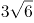

B. 4√2

C. 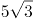

D. 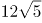

第 49 题 · 答案与解析

**参考答案（粉笔题库参考内容）**

D

**解析**

数列及选项出现多个带根号的数字，转化为根号内找规律。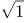，√2，√6，，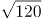，根号内形成数列：1，2，6，24，120，有明显的倍数关系，后项除前项可得新数列：2，3，4，5，是公差为1的等差数列，新数列下一项为6，则所求项为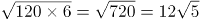。

故正确答案为D。

### 第 50 题

5/6，1/12，11/20，3/10，1/2，（ ）

A. 

B. 3/8

C. 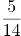

D. 7/10

第 50 题 · 答案与解析

**参考答案（粉笔题库参考内容）**

B

**解析**

观察数列特征，均为分数，考虑分数数列。观察分子、分母无明显规律，考虑反约分，原数列可转化为：5/6，1/12，11/20，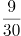，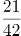。观察发现，分母：6，12，20，30，42，作差后得：6，8，10，12，是公差为2的等差数列，则下一项是14，即所求项的分母为：42+14=56；分子：5，1，11，9，21，无明显规律，考虑分子分母结合看，观察发现，6-5=1，12-1=11，20-11=9，30-9=21，即后一项分子=前一项分母-前一项分子，则所求项的分子为：42-21=21，则所求项应为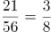，对应B项。

故正确答案为B。

### 第 51 题

“双减”政策实施后，某小学下午5：30放学，小李5：00下班去接孩子回家，当不堵车时，5：30之前到校；当堵车时，5：30之前到校的概率为0.6。若5：00—5：30堵车的概率为0.3，则小李5：30之前到校的概率是：

A. 0.78

B. 0.80

C. 0.88

D. 0.91

第 51 题 · 答案与解析

**参考答案（粉笔题库参考内容）**

C

**解析**

方法一：正面考虑。小李出发后可能有两种情况：堵车或不堵车，已知堵车的概率为0.3，则不堵车的概率为1-0.3=0.7。分情况讨论如下：

情况一：若出发后堵车，则能在5：30之前到校概率为：0.3×0.6=0.18；

情况二：若出发后不堵车，则能在5：30之前到校概率为：0.7×1=0.7。

分类用加法，则小李5：30之前到校概率为0.18+0.7=0.88。

方法二：反面考虑。小李没能在5：30之前到校的情况只有一种可能，就是出发后堵车。根据题意，此时没在5：30之前到校概率为：0.3×（1-0.6）=0.12；故小李5：30之前到校概率为1-0.12=0.88。

故正确答案为C。

### 第 52 题

如图所示，考古队在B和C两处发现重要遗址，根据对周边环境考察，确定以A和D为顶点划出一个正方形挖掘区域。已知AB、CD都与BC垂直，AB=7米，BC=7米，CD=42米，则这个正方形挖掘区域的边长为：

A. 49米

B. 45米

C. 40米

D. 35米

第 52 题 · 答案与解析

**参考答案（粉笔题库参考内容）**

D

**解析**

B、C两处为重要遗址，因此以A和D为顶点划出的正方形挖掘区域，需要包含B、C两点，才能对遗址进行挖掘。同时由题意可知，AD的长度大于42+7=49米，若AD为正方形的一条边，则所给选项均不满足，故AD只能为正方形的对角线。如下图所示，设正方形挖掘区域的边长AE和DE为x米，过点A作DC的垂线，与DC的延长线相交于点F，则DF=FC+CD=AB+CD=7+42=49米，AF=BC=7米。根据勾股定理，在三角形ADF和三角形ADE中，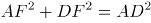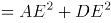，即，解得x=35，即这个正方形挖掘区域的边长为35米。

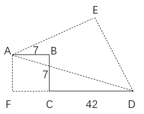

故正确答案为D。

### 第 53 题

如图所示，某主题公园将一块正方形的地面按七巧板图案设计，其中平行四边形1个、正方形1个、等腰直角三角形5个，并用油漆将七块区域刷成不同的颜色。若每种颜色的油漆单价相同，平行四边形区域的油漆费用为200元，则整块地面的油漆费用为：

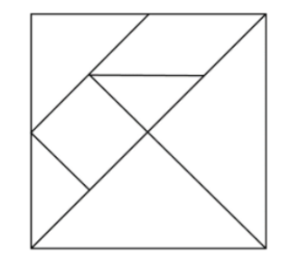

A. 1200元

B. 1600元

C. 2000元

D. 2400元

第 53 题 · 答案与解析

**参考答案（粉笔题库参考内容）**

B

**解析**

如下图，根据题意，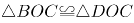且为等腰直角三角形，则CO为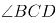的平分线，即正方形对角线。延长CO至点A，易得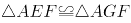且为等腰直角三角形，则EG∥BD。由于EFOH为正方形，则EF=OF=AF，可得F点为AO中点，即EG为中位线。根据三角形中位线结论，OB=2×FG，则OJ=BJ。连接GJ易得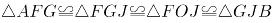。则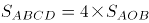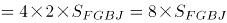。由于油漆费用=油漆单价×刷漆面积，且每种颜色的油漆单价相同，则所求费用=8×200=1600元。

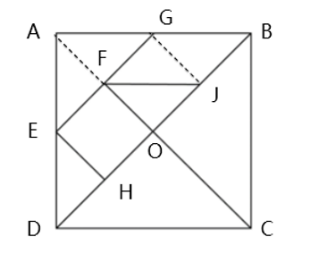

故正确答案为B。

### 第 54 题

出版社安排甲、乙、丙三人校对一本书，甲完成总任务的1/8后，剩下的分配给乙和丙。若乙的工作效率是丙的3/4，且两人完成工作所用时间相同，则乙的工作量是总任务的：

A. 3/8

B. 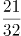

C. 

D. 1/2

第 54 题 · 答案与解析

**参考答案（粉笔题库参考内容）**

A

**解析**

方法一：根据“乙的工作效率是丙的3/4”，赋值乙的效率为3，丙的效率为4，设两人完成工作所用时间均为t，由“甲完成总任务的1/8后，剩下的分配给乙和丙”，则乙、丙两人一共完成的工作量为：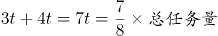，即总任务量=8t，则乙的工作量是总任务量的 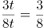。

方法二：根据“乙的工作效率是丙的3/4，且两人完成工作所用时间相同”，可知乙、丙两人工作效率比为3：4，工作时间相同，则工作效率与工作量成正比，即乙、丙两人工作量之比为3：4，假设总任务量为8份，甲做1/8，即1份，乙、丙两人共做7份，乙的工作量为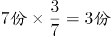，所以乙的工作量是总任务的3/8。

故正确答案为A。

### 第 55 题

正方体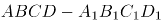中，E、F分别为棱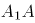和的中点，则平面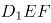截该正方体所得截面的形状是：

A. 三角形

B. 四边形

C. 五边形

D. 六边形

第 55 题 · 答案与解析

**参考答案（粉笔题库参考内容）**

B

**解析**

如图所示，设正方体的中心点为O，E、F分别分别为、的中点，为正方体的体对角线，连接、EB、BF、、、EF，易得此六条线段在同一平面上，则故平面截该正方体所得截面即为四边形。

故正确答案为B。

### 第 56 题

某种杀虫剂每桶5公斤，浓度为40%，使用时需将浓度稀释到5%，每亩地喷洒60公斤。若某农户家中有4亩地，则至少需要该杀虫剂：

A. 3桶

B. 4桶

C. 5桶

D. 6桶

第 56 题 · 答案与解析

**参考答案（粉笔题库参考内容）**

D

**解析**

设需要n桶杀虫剂，根据稀释前后溶质质量相等，可得5n×40%=60×4×5%，解得n=6。

故正确答案为D。

### 第 57 题

某政府机关将甲、乙两个部门合并。合并前，甲、乙两部门的男女人数之比分别为4：1和3：2，男女党员人数之比分别为9：2和9：4，乙部门女党员人数占本部门人数的比重是甲部门的两倍。合并后，若男女人数之比为7：3，则男女党员人数之比为：

A. 18：5

B. 27：8

C. 3：1

D. 27：10

第 57 题 · 答案与解析

**参考答案（粉笔题库参考内容）**

C

**解析**

根据题意，设甲部门的男女人数分别为4x、x，乙部门的男女人数分别为3y、2y。因合并后，男女人数之比为7：3，可列等式：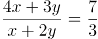，解得：x=y，说明合并前，甲部门总人数为4x+x=5x，乙部门总人数为3y+2y=5y，即甲、乙两部门总人数相等。

因“乙部门女党员人数占本部门人数的比重是甲部门的两倍”，且甲、乙两部门总人数又相等，可知乙部门女党员人数是甲部门女党员人数的两倍。根据“甲、乙两部门的男女党员人数之比分别为9：2和9：4”，设甲部门女党员人数为2a，则乙部门女党员人数为4a，甲部门男党员人数为9a，乙部门男党员人数为9a，故所求男女党员人数之比为（9a+9a）：（2a+4a）=18a：6a=3：1。

故正确答案为C。

### 第 58 题

已知A、B两地相距9公里，甲、乙两人匀速从A地前往B地。甲每小时走6公里，每走半小时休息15分钟；乙比甲早15分钟出发，中间不休息。若他们在途中（不含起点和终点）相遇了2次，则乙从A地到B地所用的时间至少为：

A. 75分钟

B. 120分钟

C. 135分钟

D. 150分钟

第 58 题 · 答案与解析

**参考答案（粉笔题库参考内容）**

C

**解析**

根据题意，因为乙比甲先出发15分钟，所以第一次相遇是甲追上乙。要使得乙从A地到B地所用的时间尽可能少，则乙的速度应尽可能大，即甲第一次追上乙花费的时间应尽可能多。因此当甲行驶30分钟后才追上乙时，乙的速度最大，此时甲、乙路程相等。可得方程：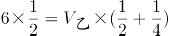，解得公里/小时，则乙从A地到B地所用的时间至少为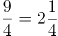小时=135分钟。

备注：下图为甲、乙两人全程的路程与时间的函数图像，第一次相遇在45分钟，此时甲追上乙，然后甲休息，乙继续走。第二次相遇在90分钟，此时甲第二次追上乙，然后甲休息，乙继续走。第三次相遇在135分钟，此时两人同时到达B点，满足题干所说途中（不含起点和终点）相遇了2次。

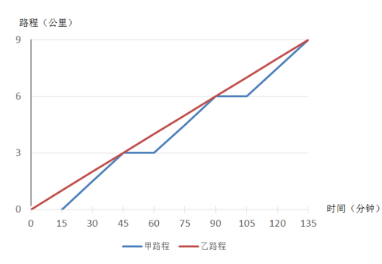

故正确答案为C。

### 第 59 题

某学者认为，人类的体力、情绪、智力自出生日起分别以22天、28天、33天为周期开始往复循环变化，前半个周期是“高潮期”，后半个周期是“低潮期”。根据该学者的观点，我们过公历生日时，体力、情绪和智力同时处于“高潮期”的最小年龄是：

A. 4周岁

B. 3周岁

C. 2周岁

D. 1周岁

第 59 题 · 答案与解析

**参考答案（粉笔题库参考内容）**

C

**解析**

根据题意利用代入排除法，问最小年龄，从小到大进行代入。代入D项若最小年龄为1周岁，即365天，体力处于个周期⋯⋯13天，22天前半个周期11天是“高潮期”，13天不满足题意，排除D项；代入C项若最小年龄为2周岁，即365×2=730天，体力处于个周期⋯⋯4天，情绪处于个周期······2天，智力处于个周期······4天，均处于以22天、28天、33天为周期的前半个周期“高潮期”，满足题意。

备注：即使在2周岁时经历了闰年366天，所有余数均加一，仍然均处于前半个周期“高潮期”。

故正确答案为C。

### 第 60 题

某疫苗接种点市民正在有序排队等候接种。假设之后每小时新增前来接种疫苗的市民人数相同，且每个接种台的效率相同，经测算：若开8个接种台，6小时后不再有人排队；若开12个接种台，3小时后不再有人排队。如果每小时新增的市民人数比假设的多25%，那么为保证2小时后不再有人排队，需开接种台的数量至少为：

A. 14个

B. 15个

C. 16个

D. 17个

第 60 题 · 答案与解析

**参考答案（粉笔题库参考内容）**

D

**解析**

设原来排队市民总数为Y人，假设每小时新增的市民人数为X人，接种台数量为N个，由牛吃草公式Y=（N-X）×T有：Y=（8-X）×6=（12-X）×3，解得：X=4，Y=24；根据“每小时新增的市民人数比假设的多25%”可得，现在每小时新增的市民人数为：4×（1+25%）=5。同样代入牛吃草公式有：24=（N-5）×2，解得：N=17。

故正确答案为D。

### 第 61 题

某市民中心广场钟楼上东、西、南、北四面各有一个挂钟，则每日早8点至晚8点，任意相邻两个钟的时针互相垂直的次数是：

A. 2

B. 3

C. 4

D. 5

第 61 题 · 答案与解析

**参考答案（粉笔题库参考内容）**

A

**解析**

如下图，设相邻两个挂钟所在平面为A、B，则A、B两个平面相互垂直。根据几何结论：若一条线段与一个平面垂直，则该线段垂直于平面上所有线段。因此需要平面B内挂钟的时针在水平方向，此时与相邻的平面A垂直即与平面A内挂钟的时针垂直。如下图所示：只有在早上9点（实线所示）、下午3点（虚线所示）这两次，平面B内挂钟的时针与平面A垂直，即A、B两个面上挂钟时针相互垂直。

故正确答案为A。

### 第 62 题

某企业举行职业技能大赛，3个下属分公司均选2名员工参赛。若同一分公司的员工比赛时出场顺序不能相邻，则参赛的6名员工不同的出场顺序共有：

A. 80种

B. 120种

C. 160种

D. 240种

第 62 题 · 答案与解析

**参考答案（粉笔题库参考内容）**

D

**解析**

位置1，从6名员工中选1名员工，有种排法；

位置2，从另外两个公司的4名员工中选1名员工，有种排法；

后续情况较复杂，考虑枚举法，设三个公司分别为A、B、C，6名员工分别为，，，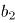，，，假设位置1安排出场，位置2安排出场，将出场顺序情况梳理如下：

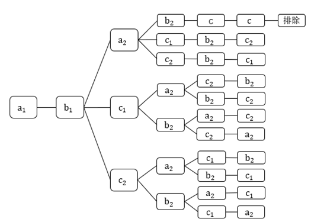

此时后续符合条件的情况有10种，因此总情况为6×4×10=240种不同的出场顺序。

故正确答案为D。

### 第 63 题

甲、乙两人对100个家庭进行电话调查。若甲、乙完成对1个家庭的调查需要的时间分别是12分钟和20分钟，则他们完成这次电话调查需要的时间至少是：

A. 12小时28分钟

B. 12小时32分钟

C. 12小时36分钟

D. 12小时40分钟

第 63 题 · 答案与解析

**参考答案（粉笔题库参考内容）**

C

**解析**

方法一：甲、乙完成对1个家庭的调查需要的时间分别是12分钟和20分钟，因此每小时（60分钟）甲调查5个家庭，乙调查3个家庭，合计调查5+3=8个家庭。小时······4个家庭，剩余4个家庭由甲调查3个，乙调查1个，用时是最少的，需要36分钟。因此两人合计用时最少为12小时36分钟，对应C项。

方法二：由于选项都是12小时多，且问“至少”，故可利用代入排除法。12小时调查数量为：甲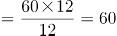个家庭，乙个家庭，合计60+36=96个家庭，还剩4个家庭未调查。问题问“至少”，从最小的开始代入。

A项：28分钟，甲可调查2个家庭，乙可调查1个家庭，合计2+1=3个，不足4个，排除；

B项：32分钟，甲可调查2个家庭，乙可调查1个家庭，合计2+1=3个，不足4个，排除；

C项：36分钟，甲可调查3个家庭，乙可调查1个家庭，合计3+1=4个，当选。

故正确答案为C。

### 第 64 题

某金融机构向9家“专精特新”企业共发放了4500万元贷款，若这9家企业获得的贷款额从少到多排列，恰好为一个等差数列，且排第3的企业获得420万元贷款，排第8的企业获得的贷款额为：

A. 620万元

B. 660万元

C. 720万元

D. 760万元

第 64 题 · 答案与解析

**参考答案（粉笔题库参考内容）**

A

**解析**

由题干可知：9家企业共发放4500万元且贷款额从少到多排列，恰好为一个等差数列。根据等差数列求和公式：，可知排名第5的企业（中位数）获得=4500÷9=500万元。又已知排名第3的企业获得420万元，则根据等差数列的通项公式：可知，等差数列的公差为：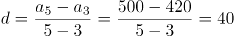万元，排名第8的企业获得万元。

故正确答案为A。

### 第 65 题

如图所示，小王买了一块直三棱柱形状的蛋糕，其中，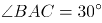。为与两位室友分享，他切出一小块和原蛋糕形状相同的蛋糕，其体积与原蛋糕的体积之比为1：3。若，则线段AE与EB的长度之比为：

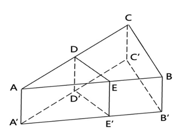

A. 2：1

B. 3：2

C. 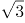：1

D. 2：

第 65 题 · 答案与解析

**参考答案（粉笔题库参考内容）**

A

**解析**

根据题意，直三棱柱与直三棱柱的体积之比为1：3，根据三棱柱体积=底面积×高，高度相同（以为高），故底面积之比为1：3，即。该立体图形的俯视图如下图所示：

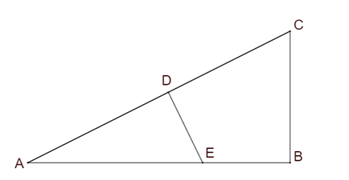

在直角中，，即，同理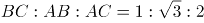，设DE为x，则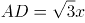，AE=2x。由于且有公共角，故，因面积之比为相似比的平方，故相似比为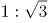，即，则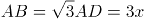，EB=3x-2x=x，所求长度之比为：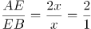。

故正确答案为A。

### 第 66 题

义务教育：基础教育

A. 农业技术：灌溉技术

B. 机械故障：突发故障

C. 债券市场：金融市场

D. 防空演习：军事演习

第 66 题 · 答案与解析

**参考答案（粉笔题库参考内容）**

C

**解析**

第一步：判断题干词语间逻辑关系。

义务教育是一种基础教育，二者为种属关系。

第二步：判断选项词语间逻辑关系。

A项：灌溉技术是一种农业技术，二者为种属关系，但词语的顺序与题干相反，与题干逻辑关系不一致，排除；

B项：有的机械故障是突发故障，有的机械故障不是突发故障，有的突发故障是机械故障，有的突发故障不是机械故障，二者为交叉关系，与题干逻辑关系不一致，排除；

C项：债券市场是一种金融市场，二者为种属关系，与题干逻辑关系一致，当选；

D项：防空演习是为增强人民群众的防空袭意识和自救互救能力，提高城市人民防空袭的整体防护能力而进行的一种防空袭训练活动，军事演习是部队在完成理论学习和基础训练之后实施的近似实战的综合性训练，二者不是种属关系，与题干逻辑关系不一致，排除。

故正确答案为C。

### 第 67 题

汛情：防汛

A. 疫情：免疫

B. 案情：破案

C. 恋情：失恋

D. 亲情：相亲

第 67 题 · 答案与解析

**参考答案（粉笔题库参考内容）**

B

**解析**

第一步：判断题干词语间逻辑关系。

汛情指汛期水位涨落的情况，防汛指在江河涨水的时期采取措施，防止泛滥成灾，依据汛情防汛，二者是依据对应关系。

第二步：判断选项词语间逻辑关系。

A项：疫情指疫病的发生和发展情况，免疫指由于具有抵抗力而不患某种传染病，二者不是依据对应关系，与题干逻辑关系不一致，排除；

B项：案情指案件的情节，依据案情破案，二者是依据对应关系，与题干逻辑关系一致，当选；

C项：先有恋情后失恋，二者不是依据对应关系，与题干逻辑关系不一致，排除；

D项：亲情指亲人的情义，不是依据亲情相亲，二者不是依据对应关系，与题干逻辑关系不一致，排除。

故正确答案为B。

### 第 68 题

神奇：鬼斧神工

A. 善良：大慈大悲

B. 强大：不可一世

C. 寒冷：冰天雪地

D. 混乱：乱七八糟

第 68 题 · 答案与解析

**参考答案（粉笔题库参考内容）**

C

**解析**

第一步：判断题干词语间逻辑关系。

鬼斧神工原意是像鬼神制作出来的，形容艺术技巧高超，不像是人力所能达到的，与神奇构成近义关系。鬼斧神工用夸张的修辞来表示非常神奇，程度加深。

第二步：判断选项词语间逻辑关系。

A项：大慈大悲形容人心肠慈悲，乐善好施，与善良构成近义关系。但大慈大悲没有用夸张的修辞手法，与题干逻辑关系不一致，排除；

B项：不可一世形容人自命不凡，狂妄自大到了极点。与强大没有关系，与题干逻辑关系不一致，排除；

C项：冰天雪地指寒冷的地方，也形容天气非常寒冷，与寒冷构成近义关系。冰天雪地用夸张的修辞来表示非常寒冷，程度加深，与题干逻辑关系一致，当选；

D项：乱七八糟形容毫无条理和秩序，乱的不成样子，与混乱构成近义关系。但乱七八糟没有用夸张的修辞手法，与题干逻辑关系不一致，排除。

故正确答案为C。

### 第 69 题

新教师：老教师

A. 计划：总结

B. 序言：结尾

C. 草稿：定稿

D. 初赛：决赛

第 69 题 · 答案与解析

**参考答案（粉笔题库参考内容）**

C

**解析**

第一步：判断题干词语间逻辑关系。

新教师是教师，老教师是教师，二者为并列关系，且由新教师变成老教师，存在内在的转变。

第二步：判断选项词语间逻辑关系。

A项：计划是工作前的提纲，总结是工作后的评价，故二者不是并列关系，与题干逻辑关系不一致，排除；

B项：书籍或文章的开头叫“序言”，与结尾不构成并列关系，与题干逻辑关系不一致，排除；

C项：草稿指在进行文学创作前提前整理的文本内容，定稿指创作内容全部确定的最后完成稿，二者为并列关系，且由草稿变成定稿，存在内在的转变，与题干逻辑关系一致，当选；

D项：初赛和决赛为并列关系，但不是由初赛变为决赛，二者不存在内在的转变，与题干逻辑关系不一致，排除。

故正确答案为C。

### 第 70 题

专项训练：短期训练：综合训练

A. 生产实践：社会实践：科学实践

B. 五年规划：中期规划：长期规划

C. 抵押贷款：低息贷款：信用贷款

D. 体能测试：视力测试：心理测试

第 70 题 · 答案与解析

**参考答案（粉笔题库参考内容）**

C

**解析**

第一步：判断题干词语间逻辑关系。

“专项训练”指针对某一个项目的训练，“短期训练”指持续时间较短的训练，“综合训练”指将两种或两种以上的项目结合起来进行的训练。故“专项训练”与“综合训练”为并列关系，同时二者均与“短期训练”为交叉关系。

第二步：判断选项词语间逻辑关系。

A项：实践包括三个方面的基本内容：“生产实践”、“社会实践”与“科学实践”，故三者为并列关系，与题干逻辑关系不一致，排除；

B项：“中期规划”与“长期规划”为并列关系，与题干逻辑关系不一致，排除；

C项：“抵押贷款”指要求借款方提供一定抵押品为担保的贷款，“低息贷款”指低于一般银行贷款利率的贷款，“信用贷款”指以借款人的信誉发放的贷款，借款人不需要提供担保。故“抵押贷款”与“信用贷款”为并列关系，同时二者均与“低息贷款”为交叉关系，与题干逻辑关系一致，当选；

D项：“体能测试”、“视力测试”与“心理测试”是针对人类三个不同的方面进行的测试，故三者为并列关系，与题干逻辑关系不一致，排除。

故正确答案为C。

### 第 71 题

论辩：辩护：共识

A. 贸易：签约：利益

B. 就读：休学：考试

C. 调研：座谈：问卷

D. 看病：诊脉：理疗

第 71 题 · 答案与解析

**参考答案（粉笔题库参考内容）**

A

**解析**

第一步：判断题干词语间逻辑关系。

“论辩”和“辩护”的目的都是为了达成“共识”，二者为目的对应关系。

第二步：判断选项词语间逻辑关系。

A项：“贸易”和“签约”的目的都是为了获得“利益”，二者为目的对应关系，与题干逻辑关系一致，当选；

B项：“休学”的目的不是为了“考试”，与题干逻辑关系不一致，排除；

C项：“调研”和“座谈”的目的不是为了“问卷”，与题干逻辑关系不一致，排除；

D项：“理疗”的意思是用物理疗法治疗，“看病”的目的是为了康复，并不是为了“理疗”，与题干逻辑关系不一致，排除。

故正确答案为A。

### 第 72 题

地砖：方砖：长条砖

A. 菜肴：荤菜：白菜

B. 零食：素食：热食

C. 青茄：紫茄：番茄

D. 木船：客船：货船

第 72 题 · 答案与解析

**参考答案（粉笔题库参考内容）**

D

**解析**

第一步：判断题干词语间逻辑关系。

“方砖”和“长条砖”是两种不同形状的砖，二者为并列关系，同时均与“地砖”为交叉关系。

第二步：判断选项词语间逻辑关系。

A项：荤菜指的是所有含有动物性成分的菜，荤菜是菜肴的一种，二者是种属关系，与题干逻辑关系不一致，排除；

B项：零食、素食、热食两两之间是交叉关系，与题干逻辑关系不一致，排除；

C项：青茄、紫茄、番茄为三种蔬菜，三者为并列关系，与题干逻辑关系不一致，排除；

D项：“客船”和“货船”是两种不同功能的船，二者为并列关系，同时均与“木船”为交叉关系，与题干逻辑关系一致，当选。

故正确答案为D。

### 第 73 题

东北亚 之于 （ ） 相当于 （ ） 之于 树冠

A. 韩国；树墩

B. 南亚；树根

C. 东半球；树洞

D. 日本海；树荫

第 73 题 · 答案与解析

**参考答案（粉笔题库参考内容）**

B

**解析**

逐一代入选项。

A项：韩国是东北亚的一部分，二者是组成关系，树墩与树冠都是树木的组成部分，二者为并列关系，前后逻辑关系不一致，排除；

B项：东北亚和南亚是不同的地理区域，二者是并列关系，树根和树冠都是树木的组成部分，二者为并列关系，前后逻辑关系一致，当选；

C项：东北亚是东半球的一部分，二者是组成关系，树洞和树冠都是树木的组成部分，二者为并列关系，前后逻辑关系不一致，排除；

D项：日本海是东北亚的一部分，二者为组成关系，树荫是指树下日光照不到的地方，树冠经阳光照射后能形成树荫，二者为对应关系，前后逻辑关系不一致，排除。

故正确答案为B。

### 第 74 题

直升机 之于 蜻蜓 相当于 （ ） 之于 （ ）

A. 雷达；蝙蝠

B. 月亮；萤火虫

C. 狮子；家猫

D. 列车；蜈蚣

第 74 题 · 答案与解析

**参考答案（粉笔题库参考内容）**

A

**解析**

逐一代入选项。

A项：“直升机”是模仿“蜻蜓”的尾部在飞行中能够保持平衡的原理发明的，二者是仿生学的对应关系；“雷达”是模仿“蝙蝠”在夜间安全飞行的原理发明的，二者是仿生学的对应关系，前后逻辑关系一致，当选；

B项：“直升机”是模仿“蜻蜓”的尾部在飞行中能够保持平衡的原理发明的，二者是仿生学的对应关系；“月亮”与“萤火虫”无明显的逻辑关系，前后逻辑关系不一致，排除；

C项：“直升机”是模仿“蜻蜓”的尾部在飞行中能够保持平衡的原理发明的，二者是仿生学的对应关系；“狮子”和“家猫”是两种不同的动物，二者是并列关系，前后逻辑关系不一致，排除；

D项：“直升机”是模仿“蜻蜓”的尾部在飞行中能够保持平衡的原理发明的，二者是仿生学的对应关系；“列车”与“蜈蚣”无明显的逻辑关系，前后逻辑关系不一致，排除。

故正确答案为A。

### 第 75 题

良禽择木而栖 之于 贤臣择主而事 相当于 （ ） 之于 （ ）

A. 关关雎鸠在河之洲；窈窕淑女君子好逑

B. 树欲静而风不止；子欲养而亲不待

C. 天有不测风云；人有旦夕祸福

D. 士为知己者死；女为悦己者容

第 75 题 · 答案与解析

**参考答案（粉笔题库参考内容）**

C

**解析**

第一步：判断题干词语间逻辑关系。

“良禽择木而栖”指的是好的鸟要选择树木栖息；“贤臣择主而事”指的是贤明的臣子要选择君主侍奉，第一句话用自然界的现象引出第二句话中的道理，二者为引申义对应。

第二步：判断选项词语间逻辑关系。

A项：“关关雎鸠在河之洲”指的是关关和鸣的雎鸠，相伴在河中的小洲；“窈窕淑女君子好逑”指的是美丽贤淑的女子，是君子的好配偶，二者不是引申义对应，与题干逻辑关系不一致，排除；

B项：“树欲静而风不止”指的是树希望静止不摆，风却不停息；“子欲养而亲不待”指的是子女想赡养父母，父母却已离去了，二者是两件不相关的事，与题干逻辑关系不一致，排除；

C项：“天有不测风云”指的是自然界的变化难以预测；“人有旦夕祸福”指的是人一生的问题难以预测，均比喻有些灾祸的发生，事先是无法预料的，第一句话用自然界的现象引出了第二句中的人的旦夕祸福，二者为引申义对应，与题干逻辑关系一致，当选；

D项：“士为知己者死”指的是志士愿意为赏识自己、了解自己的人献身；“女为悦己者容”指的是女人愿意为欣赏自己、喜欢自己的人而打扮，两句话均描述的是人，不是引申义对应，与题干逻辑关系不一致，排除。

故正确答案为C。

### 第 76 题

请从所给的四个选项中，选出最恰当的一项填入问号处，使之呈现一定的规律性。

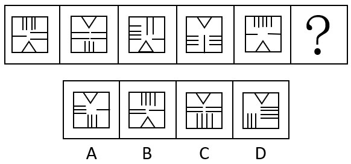

A. A

B. B

C. C

D. D

第 76 题 · 答案与解析

**参考答案（粉笔题库参考内容）**

A

**解析**

题干每幅图形均由一个正方形和内部线条组成，元素组成相同，优先考虑位置规律。观察发现，三角形的位置依次上下移动，故？处应选择一个三角形位置在上方的图形，排除B项；题干图形内部线数量均为9，排除C项；继续观察发现，题干图形内部线条在正方形四条边上均出现，而D项内部线条只在正方形三条边上出现，排除D项。

故正确答案为A。

### 第 77 题

请从所给的四个选项中，选出最恰当的一项填入问号处，使之呈现一定的规律性。

A. A

B. B

C. C

D. D

第 77 题 · 答案与解析

**参考答案（粉笔题库参考内容）**

A

**解析**

元素组成相同，优先考虑位置规律。观察发现，题干图形中的两个黑球每次分别顺时针移动3格，如下图所示：

故正确答案为A。

### 第 78 题

请从所给的四个选项中，选出最恰当的一项填入问号处，使之呈现一定的规律性。

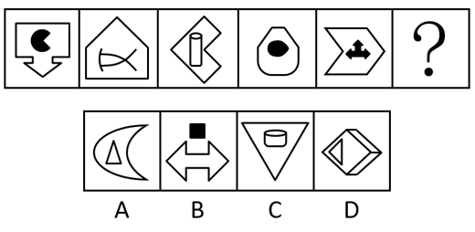

A. A

B. B

C. C

D. D

第 78 题 · 答案与解析

**参考答案（粉笔题库参考内容）**

A

**解析**

元素组成不同，优先考虑属性规律。观察发现，题干图形出现箭头、等腰元素图形，考虑对称性。题干每幅图都由两个单对称轴图形组成，因此分别画出每个图形的对称轴，发现每幅图的两条对称轴之间都是垂直关系，只有A项符合。

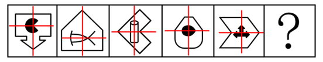

故正确答案为A。

### 第 79 题

请从所给的四个选项中，选出最恰当的一项填入问号处，使之呈现一定的规律性。

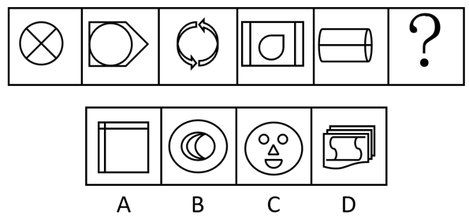

A. A

B. B

C. C

D. D

第 79 题 · 答案与解析

**参考答案（粉笔题库参考内容）**

D

**解析**

图形元素组成不同，优先考虑属性规律。观察发现，题干图形都是由曲线和直线共同构成，排除A、B两项；继续观察发现，题干图形封闭面明显，考虑数面。题干图形面数量都为4，故“？”处应该选择面数量为4的图形，只有D项符合。

故正确答案为D。

### 第 80 题

请从所给的四个选项中，选出最恰当的一项填入问号处，使之呈现出一定的规律性。

A. A

B. B

C. C

D. D

第 80 题 · 答案与解析

**参考答案（粉笔题库参考内容）**

A

**解析**

图形元素组成不同，且无明显属性规律，考虑数量规律。观察发现，题干图形中出现明显单一直线及多边形，优先考虑数直线，发现整体数直线无规律，而题干图形中横线、竖线较多，因此考虑分开数横竖线。九宫格优先横行看，三行图形的横线数依次为3、4、3、4、3、4、4、3，三行图形的竖线数依次为2、3、2、3、2、3、3、2，单看横竖线数无规律，考虑二者做运算。发现题干所有图形的横线数减竖线数均为1，故？处应选择横线数减竖线数等于1的图形，只有A项符合规律。

故正确答案为A。

### 第 81 题

请从所给的四个选项中，选出最恰当的一项填入问号处，使之呈现一定的规律性。

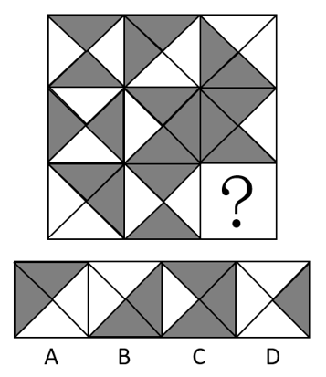

A. A

B. B

C. C

D. D

第 81 题 · 答案与解析

**参考答案（粉笔题库参考内容）**

B

**解析**

图形元素组成相似，优先考虑样式规律。题干图形存在黑色区域和空白区域，考虑黑白运算。九宫格优先横向观察，第一行图形的黑白运算规律为：黑+黑=白，白+黑=黑，黑+白=黑，白+白=白，第二行经验证符合此规律，第三行应用此规律，只有B项符合。

故正确答案为B。

### 第 82 题

下边四个图形中，只有一个是由上边的四个图形拼合（只能通过上、下、左、右平移）而成的，请把它找出来。

A. A

B. B

C. C

D. D

第 82 题 · 答案与解析

**参考答案（粉笔题库参考内容）**

A

**解析**

本题考查俄罗斯方块平面拼合。从方块最多的图形入手，贴边代入选项。在题干的4个图形中，图④的方块最多，将它贴边代入各个选项中，只有A项能够把所有图形都代入进去，拼合方式如下图所示：

故正确答案为A。

### 第 83 题

下边四个图形中，只有一个是由上边的四个图形拼合（只能通过上、下、左、右平移）而成的，请把它找出来。

A. A

B. B

C. C

D. D

第 83 题 · 答案与解析

**参考答案（粉笔题库参考内容）**

B

**解析**

本题考察平面拼合，可采用平行且等长相消的方式解题。消去平行且等长的线段后进行组合即可得到轮廓图，即为B项。平行且等长相消的方式如下图所示：

故正确答案为B。

### 第 84 题

下边四个图形中，只有一个是由上边的四个图形拼合（只能通过上、下、左、右平移）而成的，请把它找出来。

A. A

B. B

C. C

D. D

第 84 题 · 答案与解析

**参考答案（粉笔题库参考内容）**

C

**解析**

本题考查平面拼合。消去凹凸匹配的线条后进行组合可得到轮廓图，即为C项。具体拼合方式如下图所示：

故正确答案为C。

### 第 85 题

上边四张纸片，每张纸片一面是黑色，另一面是白色，下边仅有一项能由其拼合（可以平移、旋转、翻转）而成，请把它找出来。

A. A

B. B

C. C

D. D

第 85 题 · 答案与解析

**参考答案（粉笔题库参考内容）**

D

**解析**

本题考查平面拼合，可采用平行且等长相消的方式解题。将图①和图④翻转后，消去平行且等长的线段后进行组合可得到轮廓图，即为D项。平行且等长相消的方式如下图所示：

故正确答案为D。

### 第 86 题

上边四张纸片，每张纸片一面是黑色，另一面是白色，下边仅有一项能由其拼合（可以平移、旋转、翻转）而成，请把它找出来。

A. A

B. B

C. C

D. D

第 86 题 · 答案与解析

**参考答案（粉笔题库参考内容）**

C

**解析**

本题考查平面拼合，题干已知每张纸片一面是黑色，另一面是白色，且可以涉及转动，故可知，平移和旋转时纸片颜色不会改变，翻转时颜色会发生改变。经过拼合后只能得到C项。如下图所示：

故正确答案为C。

### 第 87 题

左边给定的是多面体的外表面，右边哪一项能由它折叠而成？

A. A

B. B

C. C

D. D

第 87 题 · 答案与解析

**参考答案（粉笔题库参考内容）**

A

**解析**

将题干展开图标上序号，如下图所示，逐一进行分析。

A项：选项由面b和面c构成，选项与题干展开图一致，当选；

B项：选项由面b和面c构成，以面c中空白顶点为起点进行画边（如上图蓝线所示），展开图中边1对应面b，选项中边3对应面b，选项与题干展开图不一致，排除；

C项：选项由面a和面c构成，展开图中，二者的公共边与面a内部阴影小三角形的顶点重合，选项中不重合（如下图绿线所示），选项与题干展开图不一致，排除；

D项：选项由面b和面d构成，展开图中，二者的公共边与面d内部三角形的边重合，选项中不重合（如下图红线所示），选项与题干展开图不一致，排除。

故正确答案为A。

### 第 88 题

左边给定的是纸盒外表面的展开图，右边哪一项能由它折叠而成？请把它找出来。

A. A

B. B

C. C

D. D

第 88 题 · 答案与解析

**参考答案（粉笔题库参考内容）**

C

**解析**

将原展开图标上序号，如下图所示，逐一进行分析。

A项：选项由面e和面g构成，展开图中面e与面g的公共边挨着面g的空白面，而选项中面e与面g的公共边半边挨着面g的灰色面，选项与题干展开图不一致，排除；

B项：选项由面g和面h构成，展开图中面g和面h的公共边挨着面g的灰色面，而选项中面g和面h的公共边挨着面g的空白面，选项与题干展开图不一致，排除；

C项：选项由面e和面h构成，选项与题干展开图一致，当选；

D项：选项由面e和面f构成，以面e的灰色顶点（蓝点）为起点顺时针画边，展开图中边2与面f中的长线相交于点1（边2与边3的交点），而选项中边2与面f中的长线不相交于点1（边2与边3的交点），选项与题干展开图不一致，排除。

故正确答案为C。

### 第 89 题

左边给定的是多面体的外表面，右边哪一项能由它折叠而成？请把它找出来。

A. A

B. B

C. C

D. D

第 89 题 · 答案与解析

**参考答案（粉笔题库参考内容）**

C

**解析**

将原展开图标上序号，如下图所示，逐一进行分析。

A项：选项中出现了面a和面e，面a中黑点所在矩形的长边（如下图线1所示）与面e相邻，而展开图中该矩形的长边与面b相邻，选项与题干展开图不一致，排除；

B项：选项中出现了面c、面f，面f中白圆所在矩形的长边（如下图线2所示）与面c相邻，而展开图中该矩形的长边与面e相邻，选项与题干展开图不一致，排除；

C项：选项中出现了面c、面d和面f，选项与题干展开图一致，当选；

D项：选项中出现了面a、面e，顶面为面b或面d，面e挨着顶面的空白三角形（如下图线3所示），但展开图中面e挨着面b或面d内的阴影三角形，选项与题干展开图不一致，排除。

故正确答案为C。

### 第 90 题

左边给定的是多面体的外表面，右边哪一项能由它折叠而成？请把它找出来。

A. A

B. B

C. C

D. D

第 90 题 · 答案与解析

**参考答案（粉笔题库参考内容）**

A

**解析**

将原展开图标上序号如下图，逐一进行分析。

A项：选项中出现了面f、面a和面e，选项与题干展开图一致，当选；

B项：选项中包括面d、面c和面f，选项中面d与面f有公共边边1且面f内部的两条直线挨着面d内部的空白矩形，而展开图中f内部的两条直线挨着面d内部的小三角形，选项与题干不一致，排除；

C项：选项中包括面e、面a和面b，选项中面e内部的直角梯形短直角边挨着面a，而展开图中面e内部的直角梯形短直角边挨着面f，选项与题干不一致，排除；

D项：选项中包括面c、面f和面b，选项中面c内部的三角形底边挨着面f，而展开图中面c内部的三角形底边挨着面b，选项与题干不一致，排除。

故正确答案为A。

### 第 91 题

在广袤的中华大地上，最近几十年已经新植了数以十亿计的树木，绿色植被的增长有目共睹，沙漠化和水土流失情况得到了极大缓解。据此，有专家指出，中国已经是全球变绿的最重要的力量之一。

以下哪项如果为真，最能支持上述专家的观点？

A. 中国西南地区和东北地区的快速造林大大减少了我国对进口木材的依赖

B. 卫星数据对比显示，中国大量过去荒漠化的地方现在已经被绿色植被所覆盖

C. 中国的植被面积仅占全球的6.6%，但全球植被面积净增长的25%来自中国

D. 在有些国家和地区，毁林开荒正在导致具有全球气候调节功能的雨林面积大大减少

第 91 题 · 答案与解析

**参考答案（粉笔题库参考内容）**

C

**解析**

第一步：找出论点和论据。

论点：中国已经是全球变绿的最重要的力量之一。

论据：在广袤的中华大地上，最近几十年已经新植了数以十亿计的树木，绿色植被的增长有目共睹，沙漠化和水土流失情况得到了极大缓解。

本题论点和论据都在讨论的是中国绿化的情况，话题一致，加强优先考虑补充论据。

第二步：逐一分析选项。

A项：该项说中国快速造林减少了对进口木材的依赖，而论点讨论的是中国是全球变绿的重要力量，话题不一致，无法加强，排除；

B项：该项说中国过去荒漠化的地方已经被绿色植被所覆盖，对比的是中国的过去情况和现在情况，而论点讨论的是中国是全球变绿的重要力量之一，话题不一致，无法加强，排除；

C项：该项说全球植被面积净增长的25%来自中国，补充论据说明中国是全球变绿的重要力量之一，可以加强，当选；

D项：该项说有些国家和地区的雨林面积大大减少，而论点讨论的是中国是全球变绿的重要力量之一，话题不一致，无法加强，排除。

故正确答案为C。

### 第 92 题

麦子大约在五千年前由西亚传入中国，但由麦子做成的面食直到唐宋时期才成为北方人的主食。在此之前，北方的主粮是粟，也就是小米。秦汉时期的老百姓很不愿意种麦子，汉朝曾为增加粮食产量两次大力推广种麦子，但老百姓并没有积极响应。

以下哪项如果为真，最能解释上述历史现象？

A. 外来作物很多，除了麦子，还有番薯、胡麻等，不是每种作物一传入就被接受

B. 磨粉技术传播较晚，东汉时只有官宦人家才拥有上下两扇带有磨齿的磨盘

C. 麦粒直接煮成的“麦饭”生硬难咽、口感很差，秦汉时期的绝大多数人都不爱吃

D. 东汉以后磨盘磨粉和“热汤饼”等面食技术逐渐推广开来，麦子才变得“好吃”了

第 92 题 · 答案与解析

**参考答案（粉笔题库参考内容）**

C

**解析**

第一步：找出题干矛盾。

秦汉时期的老百姓很不愿意种麦子，汉朝曾两次大力推广种麦子，但老百姓并没有积极响应。

第二步：逐一分析选项。

A项：该项说的是有些外来作物并不能马上被接受，但是汉朝已经两次大力推广了，为什么还是不能被接受，不能解释题干矛盾，排除；

B项：该项说的是东汉时期只有官宦人家才能将麦子磨粉，那在麦子不能被磨粉时，为什么老百姓不愿意种植，选项并没有明确说明，不能解释题干矛盾，排除；

C项：该项说的是由麦粒直接煮成的“麦饭”口感很差，秦汉时期的绝大多数人都不爱吃，因为麦粒不好吃所以不种麦子，可以解释即使国家大力推广，老百姓也不积极响应的原因，可以解释题干矛盾，当选；

D项：该项说的是麦子从东汉以后因为磨盘磨粉和面食技术才变得好吃，题干要解释的矛盾点是为什么国家推广也不种，C项很直接地说明因为不好吃，所以不种；D项在解释怎么才变得“好吃”，没有C项直接，排除。

故正确答案为C。

### 第 93 题

某游戏公司规定，登录游戏必须实名验证，未成年人每天最多只能在线100分钟，晚上8点至次日上午6点不能使用。然而，后台的账户登录数据显示，规定实施后，未成年人账户登录游戏的平均时长与之前相比增加了15％。

以下哪项如果为真，最能解释上述现象？

A. 规定实施后，许多家长通过为孩子注册未成年人账户来限制其长时间玩游戏

B. 许多未成年人通过购买成年人账号或者使用其父母账号登录游戏

C. 未成年人有逆反心理，新规定反而刺激了他们在节假日过度玩游戏

D. 规定实施后，公司推出在线满90分钟送装备活动，吸引了许多购买力不强的玩家

第 93 题 · 答案与解析

**参考答案（粉笔题库参考内容）**

C

**解析**

第一步：找出题干矛盾。

登录游戏必须实名验证，未成年人每天最多只能在线100分钟，但后台的账户登录数据显示，规定实施后，未成年人账户登录游戏的平均时长与之前相比增加了15％。

第二步：逐一分析选项。

A项：许多家长为孩子注册未成年人账户限制其游戏时长，说明家长在限制孩子游戏的时间，无法解释为何实名验证后未成年人账户登录时长增加，不能解释题干矛盾，排除；

B项：许多未成年人购买成年人账号或使用父母账号登录游戏，说明他们登录游戏的账户是成年人账户，但是题干说的是未成年人账户的使用情况，不能解释题干矛盾，排除；

C项：在新规之后，未成年人在节假日会过度游戏，即在节假日未成年人账户登录时长增加，可以导致未成年人账户登录游戏的平均时长比之前增加，可以解释题干矛盾，当选；

D项：规定实施后，新活动吸引许多购买力不强的玩家，但购买力不强的玩家不明确是否一定是未成年人，也可能是很多不喜欢在游戏中充值的成年人，不能解释题干矛盾，排除。

故正确答案为C。

### 第 94 题

上级检查组在某周的周一至周五检查了甲、乙、丙、丁、戊5个单位。已知：

（1）戊是第3个被检查单位；

（2）第4个被检查单位得到的既有批评也有表扬；

（3）乙和丁两个单位得到的只有批评；

（4）检查甲单位是在检查丁单位之后。

根据上述信息，可以推出以下哪项？

A. 检查乙单位是在检查丙单位之前

B. 检查甲单位是在检查戊单位之后

C. 检查丙单位是在检查丁单位之前

D. 检查戊单位是在检查丁单位之后

第 94 题 · 答案与解析

**参考答案（粉笔题库参考内容）**

D

**解析**

本题为组合排列题。题干涉及排序，可优先考虑列表。

根据条件（1）可知：

根据条件（2）（3）可知：

4不是乙、丁，故4只能是甲、丙，即如下两种假设：

假设一：

根据条件（4）检查甲单位是在检查丁单位之后，可知：丁在1或2，此时戊在丁之后；

假设二：

根据条件（4）检查甲单位是在检查丁单位之后，可知：若满足甲在丁之后，则丁不在5，丁只能在1或2，此时戊在丁之后。

故正确答案为D。

### 第 95 题

“同情用药”指的是某些重症患者可以在不参加临床试验的情况下，使用尚未获批上市的在研药物。在新冠肺炎疫情初期，提前使用抗疫药物的同情用药案例数有所增加，效果良好。但是，同情用药的实施条件十分严格，大部分患者不具备用药资格。对此，有专家建议，应该放宽同情用药的使用条件。

以下哪项如果为真，最能质疑上述专家建议的合理性?

A. 同情用药会破坏新药审批的程序和权威，这对患者和社会都有不可预料的后果

B. 即便“无药可救”的患者愿意使用未获批的在研药物，也不一定能够成功延长生命

C. 为了保护患者用药安全，大部分国家目前严禁未经过临床试验的药品上市

D. 目前，大部分常见疾病都已经有一些适用药物，这些疾病并不需要同情用药

第 95 题 · 答案与解析

**参考答案（粉笔题库参考内容）**

A

**解析**

第一步：找出论点和论据。

论点：应该放宽同情用药的使用条件。

论据：在新冠肺炎疫情初期，提前使用抗疫药物的同情用药案例数有所增加，效果良好。但是，同情用药的实施条件十分严格，大部分患者不具备用药资格。

本题的论点和论据讨论的都是同情用药的使用条件问题，二者话题一致，优先考虑削弱论点，即表明不应放宽同情用药的使用条件。

第二步：逐一分析选项。

A项：该项说的是同情用药会破坏新药审批的程序和权威，对患者和社会都有不可预料的后果，表明放宽同情用药的使用条件会产生不利影响，因此同情用药的使用条件应该严格，可以削弱，当选；

B项：该项说的是患者愿意使用未获批的在研药物后不一定能延长生命，但是论点讨论的是同情药物的使用条件是否应当放宽，讨论内容为什么样的病人应该使用该药物，而不是使用药物后可能的效果，无法削弱，排除；

C项：该项说的是未经过临床试验的药品能否上市的问题，论点讨论的是同情用药使用的限制条件，二者话题不一致，无法削弱，排除；

D项：该项说的是大部分常见疾病是否需要同情用药，而题干讨论的同情用药指的是重症患者的特殊情况，二者话题不一致，无法削弱，排除。

故正确答案为A。

### 第 96 题

近年来，某小区流浪猫泛滥成灾。去年年初该小区的物业对流浪猫进行了绝育处理。然而在今年年初，业主们发现该小区流浪猫的数量至少有去年年初的1.5倍之多。

以下哪项如果为真，最能解释上述现象？

A. 该小区多年来环境保护良好，有许多鸟类在此栖息，流浪猫极易获得食物

B. 该小区少数业主去年成立了爱猫小组，定期在该小区投放食物喂养流浪猫

C. 该小区有一些养宠物猫的租户今年退租后，将宠物猫遗弃在小区内

D. 该小区紧邻其他大型小区，流浪猫可以在这些小区间自由流动

第 96 题 · 答案与解析

**参考答案（粉笔题库参考内容）**

D

**解析**

第一步：找出题干矛盾。

去年年初该小区的物业对流浪猫进行了绝育处理，但今年年初该小区流浪猫的数量至少有去年年初的1.5倍之多。

第二步：逐一分析选项。

A项：该小区多年来环境保护良好，流浪猫极易获得食物，可以解释为什么多年来该小区有流浪猫，但是无法解释为什么去年年初对流浪猫进行绝育处理后，今年年初流浪猫的数量至少有去年年初的1.5倍之多，不能解释题干矛盾，排除；

B项：业主成立爱猫小组，投放食物，可以解释为什么该小区有流浪猫，但是无法解释为什么去年年初对流浪猫进行绝育处理后，今年年初流浪猫的数量至少有去年年初的1.5倍之多，不能解释题干矛盾，排除；

C项：一些租户将宠物猫遗弃在该小区，可以解释为什么流浪猫的数量增加了，但“一些”仅是少数，无法解释为什么今年年初流浪猫的数量至少有去年年初的1.5倍之多，不能解释题干矛盾，排除；

D项：该小区紧邻其他大型小区，流浪猫可以在小区间进行流动，说明一方面别的小区的流浪猫能流动到本小区，另一方面它们仍可以繁衍新的小猫。且“其他大型小区”体现出很有可能紧邻小区的非绝育猫咪数量不少，解释了为什么去年对本小区的流浪猫绝育，但今年年初流浪猫的数量至少有去年年初的1.5倍之多，可以解释题干矛盾，当选。

故正确答案为D。

### 第 97 题

青山村山清水秀，环境优美，村民们在村委会带领下规划自己的美好未来。他们计划：

（1）如果兴建葡萄庄园或修建民宿，就要开发乡村旅游；

（2）如果发展水产养殖或开发乡村旅游，则要修建民宿；

（3）如果不兴建葡萄庄园，就发展水产养殖；

（4）如果开发乡村旅游，则要改造村容村貌。

如果上述计划得以实施，可以得出以下哪项？

A. 青山村会兴建葡萄庄园

B. 青山村会改造村容村貌

C. 青山村不会修建民宿

D. 青山村不会发展水产养殖

第 97 题 · 答案与解析

**参考答案（粉笔题库参考内容）**

B

**解析**

第一步：分析题干条件。

（1）兴建葡萄庄园 或 修建民宿开发乡村旅游；

（2）发展水产养殖 或 开发乡村旅游修建民宿；

（3）-兴建葡萄庄园发展水产养殖；

（4）开发乡村旅游改造村容村貌。

第二步：根据题干条件进行推理。

解题思路一：

题干信息较多没有明显推理起点，可从最大信息入手，条件（1）、（2）、（4）均提到了开发乡村旅游，故从开发乡村旅游这个最大信息开始假设。

假设开发乡村旅游，依据条件（2），或关系一真即真，可得：修建民宿。再依据条件（1），或关系一真即真，可得：开发乡村旅游。开发乡村旅游是对条件（4）的肯前，可得：改造村容村貌。此种假设（开发乡村旅游）与题干信息均无矛盾。

假设不开发乡村旅游，这是对条件（1）的否后，可得：-兴建葡萄庄园 且 -修建民宿。-兴建葡萄庄园是对条件（3）的肯前，可得：发展水产养殖。再依据条件（2），或关系一真即真，可得：修建民宿，此时与已推出的不修建民宿的信息矛盾，所以第二种假设（不开发乡村旅游）不成立。

综上所述，开发乡村旅游一定成立，开发乡村旅游是对条件（4）的肯前，可得：改造村容村貌，因此，B项可以推出。

解题思路二：

条件（1）、（3）均提到“兴建葡萄庄园”，且一个是肯定一个是否定，可优先从是否兴建葡萄庄园进行假设。

假设“兴建葡萄庄园”，依据条件（1）可知，“开发乡村旅游”成立，结合条件（2）、（4）可知，“修建民宿”和“改造村容村貌”也成立；

假设“不兴建葡萄庄园”，依据条件（3）可知，“发展水产养殖”成立，结合条件（2）可知，“修建民宿”成立，根据条件（1）、（4）可知，“开发乡村旅游”、“改造村容村貌”也成立；

综上所述，无论是否兴建葡萄庄园，“开发乡村旅游”“修建民宿”“改造村容村貌”一定成立，因此，B项可以推出。

故正确答案为B。

### 第 98 题

张先生的孩子简直就是一个“麻烦制造者”，在学校上课经常与身旁同学交头接耳，不时还与老师唱反调；在家里边写作业边听音乐，不到10分钟就又开始上蹿下跳；批评两句他根本不放在心上，反而嘻皮笑脸对你做个鬼脸。张先生觉得自家的孩子浑身上下到处是缺点，对他的未来充满了焦虑。

以下哪项如果为真，最有助于缓解张先生目前的焦虑？

A. 每个孩子都有自己的行为和性格特点，这些特点可能与其父母或他人不尽相同，但不一定是真正的缺点

B. 孩子思维活跃、行动自在，敢于打破常规、表达自我，恰恰是其充满活力、有创新潜能的表现

C. 孩子不把家长批评放在心上，是因为在他们看来，家长的批评实际上是关心爱护自己的表现

D. 如果孩子过于安静，不喜欢结交同学，对家长的批评总保持沉默，家长也会感到焦虑

第 98 题 · 答案与解析

**参考答案（粉笔题库参考内容）**

B

**解析**

第一步：找出论点和论据。

论点：张先生觉得自家的孩子浑身上下到处是缺点，对他的未来充满了焦虑。

论据：张先生的孩子简直就是一个“麻烦制造者”，在学校上课经常与身旁同学交头接耳，不时还与老师唱反调；在家里边写作业边听音乐，不到10分钟就又开始上蹿下跳；批评两句他根本不放在心上，反而嘻皮笑脸对你做个鬼脸。

论点说的是张先生因觉得孩子充满缺点而对其未来充满焦虑，论据说的是孩子的一些表现，二者均讨论孩子充满缺点，话题一致，削弱优先考虑削弱论点。

第二步：逐一分析选项。

A项：说的是孩子与他人不同的特点不一定是真正的缺点，但孩子与他人不同的特点是否会影响孩子未来的发展并不清楚，不明确选项，无法削弱，排除；

B项：说的是孩子的表现从另一个角度看恰恰是优点，说明孩子并非充满缺点，进而也无须对其未来充满焦虑，直接削弱论点，可以削弱，当选；

C项：说的是孩子为什么不把家长批评放在心上，只解释了孩子其中一个缺点的形成原因，与张先生对孩子未来充满焦虑无关，无法削弱，排除；

D项：说的是即使孩子的表现与现在完全相反，张先生也会焦虑，但不能明确说明目前孩子的表现张先生是否会对其未来充满焦虑，二者话题不一致，无关项，无法削弱，排除。

故正确答案为B。

## 材料 2

张研究员要在甲、乙、丙、丁、戊、己、庚7个村中选取4个进行乡村文明建设调研。因为地点、时间、经费等原因，选择还要符合以下条件：

（1）如果不选择甲，就要选乙；

（2）如果选丙，则不能选乙；

（3）如果选丁，则不能选庚；

（4）如果选戊，则要选丁；

（5）己和庚有且只有一个入选。

### 第 99 题

根据以上信息，以下哪项可能是张研究员选择的4个村？

A. 甲、丙、丁、戊

B. 甲、乙、丁、己

C. 丙、丁、戊、己

D. 乙、丙、戊、庚

第 99 题 · 答案与解析

**参考答案（粉笔题库参考内容）**

B

**解析**

第一步：分析题干条件。

（1）-甲乙；

（2）丙 -乙；

（3）丁 -庚；

（4）戊丁；

（5）己/庚。

第二步：逐一验证选项。

提问方式问可能，优先考虑代入法。

代入A项，不满足条件（5）己和庚有且只有一个入选，不符合题干条件，排除；

代入B项，符合题干条件，当选；

代入C项，结合条件（2）可知，丙入选了，则乙不能入选，又结合条件（1）可知，甲一定入选，与选项矛盾，排除；

代入D项，结合条件（2）可知，乙入选了，则丙不能入选，与选项矛盾，排除。

故正确答案为B。

### 第 100 题

如果张研究员选择了乙，再得知以下哪个村入选就可以确定4个要调研的村？

A. 甲

B. 丁

C. 己

D. 庚

第 100 题 · 答案与解析

**参考答案（粉笔题库参考内容）**

A

**解析**

第一步：分析题干条件。

（1）-甲乙；

（2）丙乙；

（3）丁庚；

（4）戊丁；

（5）己/庚。

第二步：根据题干条件分析选项。

张研究员选择了乙，根据条件（2）可知，丙不入选。题干所给条件较多，问法为“再得知以下哪个村入选就可以确定4个要调研的村”，可以采用代入法。

代入A项：如果甲入选，此时能够确定的是甲和乙入选，丙不入选。一共有4个村子入选，此时需要在丁、戊、己、庚中选两个。根据条件（5）可知己、庚中只能选一个，那么丁和戊中也只能选一个。如果选戊，根据条件（4）可知一定要选丁，与丁、戊只能选一个矛盾，所以选丁不选戊；根据条件（3）可知若选庚，那么就不能选丁，与之前的结论矛盾，因此只能选己。那么能够确定被选的4个村子分别是甲、乙、丁、己，当选；

代入B项：丁入选，根据条件（3）可知庚不入选，根据条件（5）可知己入选，但是甲、戊之中选哪个村子并不能确定，排除；

代入C项：己入选，根据条件（5）可知庚不入选，但是甲、丁、戊之中选哪两个村子并不能确定，排除；

代入D项：庚入选，根据条件（3）可知丁不入选，根据条件（4）得出戊不入选，同时根据条件（5）可知己不入选。最终不入选的有4个村子，分别是丙、丁、戊、己，只能有3个村子入选，与题干要求不符，排除。

故正确答案为A。

### 第 101 题

微躺青年：指面对现实中的竞争压力，既不参与过度竞争，也不消极接受现状，而在专注于本职工作的同时，合理调整工作方向，追求自我价值实现的年轻人。

下列属于微躺青年的是：

A. 设计师小谭研究生毕业后，因与投资人理念不合，离开了加盟三年的设计公司到外地改做陶瓷设计。最艰难的时候，天天工作到深夜，终于设计出大受市场欢迎的产品，实现了大学以来的梦想

B. 随着新冠肺炎疫情防控形势好转，各地游客都明显增多，商家纷纷推出低价游，抢占旅游市场。小李把自己的旅行社转让出去后，开始在网络上进行家乡景点直播，很快就成为直播达人，带动了家乡旅游产业的发展

C. 今年大学毕业的小柳投递了许多份求职信，但都石沉大海。索性在网上当起了自律监督师，每天要定十几个闹钟，最多同时监督20多个人。刚开始觉得工作枯燥乏味，但现在已经收到了数百条好评，让他很有成就感

D. 小何毕业后一直在互联网公司工作，公司内部竞争压力很大，常常加班到深夜。虽然收入十分可观，但他觉得高强度工作损害了身心健康，决定每年给自己放个小长假

第 101 题 · 答案与解析

**参考答案（粉笔题库参考内容）**

A

**解析**

第一步：找出定义关键词。

“面对现实中的竞争压力，既不参与过度竞争，也不消极接受现状”、“专注于本职工作的同时，合理调整工作方向”、“追求自我价值实现”。

第二步：逐一分析选项。

A项：设计师小谭离开原来的设计公司后并没有消极接受现状，而是调整了工作方向，改做陶瓷设计，符合“面对现实中的竞争压力，既不参与过度竞争，也不消极接受现状”、“专注于本职工作的同时，合理调整工作方向”，经过不懈努力，设计的产品获得市场欢迎，最终实现了自身的梦想，符合“追求自我价值实现”，符合定义，当选；

B项：商家纷纷推出低价游，抢占旅游市场，小李把自己的旅行社转让出去后，在网络上进行家乡景点直播，符合“面对现实中的竞争压力，既不参与过度竞争，也不消极接受现状”，但小李是迫于市场的压力转出了旅行社，改做网络直播，不符合“追求自我价值实现”，不符合定义，排除；

C项：大学刚毕业的小柳投递的许多份求职信石沉大海，于是在网上当起了自律监督师，符合“面对现实中的竞争压力，既不参与过度竞争，也不消极接受现状”，但没有体现专注本职工作及工作方向上的调整，不符合“专注于本职工作的同时，合理调整工作方向”，不符合定义，排除；

D项：在互联网公司工作的小何由于工作强度高，决定每年给自己放个小长假，符合“面对现实中的竞争压力，既不参与过度竞争，也不消极接受现状”，但放小长假不属于工作方向上的调整，不符合“专注于本职工作的同时，合理调整工作方向”，不符合定义，排除。

注：本题正确率很低，粉笔通过多次教研并查询原文，如下图所示：

1.A项是微躺青年的典型案例，而且A项在原文的基础上最后加了“实现大学以来的梦想”，更符合定义关键词“自我价值实现”；

2.有同学质疑A项“天天工作到深夜”根本不微躺，但是注意A项说“最艰难的时候”，并不是每天都卷；

3.ACD这三个选项都是“大学毕业/研究生毕业”，都能够体现出“青年、年轻人”，而B项只是说“小李”，身份不明确，这个点也不如A项。

故正确答案为A。

### 第 102 题

信用联动奖惩：指有关部门或组织在法定范围内根据企业、个人信用记录，采取部门联动、社会协同等方式，对其依法联合实施奖励或惩戒的行为。

下列属于信用联动奖惩的是：

A. 某市设立了无偿献血“五星级志愿者”、志愿服务终身荣誉奖，获奖市民可以免除市管公园门票，免费乘坐市内公交车，享受市属公立医院诊察费半价优惠

B. 餐馆老板李先生在当地政务服务网提交了经营性临时占道申请，由于其信用等级为A级，可以享受审批绿色通道，第二天就收到了城管和其他相关部门的许可短信

C. 阮先生在承租的公租房里开设棋牌室，违背了申请公租房时的诚信承诺，被住房保障部门扣罚了住房保证金，并纳入五年内不得申请公租房的名单。阮先生对自己的失信行为深感后悔，保证以后一定做一个诚信公民

D. 某区政府接到媒体举报，辖区内一超市以次充好，将普通猪肉当黑猪肉售卖，区政府立即召集市场监管、税务等职能部门赶到超市，现场联合办公，对相关责任人进行查处

第 102 题 · 答案与解析

**参考答案（粉笔题库参考内容）**

B

**解析**

第一步：找出定义关键词。

“根据企业、个人信用记录”、“部门联动、社会协同”、“依法联合实施奖励或惩戒”。

第二步：逐一分析选项。

A项：根据无偿献血的志愿行为来实施奖励，不符合“根据企业、个人信用记录”，不符合定义，排除；

B项：由于李先生的信用等级为A级，符合“根据企业、个人信用记录”，可以享受审批绿色通道，且收到城管和其他相关部门的许可短信，符合“部门联动、社会协同”，也符合“依法联合实施奖励或惩戒”，符合定义，当选；

C项：阮先生在公租房开设棋牌室是违背了诚信承诺，符合“根据企业、个人信用记录”，扣罚住房保证金、纳入五年内不得申请公租房的名单均为惩戒手段，符合“依法联合实施奖励或惩戒”，但该行为均由住房保障部门实施，未提及其他有关部门，不符合“部门联动、社会协同”，不符合定义，排除；

D项：市场监管、税务等职能部门联合办公，符合“部门联动、社会协同”，但以次充好，将普通猪肉当黑猪肉售卖，属于不诚信经营的行为，并未提及商家的信用记录，不符合“根据企业、个人信用记录”，不符合定义，排除。

故正确答案为B。

### 第 103 题

去雇主化职业：指作为独立个体不受雇于任何雇主，依托网络平台提供商品或服务并获得相应报酬的就业形式。

下列属于去雇主化职业的是：

A. 林先生辞职后来到南方注册了一家绿植盆景网店，在一个多月的时间里，租赁场地，筹措资金，完善平台，忙得不亦乐乎

B. 专业买手陈女士每月穿梭在世界各地，寻找带有当季流行元素或者可能在国内热卖的款式和品牌服装，并将其带回国内

C. 小李加入了一个微信群，里面提供了许多可兼职工作的岗位，经过一番挑选，他选择了一份帮忙代取快递的兼职，用赚来的钱贴补每月生活费

D. 喜欢写作的大二学生小孟在某平台网文写手的影响下，也开始在这家平台上更新写的小说，得到了许多粉丝的打赏，他很有成就感

第 103 题 · 答案与解析

**参考答案（粉笔题库参考内容）**

D

**解析**

第一步：找出定义关键词。

“作为独立个体不受雇于任何雇主”、“依托网络平台提供商品或服务”、“获得相应报酬”。

第二步：逐一分析选项。

A项：林先生辞职后注册网店提供绿植盆景，符合“作为独立个体不受雇于任何雇主”、“依托网络平台提供商品或服务”，但未体现出获得报酬，不符合“获得相应报酬”，不符合定义，排除；

B项：陈女士把服装从世界各地带回国内，但未体现出是否依托网络平台售卖，是否获得报酬，不符合“依托网络平台提供商品或服务”、“获得相应报酬”，不符合定义，排除；

C项：小李通过微信群找到代取快递的兼职，不符合“作为独立个体不受雇于任何雇主”，不符合定义，排除；

D项：小孟依托网络平台更新写的小说，符合“作为独立个体不受雇于任何雇主”、“依托网络平台提供商品或服务”，且得到了许多粉丝的打赏，符合“获得相应报酬”，符合定义，当选。

故正确答案为D。

### 第 104 题

网络考古：指针对多年前网络上发布的各种文字、图片、影像等资料，重新查看或考证，从中发现有价值的信息。

下列属于网络考古的是：

A. 为了写一篇回忆大学生活的散文，王先生把十多年前在社交软件上的好友、大学图书馆的借书记录、当年在各种网站的帖文都翻了出来

B. 小吴夫妇很细心，从孩子出生前的每次产前检查，到出生时测量的数据建档、医学证明，再到数码相机里面每次留下的成长照片，都储存在了网络云相册里

C. 程序员小陆从公司报废的硬盘中恢复出了公司内部的宣传资料、业务调整、人员变更等文档，交给了公司有关部门

D. 多年前，网络上进行了一场“三星堆起源”的大辩论，吸引了几十万人围观留言。辩论的参与者老张回想起当年的唇枪舌剑，感慨万千

第 104 题 · 答案与解析

**参考答案（粉笔题库参考内容）**

A

**解析**

第一步：找出定义关键词。

“针对多年前网络上发布的各种文字、图片、影像等资料”、“重新查看或考证”、“从中发现有价值的信息”。

第二步：逐一分析选项。

A项：该项说的是王先生为了写一篇回忆大学生活的散文，把当年在各种网站的帖文都翻了出来，说明王先生重新查看了这些帖文，符合关键词“针对多年前网络上发布的各种文字、图片、影像等资料”、“重新查看或考证”，符合定义，当选；

B项：该项说的是小吴夫妇将孩子的产前检查、数据建档、医学证明、成长照片等资料储存在网络云相册里，并没有体现重新查看或考证这些资料，不符合关键词“重新查看或考证”，不符合定义，排除；

C项：该项说的是程序员小陆从公司报废的硬盘中恢复出了公司内部的资料，从硬盘中恢复的公司内部资料不属于网络上的资料，不符合关键词“针对多年前网络上发布的各种文字、图片、影像等资料”，不符合定义，排除；

D项：该项说的是老张回想起多年前的“三星堆起源”大辩论，并没有体现老张重新查看或考证有关该辩论的资料，不符合关键词“重新查看或考证”，不符合定义，排除。

故正确答案为A。

### 第 105 题

盲盒营销：指商家为提高复购率，将不同款式的商品或赠品放进包装盒，其中可能包含着消费者最喜欢的物品，但只有在购买并开盒后才能得知其真实情况。

下列不属于盲盒营销的是：

A. 为了迎接冬奥会，某运动品牌推出了新的促销活动，将冬奥款的运动鞋与旗下普通款以随机派发的形式混合销售，爱好收藏的消费者为获得冬奥款的鞋子往往一次购买许多双

B. 某干脆面厂家采用过一种销售方法，将印有水浒108将的精美卡片随机放入干脆面的包装袋里，不少小学生为了集齐全部卡片，几乎花光了零用钱，这种场景已经成了90后的童年记忆

C. 某女士最近迷上了买花，因为社区团购群推出了新玩法，网上订花后，商家总是在包装盒里放一个小鸡、小鸭之类的毛绒玩具，次次出乎她的意料，让她爱不释手

D. 某商家为吸引用户下载并使用其APP，每年春节举办集福卡活动，用户参与抽奖活动，随机获得各种各样的“福”字卡，集齐全套就有资格参与抽奖活动

第 105 题 · 答案与解析

**参考答案（粉笔题库参考内容）**

D

**解析**

第一步：找出定义关键词。

“商家为提高复购率”、“将不同款式的商品或赠品放进包装盒”、“在购买并开盒后才能得知其真实情况”。

第二步：逐一分析选项。

A项：“某运动品牌推出了新的促销活动”符合“商家为提高复购率”，“将冬奥款的运动鞋与旗下普通款以随机派发的形式混合销售”符合“将不同款式的商品或赠品放进包装盒”，“爱好收藏的消费者为获得冬奥款的鞋子往往一次购买许多双”符合“在购买并开盒后才能得知其真实情况”，符合定义，排除；

B项：“某干脆面厂家采用过一种销售方法”符合“商家为提高复购率”，“将印有水浒108将的精美卡片随机放入干脆面的包装袋里”符合“将不同款式的商品或赠品放进包装盒”，“不少小学生为了集齐全部卡片，几乎花光了零用钱”符合“在购买并开盒后才能得知其真实情况”，符合定义，排除；

C项：“社区团购群推出了新玩法”符合“商家为提高复购率”，“商家总是在包装盒里放一个小鸡、小鸭之类的毛绒玩具”符合“将不同款式的商品或赠品放进包装盒”，“次次出乎她的意料”符合“在购买并开盒后才能得知其真实情况”，符合定义，排除；

D项：某商家举办的“集福卡活动”既不是不同款式的商品也不是赠品，不符合“将不同款式的商品或赠品放进包装盒”，不符合定义，当选。

本题为选非题，故正确答案为D。

### 第 106 题

田保姆：指在不改变土地承包关系的前提下，农户将耕、种、管、收等部分或全部作业环节委托给社会化组织完成，成为规模经营的参与者和受益者的新型农业经营方式。

下列不属于田保姆的是：

A. 晚稻收割接近尾声，泥瓦匠老李仍然不慌不忙，在周边市区接了好几单活，他家的10亩稻田三年前已经以每年5000元的价格租给了在家务农的邻居，连收带运，啥都不用他操心

B. 老刘夫妇近年来一直跟着亲戚在外地打工，每到收割季节都得回家忙乎一阵子。去年，村里的几个年轻人合伙买了大型收割机，成立了生产合作社，老刘全家商量后，就把田里的农活全部包给了他们

C. 每年收获季，处置成堆的秸秆都让种植户非常头疼，为了解决这个问题，大王庄村委会先后购置了10套秸秆打捆、粉碎机械，及时推出了秸秆回收加工服务项目，周围村子的农民再也不为这个事情发愁了

D. 某农业科技服务公司在各个村镇建立了所管地块的示范田，定期召开现场会，展示播种方式、田间管理等，当地不少农民变成了“甩手掌柜”，随时可以通过扫描公司的二维码了解托管服务的进程

第 106 题 · 答案与解析

**参考答案（粉笔题库参考内容）**

A

**解析**

第一步：找出定义关键词。

“在不改变土地承包关系的前提下”、“农户将耕、种、管、收等部分或全部作业环节委托给社会化组织”、“成为规模经营的参与者和受益者”。

第二步：逐一分析选项。

A项：该项中泥瓦匠老李只是出租了家中的10亩稻田，符合“在不改变土地承包关系的前提下”，但承租对象是在家务农的邻居，并非社会化组织，不符合“农户将耕、种、管、收等部分或全部作业环节委托给社会化组织”，不符合定义，当选；

B项：该项中老刘全家只是把田里的农活包给村里年轻人成立的生产合作社，符合“在不改变土地承包关系的前提下”，生产合作社属于社会化组织，且老刘全家都是规模经营的参与者和受益者，符合“农户将耕、种、管、收等部分或全部作业环节委托给社会化组织”、“成为规模经营的参与者和受益者”，符合定义，排除；

C项：该项中大王庄村委会推出的秸秆回收加工服务项目给种植户带来了便利，但没有改变土地承包关系，符合“在不改变土地承包关系的前提下”，大王庄村委会属于社会化组织，参与秸秆回收加工服务项目的农民都是规模经营的参与者和受益者，符合“农户将耕、种、管、收等部分或全部作业环节委托给社会化组织”、“成为规模经营的参与者和受益者”，符合定义，排除；

D项：该项中某农业科技服务公司对于农民的土地来说只是起到了管理的作用，符合“在不改变土地承包关系的前提下”，农业科技服务公司属于社会化组织，当地参与托管服务的农民都是规模经营的参与者和受益者，符合“农户将耕、种、管、收等部分或全部作业环节委托给社会化组织”、“成为规模经营的参与者和受益者”，符合定义，排除。

本题为选非题，故正确答案为A。

### 第 107 题

胶带纸思维：指使用各种表面上看似比较简单、笨拙的临时性手段，有效解决实际问题的方式。

下列不属于胶带纸思维的是：

A. 临近下班的时候突然下了大雨，穿了新鞋子的小丽不想把鞋子弄脏，于是从办公室抽屉里拿了两个塑料袋套在脚上，一直走到地铁站鞋子都没湿

B. 马先生家下水道堵了好几天，偶然在短视频中看到了一个用白醋兑苏打水通下水道的方法，在家试验多次都没有成功，最后还得请专业人员上门疏通

C. 某社区举办的花街夜市突然停电，周围一片黑暗，社工小叶立刻去商店买来了一些蜡烛，点点烛光不仅照亮花街，还吸引了更多的游客

D. 小雯的房间突然掉了一块墙皮，但第二天有几个朋友要来访，她急中生智找出与朋友们的合影遮住了脱落墙皮的地方，美观又温馨

第 107 题 · 答案与解析

**参考答案（粉笔题库参考内容）**

B

**解析**

第一步：找出定义关键词。

“表面上看似比较简单、笨拙的临时性手段”、“有效解决实际问题”。

第二步：逐一分析选项。

A项：从办公室抽屉里拿了两个塑料袋套在鞋子上，符合“表面上看似比较简单、笨拙的临时性手段”，一直走到地铁站鞋子都没湿，符合“有效解决实际问题”，符合定义，排除；

B项：用白醋兑苏打水通下水道的方法，符合“表面上看似比较简单、笨拙的临时性手段”，但试验多次都没有成功，不符合“有效解决实际问题”，不符合定义，当选；

C项：去商店买来了一些蜡烛用来照明，符合“表面上看似比较简单、笨拙的临时性手段”，点点烛光不仅照亮花街，还吸引了更多的游客，符合“有效解决实际问题”，符合定义，排除；

D项：找出与朋友们的合影来掩盖脱落墙皮的地方，符合“表面上看似比较简单、笨拙的临时性手段”，遮住了脱落墙皮的地方，美观又温馨，符合“有效解决实际问题”，符合定义，排除。

本题为选非题，故正确答案为B。

### 第 108 题

舛互：指对陈述对象既全部否定又部分肯定，或既全部肯定又部分否定的表达技巧。

下列属于舛互的是：

A. 除了下雨天，她几乎每天晚上都去父母家看看

B. 这件工艺品由纯手工打造而成，连打磨的时候也没有使用机械力

C. 全村人当时谁也不敢冒这个险，只有他背着一身债承包了这片荒山

D. 虽然他的说法听起来不可思议，但也不是一点道理都没有

第 108 题 · 答案与解析

**参考答案（粉笔题库参考内容）**

C

**解析**

第一步：找出定义关键词。

“既全部否定又部分肯定”、“既全部肯定又部分否定”。

第二步：逐一分析选项。

A项：几乎每天晚上都去，“几乎”说明有不去的时候，不符合“全部肯定”，也不符合“全部否定”，不符合定义，排除；

B项：纯手工打造，没有使用机械力，都是对于这件工艺品的全部肯定，不符合“既全部肯定又部分否定”，不符合定义，排除；

C项：全村人谁也不敢冒这个险，符合“全部否定”，只有他承包了荒山，符合“又部分肯定”，符合定义，当选；

D项：说法听起来不可思议，但又有道理。不符合“既全部否定又部分肯定”，也不符合“既全部肯定又部分否定”，不符合定义，排除。

故正确答案为C。

### 第 109 题

陌生人社交困境：指在与陌生人交往过程中，由于误解他人行为动机或意图而造成不良后果的现象。

下列不属于陌生人社交困境的是：

A. 早高峰时段、骑电瓶车忘戴头盔的小吴被文明交通志愿者拦下来批评教育，担心上班迟到的小吴觉得志愿者是故意针对他，当场情绪失控。路口因此造成了二十分钟的拥堵

B. 赵女士在田边拍照，看到远处有村民向她挥手大喊，以为村民担心她会踩坏庄稼，就挥了挥手，继续拍照。不一会儿，她被旁边树上飞出的马蜂蛰了，又疼又肿

C. 农村随迁儿童转学到城市学校后，不少孩子最初都会担心受到歧视而不愿与大家交往，抵触班级的集体活动，学习成绩也有所下滑，性格也变得更加敏感脆弱，情况严重者甚至需要半年时间，自卑心理才会逐渐消失

D. 杨女士经常叮嘱三岁的女儿小青不要和陌生人说话、不要随便跟陌生人走、不要吃陌生人的东西、不要给陌生人开门。结果，小青进幼儿园以后的几个月里，非常胆小，动不动就哭，平时连老师问话都不回答

第 109 题 · 答案与解析

**参考答案（粉笔题库参考内容）**

C

**解析**

第一步：找出定义关键词。

“在与陌生人交往过程中”、“由于误解他人行为动机或意图而造成不良后果的现象”。

第二步：逐一分析选项。

A项：小吴被志愿者拦下来，符合“在与陌生人交往过程中”，志愿者因小吴忘戴头盔对其进行批评教育是正常工作，小吴觉得志愿者是故意针对他，当场情绪失控，路口因此造成了二十分钟的拥堵，符合“由于误解他人行为动机或意图而造成不良后果的现象”，符合定义，排除；

B项：赵女士与村民的交流，符合“在与陌生人交往过程中”，她以为村民挥手大喊是担心她会踩坏庄稼，而实际上村民是在对她进行提醒，最后没有重视提醒的田女士被马峰蛰了，符合“由于误解他人行为动机或意图而造成不良后果的现象”，符合定义，排除；

C项：农村随迁儿童担心受到歧视而不愿与大家交往，并未体现出同学是否做出了某种行为使得随迁儿童产生误解，不符合“由于误解他人行为动机或意图而造成不良后果的现象”，不符合定义，当选；

D项：小青进入幼儿园后，与同学和老师都不认识，符合“在与陌生人交往过程中”，老师问话都不答说明是受到了母亲的影响而误解了老师的行为，符合“由于误解他人行为动机或意图而造成不良后果的现象”，符合定义，排除。

本题为选非题，故正确答案为C。

### 第 110 题

骑楼：指底层沿街面后退且留出公共人行空间的建筑物。

下列建筑物不属于骑楼的是：

A. 

B. 

C. 

D. 

第 110 题 · 答案与解析

**参考答案（粉笔题库参考内容）**

C

**解析**

第一步：找出定义关键词。

“底层沿街面后退”、“留出公共人行空间”。

第二步：逐一分析选项。

A项：该项图片显示为“海口骑楼老街”，图中的沿街建筑，上面是楼房，下面是沿街廊道，该廊道既是居室(或店面)的外廊，又是室内室外的过渡空间，符合“底层沿街面后退”，同时该沿街廊道可供行人通过，符合“留出公共人行空间”，符合定义，排除；

B项：该项图片显示为“文昌铺前老街”，图中的沿街建筑，上面是楼房，下面是沿街廊道，该廊道既是居室(或店面)的外廊，又是室内室外的过渡空间，符合“底层沿街面后退”，同时该沿街廊道可供行人通过，符合“留出公共人行空间”，符合定义，排除；

C项：该项图片显示为“凤凰古城”，图中的街道两旁是建筑物的外墙，并未出现街面后退的情况也无法供行人通过，不符合“底层沿街面后退”和“留出公共人行空间”，不符合定义，当选；

D项：该项图片显示为“海口骑楼老街”，图中的沿街建筑，上面是楼房，下面是沿街廊道，该廊道既是居室(或店面)的外廊，又是室内室外的过渡空间，符合“底层沿街面后退”，同时该沿街廊道可供行人通过，符合“留出公共人行空间”，符合定义，排除。

本题为选非题，故正确答案为C。

## 材料 3

### 第 111 题

“十三五”时期，我国航天发射次数占全球的比重为：

A. 15%

B. 20%

C. 25%

D. 30%

第 111 题 · 答案与解析

**参考答案（粉笔题库参考内容）**

D

**解析**

根据题干“‘十三五’时期······比重为”，结合材料时间为2016—2020年，可判定本题为现期比重问题。定位表格材料，可知“十三五”时期我国及全球的航天发射次数。根据公式：比重，可得“十三五”时期，我国航天发射次数占全球的比重。

故正确答案为D。

### 第 112 题

下列国家或地区中，2017—2020年发射数量年均增速为负的是：

A. 中国

B. 美国

C. 俄罗斯

D. 欧洲

第 112 题 · 答案与解析

**参考答案（粉笔题库参考内容）**

C

**解析**

根据题干“······2017—2020年发射数量年均增速······”，可判定本题为年均增长率问题。定位表格材料，可知2016年、2020年中国、美国、俄罗斯、欧洲的航天器发射数量。根据年均增长率公式：，可得年均增速为负即，故现期量＜基期量。观察发现只有俄罗斯满足该要求。

因此2017—2020年发射数量年均增速为负的是俄罗斯。

故正确答案为C。

### 第 113 题

2016—2020年全球主要国家或地区单次发射航天器的最大数量：

A. 大于24枚

B. 大于16枚且不大于24枚

C. 小于11枚

D. 不小于11枚且不大于16枚

第 113 题 · 答案与解析

**参考答案（粉笔题库参考内容）**

A

**解析**

根据题干“2016—2020年······单次发射航天器······”，可判定本题为现期平均数问题。定位表格材料，可知2016—2020年中国、美国、俄罗斯、欧洲航天发射次数和航天器发射数量。根据公式：单次发射航天器数量，可知2020年美国单次发射航天器的数量最大。代入计算可得：2020年美国单次发射航天器数量枚＞24枚。

故正确答案为A。

### 第 114 题

下列饼图中，能正确反映对应年份中国、美国、俄罗斯及其他国家和地区航天器发射数量占比关系的是：

A. 

B. 

C. 

D. 

第 114 题 · 答案与解析

**参考答案（粉笔题库参考内容）**

D

**解析**

根据题干“······占比关系的是”，结合材料给出相应年份数据，可判定本题为现期比重问题。定位统计表材料，可知2016-2019年全球、中国、美国、俄罗斯航天器发射数量。结合选项，各年份情况如下：

2016年：中国航天器发射数量大于俄罗斯，A项不符合，排除；

2017年：美国航天器发射数量大于俄罗斯，B项不符合，排除；

2018年：中国航天器发射数量占比，C项不符合，排除。

故正确答案为D。

### 第 115 题

不能从上述资料中推出的是：

A. 2017—2020年全球航天器发射数量增速最慢的年份是2018年

B. 2017—2020年俄罗斯与美国发射航天器的数量差距逐年增大

C. 2016—2020年中国单次发射航天器的平均数量大于2枚

D. 2019年全球主要国家或地区中发射航天器数量增速最快的是俄罗斯

第 115 题 · 答案与解析

**参考答案（粉笔题库参考内容）**

B

**解析**

A项：定位统计表，可知2016—2020年全球航天器发射数量。根据公式：增长率，可得2017—2020年全球航天器发射数量的增速分别为：2017年，；2018年，；2019年，；2020年，。则增速最慢的是2018年，正确；

B项：定位统计表，可知2016—2020年俄罗斯与美国航天器发射数量。2016年两国航天器发射数量的差距为72-27=45枚，2017年为152-116=36枚，则2017年的差距小于2016年，故差距并非逐年增大，错误；

C项：定位统计表，可知2016—2020年中国航天发射次数和航天器发射数量。2016—2020年，中国航天发射总次数=22+18+39+34+39=152次，航天器发射总数量=40+34+95+81+77=327枚，则2016—2020年中国单次发射航天器的平均数量枚，正确；

D项：定位统计表，可知2018年、2019年全球主要国家或地区发射航天器的数量。根据公式：增长率，可得2019年中国、美国、俄罗斯、欧洲发射航天器数量的增长率分别为：中国，；美国，；俄罗斯，；欧洲，。则2019年发射航天器数量增速最快的是俄罗斯，正确。

本题为选非题，故正确答案为B。

## 材料 4

2021年1—7月，某市累计客运量97638万人，同比增长40.8%。其中，公共汽电车客运量37465万人、增长33.4%；轨道交通客运量55863万人，增长46.7%；出租车客运量4175万人、增长36.5%；轮渡客运量135万人、增长42.1%。2021年1—6月，出租车客运量分别为576万人、472万人、659万人、666万人、651万人和630万人。

### 第 116 题

2021年一季度，该市公共汽电车月平均客运量是：

A. 5223万人

B. 5568万人

C. 5612万人

D. 5911万人

第 116 题 · 答案与解析

**参考答案（粉笔题库参考内容）**

A

**解析**

根据题干“2021年一季度······月平均······”，结合材料时间为2021年，可判定本题为现期平均数问题。定位统计图可得，2021年1—3月该市公共汽电车客运量分别为5782万人、4564万人、5324万人。则2021年一季度该市公共汽电车月平均客运量万人。

故正确答案为A。

### 第 117 题

2021年1—7月，该市客运量增速最大的客运方式是：

A. 公共汽电车

B. 轨道交通

C. 出租车

D. 轮渡

第 117 题 · 答案与解析

**参考答案（粉笔题库参考内容）**

B

**解析**

定位文字材料可知：2021年1—7月公共汽电车客运量增长33.4%，轨道交通客运量增长46.7%，出租车客运量增长36.5%，轮渡客运量增长42.1%。其中轨道交通客运量增速最大。

故正确答案为B。

### 第 118 题

2021年上半年，该市轨道交通客运量占全市客运量比重最大的月份是：

A. 3月

B. 4月

C. 5月

D. 6月

第 118 题 · 答案与解析

**参考答案（粉笔题库参考内容）**

A

**解析**

根据题干“2021年上半年······占······比重最大的月份是”，可判定本题为现期比重问题。定位文字材料可得：2021年1—6月，出租车客运量分别为576万人、472万人、659万人、666万人、651万人和630万人。定位统计图可知，2021年1-6月某市轨道交通与公共汽电车客运量。全市客运量=公共汽电车客运量+轨道交通客运量+出租车客运量+轮渡客运量。根据公式：比重，即，由于轮渡客运量和其他客运量相比起来非常小，可忽略。要想比较的大小，可以直接比较的大小。代入数据可知，3月：；4月：；5月：；6月：。比较可知，2021年上半年，该市轨道交通客运量占全市客运量比重最大的月份是3月。

故正确答案为A。

### 第 119 题

2021年二季度，该市出租车客运量比一季度多：

A. 12.4%

B. 14.1%

C. 16.8%

D. 17.2%

第 119 题 · 答案与解析

**参考答案（粉笔题库参考内容）**

B

**解析**

根据题干“2021年二季度······比一季度多”，结合选项带百分号，可判定本题为一般增长率计算问题。定位文字材料可得：2021年1—6月，出租车客运量分别为576万人、472万人、659万人、666万人、651万人和630万人。根据公式：增长率，则2021年二季度，该市出租车客运量较一季度的增长率为，与B项最接近。

故正确答案为B。

### 第 120 题

能够从上述资料中推出的是：

A. 2021年6月，该市公共汽电车客运量环比下降超过5.0%

B. 2021年7月，该市轨道交通客运量同比增速高于46.7%

C. 2020年1—7月，该市公共汽电车客运量不足25000万人

D. 2021年6月，该市轨道交通客运量比公共汽电车多2000万人以上

第 120 题 · 答案与解析

**参考答案（粉笔题库参考内容）**

D

**解析**

A项：定位统计图可得：2021年6月，该市公共汽电车客运量为5491万人，5月为5665万人。根据公式：增长率，则2021年6月，该市公共汽电车客运量环比增速为，即环比下降不到5.0%，错误；

B项：定位文字材料第一段可得：2021年1—7月，某市······轨道交通客运量55863万人，增长46.7%；定位统计图可得：2021年1—6月轨道交通客运量分别为7729万人、5534万人、9023万人、9194万人、8819万人、8357万人，同比增速分别为9.9%、70.7%、96.0%、85.0%、71.7%、60.3%。根据混合增长率口诀“混合居中不正中，距离与量成反比（常用现期量代替基期量计算）” ，2~6月中6月的同比增速最低（60.3%），则2~6月的同比增速必然大于60.3%；再考虑1月与2~6月增速混合计算1-6月混合增长率，可列式：，算出；最后根据1—6月同比增速（）高于1—7月同比增速（46.7%），可判定7月同比增速应小于1—7月同比增速（46.7%），错误；

C项：定位文字材料第一段可得：2021年1—7月，某市······公共汽电车客运量37465万人、增长33.4%。根据公式：基期量，2020年1—7月，该市公共汽电车客运量为万人，超过25000万人，错误；

D项：定位统计图可得：2021年6月，该市轨道交通客运量为8357万人，公共汽电车客运量为5491万人。8357-5491=2866万人，多2000万人以上，正确。

故正确答案为D。

## 材料 5

### 第 121 题

“十三五”时期，我国住房公积金实缴余额年均增量为：

A. 0.39万亿元

B. 0.43万亿元

C. 0.54万亿元

D. 0.65万亿元

第 121 题 · 答案与解析

**参考答案（粉笔题库参考内容）**

D

**解析**

根据题干“‘十三五时期’······年均增量为”可判定本题为年均增长量问题。定位统计表可得：2020年我国住房公积金实缴余额为7.30万亿元；2015年我国住房公积金实缴余额为4.07万亿元。根据公式：年均增长量，则“十三五”时期，我国住房公积金实缴余额年均增量万亿元。

故正确答案为D。

### 第 122 题

2020年我国实缴职工的人均实缴住房公积金为：

A. 1.50万元

B. 1.61万元

C. 1.71万元

D. 1.87万元

第 122 题 · 答案与解析

**参考答案（粉笔题库参考内容）**

C

**解析**

根据题干“2020年······人均······为”，结合材料时间为2020年，可判定本题为现期平均数问题。定位统计表可得：2020年我国住房公积金实缴额为2.62万亿元；定位统计图可得：2020年我国住房公积金实缴职工人数为1.53亿人。则2020年我国实缴职工的人均实缴住房公积金万元。

故正确答案为C。

### 第 123 题

设2020年我国住房公积金实缴额、实缴余额、实缴职工人数、实缴单位数的增速分别为、、、，则下列关系正确的是：

A. 

B. 

C. 

D. 

第 123 题 · 答案与解析

**参考答案（粉笔题库参考内容）**

A

**解析**

根据题干“······2020年······增速······则下列关系正确的是”，可判定本题为一般增长率问题。定位统计表和统计图，可得2020年我国住房公积金实缴额、实缴余额、实缴职工人数、实缴单位数分别为2.62万亿元、7.30万亿元、1.53亿人、365万个；2019年我国住房公积金实缴额、实缴余额、实缴职工人数、实缴单位数分别为2.37万亿元、6.54万亿元、1.49亿人、322万个。根据公式：增长率，可得、、、，即。

故正确答案为A。

### 第 124 题

2016-2020年我国住房公积金实缴职工人数年增长超过4%的年份个数是：

A. 2

B. 3

C. 4

D. 5

第 124 题 · 答案与解析

**参考答案（粉笔题库参考内容）**

B

**解析**

根据题干“2016-2020年······增长超过4%······”，可判定本题为一般增长率问题。定位统计图可得：2015-2020年我国住房公积金实缴职工人数分别为1.24亿人、1.31亿人、1.37亿人、1.44亿人、1.49亿人、1.53亿人。根据公式：增长率，可得2016-2020年我国住房公积金实缴职工人数的年增长率分别为：

2016年：，满足；

2017年：，满足；

2018年：，满足；

2019年：，不满足；

2020年：，不满足。

综上，2016-2020年我国住房公积金实缴职工人数年增长超过4%的年份有2016年、2017年、2018年，共计3年。

故正确答案为B。

### 第 125 题

能够从上述资料中推出的是：

A. 2020年我国住房公积金实缴余额小于2019年

B. 2019年我国住房公积金实缴单位数增速大于2018年

C. 2020年我国住房公积金实缴单位的平均人数不足40人

D. 2016-2020年我国住房公积金实缴额年增量均超过2000亿元

第 125 题 · 答案与解析

**参考答案（粉笔题库参考内容）**

D

**解析**

A项：定位统计表可得，2020年我国住房公积金实缴余额为7.30万亿元；2019年我国住房公积金实缴余额为6.54万亿元，2020年>2019年，错误；

B项：定位统计图可得，2017-2019年，我国住房公积金实缴单位数分别为262万个、292万个、322万个，根据增长率可得：2019年我国住房公积金实缴单位数增长率，2018年我国住房公积金实缴单位数增长率，2019年<2018年，错误；

C项：定位统计图可得，2020年我国住房公积金实缴单位数为365万个，实缴职工人数为1.53亿人，则2020年我国住房公积金实缴单位的平均人数人>40人，错误；

D项：定位统计表可得，2015-2020年我国住房公积金实缴额分别为1.45万亿元、1.66万亿元、1.87万亿元、2.11万亿元、2.37万亿元、2.62万亿元，根据公式：增长量=现期量-基期量，则2016-2020年我国住房公积金实缴额年增量分别为：2016年=1.66-1.45=0.21万亿元>2000亿元、2017年=1.87-1.66=0.21万亿元>2000亿元、2018年=2.11-1.87=0.24万亿元>2000亿元、2019年=2.37-2.11=0.26万亿元>2000亿元、2020年=2.62-2.37=0.25万亿元>2000亿元，均超过2000亿元，正确。

故正确答案为D。

## 材料 6

2021年上半年，我国进口集成电路3123亿块，同比增长28.4%；进口额1979亿美元，增长28.3%。出口集成电路1514亿块，增长34.5%；出口额664亿美元、增长32.0%。

### 第 126 题

2021年上半年，我国集成电路进口量的环比增速是：

A. 1.8%

B. 2.1%

C. 3.5%

D. 4.6%

第 126 题 · 答案与解析

**参考答案（粉笔题库参考内容）**

C

**解析**

根据题干“2021年上半年······环比增速是”，结合选项是百分数，可判定本题为一般增长率问题。定位文字材料第一段可得：2021年上半年，我国进口集成电路3123亿块；定位统计图可得：2020年7—12月我国进口集成电路量分别为469亿块、443亿块、537亿块、485亿块、528亿块、555亿块。则2020年下半年，我国进口集成电路亿块；根据公式：增长率，代入数据，可得2021年上半年，我国集成电路进口量的环比增速，与C项最接近。

故正确答案为C。

### 第 127 题

“十三五”时期，我国集成电路出口额的年均增量是：

A. 79亿美元

B. 95亿美元

C. 111亿美元

D. 139亿美元

第 127 题 · 答案与解析

**参考答案（粉笔题库参考内容）**

B

**解析**

根据题干“‘十三五’时期······的年均增量是”，可判定本题为年均增长量问题。定位统计表可得：2015年我国集成电路出口额为691亿美元，2020年我国集成电路出口额为1166亿美元。根据公式：年均增长量，“十三五”时期是2016年-2020年，其中现期是2020年，基期是2015年，故题干所求亿美元。

故正确答案为B。

### 第 128 题

“十三五”时期，我国集成电路进口量、进口额、出口量、出口额中，年平均增长速度最快和最慢的分别是：

A. 进口量、出口量

B. 进口量、进口额

C. 进口额、出口量

D. 进口额、进口量

第 128 题 · 答案与解析

**参考答案（粉笔题库参考内容）**

A

**解析**

根据题干“‘十三五”时期’······年平均增长速度最快和最慢的分别是”，可判定本题为年均增长率问题。定位统计表可得：2015年我国集成电路进口量、出口量、进口额、出口额分别为3140亿块、1827亿块、2299亿美元、691亿美元；2020年我国集成电路进口量、出口量、进口额、出口额分别为5449亿块、2698亿块、3500亿美元、1166亿美元。根据年均增长率公式：，当年份差n相同时，直接比较即可。进口量：；出口量：；进口额：；出口额：。比较可知，年平均增长速度最快和最慢的分别是进口量、出口量。

故正确答案为A。

### 第 129 题

2020年3-12月，我国集成电路进、出口量相差最大的月份是：

A. 7月

B. 9月

C. 11月

D. 12月

第 129 题 · 答案与解析

**参考答案（粉笔题库参考内容）**

C

**解析**

定位统计图，可知2020年7月、9月、11月、12月，我国集成电路出口量分别为238亿块、272亿块、255亿块、289亿块；进口量分别为469亿块、537亿块、528亿块、555亿块。

7月集成电路进出口量差值为：469-238=231亿块；

9月集成电路进出口量差值为：537-272=265亿块；

11月集成电路进出口量差值为：528-255=273亿块；

12月集成电路进出口量差值为：555-289=266亿块；

故2020年3-12月，我国集成电路进、出口量相差最大的月份是11月。

故正确答案为C。

### 第 130 题

能够从上述资料中推出的是：

A. “十三五”时期，我国集成电路出口额增量逐年增大

B. 2020年各月，我国集成电路进、出口量呈相同的变动走势

C. 2021年上半年，我国集成电路出口平均价格同比有所提高

D. 2020年下半年，我国集成电路进口量环比增速最快的月份是9月

第 130 题 · 答案与解析

**参考答案（粉笔题库参考内容）**

D

**解析**

A项：定位表格材料，2015-2020年我国集成电路出口额分别为691亿美元、610亿美元、669亿美元、846亿美元、1016亿美元、1166亿美元。根据公式：增长量=现期量-基期量，2016年增长量=610-691=-81亿美元，2017年增长量=669-610=59亿美元，2018年增长量=846-669=177亿美元，2019年增长量=1016-846=170亿美元。2019年集成电路出口额增量低于2018年，并非逐年增大，错误；

B项：定位图形材料，2020年4月、5月集成电路进口量分别为444亿块、406亿块；2020年4月、5月集成电路出口量分别为198亿块、207亿块。进口量5月比4月下降，出口量5月比4月上升，变化趋势不同，错误；

C项：定位文字材料，2021年上半年，我国出口集成电路1514亿块，同比增长34.5%（b）；出口额664亿美元，同比增长32.0%（a）。出口平均价格，根据两期平均数比较理论，当a＞b时，平均数提高，反之则下降。32.0%（a）＜34.5%（b），平均数下降，即出口平均价格同比有所下降，错误；

D项：定位图形材料，2020年6-12月集成电路进口量分别为421亿块、469亿块、443亿块、537亿块、485亿块、528亿块、555亿块。根据公式：增长率，8月和10月环比下降，排除；7月环比增速，9月环比增速，11月环比增速，12月环比增速，可知9月环比增速最大，正确。

故正确答案为D。

